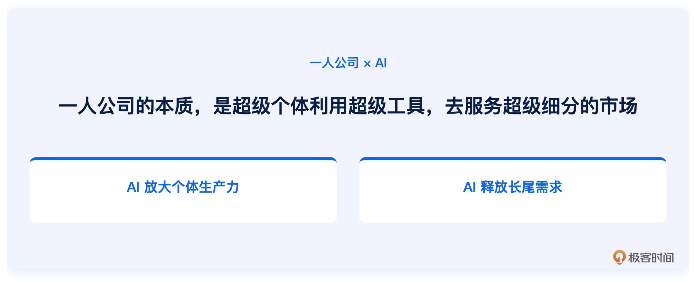
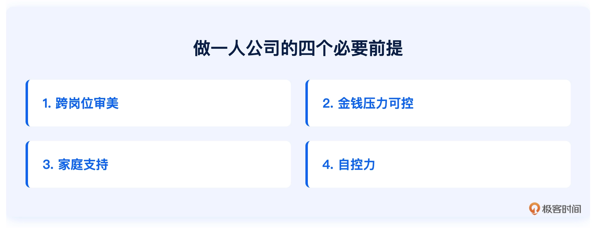

# 01 | 底线：做一人公司的必要条件是什么？

你好，我是孙志岗。这节课我们来聊聊什么样的人适合做一人公司。

其实大多数人是不适合做一人公司的，这节课就是帮你判断，你是不是那 10% 适合做一人公司的少数人。这不是贩卖焦虑，反而是帮你避免用错误的方式消耗自己。下面咱们就一层一层拆开看，最后你会收获一个可落地的自检模型。

## OPC 创业的目标是怎样的？

- Sam Altman, OpenAI CEO“I think there will be a one-person company that reaches a billion-dollar valuation.”“我认为，将会出现一家估值十亿美元的一人公司。”

你看到了吧，OpenAI 的 CEO 都看好一人公司能做到十亿美元估值，是不是听完心潮澎湃？但我要给你泼一盆清醒的冷水：十亿美元市值就是小概率事件。

你知道现在最出圈的一人 AI 项目 OpenClaw 吧？它算是目前最成功的一人公司项目了，但这个项目根本没有被资本定价，最后创始人 Peter Steinberger 是以员工身份加入了 OpenAI，靠OpenAI 的资源继续支持这个项目。你别以为他是普通人撞了大运，他可不是凡夫俗子——哪怕没有名校大厂标签，人家第一个创业公司 PSPDFKit 就已经被 1 亿欧元收购了。

所以说，随着一人公司成为新的职业和商业形态，咱们大多数人的务实目标，根本就不是追什么“独角兽”，而是 “体面的收入 + 高自由度 + 可持续”。实现这三个目标，已经是非常棒的结果了。

## 做好 OPC 的核心基础是什么？

值得一提的是，OpenClaw 的出现以及大模型能力的持续提升，让这个目标的可行性高了很多。 通过 OpenClaw 这类个人助理，可以实现 2 倍、甚至 10 倍以上的个人生产力放大。咱们这门课，讲的就是如何抓住这样的机会。

下面我给你一个可落地的自检量表，你可以对照着去看。

咱们来拆一拆这句话，你就明白这几年一人公司能起来，根本离不开 AI 这个东风。

AI 放大个体生产力，说白了就是把咱们个人的能力边界给扩大了：一方面你自己擅长的领域，AI 能帮你把产能提上去；另一方面，过去你做不了的跨领域工作，比如程序员要做海报、写文案，咨询师要做视频剪片，现在靠 AI 就能完成，不用再找别人合作。

AI 释放长尾需求，这些个性化的需求其实一直都存在，只不过过去服务单个客户的成本太高，根本赚不到钱，所以没人做。现在 AI 把服务成本压下来了，这些原来没法被满足的需求，就变成了咱们一人公司能做的市场增量。

说到这，你应该感受到：AI 是现在做一人公司的基础，用好 AI 自然就成了一人公司的必要条件。

## OPC 的必要条件有哪些？

但很多人都没意识到，用好 AI 的前提是什么？是你得能判断 AI 产出的东西到底能不能用啊！不管你指挥 AI 做什么，你都得有这个相关领域的审美能力，知道什么是好，什么是坏。

我把这句话说透：拥有跨不同领域、岗位的审美能力，是做一人公司的必要条件。但记住，这还不是唯一的条件。

从我的经验来说，做一人公司，这四个条件里只要任何一条不满足，你都一定要慎重。

### 1. 跨岗位审美

如果你一直只深耕一个岗位，不具备其他岗位的审美能力，我劝你先把这一步当作训练期，别急着押上全部做一人公司。

结论先给你放在这：AI 不会拉平人与人的差距，它会放大审美差距。用好 AI 的必要条件，就是你能判断 AI 产出的好坏。

你会写代码，咱们拿你熟悉的场景举例子。

正例就是，AI 给你生成了一篇项目介绍文案，你能看出来：逻辑是对的，但行文节奏不对，面向用户的内容太技术化，信息密度太高，不够口语化，不够吸引普通人，你能自己动手修改迭代到能直接发布使用，这就是合格的审美能力。

那反例呢？AI 给你生成了文案、做出来宣传海报，你觉得看起来像模像样，就直接拿去用了，把“看起来像成果”真的当成合格成果，结果花了一堆时间推广，转化差到离谱，还不知道问题出在哪，这不就是在错误方向白白消耗吗？

运作一家一人公司，无时无刻都需要你做决策和判断。没人能做到所有决策都做对，但如果大多数决策都做错，那肯定是非常危险的。

### 2. 金钱压力可控

如果 6 ～ 12 个月没有稳定收入你就会显著焦虑，那我建议你先选更稳定的路径。

焦虑会让动作变形、判断失误、急于求成，直接拉低成功率。

这种时候，找个稳定的工作，哪怕收入比你预期的少一些，但你心里踏实，比硬撑着开公司重要太多了。

### 3. 家庭支持

如果家人不支持，或者你们目标不一致，一定要先统一认知，否则很可能会在关键节点崩盘。创业者本来就是孤独的，一人公司创业者更是孤独到骨子里，当你遇到挫折、迷茫甚至失败的时候，家庭就是你唯一的支撑。没有这个支撑，很容易就撑不下去。

### 4. 自控力

如果你的自控力不足，上班的时候都做不好时间管理，那做一人公司只会把这个问题放大。做一人公司没有领导管你，没有 KPI 逼你，缺少外部监督，就必须靠你自己的自律建立工作系统，否则只会天天摸鱼，最后一事无成。

如果这四个条件你都满足，那你完全可以放心大胆地开始做一人公司。哪怕最后不成功，也不至于落到自我否定、家庭纠纷、扛不住生存压力的地步。但凡有不满足的，还是要三思而后行。

当然，不具备的条件也不是完全没有办法弥补，这门课后面会给你分享很多具体的经验，但现学现用补短板，本身就不是一件简单的事，你要做好心理准备。

我也不要求你今天就做决定，你可以跟着课程继续往下走，慢慢了解做一人公司的乐趣和挑战。

最后给你留个小作业，找家人聊聊做一人公司的可能性，不用急着出结论，先听听家人有什么顾虑和担心，接着跟着咱们的课，慢慢找答案就行。

## AI 师傅在线答疑

以上是我们这节课的主要知识点，关于一人公司，你或许还有很多疑问，而且每个人的情况也不同，因此我这边特别准备了一个在线学习和互动的 AI 师傅，他可以根据你的提问，个性化生成相关内容，欢迎互动体验！

点击召唤 AI 师傅：https://app.ai-shifu.cn/c/742058fcf44f4a0b975538073811150c

## 特别说明

- 因「AI 师傅」增值服务涉及 LLM 成本问题，故仅限「单课付费用户」免费享有该增值权益，先进群领取兑换码：http://gk.link/a/12I13

- 兑换码使用方式：http://gk.link/a/12I1g

- 「VIP 用户」仅享有免费学习课程权益，不享有该增值权益，可通过链接单独购买：https://app.ai-shifu.cn/c/742058fcf44f4a0b975538073811150c
