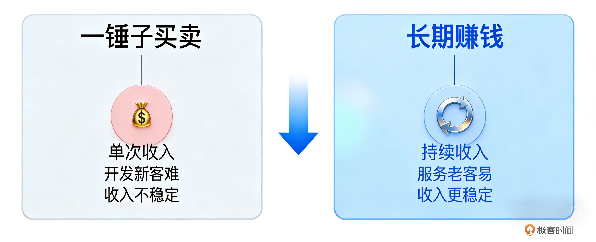
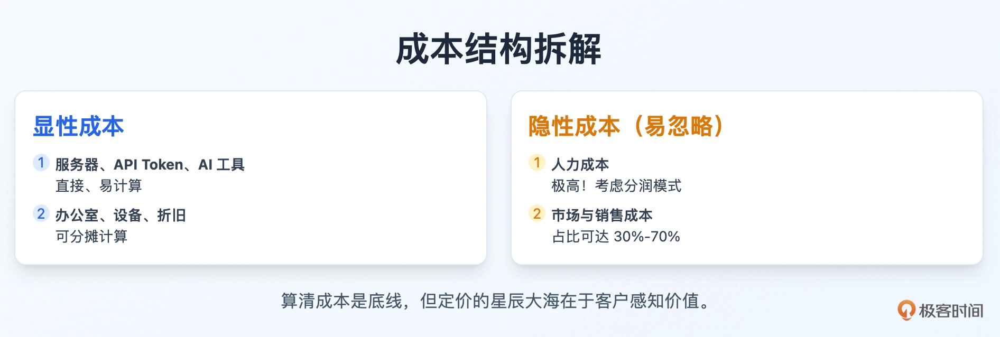

# 04 | 赚钱：如何设计收费模式？

你好，我是孙志岗。这节课我们来聊一个特别关键的事儿——找到了真需求，产品也做出来了，怎么才能把钱赚得更多、更久？

你有没有想过，卖同样的东西，收费模式设计的不同，能赚到的钱差别会非常大。这就像同样是卖水，有人摆摊按瓶卖，有人搞了个月卡送水上门，还有人直接给企业建了套直饮水系统。模式一变，天地就宽了。

## 模式选择

咱们先来看第一层：你做的这件事，是一锤子买卖，还是能长期赚钱的？

你看这张图，左边是“一锤子买卖”，像是一次性的网站开发、某个特定的营销方案设计。右边是“长期赚钱”，比如持续的软件订阅、年度顾问服务、内容代运营。

发展新客户是很难的，就像大海捞针；而能长期服务固定客户，那是非常幸福的，就像有了自家的鱼塘。所以，如果咱们的服务有长期复购的可能，千万别傻傻地每次购买单独算钱。要签长期服务合同，把收入中断的风险降到最低。

这就引出了咱们的第一个金句：订阅式付费，永远好过项目式、单次付费。卖会员，好过卖一次服务。咨询服务签年包，好过每次计价。你想，做软件 SaaS 的，按月收钱；做企业培训的，签年度服务框架；哪怕你是做视频剪辑的，也可以推出“月度内容合作伙伴”套餐，而不是按单个视频报价。这不仅仅是收入稳定，更是把客户关系从“交易”变成了“伙伴”。

但是，咱也得实事求是。有些事情注定就是一锤子买卖，比如帮人做一次性的数据迁移、设计一个 logo。这时候，就别刻意为难自己，非要追求长期赚钱。有收入，就比没收入好。先把这一锤子买卖做好，做出口碑，它也可能成为你通向长期生意的敲门砖。

## 定价法则

好，确定了收费的“节奏”，接下来咱们攻破最让人头疼的难题：定价。

很多人的第一反应是什么？是基于成本定价。我花了 100 块成本，加上我想赚的 50 块利润，那就卖 150。听起来很合理，对吧？但这是典型的“生产者思维”。最合理的定价方式，其实是基于客户愿意出多少钱。

客户的心理价位是被谁锚定的？是被市场上他看到的同类产品锚定的。所以，调研市面上的价格，是定价前的必修课。你可以“扮演”成客户，去问问竞争对手的报价。这个过程一举三得：摸清了价格水位线，学习了人家的产品是怎么包装的，还顺便偷师了销售的话术技巧。

这时候，很多人会掉入第二个陷阱：“我比别人便宜，就好卖”。真的吗？

咱们分情况看。如果你的客户是个人用户，比如卖一个知识付费课程、一个 C 端小工具，他们对价格通常比较敏感，“便宜”可能是个优势。但如果是企业客户，他们更在意的是什么？是能不能达成效果，能不能解决问题，能不能降低风险。为了确保成功、降低自己的风险，企业是愿意支付更高溢价的。一个更高的价格，有时本身就是一种信心的体现，一种价值的承诺。而且，拿到更多的利润，咱们才有充足的弹药，把产品和服务做得更好，形成正向循环。

那如果咱们做的东西市面上根本没有，是创新产品，没有参考价格怎么办？这时候，就看咱们能给客户带来多大的价值。咱们来算笔账：比如你开发了一个 AI 工具，每月能为客户节省 10个小时的人工，这 10 个小时如果按市场价值 1000 元。那么，你每月收他 300 元，客户会觉得非常划算，接受度很高。如果你只收 100 元，那对客户来说简直是“超值”，对你来说可能就是“血亏”了。所以，定价的锚点，可以从“成本”转向“客户价值”。

## 成本核算

当然，咱们不是慈善家，定价不可能完全不考虑成本。把自己的成本算清楚，是底线思维。

这张图把成本分成了两类。左边是显性成本，像服务器、API 调用费、各种 SaaS 工具订阅，这些都好算。办公室租金、设备折旧，也能摊算进去。关键是右边这些隐性成本，很多人会忽略。

第一，人力成本往往是最贵的。对于一人公司或者小团队，如果可能，我强烈建议你考虑按比例分润的合作模式，而不是支付固定工资。你请一个全职设计师，每月固定支出两万，项目没收入你也得付钱，风险全在你身上。但如果你和一个设计师谈好，这个项目利润的 20% 归他，你们就是风险共担的伙伴。他的工作积极性会完全不同，因为项目赚得多，他分得也多。这是把“雇佣军”变成了“同盟军”。

第二，千万别忽略市场和销售成本。你以为产品做出来就有人买吗？酒香也怕巷子深。获客成本可能高得吓人。这部分的比重，根据行业和产品不同，可能占到 30% 到 70%。你定价1000 块的产品，可能 300～700 块都要花在让客户知道并愿意买它上面。不算这笔账，你的利润就是空中楼阁。

## 实用技巧

聊了这么多，你可能会觉得商业模式设计太复杂。没关系，咱们还有个超级外挂：多和 AI 讨论一下。

你可以把你的产品形态、客户画像、成本结构喂给 AI，让它帮你模拟不同的定价策略和收费模式会带来怎样的财务表现。它就像一个不知疲倦的商业顾问，能给你提供无数你没想到的视角。

最后，送你一个非常实战的 tips，特别是针对项目制、需要多轮付款的情况：一定要确保首付款至少能打平你的直接成本，甚至要包含一部分利润。为什么？因为尾款想追讨起来，太难了。客户可能会拖延、会挑剔、甚至会倒闭。如果首付覆盖了成本，哪怕尾款收不回来，你也不至于亏本。如果首付还能有点利润，那这个项目你已经立于不败之地了。这就像古代打仗，“兵马未动，粮草先行”，你的首付款就是你的粮草。

## 总结

咱们今天从“一锤子买卖还是长期赚钱”的节奏选择，谈到“基于客户价值而非成本”的定价心法，再到底线思维的成本核算，最后是首付款的黄金法则。商业模式的设计，就像给咱们的生意设计一个精密的发动机。收费模式是气缸，决定动力是否持续；定价是燃油和压缩比，决定动力有多强；成本控制是散热系统，保证别把自己烧坏了。

记住，赚钱的逻辑，比赚钱的动作更重要。设计好模式，你就能从“挣辛苦钱”升级到“挣模式的钱”。用你的商业智慧，去架构一个更轻松、更持久的赚钱系统。这才是咱们一人公司创业者，应该追求的高级境界。

## AI 师傅在线答疑

以上是我们这节课的主要知识点，关于一人公司如何设计收费模式，你或许还有很多疑问，而且每个人的情况也不同，因此我这边特别准备了一个在线学习和互动的 AI 师傅，他可以根据你的提问，个性化生成相关内容，欢迎互动体验！

点击召唤 AI 师傅：https://app.ai-shifu.cn/c/742058fcf44f4a0b975538073811150c

## 特别说明

- 因「AI 师傅」增值服务涉及 LLM 成本问题，故仅限「单课付费用户」免费享有该增值权益，先进群领取兑换码：http://gk.link/a/12I13

- 兑换码使用方式：http://gk.link/a/12I1g

- 「VIP 用户」仅享有免费学习课程权益，不享有该增值权益，可通过链接单独购买：https://app.ai-shifu.cn/c/742058fcf44f4a0b975538073811150c
