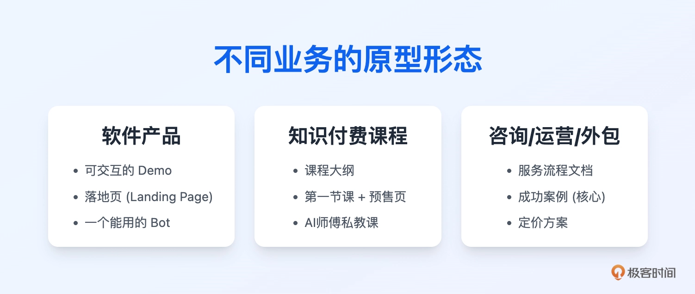

# 05 | 原型：如何验证市场？

你好，我是孙志岗。这节课我们来聊聊如何验证市场。

咱们前面聊了找真需求的两种手段：调研和原型验证。调研解决的是“我假设的需求是真的吗？”这个问题。但你想过没有，调研有个致命的局限，客户嘴上说的，和他们实际会做的，往往是两回事。这就好比，你问朋友“想不想减肥”，十个有九个说想，但你真拉他去健身房办卡，他可能就有一百个理由推脱了。

所以，调研问的是“想不想”，而原型验证，逼问的是“会不会”。

## 什么是原型？

原型是用最低成本，获取最真实的市场反馈。

这句话，就是咱们今天这堂课的灵魂。你得把它刻在脑子里。原型不是产品，不是你的心血结晶，它只是一个验证工具。它的使命，就是在你投入海量时间、金钱和感情之前，帮你探探路，看看前面是金山还是悬崖。

那么，做一个原型之前，你必须先明确一个核心问题：你到底要验证什么假设？

别急着动手。先坐下来，拿张纸，把你心里那些“我觉得”都写下来。常见的假设无非这几种：

- 客户真的有我说的这个需求吗？（需求存在性）

- 他们愿意为这个需求掏钱吗？（付费意愿）

- 我设计的这个解决方案，真的能解决他们的问题吗？（方案有效性）

- 他们愿意用我提供的这种方式来解决问题吗？（方案接受度）

你看，每一个假设，都是一道生死关。原型，就是帮你闯关的侦察兵。

## 如何玩转原型？

好，咱们现在就来看看，每一种业务具体怎么玩转原型。

先说软件产品。传统做法是画个原型图让客户“看图说话”，或者做个宣传页看有没有人注册。这有用，但还不够“真”。有个很经典的例子，Plaud 那个会议纪要录音卡，最开始创始人怎么验证的？他自己装成 AI，手动给早期用户写会议纪要！结果发现真有人愿意付费，这才坚定了做下去的信心。你看，这就是“行动验证”的极致。

但现在 AI 时代了，咱们的工具强大了太多。用最低成本做出一个“能跑”的原型，变得前所未有的简单。

- Vibe Coding（氛围编程）：这是最直接的选择。把你的想法用自然语言告诉 AI，让它帮你生成代码。别追求完美，别纠结架构，核心就一个：确保主功能在正常操作下是可用的。可能几天，甚至几小时，一个能点、能输入、能看到反馈的 Demo 就出来了。这就是你的“侦察兵”。

- 零代码平台（Coze、Dify）：如果你的产品核心是 AI 工作流、智能体，那用这些平台搭原型再合适不过。它们本身就是为快速构建 AI 应用设计的，有些产品甚至服务端就直接跑在Coze 或 Dify 上。原型验证成功，直接升级为正式产品的一部分。

- OpenClaw Skill：如果你在 OpenClaw 生态里，那更简单。快速写一个 Skill 原型，让有限的用户试用，收集反馈。效率极高。

再来看知识付费课程。这里要分高客单价（几千到上万）和低客单价（几十到几百）。

高客单价大课，比如线上直播训练营、线下私房课。它的原型是什么？不是完整的课程内容，而是“购买理由”的具象化。

用 AI 生成一张精美的课程介绍长图，或者一个简单的预售页面。里面必须包含：课程为谁解决什么问题、核心大纲、讲师背书，以及最重要的是一个低价试听课的报名入口。

这个长图或页面，就是你的原型。把它扔到潜在用户聚集的地方。如果有人愿意为这个“介绍”付一个试听课的钱，哪怕只有 99 元，这就强力验证了需求的存在。你甚至可以通过报名转化率，量化需求的强弱。试听课本身不能糊弄，必须认真准备，让学员觉得超值，愿意付全款。但完整的几十节课程内容，完全可以在收到足够多订单后再投入制作。这叫“以销定产”。

低客单价小课，比如视频录播课、图文专栏。这类课程的原型，要求就高一些了。因为客单价低，决策快，用户需要看到更实在的东西。

通常，你需要准备好完整的课程大纲和前几节正式内容（视频得录，图文得写）。这部分工作量省不了吗？以前省不了，但现在有个“作弊器”——用 AI 师傅做课。你只需要提供核心知识体系和授课思路，AI 师傅就能根据每个学习者的背景、进度、问题，进行个性化教学。如果你使用 OpenClaw 的 Skills 来制作，更能把课程制作的时间节省十倍以上。你制作的其实是一个“课程生成器”原型，验证的是市场对这种新型学习方式的接受度。

最后，说说咨询、代运营、外包这类非标服务。这是很多一人公司起步的领域。它的原型，不是文档，是案例，是口碑。

方法简单粗暴：找到 1-2 个愿意配合的早期客户（可以朋友、前同事），提供免费或极低价格的服务。

但有两个关键条件：第一，允许你完整复盘并写成案例；第二，允许为你做转介绍。

你的“原型”就是这个案例报告，它要清晰展示：

- 客户最初面临的具体困境是什么？（问题）

- 你具体提供了哪些服务动作？（过程）

- 服务后取得了什么可量化的结果？（效果，如成本降低 20%、效率提升 30%）

- 客户有什么样的评价和反馈？（证言）

这个真实的案例，就是你最强有力的销售武器。潜在客户看到别人实实在在的收获，信任门槛会大幅降低。对于非标服务，原型验证没有捷径，就是用一次实实在在的交付，来证明你的价值。

## 原型验证结果不好怎么办？

讲到这里，你可能会问：如果原型验证结果不好怎么办？没人用，没人买，反馈冷淡。

那我得说：恭喜你！

这不是风凉话。你真的应该庆幸。你只用了几小时、几天、最多几周的成本，就避免了一个可能让你浪费数月甚至数年生命的坑。快速失败，等于快速学习。

接下来，不是沮丧，而是冷静分析：是需求不真？解决方案不对？定价太高？还是推广渠道错了？根据分析，快速调整你的原型，换一个角度再验证一次。或者，果断放弃，寻找下一个方向。一人公司最大的优势就是船小好调头，你必须把这个优势发挥到极致。

快速失败 = 快速学习 = 快速找到对的方向

## 总结

回顾一下核心。调研是“听其言”，原型是“观其行”。在创业这场充满迷雾的航行中，原型就是你最可靠的声呐。它不保证你找到宝藏，但它能帮你避开冰山。

别再沉迷于构思一个完美的产品了。把你最核心的那个假设揪出来，用最低成本、最快速度，做一个能让市场“行动”起来的原型。让真实的用户行为，告诉你下一步该往哪走。

记住，一人公司的战斗，不是比谁的计划更完美，而是比谁的验证循环转得更快。

## AI 师傅在线答疑

以上是我们这节课的主要知识点，关于一人公司如何通过原型验证市场，你或许还有很多疑问，而且每个人的情况也不同，因此我这边特别准备了一个在线学习和互动的 AI 师傅，他可以根据你的提问，个性化生成相关内容，欢迎互动体验！

点击召唤 AI 师傅：https://app.ai-shifu.cn/c/742058fcf44f4a0b975538073811150c

## 特别说明

- 因「AI 师傅」增值服务涉及 LLM 成本问题，故仅限「单课付费用户」免费享有该增值权益，先进群领取兑换码：http://gk.link/a/12I13

- 兑换码使用方式：http://gk.link/a/12I1g

- 「VIP 用户」仅享有免费学习课程权益，不享有该增值权益，可通过链接单独购买：https://app.ai-shifu.cn/c/742058fcf44f4a0b975538073811150c
