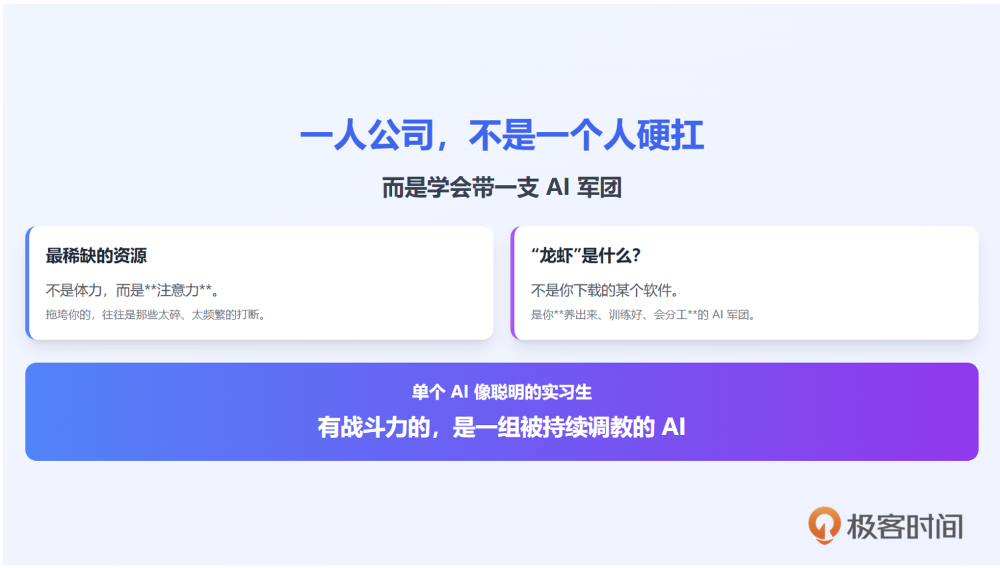
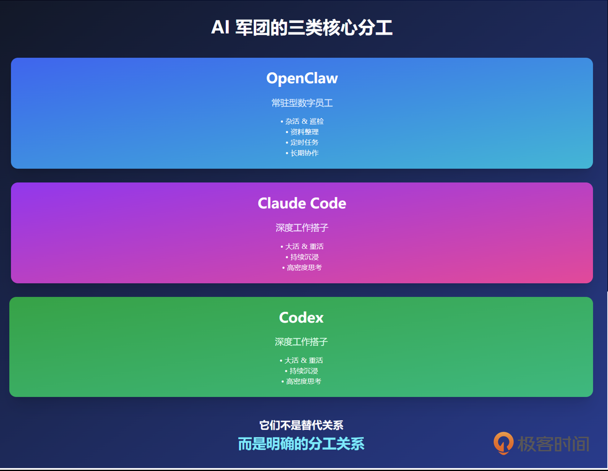
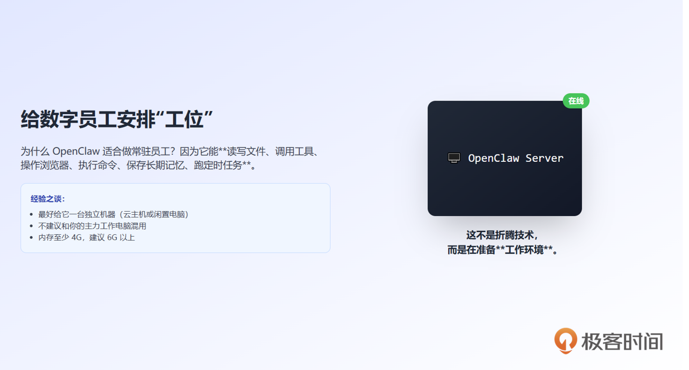
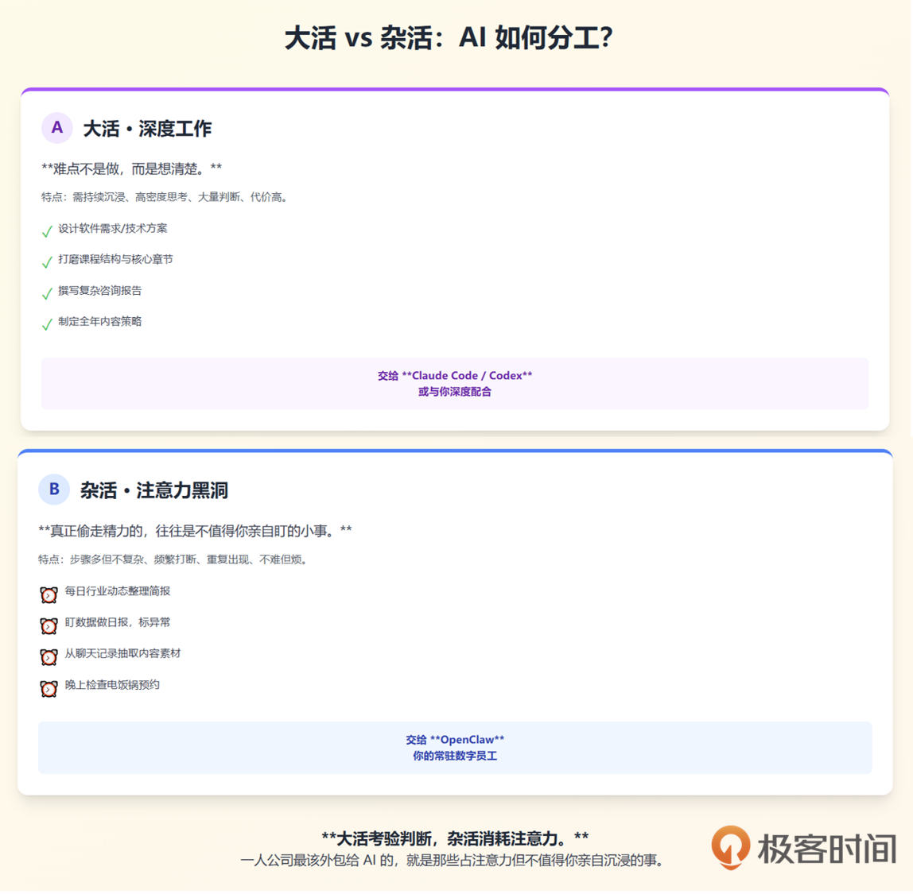
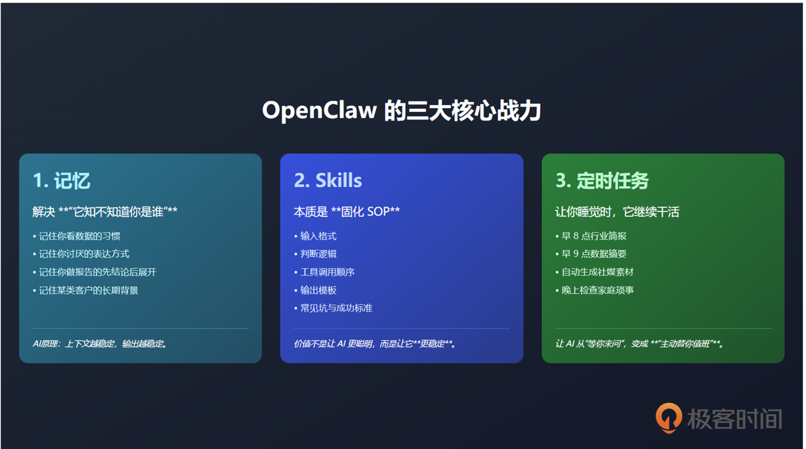
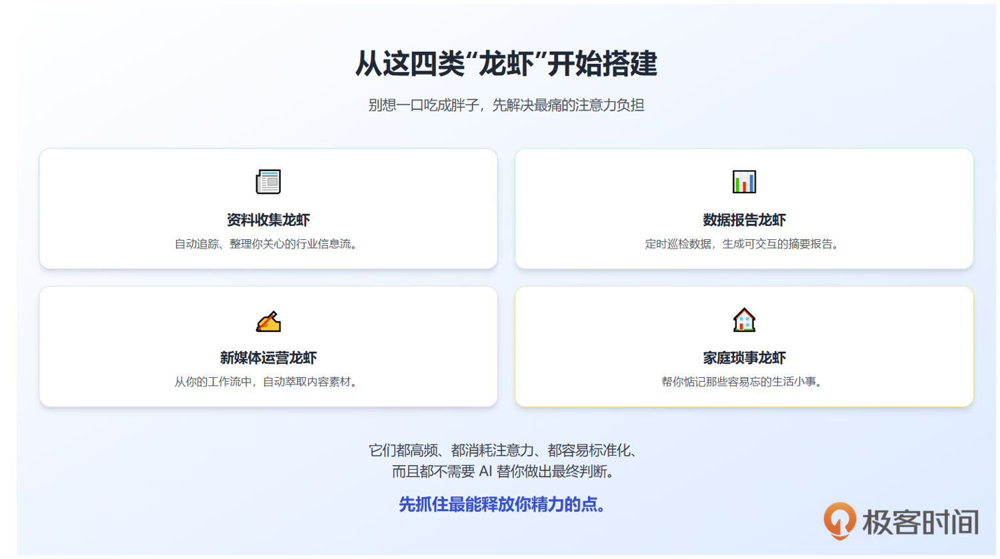
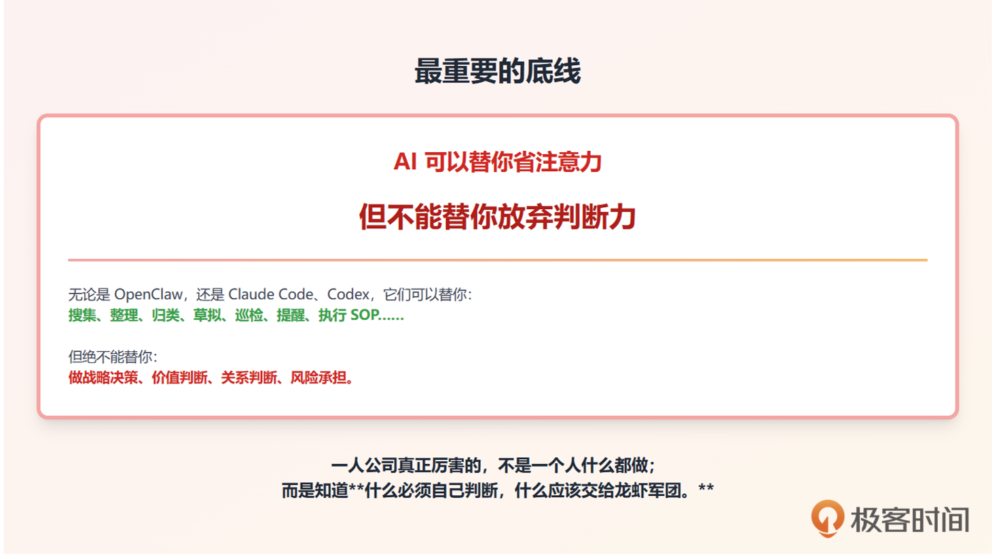

# 08-龙虾：如何打造AI军团？

你好，我是孙志岗。这节课我们来聊聊如何打造 AI 团队。

你有没有想过，一人公司真正的瓶颈在哪里？咱们都以为是自己时间不够、精力不足，对吧？但真相往往是，真正把人拖垮的，往往不是某件特别难的事，而是事情太多、太碎、太频繁地打断你。你的注意力，就像一块被反复撕扯的布，最后稀碎，什么都干不成。

所以这一节，咱们不聊具体哪个 AI 工具好用，咱们要聊的，是一种新的组织能力：一人公司不是一个人硬扛所有事，而是要学会带一支 AI 军团。这支军团，在咱们课程里，有个形象的比喻，叫“龙虾”。重点不是工具界面长什么样，而是你怎么训练它、怎么给它分工、怎么让它为你所用。

给你一个核心判断：单个 AI 更像一个聪明的实习生；而一组分工明确、被持续调教过的 AI 才是真正有战斗力的“员工”。 一个聪明的实习生确实能帮你完成一些任务，但一群训练有素、各司其职的“员工”，才能帮你打下一片天。

## AI 军团怎么搭建？

咱们要打造的 AI 军团有三个角色，我们先来拆解这三类角色。后两个，Claude Code 和Codex，很多人一听就觉得是程序员用的。没错，它们编程能力很强，但它们的本质，是很强的通用深度工作搭子。它们适合拿大活、重活，需要你持续沉浸、高密度思考的活。这个咱们稍后细说。

而 OpenClaw，是咱们这节课的重点。你千万不要把它理解成“又一个 AI 聊天软件”。它的定位完全不同：它更像一个可以长期协作、可以接工具、可以被训练、可以安排定时工作、可以沉淀工作方法的数字员工。

## OpenClaw：你的数字员工

这里我要给你植入一个至关重要的观念：把 OpenClaw 当成一个人去用，而不是当成一个工具去用。你怎么管理员工，就怎么对待 OpenClaw。管理一个员工，你肯定不会只对他下命令，你得培养他、教育他、给他反馈、纠正他的偏差、给他明确分工、设定清晰的边界。对OpenClaw 也是一样。

你如果只是临时丢过去一句话，“帮我弄一下这个”，那它就只能像个临时工，干完拉倒，下次还得从头教。但如果你告诉它你的偏好、你的标准、你的工作习惯，并且让它记住、复用、迭代，它才会越来越像一个熟悉你的老助手。

这背后其实是 AI 的底层原理。AI 本质上是概率模型，它不是一台绝对正确的机器。你教得越清楚，它做对的概率就越高；你给的背景越充分、标准越明确、反馈越及时，它就越容易越来越“懂你”。所以，教育 AI 不是玄学，而是在提高正确率。

举个例子，你可以这样“教育”你的 OpenClaw：

- “以后给我做行业简报，先写结论，再写新增变化，最后写值得追问的问题。”

- “我不喜欢空话套话，少讲概念，多给具体的动作建议。”

- “以后碰到这类任务，你先给个初稿，不要替我做最终判断。”

这和你带一个新人的逻辑是一模一样的。OpenClaw 也是一样，它需要被“养成”。

### 给数字员工安排工位

有了 OpenClaw，你就有了一个不会抱怨、不会下班、但需要你教会它的数字员工。正因为OpenClaw 这么能干，它会在后台长期运行，吃内存、吃资源。一人公司可不是只有你一个人在干活，所以咱们最好给它提供一个独立的“工位”。你可以用一台闲置的旧电脑，或者买一台轻量级的云服务器。给 OpenClaw 配机器，不是在装软件，而是在给数字员工安排工位。

### 给数字员工报酬

有了工位，接下来就是报酬。OpenClaw 需要进行模型配置。如果你真的把 OpenClaw 当成长期、高频使用的数字员工，那么完全按 API 调用次数付费，成本可能会很高。因为它不是偶尔回答一两个问题，而是可能每天都在跑任务、整理资料、读写上下文、做定时巡检、接收你的追问。

所以，在高频场景下，包月套餐通常更划算。海外可以优先考虑 OpenAI 的套餐；国内可以考虑 GLM、Kimi、MiniMax 等提供的类似 Coding Plan 的包月服务。别把这当成比价，这是一个经营判断：偶尔用用，API 没问题，像雇零工；但如果是长期养一个员工，包月更像发固定薪水。用句大白话说：你要是真让它上岗，就别总让它打零工。

## 工作任务怎么分配？

什么叫“大活”？不是说工作量巨大，而是指这件事需要你持续沉浸、需要大量的判断、需要很高的思考密度。比如，你要连续专注半小时甚至几小时，不能频繁被打断，中间要做各种权衡、设计和判断，而且一旦做错，代价比较高。大活的难点，不是做，而是想清楚。无论是设计一个软件产品的完整需求，还是打磨一门课的核心价值主张，或者是为客户梳理复杂的 AI转型方案，这类工作都需要你进行深度思考。

那“杂活”呢？杂活不等于低价值，而是低密度思考。它步骤多，经常重复出现，特别容易频繁跳出来打断你的注意力。干起来不难，但就是烦人。比如，每天追踪行业动态并整理成简报；

盯着产品数据做日报，标出异常；从一堆会议纪要、笔记、聊天记录里抽取可以发社交媒体的小素材；甚至是每天晚上检查一下小米电饭锅是不是已经预约好了明早的粥……这些事会偷走你的精力，它们往往不是难事，而是不值得你亲自持续盯着。

OpenClaw 擅长连接与调度，能把不同的工具（网页、API、本地软件、数据源）像乐高一样拼接起来，形成一个自动化的工作流。它可以不知疲倦、7x24 小时的执行，没有情绪，不会抱怨。而且绝对可靠，只要规则设对，每次执行都完全一致，避免人为疏忽。一旦配置完成，它就像你雇佣了一个绝对靠谱的数字助理，你再也不需要把这件事放在待办清单里，心智负担彻底归零。能够完全解放你的注意力。OpenClaw 是处理“已知的、重复的、多步骤琐事”的完美解决方案。 它把你的 SOP（标准作业程序）固化成了数字资产。而杂活的规则是可以被清晰描述的。OpenClaw 的配置过程，就是你把人类执行的“隐性经验”转化为机器可执行的“显性规则”。可以完美的承担这个工作。

Claude Code 和 Codex 的核心能力是理解、推理与生成。它们拥有强大的自然语言理解能力，能够和你进行多轮、复杂、充满假设和探索的对话。它能帮你拓展思维，提供你没想到的角度和技术可能性。对于非技术背景的创业者，它就像一个随身的 CTO，把复杂的技术概念用你能懂的方式解释，并实现出来。Claude Code 和 Codex 是处理“未知的、创新的、需要深度思考和设计”任务的绝佳搭档。 它放大的是你作为决策者和设计者的核心能力。大活之所以难，是因为开头往往只有一个模糊的想法。你需要一个能和你“脑暴”、能理解你含混表述、并能提出结构性建议的伙伴。Claude Code 和 Codex 刚好可以扮演这个角色

现在你明白分工了吧？OpenClaw 适合杂活，Claude Code / Codex 适合大活。

小结一下：大活考验判断，杂活消耗注意力。一人公司最应该外包给 AI 的，就是那些占注意力但不值得你亲自沉浸的事。

## OpenClaw 核心能力是什么？

现在，咱们深入到 OpenClaw 真正强大的三个实操核心：记忆、Skills 和定时任务。

第一，记忆。OpenClaw 可以把你的长期偏好、做事习惯、判断标准沉淀下来。告诉它“记住这个”，不是一个客套话，而是一个严肃的工作动作。比如，记住你分析数据时最关心哪几个指标，记住你不喜欢哪种浮夸的表达方式，记住你做任何报告都喜欢先抛结论再展开细节，记住某个重要客户的长期合作背景和雷区……AI 并不是突然有了灵性，而是因为你让它拥有了更稳定、更丰富的上下文。记忆，解决的是“它知不知道你是谁、你在意什么”。

第二，Skills。Skill 的本质，是把一件你经常重复做的事情，固化成标准作业程序（SOP）。它把输入应该是什么格式、中间需要做什么判断、按什么顺序调用哪些工具、最终输出用什么模板、过程中常见的坑是什么、成功的标准又是什么……全都固化下来。比如，固定格式的竞品资料收集、固定结构的数据分析周报、固定风格的公众号文章改写、固定步骤的新客户跟进流程。Skill 的价值，不是让 AI 更聪明，而是让它更稳定、更可靠。 这同样是“培养员工”的一部分：带人，也不是全靠口头交代，得把好方法沉淀成可复用的流程。

第三，定时任务。 这是 OpenClaw 最让人舒爽的一点：它能在你睡觉的时候继续干活。 想象一下：每天早上起床，一份整理好的行业简报已经躺在你的收件箱；一份重点突出的数据摘要等着你进一步追问；基于你昨天的笔记和产品数据，社交媒体发布的初稿素材已经生成；甚至它晚上还帮你检查了电饭锅预约，没约上就及时提醒你。这不是为了炫技，而是它让你每天醒来，就站在一个整理好的工作起点上。定时任务让 AI 从“等你来问”，变成“主动替你值班”。

## 搭建 OpenClaw 从哪里开始？

理论说完了，你可能有点懵，不知道从哪下手。别急，咱们不追求一上来就搞个特别复杂的AI 军团。你就先从下面这四类“龙虾任务”开始搭：

- 资料收集龙虾：帮你自动看新闻、看报告、看竞品。

- 数据报告龙虾：帮你盯产品数据、业务指标，自动生成日报。

- 新媒体运营龙虾：帮你从笔记、聊天、会议记录里挖内容灵感，甚至出初稿。

- 家庭琐事龙虾：帮你记着那些生活里琐碎但忘了就麻烦的小事。

为什么先做这四类？因为它们都符合几个特征：高频出现、特别容易偷走你的注意力、相对容易标准化、而且都不需要 AI 替你做最终的价值判断。咱们打造 AI 军团，不是为了追求酷炫，而是先替自己减掉真实的、沉重的注意力负担。

## AI 军团的重要底线

最后，也是整节课你必须刻在脑子里的价值观：AI 可以替你省注意力，但不能替你放弃判断力。 这是咱们使用任何 AI 军团的底线。

它可以成为你强大的手脚和感官延伸，帮你处理信息、执行流程、完成初稿、监控状态。但是，最终的拍板决策、价值权衡、人际交互、风险承担，必须牢牢握在你自己手里。一人公司真正厉害的，不是一个人什么都做；而是知道什么必须自己判断，什么应该交给龙虾军团去做。

好了，理论讲完了，该你动手了。给大家留个小作业：

1. 拿出纸笔，列出你最近两周里，最消耗你注意力、但又不需要太多深度思考的 10 件小事。

2. 从这 10 件事里，挑出 3 件，然后思考：

- 这件事能不能交给 OpenClaw 来做？

- 你需要教它什么样的标准和偏好？

- 它能不能被固化成一个固定的 Skill，或者设置成一个定时任务？

记住，打造你的 AI 军团，不是从学一堆复杂概念开始，而是从替自己减掉一份真实的注意力负担开始。现在就想想，哪件“杂活”最先让你烦心？就从它开始吧。

## AI 师傅在线答疑

以上是我们这节课的主要知识点，关于个人如何打造 AI 团队，你或许还有很多疑问，而且每个人的情况也不同，因此我这边特别准备了一个在线学习和互动的 AI 师傅，他可以根据你的提问，个性化生成相关内容，欢迎互动体验！

点击召唤 AI 师傅：https://app.ai-shifu.cn/c/742058fcf44f4a0b975538073811150c

## 特别说明

- 因「AI 师傅」增值服务涉及 LLM 成本问题，故仅限「单课付费用户」免费享有该增值权益，先进群领取兑换码：http://gk.link/a/12I13

- 兑换码使用方式：http://gk.link/a/12I1g

- 「VIP 用户」仅享有免费学习课程权益，不享有该增值权益，可通过链接单独购买：https://app.ai-shifu.cn/c/742058fcf44f4a0b975538073811150c
