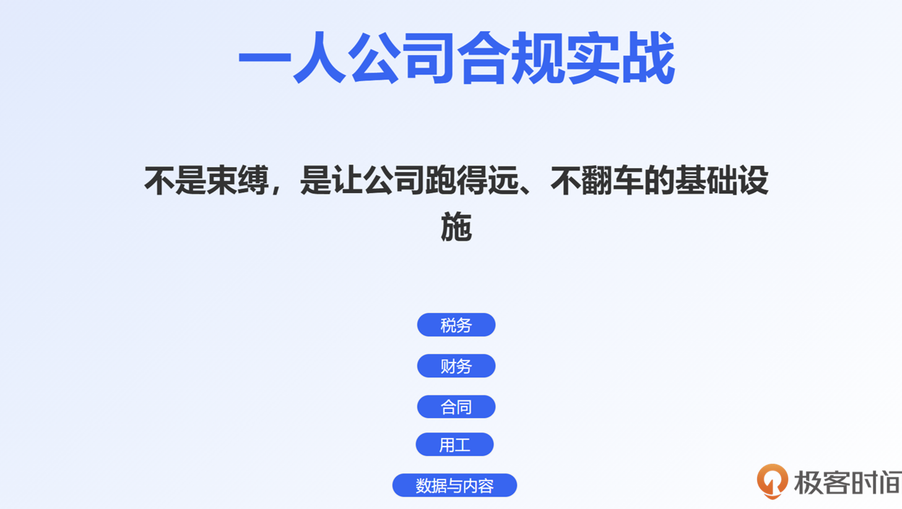
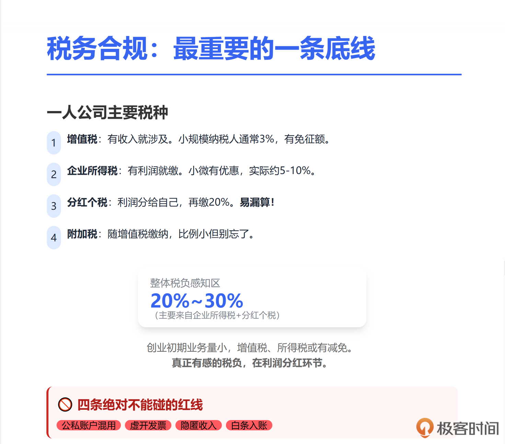
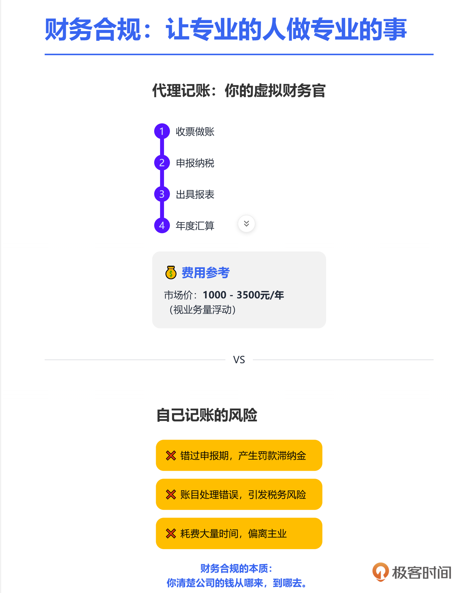
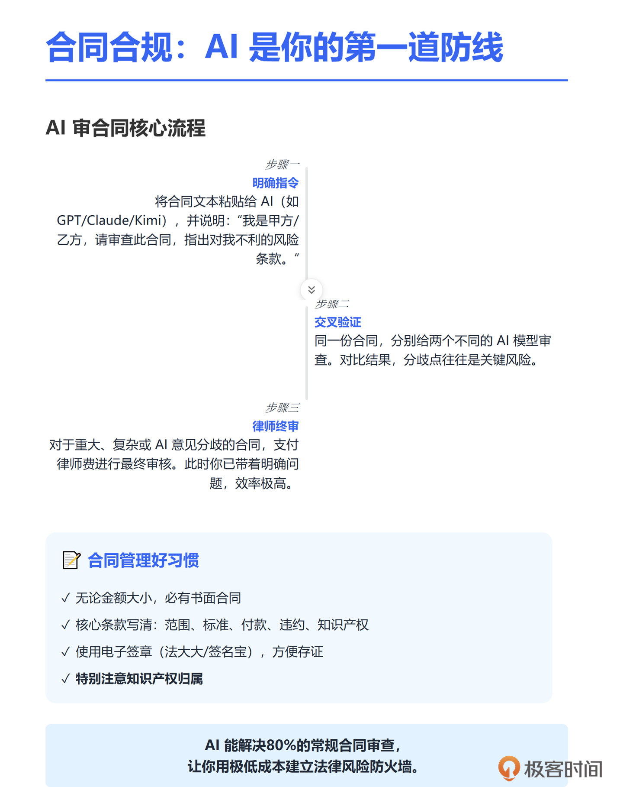
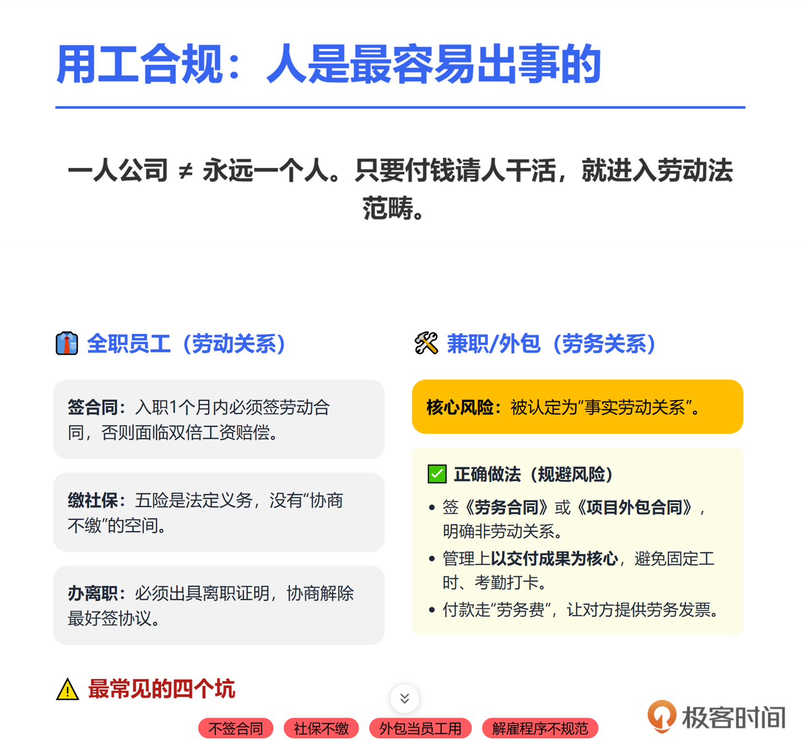
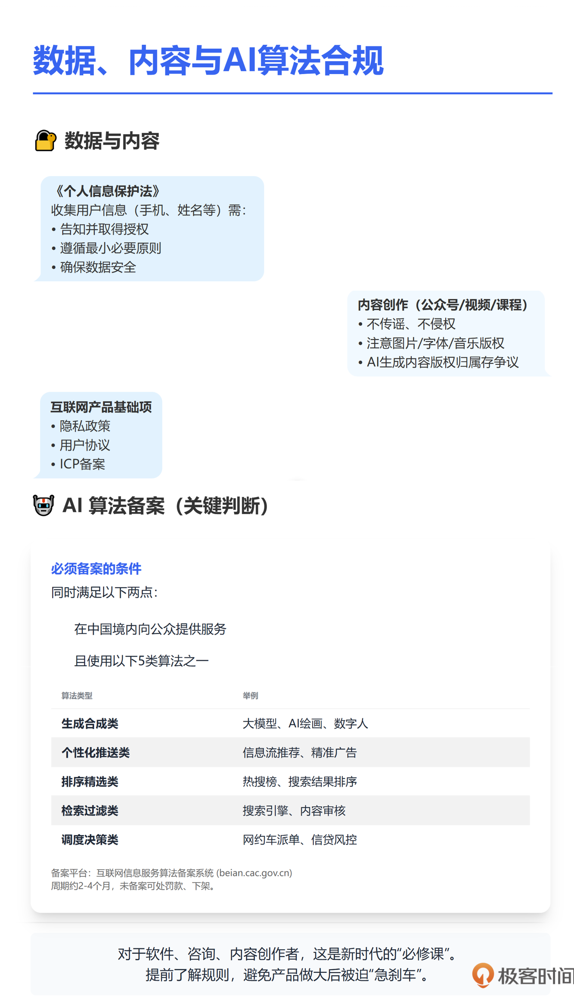

# 10-合规：如何搞好人、财、法？

你好，我是孙志岗。这节课我们来聊聊合规，如何搞好人、财、法。

你有没有过这种感觉？一提到“合规”，脑子里就蹦出一堆名词：税务、法务、合同、社保……感觉哪哪都是坑，但又不知道从哪下手，最后干脆想，我公司就我一个人，这么小，有必要吗？

很多创业者都有这个想法。但咱们换个角度想：正因为你是一个人，才更需要把合规的底子打牢。大公司有法务部、财务部、HR 部门，一个坑掉进去，可能只是部门间开个会。

但一人公司呢？所有风险，最终都精准地砸在你一个人身上。而且很多坑，不是你主动去踩的，而是你根本不知道那里有个坑。

合规，不是“不做坏事”，而是从一开始就用正确的方式经营，让公司能跑得远、不翻车。这是咱们今天要建立的第一个核心认知。今天就帮你把“合规”这两个字，从一团模糊的焦虑，变成一套清晰、能用、能上手的认知框架和行动清单。

## 合规的核心地基

那一人公司具体要合规哪些事？咱们把它拆解成四块核心地基：税务、财务、合同、用工。如果你的业务涉及做软件、搞内容、或者收集用户信息，那还有第五块：数据与内容合规。咱们一块一块来，先说最重要的税务。

## 税务合规

税务，是合规里优先级最高、最没有商量余地的一条。公司一注册成功，纳税义务就开始了。哪怕你第一个月一毛钱收入都没有，也必须按时去做“零申报”。你注意到没有？长期不申报，公司会被列入“非正常户”，到时候开发票、银行账户、甚至后续经营都会受影响。

对于咱们一人有限责任公司（注意，不是个体工商户），主要会碰到这几种税。增值税，只要你销售商品或提供服务，就涉及。好消息是，小规模纳税人税负不高，大概 3% 左右，而且月销售额低于国家规定的门槛（比如 10 万），还能享受免征。企业所得税，是公司有了利润才要缴。法定税率 25%，但对小微企业有大量优惠政策，实际算下来，税负可能在 5% 到 10% 之间。

这里有个很多人会忽略的“隐形税”——分红个人所得税。你想啊，公司赚了钱，那是公司的利润，缴完企业所得税后，剩下的税后利润，你想拿出来放到自己个人口袋里，这一步还要再缴一道 20% 的个人所得税。所以，公司账面上的利润，和你最终能拿到手的钱，是两回事。这是做预算和计算真实回报时，最容易漏算的一层成本。整体算下来，当公司开始稳定盈利后，综合税负（主要是企业所得税 + 分红个税）大概会占到利润的 20% 到 30%。创业初期业务量小，增值税、所得税可能都有减免，所以税负感知不强，但利润分红这个环节的税，是实实在在的。

税务上，有四条绝对不能碰的红线，我把它称为“一人公司的税务四大天条”：

1. 公私账户混用。这是最常见的坑。觉得公司是自己的，钱从左口袋到右口袋，无所谓。但在税务眼里，这叫账目不清，极易被认定为隐匿收入、逃避纳税。

2. 虚开发票。这不仅仅是违规，是刑事风险。红线中的红线。

3. 隐匿收入。现在金税系统有多厉害？你的银行流水、支付平台数据、甚至上下游企业的数据，都在交叉比对。想藏，很难。

4. 白条入账冲成本。没有合规发票，就不能作为合法凭证入账抵税。用收据、付款截图就想冲成本，税务不认。

税务是底线，必须亲自盯住原则，但具体操作可以托出去。这就引出了第二块：财务。

## 财务合规

对于绝大多数一人公司，我的建议非常明确：把记账报税这件事，交给专业的代理记账机构。这不是偷懒，而是最经济理性的选择。你算笔账，一个专职财务的月薪是多少？而代理记账一年的费用，通常在 1000 到 3500 元之间，取决于你的业务量和票据量。他们帮你做什么？按月或按季收票、做账、申报增值税、企业所得税、附加税，出具财务报表，年底再做汇算清缴。相当于你每年花两三千，雇了一个兼职的、专业的财务官。

那怎么找靠谱的？首先，别只盯着最低价。市面上有每月一百多甚至几十块的服务，那种通常只做最基础的录入，不帮你核对银行流水，不关注进销项匹配，更不会提醒你潜在的税务风险。出了问题，他们不负责，后果你自己扛。所以服务边界一定要说清楚，“包含哪些，不包含哪些”，比含糊的一句“全包”要可靠得多。

最靠谱的途径，其实是朋友推荐。看看你身边创业的朋友在用谁，效果怎么样。很多创业社区和园区也有对接好的资源，这种有背书的，通常更省心。

财务合规的本质不仅仅是给税务局一本账，更是给你自己一本“明白账”。你得清楚，公司到底有多少钱，钱从哪里赚来的，又花到哪里去了。这笔钱是利润还是负债？下个季度的现金流紧不紧张？清晰的财务，是你做一切业务决策的底气。所以，财务这块，核心是“托付”，找到靠谱的人，托付出去，然后你定期看报表，掌握关键信息。

## 合同合规

地基的第三块，是合同。这里有个好消息：AI 已经能成为你强大的合同助理了。

合同，是一人公司最容易忽视，但一旦踩坑就极其麻烦的领域。很多早期创业者，尤其是技术或内容出身的，觉得“谈好了就行”，合同“大概看看没问题就签”。但是你有没有想过，这个态度本身就是最大的风险？合同里一个模糊的交付标准，一个不对等的违约责任，一个归属不清的知识产权条款，未来都可能让你付出十倍百倍的代价。

但现在，时代不同了。像 GPT-4、Claude、Kimi 这类主流 AI，对于审查常规的商业合同，比如：服务合同、采购合同、合作协议、保密协议等，已经相当在行了。它们能快速识别出哪些条款是格式条款，哪些是对你方明显不利的，哪些地方存在模糊和风险。具体怎么做？很简单：把合同文本直接粘贴过去，然后给 AI 一个明确的指令：“我是这份合同的甲方（或乙方），请帮我审查其中可能存在的风险，并指出对我不利的条款。”几分钟内，你就能得到一份有重点、有提示的审阅意见。

更稳妥的做法，是多个 AI 交叉验证。比如，同一份合同，你分别扔给 Claude 和 GPT-4，看看它们给出的风险提示是否一致。如果两个 AI 在某一条款上意见分歧，那么这个地方，往往就是真正需要你高度警惕，甚至需要律师介入细看的“深水区”。AI 的作用，是帮你完成前面80% 的筛查和风险识别工作，把最后 20% 最复杂、最核心的问题交给专业的律师。这样效率极高，成本也可控。

合同管理的三个好习惯：

1. 无论合作金额多小，尽量有书面合同。

2. 核心条款必须清晰：服务范围、交付标准、付款时间和节点、违约责任、以及最重要的知识产权归属（你做出来的软件代码、课程内容、设计方案，到底归谁）。

3. 善用电子签章工具，比如“法大大”、“签名宝”，合法有效，还方便归档追溯。

## 用工合规

接下来是第四块，也是“人、法、财”里最容易出事的一环：用工合规。

一人公司，不代表所有事都必须你一个人干。当你业务增长，需要请人帮忙，无论是全职员工，还是兼职、外包。那一刻，你就进入了《劳动法》的管辖范围。劳动纠纷，是我见过对小微企业主最不友好、最耗心神的麻烦之一。成本高、周期长，而且往往带着情绪和舆论压力。这不是“赢了官司就完事”，而是“一旦被拖进去，就身心俱疲”。

如果你请的是全职员工，那么有几条硬性规定一定要记住：入职一个月内必须签订书面劳动合同，否则员工可以主张双倍工资。社保（五险）必须缴纳，这是强制义务，没有“协商不缴”这个选项。离职时，要规范办理手续，出具离职证明，如果是协商解除，最好签订书面的解除协议。

对于一人公司更常见的场景，是请兼职或外包。这里的核心风险，叫做“事实劳动关系认定”。什么意思？就是你虽然签的是劳务合同或合作协议，但如果你像管理员工一样去管理他，要求固定坐班时间、每天打卡、接受你的日常考勤管理，那么一旦发生纠纷，仲裁或法院很可能认定你们之间实际是劳动关系。一旦认定，你就需要补缴社保、支付经济补偿等，承担全职员工的全套责任。

那我们如何规避这种风险呢？关键点在于：管理方式上，必须与劳动关系有显著区别。签《劳务合同》或《项目外包合同》，明确约定是“劳务合作”或“项目承揽”。管理上，以交付成果为核心，不要规定固定的工作时间地点，不要打卡考勤。付款时，让对方提供“劳务费”发票，而不是做进工资表。记住，“外包”的本质是购买一个结果，而不是购买一个人的时间。

用工常见的四个风险：

1. 不签合同，全靠口头约定。

2. 为了“省钱”不缴社保。

3. 把外包人员当员工一样严格管理。

4. 解雇员工时没有保留证据、没有走规范程序。这些坑，踩中任何一个，后续的补救成本都远超当初的“节省”。

## 数据内容与 AI 算法合规

最后，如果你的业务涉及互联网、软件、或者内容创作，还有一块需要关注的：数据与内容合规。

如果你做软件产品、做咨询收集客户信息、或者做自媒体、知识付费，那么这一块就需要你额外关注。

数据合规，核心是《个人信息保护法》。简单说，如果你收集用户的个人信息，比如姓名、手机号、甚至行为数据，你必须：明确告知用户你收集什么、用来干嘛，并且要取得用户的单独授权。不能过度收集，收集了就要妥善保管，防止泄露。

内容合规，对于做公众号、短视频、课程培训的咱们来说，主要是版权和内容安全。别用未授权的图片、字体、音乐，别传播不实信息。

这里特别提一下 AI 生成内容：目前法律上，AI 生成物的版权归属还没有定论。如果你用 AI生成了大量内容用于商业发布，需要谨慎，最好能加入一定程度的、你本人具有独创性的加工。

最后，重点说一下 AI 算法备案。这是很多做 AI 应用、SaaS 工具的创业者会遇到的。什么样的产品必须备案？

记住一个关键判断：需要同时满足两个条件。

第一，你的产品在中国境内向公众提供服务（包括通过 API 对外提供能力）。

第二，你使用了规定中的 5 类算法之一。这 5 类算法是：生成合成类（比如你的产品用到了大模型生成文本、图片）、个性化推送类（比如做信息流推荐）、排序精选类（比如做榜单、搜索结果排序）、检索过滤类（比如做搜索引擎、内容审核）、调度决策类（比如做智能派单、风险决策）。

如果你的产品只是内部工具，或者完全部署在境外不给国内用户用，那就不需要备案。备案需要准备材料，在专门的备案系统提交，审核周期大概 2 到 4 个月。

如果该备案没备案，被查出来，可能会面临罚款、产品下架等处罚。所以，如果你做的业务涉及这些，在启动阶段就要把备案纳入规划，而不是等做大了再补课。

## 总结

咱们最后总结一下今天的内容。

- 税务，是生死线，必须亲自盯住原则，尤其是那四条红线不能碰，但具体操作可以委托给代理记账。

- 财务，是公司的仪表盘，托付给专业的人，但你得学会看报表。

- 合同，是风险的集中地，但现在有了 AI 这个强大工具，你可以用极低成本建立第一道法律防火墙。

- 用工，是人的艺术，更是法的边界，区分好“劳动关系”和“劳务关系”，能避免无数麻烦。

- 数据、内容与算法，是数字时代的新规则，提前了解，才能不踩雷。

你会发现，合规这件事，贯穿始终的逻辑不是“限制你”，而是“用一套正式、可持续的方式去经营”。税务清晰了，你才知道公司到底赚了多少钱，而不是一笔糊涂账。财务合规了，你才敢去谈更大的合作，因为账目经得起看。合同规范了，你才能避免那些“我以为说好了”的坑，让合作在清晰的轨道上运行。用工合规了，你和合作伙伴、临时帮手的关系才有保障，不会因纠纷而反目。

一人公司的风险，很少是那种一夜之间轰然倒塌的巨浪。它更像是在潮湿角落里慢慢滋生的霉菌，是那些你总觉得“没事，以后再说”的小事，比如：发票乱丢、合同没签、社保没缴、账目不清，这些小事儿长期堆积，然后在某个你最需要资金、最需要信用、最需要专注的时候，集中爆发出来，让你措手不及。

合规，就是在源头防霉，给公司建立一个干燥、坚固、能长期运转的基础设施。它不应该是你创业的负担，而应该是你敢于把公司做大的底气。希望今天这堂课，能帮你把这套框架装进脑子里，知道哪些必须亲自盯，哪些可以托出去，哪些用 AI 就够了，哪些踩了就很麻烦。把这五块地基打牢，你的“一人公司”，才能不仅仅是一个“活儿”，而是一个真正能跑得远、立得住的商业实体。

## AI 师傅在线答疑

以上是我们这节课的主要知识点，关于如何强化合规意识，搞定人、财、法，你或许还有很多疑问，而且每个人的情况也不同，因此我这边特别准备了一个在线学习和互动的 AI 师傅，他可以根据你的提问，个性化生成相关内容，欢迎互动体验！

点击召唤 AI 师傅：https://app.ai-shifu.cn/c/742058fcf44f4a0b975538073811150c

## 特别说明

- 因「AI 师傅」增值服务涉及 LLM 成本问题，故仅限「单课付费用户」免费享有该增值权益，先进群领取兑换码：http://gk.link/a/12I13

- 兑换码使用方式：http://gk.link/a/12I1g

- 「VIP 用户」仅享有免费学习课程权益，不享有该增值权益，可通过链接单独购买：https://app.ai-shifu.cn/c/742058fcf44f4a0b975538073811150c
