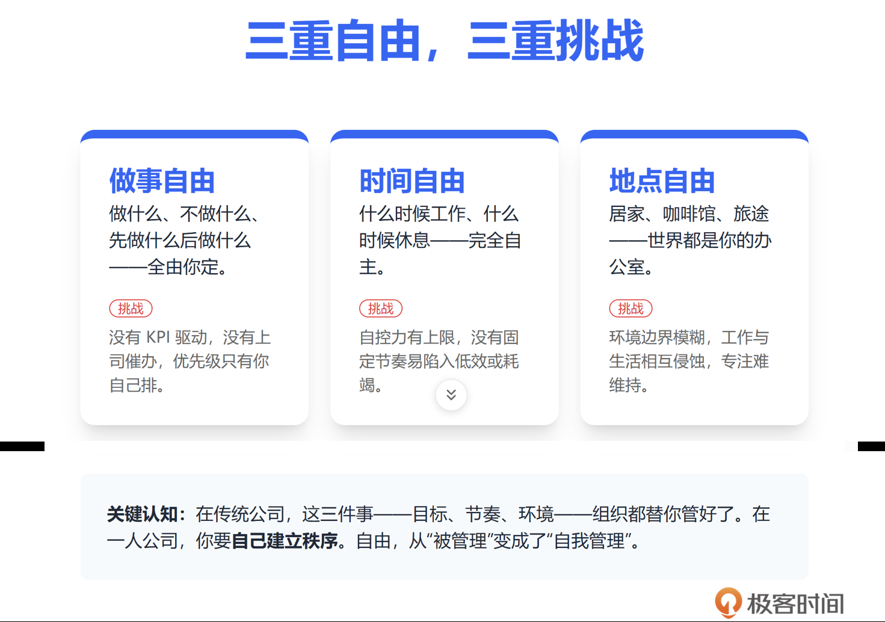
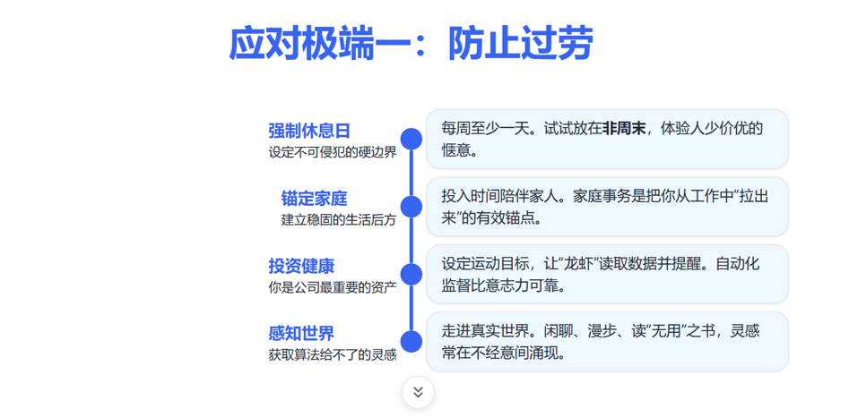
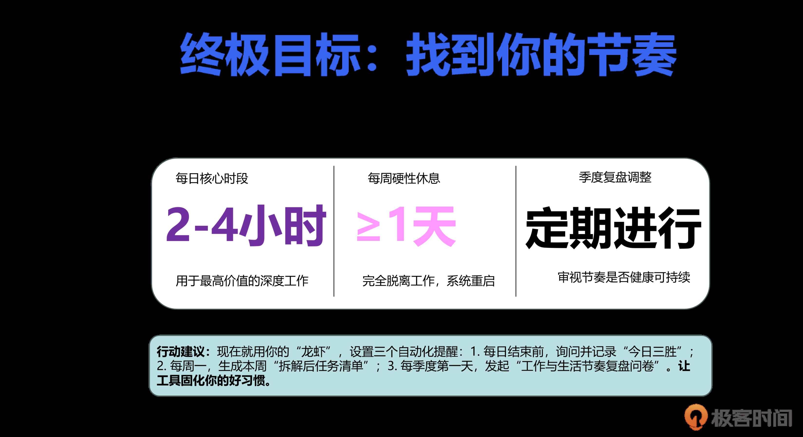
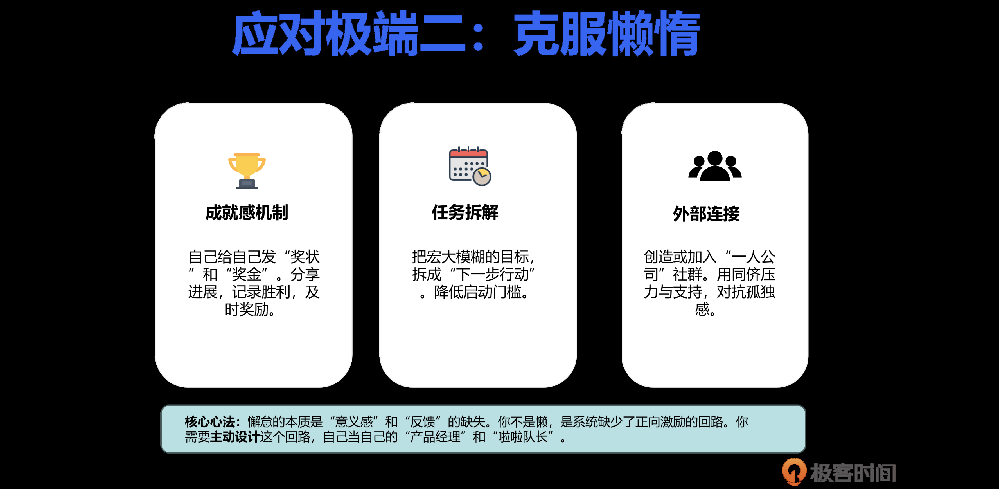

# 11-风险：如何做好自我管理？

你好，我是孙志岗。这节课我们来聊聊如何做好自我管理。

欢迎来到《OPC 一人公司创业实战课》。咱们今天要聊的这个话题，可能正是你选择这条路的初心，也可能是你正在经历的“甜蜜的烦恼”——自由。

做一人公司，意味着你拥有了别人朝九晚五时最羡慕的三样东西：做事自由、时间自由、地点自由。不用再听老板指派，不用再挤早晚高峰，不用再困在格子间里。这感觉，是不是像终于拿到了人生的遥控器，可以自己换台了？

但你想过没有，自由这个东西，很像武侠小说里的绝世内力。郭靖有了内力不会用，差点走火入魔；张无忌学会了乾坤大挪移，才能驾驭它，纵横天下。自由本身不会自动变成生产力，它既是一人公司最大的红利，也可能是最大的风险。这节课，咱们就一起练练这门“乾坤大挪移”，看看怎么才能真正驾驭这种自由，让它为你所用，而不是被它反噬。

## 三重自由背后的管理费用

咱们来具体看看这三重自由，以及它们背后暗藏的“管理费”。

第一，做事自由。今天你是写代码、做方案、还是录课程？全凭你心意。这感觉棒极了，对吧？但挑战随之而来：没有 KPI 压着你，没有上司每周找你过进度，事情的优先级完全靠你自己判断。哪个客户催得急就先做哪个？还是哪个赚钱多就先做哪个？或者哪个自己最喜欢就先做哪个？ 这三个“哪个”经常打架。对于做软件产品的你，可能纠结是先修复老 bug 还是开发新功能；对于做咨询培训的你，可能犹豫是先准备新课程大纲，还是先回复潜在客户的询盘。这种绝对的选择权，需要极强的战略定力和价值判断，否则很容易陷入“瞎忙”，做的事不少，但推进的都是次要矛盾。

第二，时间自由。睡到自然醒，下午再开工，深夜灵感来了通个宵。听起来是理想生活。但人的自控力是有天然上限的。神经科学研究表明，我们大脑的“执行功能”像肌肉一样会疲劳。没有固定的上下班节奏作为“外部骨骼”，你的工作生活很容易变成一滩“软泥”。要么摊得太薄，效率低下；要么堆得太高，直到 burnout（耗竭）。你可能发现，有时候一天好像没干什么就过去了，有时候又连续工作十几个小时停不下来。这种不规律，对身心都是巨大的消耗。

第三，地点自由。在家穿着睡衣办公，在咖啡馆听着音乐写稿，甚至在海边回复邮件。这是很多人梦想的画面。但挑战在于，当任何地方都可以是办公室时，也就意味着任何地方都“不是”纯粹的办公室了。孩子的哭声、家里的零食、咖啡馆的闲聊、旅途的风景，都在不断争夺你的注意力。工作和生活的物理边界消失了，心理边界如果没建立好，结果就是“生活被工作入侵，工作被生活打扰”，两边都做不好，还特别容易累。

看到没有？自由从来不是免费的，它只是把管理的责任，从公司转移到了你个人身上。过去是组织给你设定框架，现在需要你给自己画框。这个认知转换，是驾驭自由的第一步。

## 自我管理的两个极端

接下来，咱们要谈一个非常反直觉的观点。很多人，包括很多刚起步的创业者，都认为一人公司的自我管理，核心就是“自律”，就是跟自己的“懒惰”做斗争。我得告诉你，这个想法可能跑偏了。

在一人公司的真实情境里，自我管理面临的往往不是“懒惰”这个单一敌人，而是两个极端。

第一个极端：极度勤奋，工作时间投入太多。

表面看，这是压力驱动。公司就你一个人，自负盈亏，停下来就意味着收入暂停。这当然是一部分原因。但还有一个更隐蔽、更强大的驱动力，你注意到了吗？工作过程本身，能持续提供小而确定的成就感。对你来说，可能是每解决一个技术难题，每写完一段精彩的文案，每设计出一个清晰的课程逻辑，每谈成一个合作意向。这些“小胜利”能不断分泌多巴胺，给你即时的正反馈。这种“我正在创造价值”的感觉太迷人了，让人停不下来，不知不觉就“卷”了自己，投入了过多时间。你以为你在对抗懒惰，其实你是在对抗“成瘾”。

第二个极端：极度懈怠，提不起精神做事。

表面看，这好像是“懒”了。但深层原因，往往不是动力不足，而是反馈失效。你做了很多事，打磨了产品，发布了内容，联系了客户，但市场反应平平，用户增长缓慢，收入不见起色。这时候，内心就会开始怀疑：“我做的这些东西，真的有人需要吗？真的有价值吗？”这种价值感的动摇，是动力的头号杀手。当然，一人公司缺少传统职场里的“外部肯定”，没有上司的表扬，没有同事的掌声，这种成就感回报的不足，也会加剧这种“懈怠”的状态。它本质上是一种“心累”，是意义感的暂时缺失。

发现了吗？这两个极端，都不是简单的“自律”问题，而是你的整个工作系统，包括价值反馈系统、精力分配系统的失衡信号。所以，一人公司自我管理的真正目标，不是督促自己“更勤奋”，而是保持一种动态的、健康的“劳逸结合”。这和你打工时需要的“管住自己别偷懒”，是完全不同的方向，甚至是相反的方向。咱们接下来就看看，怎么应对这两个极端。

## 如何应对过度工作

先看如何应对第一个极端——防止自己工作过度，burn out 。

第一，设立强制休息日。 这不是建议，是纪律。每周必须设定至少一天，完全抛开工作。手机关静音，邮箱不查看，让自己彻底“失联”。我有个私人建议：试着把休息日放在周二到周四中的某一天。你会发现，去任何地方人都少，不用排队，价格可能还更优惠。这种体验本身，就是对辛勤工作最好的奖赏。休息日是你的“系统重启日”，没有它，持续高负荷运转，系统迟早会崩溃。

第二，真正重视家庭。 工作再忙，也要留出高质量的时间给家人。注意是“高质量”，不仅仅是“物理在场”。陪孩子认真玩一个游戏，和伴侣一起做顿饭、聊聊家常，陪父母去看病或者散散步。这些事从纯粹的商业角度看，好像是“浪费时间”，但它们是你作为一个“人”的根基。

家庭不是工作的对立面，而是支撑你长期战斗的、最稳固的后方和能源站。它提供了一个强大的“心理锚点”，能把你从工作的“沉浸态”里有力地拉出来，回归生活。这里可以用上你的龙虾，让它帮你自动化一些家庭事务提醒，比如家人的生日、纪念日，定期生成家庭活动建议，甚至管理家庭账单。这既照顾了家庭，也实践了自动化思维。

第三，像经营资产一样经营你的健康。在一人公司里，你自己就是最核心、最不可替代的资产。没有健康的身心，所有的自由、机会、愿景，都是空中楼阁。不要只停留在“知道”，要行动。设定具体的运动目标，比如每周跑步三次，每次半小时。

让你的龙虾来监督你。让它读取你的运动手环数据，不达标就每天定时用各种方式“唠叨”你。这种来自“外部”的，自动化的提醒，往往比靠自己那靠不住的意志力要有效得多。健康管理，是优先级最高的事。

第四，主动获取多元的、真实的输入。不要让自己所有的信息源都来自屏幕和算法推荐。走出门，去街上走走，观察形形色色的人；约朋友线下聊天，而不是只在微信上打字；读一本和你工作毫无关系的“闲书”；看一部好电影。这些看似“不务正业”的时光，常常是灵感的富矿。你为客户设计解决方案的灵感，你课程中一个绝妙的类比，你产品一个新颖的切入点，可能就来自一次偶然的街头观察或一段书里的对话。真实世界的复杂性和丰富性，是任何算法都无法模拟和推荐的。

## 如何应对懈怠

刚才讲了如何防止“过劳”这个极端，现在来看另一个极端：如何克服“懈怠”，找回动力。

当动力不足、提不起精神时，别再责怪自己“不自律”了。试试下面这三剂“药方”：

第一，自己建立“成就感”机制。在一人公司，没人给你发奖状、开表彰会。所以，你要学会自己庆祝每一个微小的胜利。今天写完了一篇重要的文章？立刻在社交媒体上分享一段心得，或者简单地记录在“胜利日记”里。这周成功交付了一个项目？马上给自己发一笔“项目奖金”，去吃顿好的，或者买一件心仪已久的小礼物。不要等到年终才回顾，要把成就感的反馈周期缩短到以“天”或“周”为单位。你的“龙虾”可以帮你自动化这个流程：每天结束时，让它问你“今天完成了哪三件最有价值的事？”并记录下来，每周生成一份“成就周报”发给你看。这种持续的、自我肯定的正反馈，是抵御价值感动摇的坚固盾牌。

第二，把任务拆解到“傻瓜都能做”的程度。很多时候我们拖延，不是因为不想做，而是因为任务太庞大、太模糊，让人望而生畏，不知从何下手。“开发一个新功能”、“写一门新课”、“拓展新市场”，这些目标听起来就让人压力山大。你需要把它们拆解成具体的、物理的“下一步行动”。

- 比如，“开发新功能”拆解为：1. 打开 IDE，新建一个分支；2. 写出这个功能的 API 接口定义；3. 实现第一个简单的函数……

每一步都应该小到几乎没有启动的心理阻力。用你的“龙虾”来帮你做这件事：告诉它你的大目标，让它用项目管理思维帮你拆解出清晰的、可执行的待办列表。当你看着清单上一个一个被划掉的小任务时，那种推进感本身就能带来动力。

第三，主动创造“外部连接”和“同侪环境”。一人公司最大的隐形杀手是“孤独”。没有同事交流，没有团队氛围，所有决策和情绪都自己消化，很容易陷入消极的思维漩涡。你必须主动打破这种信息茧房和情绪孤岛。去寻找或创建一个“一人公司创业者”的社群，可以是线上的，也可以是线下的。定期和大家交流，分享进展，吐槽困难，互相打气。看到别人也在努力，你会获得一种健康的“同侪压力”。得到别人的建议和肯定，你能获得宝贵的“外部视角”和情感支持。不要把自己活成一座孤岛，把自己变成群岛中的一员。

## 形成自己的节奏，驾驭自由的

讲完了应对两个极端的具体方法，咱们最后来聊聊，如何把这些方法整合起来，形成你一人公司独特的、可持续的工作节奏。这才是驾驭自由的终极形态。

节奏，是自由之上的秩序，是长期主义的保障。

你不必追求每天工作八小时，那是工业时代的思维。对于知识创造型的一人公司，你真正需要的是每天 2-4 小时不受打扰的“核心创造时段”。在这段时间里，关闭所有通知，沉浸到产品开发、课程设计、战略思考这些高价值工作中。剩下的时间，用于沟通、学习、处理杂务和休息。

同时，你必须捍卫我们前面提到的每周强制休息日，把它作为雷打不动的节奏锚点。此外，每季度要做一次“节奏复盘”：回顾过去三个月，你的工作状态是更偏向“过劳”还是“懈怠”？你的休息够不够？家庭时间有没有保障？健康管理是否到位？根据复盘，微调下个季度的节奏安排。

而这一切，都可以而且应该让你的 AI 助手——“龙虾”来帮你固化和管理。 让它成为你个人管理系统的“自动化中枢”。从提醒你休息，到记录你的成就，再到拆解你的任务，最后到定期发起复盘。你要做的，是做出决策和享受生活；它要做的，是确保系统持续、健康地运转。

## 总结

驾驭一人公司的自由，核心在于 “自我管理” ，而自我管理的目标不是对抗懒惰，而是 “平衡两个极端” ，最终形成你独特的、可持续的 “工作生活节奏”。

你拥有了终极的自由，也承担了终极的责任。这份责任，就是成为自己最好的管理者、合作者与守护者。

从今天起，不要再把“自律”挂在嘴边，而是开始设计你的系统，建立你的节奏，用好你的“龙虾”。让自由，真正为你服务。

## AI 师傅在线答疑

以上是我们这节课的主要知识点，关于如何强化合规意识，搞定人、财、法，你或许还有很多疑问，而且每个人的情况也不同，因此我这边特别准备了一个在线学习和互动的 AI 师傅，他可以根据你的提问，个性化生成相关内容，欢迎互动体验！

点击召唤 AI 师傅：https://app.ai-shifu.cn/c/742058fcf44f4a0b975538073811150c

## 特别说明

- 因「AI 师傅」增值服务涉及 LLM 成本问题，故仅限「单课付费用户」免费享有该增值权益，先进群领取兑换码：http://gk.link/a/12I13

- 兑换码使用方式：http://gk.link/a/12I1g

- 「VIP 用户」仅享有免费学习课程权益，不享有该增值权益，可通过链接单独购买：https://app.ai-shifu.cn/c/742058fcf44f4a0b975538073811150c
