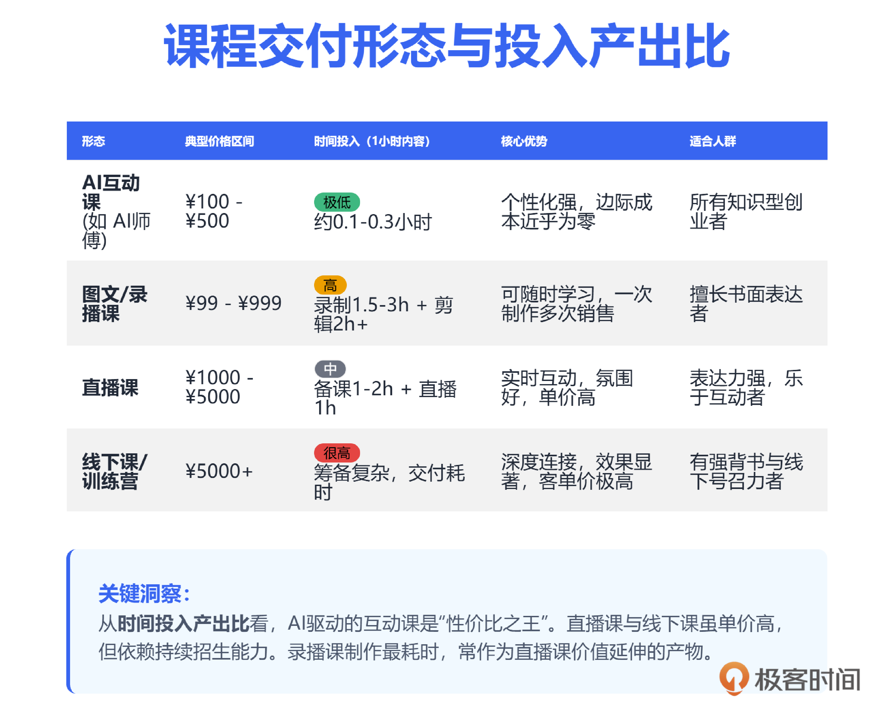

# 13-如何打造自己的知识内容产品？

你好，我是孙志岗。这节课我们来聊聊如何打造自己的知识内容产品。

咱们这堂课，就从你我都熟悉的领域——知识付费，开始聊起。很多人觉得，卖课是条捷径，尤其是在 AI 浪潮里，最先赚到钱的，好像确实是那些教别人怎么用 AI 的人。不少一人公司的第一桶金，也来自这里。但你想过没有，为什么有人能靠这个风生水起，有人却连水花都溅不起来？这背后其实有三个缺一不可的基石。

## 知识内容产品背后的三大基石

第一，强背书。卖课其实卖的不是信息，是信任。用户凭什么信你？你得有“硬通货”。比如，你参与过某个知名项目，在头部公司担任过关键角色，或者在社交媒体上持续输出过硬核干货，积累了口碑。这些，都是你能拿出来的“信任状”。

第二，真干货。这分两种：一种是你自己亲身趟过河、踩过坑，能讲出别人不知道的“内幕”和“手感”；另一种是你有极强的信息处理能力，能把散落各处的珍珠串成项链，帮别人省下大量摸索的时间。你的价值，就藏在这里。

第三，好渠道。酒香也怕巷子深。你的渠道，可能只是自己的朋友圈。擅长运营的，能从朋友圈破圈；不擅长的，卖完一波就结束了。所以，拥抱大渠道，往往是更优解。就算你自己有十万粉丝，和平台合作带来的销量，可能是一个量级的差距。而且，成熟的渠道还能在课程包装、定价、服务设计上给你宝贵的建议。

你看，这三块基石，是不是像三角形的三个支点？少了任何一个，这个生意都很难立得稳。

## 怎么选择合适的渠道

聊完基础，咱们切入实战。课程，本质上也是一种产品。所以，第一步不是埋头写课，而是抬头找渠道。你擅长什么不重要，重要的是你擅长的，能不能和某个渠道的需求匹配上。

如果你选择和大渠道合作，比如得到、极客时间这类平台，分成比例通常在 10% 到 50% 之间。这个数字浮动很大，取决于平台政策、你的咖位，还有课程的交付成本。有时候，也会有版权买断或者按课时付费的模式。记住，在分润谈判上，渠道通常比老师更有话语权。

如果咱们只想在私域里深耕，那还有一条路：找专业的课程发售团队。他们不给你流量，但擅长把私域流量“榨干”，通过一系列发售动作，把转化率做到极致。他们的分成一般在 30% 左右。这相当于你花钱买了一套成熟的“转化系统”。

课程还有个巨大的优点：极易原型验证。你不需要把课全部做出来，只要有吸引人的标题、简介、大纲和讲师介绍，就能开始预售。卖得好，再投入精力教研；卖得不好，全额退款，几乎零成本试错。这像不像互联网产品的“最小可行性产品”（MVP）？

## 怎么定价与交付

接下来是定价和交付形式，这里面的门道就多了。定价要锚定目标用户的购买力，同时参考同类产品。但有意思的是，课程比竞品稍贵一点，可能反而是优势。为什么？因为在用户心里，敢定高价往往意味着质量更高。而且，愿意付更高价的用户，平均认知水平和付费意愿也更强，后续服务反而更轻松。

价格定了，用什么形式交付？这里有个常见的“价格 - 形态”匹配公式：

- 5000 元以上，甚至万元：这种通常是线下课，附带手把手的重度辅导。这卖的不是知识，是陪伴和结果。

- 1000-5000 元：这种主流是线上直播课，配合社群答疑。实时互动是它的价值所在。

- 500 元以下：这种多是图文课、录播课。但现在有个新形态特别有意思——用 AI 师傅（ai-shifu.cn）做一对一互动课。它单价不高，但体验很独特。

如果课程里包含项目实战，价格可以轻松加上 1000 块；如果承诺一年的社群服务，再加1000 块也很合理。你看，附加价值是提升客单价的利器。

从投入产出比来看，不同形式差异巨大。用 AI 师傅做课，时间成本最低，可能只有其他形式的十分之一。图文课和直播课，初次准备的时间差不多，取决于你更擅长写还是讲。但如果是直播，每次开班都要重复讲，时间成本就上去了。

最费时间的，其实是录播课。你以为对着镜头讲完就行了？其实不然，一个有经验的老师，录1 小时的成品，可能需要 1.5 到 3 小时，后期剪辑还得再加 2 小时。而直播和线下课，虽然单价能卖得高，不过单次时间开销并不夸张，所以是主流模式。但它们的缺点是交付的边际成本高。每多一个班，你就得重新讲一遍。所以很多课程在招生乏力后，会把之前的直播录像剪成录播课，低价销售，榨取剩余价值。

用 AI 师傅做的课，虽然单价看起来不高，但因为时间投入极低，又能提供个性化的互动体验（比图文、录播好，某些方面甚至超过直播），所以它的“时间 ROI”（投资回报率）可能是最高的。这给了一人公司一个轻量级启动的绝佳选择。

## 怎么开始筹备内容

好，假设咱们决定开干了，做好了前期的准备工作。我们应该从哪里开始呢？从教研，制作课程大纲开始。现在有了 AI，这事儿变得简单多了。你可以用 AI 去调研竞品的大纲，然后融入你自己的思考和经验，碰撞出一个更优的结构。甚至，在 AI 师傅里有个叫“龙虾助手”的技能，能帮你一条龙完成大纲设计、内容撰写和发布上线。你可以喂给它你的资料，或者让它自己去网上搜索，都能融合进课程里。

说到这，我必须提一个重要的观点。在 AI 的加持下，哪怕你完全不懂某个领域，也能迅速拼凑出一门“看上去很美”的课。但我坚决反对你这么做。教育培训有个特点：学生是因为不懂才来学，他们最初往往没有能力判断课程的真伪和深浅。利用这个信息差去牟利，近乎诈骗。唯有你亲身经历、验证过的干货，才是有生命力的课程，才对得起别人的信任和金钱。

如果你选择的是直播或线下课，这对老师的现场能力要求很高。很多人就是卡在这里，才转而选择其他形式。这种情况要怎么破局？

第一，底气来自于绝对的自信。相信自己有独一无二的干货。有些职业讲师口若悬河、气氛火爆，但内容空洞，学员听完会觉得“热闹是老师的，我什么也没留下”。干货，才是你真正的“压舱石”。

第二，把授课当成一场大型聊天，敢于互动。一潭死水的课堂，谁也提不起精神。有几个小技巧：

- 讲前设问：在讲一个知识点前，先抛出一个问题，让学员思考、甚至瞎猜。这能瞬间激活他们的脑子，让他们带着问题听讲，效果倍增。同时，你也能摸清学员的水平，方便调整后面的内容，甚至制造“哦，原来是这样！”的反转惊喜。

- 讲后连接：讲完一个方法，立刻让学员结合自己手头的真实问题，想想怎么应用。如果你是有实战经验的老师，这个环节就是你“封神”的时刻，也是最吸粉的环节。

最后，分享一个我线下讲课的“笨”办法，但极其有效：快速扫视全场，找到几个看起来颜值高、神情阳光、互动积极的学员。讲课的时候，你的目光就主要在他们几个之间流转。别看那些玩手机、打瞌睡的。为什么？因为你经常看那些积极的学员，他们会感受到被关注，更愿意用点头、微笑给你正反馈。这些正反馈会像能量一样回传给你，让你越讲越带劲，状态越来越好。课堂气氛，就这么被几个“能量节点”给带起来了。

## 总结

好了，关于知识变现，咱们今天聊了它的基石、渠道选择、产品设计、交付形态和授课心法。信息量不小，但核心就一句：用你的真本事，通过对的渠道，用合适的形式，解决一群人的真问题。

现在，是时候把目光收回来，看看你自己了。今天的作业就是：

- 请你仔细分析一下，自己身上有什么比较特别的能力或经验？什么样的人会愿意为学习你这个能力或经验而付费？最后，哪个平台或渠道，这样的人聚集得最多？

别急着回答，好好想想。这个作业的答案，或许就是你知识付费之路的起点。咱们下次课见。

## AI 师傅在线答疑

以上是我们这节课的主要知识点，关于如何打造自己的知识内容产品，你或许还有很多疑问，而且每个人的情况也不同，因此我这边特别准备了一个在线学习和互动的 AI 师傅，他可以根据你的提问，个性化生成相关内容，欢迎互动体验！

点击召唤 AI 师傅：https://app.ai-shifu.cn/c/742058fcf44f4a0b975538073811150c

## 特别说明

- 因「AI 师傅」增值服务涉及 LLM 成本问题，故仅限「单课付费用户」免费享有该增值权益，先进群领取兑换码：http://gk.link/a/12I13

- 兑换码使用方式：http://gk.link/a/12I1g

- 「VIP 用户」仅享有免费学习课程权益，不享有该增值权益，可通过链接单独购买：https://app.ai-shifu.cn/c/742058fcf44f4a0b975538073811150c
