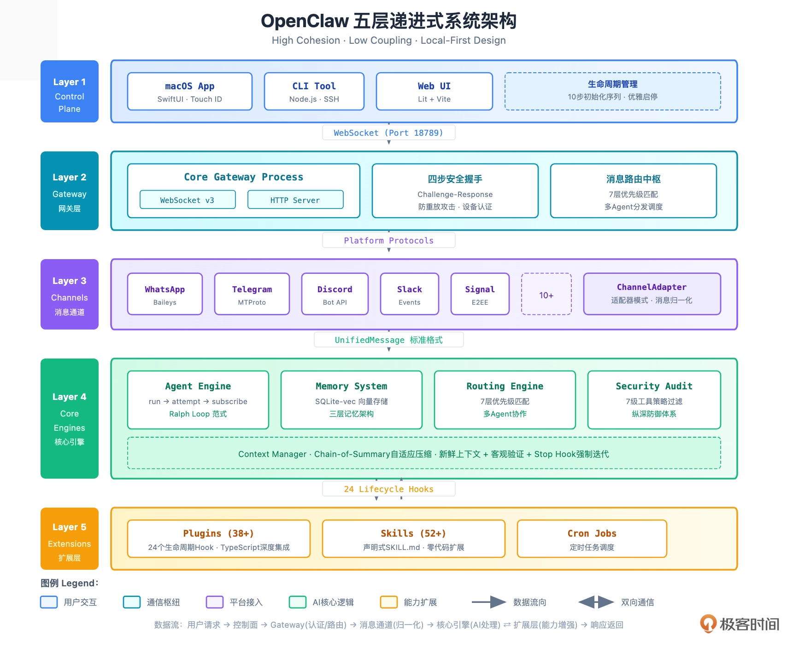
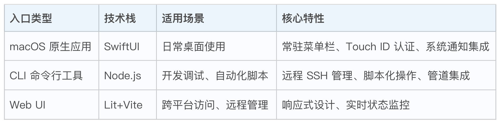
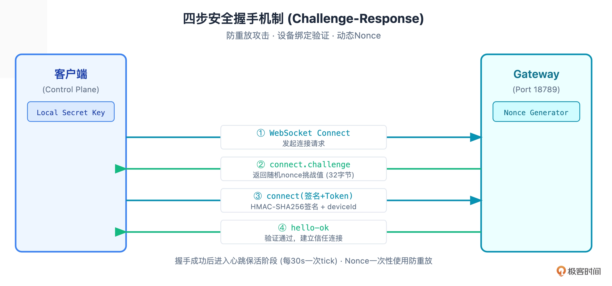
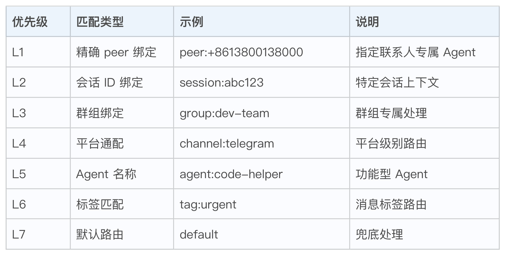
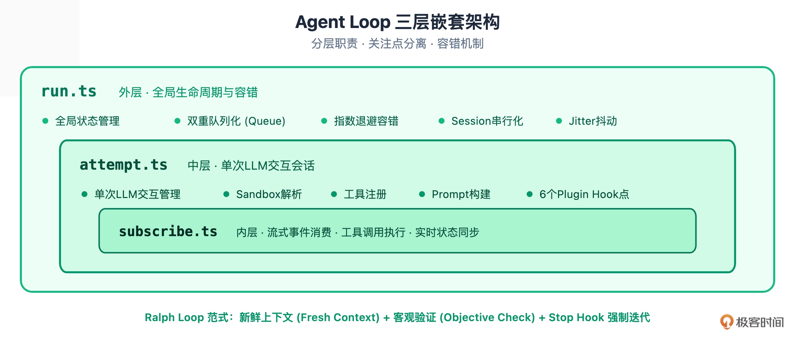
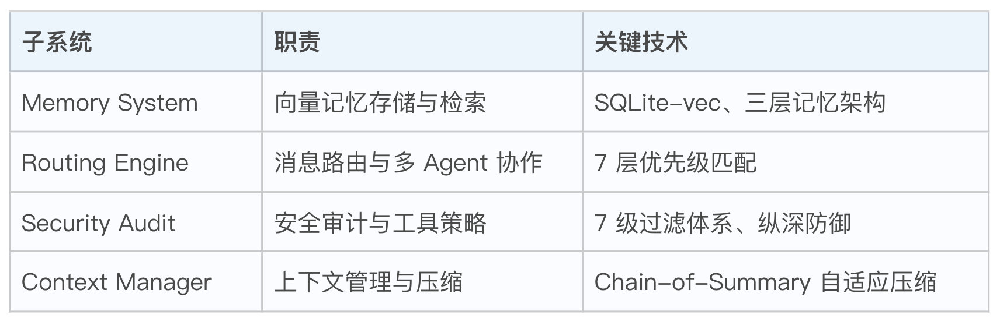
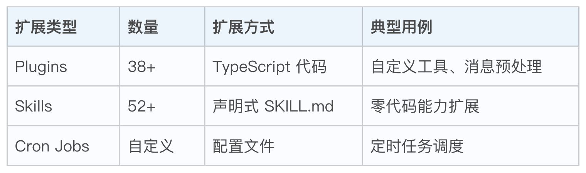

# 01 | OpenClaw系统架构全景：如何设计高内聚低耦合的Agent系统？

你好，我是 Henry，欢迎来到《OpenClaw 核心原理与实战》。

当你接手一个复杂的 AI Agent 项目时，是否曾被错综复杂的模块依赖关系困扰？改动一处代码，却引发连锁反应？如果你也有过类似的经历，那你一定理解为什么软件工程师把这种代码戏称为“意大利面条”——看似每一根都在碗里，却纠缠得让人无从下手。你一定能体会到“高内聚低耦合”这六个字的珍贵。在 AI Agent 领域，这个问题被进一步放大：我们的系统不仅要处理复杂的自然语言理解，还要同时接入多个异构平台、管理长期记忆、执行各类工具调用，甚至在用户不知情的情况下进行多轮自我反思与迭代。

面对这些挑战，我们不禁要思考三个关键问题：你会如何划分模块边界？如何确保修改记忆系统不会影响消息路由？如何让第三方开发者能够安全地扩展功能而不破坏核心逻辑？

OpenClaw 给出的答案是一个精心设计的五层嵌套架构。这个架构就像人体的经络系统——每条经络各司其职，却又通过特定的穴位相互连通。今天，我们就来拆解这个“经络图”，看看一个生产级的 Agent 系统是如何炼成的。

## 架构全景：五层嵌套的设计哲学

在深入每一层之前，让我们先站在 30000 英尺的高空俯瞰整个系统。OpenClaw 采用的是一种洋葱式架构——从外到内，每一层都承担着特定的职责，并通过标准化的接口与相邻层通信。

### 五层架构全景图

下图展示了 OpenClaw 的完整系统架构，从用户交互入口到底层扩展能力，形成了一个清晰的分层体系：

如上图所示，OpenClaw 采用自上而下的五层递进式架构。数据从用户交互的控制面进入，经过 Gateway 的安全认证和路由分发，通过消息通道完成平台适配，最终在核心引擎层完成 AI逻辑处理，并可通过 24 个生命周期 Hook 调用扩展层的各类能力。这种设计确保了每一层只关注自己的核心职责，实现了真正的“高内聚低耦合”。

让我们从最外层开始，逐层深入这个精密的系统。

### 控制面（Control Plane）：用户与系统的接触点

控制面是整个系统的“脸面”——用户通过它与 Agent 进行交互。OpenClaw 在这一层提供了三种形态的入口，适配不同用户群体的使用习惯：

这种多端设计体现了一个重要原则：控制面只负责“展示”和“指令下发”，不承担任何业务逻辑。无论你是通过精美的 SwiftUI 界面还是简洁的命令行，发送的指令最终都会被标准化为相同的消息格式，传递给下一层处理。

控制面还承担着系统生命周期管理的重任。OpenClaw 设计了一套精细的 10 步初始化序列，确保系统各模块按依赖关系正确就绪：

- Step 1：加载配置文件 (config.yaml)

- Step 2：初始化日志系统 (Winston/Pino)

- Step 3：建立数据库连接 (SQLite)

- Step 4：加载安全策略 (Policy Engine)

- Step 5：初始化 Memory 向量索引 (SQLite-vec)

- Step 6：注册核心 Agent 实例

- Step 7：加载 Plugins (38+ 官方扩展)

- Step 8：解析 Skills (52+ 内置技能)

- Step 9：启动 Gateway 监听 (Port 18789)

- Step 10：激活消息通道 (WhatsApp/Telegram/…)

这套启动序列就像火箭发射前的检查清单——每一步都必须成功，才能进入下一步。如果任何一步失败，系统会优雅地回滚并报告具体的错误位置，确保不会在半初始化状态下运行。

指令已准备就绪，接下来由谁来接棒？答案是 Gateway 网关层。

### Gateway 网关层：系统的“交通枢纽”

如果说整个 OpenClaw 是一座城市，那么 Gateway 就是它的中央交通枢纽——所有的数据流都必须经过这里，经过检票、安检、分流，才能到达目的地。

Gateway 采用 JSON over WebSocket 协议，监听在 18789 端口。为什么选择 WebSocket而不是 HTTP？因为 Agent 系统需要处理大量的双向实时通信——用户发送消息、Agent 流式回复、工具执行结果返回、状态更新推送，这些场景下长连接的效率远高于短连接的 HTTP 轮询。

但开放的 WebSocket 端口也带来了安全隐患。OpenClaw 设计了一套四步安全握手机制来防范重放攻击，采用经典的“挑战 - 响应”（Challenge-Response）模式：

这种挑战 - 响应模式确保了即使攻击者截获了历史通信数据，也无法伪造合法的连接请求——因为每次的 nonce 都是动态生成的一次性随机数。此外，deviceVerification 机制还确保连接请求来自受信任的特定设备，实现了设备级别的绑定认证。

Gateway 还承担着消息路由中枢的角色。当一条消息进入系统，Gateway 会根据 7 层优先级匹配规则，决定将消息分发给哪个 Agent 处理：

这个设计让 OpenClaw 能够支持多 Agent 协作场景——不同的 Agent 可以处理不同类型的消息，而路由逻辑被集中管理在 Gateway 层，避免了“各自为战”的混乱局面。

### 消息通道层（Message Channels）：连接异构世界的桥梁

现实世界中的即时通讯平台五花八门：WhatsApp 使用 Baileys 库对接、Telegram 用 MTProto协议、Discord 又是另一套 Bot API。如果你的 Agent 需要同时服务于这些平台的用户，网关解决了“如何统一通信”的问题，但另一个挑战随之而来——如何避免为每个平台写一套完全不同的处理逻辑？

OpenClaw 的答案是适配器模式（Adapter Pattern）。

每个平台对应一个 ChannelAdapter 实现，负责将平台特有的消息格式转换为统一的UnifiedMessage 对象。这就像一个翻译团队——无论你说英语、法语还是日语，翻译官们都会把你的话转换成系统内部的“通用语”，让核心引擎无需关心消息的来源。

这个设计的精妙之处在于：核心引擎层完全不知道消息来自哪个平台。对于 Agent Loop 来说，它处理的永远是标准化的 UnifiedMessage，无需关心底层是 Telegram 还是 WhatsApp。这种“信息隐藏”大大降低了系统的耦合度，也实现了“一次开发，多平台运行”的目标。

### 核心引擎层（Core Engines）：智能的“心脏”

核心引擎层是整个系统最复杂、也最核心的部分。它包含四个相对独立的子系统，每个子系统都是一个高度内聚的功能单元。

1. AgentLoop：三层嵌套的执行引擎

Agent Loop 采用了一种独特的三层嵌套架构，这是 OpenClaw 最具创新性的设计之一：

这三层各司其职：

- run.ts（外层）：负责全局生命周期管理，包括双重队列化、指数退避容错、Session 串行化和 Jitter 抖动。当 Agent 调用失败时，外层会根据错误类型决定是重试还是放弃。

- attempt.ts（中层）：管理单次 LLM 交互会话，包括 Sandbox 解析、工具注册、Prompt 构建，以及 6 个关键的 Plugin Hook 点（如 before_llm、after_tool 等）。

- subscribe.ts（内层）：处理流式事件消费、工具调用执行和实时状态同步，确保每一个token 都能被正确处理。

这种分层设计的好处是关注点分离——如果你想修改重试策略，只需要改动 run.ts；如果你想调整 Prompt 构建逻辑，只需要动 attempt.ts；如果你想优化流式响应处理，只需要改subscribe.ts。三层之间通过清晰的接口通信，互不干扰。

2. RalphLoop 范式：三原则驱动的智能迭代

OpenClaw 的 Agent Loop 实现了一套被称为 Ralph Loop 的范式，它包含三个核心原则：

- 新鲜上下文（Fresh Context）：每轮迭代都重新构建上下文，避免历史信息的累积污染。

- 客观验证（Objective Check）：引入外部工具来验证 LLM 的输出，而非盲目信任。

- Stop Hook 强制迭代：通过 Hook 机制强制 Agent 在必要时停止，避免无限循环。

这三个原则的组合，让 OpenClaw 的 Agent 能够在复杂任务中保持稳定和可控，而不是像某些早期 Agent 系统那样陷入“幻觉循环”。

3. 其他核心子系统

除了 Agent Engine，核心引擎层还包括：

核心引擎提供了强大的 AI 能力，但一个优秀的系统还需要开放的生态。

### 扩展层：24 个 Hook 点的能力边界

扩展层是 OpenClaw 开放性的体现。通过 24 个生命周期 Hook 点，第三方开发者可以在不修改核心代码的前提下，注入自定义逻辑：

这种设计让 OpenClaw 既保持了核心的稳定性，又具备了极强的可扩展性——你可以为它添加任何你需要的能力，而不用担心破坏原有的功能。

现在，你应该已经对 OpenCalw 架构蓝图有了一个清晰的了解，你可能好奇：支撑这套架构的技术栈是如何选择的？接下来我们再来看看比较关键的技术选型。

## 技术选型：为什么是 Node.js 和 SQLite？

在阅读 OpenClaw 源码时，你可能会好奇：为什么选择 Node.js 而不是 Python？为什么用SQLite 而不是 PostgreSQL？这些选型背后都有深思熟虑的考量。

### Node.js 22+：事件驱动的天然优势

Agent 系统的核心场景是大量并发的 I/O 操作——等待 LLM 响应、等待工具执行、等待消息平台回复。这恰恰是 Node.js 事件驱动模型的强项。相比 Python 的 asyncio，Node.js 的事件循环更加成熟、生态更加丰富，而且在处理 WebSocket 长连接时有着天然的优势。

此外，Node.js 22+ 引入的原生 TypeScript 支持，让 OpenClaw 能够在保持类型安全的同时，避免繁琐的编译配置。

### SQLite-vec：Local-First 的向量存储

选择 SQLite-vec 而非 Pinecone 或 Milvus，体现了 OpenClaw 的 Local-First 哲学。所有数据都存储在本地，用户拥有完全的数据主权。SQLite 的单文件部署特性，也让整个系统的安装和迁移变得极其简单——只需要复制一个.db 文件，就能把所有记忆带走。下节课我们还会详细讲解 Local-First，敬请期待。

## 总结：架构即哲学

回顾 OpenClaw 的五层架构，我们可以提炼出几个核心的设计哲学：

1. 分层解耦：每一层只关注自己的职责，通过标准接口与相邻层通信。

2. Local-First：数据主权归用户所有，隐私保护是底线而非可选项。

3. 可扩展性：通过 Hook 机制开放能力边界，而非无限膨胀核心代码。

4. 容错优先：从最外层就考虑失败场景，而非事后补救。

这些哲学不仅适用于 Agent 系统，也是所有复杂软件架构应当遵循的原则。当你下次面对一个“意大利面条”式的代码库时，不妨想想 OpenClaw 的“五层蛋糕”——也许，重构的第一步就是画一张清晰的架构图。

## 思考题

1. 在 OpenClaw 的五层架构中，如果你需要新增对一个即时通讯平台（如 Slack）的支持，你需要修改哪些层的代码？这种设计如何体现了“高内聚低耦合”原则？

2. 文中提到 OpenClaw 选择了 SQLite 而非云端数据库来实现 Local-First 理念。这种选择在什么场景下可能成为限制？你会如何在保持数据主权的前提下解决这些限制？

欢迎你在留言区与我交流！如果今天的课程让你有所收获，也欢迎转发给有需要的朋友，邀请他来一起学习，我们下节课再见！
