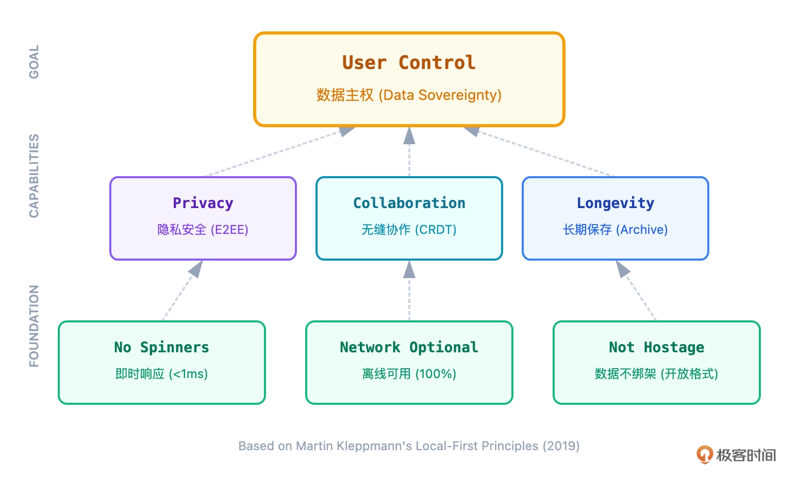
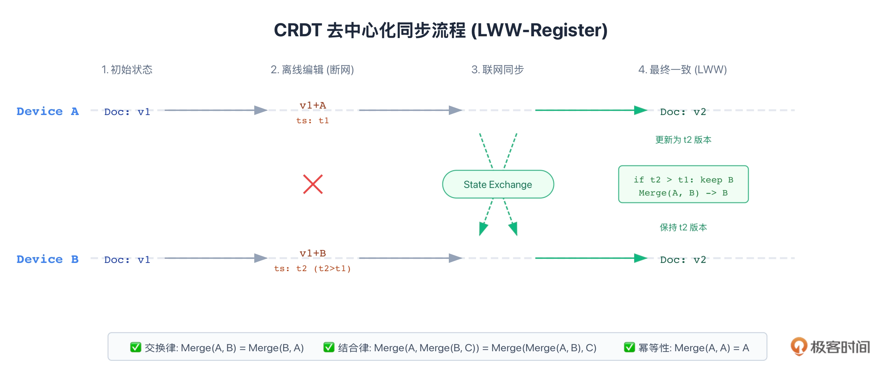
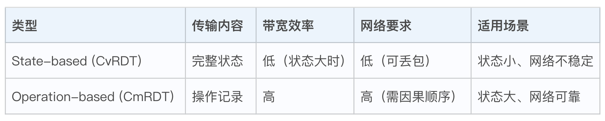
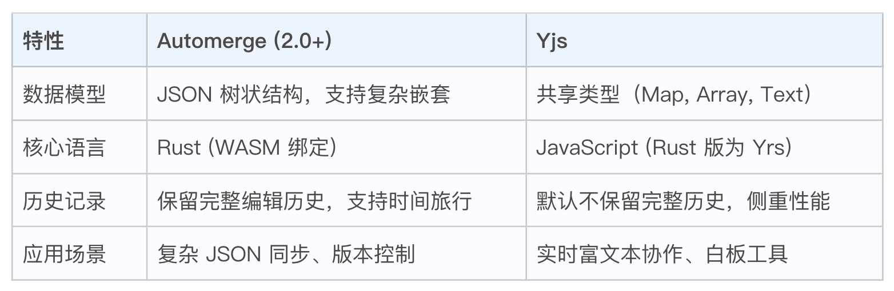
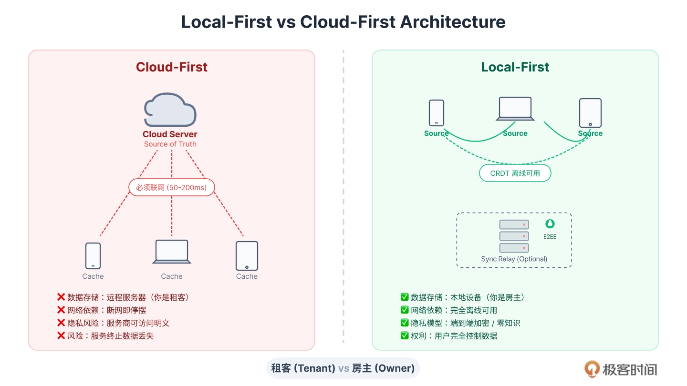
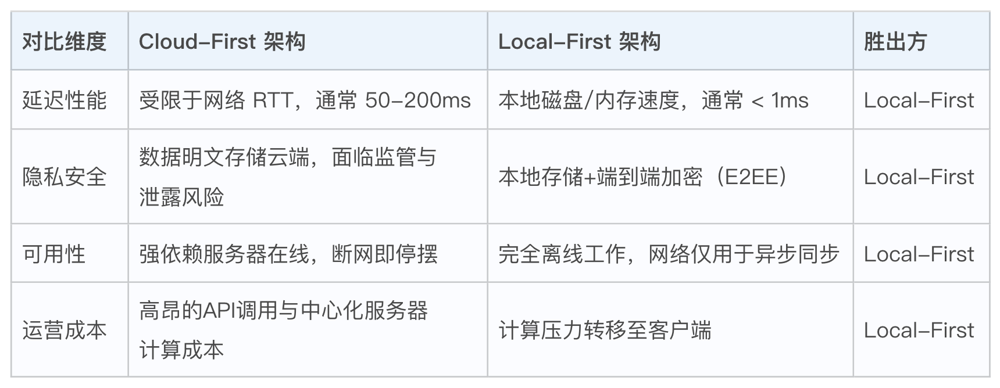
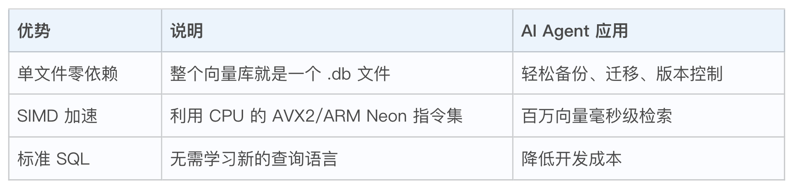
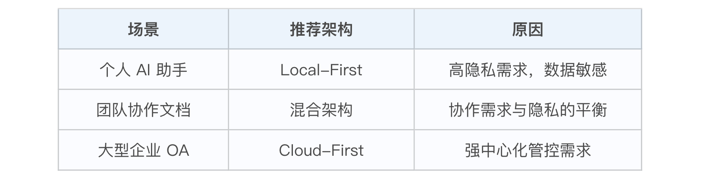

# 02 | Local-First隐私哲学与数据主权：Agent本地优先有什么优势？

你好，我是 Henry，欢迎来到《OpenClaw 核心原理与实战》。

如果你来设计一个个人 AI Agent，你会把用户的聊天记录、私密笔记、工作文档存储在哪里？是上传到某个科技巨头的云服务器，还是安全地保存在用户自己的设备上？

这个问题从 2024 年开始就变得尤为尖锐。这一年，云端集中化存储的风险以惨痛的方式暴露在公众面前：Snowflake 泄露事件导致包括 AT&T 在内的多家企业约 1.1 亿客户数据被窃取；National Public Data（NPD）高达 2.9 亿条包含社会安全号的敏感记录泄露，直接导致该公司申请破产；而 Change Healthcare 遭受的勒索软件攻击不仅影响了全美三分之一人口的医疗账单，更造成了高达 28.7 亿美元的直接损失。

这些案例揭示了一个残酷的现实：当你的数据存储在云端时，你实际上是在把钥匙交给了别人。

了解了云端存储的风险后，你可能会问：有没有一种架构，能让 AI Agent 既拥有强大的记忆能力，又不把我的数据交给别人？答案是有的，Local-First 架构提供了一种不同的选择——它不是要预言这是未来，而是要回答一个务实的问题：在 AI Agent 深度介入个人生活的时代，如何在获得智能服务的同时，不必用隐私作为代价？

从性能角度看，Local-First 的优势是可量化的。本地磁盘访问延迟通常小于 1 毫秒，而Cloud-First 架构受限于网络往返时间（RTT），延迟普遍在 50-200 毫秒之间。对于需要频繁访问记忆库和知识库的 AI Agent 而言，这种差距意味着“即时响应”与“等待加载”的本质区别。

这节课我们就来详细分析下 Local-First，就其涉及到的七大原则、架构设计、技术优势做展开。

在动手构建任何系统之前，我们需要一套清晰的设计原则来指导决策。Local-First 的七大原则就是这样的设计蓝图——它告诉我们，一个真正尊重用户数据主权的 Agent 应该满足哪些条件。如果你跳过这一节直接看技术实现，就像没有图纸就开始盖楼，最终可能建出一个“看似本地优先，实则云端依赖”的伪装品。

## Local-First 七大原则详解

2019 年，Martin Kleppmann 与 Ink & Switch 团队发表了具有里程碑意义的论文《Local-First Software: You Own Your Data, in spite of the Cloud》，首次系统性地定义了 Local-First软件应当追求的七大理想原则。这些原则并非空洞的口号，而是可以指导具体技术选型和架构设计的实践指南。



### 基础层：即时响应、离线可用、数据不绑架

原则一：No Spinners（即时响应）——当数据存储在用户设备上时，读取操作是毫秒级的磁盘访问，而非跨越大洋的网络请求。在 AI Agent 场景中，这意味着用户可以随时与 Agent 对话，无需等待网络连接，Agent 访问用户的历史对话、个人偏好、知识库都是本地操作。

原则二：Network Optional（离线可用）——真正的 Local-First 应用在完全离线状态下也能正常工作。设想用户在飞机上、地铁里需要使用 Agent——如果 Agent 依赖云端 API，这些场景就会完全失效。而基于本地大模型的 Agent 可以在任何环境下工作。

原则三：Not Hostage（数据不绑架）——数据必须存储在开放、可迁移的格式中。用户应该能够轻松导出全部数据，并在其他应用中使用。这就像房产证上写的是你的名字，即使物业公司更换，房子依然属于你。

### 能力层：隐私安全、无缝协作、长期保存

原则四：Privacy（隐私安全）——当数据存储在本地时，隐私保护从信任问题变成了技术问题。用户不需要信任某个云服务商不会滥用数据，因为数据根本就没有离开过自己的设备。对于需要同步的数据，Local-First 架构采用端到端加密（E2EE）。

原则五：Collaboration（无缝协作）——Local-First 并不意味着“孤岛”。当用户拥有多台设备，或需要与他人协作时，数据应该能够无缝同步。关键在于：同步是在设备之间直接进行，而非通过中心服务器中转。

原则六：Longevity（长期保存）——你今天创建的数据，应该在五十年后依然可以访问。Local-First 将数据存储在用户设备上，使用开放格式（如 SQLite、Markdown、JSON），确保即使原始应用不复存在，数据依然可以被读取。

### 目标层：用户控制

原则七：User Control（用户控制）——最终也是最重要的原则：用户对自己的数据拥有完全的控制权，包括访问权、修改权、导出权、共享权和遗忘权。这七大原则共同构成了 Local-First 的完整愿景，其核心目标是实现真正的数据主权。

现在你已经掌握了七大原则，但一个现实问题浮出水面：原则中提到的“多端协同”和“实时同步”，在没有中央服务器的情况下如何实现？当你的手机和电脑同时修改了同一条笔记，谁的版本是对的？如果你来设计一个多设备同步系统，最棘手的问题是什么？答案是冲突处理。这正是下面 CRDT 技术要解决的核心难题——它是让 Local-First 从理想变为现实的关键一环。

## CRDT：让数据自动对账的魔法

为什么 CRDT 是必学的？想象一下：如果没有可靠的多端同步技术，你的 Local-First Agent就会变成一座座信息孤岛——手机上的对话记录无法同步到电脑，电脑上的知识库无法在平板上访问。更糟的是，你可能会被迫引入一个“中央裁判服务器”来解决冲突，而这恰恰违背了Local-First 的初衷。CRDT 正是打破这一困境的关键技术，它让你在完全去中心化的环境下实现无冲突同步。

CRDT（Conflict-free Replicated Data Types，无冲突复制数据类型）提供了一种优雅的解决方案。你可以把 CRDT 想象成一个自动对账系统：就像银行会自动合并你在不同 ATM 机上的交易记录，CRDT 能够自动合并来自不同设备的数据变更，保证最终结果一致，且不会丢失任何信息。



### 两大技术流派

CRDT 主要分为两大流派，它们在实现方式上有本质区别：



### 主流开源项目对比：Automerge vs Yjs



目前，Figma 利用类似 CRDT 的原理处理复杂图形树的并发编辑；JupyterLab 集成 Yjs 实现多用户代码单元格协作。

### LWW-Register 实现示例

LWW-Register（Last-Writer-Wins Register）是最简单也最常用的 CRDT 类型之一。以下是一个 Python 实现示例：

```python
import time
from dataclasses import dataclass
from typing import Any
@dataclass
class LWWRegister:
   """
   Last-Writer-Wins Register: 基于时间戳的CRDT实现
   原理：每次写入记录(值, 时间戳)，合并时保留时间戳较大的版本
   """
   value: Any = None
   timestamp: float = 0.0
   node_id: str = "default"
   def set(self, new_value: Any) -> 'LWWRegister':
       """写入新值，使用当前时间戳"""
       return LWWRegister(
           value=new_value,
           timestamp=time.time(),
           node_id=self.node_id
       )
   def merge(self, other: 'LWWRegister') -> 'LWWRegister':
       """
       合并两个副本 - CRDT的核心操作
       满足半格性质：交换律、结合律、幂等性
       """
       if self.timestamp > other.timestamp:
           return self
       elif self.timestamp < other.timestamp:
           return other
       else:
           return self if self.node_id >= other.node_id else other
```

掌握了 CRDT，你已经拥有了实现多端同步的技术能力。但技术能力只是工具，真正的挑战在于架构决策：什么时候该用 Local-First？什么时候 Cloud-First 更合适？这需要我们跳出技术细节，从更高的视角理解两种架构的本质差异——这就是接下来“源头真相”讨论的核心议题。

## Local-First vs Cloud-First：架构对比

你可能会问：我已经学会了 CRDT，为什么还要花时间理解架构哲学？原因很简单——技术是中性的，但架构选择是有立场的。同样是多端同步，你可以用 CRDT 实现真正的 Local-First，也可以只用它做客户端缓存而核心数据仍放云端。

只有深刻理解两种架构“谁是数据源头”这一本质差异，你才能在面对具体项目时做出正确的架构决策，而不是被流行趋势裹挟。下面是理解两种架构本质差异的关键部分，让我们通过一张架构图来直观对比：



### 四维度系统对比



### “源头真相”的本质区别

两种架构最根本的区别在于：谁是数据的“源头真相”（Source of Truth）？

在 Cloud-First 架构中，云端服务器是唯一的源头真相，所有客户端只是缓存副本。这意味着：服务器说什么是对的，什么就是对的；服务器删除了什么，就永远消失了；服务器宕机了，一切都停摆。

在 Local-First 架构中，每个用户设备都是独立的源头真相。设备之间通过 CRDT 技术实现去中心化同步，不需要一个“权威”来裁决谁对谁错。即使同步服务器消失，用户数据依然完整保留在本地。

用一个比喻来总结：Cloud-First 架构下，用户是租客——你住在别人的房子里，房东有权进入、有权涨价、有权收回；Local-First 架构下，用户是房主——房子是你的，钥匙在你手里，没有任何人可以未经许可闯入。

现在你已经理解了 Local-First 和 Cloud-First 的架构本质，下一个问题是：如果我选择 Local-First 架构来构建 AI Agent，如何让 Agent 在本地就能理解用户的语义需求？这需要向量搜索能力，而 SQLite-vec 正是实现这一能力的轻量级工具——它让你的 Agent 在不联网的情况下也能“听懂”用户的问题。

## SQLite-vec：本地向量搜索的利器

现代 AI Agent 的核心能力之一是语义理解——不仅能搜索精确匹配的关键词，还能理解用户意图，找到语义相关的内容。这需要将文本转换为高维向量（Embedding），并进行相似度搜索。SQLite-vec 作为 SQLite 的扩展，完美契合 Local-First 理念。

三大核心优势：



```sql
-- 创建向量表
CREATE VIRTUAL TABLE documents USING vec0(
   embedding FLOAT[384]  -- 384维向量
);
-- KNN相似搜索
SELECT rowid, distance
FROM documents
WHERE embedding MATCH ?  -- 查询向量
ORDER BY distance
LIMIT 10;
```

正如 sqlite-vec 作者 Alex Garcia 所强调的：使用这个扩展，“不会有任何一个字节的数据离开设备”。

至此，你已经掌握了构建 Local-First AI Agent 的完整技术栈：七大原则定方向，CRDT 保同步，SQLite-vec 做语义理解。但现实往往比技术复杂——当你的 Agent 服务于跨国用户时，你会发现法律边界可能比技术边界更难逾越。下面我们看看数据主权在全球法律框架下面临的真实挑战。

## 数据主权与法律冲突

你可能会好奇：我是工程师，为什么要学法律？答案是：在数据主权时代，技术架构本身就是一种法律声明。如果你的 Agent 采用云端存储，当美国政府依据《CLOUD Act》要求服务商交出数据时，无论用户身在何国，数据都可能被调取。反之，如果采用 Local-First 架构配合客户端加密，你在技术上就为用户筑起了一道法律无法轻易穿透的防线。这一部分将帮助你理解：架构选择如何成为数据主权的最后一道屏障。

美国《CLOUD Act》（2018）允许执法机构调取美资企业存储在海外（如欧盟境内）的数据，这与欧盟《GDPR》第 48 条直接冲突——后者要求跨境调证必须基于国际协定。这种法律冲突让使用云服务的企业陷入两难：响应美国调证可能违反欧盟法律，拒绝则可能面临美国处罚。

Local-First 架构通过以下技术路径规避此类风险：

1. 客户端加密（CSE）：确保云端服务商在技术上无法解密用户数据，即使收到调证请求也无法响应。

2. 文件原生架构：如 Obsidian 和 Logseq，直接操作本地 Markdown 文件，用户通过Syncthing 或 Git 自控同步通道。

3. 去中心化身份（DID）：确保用户身份与数据访问权不依赖于单一中心化入口。

学完法律冲突后，你会发现世界并不是非黑即白的。Local-First 有其优势，但也有明确的局限；法律提供了保护框架，但也带来了合规成本。

## 结语：Local-First 的边界与权衡

尽管前面分析了 Local-First 的诸多优势，但任何技术方案都有其适用边界。客观看待这些边界，并给出不同场景下的架构选择建议——这是你从“学习者”走向“决策者”的关键一步。客观地说，Local-First 存在以下局限性：

- 局限一：本地硬件性能要求——大规模向量检索、本地 LLM 推理都对设备算力有一定要求。在低端设备上，用户体验可能不如云端方案。

- 局限二：多端同步复杂性——CRDT 虽然优雅，但实现起来比中心化同步复杂得多。冲突解决策略的选择、历史记录的存储开销都是工程挑战。



这里，我想分享一个核心观点：Local-First 并非要消灭云，而是要重新定义云的角色——从“数据的监狱”转变为“加密的搬运工”。云可以作为同步中继存在，但它只能看到密文，只能传输数据，而无权解读、无权扣留、无权删除。这才是用户数据主权真正被尊重的样子。

在 AI Agent 深度介入生活的时代，选择 Local-First 还是 Cloud-First，本质上是在回答一个问题：你愿意做数据的租客，还是房主？

这节课的目标是帮助你理解如何构建“一个既懂你又保护你的 AI Agent 记忆系统”。现在你已经拥有了完整的知识工具箱：原则指导方向，技术提供能力，法律划定边界，权衡指引决策。记住，没有完美的架构，只有适合场景的架构。愿你在未来的实践中，用这些知识为用户筑起真正的数据主权防线。

## 思考题

假设你要为一位高净值客户设计一个“私人财富管理 Agent”，该 Agent 需要记录客户的投资偏好、资产配置和财务决策历史。请结合 Local-First 七大原则，回答以下问题：

1. 你会优先采用哪 3 个原则来确保其资产数据的绝对安全？

2. “长期保存”原则在这个场景下有什么特殊意义？

3. 如果客户要求能在私人飞机（无网络环境）上使用该 Agent，你的架构需要满足哪些原则？

欢迎你在留言区与我交流！如果今天的课程让你有所收获，也欢迎转发给有需要的朋友，邀请他来一起学习，我们下节课再见！
