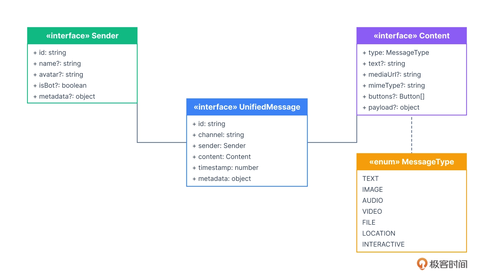
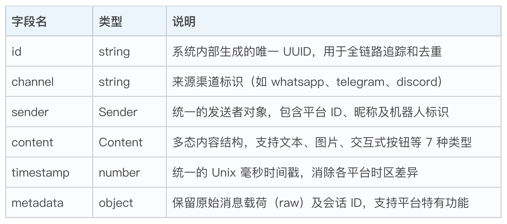
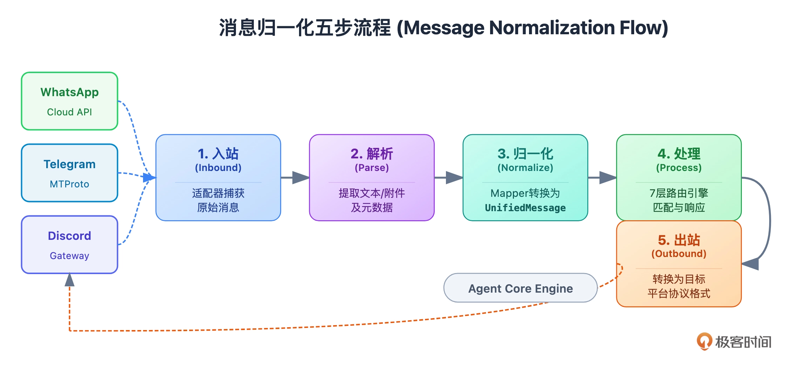
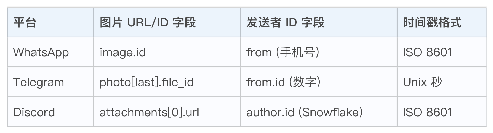
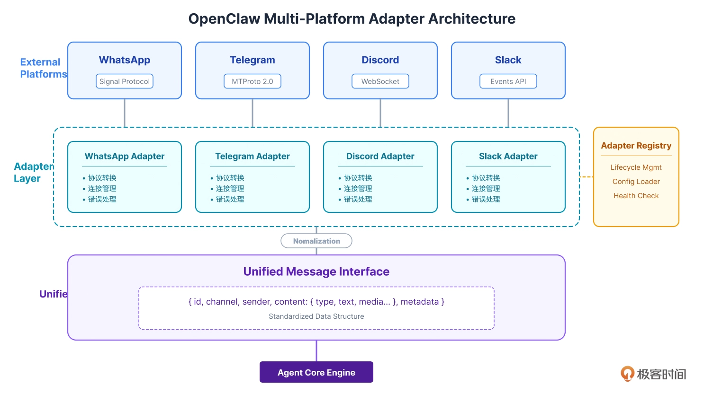
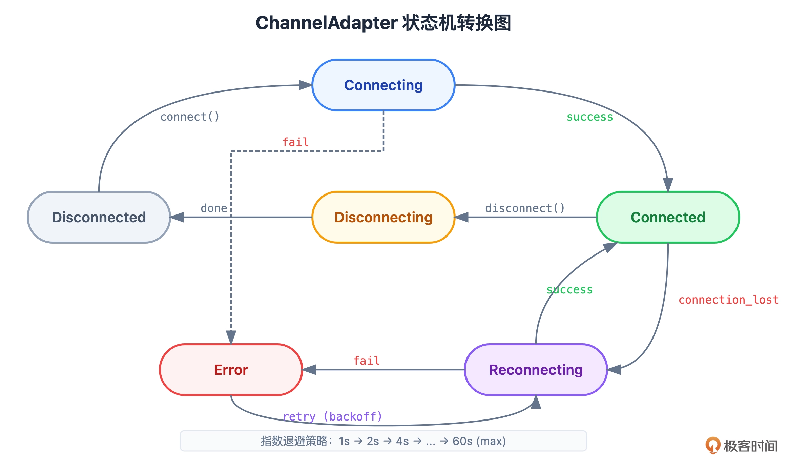

# 03 | 统一消息模型与多平台适配：如何构建Agent的“万能插座”？

你好，我是 Henry，欢迎来到《OpenClaw 核心原理与实战》。

先思考一个问题：当你的 Agent 需要同时接入微信、Telegram、Web、Discord 等多个平台时，你会如何设计消息处理架构？为每个平台写一套独立的消息处理代码？这意味着 N 个平台需要维护 N 套逻辑，任何业务变更都要修改 N 处代码——这显然是一场维护噩梦。例如在电商场景里，想象你正在经营一家快速成长的跨境电商公司。为了覆盖全球客户，你的客服系统必须同时在三个战场作战：WhatsApp（处理东南亚和拉美客户的日常咨询）、Telegram（维系技术社区和加密货币支付查询）、Discord（服务游戏玩家群体并发布活动公告）。

某天，法务部门要求修改“退款流程”：所有退款申请必须先经过人工初审。如果你的系统是为每个平台独立编写的，噩梦就开始了：你必须分别修改 WhatsApp 的 Webhook 逻辑、Telegram 的 Bot 监听器以及 Discord 的 Gateway 处理器。这不仅是三倍的工作量，更可怕的是逻辑不一致风险——如果 Telegram 端的代码漏掉了一个判断条件，可能导致公司遭受不必要的损失。

这种“异构性”带来的业务逻辑冗余是 Agent 系统走向规模化的最大障碍。这节课我们就深入OpenClaw 的核心设计，看看如何通过统一消息模型和适配器模式，将这些纷繁复杂的“方言”统一翻译成标准语言，实现真正的“一次开发，多平台运行”。让你的 Agent 只需编写一套核心逻辑，就能优雅地接入任意平台。

## UnifiedMessage：定义  Agent 的通用语言

在理解了多平台接入的痛点后，我们首先需要解决的问题是：如何让不同平台的消息“说同一种语言”？ 第一步不是写代码，而是定义一个统一消息模型——UnifiedMessage。你可以把它理解为“万能插座”的插孔规格标准：无论原始电器的插头是两脚还是三脚、是扁头还是圆头，只要符合这个规格，就能接入系统。

### 统一消息模型架构

在 OpenClaw 中，所有的外部交互最终都会被封装为 UnifiedMessage 对象。它不仅包含消息文本，还承载了发送者身份、媒体附件以及复杂的元数据。



### 核心字段设计

UnifiedMessage 的设计遵循“高内聚、易扩展”的原则，其核心字段如下表所示：



### TypeScript 接口定义

接下来这段代码定义了 UnifiedMessage 接口，它是整个消息适配体系的核心契约。这个接口的设计需要完成三个关键职责：

1. 身份标识：提供消息的唯一 ID、会话 ID、发送者信息

2. 内容承载：统一表示文本、图片、文件等多种消息类型

3. 上下文传递：携带平台来源、时间戳等元数据

```
// 统一消息主接口定义
interface UnifiedMessage {
 id: string;              // 内部唯一ID
 channel: string;         // 渠道名
 sender: {
   id: string;            // 平台用户ID
   name?: string;         // 显示名称
   isBot: boolean;        // 是否为机器人
   metadata?: any;        // 平台特有用户信息
 };
 content: {
   type: 'text' | 'image' | 'file' | 'interactive';
   text?: string;         // 文本内容
   mediaUrl?: string;     // 附件地址
   buttons?: any[];       // 交互按钮
   payload?: any;         // 自定义载荷
 };
 timestamp: number;       // 毫秒时间戳
 metadata: {
   conversationId: string; // 会话/群组ID
   raw?: any;              // 原始JSON对象（调试用）
 };
}
```

既然我们已经定义了这套“标准普通话”，那么谁来负责把各地的“方言”翻译过来呢？这就需要一套精密的流水线。在 OpenClaw 中，这个转换过程叫做“消息归一化”，由各平台的 Mapper组件负责实现。

## 消息归一化：从原始载荷到标准件

消息归一化（Normalization）是系统中最繁忙的“加工厂”。它将来自不同平台的原始数据，经过五道工序，加工成 Agent 核心引擎能够理解的“标准件”。

### 五步归一化流程



1. 入站 (Inbound)：适配器像“海关收件窗口”一样，通过 Webhook 或长连接签收原始包裹。

2. 解析 (Parse)：拆开包裹，识别出这是一个文本还是图片。

3. 归一化 (Normalize)：调用 Mapper，将提取的信息填入 UnifiedMessage 模板。

4. 处理 (Process)：Agent 核心引擎根据统一模型进行逻辑推理和决策。

5. 出站 (Outbound)：将 Agent 的响应逆向翻译回目标平台的特定格式并发送。

### 异构平台数据差异对比

不同平台对同一类消息的表达方式天差地别，下表展示了这种显著的异构性：



### 实战：Telegram Mapper 实现片段

以 TelegramMapper 为例，让我们看看一个具体的“转换头”是如何工作的。这个映射器需要完成以下四项任务：

1. 提取身份信息：从 Telegram 原始消息中解析 chat_id、user_id

2. 转换消息类型：将 Telegram 的 message/photo/document 映射为统一类型

3. 解析内容载荷：根据消息类型提取 text、file_id 等具体内容

4. 填充元数据：记录消息时间戳、平台来源等上下文信息

```python
class TelegramMapper {
 toUnified(raw: any): UnifiedMessage {
   return {
     id: crypto.randomUUID(),
     channel: 'telegram',
     sender: {
       id: String(raw.from.id),
       name: raw.from.first_name,
       isBot: raw.from.is_bot
     },
     content: {
       type: raw.photo ? 'image' : 'text',
       text: raw.text || raw.caption,
       mediaUrl: raw.photo ? raw.photo[raw.photo.length - 1].file_id : undefined
     },
     timestamp: raw.date * 1000, // 秒转毫秒
     metadata: {
       conversationId: String(raw.chat.id),
       raw: raw
     }
   };
 }
}
```

TelegramMapper 的实现展示了“转换头”的典型模式：接收原始格式 → 字段映射 → 输出统一格式。其他平台（如微信、Discord）的 Mapper 遵循相同的模式，只是映射规则不同。

现在，我们的流程已经定义清楚了，但具体由谁来执行这些连接、监听和发送的任务呢？欢迎来到适配器的世界。

## ChannelAdapter：Agent  的“万能插座”

学到这里，你可能会问：有了归一化映射器（Mapper），为什么还需要 ChannelAdapter？ 这是一个好问题。答案在于职责分离：

- Mapper：只负责数据格式转换，是“无状态”的纯函数

- Adapter：负责连接管理、错误恢复、心跳检测、重试机制等“有状态”的生产级问题

用“万能插座”的比喻来说：Mapper 是“转换头”，负责电气规格适配；Adapter 是“插座本体”，负责供电稳定、过载保护、漏电检测。只有两者配合，才能构成一个可靠的生产级系统。

### 适配器架构与职责



每个适配器承担着三大核心职责：

1. 协议转换：负责 UnifiedMessage 与平台原生协议（如 MTProto、Signal）的互转

2. 连接管理：维护长连接心跳，处理 Webhook 握手

3. 错误处理：捕获平台限流（Rate Limit）或 Token 失效等异常

### 状态机与自愈机制

为了保证 Agent 永不掉线，适配器内部实现了一套严谨的状态机。



当连接因网络波动断开时，适配器会自动进入 Reconnecting 状态，并启动指数退避策略（Exponential Backoff）：

- 第 1 次重试：1 秒后

- 第 2 次重试：2 秒后

- 第 3 次重试：4 秒后

- …

- 最大间隔：60 秒（防止对平台服务器造成 DDoS 攻击）

### AdapterRegistry：适配器注册中心

ChannelAdapter 的一个核心设计是“注册中心模式”——所有平台适配器在启动时注册到统一的Registry 中。这个设计带来三个好处：

1. 动态发现：运行时可查询当前支持的平台列表

2. 统一调度：消息路由层通过 Registry 获取对应 Adapter

3. 热插拔能力：新增平台只需注册，无需修改核心代码

```python
class AdapterRegistry {
 private adapters = new Map<string, ChannelAdapter>();
 register(adapter: ChannelAdapter) {
   this.adapters.set(adapter.channel, adapter);
 }
 async send(msg: UnifiedMessage) {
   const adapter = this.adapters.get(msg.channel);
   if (!adapter) throw new Error(`未找到渠道 ${msg.channel} 的适配器`);
   return await adapter.send(msg);
 }
}
```

AdapterRegistry 实现了“开闭原则”——对扩展开放（新增平台），对修改关闭（核心逻辑不变）。这正是“万能插座”架构的精髓所在。

到目前为止，我们完成了消息的“入口适配”：原始消息通过 Adapter 进入系统，经 Mapper 转换为统一格式。但这只是消息旅程的起点——下一步是决定这条消息应该由哪个 Agent 处理。

想象一个场景：跨境电商系统中同时运行着订单 Agent、客服 Agent、营销 Agent。当一条用户消息进来，系统如何判断应该交给谁？这就是路由引擎要解决的问题。

用“万能插座”的比喻延伸：统一模型是“插孔规格”，适配器是“插座本体”，那么路由引擎就是“配电箱”——负责将电流（消息）分配到正确的电路（Agent）。

## 7 层路由引擎：基于模型的智能分发

在 OpenClaw 中，路由引擎不再关心消息来自哪个平台，它只关注 UnifiedMessage。路由决策主要依赖模型中的 metadata。例如：

- 会话路由：利用 conversationId 锁定多轮对话上下文。

- 权限路由：检查 sender.id 是否在管理员白名单中。

- 功能路由：根据 content.type（如图片）分发给视觉识别插件。

这种设计确保了路由逻辑的纯粹性——无论用户是在微信还是 Telegram 发送图片，触发的都是同一个“图片处理逻辑”。

## 实战场景：跨境电商双平台接入

接下来，我们通过一个完整的实战案例，演示如何用统一消息模型实现 Telegram + 微信双平台。以下代码展示了如何利用上述架构，同时启动微信和 Telegram 客服机器人：

```javascript
async function startEcommerceAgent() {
 const registry = new AdapterRegistry();
 // 1. 接入微信适配器
 registry.register(new WeChatAdapter({
   appId: process.env.WECHAT_ID,
   token: process.env.WECHAT_TOKEN
 }));
 // 2. 接入Telegram适配器
 registry.register(new TelegramAdapter({
   botToken: process.env.TG_BOT_TOKEN
 }));
 // 3. 统一处理逻辑
 const onMessage = async (msg: UnifiedMessage) => {
   console.log(`收到来自 ${msg.channel} 的消息: ${msg.content.text}`);
   // 业务逻辑：所有平台共享退款查询功能
   if (msg.content.text?.includes('退款')) {
     const response = await refundService.query(msg.sender.id);
     await registry.send({
       ...msg,
       content: { type: 'text', text: response }
     });
   }
 };
 // 启动所有连接
 await Promise.all([...registry.values()].map(a => a.connect(onMessage)));
}
```

回顾这个实战案例，核心流程是：原始消息 → Adapter 接收 → Mapper 转换 →UnifiedMessage → 路由分发 → Agent 处理。

整个过程中，Agent 核心代码完全不感知平台差异——这就是“万能插座”架构的威力。

## 总结与权衡

统一消息模型与适配器架构为 Agent 带来了极大的灵活性，但在实际工程中，我们也必须面对一些权衡（Trade-offs）：

- 适配器维护成本：虽然业务逻辑统一了，但每个平台的 API 升级仍需更新对应的适配器。这套架构的核心权衡是：用“适配层的复杂度”换取“核心逻辑的简洁性”。

- 信息损失风险：归一化过程追求“最大公约数”，某些平台的特有功能（如 Discord 的复杂嵌入式卡片）在转换为统一模型时可能会丢失部分细节。

- 性能开销：多层转换和状态机管理会带来微小的延迟，但在对话式场景中，这种毫秒级的开销通常是可以接受的。

学完本节，你应该能够回答三个问题：

1. 为什么需要统一消息模型？（解决多平台维护噩梦）

2. Mapper 和 Adapter 的职责边界是什么？（数据转换 vs 连接管理）

3. 如何新增一个平台接入？（实现 Mapper + Adapter + 注册）

## 思考题

随着大模型能力的增强，未来我们是否可以直接让 LLM 来担任“适配器”，通过自然语言描述直接生成不同平台的 API 调用载荷？

欢迎你在留言区与我交流！如果今天的课程让你有所收获，也欢迎转发给有需要的朋友，邀请他来一起学习，我们下节课再见！
