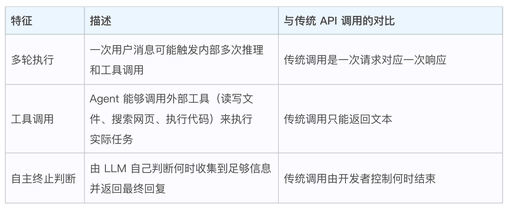
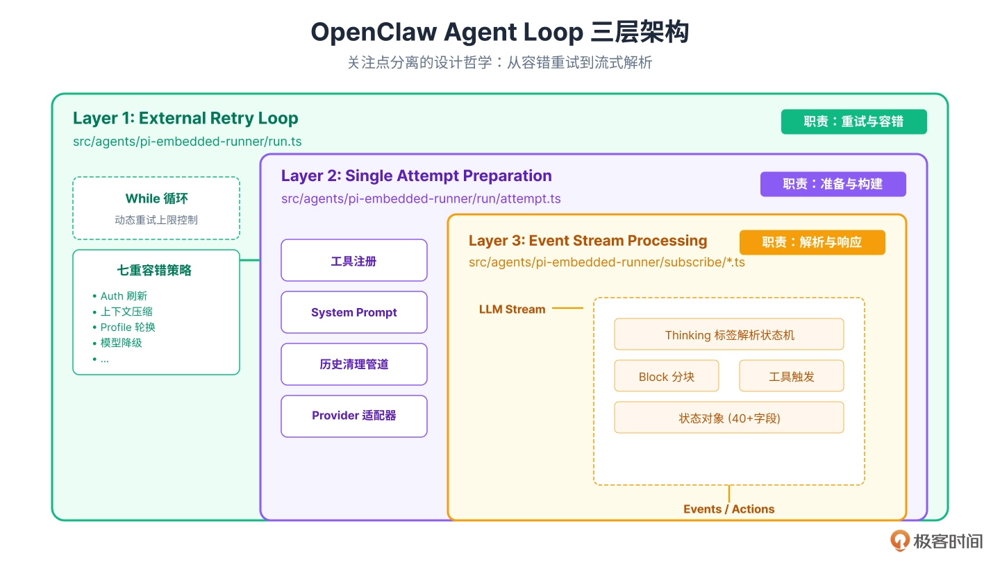
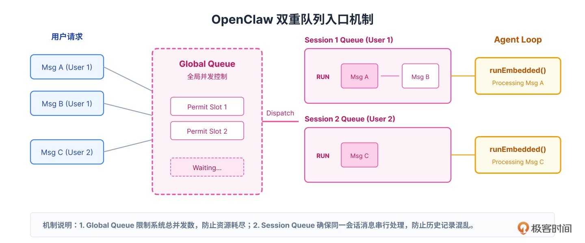
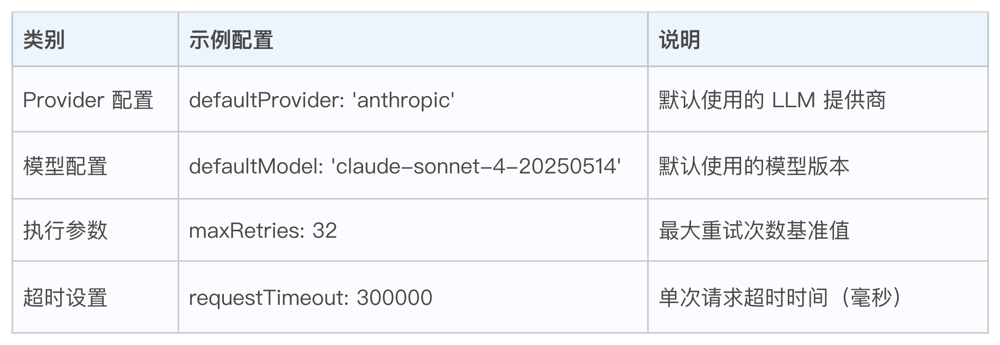

# 04 | 三层架构与执行流程总览：Agent如何完成感知-思考-行动循环？

你好，我是 Henry，欢迎来到《OpenClaw 核心原理与实战》。

当你第一次接触 AI Agent 开发时，是否有过这样的困惑：明明都是调用大语言模型的 API，为什么有些系统只能“一问一答”，而有些却能像真正的助手一样，自己去搜索信息、执行代码、生成文件，甚至在遇到问题时自动调整策略重新尝试？

这个问题的答案，就藏在今天我们要深入探讨的核心概念里——Agent Loop。

如果把一个 AI Agent 比作一个人，那么 Agent Loop 就是它的“心跳”。每一次心跳，Agent 都在进行“感知当前状态→思考下一步行动→执行并观察结果”的循环。这个循环会持续运转，直到 Agent 判断任务已经完成。理解 Agent Loop 的设计，是掌握任何生产级 Agent 系统的第一把钥匙。

今天这节课，我们将俯瞰 OpenClaw 的 Agent Loop 架构，建立起清晰的概念模型。你将学到：Agent Loop 与普通 LLM 调用的本质区别是什么？OpenClaw 为什么要把 Agent Loop 拆成三层？双重队列入口机制解决了什么问题？这些知识将为后续深入每一层的实现细节打下坚实基础。

## 什么是 Agent Loop ？

### 从“单次调用”到“自主循环”

让我们先从一个简单的对比开始理解 Agent Loop 的本质。

当你使用 ChatGPT 的 API 进行一次普通对话时，流程是这样的：发送消息→等待响应→获得回复，结束。这是一个单次 API 调用，控制权始终在调用方手中。你决定什么时候发消息，API 返回结果后交互就结束了。

但 Agent Loop 完全不同。当用户说“帮我分析这份销售数据并生成可视化报告”时，Agent 内部可能会经历这样的过程：

- 第一轮：读取数据文件，发现是 CSV 格式

- 第二轮：执行 Python 代码进行数据清洗

- 第三轮：计算关键指标，发现有异常值需要处理

- 第四轮：重新清洗数据，生成统计结果

- 第五轮：调用绘图工具生成可视化图表

- 第六轮：整合所有结果，生成最终报告

在这个过程中，LLM 自己决定是否继续循环——这是 Agent Loop 与普通 API 调用的本质区别。用户只发出了一条指令，但 Agent 内部进行了多轮“思考 - 行动 - 观察”的迭代，每一轮结束时由 LLM 判断：任务完成了吗？还需要继续吗？下一步该做什么？

### Agent Loop 的三个关键特征

基于上述理解，我们可以提炼出 Agent Loop 的三个关键特征：



这三个特征共同构成了业界所说的 “ReAct”（Reasoning and Acting）范式的核心——Agent在一个循环中反复交替进行推理（Reasoning）和行动（Acting），直到任务完成。

理解了 Agent Loop 的概念之后，一个自然的问题浮现出来：在生产环境中，我们需要处理网络超时、API 限流、上下文溢出等各种异常情况，一个简单的 while 循环显然无法满足需求。那么，OpenClaw 是如何设计它的 Agent Loop 来应对这些挑战的呢？这就引出了我们下一个核心知识点——三层架构设计。

## OpenClaw 的三层架构设计

### 为什么需要分层？

想象一下，如果把所有 Agent Loop 的逻辑都写在一个函数里会发生什么：重试逻辑、工具注册、Prompt 构建、流式事件处理、错误恢复……这些代码会纠缠在一起，形成一团难以维护的“意大利面条”。更糟糕的是，当你需要修改重试策略时，可能会意外影响到事件处理逻辑。

OpenClaw 采用了关注点分离（Separation of Concerns）原则，将 Agent Loop 拆分为三个层次。每一层只关注一个核心问题，通过标准接口与相邻层通信。这种设计就像人体的神经系统：大脑（外层）负责战略决策，脊髓（中层）负责协调执行，神经末梢（内层）负责实时感知和反馈。

### 三层架构详解

让我们逐层剖析 OpenClaw 的 Agent Loop 架构。

```
第一层：外部重试循环 runEmbeddedPiAgent()（run.ts）
```

这一层位于最外部，核心职责是回答一个问题：如果失败了怎么办？

它不关心 LLM 具体如何调用，不关心 Prompt 如何构建，只关注一件事——当下层汇报“出错了”时，应该采取什么恢复策略。这一层实现了 OpenClaw 著名的“七重容错策略”（我们将在下一课详细讲解），包括 Auth 刷新、上下文压缩、Profile 轮换、模型降级等。

```
源文件位置：src/agents/pi-embedded-runner/run.ts（约 1708 行）
第二层：单次 LLM 尝试 runEmbeddedAttempt() （attempt.ts）
```

这一层位于中间，核心职责是回答：一次调用需要准备什么？

每当外层决定“执行一次 LLM 调用”时，中层就开始工作：注册可用工具、构建 SystemPrompt、清理会话历史、适配不同 Provider 的 API 格式……这是一条完整的“准备链条”，确保每次发往 LLM 的请求都是完整、合规、安全的。

```
源文件位置：src/agents/pi-embedded-runner/run/attempt.ts（约 2923 行）
第三层：事件流处理 subscribeEmbeddedPiSession() （subscribe 相关文件）
```

这一层位于最内部，核心职责是回答：LLM 正在说话时发生了什么？

当 LLM 开始流式输出时，内层负责实时解析每一个 token：这是思考过程还是正式回复？是否触发了工具调用？如何将长文本分块发送给用户？这一层需要处理 10 种不同的事件类型，维护 40 多个状态字段，是整个 Agent Loop 中最“细腻”的部分。

```
源文件位置：由 pi-embedded-subscribe.ts 入口及 5 个 handlers 模块文件组成
```

### 三层协作的完整图景



- OpenClaw Agent Loop 三层架构示意图展示了外层重试循环(run.ts)、中层单次准备(attempt.ts)、内层事件处理(subscribe)的嵌套关系

为了更直观地理解三层之间的关系，上图清晰展示了三层架构的嵌套结构：外层（绿色）负责重试与容错决策，中层（紫色）负责单次调用的准备工作，内层（橙色）负责实时事件流的解析与响应。

这种分层设计带来了几个显著优势：

1. 可维护性：修改重试策略不会影响事件处理逻辑

2. 可测试性：每一层都可以独立进行单元测试

3. 可扩展性：新增 Provider 支持只需在中层添加适配器

理解了三层架构的职责划分后，你可能会问：当多个用户同时发送消息，或者同一个用户快速连续发送多条消息时，系统如何保证不会出现混乱？这就涉及到 Agent Loop 的入口机制——双重队列设计。

## 入口机制：双重队列嵌套

### 为什么需要队列？

在生产环境中，Agent 系统会面临两个并发挑战：

1. 同一会话的竞态条件：用户快速连续发送消息 A 和 B，如果 A 还没处理完 B 就开始执行，可能导致会话历史记录混乱。

2. 全局资源耗尽：大量并发请求同时涌入，可能瞬间耗尽 API 额度或系统资源。

OpenClaw 通过双重队列嵌套机制优雅地解决了这两个问题。

### 双重队列的设计原理

Session 队列（内层）：保证同一会话串行执行

每个会话（Session）都有自己独立的队列。当用户在同一个对话中连续发送消息时，这些消息会按顺序排队，确保前一条处理完毕后才开始下一条。这避免了会话历史被并发写入导致的数据不一致问题。

Global 队列（外层）：控制全局并发度

所有会话的执行请求都需要经过全局队列的“门禁”。系统可以配置最大并发数，防止资源耗尽。当并发达到上限时，新请求会在全局队列中等待。

```javascript
// 双重队列的逻辑简化示意
async function runAgentLoop(sessionId: string, message: string) {
 // 第一层：获取全局并发许可
 await globalQueue.acquire();
 try {
   // 第二层：在Session队列中串行执行
   await sessionQueues.get(sessionId).run(async () => {
     // 实际的Agent Loop执行逻辑
     await executeAgentLoop(sessionId, message);
   });
 } finally {
   // 释放全局并发许可
   globalQueue.release();
 }
}
```



- 双重队列入口机制流程图展示了 Global Queue 控制全局并发、Session Queue 保证会话串行的协作机制

这种“先获取全局许可，再进入会话队列”的设计，既保证了单会话的顺序性，又控制了系统整体的并发压力——就像医院的挂号系统，既要保证每个患者按顺序看病（Session 队列），又要控制同时就诊的人数不超过诊室容量（Global 队列）。

队列机制解决了“谁先执行”的问题，但还有一个关键问题没有回答：Agent Loop 执行时，使用哪个模型？API Key 从哪里来？默认参数是什么？这就需要了解 OpenClaw 的模型解析与默认值体系。

## 模型异步解析与默认值体系

### resolveModelAsync()：动态确定执行环境

在 Agent Loop 真正开始执行之前，系统需要确定一系列关键参数：使用哪个 LLM Provider（Anthropic、OpenAI 还是 Ollama）？具体使用哪个模型版本？API Key 是什么？

```
OpenClaw 通过 resolveModelAsync() 函数来完成这个解析过程。有趣的是，这个过程是
```

可被插件 Hook 介入的。这意味着你可以通过插件动态地：

- 根据用户身份切换不同的模型

- 根据任务类型选择最合适的 Provider

- 在运行时动态覆盖默认配置

```javascript
// resolveModelAsync的简化逻辑
async function resolveModelAsync(context: AgentContext) {
 // 1. 读取默认配置
 let model = defaults.model;
 let provider = defaults.provider;
 // 2. 应用Profile级别的覆盖
 if (context.profile?.model) {
   model = context.profile.model;
 }
 // 3. 触发Hook，允许插件动态修改
 const hookResult = await hooks.trigger('before_model_resolve', {
   model, provider, context
 });
 return hookResult ?? { model, provider };
}
```

### defaults.ts：系统的“出厂设置”

```
defaults.ts 文件定义了 OpenClaw 的所有默认值，可以将其理解为系统的“出厂设置”。这
```

些默认值涵盖：



这种“默认值 + 多级覆盖”的设计模式，让系统既有开箱即用的便利性，又保留了灵活定制的能力。

配置解析完成后，Agent Loop 就可以开始执行了。但在多轮交互中，如何准确计量 Token 消耗？这对于成本控制和用量监控至关重要。

## Usage 累计器：精确计量 Token 消耗

### 为什么需要区分“累计”与“最后一次”？

在 Agent Loop 的多轮执行中，Token 消耗的计量有一个微妙之处：Input Token 和 OutputToken 的统计逻辑是不同的。

- Output Token：需要累计所有轮次的输出，因为每一轮 LLM 都会产生新的输出。

- Input Token：只需记录最后一次的值，因为会话历史会累积，最后一次的 Input 实际上包含了之前所有内容。

如果不做这个区分，你可能会发现统计的 Token 数远超实际消耗——因为重复计算了历史消息中的 Input Token。

### Usage 累计器的实现逻辑

OpenClaw 的 Usage 累计器维护两套数据：

```javascript
interface UsageAccumulator {
 // 累计值（用于Output）
 totalOutputTokens: number;
 totalCacheCreationTokens: number;
 // 最后一次值（用于Input）
 lastInputTokens: number;
 lastCacheReadTokens: number;
}
// 每次LLM调用完成后的更新逻辑
function updateUsage(accumulator: UsageAccumulator, currentUsage: Usage) {
 // Output相关：累加
 accumulator.totalOutputTokens += currentUsage.outputTokens;
 accumulator.totalCacheCreationTokens += currentUsage.cacheCreationTokens;
 // Input相关：覆盖
 accumulator.lastInputTokens = currentUsage.inputTokens;
 accumulator.lastCacheReadTokens = currentUsage.cacheReadTokens;
}
// 计算最终总消耗
function getTotalUsage(accumulator: UsageAccumulator) {
 return {
   inputTokens: accumulator.lastInputTokens,
   outputTokens: accumulator.totalOutputTokens,
   // ...
 };
}
```

这种设计确保了 Token 统计的准确性，为成本核算和用量告警提供了可靠的数据基础。

## 总结：Agent Loop 的概念闭环

让我们回顾今天学习的核心内容，将这些知识点串联成一个完整的概念闭环。

1. Agent Loop 的本质：不同于单次 API 调用，Agent Loop 是一个由 LLM 自主控制的“思考 -行动 - 观察”循环，具备多轮执行、工具调用和自主终止判断三大特征。

2. 三层架构设计：OpenClaw 将 Agent Loop 拆分为外层（重试容错）、中层（单次准备）、内层（事件处理），每层专注解决一个核心问题，实现了高内聚低耦合。

3. 双重队列入口：通过 Session 队列保证单会话顺序性，通过 Global 队列控制全局并发，优雅解决了生产环境的并发挑战。

```
模型解析与默认值：resolveModelAsync() 支持动态解析和 Hook 介入，
defaults.ts 提供灵活的默认值体系。
```

5. Usage 累计器：通过区分“累计值”与“最后一次值”，实现了多轮交互中 Token 消耗的精确计量。

回到开篇的问题：为什么有些 AI 系统能像真正的助手一样自主工作？答案就在于它们实现了真正的 Agent Loop——一个能够自我驱动、自我纠错、自主决策的执行引擎。而 OpenClaw的三层架构设计，正是这种能力的工程化体现。

在接下来的课程中，我们将逐层深入：下一课将详细拆解外层的七重容错策略，看看OpenClaw 如何在生产环境中实现“打不死的小强”般的健壮性。

## 思考题

1. 架构设计题：假设你需要为 OpenClaw 新增一个功能——当 Agent 执行超过 10 轮仍未完成时，自动发送通知给用户询问是否继续。根据三层架构的职责划分，这个功能应该在哪一层实现？为什么？

2. 并发设计题：双重队列机制中，Session 队列保证了同一会话的串行执行。但如果某个用户的任务执行时间特别长（比如 30 分钟），会不会阻塞该用户的其他会话？OpenClaw 可以如何优化这种场景？

欢迎你在留言区与我交流！如果今天的课程让你有所收获，也欢迎转发给有需要的朋友，邀请他来一起学习，我们下节课再见！
