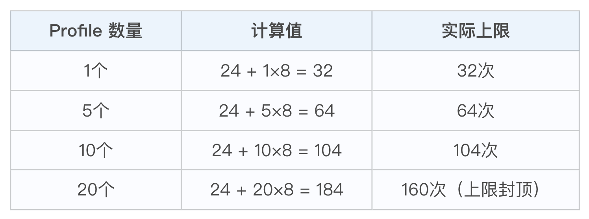
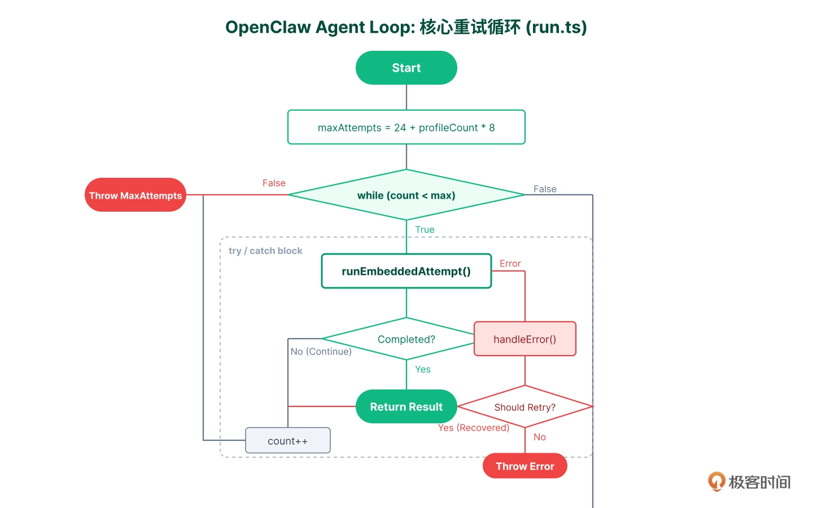
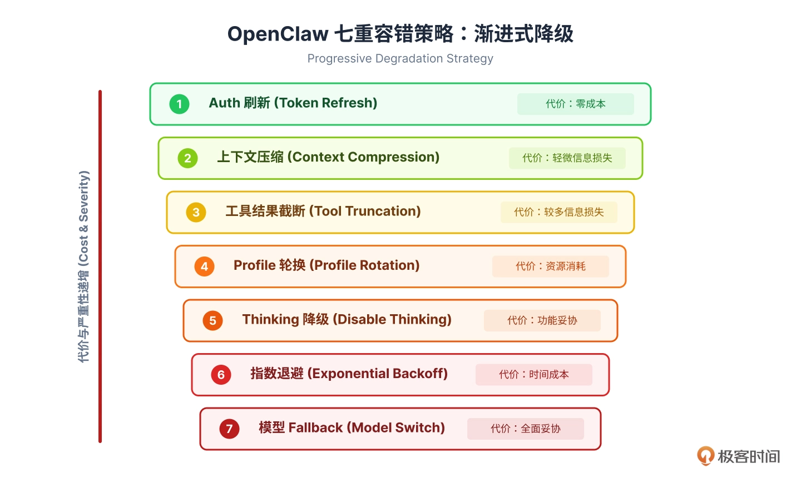
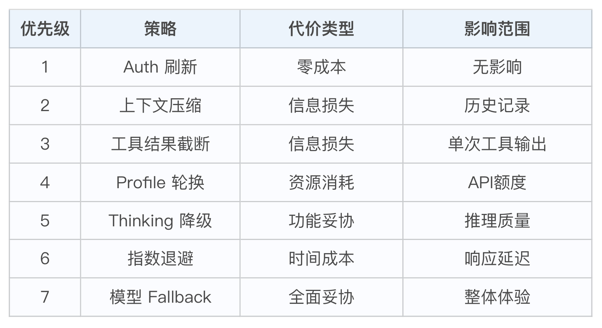

# 05 | 核心重试循环与七重容错策略：生产级Agent系统如何实现渐进式降级？

你好，我是 Henry，欢迎来到《OpenClaw 核心原理与实战》。

凌晨三点，你的手机突然响起告警：生产环境的 Agent 服务大面积报错。你睡眼惺忪地打开监控面板，发现是 LLM 供应商的 API 触发了限流——每分钟请求数超过了配额上限。更糟糕的是，由于没有容错机制，所有正在执行的 Agent 任务都直接失败了，用户看到的是一片“服务暂时不可用”的错误提示。

这个场景是否似曾相识？在生产环境中，Agent 系统面临的挑战远比开发环境复杂：网络抖动、API 限流、Token 超限、模型过载……任何一个环节出问题，都可能导致整个任务失败。一个没有容错能力的 Agent，就像一个不会游泳的人被扔进大海——遇到第一个浪头就会被淹没。

```
今天这节课，我们将深入 OpenClaw 的 run.ts 文件，拆解它的核心重试循环和七重容错策
```

略。你将学到：重试循环的骨架是什么样的？七种容错策略分别解决什么问题？为什么它们要按特定顺序排列？理解这些设计，你就能打造出“打不死的小强”般健壮的 Agent 系统。

## 重试循环的骨架

### while 循环：Agent Loop 的“心脏起搏器”

```
在上一课中，我们了解了 Agent Loop 的三层架构，其中最外层的 run.ts 负责重试与容错。
```

现在让我们打开这个文件，看看它的核心结构。

```
run.ts 的核心是一个 while 循环，可以将其理解为 Agent 的“心脏起搏器”——只要任务没有
```

完成或没有遇到不可恢复的错误，它就会持续跳动，驱动 Agent 不断尝试。

```javascript
// run.ts 核心循环的简化结构
async function runEmbeddedPiAgent(context: AgentContext) {
 let attemptCount = 0;
 const maxAttempts = calculateMaxAttempts(context.profiles);
 while (attemptCount < maxAttempts) {
   try {
     // 调用中层：执行单次LLM尝试
     const result = await runEmbeddedAttempt(context);
     // 成功完成，退出循环
     if (result.completed) {
       return result;
     }
     // LLM决定继续执行下一轮
     attemptCount++;
   } catch (error) {
     // 核心容错逻辑：根据错误类型选择恢复策略
     const recovery = await handleError(error, context);
     if (recovery.shouldRetry) {
       attemptCount++;
       continue; // 重试
     } else {
       throw error; // 不可恢复，上抛错误
     }
   }
 }
 throw new MaxAttemptsExceededError();
}
```

这个循环结构清晰地体现了外层的职责：它不关心 LLM 如何调用、Prompt 如何构建，只关心两件事——成功了就返回，失败了就想办法恢复。

### 动态重试上限：与 Profile 数量挂钩

一个重要的设计细节是：重试次数上限不是固定的，而是动态计算的。OpenClaw 使用以下公式：maxAttempts = 24 + profileCount × 8

```
其中 profileCount 是配置的 API Key 数量。这个值被限制在  [32, 160]  的区间内：
```



为什么要这样设计？因为更多的 Profile 意味着更多的“备用弹药”——当一个 API Key 被限流时，系统可以切换到另一个继续执行。Profile 越多，系统的容错空间就越大，允许的重试次数自然也应该更多。



- 核心重试循环骨架流程图展示了 while 循环的完整逻辑：初始化 maxAttempts、执行 runEmbeddedAttempt()、成功返回或错误处理、可恢复则重试否则抛出

```
理解了循环骨架之后，关键问题来了：当 catch 块捕获到错误时，handleError 函数内部
```

发生了什么？这就是七重容错策略的舞台。

## 七重容错策略详解

OpenClaw 的容错策略设计遵循一个核心原则：代价递增。就像医院急救一样，医生会先尝试最简单、副作用最小的治疗方案，只有在无效时才会升级到更激进的手段。七种策略按照对系统影响从小到大排列，确保在解决问题的同时最小化“副作用”。



- 七重容错策略渐进式降级图按代价递增顺序排列：从零成本的 Auth 刷新到全面妥协的模型 Fallback，体现“能省则省、逐级加码”的设计哲学

### 策略一：Runtime Auth 自动刷新

```
触发条件：检测到 isAuthAssistantError(error) 且系统配置了 Runtime Auth（如
```

OAuth Token）。

原理：许多 LLM 服务使用有过期时间的访问令牌。OpenClaw 会在令牌过期前 5 分钟主动触

```
发刷新，而不是等到过期后再处理。如果刷新正在进行中（refreshInFlight 为 true），循
```

环会等待刷新完成后自动重试。

```
// 策略1：Auth刷新
if (isAuthAssistantError(error) && context.runtimeAuth) {
 if (context.runtimeAuth.refreshInFlight) {
   // 等待正在进行的刷新完成
   await context.runtimeAuth.waitForRefresh();
   return { shouldRetry: true, strategy: 'auth_refresh' };
 }
 // 检查是否可以刷新
 if (canRefreshToken(context.runtimeAuth)) {
   await context.runtimeAuth.refresh();
   return { shouldRetry: true, strategy: 'auth_refresh' };
 }
}
```

代价：零成本。不丢失任何信息，不改变模型行为，仅产生极短的等待延迟。这就是为什么它排在第一位。

### 策略二：上下文压缩

```
触发条件：检测到 isLikelyContextOverflowError(error)（上下文超出模型窗口限
```

制）且压缩尝试次数小于 3 次。

原理：当对话历史过长导致 Token 超限时，OpenClaw 会调用可插拔的上下文引擎

```
（contextEngine.compact()）对历史记录进行摘要化处理。这个引擎可以使用 LLM 来
```

提取关键信息，将冗长的对话压缩成精炼的摘要。

```
// 策略2：上下文压缩
if (isLikelyContextOverflowError(error) && compactAttempts < 3) {
 await context.contextEngine.compact({
   session: context.session,
   preserveRecent: 5,  // 保留最近5轮对话的完整内容
   summaryMaxTokens: 2000
 });
 compactAttempts++;
 return { shouldRetry: true, strategy: 'context_compact' };
}
```

代价：信息损失。旧的对话细节会被模糊化，Agent 可能“忘记”一些早期的上下文。但核心语义得以保留，任务通常可以继续。上限设为 3 次是为了防止无限压缩导致信息损失过多。

### 策略三：工具结果截断

触发条件：上下文压缩达到 3 次上限后仍然溢出，且

```
sessionLikelyHasOversizedToolResults(session) 返回 true。
```

原理：有时候上下文溢出不是因为对话历史太长，而是因为某个工具返回了巨量数据——比如Agent 读取了一个 10MB 的日志文件。这种情况下，OpenClaw 会直接截断该工具的输出，保

```
留头部和尾部内容，中间标记为 [truncated]。
// 策略3：工具结果截断
if (compactAttempts >= 3 && sessionLikelyHasOversizedToolResults(session)) {
 truncateOversizedToolResults(session, {
   maxResultLength: 50000,  // 最大保留50000字符
   headRatio: 0.3,          // 头部保留30%
   tailRatio: 0.2,          // 尾部保留20%
   truncationMarker: '\n\n[... content truncated due to size ...]\n\n'
 });
 return { shouldRetry: true, strategy: 'tool_truncation' };
}
```

代价：更多信息损失。比压缩更激进，直接丢弃了部分工具执行的原始数据。但这是在“任务失败”和“部分信息丢失”之间的权衡——通常后者更可接受。

### 策略四：Profile 轮换

```
触发条件：检测到 isAuthOrRateLimitError(error)（认证失败或 HTTP 429 限流错
```

误）。

原理：当一个 API Key 被限流或失效时，OpenClaw 会标记该 Profile 为“暂时不可用”，然后自动切换到候选列表中的下一个可用 Profile。这就是为什么配置多个 API Key 是生产环境的最佳实践。

```javascript
// 策略4：Profile轮换
if (isAuthOrRateLimitError(error)) {
 // 标记当前Profile失败
 markProfileFailed(context.currentProfile, {
   reason: error.code,
   cooldownMinutes: 15  // 15分钟冷却期
 });
 // 尝试切换到下一个可用Profile
 const nextProfile = advanceAuthProfile(context.profiles);
 if (nextProfile) {
   context.currentProfile = nextProfile;
   return { shouldRetry: true, strategy: 'profile_rotation' };
 }
 // 所有Profile都不可用，继续尝试其他策略
}
```

代价：资源切换。需要消耗备用的 API 额度，但对用户体验无功能性影响。这是一个“花钱买稳定”的策略。

### 策略五：Thinking 级别降级

触发条件：模型不支持当前请求的 Thinking 级别（如 Claude 的 Extended Thinking 功能）。

原理：一些高级推理功能（如深度思考模式）可能在特定条件下不可用。OpenClaw 会按照

```javascript
high → medium → low → off 的顺序逐级降低推理深度，直到找到模型支持的级别。
// 策略5：Thinking级别降级
if (isThinkingLevelNotSupportedError(error)) {
 const currentLevel = context.thinkingLevel;
 const fallbackLevel = pickFallbackThinkingLevel(currentLevel);
 if (fallbackLevel) {
   context.thinkingLevel = fallbackLevel;
   return { shouldRetry: true, strategy: 'thinking_downgrade' };
 }
}
// 降级顺序映射
function pickFallbackThinkingLevel(current: ThinkingLevel): ThinkingLevel | null
 const fallbackMap = {
   'high': 'medium',
   'medium': 'low',
   'low': 'off',
   'off': null  // 已经是最低级别，无法再降
 };
 return fallbackMap[current];
}
```

代价：功能妥协。LLM 的推理质量会下降，回答可能不够深入或准确。但至少能产出结果，总比完全失败要好。

### 策略六：Overload 指数退避

触发条件：服务端返回过载（Overload/503）错误。

原理：当 LLM 服务端过载时，立即重试只会加剧拥堵。OpenClaw 采用指数退避策略：初始等待 250ms，每次失败后等待时间翻倍，最高 1500ms。同时加入 20% 的随机抖动（Jitter）来避免多个客户端同时重试造成的“惊群效应”。

```javascript
// 策略6：指数退避
if (isOverloadError(error)) {
 const baseDelay = 250;  // 初始250ms
 const maxDelay = 1500;  // 最大1500ms
 const jitterRatio = 0.2; // 20%抖动
 // 计算退避时间
 let delay = Math.min(baseDelay * Math.pow(2, overloadRetryCount), maxDelay);
 // 添加随机抖动
 const jitter = delay * jitterRatio * (Math.random() - 0.5) * 2;
 delay = Math.floor(delay + jitter);
 await sleep(delay);
 overloadRetryCount++;
 return { shouldRetry: true, strategy: 'exponential_backoff' };
}
```

代价：时间成本。系统进入被动等待状态，响应延迟显著增加。但这是在服务端过载时的无奈之举，强行重试只会让情况更糟。

### 策略七：模型 Fallback

触发条件：上述所有策略均无效，且系统配置了备选模型。

```
原理：作为最后的“救命稻草”，OpenClaw 会抛出 FailoverError，由外部的 Fallback 链捕
```

获并切换到完全不同的备选模型重新执行。例如，从 Claude 切换到 GPT-4，或从云端模型切换到本地部署的 Ollama 模型。

```javascript
// 策略7：模型Fallback（最后手段）
if (context.fallbackModels && context.fallbackModels.length > 0) {
 const fallbackModel = context.fallbackModels.shift();
 throw new FailoverError({
   originalError: error,
   fallbackTo: fallbackModel,
   message: `Primary model failed, falling back to ${fallbackModel.name}`
 });
}
// 外层Fallback链捕获
try {
 await runEmbeddedPiAgent(context);
} catch (error) {
 if (error instanceof FailoverError) {
   // 使用备选模型重新执行
   context.model = error.fallbackTo;
   await runEmbeddedPiAgent(context);
 }
}
```

代价：全面妥协。模型的能力、成本、延迟、回复风格都可能发生显著变化。用户可能会明显感知到回答质量的不同。这是“保证有输出”与“保证输出质量”之间的艰难抉择。

## 设计哲学：渐进式降级与断路器

### 代价递增排列的智慧

回顾七重策略，你会发现它们的排列顺序绝非随意。



这种“先试便宜的，不行再升级”的设计，确保了系统在解决问题时付出最小的代价。这不是简单的工程直觉，而是生产环境中无数次踩坑后沉淀的智慧。

### 断路器设计：防止无限循环

每种策略都有明确的终止条件，这是断路器（Circuit Breaker）模式的体现：

- 上下文压缩：最多 3 次

- Profile 轮换：Profile 耗尽即停止

- Thinking 降级：降到 off 即停止

- 指数退避：达到最大延迟后停止

- 总重试次数：32-160 次的硬上限

没有断路器的容错系统是危险的——它可能陷入无限重试的死循环，不仅无法恢复任务，还会浪费大量资源。OpenClaw 的每个策略都内置了“熔断”机制，确保在合理的尝试次数后优雅地放弃。

### 可观测性：错误分类与监控

最后值得一提的是，OpenClaw 对每种错误类型都有清晰的分类和监控。通过

```
isAuthAssistantError、isLikelyContextOverflowError、isOverloadError
```

等判断函数，系统能够精确识别错误类型并选择对应的恢复策略。这些分类也为监控告警提供了基础——你可以针对不同类型的错误设置不同的告警阈值和处理流程。

## 总结：构建“打不死”的 Agent 系统

让我们回顾今天学习的核心内容：

```
重试循环骨架：run.ts 中的 while 循环是 Agent 的“心脏起搏器”，重试上限通过 24 +
profileCount × 8 公式动态计算，范围在 32-160 次之间。
```

2. 七重容错策略：按代价递增排列——Auth 刷新（零成本）→ 上下文压缩（信息损失）→ 工具截断（更多信息损失）→ Profile 轮换（资源消耗）→ Thinking 降级（功能妥协）→ 指数退避（时间成本）→ 模型 Fallback（全面妥协）。

3. 设计哲学：渐进式降级确保最小代价解决问题；断路器机制防止无限循环；精确的错误分类支撑监控告警。

回到开头的场景：如果你的 Agent 系统具备这七重容错能力，凌晨三点的限流告警就不再是灾难。系统会自动切换 API Key 继续执行，你可以安心睡到天亮，第二天再来优化配额策略。这就是生产级 Agent 系统应有的健壮性。

```
在下一课中，我们将深入中层的 attempt.ts，看看单次 LLM 尝试需要准备什么——从工具
```

注册到策略管道，从 Prompt 构建到 Session 管理，每一个环节都大有学问。

## 思考题

1. 策略排序题：假设你的 Agent 系统部署在网络不稳定的边缘环境中，经常遇到网络超时错误。你会如何调整七重策略的优先级顺序？是否需要新增专门针对网络超时的策略？

2. 断路器设计题：文中提到上下文压缩的上限是 3 次。如果你发现用户的对话普遍很长，3 次压缩后仍然经常溢出，你会如何优化？提高压缩上限是好的方案吗？还有其他思路吗？

欢迎你在留言区与我交流！如果今天的课程让你有所收获，也欢迎转发给有需要的朋友，邀请他来一起学习，我们下节课再见！
