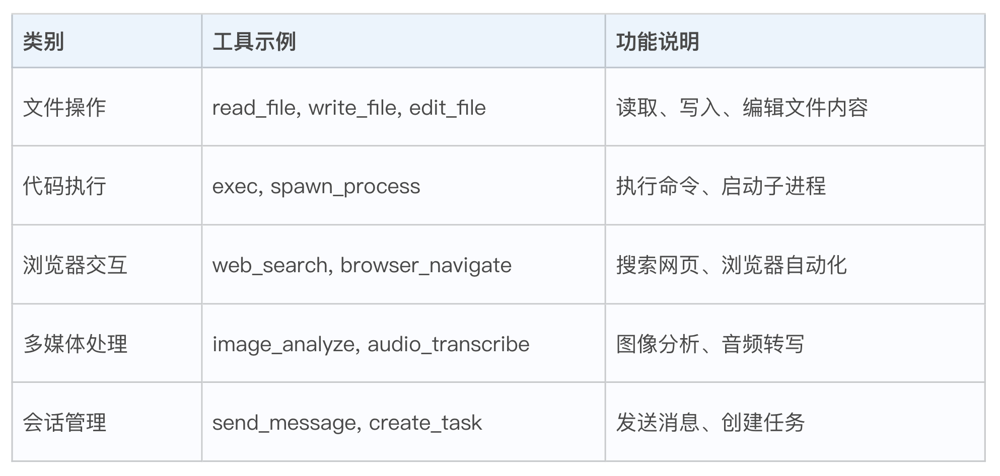
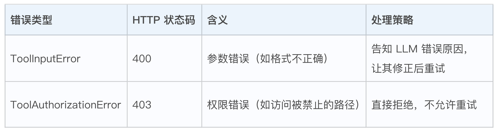
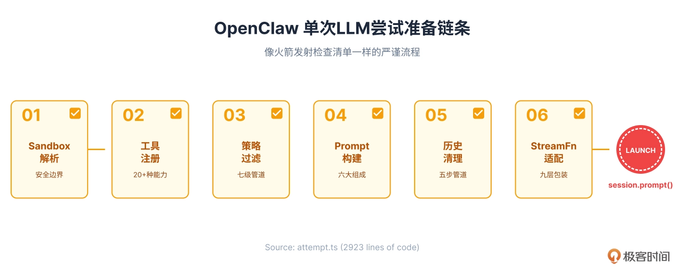
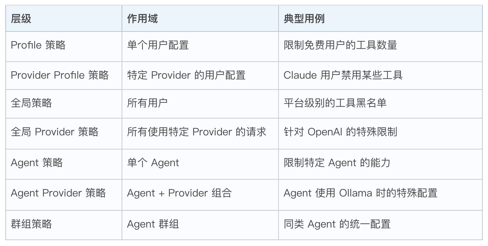
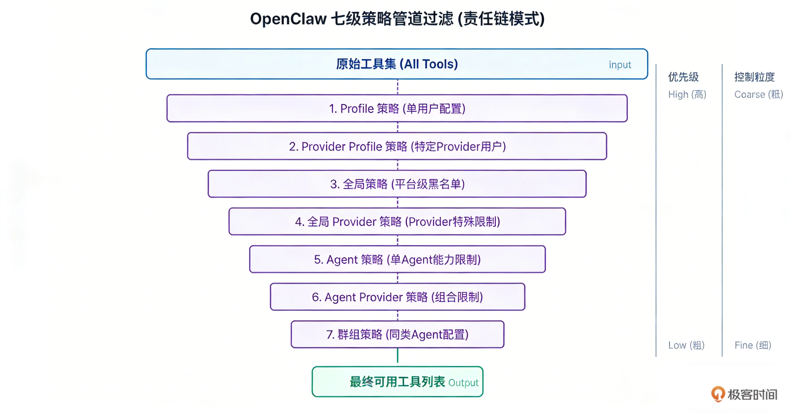
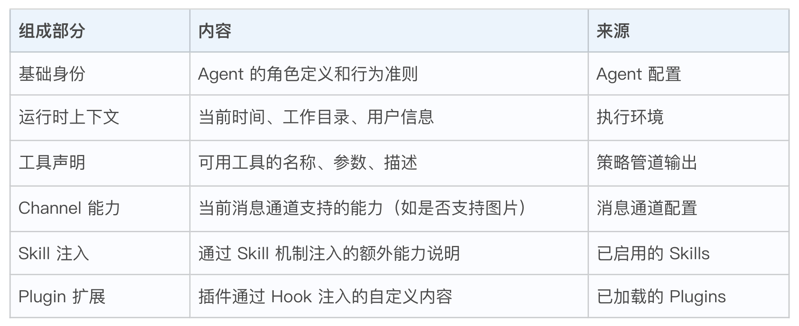
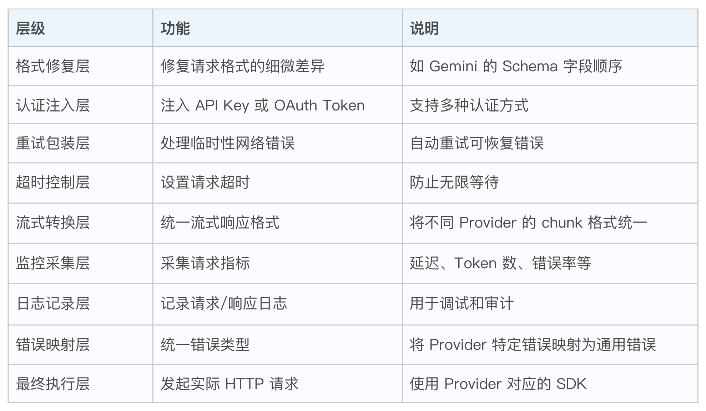
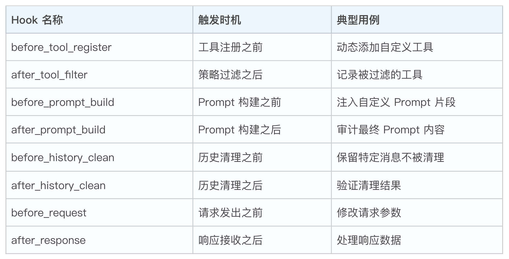

# 06 | 单次LLM尝试的完整流程：从工具注册开始发生了什么？

你好，我是 Henry，欢迎来到《OpenClaw 核心原理与实战》。

当你按下发送按钮，看到 Agent 开始思考时，你是否想过：在 LLM 真正收到你的消息之前，系统究竟做了多少准备工作？

如果把 Agent Loop 比作一次火箭发射，那么我们前两课讲的重试循环就是“发射控制中

```
心”——它负责决定何时发射、失败后如何重试。而今天我们要深入的 attempt.ts，则是“发
```

射前的检查清单”——从燃料加注到姿态校准，从通信测试到倒计时确认，每一个步骤都必须精确无误，火箭才能顺利升空。

在 OpenClaw 中，一次单次 LLM 尝试（Attempt）涉及的准备工作之复杂，可能会超出你的想象：工具注册、策略过滤、Prompt 构建、历史清理、Provider 适配……这条准备链条包含了2923 行精心设计的代码。今天，我们就来逐一拆解这条链条的每一个环节，看看 OpenClaw是如何确保每一次 LLM 调用都“弹无虚发”的。

## 工具注册：定义 Agent 的能力边界

### 为什么工具注册是第一步？

在 Agent 能够执行任何任务之前，系统必须首先回答一个根本性问题：这个 Agent 能做什么？

工具注册就是定义 Agent 能力边界的过程。一个没有注册任何工具的 Agent，就像一个只会说话但没有手脚的人——它可以分析问题、给出建议，但无法执行任何实际操作。而一个注册了文件读写、代码执行、网页搜索等工具的 Agent，则具备了知行合一的能力。

### Sandbox 环境解析：建立安全边界

```
在注册工具之前，OpenClaw 首先通过 resolveUserPath() 函数解析工作目录，建立
```

Sandbox 安全边界。这一步至关重要——它决定了 Agent 能够访问的文件系统范围。

```javascript
// Sandbox环境解析示意
const sandboxConfig = await resolveUserPath({
 workspaceRoot: '/usr/local/app/workspace',
 allowedPaths: ['/usr/local/app/workspace/**'],
 deniedPaths: ['/etc/**', '/root/**', '**/.env']
});
```

通过这种配置，Agent 只能在指定的工作目录下读写文件，无法访问系统敏感路径。这就像给Agent 画了一个活动范围——它可以在自己的“房间”里自由活动，但不能擅自进入其他“禁区”。

### 工具注册工厂：20+ 种能力的集中注册

```
OpenClaw 通过 createOpenClawCodingTools() 工厂函数集中注册所有可用工具。这些
```

工具按功能分为多个类别：



这种集中注册的设计模式带来了两个好处：一是所有工具定义集中管理，便于维护和审计；二是支持根据场景动态调整工具集——比如在“只读模式”下自动排除所有写入类工具。

### 工具类型体系与错误分类

```
OpenClaw 定义了统一的工具类型 AnyAgentTool，所有工具必须遵循这个接口规范。更重
```

要的是，系统对工具执行错误进行了精细分类。



这种分类的意义在于：

- 400 错误是可修复的——LLM 可以根据错误信息调整参数重新调用。

- 而 403 错误是不可逾越的——无论 LLM 如何尝试，都不应该绕过权限限制。



- 展示从 Sandbox 解析到 session.prompt() 发射的六步准备流程

## 工具策略管道：七级过滤的责任链

### 为什么需要多级策略？

想象这样一个场景：你运营一个多租户的 Agent 平台，不同租户有不同的权限等级，同一个租户的不同 Agent 也有不同的能力范围。如何灵活地控制“谁能用什么工具”？

OpenClaw 的答案是责任链模式的策略管道——工具必须依次通过多级关卡的审核，全部通过后才能出现在 LLM 的可用工具列表中。

### 七级策略过滤详解

策略管道包含七级过滤，按优先级从高到低依次执行：

```
工具 → Profile策略 → Provider Profile策略 → 全局策略
   → 全局Provider策略 → Agent策略 → Agent Provider策略
   → 群组策略 → 最终可用工具列表
```





- 漏斗形状展示工具如何被逐层筛选，粒度由粗到细

### 前置过滤与 Schema 归一化

在进入七级管道之前，系统还会进行一轮“前置过滤”。

- 消息通道过滤：在语音通道（voice）中禁用 TTS 工具，避免重复朗读。

- 模型能力过滤：如果模型内置了搜索能力（如某些版本的 Claude），则自动禁用自定义的

```
web_search 工具，避免功能冲突。
权限标记检查：标记为 Owner-Only 的工具（如 exec）只有会话所有者才能使用。
```

- Schema 归一化：不同 Provider 对工具定义的 JSON Schema 格式有细微差异（比如Gemini 要求特定的字段顺序）。归一化过程会自动修复这些格式问题，确保工具定义能被所有 Provider 正确解析。

策略管道确保了工具的“可用性”，接下来我们需要告诉 LLM 如何使用这些工具——这就是System Prompt 的职责。

## System Prompt 参数化构建

### 动态 Prompt vs 静态 Prompt

传统的 LLM 应用通常使用静态 Prompt——开发时写好，运行时不变。但在 Agent 系统中，Prompt 必须是动态的：可用工具会变、用户身份会变、执行环境会变……一个写死的 Prompt无法适应这些变化。

OpenClaw 采用参数化构建的方式，将 System Prompt 分解为多个独立组件，在运行时根据上下文动态组装。

### 六大组成部分

System Prompt 由以下六个部分动态组装而成：



```javascript
// System Prompt组装示意
function buildSystemPrompt(context: AttemptContext): string {
 const parts = [
   buildBaseIdentity(context.agent),
   buildRuntimeContext(context.environment),
   buildToolDeclarations(context.availableTools),
   buildChannelCapabilities(context.channel),
   buildSkillInjections(context.skills),
   buildPluginExtensions(context.plugins)
 ];
 return parts.filter(Boolean).join('\n\n');
}
```

这种模块化设计的好处是：每个部分都可以独立修改和测试，而且支持通过 Plugin 机制扩展新的组成部分。

Prompt 构建完成后，还需要处理一个关键问题：会话历史。如何确保传递给 LLM 的历史记录是干净、完整、合规的？

## Session 管理与历史清理管道

### 为什么历史清理如此重要？

会话历史是 Agent“记忆”的载体，但原始的历史记录往往存在各种问题：格式不统一（不同来源的消息格式可能不同）、工具调用未闭合（调用了工具但没有结果）、长度超限（超过模型的上下文窗口）……如果直接将这些脏数据传给 LLM，轻则影响回复质量，重则导致 API 报错。

OpenClaw 设计了一条五步清理管道，确保传递给 LLM 的历史记录符合所有要求。

### 五步清理流程详解

第一步：格式清理

将不同来源的消息统一转换为标准格式。比如，来自 WhatsApp 的消息和来自 CLI 的消息，

```
虽然原始格式不同，但经过清理后都变成统一的 UnifiedMessage 结构。
```

第二步：轮次校验

```
检查消息的角色交替是否正确。大多数 LLM 要求消息必须严格按照 user → assistant →
user → assistant 的顺序交替。如果发现连续两条 user 消息或连续两条 assistant 消息，
```

系统会进行合并或插入占位消息。

第三步：截断处理

当历史长度接近模型的上下文限制时，系统需要决定“删除哪些内容”。OpenClaw 采用保头保尾的策略：保留最早的几轮（建立任务背景）和最新的几轮（保持当前上下文），中间的内容根据需要截断或摘要化。

第四步：配对修复

```
确保每个工具调用都有对应的结果。如果发现 tool_use 消息后面没有跟着
tool_result，系统会插入一个“超时”或“中断”的结果消息，避免 LLM 困惑于未闭合的调
```

用。

第五步：最终组装将清理后的历史与 System Prompt、当前用户消息组装成完整的请求 payload。

```javascript
// 五步清理管道示意
async function cleanSessionHistory(rawHistory: Message[]): Promise<Message[]> {
 let messages = rawHistory;
 messages = formatCleanup(messages);      // Step 1
 messages = validateTurns(messages);       // Step 2
 messages = truncateIfNeeded(messages);    // Step 3
 messages = repairToolPairs(messages);     // Step 4
 return messages;                          // Ready for Step 5
}
```

经过五步清理，我们得到了一份干净的请求数据。但不同的 LLM Provider 有不同的 API 格式——Anthropic 用一种格式，OpenAI 用另一种格式。如何抹平这些差异？

## StreamFn 多层适配：抹平 Provider 差异

### Provider 碎片化的挑战

当前 LLM 市场存在显著的碎片化：Anthropic 的 Claude、OpenAI 的 GPT、Google 的Gemini、本地部署的 Ollama……每个 Provider 的 API 格式、认证方式、流式响应格式都有差异。如果为每个 Provider 编写独立的调用逻辑，代码会变得难以维护。

OpenClaw 的解决方案是 StreamFn 适配器架构——通过多层适配器包装，将所有 Provider的差异封装在适配层内，对上层业务逻辑暴露统一接口。

### 九层适配器包装

StreamFn 并非单一适配器，而是由多层适配器组成的“洋葱结构”。



这种分层设计的优势在于：每一层都可以独立开发、测试和替换。当需要支持新的 Provider时，只需在最内层添加一个新的执行器，外层的适配逻辑可以完全复用。

## Plugin Hook：全生命周期的扩展点

### Hook 机制的设计理念

即使 OpenClaw 的设计再周全，也无法预见所有用户场景。为此，系统在单次尝试的关键节点暴露了 8 个以上的 Hook 点，允许开发者通过 Plugin 注入自定义逻辑。

### 关键 Hook 点及其触发时机



通过这些 Hook，开发者可以在不修改 OpenClaw 核心代码的情况下，实现各种定制需求：从简单的日志记录，到复杂的 A/B 测试逻辑。

## 总结：准备链条的完整图景

让我们回顾今天学习的内容，将单次 LLM 尝试的完整准备链条串联起来。

1. 工具注册：通过 Sandbox 建立安全边界，通过工厂函数注册 20+ 种工具，通过类型体系规范工具行为。

2. 策略管道：七级过滤确保工具权限控制精确到位，前置过滤处理特殊场景。

3. Prompt 构建：六大组成部分动态组装，实现参数化的 System Prompt。

4. 历史清理：五步管道确保会话历史干净、完整、合规。

5. Provider 适配：九层包装抹平不同 Provider 的 API 差异。

6. Hook 扩展：8+ 个关键节点支持 Plugin 介入。

回到开头的场景：这条准备链条就像火箭发射前的检查清单，每一步都不可或缺。工具注册是“装载有效载荷”，策略过滤是“安全检查”，Prompt 构建是“设定航向”，历史清理是“清空燃料管道中的杂质”，Provider 适配是“调整发射参数以适应当前天气”，而 Hook 机制则是“预留的紧急干预接口”。

```
只有当所有检查项都打上绿色的勾，“发射”按钮才会被按下——session.prompt() 被调
```

用，请求真正发往 LLM。

下一课，我们将进入 Agent Loop 的最内层——事件驱动的流式处理。当 LLM 开始返回响应时，系统是如何实时解析、分块发送、执行工具调用的？敬请期待。

## 思考题

1. 策略设计题：假设你需要实现一个“试用模式”——试用用户每天只能调用 10 次代码执行工具（exec）。根据七级策略管道的设计，你会在哪一级实现这个限制？需要记录哪些状态信息？

2. 历史管理题：五步清理管道中的“配对修复”步骤会为未闭合的工具调用插入超时结果。但如果某个工具调用实际上还在执行中（比如一个耗时 30 秒的代码执行），这种修复会不会导致问题？OpenClaw 可能如何处理这种情况？

欢迎你在留言区与我交流！如果今天的课程让你有所收获，也欢迎转发给有需要的朋友，邀请他来一起学习，我们下节课再见！
