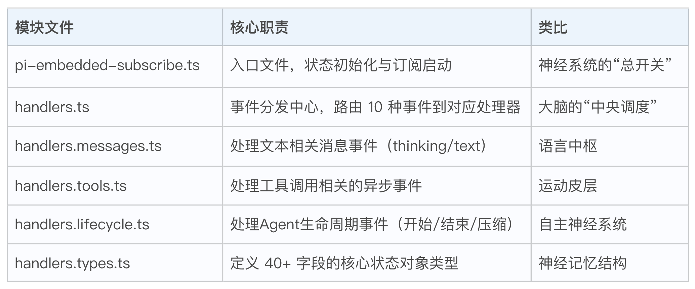
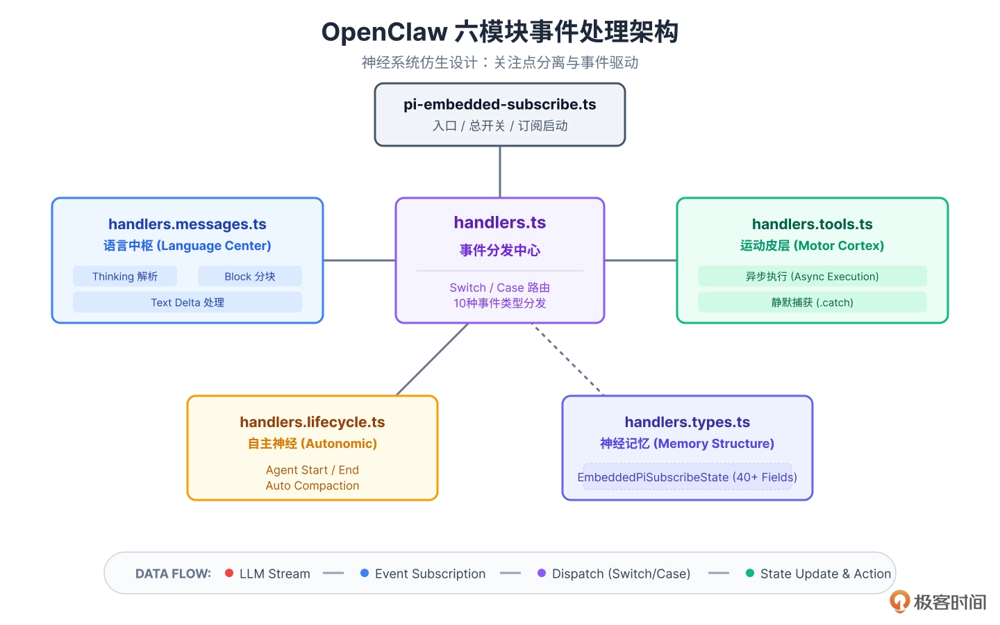
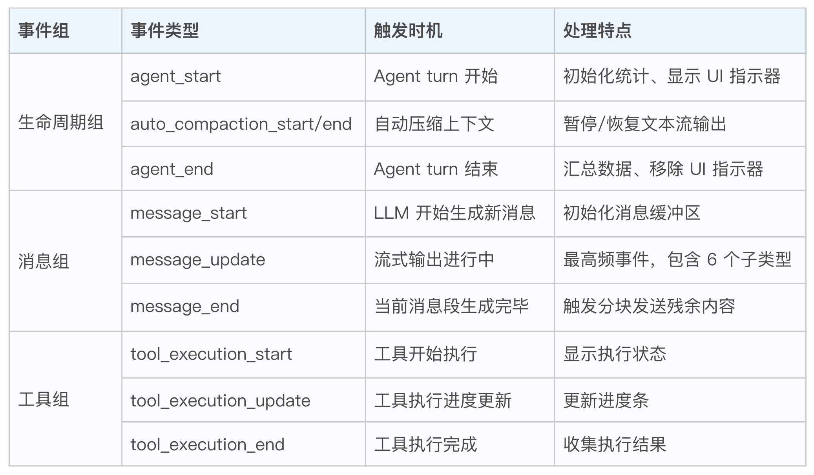
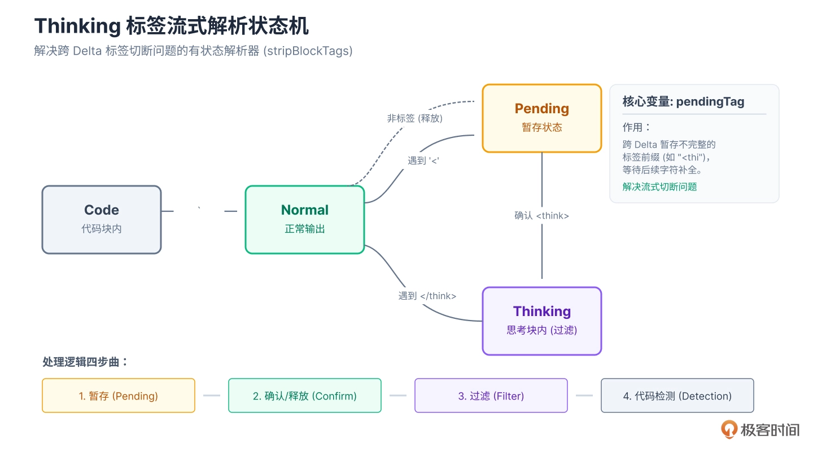
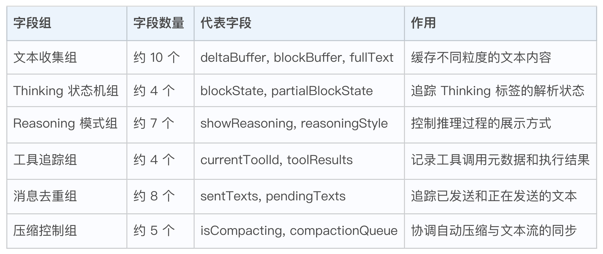

# 07 | 事件驱动的流式处理与状态管理：如何实现Thinking解析和状态处理？

你好，我是 Henry，欢迎来到《OpenClaw 核心原理与实战》。

在前两课中，我们深入探讨了 Agent Loop 的外层重试机制和中层准备链条。现在，让我们把目光聚焦到最内层——当 LLM 开始“说话”的那一刻，系统内部究竟发生了什么？

想象一下这个场景：你向 Agent 提问，几毫秒后，屏幕上开始逐字逐句地显示回答。看起来很简单，对吗？但在这平静的表面之下，系统正在以每秒数十次的频率处理着一连串的事件流：这段文字是思考过程还是正式回复？用户能不能看到这部分内容？LLM 是不是要调用工具了？如何把长文本优雅地分块发送而不是一股脑地倾泻出来？

这就像人体的神经系统——当你的手指触碰到热水杯时，神经末梢每毫秒都在向大脑发送信号，大脑需要实时解析这些信号：是温暖还是烫伤？是继续握住还是松手？OpenClaw 的事件处理模块扮演的正是这个角色，它是 Agent 的“神经系统”，负责实时感知 LLM 输出的每一个token，并做出恰当的响应。

今天这节课，我们将深入这个“神经系统”的内部构造，理解 OpenClaw 如何通过精巧的事件驱动架构实现流式响应的实时处理。

## 事件处理架构：六模块的关注点分离

### 为什么需要拆分成六个模块？

在流式处理场景下，代码复杂度会急剧上升。如果把所有逻辑写在一个文件里，你会面对：事件分发逻辑、文本处理逻辑、工具执行逻辑、生命周期管理、状态类型定义……这些代码纠缠在一起，任何修改都可能引发连锁反应。

OpenClaw 遵循单一职责原则，将事件处理代码拆分为六个模块文件，每个模块只负责一类事情。这种设计不仅便于团队协作（不同开发者可以并行修改不同模块），也大大提升了代码的可测试性和可维护性。

### 六模块的职责划分





- 神经系统仿生设计展示 handlers.ts 中央调度与五个功能模块的关系

让我们看看入口文件如何启动整个事件订阅流程：

```bash
// pi-embedded-subscribe.ts 入口逻辑简化
export async function subscribeEmbeddedPiSession(
 session: EmbeddedPiSession,
 options: SubscribeOptions
) {
 // 1. 初始化状态对象（40+字段）
 const state: EmbeddedPiSubscribeState = initializeState(options);
 // 2. 订阅LLM流式输出
 session.on('event', (event) => {
   // 3. 将事件路由到分发中心
   handleEvent(event, state, options);
 });
 // 4. 返回控制句柄
 return { state, cancel: () => session.cancel() };
}
事件分发中心 handlers.ts 则通过 switch/case 结构将不同类型的事件路由到对应的处
```

理模块：

```bash
// handlers.ts 事件分发逻辑
export function handleEvent(
 event: AgentEvent,
 state: EmbeddedPiSubscribeState,
 options: SubscribeOptions
) {
 switch (event.type) {
   // 生命周期组 → handlers.lifecycle.ts
   case 'agent_start':
   case 'agent_end':
   case 'auto_compaction_start':
   case 'auto_compaction_end':
     handleLifecycleEvent(event, state, options);
     break;
   // 消息组 → handlers.messages.ts
   case 'message_start':
   case 'message_update':
   case 'message_end':
     handleMessageEvent(event, state, options);
     break;
   // 工具组 → handlers.tools.ts
   case 'tool_execution_start':
   case 'tool_execution_update':
   case 'tool_execution_end':
     handleToolEvent(event, state, options).catch(() => {});
     break;
 }
}
注意工具事件处理器后面的 .catch(() => {})——这是一个重要的设计决策，我们稍后会
```

详细解释。

理解了模块划分后，接下来的问题是：这 10 种事件具体代表什么？它们在 Agent 执行过程中何时触发？

## 十种事件类型详解

### 事件分类概览

OpenClaw 的 10 种事件类型可以分为三个功能组，每组服务于不同的处理需求：



### 消息组的六个子类型

```
message_update 是整个事件流中触发频率最高的事件，它承载了 LLM 输出的每一个
```

token。为了区分不同类型的内容，OpenClaw 将其细分为六个子类型。

1. Thinking 子类型（思考过程）：

```
thinking_start：LLM 开始输出思考内容（如 <think> 标签开始）
thinking_delta：思考内容的增量片段
thinking_end：思考内容结束
```

2. Text 子类型（正式回复）：

```
text_start：正式回复内容开始
text_delta：正式回复的增量片段
text_end：当前文本块结束
```

这种细分让系统可以对思考内容和正式回复采取不同的处理策略——例如，某些场景下用户可能不想看到冗长的思考过程，系统可以选择只展示最终回复。

### 工具事件的异步处理与静默捕获

```
工具事件的处理器有一个特殊之处：它们是异步执行的，并且使用 .catch() 静默捕获错
```

误。

为什么要这样设计？原因有两个：

1. 不阻塞主事件循环：工具执行（如文件读写、网络请求）可能耗时较长，如果同步等待，会阻塞后续文本事件的处理，导致用户界面卡顿。

2. 防止流崩溃：工具执行失败是常见情况，如果错误向上抛出，可能导致整个事件订阅中断；静默捕获确保即使某个工具失败，文本流仍能继续。

这就像神经系统的设计，即使某个肢体受伤，大脑仍能继续处理其他感知信息，而不是整个系统瘫痪。

理解了事件类型后，让我们深入最复杂的工程难题——如何在流式场景下正确解析 Thinking标签。

## Thinking 标签流式解析：跨 Delta 的状态机

### 工程难点：被切断的标签

```
在流式输出场景下，LLM 返回的内容是一个个小片段（delta），而 <think> 和 </think>
```

标签可能恰好被切断在两个 delta 的边界上：

```
Delta 1: "让我分析一下这个问题<thi"
Delta 2: "nk>首先考虑边界条件..."
Delta 3: "...因此结论是</think>最终答案是42"
如果我们对每个 delta 独立进行标签匹配，<thi和nk> 会被当作普通文本输出给用户——这
```

显然不是我们想要的结果。

### 解决方案：有状态的 stripBlockTags() 解析器

```
OpenClaw 使用有状态的解析器 stripBlockTags() 来解决这个问题。其核心思想是维护
```

一个跨 delta 的状态机，能够“记住”上一个 delta 结尾的未完成状态：

```javascript
// stripBlockTags状态机的简化实现
interface BlockParserState {
 pendingTag: string;       // 暂存的不完整标签前缀
 thinking: boolean;        // 当前是否在<think>块内
 inlineCode: boolean;      // 当前是否在代码块内（避免误判）
}
function stripBlockTags(
 delta: string,
 state: BlockParserState
): { output: string; state: BlockParserState } {
 let output = '';
 let i = 0;
 // 如果有暂存的前缀，先拼接
 if (state.pendingTag) {
   delta = state.pendingTag + delta;
   state.pendingTag = '';
 }
 while (i < delta.length) {
   // 检测代码块边界（避免将代码中的<误判为标签）
   if (delta[i] === '`') {
     state.inlineCode = !state.inlineCode;
     output += delta[i++];
     continue;
   }
   // 在代码块内，直接输出
   if (state.inlineCode) {
     output += delta[i++];
     continue;
   }
   // 检测标签开始
   if (delta[i] === '<') {
     const remaining = delta.slice(i);
     // 完整的<think>标签
     if (remaining.startsWith('<think>')) {
       state.thinking = true;
       i += 7;
       continue;
     }
     // 完整的</think>标签
     if (remaining.startsWith('</think>')) {
       state.thinking = false;
       i += 8;
       continue;
     }
     // 不完整的前缀，暂存等待下一个delta
     if ('<think>'.startsWith(remaining) ||
         '</think>'.startsWith(remaining)) {
       state.pendingTag = remaining;
       break;
     }
   }
   // 根据thinking状态决定是否输出
   if (!state.thinking) {
     output += delta[i];
   }
   i++;
 }
 return { output, state };
}
```

### 状态机的四步逻辑

这个状态机的工作流程可以总结为四步：

```
暂存（Pending）：发现不完整前缀（如 < 或 <thi）时，将其存入 pendingTag，不输
```

- 出。

2. 确认 / 释放（Confirm/Release）：下一个 delta 到达后拼接，若确认是标签则切换

```
thinking 状态；若不是则将暂存内容作为普通文本释放。
过滤（Filter）：当 thinking 为 true 时，拦截所有文本不发送给用户。
代码检测（Code Detection）：通过 inlineCode 状态追踪代码块边界，避免将代码中的
< 误判为标签开始。
```



- 展示 Normal、Pending、Thinking、Code 四状态及其转换条件

这种设计确保了无论标签如何被切断，最终用户看到的始终是正确过滤后的内容。

解决了 Thinking 解析后，下一个问题是：如何将 LLM 输出的长文本优雅地分块发送给用户？

## Block Reply 分块发送与消息去重

### 为什么需要分块发送？

设想 LLM 输出了一段 500 字的代码和解释。如果我们等到全部生成完毕再发送，用户需要等待很长时间才能看到内容；如果我们收到一个 token 就发送一次，会导致消息碎片化，代码块可能被“撕碎”显示（用户看到半行代码就被下一条消息打断）。

最佳实践是按语义边界分块：等到一个完整的段落或代码块生成完毕后，再作为一个整体发送。这样既保证了实时性，又维护了阅读的流畅性。

### EmbeddedBlockChunker 的分片逻辑

```
OpenClaw 使用 EmbeddedBlockChunker 来实现智能分片：
```

```python
// 分块逻辑的简化示意
class EmbeddedBlockChunker {
 private buffer: string = '';
 push(delta: string): string[] {
   this.buffer += delta;
   const chunks: string[] = [];
   // 按段落边界分割（连续两个换行）
   const paragraphs = this.buffer.split(/\n\n+/);
   // 保留最后一个（可能不完整）
   this.buffer = paragraphs.pop() || '';
   // 输出完整的段落
   for (const p of paragraphs) {
     if (p.trim()) {
       chunks.push(p.trim());
     }
   }
   return chunks;
 }
 flush(): string | null {
   // 发送残余内容
   const remaining = this.buffer.trim();
   this.buffer = '';
   return remaining || null;
 }
}
```

### 消息去重：防止内容重复

```
在某些场景下，LLM 可能通过工具（如 send_message）发送过一段文本，然后在最终回复
```

中又重复了这段内容。如果不做处理，用户会看到重复的信息。

```
OpenClaw 通过 messagingToolSentTexts 记录已通过工具发送的文本，并在最终回复时
```

进行归一化比较：

```javascript
// 去重逻辑
function shouldSkipChunk(
 chunk: string,
 sentTexts: Set<string>
): boolean {
 // 归一化：去除空白差异
 const normalized = chunk.replace(/\s+/g, ' ').trim();
 for (const sent of sentTexts) {
   const normalizedSent = sent.replace(/\s+/g, ' ').trim();
   if (normalized === normalizedSent) {
     return true; // 已发送过，跳过
   }
 }
 return false;
}
```

这种归一化比较忽略了空白字符和换行的差异，确保即使格式略有不同，语义相同的内容也能被正确去重。

理解了分块和去重后，最后一个关键知识点是：如何用一个状态对象串联起所有这些复杂的流式处理逻辑？

## 核心状态对象：EmbeddedPiSubscribeState 的 40+ 字段

### 为什么需要这么多字段？

流式处理的本质是“时间轴上的数据处理”——数据不是一次性到达的，而是随时间逐步到来。这意味着我们需要大量的“记忆”来：

- 记住已经收到的内容（缓冲区）

- 记住当前所处的状态（状态机）

- 记住已经做过的事情（去重追踪）

- 记住正在进行的操作（工具追踪）

```
OpenClaw 的 EmbeddedPiSubscribeState 包含 40 多个字段，正是为了维护这些记忆。
```

### 字段分组详解



### 状态对象的 TypeScript 定义

```
// handlers.types.ts 中的核心类型定义
interface EmbeddedPiSubscribeState {
 // ===== 文本收集组 =====
 deltaBuffer: string;           // 原始delta累积
 blockBuffer: string;           // 待分块发送的缓冲
 fullText: string;              // 完整响应文本
 thinkingText: string;          // 思考内容累积
 // ===== Thinking状态机组 =====
 blockState: {
   thinking: boolean;           // 已确认的thinking状态
   inlineCode: boolean;         // 代码块内标记
 };
 partialBlockState: {
   pendingTag: string;          // 待确认的标签前缀
 };
 // ===== Reasoning模式组 =====
 showReasoning: boolean;        // 是否展示推理过程
 reasoningStyle: 'inline' | 'collapsed' | 'hidden';
 reasoningStarted: boolean;
 reasoningEnded: boolean;
 // ===== 工具追踪组 =====
 currentToolId: string | null;
 toolExecutions: Map<string, ToolExecution>;
 toolSummariesSent: Set<string>;
 // ===== 消息去重组 =====
 messagingToolSentTexts: Set<string>;
 pendingSendTexts: string[];
 lastSentChunk: string | null;
 // ===== 压缩控制组 =====
 isCompacting: boolean;
 compactionPaused: boolean;
 queuedDuringCompaction: AgentEvent[];
 // ... 更多字段
}
```

这个状态对象贯穿整个事件处理流程——每当一个事件到达，处理器都会读取状态、执行逻辑、更新状态。状态对象就像 Agent 的“短期记忆”，让系统能够在无数个离散的事件中保持连贯的处理逻辑。

## 总结：事件驱动的知识闭环

让我们回顾今天学习的核心内容，将这些知识点串联成一个完整的图景。

1. 六模块架构：通过关注点分离，将复杂的事件处理逻辑拆分为入口、分发、消息、工具、生命周期、类型六个模块，实现了高内聚、低耦合的代码组织。

2. 十种事件类型：生命周期组管理 Agent 的开始与结束，消息组（含 6 个子类型）处理 LLM的流式输出，工具组异步处理工具执行事件并静默捕获错误。

```
Thinking 流式解析：通过有状态的 stripBlockTags() 解析器和跨 delta 的状态机设
```

- 计，解决了标签被切断的工程难题。

```
Block Reply 与去重：EmbeddedBlockChunker 按语义边界智能分片，归一化比较机制
```

- 防止内容重复。

```
40+ 字段状态对象：EmbeddedPiSubscribeState 作为事件处理的“记忆中枢”，维护了
```

- 文本缓冲、状态机、工具追踪、消息去重等全部运行时状态。

回到开头的比喻：如果说 Agent Loop 是 AI Agent 的“心跳”，那么事件处理模块就是它的“神经系统”。每一个 delta 的到来都是一次神经冲动，状态对象是神经记忆，六模块架构是神经网络的分区，而状态机则是条件反射的编码规则。正是这套精密的“神经系统”，让 OpenClaw 能够实时、准确、优雅地处理 LLM 的流式输出。

至此，我们已经完成了 Agent Loop 核心引擎模块的全部学习——从外层的重试容错，到中层的准备链条，再到内层的事件处理。这三层知识相互支撑，共同构成了一个生产级 Agent 系统的执行引擎。

## 思考题

```
状态机设计题：在当前的 Thinking 解析实现中，<think> 标签只支持一层嵌套。如果未来
需要支持多层嵌套（如 <think><deep_think>...</deep_think></think>），你会
```

- 如何修改状态机的设计？需要增加哪些状态字段？

2. 性能优化题：假设某个 Agent 的单次回复长达 10000 个 token，按当前的分块策略会产生

```
大量的消息分片。你会如何优化 EmbeddedBlockChunker 的逻辑，在保持实时性的同时
```

- 减少消息分片数量？可以考虑哪些动态调整策略？

欢迎你在留言区与我交流！如果今天的课程让你有所收获，也欢迎转发给有需要的朋友，邀请他来一起学习，我们下节课再见！
