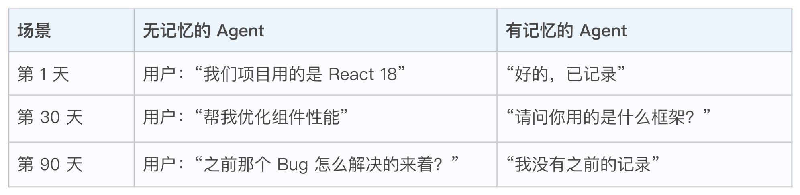
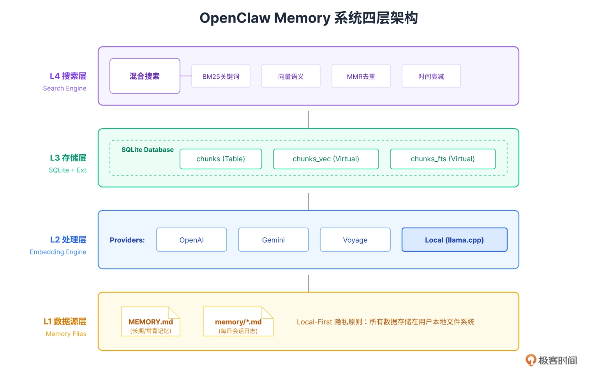
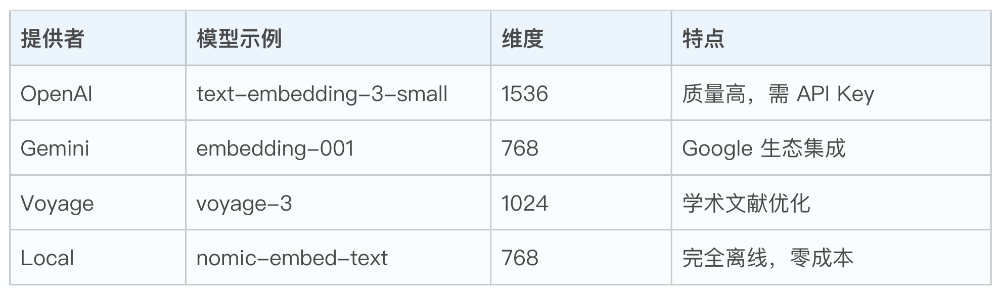
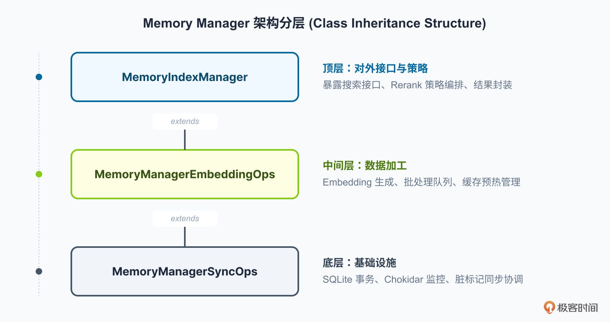

# 08 | 四层记忆架构设计：如何构建完整的记忆系统骨架？

你好，我是 Henry，欢迎来到《OpenClaw 核心原理与实战》。

在模块一中，我们理解了 Local-First 隐私哲学，知道了为什么 OpenClaw 坚持让数据留在用户本地。在模块二中，我们深入剖析了 Agent Loop 的运行机制——感知、决策、行动、反馈的无限循环。现在，让我们思考一个关键问题：当一次会话结束，Agent 的“大脑”里还剩下什么？

答案是：什么都不剩。

Agent Loop 每次循环结束后，其上下文窗口中的对话历史、推理过程、工具调用结果，都会随着会话的关闭而归零。这就像一个每天醒来都失忆的人——昨天你告诉他的项目背景、技术偏好、团队成员，今天他全忘了，你得从头再讲一遍。

想象这样一个场景：



差距一目了然。Memory 系统的存在意义，就是让 Agent 拥有跨会话的持久记忆能力，从“金鱼脑”进化为真正的智能助手。

这节课，我们将从动机出发，逐步揭开 OpenClaw Memory 系统的架构设计与核心实现。你将看到：为了实现“记住”这个看似简单的功能，工程上需要解决哪些挑战，以及 OpenClaw 是如何用优雅的分层设计来应对这些挑战的。

## Memory 系统的六大挑战

在设计 Memory 系统之前，我们需要明确：让 Agent 拥有记忆，到底难在哪里？OpenClaw团队总结了六大核心挑战。

1. 存储挑战：海量数据往哪放

用户与 Agent 的对话可能持续数月甚至数年。假设每天产生 5000 字的对话记录，一年就是180 万字。这些数据需要一个可靠、高效的存储方案——既要支持快速写入，又要支持复杂查询。

2. 检索挑战：大海捞针的效率

当记忆库积累到数十万条记录时，如何在毫秒级时间内找到与当前问题相关的那几条？暴力遍历显然不可行，需要专门的索引结构。

3. 相关性挑战：理解语义而非匹配文字用户问“之前讨论的性能问题”，记忆库里存的是“React 组件渲染优化方案”。传统的关键词搜索会错过这条高度相关的记录，因为两者没有共同的词汇。我们需要语义理解能力。

4. 多样性挑战：避免信息茧房

搜索引擎返回的前 10 条结果，如果有 8 条都在说同一件事，那就浪费了 Agent 宝贵的上下文窗口空间。我们需要去重机制，确保返回的记忆覆盖不同角度。

5. 时效性挑战：近期记忆更重要

3 个月前的技术决策可能已经过时，昨天的讨论结论更值得参考。Memory 系统需要时间感知，让新鲜的记忆拥有更高权重。

6. 隐私挑战：数据主权不可让渡

用户的对话记录可能包含商业机密、个人隐私、敏感代码。将这些数据上传到云端是不可接受的。OpenClaw 坚持 Local-First 原则——所有记忆数据必须保留在用户本地。

这六大挑战，对应了 Memory 系统的六个核心设计目标。接下来，我们看看 OpenClaw 如何用四层架构来逐一攻克。

## 四层架构设计

OpenClaw 的 Memory 系统采用经典的分层架构，每一层解决特定的问题域。



### L1 数据源层：记忆从哪来

Memory 系统的原始数据来自两类 Markdown 文件：

```
MEMORY.md：长期记忆文件，存放用户手动维护的重要信息，如项目背景、技术栈偏好、
```

- 团队成员信息。这类记忆被标记为“常青记忆”，不受时间衰减影响。

```
memory/YYYY-MM-DD.md：每日会话日志，由 Memory Flush 机制自动生成。每次会话
```

- 中值得记住的信息会被追加到当天的文件中。

这种设计遵循了 Local-First 原则——所有数据以人类可读的 Markdown 格式存储在本地，用户随时可以查看、编辑、删除。

### L2 处理层：文本如何变成向量

为了实现语义搜索，我们需要将文本转换为高维向量（Embedding）。OpenClaw 支持多种嵌入引擎：



```
当配置为 auto 模式时，系统会按 local → openai → gemini → voyage 的顺序自动尝
```

试，实现智能降级。

### L3 存储层：数据怎么持久化

OpenClaw 选择 SQLite 作为存储引擎，配合两个关键扩展：

```
sqlite-vec：向量搜索扩展，支持余弦相似度计算，实现高效的 ANN（近似最近邻）检
```

- 索。

```
FTS5：SQLite 内置的全文搜索引擎，支持 BM25 排序算法。
```

为什么选 SQLite 而不是专用向量数据库（如 Pinecone、Milvus）？答案依然是 Local-First：SQLite 是单文件数据库，无需启动额外服务，完美契合本地部署场景。

### L4 搜索层：检索策略的编排

搜索层是整个系统的“大脑”，负责编排复杂的检索策略：

1. 混合搜索：同时执行向量搜索和关键词搜索，综合两者的优势。

2. 加权合并：默认 70% 向量权重 + 30% 关键词权重。

3. 时间衰减：为每条结果乘以时间衰减因子，近期记忆得分更高。

4. MMR 去重：通过最大边际相关性算法，剔除高度相似的结果。

这四步流程的具体实现，我们会在下节课深入展开。现在，你只需要把它们当作“黑盒”，知道它们存在即可。

## Memory Manager 三层类继承体系

理解了架构分层，我们来看代码是如何组织的。OpenClaw 采用关注点分离的继承设计，将Memory Manager 拆分为三个层次：



### 底层：MemoryManagerSyncOps

这一层处理“脏活累活”——与文件系统和数据库打交道：

- 数据库生命周期管理：创建表、建立索引、关闭连接

```
文件监控：使用 chokidar 库监听 memory/ 目录的变化
同步协调：当检测到文件变更时，标记 dirty = true，触发增量索引
```

### 中间层：MemoryManagerEmbeddingOps

这一层专注于向量生成：

- 批量嵌入：将文本分块后批量调用 Embedding API，减少网络往返

```
缓存管理：已计算的向量存入 embedding_cache 表，避免重复计算
```

- 降级处理：当嵌入服务不可用时，优雅降级为纯 FTS 模式

### 顶层：MemoryIndexManager

这是对外暴露的核心类，Agent 和工具只与这一层交互：

```
搜索接口：search(query, options) 是唯一的入口方法
```

- 策略编排：协调混合搜索、MMR、时间衰减等算法

```
状态查询：提供 status() 方法，返回当前索引状态和后端类型
```

这种继承设计的好处是：每一层只关心自己的职责，修改底层实现不影响上层接口。比如，未

```
来如果要把 SQLite 换成 DuckDB，只需要修改 MemoryManagerSyncOps，上层代码无需改
```

动。

## 核心类 MemoryIndexManager 详解

```
现在，让我们深入 MemoryIndexManager 的实现细节。这是你在阅读 OpenClaw 源码时会
```

频繁接触的核心类。

### 核心字段定义

```bash
// src/memory/manager.ts
export class MemoryIndexManager
 extends MemoryManagerEmbeddingOps
 implements MemorySearchManager {
 // ★ 配置与标识
 protected readonly cfg: OpenClawConfig;       // 全局配置对象
 protected readonly agentId: string;           // Agent 唯一标识
 protected readonly settings: ResolvedMemorySearchConfig;  // 搜索参数配置
 // ★ 核心依赖
 protected provider: EmbeddingProvider | null; // 嵌入提供者，可为 null（降级为纯 FT
 protected db: DatabaseSync;                   // SQLite 数据库连接
 // ★ 向量索引状态
 protected readonly vector: {
   enabled: boolean;      // 配置层面是否启用向量搜索
   available: boolean | null;  // 运行时 sqlite-vec 是否可用（null = 未检测）
 };
 // ★ 文件监控与同步
 protected watcher: FSWatcher | null = null;   // chokidar 文件监控实例
 protected dirty: boolean = false;             // 变更标志位：true 表示有待同步的文件
 private syncing: Promise<void> | null = null; // 同步互斥锁：防止并发同步
}
```

这些字段揭示了几个重要的设计决策：

```
provider 可为 null：这意味着系统可以在没有嵌入服务的情况下运行，退化为纯关键词
```

- 搜索。

```
dirty 标志位：采用懒同步策略，不是每次文件变更都立即索引，而是在下次搜索前批量
```

- 处理。

```
syncing 互斥锁：防止多个并发搜索请求触发重复的同步操作。
```

### 双层缓存工厂方法

```
MemoryIndexManager 不能直接 new，必须通过静态工厂方法 get() 获取实例。这个设计
```

解决了两个问题：单例共享和并发安全。

```sql
// src/memory/manager.ts
// ★ 第一层缓存：存储已创建的实例
const INDEX_CACHE = new Map<string, MemoryIndexManager>();
// ★ 第二层缓存：存储正在创建中的 Promise
const INDEX_CACHE_PENDING = new Map<string, Promise<MemoryIndexManager>>();
export class MemoryIndexManager extends MemoryManagerEmbeddingOps {
 static async get(
   cfg: OpenClawConfig,
   agentId: string,
   options?: { forceRefresh?: boolean }
 ): Promise<MemoryIndexManager> {
   const cacheKey = `${cfg.configHash}:${agentId}`;
   // ★ 检查第一层缓存：已有实例直接返回
   if (!options?.forceRefresh) {
     const cached = INDEX_CACHE.get(cacheKey);
     if (cached) return cached;
   }
   // ★ 检查第二层缓存：有正在创建的 Promise 则等待它完成
   const pending = INDEX_CACHE_PENDING.get(cacheKey);
   if (pending) return pending;
   // ★ 都没有，创建新的 Promise 并存入第二层缓存
   const creationPromise = (async () => {
     try {
       // 初始化嵌入提供者（可能耗时数秒，尤其是本地模型）
       const provider = await createEmbeddingProvider(cfg);
       // 创建实例
       const instance = new MemoryIndexManager(cfg, agentId, provider);
       await instance.initialize();  // 打开数据库、建表、启动文件监控
       // ★ 存入第一层缓存
       INDEX_CACHE.set(cacheKey, instance);
       return instance;
     } finally {
       // ★ 无论成功失败，都要清理第二层缓存
       INDEX_CACHE_PENDING.delete(cacheKey);
     }
   })();
   // 存入第二层缓存
   INDEX_CACHE_PENDING.set(cacheKey, creationPromise);
   return creationPromise;
 }
}
```

为什么需要两层缓存？考虑这个场景：用户快速连续发起 3 次搜索请求，每次都需要先获取MemoryIndexManager 实例。如果只有第一层缓存：

- 请求 1：缓存未命中，开始创建实例（耗时 2 秒加载本地模型）

- 请求 2：缓存未命中（请求 1 还没创建完），又开始创建实例

- 请求 3：缓存未命中，又开始创建实例

结果：同时加载了 3 个本地模型，内存爆炸！

```
有了第二层缓存（INDEX_CACHE_PENDING），请求 2 和请求 3 会发现“已经有人在创建了”，
```

于是等待同一个 Promise 完成，共享同一个实例。

### search() 八步流程

```javascript
search() 是 MemoryIndexManager 最核心的方法，完整流程分为八个步骤：
// src/memory/manager.ts
async search(
 query: string,
 options: MemorySearchOptions = {}
): Promise<MemorySearchResult[]> {
 // ════════════════════════════════════════════════════════════
 // Step 1: 会话预热 —— 检查是否有待同步的文件变更
 // ════════════════════════════════════════════════════════════
 if (this.dirty) {
   await this.sync();  // ★ 触发增量索引，将新文件内容写入数据库
   this.dirty = false;
 }
 // ════════════════════════════════════════════════════════════
 // Step 2: 参数确定 —— 清理查询词，设定阈值
 // ════════════════════════════════════════════════════════════
 const cleanedQuery = cleanQuery(query);  // 去除特殊字符、标准化空白
 if (!cleanedQuery) return [];
 const minScore = options.minScore ?? this.settings.minScore ?? 0.3;
 const maxResults = options.maxResults ?? this.settings.maxResults ?? 20;
 // ════════════════════════════════════════════════════════════
 // Step 3: 模式分支 —— 判断走混合搜索还是纯 FTS
 // ════════════════════════════════════════════════════════════
 const useHybrid = this.provider !== null && this.vector.available === true;
 if (!useHybrid) {
   // ★ 降级路径：仅使用关键词搜索
   return this.ftsOnlySearch(cleanedQuery, maxResults, minScore);
 }
 // ════════════════════════════════════════════════════════════
 // Step 4: 关键词搜索 —— 执行 BM25 全文检索
 // ════════════════════════════════════════════════════════════
 const ftsQuery = buildFtsQuery(cleanedQuery);  // 构建 FTS5 查询语法
 const keywordResults = ftsQuery
   ? this.executeKeywordSearch(ftsQuery, maxResults * 2)  // ★ 多取一些，供后续筛选
   : [];
 // ════════════════════════════════════════════════════════════
 // Step 5: 向量搜索 —— 生成查询向量并检索
 // ════════════════════════════════════════════════════════════
 const queryEmbedding = await this.provider!.embedQuery(cleanedQuery);
 const vectorResults = this.executeVectorSearch(queryEmbedding, maxResults * 2);
 // ════════════════════════════════════════════════════════════
 // Step 6: 混合合并 —— 加权求和两路结果
 // ════════════════════════════════════════════════════════════
 const merged = await mergeHybridResults({
   vector: vectorResults,
   keyword: keywordResults,
   vectorWeight: this.settings.vectorWeight,   // 默认 0.7
   textWeight: this.settings.textWeight,       // 默认 0.3
   mmr: this.settings.mmr,                     // MMR 配置（黑盒）
   temporalDecay: this.settings.temporalDecay, // 时间衰减配置（黑盒）
 });
 // ════════════════════════════════════════════════════════════
 // Step 7: 后处理 —— 时间衰减 + MMR 去重已在 merge 中完成
 // ════════════════════════════════════════════════════════════
 // （mergeHybridResults 内部已经应用了时间衰减和 MMR）
 // ════════════════════════════════════════════════════════════
 // Step 8: 过滤与降级 —— 应用 minScore 阈值
 // ════════════════════════════════════════════════════════════
 let finalResults = merged.filter(r => r.score >= minScore);
 // ★ 安全网：如果过滤后结果为空，尝试降级保留关键词命中的结果
 if (finalResults.length === 0 && keywordResults.length > 0) {
   finalResults = keywordResults
     .filter(r => r.score >= minScore * 0.5)  // 放宽阈值
     .slice(0, maxResults);
 }
 return finalResults.slice(0, maxResults);
}
这八个步骤构成了搜索的完整骨架。其中，Step 6 调用的 mergeHybridResults 是一个“黑
```

盒”——它内部包含了加权求和、时间衰减、MMR 去重三个核心算法。下节课，我们将打开这个黑盒，逐一剖析其中的数学原理和代码实现。

## 总结

经过这节课的学习，你应该掌握以下要点：

1. 动机理解：Agent Loop 的上下文在会话结束时归零，Memory 系统让 Agent 拥有跨会话的持久记忆能力。

2. 六大挑战：存储、检索、相关性、多样性、时效性、隐私——这六个挑战是 Memory 系统设计的出发点。

3. 四层架构：数据源层（Markdown 文件）→ 处理层（Embedding 引擎）→ 存储层（SQLite+ 扩展）→ 搜索层（混合检索策略）。

```
三层类继承：MemoryManagerSyncOps → MemoryManagerEmbeddingOps →
MemoryIndexManager，每一层专注于特定职责。
双层缓存工厂：INDEX_CACHE 存储已创建实例，INDEX_CACHE_PENDING 存储创建中的
```

- Promise，防止并发重复初始化。

6. 搜索八步流程：会话预热 → 参数确定 → 模式分支 → 关键词搜索 → 向量搜索 → 混合合并→ 后处理 → 过滤降级。

这节课我们多次提到了三个“黑盒”：

- 混合搜索：向量和关键词结果如何加权合并？

- MMR 去重：怎么保证返回结果的多样性？

- 时间衰减：近期记忆的权重是如何计算的？

下节课我们将逐一打开这三个黑盒，用数学公式和代码实现告诉你：OpenClaw 是如何解决“准、不重、够新”这三个核心问题的。

## 思考题

```
降级设计：在 search() 方法中，当 provider 为 null 时，系统会降级为纯 FTS 模式。
```

- 请思考：这种降级设计带来了什么好处？如果没有这个降级路径，用户体验会有什么变化？

```
缓存键设计：双层缓存使用 ${cfg.configHash}:${agentId} 作为缓存键。为什么要
包含 configHash？如果只用 agentId 会有什么问题？
```

3. dirty 标志位：系统采用懒同步策略（在搜索前才同步），而不是文件变更时立即同步。请分析这种设计的优缺点。

欢迎你在留言区与我交流！如果今天的课程让你有所收获，也欢迎转发给有需要的朋友，邀请他来一起学习，我们下节课再见！
