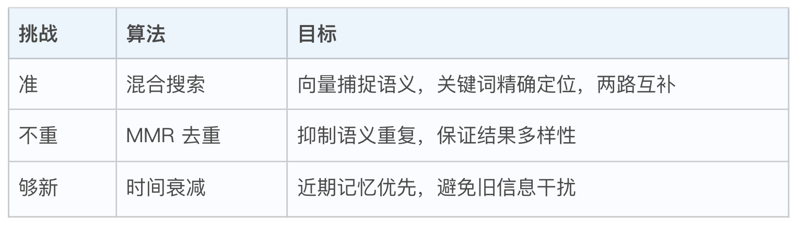
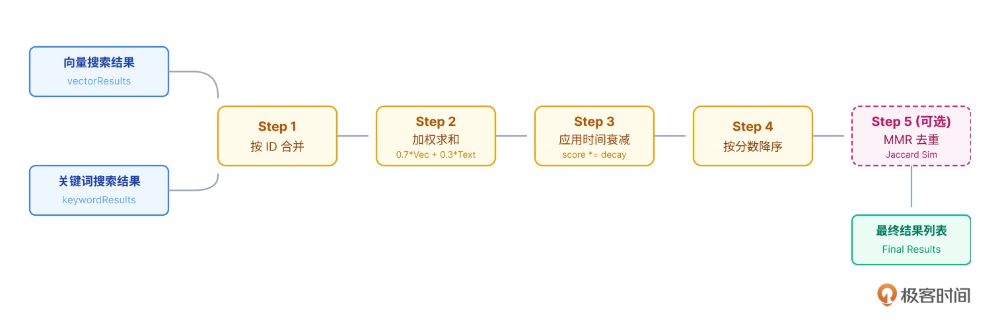
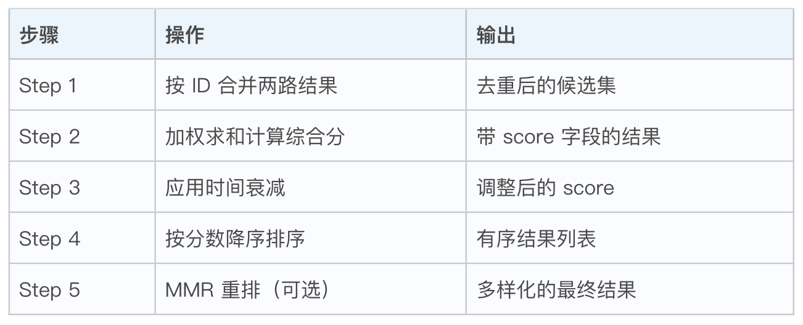
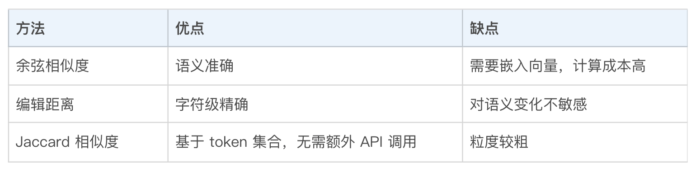
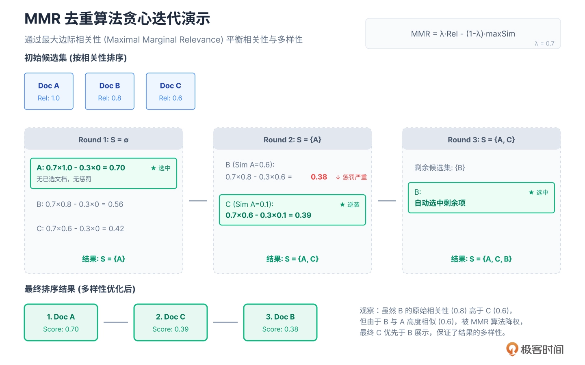
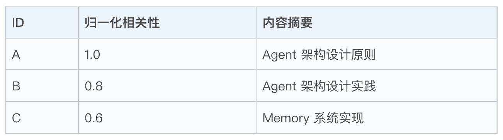

# 09 | 混合搜索、MMR去重与时间衰减：如何协作解决“准、不重、够新”？

你好，我是 Henry，欢迎来到《OpenClaw 核心原理与实战》。

```
上节课我们走完了 MemoryIndexManager 的 search() 方法八步流程，但在第六步“混合
合并”、第七步“后处理”中，我特意用黑盒标注了三个关键函数：mergeHybridResults、
mmrRerank、applyTemporalDecay。当时我说“先当黑盒用，下节课再打开”——现在，就
```

是打开它们的时候了。

这三个算法分别解决记忆检索中的三大核心挑战：



这节课的核心任务，就是把这三个黑盒逐一拆解。

## 混合搜索：向量 + 关键词双引擎

### 为什么需要混合？

单一检索模式各有软肋：

- 纯向量搜索：擅长语义理解（如何部署≈怎么上线），但对专有名词、代码片段容易失焦。

```
纯关键词搜索：精确匹配能力强（搜 MemoryIndexManager 绝不会漏），但无法理解同义
```

- 表达。

OpenClaw 的解决方案是双引擎并行 + 加权融合。默认权重配置：

```
向量权重 = 0.7（70%）
关键词权重 = 0.3（30%）
```

这个比例是经验值——向量在语义理解上贡献更大，但关键词作为“精确锚点”不可或缺。

### 向量搜索路径

```
向量搜索优先使用 SQLite 扩展 sqlite-vec 提供的 vec_distance_cosine() 函数，直
```

接在数据库层完成近似最近邻检索。如果扩展不可用，则降级为 JavaScript 层计算余弦相似度：

```javascript
// src/memory/hybrid.ts
// ★ 向量距离转相似度：distance ∈ [0, 2]，similarity ∈ [0, 1]
function distanceToSimilarity(distance: number): number {
 return 1 - distance / 2;
}
```

### 关键词搜索与 FTS 查询构建

```
关键词搜索基于 SQLite FTS5 全文索引，使用 MATCH 语法和 bm25() 排名函数。但用户的
```

自然语言查询不能直接扔给 FTS5，需要先构建合法的查询表达式：

```bash
// src/memory/hybrid.ts
export function buildFtsQuery(raw: string): string | null {
 // ★ Unicode 感知分词：支持中文、日文等非拉丁字符
 const tokens = raw.match(/[\p{L}\p{N}_]+/gu)
   ?.map(t => t.trim())
   .filter(Boolean) ?? [];
 if (tokens.length === 0) return null;
 // ★ 双引号包裹 + AND 连接，确保精确匹配
 const quoted = tokens.map(t => `"${t.replaceAll('"', "")}"`);
 return quoted.join(" AND ");
}
```

关键设计点：

```
使用 \p{L}\p{N} Unicode 属性匹配，天然支持多语言分词
```

2. 每个 token 用双引号包裹，防止 FTS5 特殊字符注入

```
使用 AND 连接，要求所有词都出现（提高精确度）
```

## BM25 分数转换：从负数到归一化

### 问题背景

```
SQLite FTS5 的 bm25() 函数返回的是负数——越小表示越相关（-10 比 -1 更好）。但我们的
混合合并需要一个 (0, 1) 区间的分数，方便与向量相似度加权求和。
```

### 转换公式推导

```
设 rank 为 bm25() 返回值（负数），令 relevance = -rank（正数）。我们使用双曲变换
将其映射到 (0, 1)：
```

## relevance

## score =

## 1 + relevance

- ​

这个公式的优雅之处在于：

```
当 relevance → 0 时，score → 0
当 relevance → ∞ 时，score → 1
```

- 单调递增，保持排序一致性

### 完整代码实现

```bash
// src/memory/hybrid.ts
export function bm25RankToScore(rank: number): number {
 // ★ 防御性处理：非有限数字返回极低分
 if (!Number.isFinite(rank)) {
   return 1 / (1 + 999);
 }
 // ★ 核心转换：负数 rank → (0, 1) 区间
 if (rank < 0) {
   const relevance = -rank;
   return relevance / (1 + relevance);
 }
 // 兜底：正数 rank（理论上不应出现）
 return 1 / (1 + rank);
}
```

测试验证：

```
bm25RankToScore(-10) → 10/11 ≈ 0.909（高相关）
bm25RankToScore(-1) → 1/2 = 0.5（中等相关）
bm25RankToScore(-0.1) → 0.1/1.1 ≈ 0.091（低相关）
```

## 混合合并五步流程

### 流程概览

```
mergeHybridResults 是混合搜索的“大脑”，负责将两路搜索结果融合为最终排序。完整流
```

程分为五步：





### 完整代码实现

```bash
// src/memory/hybrid.ts
export async function mergeHybridResults(params: {
 vector: HybridVectorResult[];
 keyword: HybridKeywordResult[];
 vectorWeight: number;    // 默认 0.7
 textWeight: number;      // 默认 0.3
 mmr?: Partial<MMRConfig>;
 temporalDecay?: Partial<TemporalDecayConfig>;
 nowMs?: number;
}): Promise<HybridMergedResult[]> {
 const byId = new Map<string, MergedEntry>();
 // ═══════════════════════════════════════════════════════
 // Step 1: 按 ID 合并两路结果
 // ═══════════════════════════════════════════════════════
 // ★ 先处理向量结果
 for (const r of params.vector) {
   byId.set(r.id, {
     ...r,
     vectorScore: r.vectorScore,
     textScore: 0,  // 占位，等待关键词结果填充
   });
 }
 // ★ 再合并关键词结果
 for (const r of params.keyword) {
   const existing = byId.get(r.id);
   if (existing) {
     // 已存在：补充 textScore 和 snippet
     existing.textScore = r.textScore;
     if (r.snippet?.length > 0) {
       existing.snippet = r.snippet;
     }
   } else {
     // 新条目：向量分为 0
     byId.set(r.id, {
       ...r,
       vectorScore: 0,
       textScore: r.textScore,
     });
   }
 }
 // ═══════════════════════════════════════════════════════
 // Step 2: 加权求和
 // ═══════════════════════════════════════════════════════
 const merged = Array.from(byId.values()).map(entry => ({
   ...entry,
   // ★ 核心公式：score = vectorWeight × vectorScore + textWeight × textScore
   score: params.vectorWeight * entry.vectorScore
        + params.textWeight * entry.textScore,
 }));
 // ═══════════════════════════════════════════════════════
 // Step 3: 应用时间衰减
 // ═══════════════════════════════════════════════════════
 const decayed = await applyTemporalDecayToHybridResults({
   results: merged,
   config: params.temporalDecay,
   nowMs: params.nowMs,
 });
 // ═══════════════════════════════════════════════════════
 // Step 4: 按分数降序排序
 // ═══════════════════════════════════════════════════════
 const sorted = decayed.toSorted((a, b) => b.score - a.score);
 // ═══════════════════════════════════════════════════════
 // Step 5: MMR 重排（如果启用）
 // ═══════════════════════════════════════════════════════
 const mmrConfig = { enabled: false, lambda: 0.7, ...params.mmr };
 if (mmrConfig.enabled) {
   return applyMMRToHybridResults(sorted, mmrConfig);
 }
 return sorted;
}
```

## MMR 去重算法：多样性的数学保证

### 问题场景

假设用户搜索“Agent 架构设计”，返回的前 5 条结果可能都在讲同一个话题的不同段落——内容高度重复，信息增益有限。MMR（Maximal Marginal Relevance）算法通过惩罚与已选文档相似的候选来保证多样性。

### 核心公式

## MMR(d) = λ × Rel(d) −(1 −λ) ×

- ​Sim(d, s)

## max

- s∈S

```
Rel(d)：文档 d 与查询的相关性（归一化后的 score）
Sim(d, s)：文档 d 与已选集合 S 中文档的相似度
λ：权衡参数，默认 0.7（偏向相关性）
```

### 相似度选择：为什么是 Jaccard ？

计算文档间相似度有多种选择：



OpenClaw 选择 Jaccard 相似度，在效率与效果间取得平衡：

## ∣A ∩B∣

## Jaccard(A, B) =

## ∣A ∪B∣

- ​

### 完整代码实现

```sql
// src/memory/mmr.ts
// ★ 分词函数：将文本转为 token 集合
function tokenize(text: string): Set<string> {
 const tokens = text.toLowerCase().match(/[\p{L}\p{N}]+/gu) ?? [];
 return new Set(tokens);
}
// ★ Jaccard 相似度计算
function jaccardSimilarity(a: Set<string>, b: Set<string>): number {
 if (a.size === 0 && b.size === 0) return 1;
 const intersection = [...a].filter(t => b.has(t)).length;
 const union = new Set([...a, ...b]).size;
 return intersection / union;
}
// ★ 计算候选与已选集合的最大相似度
function maxSimilarityToSelected<T extends MMRItem>(
 candidate: T,
 selected: T[],
 tokenCache: Map<string, Set<string>>
): number {
 if (selected.length === 0) return 0;
 const candTokens = tokenCache.get(candidate.id)!;
 let maxSim = 0;
 for (const s of selected) {
   const selTokens = tokenCache.get(s.id)!;
   const sim = jaccardSimilarity(candTokens, selTokens);
   if (sim > maxSim) maxSim = sim;
 }
 return maxSim;
}
// ★ MMR 分数计算
function computeMMRScore(
 relevance: number,
 maxSimilarity: number,
 lambda: number
): number {
 return lambda * relevance - (1 - lambda) * maxSimilarity;
}
// ═══════════════════════════════════════════════════════
// MMR 主函数：贪心迭代选择
// ═══════════════════════════════════════════════════════
export function mmrRerank<T extends MMRItem>(
 items: T[],
 config: Partial<MMRConfig> = {}
): T[] {
 const { enabled = false, lambda = 0.7 } = config;
 // ★ 短路返回：未启用或数量不足
 if (!enabled || items.length <= 1) return [...items];
 // ★ 预计算所有文档的 token 集合（缓存优化）
 const tokenCache = new Map<string, Set<string>>();
 for (const item of items) {
   tokenCache.set(item.id, tokenize(item.content));
 }
 // ★ 分数归一化到 [0, 1]
 const maxScore = Math.max(...items.map(i => i.score));
 const minScore = Math.min(...items.map(i => i.score));
 const scoreRange = maxScore - minScore;
 const normalizeScore = (score: number): number => {
   if (scoreRange === 0) return 1;
   return (score - minScore) / scoreRange;
 };
 // ★ 贪心迭代：每轮选择 MMR 分数最高的候选
 const selected: T[] = [];
 const remaining = new Set(items);
 while (remaining.size > 0) {
   let bestItem: T | null = null;
   let bestMMRScore = -Infinity;
   for (const candidate of remaining) {
     const normalizedRelevance = normalizeScore(candidate.score);
     const maxSim = maxSimilarityToSelected(candidate, selected, tokenCache);
     const mmrScore = computeMMRScore(normalizedRelevance, maxSim, lambda);
     // ★ 平局时用原始分数作为 tiebreaker
     if (mmrScore > bestMMRScore ||
         (mmrScore === bestMMRScore && candidate.score > (bestItem?.score ?? -In
       bestMMRScore = mmrScore;
       bestItem = candidate;
     }
   }
   if (bestItem) {
     selected.push(bestItem);
     remaining.delete(bestItem);
   } else {
     break;
   }
 }
 return selected;
}
```

### 手动推演示例

```
假设有 3 个候选文档，λ = 0.7，下图展示了完整的三轮迭代过程：
```





Round 1（已选集合 S = ∅）：

- A：MMR = 0.7×1.0 - 0.3×0 = 0.70 ✓ 最高

- B：MMR = 0.7×0.8 - 0.3×0 = 0.56

- C：MMR = 0.7×0.6 - 0.3×0 = 0.42

选择 A，S = {A}

Round 2（S = {A}）：

- B：Jaccard(B, A) = 0.6（内容相似），MMR = 0.7×0.8 - 0.3×0.6 = 0.56 - 0.18 = 0.38

- C：Jaccard(C, A) = 0.1（内容不同），MMR = 0.7×0.6 - 0.3×0.1 = 0.42 - 0.03 = 0.39 ✓ 最高

选择 C！尽管 B 的相关性更高，但因为与 A 太相似而被惩罚。

最终排序：A → C → B（多样性得到保证）

## 时间衰减机制：让记忆有“保鲜期”

### 设计动机

并非所有记忆都应该拥有相同的权重。昨天的对话比去年的对话更可能与当前任务相关。时间衰减通过指数衰减模型实现“近期优先”。

### 数学模型

## decay = e−λ×age_days

```
其中 λ = ln(2) / halfLifeDays，halfLifeDays 默认为 30 天。
```

这意味着：

- 今天的记忆：decay = 1.0（无衰减）

- 30 天前的记忆：decay = 0.5（半衰）

- 60 天前的记忆：decay = 0.25

- 90 天前的记忆：decay = 0.125

### 核心代码实现

```bash
// src/memory/temporal.ts
export function calculateTemporalDecayMultiplier(params: {
 ageInDays: number;
 halfLifeDays: number;  // 默认 30
}): number {
 // ★ 半衰期转衰减常数
 const lambda = Math.LN2 / params.halfLifeDays;
 // ★ 防御性处理：负数年龄视为 0
 const clampedAge = Math.max(0, params.ageInDays);
 // ★ 指数衰减公式
 return Math.exp(-lambda * clampedAge);
}
```

### 时间戳获取：三层优先级

获取文档的“年龄”需要确定其时间戳，OpenClaw 采用三层优先级策略：

```bash
// src/memory/temporal.ts
export function extractTimestamp(params: {
 filePath: string;
 fileStats?: { mtimeMs: number };
}): { timestamp: number; isEvergreen: boolean } {
 // ★ 优先级 1：从文件路径解析日期
 // 匹配 memory/2026-03-19.md 格式
 const dateMatch = params.filePath.match(/(\d{4})-(\d{2})-(\d{2})/);
 if (dateMatch) {
   const [_, year, month, day] = dateMatch;
   const timestamp = new Date(`${year}-${month}-${day}`).getTime();
   return { timestamp, isEvergreen: false };
 }
 // ★ 优先级 2：检测常青记忆（MEMORY.md）
 const basename = path.basename(params.filePath).toLowerCase();
 if (basename === "memory.md") {
   // 常青记忆：返回当前时间，永不衰减
   return { timestamp: Date.now(), isEvergreen: true };
 }
 // ★ 优先级 3：使用文件修改时间
 if (params.fileStats?.mtimeMs) {
   return { timestamp: params.fileStats.mtimeMs, isEvergreen: false };
 }
 // 兜底：当前时间
 return { timestamp: Date.now(), isEvergreen: false };
}
```

### 常青记忆：永不过时的知识

```javascript
MEMORY.md 文件存储用户手动维护的长期知识（如个人偏好、项目背景），这类信息不应随
时间衰减。系统通过 isEvergreen 标志识别并跳过衰减计算：
// 应用衰减时的判断逻辑
if (timestampInfo.isEvergreen) {
 // ★ 常青记忆：decay = 1.0，不衰减
 result.score = result.score * 1.0;
} else {
 const ageInDays = (nowMs - timestampInfo.timestamp) / (1000 * 60 * 60 * 24);
 const decay = calculateTemporalDecayMultiplier({ ageInDays, halfLifeDays });
 result.score = result.score * decay;
}
```

## 总结

经过这节课的学习，你应该掌握以下要点：

```
混合搜索：70% 向量 + 30% 关键词的双引擎设计，buildFtsQuery 实现 Unicode 感知
```

- 分词

```
BM25 转换：bm25RankToScore 将负数 rank 映射到 (0, 1)，公式为 relevance / (1
+ relevance)
```

3. 五步合并：按 ID 去重 → 加权求和 → 时间衰减 → 排序 → MMR 重排

```
MMR 算法：基于 Jaccard 相似度的贪心迭代，λ=0.7 平衡相关性与多样性
```

5. 时间衰减：指数衰减模型，30 天半衰期，常青记忆（MEMORY.md）永不衰减

6. 工程思维：选择 Jaccard 而非余弦相似度，是“够用即可”的务实决策

```
到这里，我们已经打开了 search() 方法里的所有算法黑盒。但还有一个更底层的问题没有
```

回答：

```
向量从哪来？ embedQuery() 背后是什么？
```

- 数据怎么存？ 六张表的 Schema 如何设计？

- 查询怎么优化？ 分块策略和索引重建有哪些工程细节？

下节课，我们将深入数据基础设施层，看看 Embedding 多提供者体系、SQLite 存储设计以及

```
chunkMarkdown 分块算法的实现。
```

## 思考题

1. 参数调优：如果你的应用场景是“法律文档检索”，需要极高的精确度而非多样性，你会如何

```
调整 vectorWeight、textWeight 和 MMR.lambda 三个参数？
```

2. 算法改进：当前的 MMR 使用 Jaccard 相似度，如果你愿意牺牲一些性能换取更好的语义去重效果，可以如何改进？提示：考虑复用已有的 Embedding 向量。

```
边界情况：假设某个 chunk 既没有文件路径日期，也没有文件修改时间（fileStats 为
空），当前代码会返回 Date.now()。这个设计合理吗？有没有更好的默认策略？
```

欢迎你在留言区与我交流！如果今天的课程让你有所收获，也欢迎转发给有需要的朋友，邀请他来一起学习，我们下节课再见！
