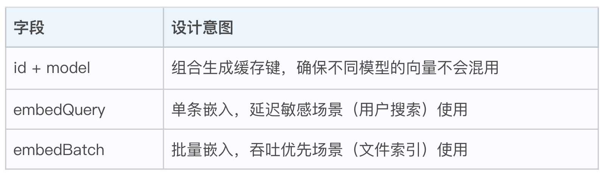
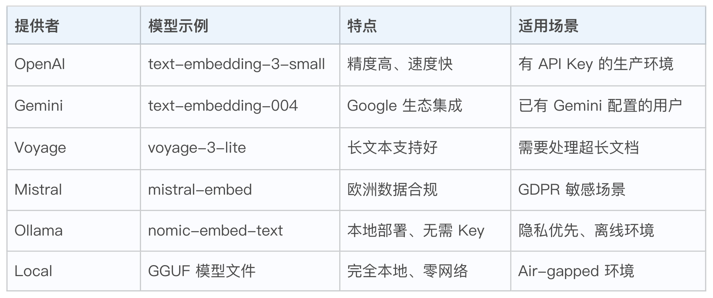
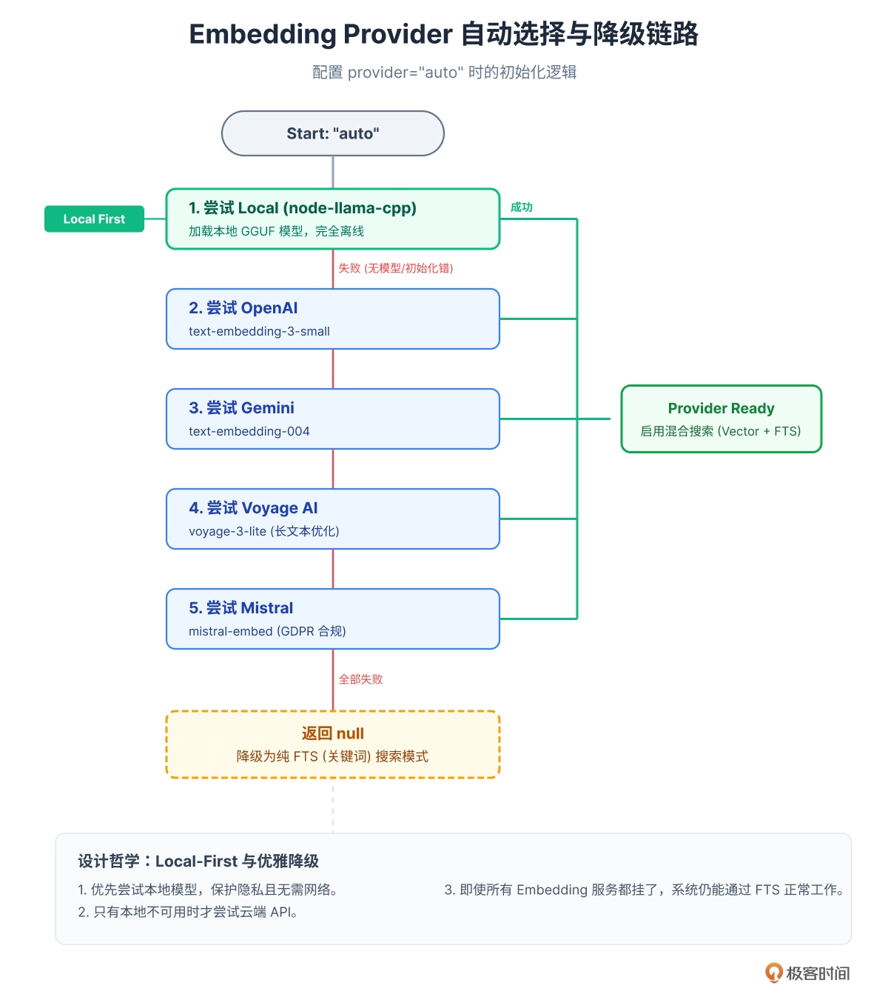
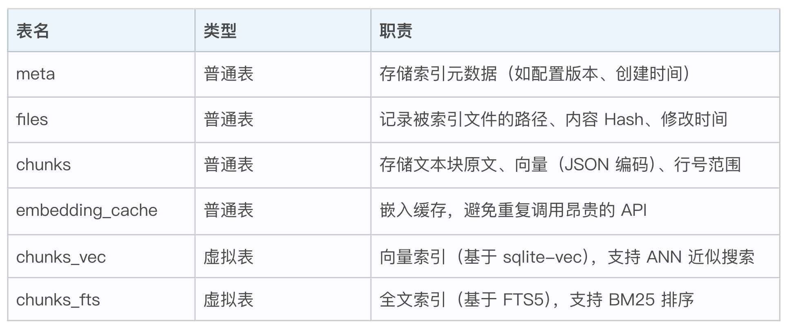
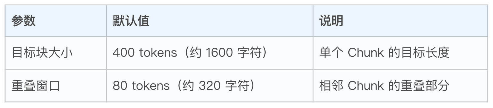

# 10 | Embedding存储与优化：向量从哪来？数据怎么存？查询怎么优化？

你好，我是 Henry，欢迎来到《OpenClaw 核心原理与实战》。

上节课我们深入剖析了混合搜索的加权融合、MMR 去重的贪心迭代以及时间衰减的指数模型——这三大算法共同回答了“搜索结果如何又准、又不重、又够新”的问题。但算法再精妙，也需要坚实的数据基础设施来支撑：向量从哪里来？数据存储在哪里？查询又如何优化？

这节课我们将聚焦 Memory 系统的数据层，从 Embedding 多提供者体系、SQLite 六张表设计，到分块策略与查询扩展，带你完整走通数据基础设施的每一个环节。

## EmbeddingProvider 统一接口：屏蔽底层差异的契约

在第 01 课时我们提到，Memory 系统的处理层负责将文本转化为向量。但现实中，嵌入引擎五花八门——OpenAI 用 REST API，Ollama 走本地 HTTP，node-llama-cpp 直接加载GGUF 模型文件。如果让上层调用者（MemoryIndexManager）逐一适配，代码会迅速膨胀且难以维护。

```
OpenClaw 的解决方案是统一接口：所有嵌入引擎都必须实现 EmbeddingProvider 接口，
```

上层只需调用接口方法，无需关心底层实现。

### 接口定义

```bash
// src/memory/embeddings.ts
export type EmbeddingProvider = {
 id: string;                                           // ★ 提供者唯一标识
 model: string;                                        // ★ 模型名称（用于缓存键）
 maxInputTokens?: number;                              // 最大输入 tokens（可选）
 embedQuery: (text: string) => Promise<number[]>;      // ★ 单条嵌入（搜索时使用）
 embedBatch: (texts: string[]) => Promise<number[][]>; // ★ 批量嵌入（索引时使用）
 embedBatchInputs?: (inputs: EmbeddingInput[]) => Promise<number[][]>;  // 多模态
};
```

这份接口契约有三个关键设计：



### 为什么区分 embedQuery 和 embedBatch？

你可能会问：单条嵌入不就是批量嵌入的特例吗？确实如此，但区分它们有工程上的考量：

1. API 计费差异：部分提供商对单次请求和批量请求有不同的计费策略

2. 网络开销：搜索场景下单条请求更快，索引场景下批量请求更省 RTT（往返时延）

3. 错误隔离：批量请求中一条失败不应影响其他条目的处理

## 六种嵌入提供者与 Auto 选择链路

```
OpenClaw 内置了六种 EmbeddingProvider 实现，覆盖从云端 API 到本地离线的全部场
```

景：



### Auto 选择与降级链路

```
当用户配置 embedding.provider: "auto" 时，系统会按照预设顺序自动尝试可用的提
```

供者：



```bash
// src/memory/embeddings.ts - createEmbeddingProvider
export async function createEmbeddingProvider(
 config: EmbeddingConfig
): Promise<EmbeddingProvider | null> {
 const provider = config.provider ?? "auto";
 if (provider === "auto") {
   // ★ 降级顺序：local → openai → gemini → voyage → mistral
   const tryOrder = ["local", "openai", "gemini", "voyage", "mistral"] as const;
   for (const candidate of tryOrder) {
     try {
       const p = await createSpecificProvider(candidate, config);
       if (p) {
         console.log(`[Embedding] Auto-selected: ${candidate}`);
         return p;
       }
     } catch (e) {
       console.warn(`[Embedding] ${candidate} unavailable:`, e.message);
       // ★ 继续尝试下一个，不中断
     }
   }
   // ★ 全部失败，返回 null，上层降级为纯 FTS 模式
   console.warn("[Embedding] All providers failed, falling back to FTS-only");
   return null;
 }
 // 显式指定提供者时，直接创建
 return createSpecificProvider(provider, config);
}
```

为什么 Local 排在第一位？这体现了 OpenClaw 的 Local-First 哲学：优先使用本地资源，减少对外部服务的依赖，同时保护用户隐私。只有当本地模型不可用时，才尝试云端 API。

### 降级的最终兜底：纯 FTS 模式

```
如果所有嵌入提供者都失败（例如离线环境且无本地模型），createEmbeddingProvider
返回 null。此时 MemoryIndexManager 会将 provider 字段置空，搜索时自动退化为纯
```

FTS 模式——只使用 BM25 关键词搜索，不进行向量语义匹配。

这种“优雅降级”设计确保了系统在任何环境下都能工作，只是搜索质量有所下降。

## Local 提供者：懒初始化与重入保护

```
Local 提供者使用 node-llama-cpp 加载 GGUF 格式的嵌入模型，这是 OpenClaw 实现完
```

全离线语义搜索的关键。但模型加载是一个耗时且耗内存的操作（通常需要 3-10 秒，占用500MB-2GB 内存），因此必须精心管理。

### 懒初始化设计

OpenClaw 采用懒初始化策略：只有在第一次真正需要嵌入时才加载模型，而非应用启动时立即加载。

```bash
// src/memory/embeddings.ts - createLocalEmbeddingProvider
let localInstance: EmbeddingProvider | null = null;
let localInitPromise: Promise<EmbeddingProvider | null> | null = null;
export async function createLocalEmbeddingProvider(
 config: LocalEmbeddingConfig
): Promise<EmbeddingProvider | null> {
 // ★ 重入保护：如果已有实例，直接返回
 if (localInstance) return localInstance;
 // ★ 并发保护：如果正在初始化，等待现有 Promise
 if (localInitPromise) return localInitPromise;
 // ★ 首次初始化：创建 Promise 并缓存
 localInitPromise = (async () => {
   try {
     const { getLlama } = await import("node-llama-cpp");
     const llama = await getLlama();
     // 加载模型文件
     const model = await llama.loadModel({
       modelPath: config.modelPath,
       gpuLayers: config.gpuLayers ?? 0,  // 默认 CPU 推理
     });
     // 创建嵌入上下文
     const context = await model.createEmbeddingContext();
     localInstance = {
       id: "local",
       model: path.basename(config.modelPath),
       embedQuery: async (text) => {
         const result = await context.getEmbeddingFor(text);
         return normalizeVector(result.vector);  // ★ 归一化处理
       },
       embedBatch: async (texts) => {
         const results = await Promise.all(
           texts.map(t => context.getEmbeddingFor(t))
         );
         return results.map(r => normalizeVector(r.vector));
       },
     };
     return localInstance;
   } catch (e) {
     console.error("[Local Embedding] Init failed:", e);
     return null;
   } finally {
     localInitPromise = null;  // ★ 清理 Promise 缓存
   }
 })();
 return localInitPromise;
}
```

### 为什么需要向量归一化？

```
注意代码中的 normalizeVector() 调用。向量归一化（将向量缩放到单位长度）有两个重
```

要作用：

1. 统一相似度计算：归一化后，余弦相似度等价于点积，计算更快

2. 跨模型兼容：不同模型输出的向量范数不同，归一化后可以使用统一的相似度阈值

```javascript
function normalizeVector(vec: number[]): number[] {
 const norm = Math.sqrt(vec.reduce((sum, v) => sum + v * v, 0));
 if (norm === 0) return vec;
 return vec.map(v => v / norm);
}
```

## SQLite 六张表 Schema 设计

```
OpenClaw 选择 SQLite 作为存储引擎，配合 sqlite-vec 扩展实现向量搜索，配合 FTS5
```

实现全文搜索。整个 Schema 由六张表组成，各司其职。

### 六张表职责一览



### 核心表结构

```sql
-- src/memory/storage.ts - Schema 定义
-- 元数据表：追踪索引状态
CREATE TABLE IF NOT EXISTS meta (
 key   TEXT PRIMARY KEY,
 value TEXT
);
-- 文件表：增量同步的基础
CREATE TABLE IF NOT EXISTS files (
 path      TEXT PRIMARY KEY,           -- ★ 相对于项目根目录的路径
 hash      TEXT NOT NULL,              -- ★ 内容 SHA-256，用于检测变更
 mtime     INTEGER NOT NULL,           -- 修改时间戳
 size      INTEGER NOT NULL            -- 文件大小（字节）
);
-- 文本块表：核心数据存储
CREATE TABLE IF NOT EXISTS chunks (
 id         TEXT PRIMARY KEY,          -- ★ 复合 Hash ID
 file_path  TEXT NOT NULL,
 content    TEXT NOT NULL,             -- 原始文本
 embedding  TEXT,                      -- JSON 编码的向量
 start_line INTEGER,
 end_line   INTEGER,
 hash       TEXT NOT NULL,             -- 内容 Hash
 FOREIGN KEY (file_path) REFERENCES files(path) ON DELETE CASCADE
);
-- 嵌入缓存表：节省 API 调用
CREATE TABLE IF NOT EXISTS embedding_cache (
 content_hash TEXT NOT NULL,
 model        TEXT NOT NULL,
 embedding    TEXT NOT NULL,           -- JSON 编码的向量
 created_at   INTEGER DEFAULT (unixepoch()),
 PRIMARY KEY (content_hash, model)     -- ★ 内容+模型组合唯一
);
-- 向量虚拟表（sqlite-vec）
CREATE VIRTUAL TABLE IF NOT EXISTS chunks_vec USING vec0(
 id       TEXT PRIMARY KEY,
 embedding FLOAT[1536]                 -- ★ 维度需与模型匹配
);
-- 全文索引虚拟表（FTS5）
CREATE VIRTUAL TABLE IF NOT EXISTS chunks_fts USING fts5(
 id,
 content,
 content='chunks',                     -- ★ 内容来源于 chunks 表
 content_rowid='rowid'
);
```

### Chunk ID 生成策略

Chunk ID 不是简单的自增整数，而是由多个字段组合生成的 Hash：

```sql
// Chunk ID = SHA-256(source:path:startLine:endLine:contentHash:model)
function generateChunkId(params: {
 source: string;      // 数据来源（如 "file"）
 path: string;        // 文件路径
 startLine: number;
 endLine: number;
 contentHash: string; // 内容 Hash
 model: string;       // 嵌入模型名
}): string {
 const input = [
   params.source,
   params.path,
   params.startLine,
   params.endLine,
   params.contentHash,
   params.model,
 ].join(":");
 return crypto.createHash("sha256").update(input).digest("hex");
}
```

这种设计有三个好处：

1. 天然去重：相同内容、相同模型生成的 Chunk ID 必然相同

2. 模型隔离：切换模型后，ID 不同，不会误用旧向量

3. 可追溯：从 ID 可以反推出数据来源

## chunkMarkdown 分块算法

将长文档切分为适合嵌入的小块是 Memory 系统的关键步骤。块太大会稀释语义，块太小会丢失上下文。OpenClaw 采用基于行的滑动窗口策略。

### 分块参数



### 核心实现

```bash
// src/memory/chunk.ts - chunkMarkdown
export function chunkMarkdown(params: {
 content: string;
 filePath: string;
 targetTokens?: number;    // 默认 400
 overlapTokens?: number;   // 默认 80
}): Chunk[] {
 const targetChars = (params.targetTokens ?? 400) * 4;   // ★ 1 token ≈ 4 chars
 const overlapChars = (params.overlapTokens ?? 80) * 4;
 const lines = params.content.split("\n");
 const chunks: Chunk[] = [];
 let currentChunk: string[] = [];
 let currentLength = 0;
 let startLine = 0;
 for (let i = 0; i < lines.length; i++) {
   const line = lines[i];
   const lineLength = line.length + 1;  // +1 for newline
   // 累积行直到达到目标大小
   if (currentLength + lineLength > targetChars && currentChunk.length > 0) {
     // ★ 生成当前块
     chunks.push({
       content: currentChunk.join("\n"),
       filePath: params.filePath,
       startLine,
       endLine: i - 1,
     });
     // ★ 重叠窗口：保留尾部内容作为下一块的开头
     const overlapLines: string[] = [];
     let overlapLength = 0;
     for (let j = currentChunk.length - 1; j >= 0 && overlapLength < overlapChar
       overlapLines.unshift(currentChunk[j]);
       overlapLength += currentChunk[j].length + 1;
     }
     currentChunk = overlapLines;
     currentLength = overlapLength;
     startLine = i - overlapLines.length;
   }
   currentChunk.push(line);
   currentLength += lineLength;
 }
 // 处理最后一个块
 if (currentChunk.length > 0) {
   chunks.push({
     content: currentChunk.join("\n"),
     filePath: params.filePath,
     startLine,
     endLine: lines.length - 1,
   });
 }
 return chunks;
}
```

### 为什么需要重叠窗口？

假设有一段连续的文本：“我们昨天讨论了项目方案，今天需要确认实施细节。”

如果在“方案”和“今天”之间硬切，两个块分别包含：

- 块 A：“我们昨天讨论了项目方案”

- 块 B：“今天需要确认实施细节”

当用户搜索“项目实施”时，两个块都只能部分匹配。但如果使用重叠窗口：

- 块 A：“我们昨天讨论了项目方案，今天需要”

- 块 B：“项目方案，今天需要确认实施细节”

块 B 就能同时命中“项目”和“实施”，搜索质量显著提升。

## runSafeReindex：原子交换的四步骤

当需要全量重建索引（例如切换嵌入模型）时，不能简单地清空数据库重新写入——这会导致重建期间搜索完全不可用。OpenClaw 采用原子交换策略，确保重建期间旧索引依然可用。

### 四步骤流程

```sql
// src/memory/storage.ts - runSafeReindex
export async function runSafeReindex(params: {
 dbPath: string;
 indexFn: (tempDb: Database) => Promise<void>;
}): Promise<void> {
 const tempPath = `${params.dbPath}.tmp-${crypto.randomUUID()}`;
 const backupPath = `${params.dbPath}.backup`;
 try {
   // ★ 步骤 1：创建临时数据库
   const tempDb = new Database(tempPath);
   initSchema(tempDb);
   // ★ 步骤 2：迁移嵌入缓存（节省 API 费用）
   const originalDb = new Database(params.dbPath);
   const cacheRows = originalDb.prepare(
     "SELECT content_hash, model, embedding, created_at FROM embedding_cache"
   ).all();
   const insertCache = tempDb.prepare(
     "INSERT OR IGNORE INTO embedding_cache VALUES (?, ?, ?, ?)"
   );
   for (const row of cacheRows) {
     insertCache.run(row.content_hash, row.model, row.embedding, row.created_at)
   }
   originalDb.close();
   // ★ 步骤 3：执行索引（在临时库上完成所有分块、嵌入、写入）
   await params.indexFn(tempDb);
   tempDb.close();
   // ★ 步骤 4：原子交换
   if (fs.existsSync(params.dbPath)) {
     fs.renameSync(params.dbPath, backupPath);  // 原文件 → 备份
   }
   fs.renameSync(tempPath, params.dbPath);      // 临时文件 → 正式文件
   // 清理备份
   if (fs.existsSync(backupPath)) {
     fs.unlinkSync(backupPath);
   }
   console.log("[Reindex] Atomic swap completed successfully");
 } catch (error) {
   // ★ 失败回滚
   if (fs.existsSync(backupPath) && !fs.existsSync(params.dbPath)) {
     fs.renameSync(backupPath, params.dbPath);
   }
   if (fs.existsSync(tempPath)) {
     fs.unlinkSync(tempPath);
   }
   throw error;
 }
}
```

### 为什么要迁移嵌入缓存？

嵌入缓存表存储了已计算的向量。如果切换模型，旧向量确实无法复用（因为 Chunk ID 包含模型名）。但如果只是重建索引而不换模型，迁移缓存可以避免大量重复的 API 调用，节省时间和费用。

## 查询扩展：extractKeywords 的多语言策略

全文搜索依赖于关键词匹配，但用户的自然语言查询往往包含大量“噪音”（如停用词、标点）。

```
extractKeywords 负责将模糊查询转化为干净的关键词列表。
```

### 多语言停用词过滤

```bash
// src/memory/query.ts - extractKeywords
const STOP_WORDS = {
 en: new Set(["the", "a", "an", "is", "are", "was", "were", "be", "been", "being
              "have", "has", "had", "do", "does", "did", "will", "would", "could
              "should", "may", "might", "must", "shall", "can", "need", "to", "o
              "in", "for", "on", "with", "at", "by", "from", "as", "into", "thro
 zh: new Set(["的", "了", "在", "是", "我", "有", "和", "就", "不", "人", "都", "一"
              "一个", "上", "也", "很", "到", "说", "要", "去", "你", "会", "着", "没
              "看", "好", "自己", "这"]),
};
export function extractKeywords(query: string): string[] {
 // 分词
 const tokens = query.match(/[\p{L}\p{N}_]+/gu) ?? [];
 return tokens.filter(token => {
   // 过滤停用词
   if (STOP_WORDS.en.has(token.toLowerCase())) return false;
   if (STOP_WORDS.zh.has(token)) return false;
   // 过滤过短的英文词（< 2 字符）
   if (/^[a-zA-Z]+$/.test(token) && token.length < 2) return false;
   // 过滤纯数字
   if (/^\d+$/.test(token)) return false;
   return true;
 });
}
```

### 中文 Unigram + Bigram 策略

中文没有空格分隔，传统分词工具（如 jieba）在 Node.js 环境下部署困难。OpenClaw 采用轻量级的 Unigram + Bigram 策略：

```javascript
function tokenizeChinese(text: string): string[] {
 const chars = [...text].filter(c => /\p{Script=Han}/u.test(c));
 const tokens: string[] = [];
 // Unigram：单字
 tokens.push(...chars);
 // Bigram：双字组合
 for (let i = 0; i < chars.length - 1; i++) {
   tokens.push(chars[i] + chars[i + 1]);
 }
 return tokens;
}
// 示例："讨论方案" →["讨", "论", "方", "案", "讨论", "论方", "方案"]
```

这种策略虽然会产生一些无意义的组合（如“论方”），但通过 FTS5 的 BM25 排序，高频无意义词会被自然降权，而有意义的词组（如“讨论”、“方案”）会获得更高分数。

## 总结

完成本课学习，你应该掌握了以下知识点：

```
EmbeddingProvider 统一接口：通过 embedQuery 和 embedBatch 两个方法屏蔽底层
```

- 差异，支持六种嵌入提供者

```
Auto 选择与降级链路：local → openai → gemini → voyage → mistral 的尝试
```

- 顺序，最终兜底为纯 FTS 模式

3. Local 懒初始化：重入保护机制避免重复加载模型，向量归一化确保跨模型兼容

```
SQLite 六张表设计：meta、files、chunks、embedding_cache、chunks_vec、
chunks_fts 各司其职
Chunk ID 生成策略：SHA-256(source:path:line:hash:model) 实现天然去重与模
```

- 型隔离

6. 分块重叠窗口：80 tokens 重叠确保跨块语义连续性

7. 原子交换索引：四步骤保证重建期间旧索引可用

8. 多语言查询扩展：停用词过滤 + 中文 Bigram 策略

到目前为止，我们已经完整走通了 Memory 系统的读取链路（搜索算法 + 数据基础设施）。但还有一个关键问题没有解答：新的记忆是如何写入系统的？Agent 如何与 Memory 系统集成？

下节课，我们将打通记忆系统与 Agent Loop 的闭环：

- Memory Tool 如何注册为 Agent 可调用的工具？

- Memory Flush 机制如何实现“静默”的记忆持久化？

- 完整的数据流全景——从用户提问到记忆写入再到下次检索

## 思考题

1. 降级策略优化：当前 Auto 选择链路是固定顺序。如果要根据“上次成功使用的提供者”动态

```
调整顺序，你会如何修改 createEmbeddingProvider 的实现？
```

2. 分块策略权衡：假设你的应用场景是法律合同分析，文档中经常有跨多段的条款引用。当前400 tokens 的分块大小是否合适？你会如何调整参数或改进算法？

```
缓存失效问题：embedding_cache 表使用 content_hash + model 作为主键。如果
```

- OpenAI 在不改变模型名的情况下更新了嵌入算法（输出向量发生变化），缓存会产生什么问题？你有什么解决方案？

欢迎你在留言区与我交流！如果今天的课程让你有所收获，也欢迎转发给有需要的朋友，邀请他来一起学习，我们下节课再见！
