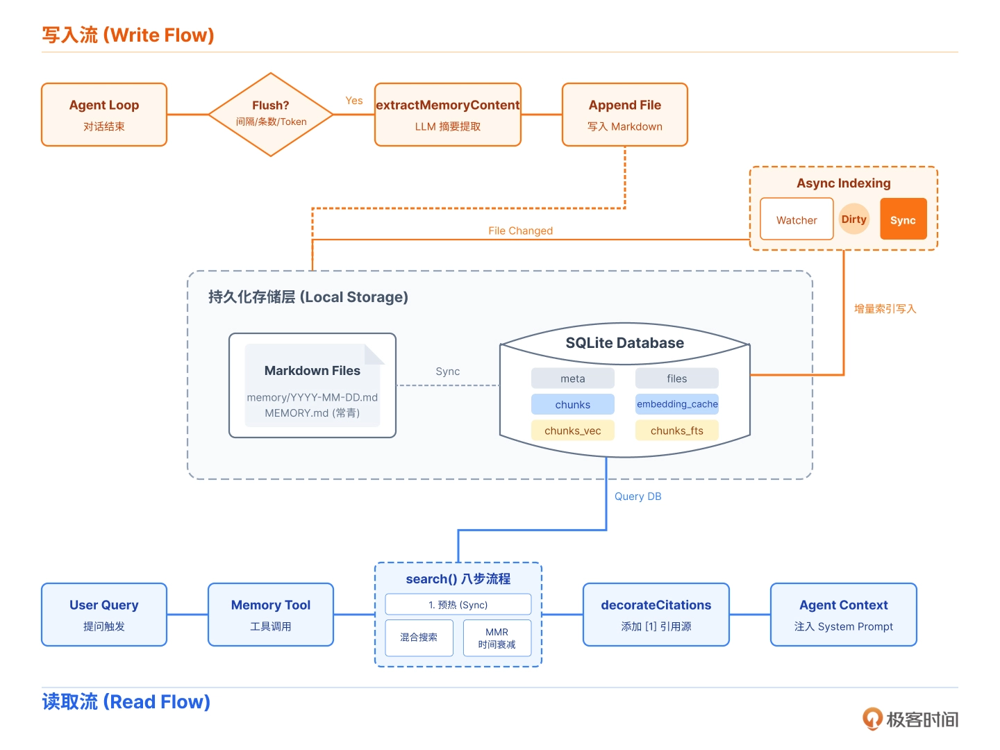
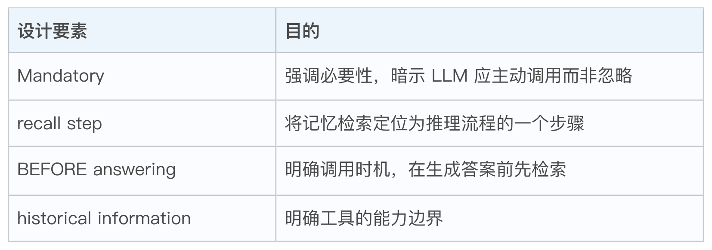
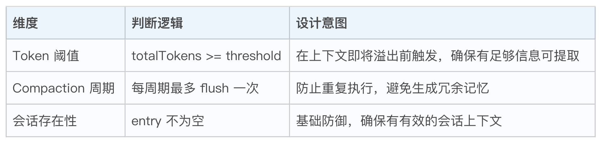
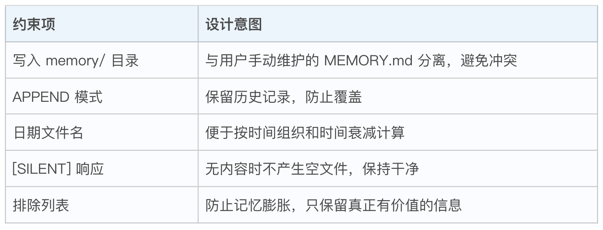
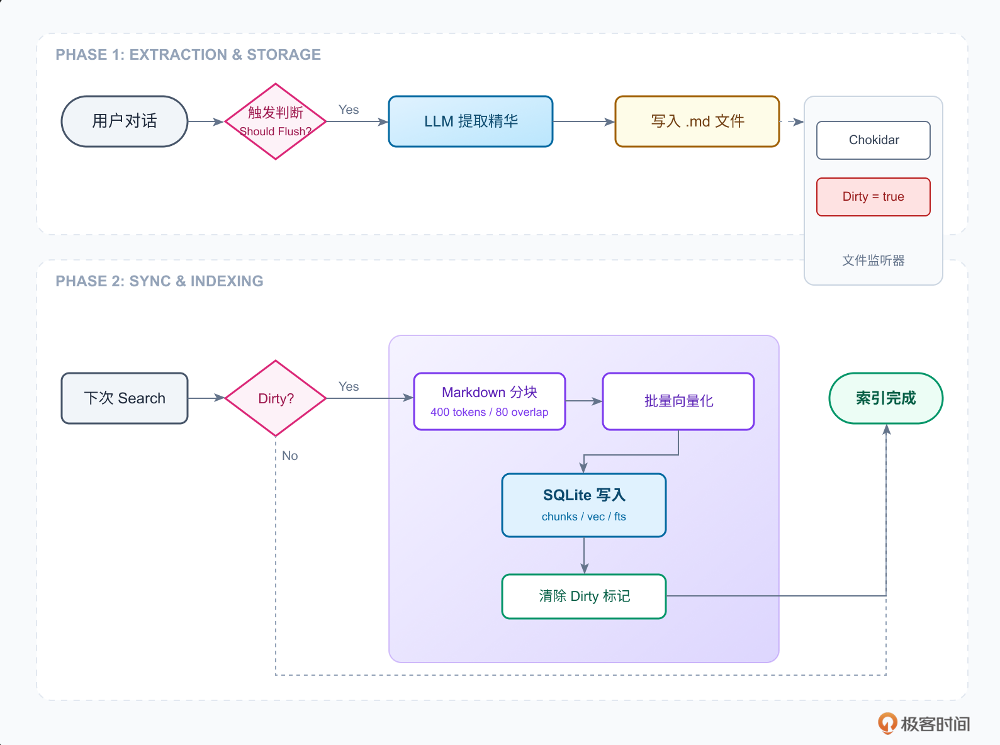
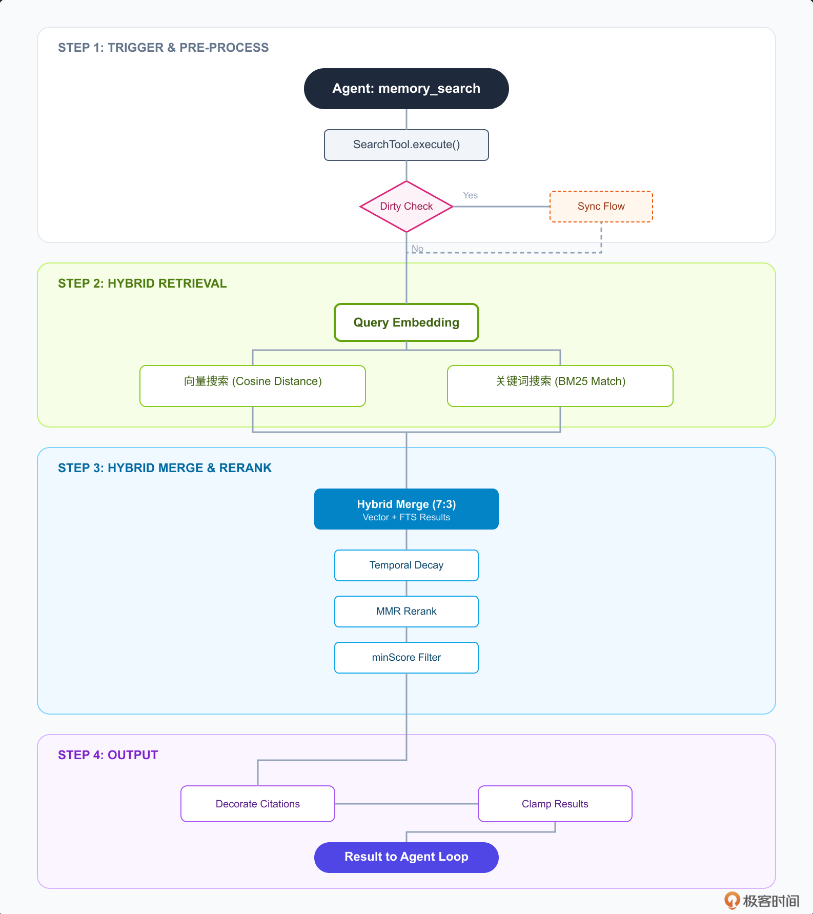
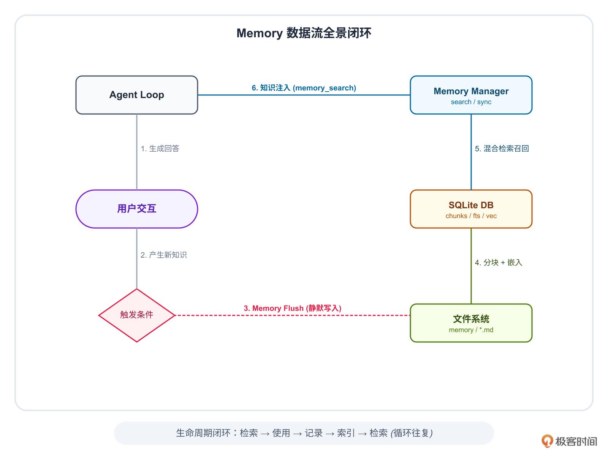
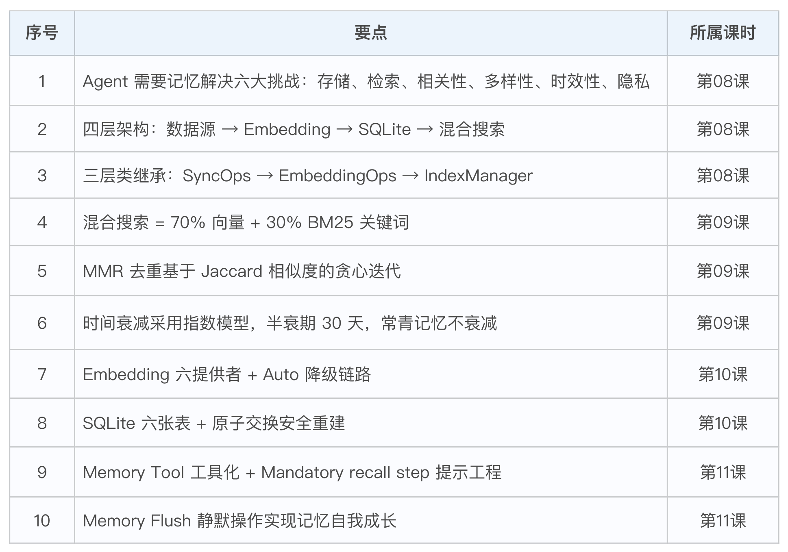

# 11 | Agent集成与数据流全景：记忆如何与Agent闭环联动？

你好，我是 Henry，欢迎来到 Memory 向量记忆系统的最后一课。

在前三课中，我们已经构建了完整的记忆基础设施：第 08 课我们理解了为什么 Agent 需要记忆，搭建了四层架构和三层类继承体系；第 09 课我们打开了混合搜索、MMR 去重、时间衰减三个核心算法的“黑盒”；第 10 课我们深入了 Embedding 多提供者体系和 SQLite 六张表的存储工程。

但此刻你可能会问：这些精心设计的基础设施，Agent 到底是怎么用起来的？对话中产生的新知识，又是如何自动沉淀为长期记忆的？

这就是本课要解决的核心问题——打通 Agent 与 Memory 的完整闭环。你将看到：

1. Memory 搜索如何被包装成 Agent 可调用的“工具”？

2. 搜索结果如何附加引用标注，让 LLM 能够溯源？

3. 系统如何在恰当时机静默触发记忆持久化？

4. 写入流与读取流的完整链路是什么样的？

学完这节课，你将拥有一张“数据流全景图”，理解 OpenClaw 如何实现“检索 - 使用 - 记录 - 索引”的生命周期闭环。



## Memory Tool 工具化集成

### 为什么需要工具化

在 Agent Loop 中，LLM 并不能直接调用 TypeScript 函数。它只能通过“工具调用”（Tool Call）的方式与外部世界交互。因此，我们需要将 Memory Manager 的搜索能力包装成一个符合Agent 工具规范的对象。

```
这个包装器就是 createMemorySearchTool——它是 Memory 系统与 Agent Loop 之间的
```

桥梁。

### createMemorySearchTool 完整实现

```bash
// src/agents/tools/memory-tool.ts
export function createMemorySearchTool(options: {
 manager: MemorySearchManager;
 maxResults?: number;
 minScore?: number;
 maxInjectedChars?: number;
 includeCitations?: boolean;
}): AnyAgentTool | null {
 const {
   manager,
   maxResults = 10,
   minScore = 0.3,
   maxInjectedChars = 8000,
   includeCitations = true,
 } = options;
 // ★ 若 manager 未就绪，返回 null，Agent Loop 会跳过此工具
 if (!manager || !manager.ready()) return null;
 return {
   name: "memory_search",
   // ★ 提示工程关键：使用 "Mandatory recall step" 引导 LLM 积极使用记忆
   description: `Mandatory recall step: semantically search MEMORY.md + memory/*
Use this BEFORE answering questions that might benefit from historical informatio
Returns ranked results with source citations.`,
   parameters: {
     type: "object",
     properties: {
       query: {
         type: "string",
         description: "Natural language search query describing what information
       },
     },
     required: ["query"],
   },
   execute: async (toolCallId: string, params: { query: string }) => {
     const { query } = params;
     // Step 1: 调用 Memory Manager 的搜索方法
     // ★ 这里会触发完整的混合搜索 → MMR 去重 → 时间衰减流程
     const rawResults = await manager.search(query, {
       maxResults,
       minScore,
       sessionKey: toolCallId,
     });
     // Step 2: 获取搜索引擎状态
     const status = manager.status();
     const { provider, model, fallback } = status;
     // Step 3: 添加引用标注
     const decorated = decorateCitations(rawResults, includeCitations);
     // Step 4: 针对 QMD 后端限制注入字符数
     // ★ 防止向 LLM 注入过多 Token，浪费上下文窗口
     const results = (status.backend === "qmd")
       ? clampResultsByInjectedChars(decorated, maxInjectedChars)
       : decorated;
     // Step 5: 返回 JSON 格式结果给 Agent Loop
     return jsonResult({
       results,
       provider,
       model,
       fallback,
       citations: includeCitations,
       mode: status.mode,
       totalFound: rawResults.length,
       returned: results.length,
     });
   },
 };
}
```

### Mandatory recall step 提示工程设计

```
注意 description 字段中的措辞——Mandatory recall step。这是一个精心设计的提示工
```

程技巧：



```
这种设计让 LLM 更倾向于在回答用户问题前主动调用 memory_search，而不是仅凭当前对
```

话上下文“硬猜”。

## 引用标注机制 decorateCitations

### 为什么需要引用标注

当 LLM 基于记忆结果生成回答时，用户可能会追问：“这个信息是从哪里来的？”为了支持溯源，我们需要在搜索结果中附加文件路径和行号范围。

### decorateCitations 的核心逻辑

```bash
// src/agents/tools/memory-tool.ts
export function decorateCitations(
 results: SearchResult[],
 includeCitations: boolean
): DecoratedSearchResult[] {
 if (!includeCitations) {
   return results.map(r => ({ ...r, citation: null }));
 }
 return results.map((result, index) => {
   // ★ 构建引用标识：[1], [2], [3]...
   const citationId = `[${index + 1}]`;
   // ★ 构建来源描述：文件路径 + 行号范围
   const source = result.startLine && result.endLine
     ? `${result.source}:L${result.startLine}-${result.endLine}`
     : result.source;
   return {
     ...result,
     citation: {
       id: citationId,
       source,
       // ★ 格式化后的完整引用文本
       formatted: `${citationId} ${source}`,
     },
   };
 });
}
```

### 引用效果示例

当 Agent 使用记忆结果回答问题时，可以这样呈现：

```
根据历史记录，您在 2 月 23 日讨论过该方案的性能优化方向 [1]，
当时的结论是优先优化数据库查询 [1]。此外，您在长期记忆中也记录了
相关的架构决策 [2]。
---
```

- 引用来源：

```
[1] memory/2026-02-23.md:L15-L28
[2] MEMORY.md:L102-L115
```

## shouldRunMemoryFlush 触发条件

### Memory Flush 的设计动机

Agent 在与用户对话过程中会产生大量有价值的信息——新的决策、学到的偏好、重要的结论。如果这些信息随着会话结束而消失，Agent 就永远无法成长。

Memory Flush 机制的目标是：在恰当的时机，静默地将对话精华持久化为长期记忆。

### 三维度触发条件

```bash
// src/auto-reply/reply/memory-flush.ts
export function shouldRunMemoryFlush(params: {
 entry?: Pick<SessionEntry,
   "totalTokens" | "totalTokensFresh" |
   "compactionCount" | "memoryFlushCompactionCount">;
 contextWindowTokens: number;      // 模型上下文窗口大小
 reserveTokensFloor: number;       // 预留给回复的 Token 数
 softThresholdTokens: number;      // 软阈值，通常为 4000
}): boolean {
 // ★ 条件零：会话必须存在
 if (!params.entry) return false;
 // 获取当前会话的 Token 用量
 const totalTokens = resolveFreshSessionTotalTokens(params.entry);
 if (!totalTokens || totalTokens <= 0) return false;
 // ★ 条件一：Token 阈值判断
 // 计算触发阈值 = 上下文窗口 - 预留空间 - 软阈值
 const threshold = params.contextWindowTokens
   - params.reserveTokensFloor
   - params.softThresholdTokens;
 // Token 用量未达到阈值，不触发
 if (threshold <= 0 || totalTokens < threshold) return false;
 // ★ 条件二：每个 compaction 周期最多 flush 一次
 // 防止 Agent 在同一压缩周期内反复执行 flush
 if (hasAlreadyFlushedForCurrentCompaction(params.entry)) return false;
 return true;
}
// 辅助函数：检查当前 compaction 周期是否已 flush
function hasAlreadyFlushedForCurrentCompaction(
 entry: Pick<SessionEntry, "compactionCount" | "memoryFlushCompactionCount">
): boolean {
 const { compactionCount = 0, memoryFlushCompactionCount = -1 } = entry;
 // ★ 如果上次 flush 的 compaction 编号 >= 当前编号，说明已经 flush 过
 return memoryFlushCompactionCount >= compactionCount;
}
```

### 三维度设计解析



## Memory Flush 静默操作机制

### Silent Agentic Turn 的概念

Memory Flush 不是由用户触发的，而是系统在满足条件时悄悄发送一条内部指令给 LLM。这个过程对用户完全透明，我们称之为 Silent Agentic Turn（静默操作轮次）。

### DEFAULT_MEMORY_FLUSH_PROMPT 约束设计

```bash
// src/auto-reply/reply/memory-flush.ts
export const DEFAULT_MEMORY_FLUSH_PROMPT = `
[SYSTEM INTERNAL - Memory Flush Request]
Review the current conversation and extract information worth remembering long-te
Write to the appropriate memory file following these constraints:
CONSTRAINTS:
1. Write to memory/YYYY-MM-DD.md (use today's date: ${getTodayDateString()})
2. If the file exists, APPEND to it (do not overwrite)
3. If the file does not exist, create it with a date header
4. Extract ONLY genuinely useful information:
  - User preferences and decisions
  - Important conclusions or agreements
  - Technical details worth preserving
  - Context that would help future conversations
5. Do NOT include:
  - Trivial small talk
  - Information already in MEMORY.md
  - Temporary or session-specific data
6. If nothing is worth remembering, respond with: [SILENT]
FORMAT for new entries:
## HH:MM - Brief Topic
- Key point 1
- Key point 2
`;
```

### 约束设计解析



## 写入流完整链路

当 Memory Flush 被触发后，数据是如何流转并最终被索引的？让我们追踪完整链路：



### 关键节点说明

```
chokidar 监控：系统启动时会监控 MEMORY.md 和 memory/ 目录下的所有 .md 文件。任
何变更都会触发回调，设置 dirty = true。
```

- 惰性同步：同步不是立即执行的，而是在下次搜索时才触发。这种设计避免了频繁的文件变更导致的性能抖动。

- 原子性保证：写入三张表的操作在同一个事务中完成，要么全部成功，要么全部回滚。

## 读取流完整链路

当 Agent 需要检索记忆时，数据是如何被召回的？



## 数据流全景闭环

将写入流和读取流结合，我们得到完整的“检索 - 使用 - 记录 - 索引”生命周期：



这个闭环实现了 OpenClaw Memory 系统的核心价值主张：Agent 越用越聪明。每一次有意义的对话都会被自动沉淀为长期记忆，而这些记忆又会在未来的对话中被召回，形成正向循环。

## 总结

恭喜你解锁了 Memory 向量记忆系统的四节课程！让我们回顾下整个模块的十大核心要点：



至此，我们已经完整构建了 OpenClaw 的“记忆大脑”。但一个强大的 Agent 系统不仅需要记忆，还需要协作。

在下一个模块中，我们将进入消息路由与多 Agent 协作的世界：

- 消息如何在不同 Agent 之间路由？

- 如何设计 Agent 的角色分工？

- 多个 Agent 如何协同完成复杂任务？

这些问题，我们下个模块见分晓。

## 思考题

在当前的 Memory Flush 设计中，触发条件依赖于 Token 阈值和 Compaction 周期。假设用户进行了一次非常简短但极其重要的对话（例如确认了一个关键决策），但由于 Token 数量未达阈值，这段对话可能不会被自动持久化。

请思考：

1. 如何设计一个基于内容重要性的补充触发机制？

2. 这种机制需要额外调用 LLM 来评估重要性，如何平衡成本与收益？

3. 能否设计一个用户显式触发的 Memory Flush 命令，作为自动机制的补充？

欢迎你在留言区与我交流！如果今天的课程让你有所收获，也欢迎转发给有需要的朋友，邀请他来一起学习，我们下节课再见！
