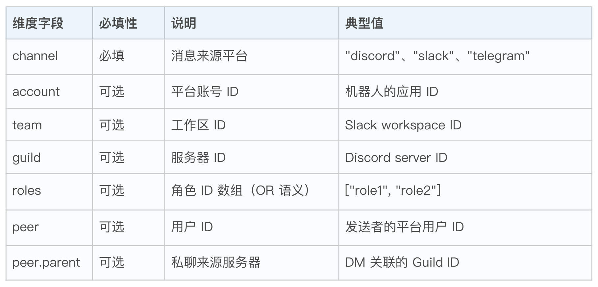
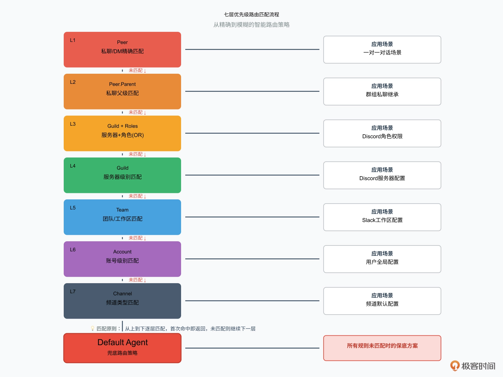
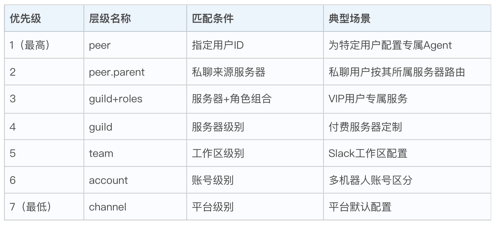
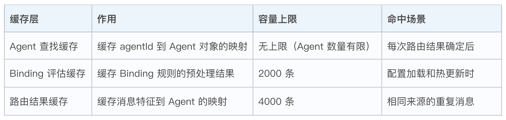

# 13 | 七层路由匹配引擎：如何实现精准的消息分发？

你好，我是 Henry，欢迎来到《OpenClaw 核心原理与实战》。

在上一讲中，我们了解了 OpenClaw 的整体架构和消息处理流程。当一条消息从 Discord、Slack 或 Telegram 进入系统后，路由引擎需要做出一个关键决策：这条消息应该交给哪个Agent 处理？这看似简单的问题，背后隐藏着复杂的匹配逻辑和性能挑战。这节课我们将深入路由引擎的核心——Binding 配置与七层优先级匹配机制。

## 为什么需要灵活的路由机制

在真实的多平台聊天机器人场景中，我们面临着多样化的配置需求。想象一下你正在运营一个AI 助手服务，连接了多个 Discord 服务器和 Slack 工作区。

场景一：平台级默认配置。你希望所有来自 Discord 的消息默认由“通用助手”Agent 处理，而Telegram 的消息由“轻量助手”处理。这是最基础的路由需求。

场景二：服务器级定制。某个 Discord 服务器（Guild）是付费客户，他们希望使用功能更强大的“高级助手”Agent。这要求我们能够在服务器级别覆盖默认配置。

场景三：角色级权限控制。在同一个 Discord 服务器中，拥有 VIP 角色的用户可以访问“专属助手”，而普通用户只能使用“基础助手”。这需要基于用户角色进行路由。

场景四：私聊特殊处理。当用户通过私聊（DM）与机器人交互时，你可能希望提供不同于群聊的服务体验。这要求我们能够识别并特殊处理私聊场景。

这四个场景揭示了路由配置的核心挑战：如何用一套统一的配置机制，优雅地表达从粗粒度到细粒度的多层次路由规则？这就是 Binding 配置和七层优先级体系要解决的问题。

## Binding 配置数据结构详解

### 顶层结构：bindings 数组

Binding 配置是一个 JSON 数组，每个元素定义了一条从“匹配条件”到“目标 Agent”的映射规则。让我们从一个完整的配置示例开始：

```json
{
 "bindings": [
   {
     "match": {
       "channel": "discord"
     },
     "agentId": "default-discord-agent"
   },
   {
     "match": {
       "channel": "discord",
       "guild": "123456789"
     },
     "agentId": "premium-agent"
   },
   {
     "match": {
       "channel": "discord",
       "guild": "123456789",
       "roles": ["vip-role-id", "admin-role-id"]
     },
     "agentId": "exclusive-agent"
   },
   {
     "match": {
       "channel": "discord",
       "peer": "987654321"
     },
     "agentId": "special-user-agent"
   }
 ]
}
```

这个配置定义了四条规则，从上到下分别对应：Discord 平台默认 Agent、特定服务器的定制Agent、拥有特定角色的专属 Agent、以及特定用户的专属 Agent。

### match 字段：匹配条件的声明

match 字段是 Binding 的核心，它声明了这条规则的适用范围。让我们逐一解析各个匹配维度：



channel 是唯一的必填字段，这体现了一个重要的设计原则：每条 Binding 规则必须明确它适用于哪个平台。这避免了跨平台配置的混淆，同时为后续的分桶索引优化奠定了基础。

### agentId：目标 Agent 的指向

agentId 字段指定了匹配成功后消息应该路由到的 Agent 标识符。这个 ID 对应系统中已注册的 Agent 配置。如果指定的 Agent 不存在，路由引擎会降级到 default Agent，确保消息不会丢失。

## 七层优先级体系：从精确到模糊的匹配哲学

当多条 Binding 规则都能匹配同一条消息时，如何决定使用哪条规则？OpenClaw 采用了七层声明式优先级体系，遵循“更精确的规则优先”的设计哲学。



### 优先级层次总览

七层优先级从高到低排列如下：



### 各层级详解与实际应用

### 第一层：peer（用户级）

这是最高优先级，当你需要为某个特定用户提供完全定制的服务时使用。例如，你的测试团队成员可能需要访问开发中的实验性 Agent：

```json
{
 "match": {
   "channel": "discord",
   "peer": "developer-user-id"
 },
 "agentId": "experimental-agent"
}
```

这条规则会确保这位开发者无论在哪个服务器、拥有什么角色，始终使用实验性 Agent。

### 第二层：peer.parent（私聊来源服务器）

这是一个精妙的设计。在 Discord 中，当用户通过私聊联系机器人时，我们可能想根据用户“来自哪个服务器”来决定路由。peer.parent 字段允许我们追踪私聊的来源上下文：

```json
{
 "match": {
   "channel": "discord",
   "peer.parent": "premium-guild-id"
 },
 "agentId": "premium-dm-agent"
}
```

这样，来自付费服务器的用户即使在私聊中也能享受高级服务。

### 第三层：guild+roles（服务器 + 角色组合）

当 Binding 同时指定了 guild 和 roles 时，它进入第三优先级。roles 字段是一个数组，采用OR 语义——用户只需拥有数组中的任意一个角色即可匹配。这个设计让配置更加灵活：

```json
{
 "match": {
   "channel": "discord",
   "guild": "123456789",
   "roles": ["vip", "moderator", "booster"]
 },
 "agentId": "privileged-agent"
}
```

VIP、版主、服务器助力者都能匹配这条规则，无需为每种角色单独配置。

### 第四层：guild（服务器级）

纯服务器级别的配置，不涉及角色判断。这是最常用的定制层级：

```json
{
 "match": {
   "channel": "discord",
   "guild": "enterprise-guild-id"
 },
 "agentId": "enterprise-agent"
}
```

### 第五层：team（工作区级）

team 层级主要用于 Slack，对应 Slack 的 workspace 概念：

```json
{
 "match": {
   "channel": "slack",
   "team": "T01234567"
 },
 "agentId": "workspace-specific-agent"
}
```

### 第六层：account（账号级）

当你运行多个机器人账号时，可以为不同账号配置不同的默认 Agent：

```json
{
 "match": {
   "channel": "discord",
   "account": "bot-account-2"
 },
 "agentId": "account-2-default-agent"
}
```

### 第七层：channel（平台级）

最低优先级，作为平台的兜底配置：

```json
{
 "match": {
   "channel": "discord"
 },
 "agentId": "discord-default-agent"
}
```

### Fallback 机制：default Agent

如果消息遍历完所有七层都没有找到匹配的 Binding，路由引擎会将消息发送到系统配置的default Agent。这确保了任何消息都不会因为配置缺失而丢失，体现了安全降级的设计理念。

## 高性能保障机制

七层优先级体系虽然表达力强大，但如果采用朴素的遍历匹配，性能会随着 Binding 数量和消息量的增长而急剧下降。OpenClaw 通过六维分桶索引和三层缓存体系实现了高效匹配。

### 六维分桶索引：EvaluatedBindingsIndex

EvaluatedBindingsIndex 是路由引擎的核心数据结构，它将 Binding 规则按六个维度预先分桶，使得查询时能够快速定位相关的规则子集。

```
interface EvaluatedBindingsIndex {
 // 六个维度的分桶索引
 byPeer: Map<string, EvaluatedBinding[]>;
 byPeerParent: Map<string, EvaluatedBinding[]>;
 byGuildRoles: Map<string, EvaluatedBinding[]>;
 byGuild: Map<string, EvaluatedBinding[]>;
 byTeam: Map<string, EvaluatedBinding[]>;
 byAccount: Map<string, EvaluatedBinding[]>;
 byChannel: Map<string, EvaluatedBinding[]>;
}
```

当一条消息到达时，路由引擎不再遍历所有 Binding，而是：

1. 根据消息的 channel，从 byChannel 中取出该平台的候选规则

2. 如果消息包含 peer 信息，从 byPeer 中查找精确匹配

3. 依次检查各个优先级层的分桶

这种设计将匹配复杂度从 O(n) 降低到近似 O(1) ——无论你有多少条 Binding 规则，只要它们分布在不同的桶中，查询时间就基本恒定。

### tiers 数组：匹配逻辑的代码实现

让我们看看实际的匹配代码如何组织七层优先级：

```javascript
function findMatchingBinding(
 message: IncomingMessage,
 index: EvaluatedBindingsIndex
): EvaluatedBinding | null {
 const { channel, account, team, guild, roles, peer, peerParent } = message;
 // 定义七层优先级的检查顺序（tiers数组）
 const tiers = [
   // Tier 1: peer精确匹配
   () => peer ? index.byPeer.get(`${channel}:${peer}`) : null,
   // Tier 2: peer.parent匹配
   () => peerParent ? index.byPeerParent.get(`${channel}:${peerParent}`) : null,
   // Tier 3: guild+roles组合匹配
   () => {
     if (!guild || !roles?.length) return null;
     // OR语义：任一角色匹配即可
     for (const role of roles) {
       const key = `${channel}:${guild}:${role}`;
       const bindings = index.byGuildRoles.get(key);
       if (bindings?.length) return bindings;
     }
     return null;
   },
   // Tier 4: guild匹配
   () => guild ? index.byGuild.get(`${channel}:${guild}`) : null,
   // Tier 5: team匹配
   () => team ? index.byTeam.get(`${channel}:${team}`) : null,
   // Tier 6: account匹配
   () => account ? index.byAccount.get(`${channel}:${account}`) : null,
   // Tier 7: channel匹配
   () => index.byChannel.get(channel)
 ];
 // 按优先级顺序检查各层
 for (const tierFn of tiers) {
   const candidates = tierFn();
   if (candidates?.length) {
     // 返回该层的第一个匹配（同层内按配置顺序）
     return candidates[0];
   }
 }
 // 所有层都未匹配，返回null（将使用default Agent）
 return null;
}
```

这段代码清晰地展示了 tiers 数组如何组织七层匹配逻辑。每一层都是一个惰性求值的函数，只有当前面的层都未匹配时才会执行下一层的查找。

### 三层缓存体系

除了分桶索引，OpenClaw 还引入了三层缓存来进一步提升性能：



Agent 查找缓存：避免了每次路由都要查询 Agent 注册表。由于系统中的 Agent 数量通常是有限的（几十到几百个），这层缓存可以常驻内存。

Binding 评估缓存：存储了 Binding 规则的预处理结果，包括 match 条件的解析和验证。当配置热更新时，只需要重新评估变化的 Binding，未变化的直接从缓存读取。2000 条的上限基于“大多数实例不会有超过 2000 条 Binding 规则”的经验判断。

路由结果缓存：最关键的优化。它以消息的关键特征（channel+guild+peer+roles 的组合）为key，直接缓存最终的路由结果。当同一个用户在同一个服务器连续发送消息时，第二条消息起就能直接命中缓存，跳过整个匹配流程。4000 条的上限是在内存占用和命中率之间的权衡——根据 LRU 策略淘汰最久未使用的条目。

### 设计权衡与性能分析

三层缓存体系体现了几个重要的设计权衡：

- 空间换时间：缓存占用了额外的内存，但显著降低了 CPU 开销。在高并发场景下，这是划算的交易。

- 缓存一致性：当 Binding 配置更新时，需要智能地失效相关缓存。OpenClaw 采用了“部分失效”策略——只失效受影响的缓存条目，而非全量清空。

- 容量上限：2000 和 4000 的上限是基于实际运营数据的经验值。如果你的场景有特殊需求，可以通过环境变量调整这些参数。

## 实战案例：Discord 服务器配置示例

让我们通过一个完整的实战案例来巩固所学知识。假设你运营的 AI 助手服务连接了三个Discord 服务器：

- 免费社区服务器（Guild A）

- 付费企业服务器（Guild B）

- 内部测试服务器（Guild C）

你的配置需求是：

1. 所有 Discord 消息默认使用基础 Agent

2. 付费服务器使用高级 Agent

3. 付费服务器中的 VIP 角色使用专属 Agent

4. 测试服务器的所有消息使用实验 Agent

5. 核心开发者无论在哪都使用调试 Agent

对应的 Binding 配置如下：

```json
{
 "bindings": [
   {
     "match": { "channel": "discord", "peer": "dev-user-001" },
     "agentId": "debug-agent"
   },
   {
     "match": { "channel": "discord", "guild": "guild-c-id" },
     "agentId": "experimental-agent"
   },
   {
     "match": {
       "channel": "discord",
       "guild": "guild-b-id",
       "roles": ["vip-role"]
     },
     "agentId": "exclusive-agent"
   },
   {
     "match": { "channel": "discord", "guild": "guild-b-id" },
     "agentId": "premium-agent"
   },
   {
     "match": { "channel": "discord" },
     "agentId": "basic-agent"
   }
 ]
}
```

注意配置的顺序：虽然七层优先级会自动处理匹配顺序，但将高优先级的规则放在前面可以提高可读性。当付费服务器的 VIP 用户发送消息时，虽然 guild-only 规则和 guild+roles 规则都能匹配，但后者优先级更高，用户会被路由到 exclusive-agent。

## 总结

这节课我们深入学习了 OpenClaw 路由引擎的核心机制：

- Binding 配置结构：以 bindings 数组为顶层结构，每条规则包含 match 匹配条件和agentId 目标指向。channel 是唯一必填字段，其他维度（peer、guild、roles 等）按需配置。

- 七层优先级体系：从 peer（最精确）到 channel（最模糊），遵循“精确优先”的匹配哲学。roles 字段采用 OR 语义，降低了配置复杂度。

- 高性能保障：六维分桶索引 EvaluatedBindingsIndex 将查询复杂度降至 O(1)；三层缓存体系（Agent 查找缓存、Binding 评估缓存、路由结果缓存）进一步提升热路径性能。

- Fallback 机制：当所有 Binding 都不匹配时，消息会路由到 default Agent，确保服务的可用性。

理解路由引擎的工作原理，不仅帮助你正确配置 Binding 规则，也为后续的性能调优和故障排查打下基础。

## 思考题

假设你的 OpenClaw 实例有 100 个 Binding 规则，某个 Discord 服务器有 50 个角色。在不使用分桶索引的情况下，最坏情况需要多少次匹配？使用分桶索引后呢？

提示：考虑 guild + roles 层级的 OR 语义——每个角色都可能触发一次匹配检查。

欢迎你在留言区与我交流！如果今天的课程让你有所收获，也欢迎转发给有需要的朋友，邀请他来一起学习，我们下节课再见！
