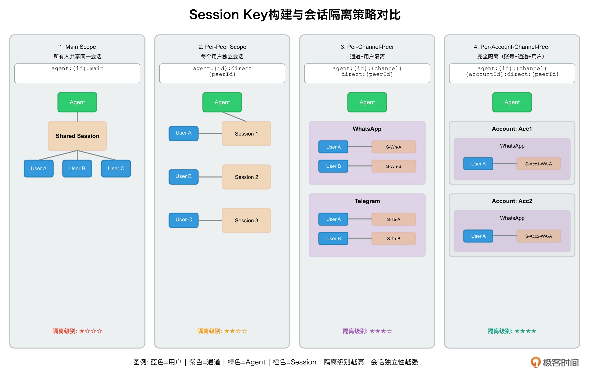
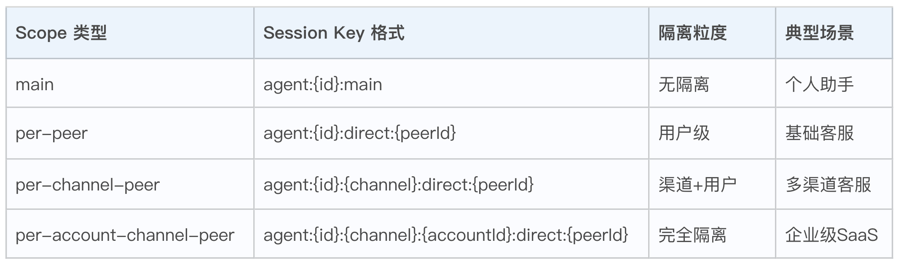
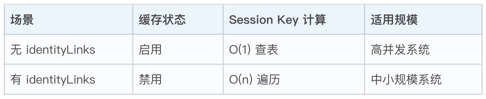

# 14 | SessionKey构建与会话隔离策略：如何实现多租户记忆隔离？

你好，我是 Henry，欢迎来到《OpenClaw 核心原理与实战》。

想象你正在使用微信。当你和小明聊天时，你们的对话记录是独立的；当你和小红聊天时，那又是另一段独立的历史。小明看不到你和小红说了什么，小红也看不到你和小明的秘密。这种对话隔离的体验，我们每天都在享受，却很少思考它是如何实现的。

在 Agent 框架中，Session Key 扮演的正是这个角色——它是区分不同对话上下文的唯一标识符。不同的 Session Key 意味着完全独立的对话历史、独立的状态记忆、独立的上下文窗口。就像微信为你和每个好友创建独立的聊天窗口一样，Agent 框架通过 Session Key 为每个对话场景创建独立的会话空间。

但与微信不同的是，Agent 框架面临的场景要复杂得多。一个企业级 AI 助手可能同时服务于：多个用户、多个渠道（WhatsApp、Telegram、网页）、多个业务账号。如何在这些维度上灵活控制隔离粒度？这正是本节课要解决的核心问题。

## Session Key 的构建规则与 DM Scope

### Session Key 的本质

Session Key 本质上是一个字符串，用于在存储层（如 Redis、内存）中索引特定的会话状态。它的构建遵循一个递进式的模式：

```
agent:{agentId}:{scope-specific-parts}
其中 {scope-specific-parts} 根据不同的隔离策略（DM Scope）而变化。框架提供了
```

四种 DM Scope，分别对应从“完全共享”到“完全隔离”的四个级别。

### 四种 DM Scope 详解

下图直观展示了四种 DM Scope 的隔离效果差异：



让我们通过一个统一的场景来理解这四种策略。假设你运营一个 AI 客服 Agent，有三个用户（Alice、Bob、Carol）通过两个渠道（WhatsApp、Telegram）联系你，而你在 WhatsApp上有两个业务账号（Sales、Support）。

1. Main Scope：所有人共享

```
Session Key 格式：agent:{id}:main
```

这是最简单的模式，所有用户、所有渠道、所有请求都共享同一个 Session。无论是 Alice 从WhatsApp 发消息，还是 Bob 从 Telegram 提问，Agent 看到的都是同一份对话历史。

```javascript
// 配置示例
const agent = defineAgent({
 id: 'my-assistant',
 dmScope: 'main'  // 默认值
});
// 所有请求都映射到: agent:my-assistant:main
```

适用场景：个人助手、单用户工具、需要跨用户共享上下文的协作场景。例如，一个家庭共享的智能音箱助手，全家人都在和同一个助手对话，助手需要记住所有人说过的话。

风险警示：在多用户场景下使用 Main Scope 会导致严重的隐私泄露。Alice 问的问题会出现在 Bob 看到的上下文中，这在商业客服系统中是不可接受的。

2. Per-Peer Scope：每人独立

```
Session Key 格式：agent:{id}:direct:{peerId}
```

每个用户（peer）拥有独立的 Session，但同一用户在不同渠道的对话会合并。Alice 在WhatsApp 和 Telegram 上的消息会被视为同一个对话流。

```javascript
const agent = defineAgent({
 id: 'customer-service',
 dmScope: 'per-peer'
});
// Alice的请求 → agent:customer-service:direct:alice_123
// Bob的请求   → agent:customer-service:direct:bob_456
```

适用场景：基础客服系统、用户身份统一的平台。当你的用户体系已经实现了跨渠道身份统一（如通过手机号或邮箱关联），Per-Peer 是一个好选择。

潜在问题：如果用户身份在不同渠道不统一（WhatsApp 用手机号、Telegram 用用户名），同一个人可能被识别为两个 peer，导致上下文割裂。

3. Per-Channel-Peer Scope：通道 + 人独立

```
Session Key 格式：agent:{id}:{channel}:direct:{peerId}
```

在 Per-Peer 的基础上增加了渠道维度。Alice 在 WhatsApp 上的对话和她在 Telegram 上的对话是完全隔离的。

```javascript
const agent = defineAgent({
 id: 'multi-channel-service',
 dmScope: 'per-channel-peer'
});
// Alice@WhatsApp → agent:multi-channel-service:whatsapp:direct:alice_123
// Alice@Telegram → agent:multi-channel-service:telegram:direct:alice_456
```

适用场景：多渠道客服系统，尤其是当不同渠道有不同的业务特性时。例如，WhatsApp 可能用于售前咨询（需要产品知识），而 Telegram 可能用于技术支持（需要故障排查能力）。将它们隔离可以让 Agent 在不同渠道展现不同的人格。

4. Per-Account-Channel-Peer Scope：完全隔离

```
Session Key 格式：agent:{id}:{channel}:{accountId}:direct:{peerId}
```

这是隔离级别最高的模式，增加了账号维度。同一用户、同一渠道，如果连接到不同的业务账号，也会被隔离。

```javascript
const agent = defineAgent({
 id: 'enterprise-service',
 dmScope: 'per-account-channel-peer'
});
// Alice@WhatsApp@SalesAccount   → agent:enterprise-service:whatsapp:sales_001:di
// Alice@WhatsApp@SupportAccount → agent:enterprise-service:whatsapp:support_001:
```

适用场景：企业级多租户系统、SaaS 平台。当你的 Agent 同时为多个客户（企业）提供服务，每个客户有自己的业务账号，数据必须严格隔离时，这是唯一的选择。

下表总结了四种 Scope 的对比：



## 群组场景的自动隔离

前面讨论的都是私聊（DM，Direct Message）场景。当消息来自群组时，隔离策略会有所不同。

### 群组 Session Key 的构建

对于群组消息，Session Key 的构建与 DM Scope 配置无关——群组天然需要隔离，因为每个群有自己的讨论主题和上下文。

```
群组 Session Key 格式：agent:{id}:{channel}:group:{groupId}
// 群组消息自动映射
// Marketing群组@WhatsApp → agent:my-agent:whatsapp:group:marketing_grp_001
// DevTeam群组@Slack     → agent:my-agent:slack:group:devteam_grp_002
```

注意这里包含了 channel 维度。这是合理的设计：同一个 Marketing 团队可能同时存在于WhatsApp 和 Slack 中，它们应该是独立的对话空间。

### 群组中的身份识别

```
虽然群组有独立的 Session，但 Agent 仍然可以识别消息的发送者。消息对象中的 userId
```

字段会携带发送者信息，Agent 可以据此提供个性化响应：

```
// 群组消息结构
{
 sessionKey: 'agent:my-agent:slack:group:devteam_001',
 userId: 'alice_123',  // 发送者
 content: '帮我查一下昨天的部署日志'
}
```

## 线程扩展：Session Key 的深度隔离

在某些平台（如 Slack、Discord）中，群组内还支持线程功能——针对某条消息展开独立的讨论。这需要更细粒度的隔离。

### 线程 Session Key 的构建

```
当消息属于某个线程时，Session Key 会追加 :thread:{threadId} 后缀：
基础群组Key:     agent:{id}:{channel}:group:{groupId}
线程扩展Key:     agent:{id}:{channel}:group:{groupId}:thread:{threadId}
```

实际示例：

```
// Slack中的场景
// 主频道消息   → agent:my-agent:slack:group:general
// 回复线程消息 → agent:my-agent:slack:group:general:thread:1647382910.001
```

### 线程隔离的意义

线程隔离解决的是话题混淆问题。想象一个技术支持群，同时有人在讨论三个不同的 bug。如果没有线程隔离，Agent 的上下文会混杂三个问题的信息，导致回答混乱。通过线程隔离，每个 bug 讨论都有独立的上下文窗口。

## identityLinks：跨通道身份关联的艺术

现在我们面临一个有趣的挑战：用户 Alice 在 WhatsApp 上用手机号注册（+86-138xxxx），在Telegram 上用用户名注册（alice_cool），在网页上用邮箱登录（alice@example.com）。从系统角度看，这是三个不同的 peerId。但从业务角度看，这是同一个人。

```
如何让 Agent 认出跨渠道的同一个用户？答案是 identityLinks。
```

### identityLinks 的数据结构

```
identityLinks 是一个 Record<string, string[]> 类型的映射表，用于声明哪些身份标识
```

属于同一个人：

```javascript
const identityLinks: Record<string, string[]> = {
 'alice_canonical': [
   'whatsapp:+8613812345678',
   'telegram:alice_cool',
   'web:alice@example.com'
 ],
 'bob_canonical': [
   'whatsapp:+8613987654321',
   'slack:bob.smith'
 ]
};
```

### 双向候选匹配逻辑

当框架需要确定 Session Key 时，会执行以下匹配逻辑：

```
步骤 1：构造当前请求的身份标识，格式为 {channel}:{peerId}
```

- 步骤 2：在 identityLinks 中查找包含该标识的条目

```
步骤 3：如果找到，使用条目的 Key（如 alice_canonical）作为统一的 peerId
```

- 步骤 4：如果未找到，回退到原始 peerId

```javascript
// 匹配示例
function resolveIdentity(channel: string, peerId: string): string {
 const currentIdentity = `${channel}:${peerId}`;
 for (const [canonicalId, identities] of Object.entries(identityLinks)) {
   if (identities.includes(currentIdentity)) {
     return canonicalId;  // 找到关联，返回统一ID
   }
 }
 return peerId;  // 未找到，返回原始ID
}
// resolveIdentity('telegram', 'alice_cool') → 'alice_canonical'
// resolveIdentity('whatsapp', 'unknown_user') → 'unknown_user'
```

### 对缓存的影响：灵活性 vs 性能的权衡

这里有一个重要的架构决策：当启用 identityLinks 时，路由缓存会被禁用。

为什么？因为 identityLinks 可能随时更新。用户今天可能只有 WhatsApp 账号，明天绑定了Telegram。如果使用缓存，旧的 Session Key 会继续生效，导致身份关联失效。

```
// 缓存策略
if (identityLinks && Object.keys(identityLinks).length > 0) {
 // 禁用路由缓存，每次请求都重新计算Session Key
 routeCache.disable();
}
```

性能影响评估：



设计建议：如果你的系统需要处理大量并发请求（如每秒数千次），且跨渠道身份关联不是核心需求，建议在业务层预处理身份映射，而非依赖 identityLinks。

## Agent ID 规范化与安全防护

Session Key 的第一部分是 Agent ID，它的安全性直接影响整个会话隔离机制的可靠性。

### 规范化处理

框架对 Agent ID 执行以下规范化操作：

```javascript
小写化：MyAgent → myagent，确保大小写不敏感。
非法字符替换：将特殊字符（如:, /, \）替换为下划线，防止 Session Key 结构被破坏。
function normalizeAgentId(id: string): string {
 return id
   .toLowerCase()
   .replace(/[^a-z0-9_-]/g, '_');
}
// normalizeAgentId('My:Agent/V2') → 'my_agent_v2'
```

### 原型链污染防护

这是一个容易被忽视但至关重要的安全措施。在 JavaScript 中，某些属性名（如

```
__proto__、constructor、prototype）具有特殊含义。如果攻击者能够注入这些名称
```

作为 Agent ID 或 peerId，可能导致原型链污染攻击。

```javascript
// 危险场景（无防护时）
const sessions = {};
const maliciousId = '__proto__';
sessions[maliciousId] = { polluted: true };
// 这会污染Object.prototype！
// 防护措施
const FORBIDDEN_KEYS = ['__proto__', 'constructor', 'prototype'];
function isSafeKey(key: string): boolean {
 return !FORBIDDEN_KEYS.includes(key.toLowerCase());
}
function safeSetSession(key: string, value: any) {
 if (!isSafeKey(key)) {
   throw new SecurityError(`Forbidden key: ${key}`);
 }
 sessions[key] = value;
}
```

框架在构建 Session Key 的每个环节，都会检查这些危险键名，确保系统安全。

## 综合示例：构建企业级会话管理

下面让我们通过一个示例，将本节课的所有概念串联起来。

场景：一家跨国电商公司部署 AI 客服系统，支持 WhatsApp、Telegram、网页三个渠道，在WhatsApp 上有美国和欧洲两个业务账号。

```javascript
// Agent配置
const customerServiceAgent = defineAgent({
 id: 'Global-CS-Bot',  // 会被规范化为 'global-cs-bot'
 dmScope: 'per-account-channel-peer',
 identityLinks: {
   // VIP客户的跨渠道身份关联
   'vip_alice': [
     'whatsapp:+14155551234',
     'telegram:alice_vip',
     'web:alice@bigcorp.com'
   ]
 }
});
// Session Key生成示例
// 普通用户Bob通过WhatsApp美国账号联系
// → agent:global-cs-bot:whatsapp:us_account:direct:+14155559999
// VIP用户Alice通过Telegram联系（触发identityLinks匹配）
// → agent:global-cs-bot:telegram:direct:vip_alice
// 群组消息
// → agent:global-cs-bot:slack:group:support_team
// 群组中的线程
// → agent:global-cs-bot:slack:group:support_team:thread:1647382910
```

## 总结

本节课我们深入学习了 Agent 框架中的会话隔离机制，核心知识点包括：

1. Session Key 的本质：它是会话状态的唯一索引，不同的 Key 意味着完全独立的对话上下文。

```
四种 DM Scope：从 main（完全共享）到 per-account-channel-peer（完全隔
```

- 离），提供了灵活的隔离粒度选择。选择的关键在于理解你的业务场景——个人助手用main，基础客服用 per-peer，多渠道系统用 per-channel-peer，企业级 SaaS 用完全隔离。

```
群组与线程：群组天然隔离，线程通过追加 :thread:{threadId} 实现深度隔离。
```

4. identityLinks：跨渠道身份关联的优雅解决方案，但需要权衡灵活性与性能，启用时会禁用路由缓存。

5. 安全防护：Agent ID 规范化和原型链污染防护是构建可靠系统的基础。

## 思考题

你正在为一家跨国企业设计 AI 客服系统，客户可能通过 WhatsApp、Telegram、网页三个渠道联系。业务要求包括：(1) 客户在不同渠道的咨询历史需要打通；(2) 欧洲和美国区域有独立的客服团队和话术风格；(3) 系统需要支持每秒 1000+ 的并发请求。

请回答：

1. 你会选择哪种 dmScope？为什么？

2. 是否需要启用 identityLinks？如果需要，如何平衡灵活性与性能？

3. 如果要同时满足“跨渠道历史打通”和“区域隔离”，你会如何设计 Session Key 的结构？

欢迎你在留言区与我交流！如果今天的课程让你有所收获，也欢迎转发给有需要的朋友，邀请他来一起学习，我们下节课再见！
