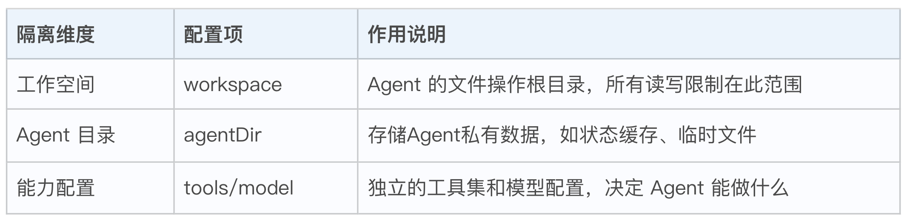
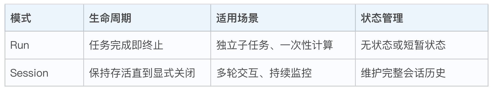
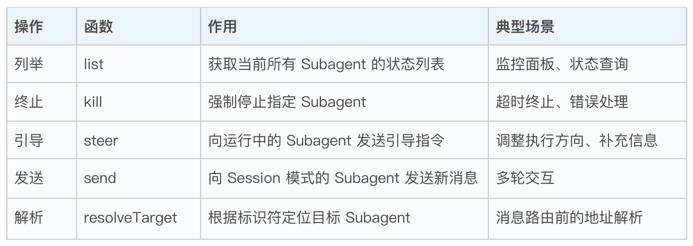

# 15 | 多Agent隔离与Subagent动态协作：如何让多个Agent分工协作？

你好，我是 Henry，欢迎来到《OpenClaw 核心原理与实战》。

在前两课中，我们深入探讨了消息路由的入站机制和会话隔离策略。这一节把视角从“单个Agent 如何处理消息”提升到“多个 Agent 如何协同工作”。

首先我们从项目经理的视角，来理解多 Agent 协作。想象你是一位项目经理，手下有一支技术团队。当接到一个复杂项目时，你不会独自完成所有工作，而是会：首先评估项目的复杂度和所需技能；然后将任务分解为可独立执行的子任务；接着为每个子任务指派合适的团队成员；最后协调各成员的工作进度，确保成果能够有序汇总。

多 Agent 协作是 AI Agent 从“玩具”变成“生产力工具”的关键跳跃。理解 Subagent 系统，就理解了 OpenClaw 如何将复杂任务分解、并行化、可靠地执行。这也是当前 AI Agent 领域的前沿方向——几乎所有主流的 Agent 框架都在探索多 Agent 协作的最佳实践。

但这里有一个关键问题：如果所有 Agent 共享同一个工作空间，会发生什么？答案是混乱——文件冲突、状态污染、权限越界。因此，在讨论协作之前，我们必须先理解隔离。隔离是协作的前提，只有边界清晰的个体，才能形成有序的整体。

## Agent 作用域隔离：独立的工作边界

每个 Agent 都需要一个清晰的领地，这不仅是资源组织的需要，更是安全隔离的基础。正因为默认是完全隔离的，所以多 Agent 协作才需要一个专门的框架来打通隔离边界——这就是Subagent 系统存在的原因。

在 OpenClaw 中，每个 Agent 拥有完全独立的资源空间。Agent A 无法访问 Agent B 的工作

```
空间、记忆、对话历史。通过 resolveAgentConfig() 函数，为每个 Agent 构建独立的配
```

置作用域。

### 三层隔离边界

Agent 的隔离体现在三个核心维度上：



工作空间隔离（workspace）是最直观的边界。当创建一个 Subagent 用于处理代码分析时，

```
它的 workspace 可能被限制在 /project/src 目录下，这意味着它无法访问项目的配置文
```

件或敏感数据。这种限制不是建议，而是强制——任何越界操作都会被 Shell 工具的路径校验拦截。

Agent 目录隔离（agentDir）提供了 Agent 的私有存储空间。每个 Agent 在这里保存自己的运行状态、中间结果和配置缓存。这确保了即使多个 Agent 并行运行，它们的内部状态也不会相互干扰。

能力配置隔离（tools/model）决定了 Agent 的行为边界。一个专注于文档翻译的 Subagent可能只被授予文件读取和网络搜索的能力，而无法执行 Shell 命令。这种最小权限原则有效防止了 Subagent 的能力越界。

### resolveAgentConfig() 的配置解析

```
配置解析函数 resolveAgentConfig() 承担着将声明式配置转化为运行时边界的任务。它
```

的解析过程遵循明确的优先级：显式指定优先于继承配置，继承配置优先于系统默认值。

解析过程中有一个关键概念：配置继承与覆盖。子 Agent 可以继承父 Agent 的部分配置（如模型选择），同时覆盖特定项（如工具集）。这种机制既避免了配置的重复定义，又保留了定制化的灵活性。

理解了隔离机制后，我们就能更好地理解为什么需要一套专门的协作框架。正是因为每个Agent 都是隔离的孤岛，我们才需要精心设计的桥梁来连接它们。

## Subagent 四大模块详解

Subagent 系统由四个核心模块构成：Spawn 负责创建、Registry 负责注册、Control 负责管控、Announce 负责通信。这四个模块各司其职又紧密配合，共同支撑起多 Agent 协作的完整生命周期。

### Spawn 模块：Subagent 的诞生

Spawn 模块生成子 Agent，是 Subagent 生命周期的起点，它定义了如何创建一个新的子Agent。这个过程比简单的 “new 一个对象”要复杂得多，涉及模式选择、环境隔离和安全校验。

### 两种运行模式

Subagent 支持两种截然不同的运行模式。

Run 模式是“任务式”执行。父 Agent 派发一个明确的任务，子 Agent 执行完毕后返回结果并终止。这类似于调用一个函数，输入参数、获取返回值、调用结束。Run 模式适合处理边界清晰、可独立完成的子任务，如分析这段代码的复杂度，或将这篇文档翻译成中文。

Session 模式是“会话式”执行。子 Agent 被创建后会保持存活状态，可以接收多次消息，维护对话上下文。这类似于开启一个长连接，建立会话后，可以进行多轮交互。Session 模式适合需要持续交互或状态保持的场景，如与用户进行多轮问答，或实时监控某个进程的输出。



### 沙箱隔离策略

创建 Subagent 时需要指定沙箱模式，这决定了子 Agent 的权限边界。

Inherit 模式让子 Agent 继承父 Agent 的权限配置。这是一种信任传递，如果父 Agent 被授权访问某些资源，子 Agent 也自动获得相同授权。这种模式适合父子 Agent 执行紧密相关任务的场景，简化了配置管理。

Require 模式要求子 Agent 重新声明所需权限。即使父 Agent 拥有广泛权限，子 Agent 也必须显式请求每一项能力。这是“最小权限原则”的严格实现，虽然配置更繁琐，但安全性更高。

### 九步生成流程

Spawn 模块的核心是一个精心设计的九步生成流程。

第一步，参数校验。检查传入的配置参数是否完整有效，包括任务描述、模式选择、工具配置等。

```
第二步，深度检查。验证当前的嵌套深度是否超过 maxSpawnDepth 限制。这是防止无限递
```

归创建 Subagent 的关键防线。

第三步，数量检查。统计当前 Agent 已创建的子 Agent 数量，确保不超过

```
maxChildrenPerAgent 限制。
第四步，白名单校验。如果配置了 allowAgents 白名单，检查请求创建的 Agent 类型是否
```

在允许范围内。

```
第五步，配置解析。调用 resolveAgentConfig() 生成子 Agent 的运行时配置，处理继承
```

与覆盖逻辑。

第六步，环境隔离。为子 Agent 创建独立的 workspace 和 agentDir，建立文件系统边界。

第七步，工具实例化。根据配置创建子 Agent 专属的工具实例，绑定正确的作用域。

第八步，注册登记。将新创建的 Subagent 注册到 Registry 模块，建立父子关系映射。

第九步，启动执行。根据 Run 或 Session 模式，启动子 Agent 的执行循环。

### 安全机制三重门

Spawn 模块内置了三道安全关卡，防止 Subagent 系统被滥用。

```
maxSpawnDepth 限制了 Agent 的嵌套深度。例如设置为 3 时，最多允许三层嵌套：主
```

Agent → 子 Agent → 孙 Agent。这防止了恶意或错误的递归创建导致资源耗尽。

```
maxChildrenPerAgent 限制了单个 Agent 可创建的直接子 Agent 数量。这防止了“广度爆
```

炸”——某个 Agent 疯狂创建子 Agent 而耗尽系统资源。

```
allowAgents 白名单提供了细粒度的类型控制。系统管理员可以指定只允许创建特定类型的
```

Subagent，如只允许“翻译 Agent”和“分析 Agent”，而禁止“执行 Agent”。

### Registry 模块：Subagent 的户籍管理

Registry 模块管理子 Agent 的完整生命周期，是 Subagent 系统的“户籍管理中心”，负责跟踪所有 Subagent 的状态、维护父子关系、处理异常清理。

### 三大核心操作

Registry 提供三个核心函数管理 Subagent 的生命周期。

```
registerSubagentRun() 在 Subagent 创建时被调用，将新 Agent 的信息注册到系统中。
```

它记录的信息包括：Agent 的唯一标识、父 Agent 的引用、创建时间、运行模式（Run/Session）、初始任务描述等。这些信息构成了 Subagent 的“出生证明”。

```
completeSubagentRun() 在 Subagent 正常完成任务时被调用。它标记 Agent 的状态为已
```

完成，记录完成时间和返回结果，但并不立即清理资源，因为父 Agent 可能还需要读取结果。

```
finalizeSubagentCleanup() 执行真正的资源清理。它释放 Agent 占用的内存、关闭文
```

件句柄、清理临时目录。这是 Subagent 生命周期的终点。

三个函数的分离体现了状态转换与资源释放的解耦——任务完成是逻辑状态的变化，资源清理是物理操作的执行，两者需要独立控制以支持更灵活的生命周期管理。

### 状态持久化

Registry 不仅在内存中维护状态，还支持将关键信息持久化到磁盘。这为系统提供了崩溃恢复的能力。如果主进程异常退出，重启后可以根据持久化的状态恢复 Subagent 的管理。

持久化的信息采用增量写入策略：只有状态变更时才触发写入，而非定时全量保存。这在保证数据安全的同时，避免了频繁 IO 带来的性能开销。

### 孤儿回收与定时清扫

在复杂的多 Agent 系统中，孤儿 Agent 是一个必须处理的问题。什么是孤儿？当父 Agent 意外终止时，它创建的子 Agent 就成了孤儿——没有人再等待它们的结果，也没有人会清理它们。

Registry 的孤儿回收机制，通过定期遍历所有注册的 Subagent 来识别孤儿。判定标准是：如果一个 Subagent 的父 Agent 已不存在于系统中，它就是孤儿，应该被终止并清理。

定时清扫器（Sweeper）是这一机制的执行者。它以配置的间隔（如每 30 秒）触发一次扫描，执行以下操作：识别并终止孤儿 Agent；清理已完成但超过保留期限的 Agent 记录；释放过期的资源占用。

### Control 模块：Subagent 的调度中心

Control 模块是父 Agent 对子 Agent 的控制操作，提供了对 Subagent 的运行时控制能力。如果说 Spawn 负责“生”、Registry 负责“管”，那么 Control 就负责“调”——在运行过程中对Subagent 进行干预。

### 五种控制操作

Control 模块提供五种操作，覆盖了运行时控制的主要场景：



list 操作返回的不仅是 ID 列表，还包括每个 Agent 的运行状态（pending/running/completed/failed）、运行时长、内存占用等监控信息。这为构建管理界面提供了数据支撑。

kill 操作实现了级联终止机制：当终止一个 Agent 时，它的所有子 Agent 也会被递归终止。这确保了不会留下孤儿进程，体现了资源管理的完整性。级联终止按深度优先顺序执行——先终止最深层的子孙，再逐层向上，最后终止目标 Agent 本身。

steer 操作是一种“软干预”。它不终止 Agent 的执行，而是在 Agent 的消息队列中插入一条引导指令。Agent 在处理完当前工作后会收到这条指令，据此调整后续行为。这类似于项目经理在不打断工作的情况下，给团队成员发送一条补充说明。

send 操作专用于 Session 模式的 Subagent。它向 Agent 的输入队列追加一条新消息，触发Agent 的下一轮处理。这是实现多轮对话的基础。

resolveTarget 操作负责将各种形式的 Agent 标识符解析为具体的 Agent 引用。标识符可以

```
是：数字 ID（如 123）、命名标识（如 translator-01）、层级路径（如
main.analyzer.parser）。这种灵活性简化了跨 Agent 通信的代码编写。
```

### Announce 模块：Subagent 的通信枢纽

Announce 模块处理 Subagent 的消息通知，子 Agent 完成后通知父 Agent。当一个Subagent 完成任务、遇到错误或需要报告进度时，都通过这个模块将信息传递给关心这些事件的其他 Agent。

### 三种投递路径

Announce 模块支持三种消息投递路径，适用于不同的通信场景。

Queue 路径将通知放入目标 Agent 的消息队列。这是一种异步、非阻塞的投递方式，发送方不等待接收方处理完成。适用于进度报告、状态更新等非紧急通知。

Steer 路径将通知作为引导指令发送。它不仅传递信息，还暗示接收方应该据此调整行为。适用于需要接收方响应的场景，如“子任务 A 已完成，请开始子任务 B”。

Direct 路径实现同步投递，发送方会阻塞等待接收方确认。这是最严格的投递保证，适用于关键节点的同步，如“所有子任务完成，主任务可以汇总结果”。

### 四步通知流程

无论采用哪种投递路径，Announce 模块都执行统一的四步流程。

第一步，构建通知体。将要传递的信息（事件类型、相关数据、时间戳等）封装为标准的通知对象。

第二步，确定接收者。根据通知类型和配置，确定哪些 Agent 应该收到这条通知。接收者可能是直接父 Agent、所有祖先 Agent，或者通过订阅机制注册的观察者。

第三步，选择投递路径。根据通知的紧急程度和语义，选择 Queue、Steer 或 Direct 路径。这一步可能由通知发起者显式指定，也可能由系统根据默认策略自动决定。

第四步，执行投递并处理响应。通过选定的路径发送通知，并处理可能的失败情况（如目标Agent 已终止）。

### 后代唤醒机制

```
wakeSubagentRunAfterDescendants 是 Announce 模块中一个精巧的机制。它解决的问
```

题是：当一个 Agent 需要等待其所有后代 Agent 完成时，如何高效地实现这种同步？

朴素的实现是轮询，父 Agent 不断查询所有后代的状态。但这既浪费资源，又可能引入延迟。

```
wakeSubagentRunAfterDescendants 采用事件驱动的方式：父 Agent 声明“当我的所有
```

后代完成时，唤醒我”。然后它可以进入休眠状态，不消耗 CPU 资源。每当有后代 Agent 完成时，Announce 模块会检查是否所有后代都已完成；如果是，就唤醒等待中的父 Agent。

这种机制对于实现 Fork-Join 模式特别有用：父 Agent 派发多个并行子任务，然后等待所有子任务完成后汇总结果。

## 出站路由 BoundDeliveryRouter

在第 13 课中，我们详细分析了入站路由机制，消息如何从用户抵达正确的 Agent。BoundDeliveryRouter 是它的镜像对称，处理 Agent 发出的消息如何抵达目标。

### 与入站路由的对称设计

入站路由解决“消息从哪来”的问题，出站路由解决“消息到哪去”的问题。两者共享相同的设计哲学：通过路由规则匹配，将消息导向正确的目的地。

BoundDeliveryRouter 的 Bound 前缀表明它是绑定到特定 Agent 的。每个 Agent 都有自己的出站路由器实例，路由器知道自己属于哪个 Agent，这使得它能够正确处理相对地址（如父Agent、第一个子 Agent）。

### 匹配优先级

出站路由的匹配遵循明确的优先级规则：

首先匹配显式目标。如果消息中指定了明确的目标（如具体的 Agent ID），直接路由到该目标，跳过后续规则。

其次匹配模式规则。根据消息类型、来源 Agent 类型、上下文条件等，匹配预配置的路由规则。匹配到的第一条规则决定路由行为。

最后应用默认路由。如果没有任何规则匹配，使用默认路由，通常是将消息发送给父 Agent 或主 Agent。

### 消息动作执行

```
出站路由的最终目的是触发动作执行。这通过 message-action-runner 组件完成，它支
```

持的动作类型包括：

- 投递动作：将消息发送到目标 Agent 的输入队列。这是最常见的动作类型。

- 广播动作：将消息发送给多个目标，如通知所有子 Agent 任务取消。

- 存储动作：将消息持久化而非投递，用于审计日志或断点恢复。

- 转换动作：在投递前对消息进行转换，如格式转换、内容脱敏。

## 总结

这节课我们重点讲解多 Agent 的隔离与协作。隔离与协作是多 Agent 系统的一体两面。没有隔离，协作将陷入混乱；没有协作，隔离将毫无意义。Subagent 系统通过精巧的架构设计，在两者之间找到了平衡点。作用域隔离确保边界清晰，Spawn/Registry/Control/Announce 四大模块协同支撑起 Subagent 的完整生命周期，BoundDeliveryRouter 完成了出站路由的最后一块拼图。

## 思考题

在一个智能研究应用助手场景，用户向 Agent 提出请求：“请帮我分析这篇机器学习论文，提取其中的实验数据，生成可视化图表，并将核心内容翻译成中文。”

请设计一个 Subagent 分工方案，回答以下问题：

1. 你会创建哪些 Subagent？每个 Subagent 的职责是什么？

2. 对于每个 Subagent，你选择 Run 模式还是 Session 模式？为什么？

3. 这些子任务之间存在怎样的依赖关系？你如何通过 Announce 模块的机制来协调它们的执行顺序？

4. 如果论文分析 Subagent 执行时间过长，你如何利用 Control 模块进行干预？

欢迎你在留言区与我交流！如果今天的课程让你有所收获，也欢迎转发给有需要的朋友，邀请他来一起学习，我们下节课再见！
