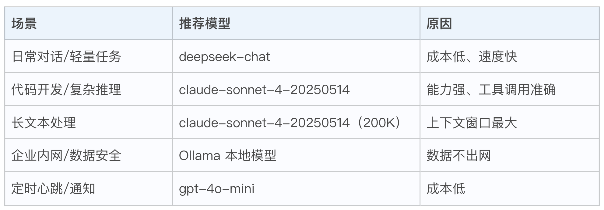

# 17 | 接入通道并配置多Agent：实现多场景助手

你好，我是 Henry，欢迎来到《OpenClaw 核心原理与实战》。

上节课我们完成了快速搭建 OpenClaw 开发环境，证明系统在正常运转。但你会发现如果想要解决日常的任务，还需要一个和 OpenClaw 交互的渠道，以及需要多个 Agent。举几个具体的场景：

- 场景一：工作和生活的边界。你白天用 Agent 帮你整理会议纪要、撰写邮件草稿；晚上用它推荐菜谱、规划周末旅行。如果只有一个 Agent，它的 System Prompt 要同时覆盖“专业工作助手”和“温暖生活管家”两种人设，这会让 LLM 的回复风格变得模糊不清。

- 场景二：不同通道的差异化需求。你在 Telegram 上是私人助手模式（只有你自己用），在飞书群里是团队知识库模式（多人使用）。两种场景对会话隔离、工具权限、模型选择的需求完全不同。

- 场景三：成本控制。日常闲聊用最贵的 Claude Sonnet 是浪费。你希望简单对话用DeepSeek（便宜快速），复杂推理再用 Claude（能力强大）。

这三个场景的共同诉求是：同一个 OpenClaw 实例，需要接入多个通道，同时需要运行多个Agent，每个 Agent 有不同的模型、人设、通道和权限。

下面我们首先接入你的第一个通道 Telegram，用来演练接入通道的过程。然后通过

```
openclaw.yaml 中的声明式配置，定义出任意复杂的多 Agent 工作流，实现多 Agent 场景
```

助手能力。

## 接入你的第一个通道

OpenClaw 支持 21 种消息通道（Telegram、Discord、飞书、钉钉、企业微信、WhatsApp等）。Telegram 接入简单，只需一个 Bot Token，不需要企业认证、不需要回调服务器。同时调试方便，不需要等待审核或轮询。这里选择 Telegram 作为示例，其他通道类似，你在接入飞书、钉钉等其他通道过程中，如果遇到问题，可以在留言给我。

### 创建 Telegram Bot

```
打开 Telegram，搜索 @BotFather（Telegram 官方的 Bot 管理器）。
发送 /newbot，按提示输入 Bot 名称和用户名。BotFather 会返回一个 Bot Token，格式
```

- 类似：

```
110201543:AAHdqTcvCH1vGWJxfSeofSAs0K5PALDsaw
```

3. 把 Token 保存到环境变量：

```bash
export TELEGRAM_BOT_TOKEN="110201543:AAHdqTcvCH1vGWJxfSeofSAs0K5PALDsaw"
```

### 配置添加通道

```
在 openclaw.yaml 中添加 Telegram 通道配置：
providers:
 anthropic:
   apiKey: "${ANTHROPIC_API_KEY}"
agents:
 list:
   - id: assistant
     model: claude-sonnet-4-20250514
     identity:
       name: "我的 AI 助手"
       instructions: |
         你是一个友好、专业的 AI 助手。
         - 回答问题时条理清晰
         - 遇到不确定的问题，诚实说明
         - 支持中英文双语交流
# 新增：Telegram 通道
channels:
 telegram:
   accountId: "${TELEGRAM_BOT_TOKEN}"
```

我们新增了两个部分：

```
-identity 字段：这里定义了 Agent 的人设——名字和行为指引（instructions）。
instructions 的内容会注入到 System Prompt 中，通过 System Prompt 引导 Agent 行
```

- 为。

```
channels.telegram 字段：声明 Telegram 通道。accountId 就是刚才从 BotFather
```

- 获取的 Token。配置完成后，OpenClaw 会在启动时通过 Telegram Channel Plugin 的

```
startAccount() 方法建立长连接，持续接收消息。
```

重启 OpenClaw 使配置生效：

```bash
# docker 重启
docker-compose restart
# 或者是本地安装重启
openclaw restart
```

## 配置多 Agent 场景助手

在动手写配置之前，先理解 OpenClaw 多 Agent 配置的核心设计哲学：Agent 定义和通道绑定是分离的。我们下面做一个类比：

- Agent 定义 = 你的团队成员——每个人有自己的能力和人设。

- 通道绑定（Bindings） = 谁坐在哪个工位——决定消息从哪个通道到达哪个 Agent。

分离的好处是灵活性：同一个 Agent 可以接收多个通道的消息（工作助手同时接 Telegram 和Slack），不同通道也可以绑定不同 Agent（Telegram 给工作助手，飞书给日程管家）。

下面让我们动手配置一个“工作助手 + 生活助手”的双 Agent 系统做为示例：

```
# openclaw.yaml — 双 Agent 配置
providers:
 anthropic:
   apiKey: "${ANTHROPIC_API_KEY}"
 deepseek:
   apiKey: "${DEEPSEEK_API_KEY}"
agents:
 list:
   - id: work
     model: claude-sonnet-4-20250514
     identity:
       name: "工作助手"
       instructions: |
         你是一个专业的工作助手，擅长：
         - 整理会议纪要，提取关键决策和行动项
         - 撰写和润色邮件草稿
         - 分析数据报告，给出商业洞察
         - 管理待办事项和项目进度
         语气保持专业、简洁、有条理。
   - id: life
     model: deepseek-chat
     identity:
       name: "生活助手"
       instructions: |
         你是一个温暖的生活助手，擅长：
         - 菜谱推荐和烹饪指导
         - 旅行规划和攻略整理
         - 健康建议和运动计划
         - 日常提醒和生活小技巧
         语气亲切、温暖、有生活气息。
# 路由规则：不同 Bot 绑定不同 Agent
bindings:
 - agentId: work
   match:
     channel: telegram
     accountId: "${WORK_BOT_TOKEN}"
 - agentId: life
   match:
     channel: telegram
     accountId: "${LIFE_BOT_TOKEN}"
channels:
 telegram:
   - accountId: "${WORK_BOT_TOKEN}"
   - accountId: "${LIFE_BOT_TOKEN}"
```

我们来详细解析下当前的配置。

```
providers 部分：声明了两个 LLM 提供商——Anthropic（Claude）和 DeepSeek。工作助
```

手用 Claude（推理能力更强，适合处理复杂工作任务），生活助手用 DeepSeek（响应快、成本低，适合日常对话）。

```
agents.list 部分：定义了两个 Agent。每个 Agent 有独立的 id、model 和
identity。注意 instructions 的写法，它们定义了截然不同的人设，确保两个 Agent 的
```

回复风格有明显区分。

```
bindings 部分：这是路由的核心。七层优先级匹配，这里用的是 channel + accountId
```

组合（对应优先级第 6 层）。两条 binding 规则分别把两个不同的 Telegram Bot 绑定到两个不同的 Agent。

实际效果：你在 Telegram 上创建两个 Bot（通过 @BotFather），一个叫工作助手，一个叫生

```
活助手。给工作助手发消息会路由到 work Agent（用 Claude 回复），给生活助手发消息会路
由到 life Agent（用 DeepSeek 回复）。两个 Agent 完全独立，各自的对话历史、记忆、工
```

具权限互不干扰。

## 配置 DM Scope 用户会话隔离

双 Agent 配置解决了“不同人设不同能力”的问题。但还有一个关键问题没回答：不同用户的对话怎么隔离？

```
默认情况下，dmScope 是 "main"——所有用户共享同一个 Session。这对个人助手场景没
```

问题（只有你自己用），但如果你把 Agent 分享给团队使用，所有人的对话就混在一起了，张三的工作内容李四也能看到，Agent 会搞不清谁在说什么。所以根据使用场景，你需要选择正确的 DM Scope，下面通过不同场景演示 DM Scope 配置。

场景 A：个人助手

```
session:
 dmScope: "main"
所有对话共享一个 Session Key：agent:work:main。不管你从 Telegram 还是其他通道发
```

消息，Agent 看到的都是同一段对话历史。

适合只有你自己使用，希望跨平台共享上下文。比如你在电脑上用 Telegram 开始了一段对话，切到手机上继续，上下文不会丢失。

场景 B：客服系统

```
session:
 dmScope: "per-peer"
例如每个用户有独立的 Session Key：agent:work:direct:alice123、
agent:work:direct:bob456。Alice 和 Bob 的对话完全隔离，但 Alice 在不同平台的对话
```

是打通的。这种适合多人共用一个 Agent，需要每人独立的对话空间。比如客服场景，每个客户的咨询记录各自独立。

场景 C：严格通道隔离

```
session:
 dmScope: "per-channel-peer"
Session Key 包含通道信息：agent:work:telegram:direct:alice123、
agent:work:discord:direct:alice123。即使是同一个人，在 Telegram 和 Discord 上
```

的对话也是分开的。适合不同通道承载不同用途。比如 Telegram 处理工作事务，Discord 处理社区运营，你不希望 Agent 在 Discord 回复时引用你在 Telegram 上的工作内容。

## 模型选择与成本优化

我们在使用 OpenClaw 时候可能有有一个疑问，一个 Agent 到底用哪个模型？OpenClaw 有一条五层模型优先级链：

```
heartbeat model override       ← 最高优先级（定时心跳场景）
   ↓
session model override         ← 用户通过 /model 指令临时切换
   ↓
channel model override         ← 通道级别配置
   ↓
agent default model            ← Agent 配置的默认模型
   ↓
global default model           ← 全局默认模型（最低优先级）
这个优先级链的设计逻辑是：越临时的覆盖越持久。用户的临时指令（/model gpt-4o）覆
```

盖 Agent 默认配置，Agent 默认配置覆盖全局默认——让最具体的设置胜出。

还有一个更实用的场景是配置模型降级链，当主模型不可用时，自动切换到备选模型。模型Fallback 机制是七重容错策略的第 7 层，当前面所有恢复策略（Auth 刷新、上下文压缩、Profile 轮换、Thinking 降级、Overload 退避）都无法恢复时，系统会抛出

```
FailoverError，由外部 Fallback 链捕获并切换到备选模型。
```

不同场景，我们模型选择有不同的考量，常见场景的模型选择建议如下：



成本优化的核心原则：用最便宜的模型完成能胜任的任务。不是所有任务都需要最强模型，日常闲聊用 DeepSeek，复杂工作用 Claude，心跳通知用 GPT-4o-mini。通过模型分级，你可以在不降低关键任务质量的前提下，大幅降低整体成本。

## 工具权限配置：让 Agent 能做什么

模型决定了 Agent 多聪明，工具权限决定了 Agent 能做什么。OpenClaw 有 7 层工具策略管道，核心原则是：每层只能收紧，不能放宽。对于多 Agent 场景，不同 Agent 需要不同的工具权限，下面是一个全局工具配置案例：

```
# 全局工具配置
tools:
 profile: "coding"        # 20 个基础工具作为起点
 deny:
   - "group:automation"   # 全局禁止定时任务和网关管理
   - nodes                # 全局禁止设备管理
# Agent 级别差异化
agents:
 list:
   - id: work
     tools:
       alsoAllow:
         - web_search       # 额外开启网页搜索
         - web_fetch        # 额外开启网页抓取
   - id: life
     tools:
       allow:               # 白名单模式：只允许这些工具
         - web_search
         - memory_search
         - memory_write
         - message
       deny:
         - exec             # 绝对禁止执行命令
```

这个配置的管道详细过程如下：

```
life Agent 收到请求，试图使用 exec 工具：
Step 1: profile = "coding" → 含 exec
......
Step 5: agents.life.allow = [web_search, memory_search, ...] → exec 不在白名单 ❌
结果：exec 在 Step 5 被过滤掉。life Agent 无法执行命令。
```

这就是只能收紧不能放宽原则的实际体现，全局 Profile 允许的工具，在 Agent 级别可以进一步限制。

工具权限配置核心是为了安全，对于非技术角色使用的 Agent（如生活助手等），常见的建议如下：

1. 使用白名单模式：明确列出允许的工具，而不是用 deny 列表排除危险工具。白名单的安全性更高，新增的工具默认被禁止，不会意外暴露。

```
禁止 exec 工具：除非 Agent 确实需要执行系统命令（如编码助手），否则应该显式 deny
exec。
限制 write 工具：文件写入能力意味着 Agent 可以修改你的文件系统。非开发场景通常不
```

- 需要这个能力。

## 总结

本节我们主要讲解了 OpenClaw 配置体系的五大维度：

第一，接入通道。通过接入第一个通道 Telegram，用来演练接入通道的过程。

```
第二，多 Agent 配置。通过 agents.list 定义多个 Agent，通过顶层 bindings 数组将不
```

同通道绑定到不同 Agent。Agent 定义和通道绑定是分离的，灵活性极高。

```
第三，DM Scope 会话隔离。四种模式从粗到细，main（所有人共享）→ per-peer（每人
独立）→ per-channel-peer（通道 + 人独立）→ per-account-channel-peer（完全
```

隔离）。根据使用场景选择正确的隔离级别。

第四，模型选择与成本优化。结合 OpenClaw 五层模型优先级链，配置 Fallback 确保高可用。不同场景用不同模型，日常用便宜模型，关键任务用强模型。

第五，工具权限分级。结合 7 层管道实现 Agent 级别差异化权限进行演示，工作助手开放更多工具，生活助手只保留安全的工具子集，白名单模式比黑名单更安全。

今天我们用配置定义了 Agent 的模型、人设、通道和权限。但 Agent 的能力还可以更丰富，它可以查天气、管 GitHub Issues、读 PDF、发邮件、生成图片……这些能力不需要你代码开发，OpenClaw 社区已经做好了，53 个内置 Skill 以及社区贡献的 Skill。后面我们会讲解如何安装和配置，让 Agent 获得更加丰富的能力。

## 思考题

完成 OpenClaw 接入第一个渠道，按照演练配置你的第一个多场景助手，并结合成本和效果的考量，进行合理的模型选择和工具权限配置。

如果你遇到了无法解决的问题，欢迎留言区与我交流！如果今天的课程让你有所收获，也欢迎转发给有需要的朋友，邀请他来一起学习，我们下节课再见！
