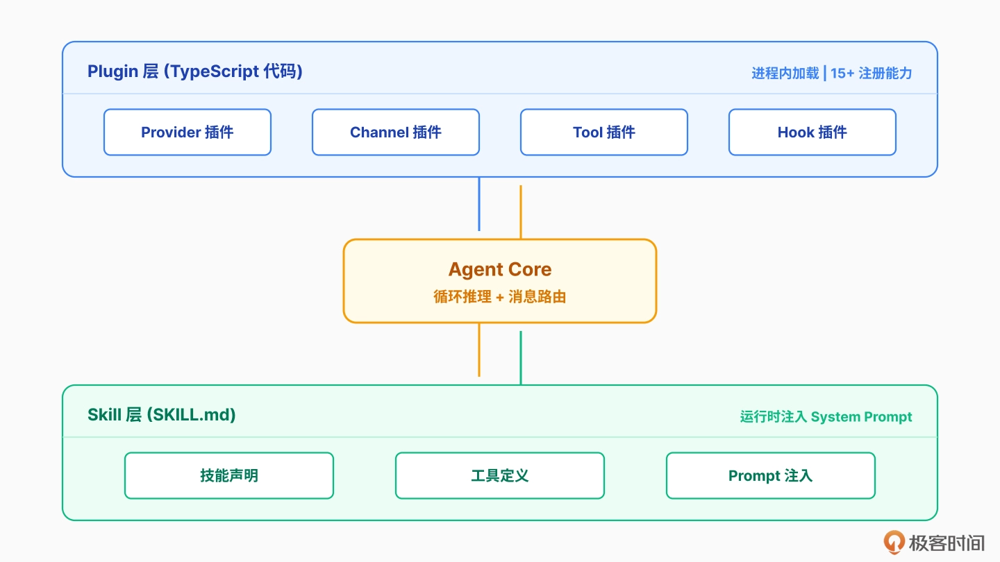
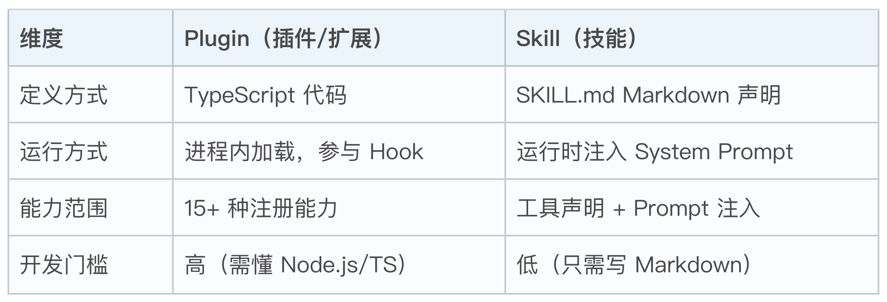
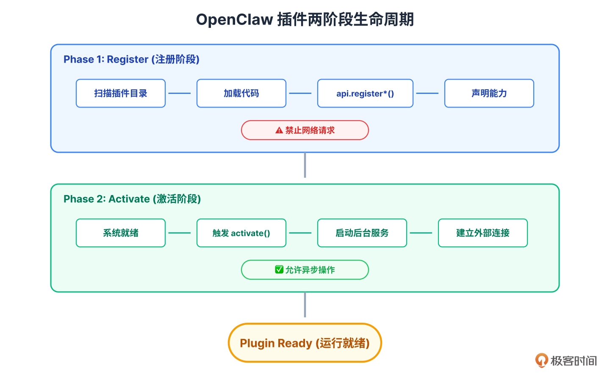

# 20 | 双层扩展体系与Plugin全貌：一个Agent框架如何变成万能生态？

你好，我是 Henry，欢迎来到《OpenClaw 核心原理与实战》。

在前面五个模块中，我们一直在拆解 OpenClaw 的内部机制：Agent 怎么循环推理、Memory怎么存储检索、消息怎么路由、安全怎么保障。但有一个核心问题始终没有回答：OpenClaw怎么从一个“能跑的框架”变成一个“什么都能干的生态”？

我们学习 Agent Loop 的时候知道，Agent 的核心能力来自工具调用。那么 Agent 能调用的工具从哪来？LLM Provider 谁注册的？Telegram 通道怎么接入的？答案是这些全部来自插件。

一个 AI Agent 为什么需要插件系统？OpenClaw 的核心框架只做两件事——Agent 循环推理+ 消息路由。一切具体能力（LLM 接入、消息通道、工具、记忆系统）都是通过插件注册进来的。类比来说：

- OpenClaw 核心 ≈ 浏览器引擎（只知道怎么渲染页面）

- 插件 / 扩展 ≈ Chrome 扩展（给浏览器加各种能力）

- 关键区别：OpenClaw 的插件不只是增强体验，而是提供核心能力，没有 Provider 插件，Agent 连模型都调不了

OpenClaw 框架目前拥有 74 个内置扩展和 53 个内置技能，总计 127 个扩展点，原生覆盖了33 种 LLM 和 21 种消息通道。这意味着，当你下载并运行 OpenClaw 时，你拿到的不是一个空壳，而是一个已经通过插件体系武装到牙齿的成熟系统。这种“微内核 + 插件”的架构模式，确保了核心引擎的轻量化，同时通过外部模块实现了能力的无限扩展。

## 核心框架与插件的边界

OpenClaw 的核心（Core）极其克制，它仅负责以下三件事：

1. Agent 循环推理：驱动思考 - 行动 - 观察的闭环。

2. 消息路由：确保信息在不同组件间正确传递。

3. 生命周期管理：负责插件的发现、加载与调度。

除此之外的所有功能，皆为插件。这种设计确保了系统的高内聚低耦合：即使某个插件崩溃，也不会导致核心引擎宕机；而当你需要升级某个模型接口时，只需替换对应的插件，无需触动核心逻辑。

## 双层扩展体系：Plugin vs Skill

为了兼顾“深度定制”与“快速开发”，OpenClaw 设计了独特的双层扩展体系。理解这两者的差异，是掌握 OpenClaw 开发的第一步。



### Plugin（插件 / 扩展）：进程内的深度参与

Plugin 是 OpenClaw 的“重型武器”。它使用 TypeScript 编写，在 Agent 进程内加载。

- 能力范围：它可以参与 Agent 的全生命周期 Hook，拥有 15+ 种注册能力。

- 适用场景：接入新的 LLM Provider、开发复杂的消息通道（Channel）、实现底层的记忆存储引擎。

- 开发门槛：较高，需要开发者熟悉 Node.js/TypeScript 以及 OpenClaw 的 SDK 规范。

### Skill（技能）：基于 Prompt 的轻量扩展

Skill 是 OpenClaw 的“轻骑兵”。它本质上是一个遵循特定格式的 Markdown 文件（SKILL.md）。

- 运行方式：在运行时被解析，将其中的指令和工具声明注入到 System Prompt 中。

- 能力范围：主要用于定义 Agent 的特定行为、工具使用规范和领域知识。

- 开发门槛：极低，非技术人员只需编写 Markdown 即可为 Agent 增加新技能。

Plugin 和 Skill 我们从定义、运行、能力范围、开发门槛维度进行一个比较：



既然 Plugin 承载了如此核心的能力，首选我们深入讲解一个标准的插件如何定义，它是如何被框架识别并运行的？

## Plugin 定义结构与元数据规范

在 OpenClaw 中，Extension（扩展）本质上就是内置的 Plugin，两者使用完全相同的 API 接口。一个标准的插件由元数据、类型标识和配置校验三部分组成。

### 插件接口定义

```
开发者需要实现 Plugin 接口，其核心结构如下：
interface Plugin {
 // 1. 元数据
 id: string;          // 插件唯一标识，如 "openai-provider"
 name: string;        // 插件名称
 version: string;     // 语义化版本号
 // 2. 类型标识
 kind?: string;       // 标识槽位插件，如 "memory" 或 "context-engine"
 // 3. 配置验证
 configSchema?: ZodSchema; // 使用 Zod 定义配置项的合法性
}
kind 字段是 OpenClaw 实现“插槽式替换”的关键。例如，框架定义了 memory 类型的插槽，
如果你开发了一个基于 Redis 的记忆插件并声明 kind: 'memory'，那么它就可以无缝替换
```

掉默认的本地文件记忆插件，而不需要修改 Agent 的任何调用代码。

```
OpenClaw 一共有四种插件来源：bundled（extensions/ 内置）、global（全局安装）、
workspace（工作区）、config（配置指定）。
你会注意到 extensions 目录有 74 个模块。但 Extension 本质就是内置 Plugin，使用与第
三方 Plugin 完全相同的 OpenClawPluginApi 接口。唯一区别是 origin: "bundled" vs
```

外部安装。Plugin 和 Extension 是同一套架构，不存在第三层。

## 两阶段生命周期：从加载到激活

为了确保系统的稳定性，OpenClaw 为插件设计了严谨的两阶段生命周期。这就像火箭发射前的检查清单，每一个阶段都有其明确的禁区和职责。



### Phase 1：Register（注册阶段）

这是插件的“声明期”。

- 动作：框架扫描插件目录，加载代码，并执行插件内部的注册逻辑。

```
职责：通过 api.register*() 声明自己拥有的能力（如工具、Hook、Provider）。
```

- 铁律：此阶段禁止进行任何网络请求或耗时操作。因为此时所有插件尚未加载完毕，任何外部依赖都可能导致初始化死锁。

### Phase 2：Activate（激活阶段）

这是插件的“运行期”。

- 动作：在所有插件注册完毕、系统准备就绪后触发。

- 职责：用于启动后台服务、建立数据库连接或初始化外部 API 客户端。

- 意义：确保了插件在正式工作前，其依赖的所有其他插件能力（如 Hook 拦截器）已经全部就位。

这里我们需要思考一下为什么分两阶段？

想象 Plugin A 在注册时需要检查“系统里有没有 memory-core 工具”，如果边注册边启动，memory-core 可能还没注册完。分两阶段后，Activate 时所有 Plugin 已注册完毕，注册表是完整快照。所以通过两阶段避免竞态。

```
在注册阶段，我到底能通过 api 注册哪些“超能力”？这决定了插件的能力天花板。知道天花板
```

在哪儿，才知道自己能做什么。OpenClaw 提供了 15+ 种注册能力。

## 15+ 种注册能力：万能生态的基石

OpenClaw 提供的 SDK 接口极其丰富，几乎覆盖了 Agent 开发的所有维度。我们可以将其归纳为“核心注册”与“Provider 注册”两大类。

### 核心注册接口

这些接口直接干预框架的运行行为：

```
registerTool：注册可供 Agent 调用的原子工具。
registerHook：将逻辑注入到 Agent 的生命周期。
registerChannel：接入新的消息平台（如微信、Slack）。
registerHttpRoute：为插件开启自定义的 HTTP 接口。
registerCli：为 OpenClaw 命令行工具增加新指令。
```

### Provider 注册接口（AI 能力抽象）

Provider 模式是 OpenClaw 兼容百模的关键：

```
registerProvider：注册基础 LLM 推理能力。
registerSpeechProvider：注册 TTS（文字转语音）能力。
registerImageGenerationProvider：注册图像生成能力。
registerWebSearchProvider：注册网页搜索服务。
```

通过这些标准化的接口，OpenClaw 将复杂的外部服务抽象成了统一的内部资源。

### 四种典型插件模式案例

在实际开发中，插件通常以以下四种模式之一存在。

```
Provider 模式：最纯粹的能力提供者。例如 OpenAIProvider，它只负责把框架的请求
```

- 翻译成 OpenAI 的 API 调用：

```bash
export default definePluginEntry({
 id: "openai",
 register(api) {
   api.registerProvider(buildOpenAIProvider());
   api.registerSpeechProvider(buildOpenAISpeechProvider());
   api.registerMediaUnderstandingProvider(openaiMediaUnderstandingProvider);
   api.registerImageGenerationProvider(buildOpenAIImageGenerationProvider());
 },
});
```

2. Channel 模式：Agent 的“耳朵和嘴巴”。它负责监听外部消息（如 Telegram 消息），将其转

```bash
化为框架标准的 InboundMessage，并将 Agent 的回复发送回去：
export default defineChannelPluginEntry({
 id: "telegram",
 plugin: telegramPlugin,
 setRuntime: setTelegramRuntime,
});
```

3. 工具 + CLI 模式：增强型插件。既提供给 Agent 运行时使用的 Tool，又提供给开发者在终端使用的管理命令：

```bash
export default definePluginEntry({
 id: "memory-core",
 kind: "memory",
 register(api) {
   api.registerTool(factory, { names: ["memory_read", "memory_write"] });
   api.registerCli(({ program }) => {
     program.command("memory").description("Manage agent memory");
   });
 },
});
```

4. 复合模式：全能型插件。例如一个“知识库插件”，它可能同时注册了 Hook（用于拦截消息并检索知识）、Tool（用于手动查询）和 HttpRoute（用于上传文档的 UI 界面）：

```bash
export default {
 id: "diffs",
 register(api) {
   api.registerTool(/* ... */);
   api.registerHttpRoute({ path: "/plugins/diffs", auth: "plugin" });
   api.on("before_prompt_build", async () => ({
     prependSystemContext: "diff 上下文信息...",
   }));
 },
};
```

## 总结

学习 OpenClaw 的插件体系核心，是为了理解“解耦”的设计。通过双层扩展体系，OpenClaw成功地将“稳定的核心”与“易变的业务”分离开来。对于开发者而言，这意味着你可以轻松使用扩展，通过极小的代价实现极其复杂的功能。

在接下来的课程中，我们将深入到插件系统的灵魂：Hook 机制，看看插件是如何精准地参与到 Agent 生命周期的每一个关键时刻的。

## 思考题

你需要为一个企业内部 Agent 开发一个功能，要求它能读取内部 Wiki（需要 API Key 认证），并且在每次回答用户问题前，先检查用户是否有权访问该知识。你会选择开发一个 Plugin 还是一个 Skill？为什么？

欢迎你在留言区与我交流！如果今天的课程让你有所收获，也欢迎转发给有需要的朋友，邀请他来一起学习，我们下节课再见！
