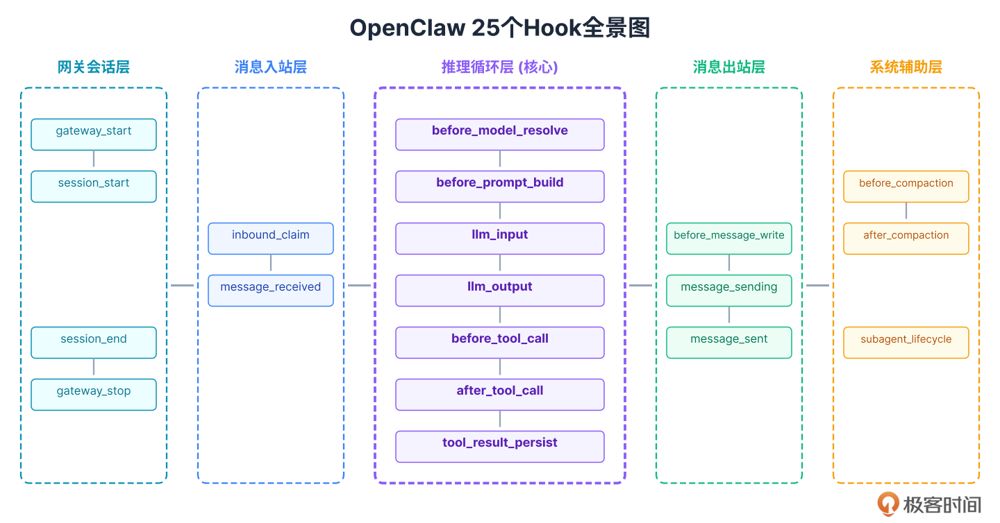
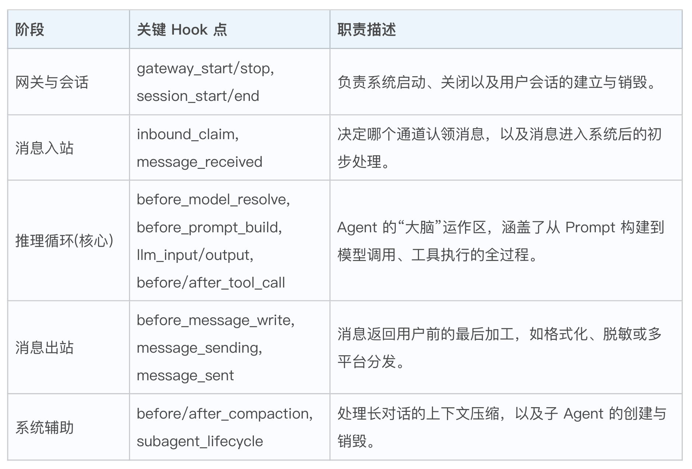
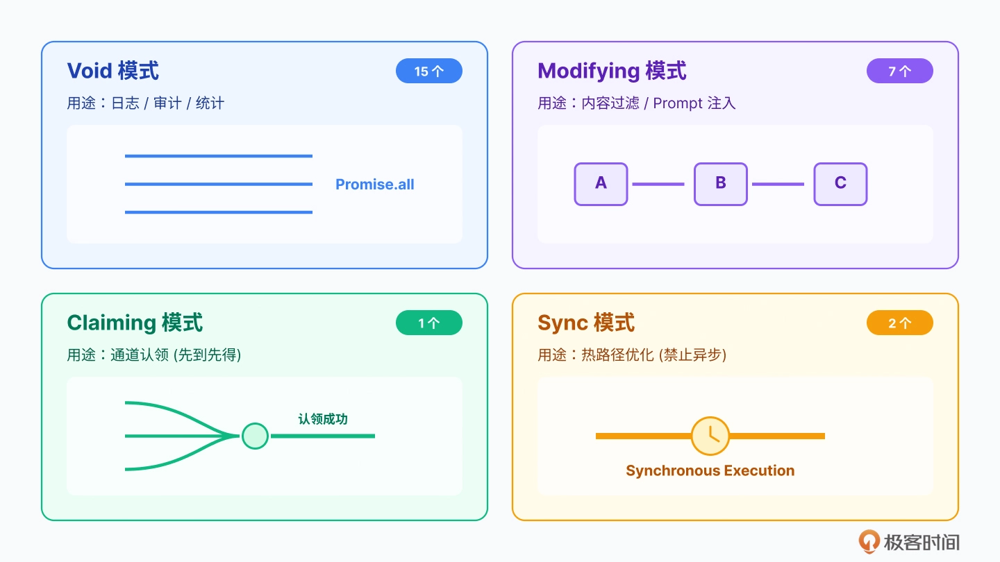

# 21 | Hook系统深入：插件如何参与Agent生命周期的每一个关键时刻？

你好，我是 Henry，欢迎来到《OpenClaw 核心原理与实战》。

在开发复杂的 Agent 系统时，每当想在模型调用前加一个日志，或者在消息发送后做一次规则逻辑，就不得不深入代码，在层层嵌套的逻辑中开发代码。这种“牵一发而动全身”的开发体验，是系统耦合度过高的典型症状。那么如何划分边界？如何确保不同插件的修改互不干扰？如何让一个核心框架在不改动源码的前提下，具备无限的逻辑注入能力？

这正是今天我们要深入探讨的 Hook 系统。上节课建立了插件的能力清单（能注册什么），这是静态描述。Hook 回答的是动态问题：插件在 Agent 处理一条消息的完整生命周期中，到底在哪些环节被调用。就像学开车，开始认识了仪表盘上所有按钮（注册能力），然后学什么时候踩刹车、什么时候打方向盘（Hook 时机）。

OpenClaw 的 Hook 系统，本质上是一套高度抽象的非侵入式逻辑注入机制。它将 Agent 从接收消息到输出结果的每一个微小动作，都定义为了可监听、可干预的“检查站”。

## Hook 全景：Agent 生命周期的“检查站”

在 OpenClaw 中，一个 Agent 的生命周期并非黑盒，而是由 25 个精心设计的 Hook 点串联而成的透明流程。我们可以将这些 Hook 比作城市中的“检查站”，每一条数据流（消息、指令、上下文）在通过这些检查站时，都需要接受插件的“检查”或“加工”。

为了让你对全局有清晰的认知，我们将这 25 个 Hook 按照 Agent 执行的逻辑顺序划分为五个阶段：





你可能会问：为什么需要定义这么多 Hook？

```
答案在于职责分离。例如，在“推理循环”阶段，before_prompt_build 允许插件注入额外
的背景知识（RAG），而 llm_input 则是在 Prompt 已经完全构建好、即将发给模型前的最
后一次“审查”。如果你想做 Prompt 注入攻击防御，应该在 llm_input 处拦截；如果你想做
知识增强，则应在 before_prompt_build 处介入。这种颗粒度的划分，确保了插件开发者
```

能够在正确的时间做正确的事。

你现在知道了 Hook 的触发时机，但还有一个关键问题：当多个插件都注册了同一个 Hook，它们是同时执行还是排队执行？结果怎么合并？这直接影响你设计插件时的思路。所以接下来我们要讲执行模式。

## 四种执行模式：不同场景下的“交通规则”

如果说 Hook 是检查站，那么执行模式就是通过检查站的“交通规则”。不同的业务逻辑对执行的顺序、异步性以及结果的依赖程度完全不同，所以光靠一种通用模式是远远不够的，所以，OpenClaw 设计了四种执行模式来应对这些复杂场景。

- 有些 Hook 只是通知（消息发出去了）→ 不需要返回结果 → Void 模式

- 有些 Hook 需要修改数据（改一下模型选择）→ 需要结果链式合并 → Modifying 模式

- 有些 Hook 需要竞争（这条消息归哪个通道）→ 先到先得 → Claiming 模式

- 有些 Hook 在热路径上（每条消息写入时）→ 不能有 async 开销 → Sync 模式



### Void 模式：并行的“旁观者”

```
这是数量最多的一种模式。它采用 Promise.all 并行执行所有注册的 Hook 函数。
Hook列表：llm_input, llm_output, agent_end, before_compaction,
 after_compaction, before_reset, message_received, message_sent,
 after_tool_call, session_start, session_end, subagent_spawned,
 subagent_ended, gateway_start, gateway_stop
```

- 特点：不关心返回值，插件之间互不阻塞。

- 典型用途：日志记录、审计监控、数据统计。

- 比喻：就像路边的监控摄像头，它们只负责记录车辆经过，不会影响车辆的行驶速度。

### Modifying 模式：链式的“加工厂”

这是最核心的模式。Hook 函数按优先级顺序执行，前一个插件的处理结果会作为后一个插件的输入。

```
Hook列表：before_model_resolve, before_prompt_build,
 before_agent_start, message_sending, before_tool_call,
 subagent_spawning, subagent_delivery_target
```

- 特点：链式合并，结果受优先级影响。

- 典型用途：内容过滤、Prompt 注入、消息脱敏。

- 比喻：就像流水线上的工人，第一个人负责组装零件，第二个人负责打磨，最后产出成品。

### Claiming 模式：竞争的“认领者”

```
专门用于 inbound_claim。
Hook列表：inbound_claim
```

- 特点：先到先得。一旦某个插件返回了非空值（认领了该消息），后续插件将不再执行。

- 典型用途：多通道消息分发。

- 比喻：就像出租车抢单，第一个按下抢单键的司机获得乘客，其他司机自动失去机会。

### Sync 模式：严苛的“计时员”

用于系统热路径（Hot Path）优化，不允许任何异步操作。

```
Hook列表：tool_result_persist, before_message_write
特点：必须同步执行，严禁使用 async/await。
```

- 典型用途：高性能计数器、内存状态同步。

- 比喻：就像百米赛跑的计时器，必须在运动员冲线的一瞬间给出结果，不能有半秒延迟。

## 当冲突发生时，合并策略与优先级

既然多个插件可以注册同一个 Hook，那么当它们产生冲突时，系统该听谁的？这就涉及到了OpenClaw 的合并策略（Merging Strategies）。

### 优先级机制

```
每一个 Hook 注册时都可以指定一个 priority（默认为 100）。数值越小，优先级越高，越
```

先执行。

```
// 插件 A：高优先级，先执行
api.registerHook('before_message_write', async (msg) => {
 return { ...msg, content: `[高优处理] ${msg.content}` };
}, { priority: 10 });
// 插件 B：低优先级，后执行
api.registerHook('before_message_write', async (msg) => {
 return { ...msg, content: `${msg.content} (已审计)` };
}, { priority: 200 });
```

### 四种设计模式

根据 Hook 的性质，OpenClaw 采用了四种不同的结果合并逻辑：

1. 先到先得（First-Win）：适用于决策型 Hook（如 Claiming 模式）。高优先级的结果直接生效，忽略后续。

2. 后覆盖前（Last-Override）：适用于修改型 Hook。如果多个插件修改了同一个字段，最后执行的非空值将覆盖前面的修改。

```
拼接累加（Append/Collect）：适用于信息型 Hook。例如 before_prompt_build，所
```

- 有插件提供的 Context 都会被拼接在一起。

4. 任一为 true（Any-True）：适用于防护型 Hook。只要有一个插件返回“拒绝”，整个流程即刻终止（一票否决制）。

## Hook 接口定义与执行序列

为了让大家更直观地理解 Hook 的运作，我们来看一下 OpenClaw 内部是如何定义这些 Hook接口的。

### 标准化接口展示

在 SDK 中，Hook 的定义严格遵循类型安全原则。以下是核心推理 Hook 的 TypeScript 定义片段：

```bash
export interface HookDefinitions {
 /** 在模型解析前触发，可用于动态切换 Provider */
 'before_model_resolve': (context: AgentContext) => Promise<ProviderConfig | voi
 /** 在 Prompt 构建前触发，用于注入 RAG 知识 */
 'before_prompt_build': (args: { messages: Message[], tools: Tool[] }) => Promis
 /** 工具执行后的持久化 Hook */
 'tool_result_persist': (result: ToolResult) => Promise<void>;
}
```

### 逻辑步骤序列：一次完整的 Hook 执行流

当一条用户消息进入 OpenClaw 时，Hook 的执行序列就像一份“火箭发射前的检查清单”：

```
Step 1：inbound_claim —— 谁来接这单？（Telegram 插件：我来！）
Step 2：message_received —— 消息已入库，通知 UI 更新。
Step 3：before_prompt_build —— 检索向量数据库，把相关知识塞进 Prompt。
Step 4：llm_input —— 检查 Prompt 里有没有敏感词？（安全插件：扫描完毕，安全）
Step 5：llm_output —— 模型回话了，先别发给用户，看看格式对不对。
Step 6：message_sent —— 任务完成，记录本次对话消耗的 Token。
```

## 总结

我们详细拆解了 Hook 的全景、执行模式和合并策略。Hook 系统的存在让 OpenClaw 变成了一个“透明的容器”。Hook 机制它不仅是实现功能的手段，更是一种架构思维。

通过 Hook，我们将 Agent 的核心逻辑（推理循环）与外围功能（日志、安全、知识库、多平台适配）彻底解耦。这意味着，你可以独立开发一个“敏感词过滤插件”，而不需要知道 Agent是如何调用 GPT-4 的；你也可以开发一个“飞书适配器”，而不需要修改任何关于记忆系统的代码。这种高度的解耦，正是 OpenClaw 能够从一个简单的框架演变成万能生态的基石。

## 思考题

你需要开发一个企业合规插件，要求记录所有用户与 Agent 的对话日志，如果用户询问公司机密（如薪资标准），Agent 必须拒绝回答并触发警报。那么你会选择哪几个 Hook 点来实现上述功能？两个功能分别应该采用哪种执行模式（Void/Modifying/Claiming/Sync）？为什么？

欢迎你在留言区与我交流！如果今天的课程让你有所收获，也欢迎转发给有需要的朋友，邀请他来一起学习，我们下节课再见！
