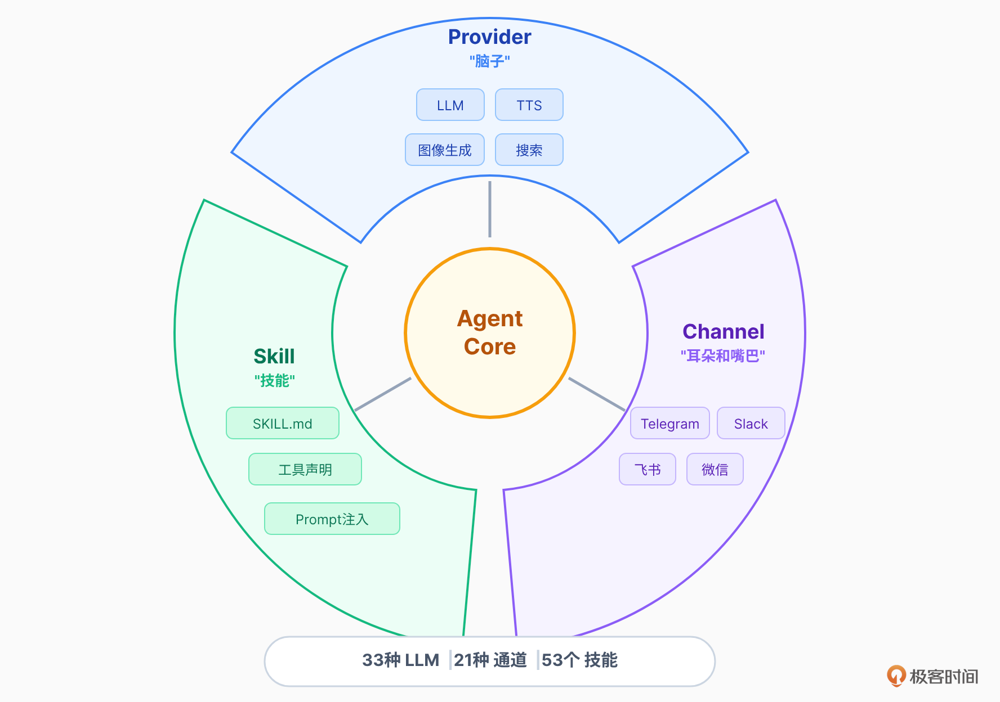
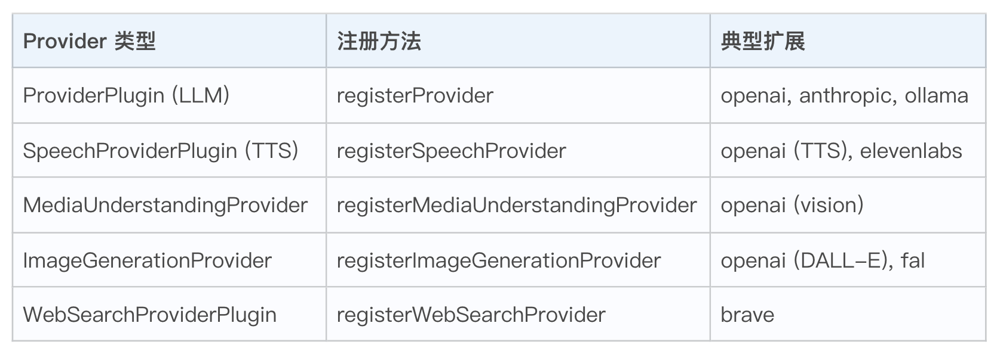
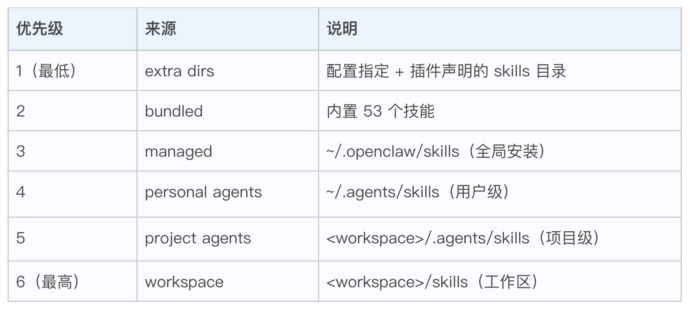
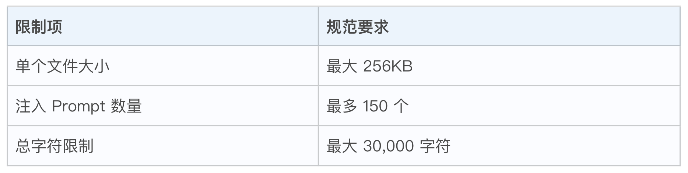
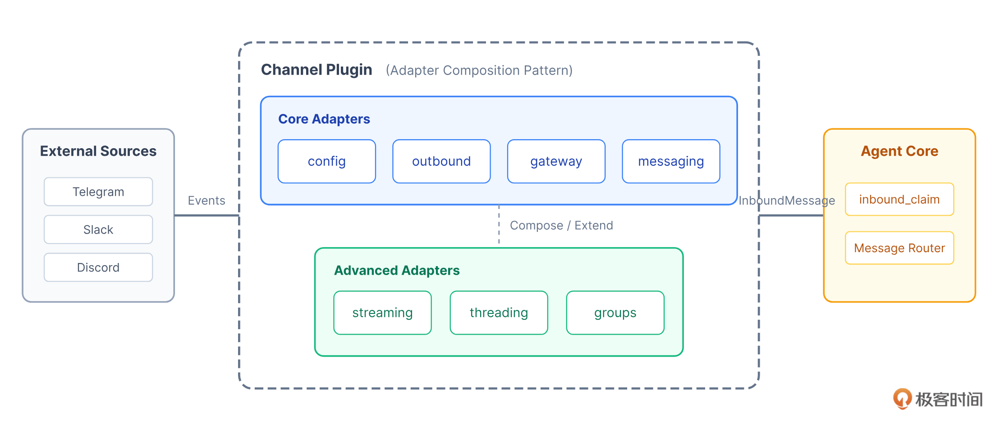

# 22 | Provider、Skill与Channel实战：如何用三种插件类型覆盖80%开发场景？

你好，我是 Henry，欢迎来到《OpenClaw 核心原理与实战》。

前面我们学了插件的骨架（定义 + API）和神经系统（Hook），理解了框架的运行机制。这一节我们聚焦“肌肉”——三种让 Agent 真正“有用”的核心插件类型。为了方便理解，我们把OpenClaw 比作一个正在成长的人，那么它的核心循环就是维持生命的心跳。然而，一个只有心跳的躯壳是无法感知世界并采取行动的。它需要“脑子”来思考，需要“技能”来处理具体任务，还需要“耳朵和嘴巴”来与外界交流。在 OpenClaw 的设计哲学中，这三者分别对应了Provider、Skill 和 Channel 三种核心插件：

- Provider：能调用 LLM 模型，让 Agent 有“脑子”

- Skill：知道怎么查天气、管 GitHub，让 Agent 有“技能”

- Channel：能接收和发送消息，让 Agent 有“耳朵和嘴巴”

为什么把这三种放在一起？它们代表 Agent 能力的三个基本维度——思考（Provider）、行为（Skill）、交互（Channel）。理解了这三种，你就覆盖了 OpenClaw 插件开发最常见的 80%场景。



下面我们首先讲解 Provider 体系，Provider 是最重要的插件类型，没有 Provider，Agent 连模型都调不了。

## Provider 体系：为 Agent 装上最强大脑

Provider 插件本质是工厂模式与策略模式的结合。OpenClaw 定义了统一的

```
ProviderPlugin 接口，确保了底层基础设施的可替换性。无论你接入的是 OpenAI、
```

Anthropic 还是本地部署的 Llama，对于框架来说，它们都是符合标准的“脑子”。

```
OpenClaw 内置的 33 种 Provider 全部通过 registerProvider 注册。Provider 是基础设施
```

级的插件。

下面是 ProviderPlugin 完整接口示例：

```bash
export type ProviderPlugin = {
 id: string;
 label: string;
 aliases?: string[];
 // 认证——支持 5 种方式
 auth: ProviderAuthMethod[];
 // auth.kind: "oauth" | "api_key" | "token" | "device_code" | "custom"
 // 模型目录——静态 + 动态 + 增强
 catalog?: ProviderPluginCatalog;
 resolveDynamicModel?: (ctx) => ProviderRuntimeModel | null;
 augmentModelCatalog?: (ctx) => ModelCatalogEntry[] | null;
 // 流式处理
 wrapStreamFn?: (ctx) => StreamFn | null;
 // 能力声明
 capabilities?: Partial<ProviderCapabilities>;
 // 思考模式
 isBinaryThinking?: (ctx) => boolean | undefined;
 supportsXHighThinking?: (ctx) => boolean | undefined;
 resolveDefaultThinkingLevel?: (ctx) => ThinkLevel | null;
 // 运行时认证
 prepareRuntimeAuth?: (ctx) => Promise<ProviderPreparedRuntimeAuth | null>;
 resolveUsageAuth?: (ctx) => Promise<ProviderResolvedUsageAuth | null>;
 fetchUsageSnapshot?: (ctx) => Promise<ProviderUsageSnapshot | null>;
 // 设置向导
 wizard?: ProviderPluginWizard;
};
```

我们可以看到，Provider 接口设计得如此丰富，并不是过度设计，而是因为不同 Provider 差异极大。

- OpenAI 用 API Key，Google 用 OAuth，Ollama 免认证

- 模型目录有静态的（已知列表）和动态的（用户自定义 ID）

- 流式输出格式各家不同（SSE、WebSocket、gRPC）

- 丰富的接口 = 最大的灵活性，每个 Provider 只需实现自己需要的部分

### 五种认证方式与细分类型

为了应对不同厂商的差异，OpenClaw 提供了极其灵活的认证体系。开发者可以根据实际情况

```
选择 oauth、api_key、token、device_code 或 custom 认证方式。
```

在实际应用中，Provider 被细分为五种类型，涵盖了 AI 能力的全景：

1. ProviderPlugin (LLM)：核心推理引擎

2. SpeechProviderPlugin (TTS)：赋予 Agent 说话的能力

3. MediaUnderstandingProvider：让 Agent 看懂图片和视频

4. ImageGenerationProvider：让 Agent 具备创作能力

5. WebSearchProviderPlugin：为 Agent 提供实时联网搜索的“外挂”



了解了如何构建 Agent 的“大脑”后，我们接下来要解决如何让这个大脑学会具体的任务，这就是 Skill 系统的用武之地。

## Skill 技能系统：赋予 Agent 专业能力

如果说 Provider 是通用的智力，那么 Skill 就是具体的专业技能。OpenClaw 的 Skill 系统遵循一个核心理念：不修改代码逻辑，仅通过注入 System Prompt 引导行为。

Skill 的设计理念极简，本质是把专家知识写成 Markdown，让 LLM 按照你的指引使用工具。开发门槛极低，不懂编程的领域专家也能创建 Skill。

```
一个标准的 SKILL.md 包含以下核心要素：
```

- 元数据：定义技能的 ID、名称和版本。

```
依赖检查：通过 bins（二进制文件）、env（环境变量）和 os（操作系统）确保运行环
```

- 境。

- 行为指引：告诉 LLM 在什么场景下使用该技能，以及具体的 SOP。

以 weather 这个 Skill 为例：

```
---
name: weather
description: "Get current weather and forecasts via wttr.in or Open-Meteo"
homepage: https://wttr.in/:help
metadata:
 {
   "openclaw":
     {
       "emoji": "☔",
       "requires": { "bins": ["curl"] }
     }
 }
---
# Weather Skill
当用户询问天气时，使用 curl 命令查询 wttr.in。
## When to Use
- User asks about weather conditions
- User wants to know the forecast
## Commands
- `curl "wttr.in/{city}?format=3"` — 简短天气
- `curl "wttr.in/{city}"` — 详细天气报告
```

核心字段主要如下：

```
name / description：基础元数据
metadata.openclaw：嵌套结构（⚠️不是 frontmatter 顶层的 requires）
emoji：显示表情
requires.bins：依赖的二进制（如 curl、gh）
requires.env：依赖的环境变量
```

### 门控机制与加载优先级

为了确保系统的健壮性，OpenClaw 引入了自动门控机制。系统会自动检测环境，如果某个技能依赖的二进制工具不存在，该技能将不会被激活。

Skill 是否加载取决于以下检查：

1. bins 检查 → 依赖的二进制是否存在（如 curl、gh）

2. env 检查 → 依赖的环境变量是否已设置

3. config 检查 → 依赖的配置项是否存在

4. os 检查 → 当前操作系统是否匹配

5. always 标记 → 如果为 true，跳过所有门控

```
配置覆写 → config.skills.entries.<name>.enabled 可强制启用 / 禁用
```

同时，Skill 的加载遵循严格的六级优先级，确保了配置的灵活性。





这种设计确保了即使在复杂的项目中，Prompt 也不会因为过度堆砌而导致模型迷失方向。

既然 Agent 已经有了脑子和技能，它还需要一个通道来接收指令并输出结果。接下来，我们将探讨如何构建 Agent 的“感官”。

## Channel Plugin：连接现实世界的“耳朵和嘴巴”

Channel 插件负责解决 Agent 与外部通信系统的对接问题。它采用了经典的“通道适配器（Channel Adapter）”模式，将 Agent 生成的结构化消息转换为特定平台（如 Slack、Telegram）的协议格式。

### 适配器组合模式

Channel 的强大之处在于其模块化的适配器设计。开发者可以像搭积木一样组合不同的能力：

```
核心适配器：处理 config（配置）、outbound（出站消息）、gateway（网关接入）和
messaging（基础消息）。
高级适配器：支持 streaming（流式输出）、threading（会话线程）和 groups（群组
```

- 管理）。



### 竞争认领机制：inbound_claim

当一条消息从外部进入系统时，OpenClaw 如何决定由哪个插件处理？答案是

```
inbound_claim Hook。
```

这是一个典型的“竞争认领”模式：

1. 消息到达网关。

```
框架触发 inbound_claim Hook。
```

3. 所有注册的 Channel 插件根据消息特征（如 URL 路径、Header 标识）进行判断。

```
第一个返回 true 的插件将获得该消息的处理权。
```

目前 OpenClaw 已内置了 21 个通道，覆盖了从企业级的飞书、Slack 到个人社交的Telegram、WhatsApp 等主流平台。

## 总结

在实际开发中，我们往往需要组合这三种能力。例如，构建一个“专业翻译 Agent”：

1. Provider：接入 DeepL 或 GPT-4 作为翻译引擎。

```
Skill：编写 SKILL.md，定义翻译的风格（如信达雅）和术语表。
```

3. Channel：对接 Telegram，让用户可以随时随地发送文字进行翻译。

通过这三种插件类型的配合，开发者无需触碰 OpenClaw 的核心代码，即可实现 80% 以上的业务需求。这种高度解耦的架构，正是 OpenClaw 能够快速构建繁荣生态的基石。

## 思考题

```
需要为一个私有部署的医疗大模型开发接入插件，该模型要求使用动态生成的 device_code
```

进行认证，且输出结果需要经过一个本地的脱敏工具处理。

你应该选择哪种 Provider 认证方式？如何利用 Skill 的依赖检查（bins）确保脱敏工具在运行前已就绪？如果该 Agent 需要在医院内部的钉钉群中使用，你需要配置 Channel 的哪些适配器？

欢迎你在留言区与我交流！如果今天的课程让你有所收获，也欢迎转发给有需要的朋友，邀请他来一起学习，我们下节课再见！
