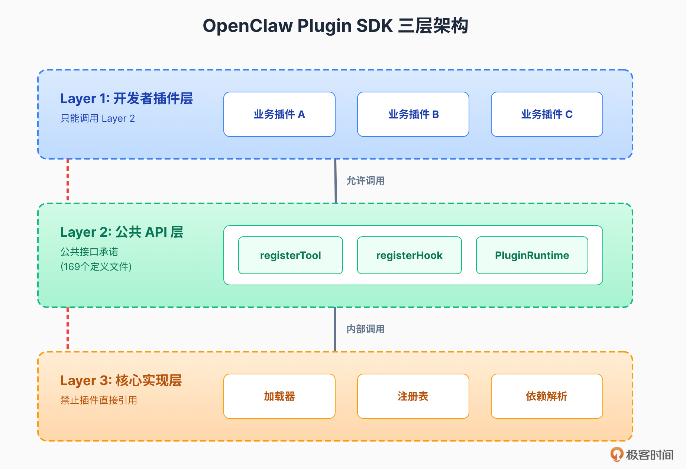
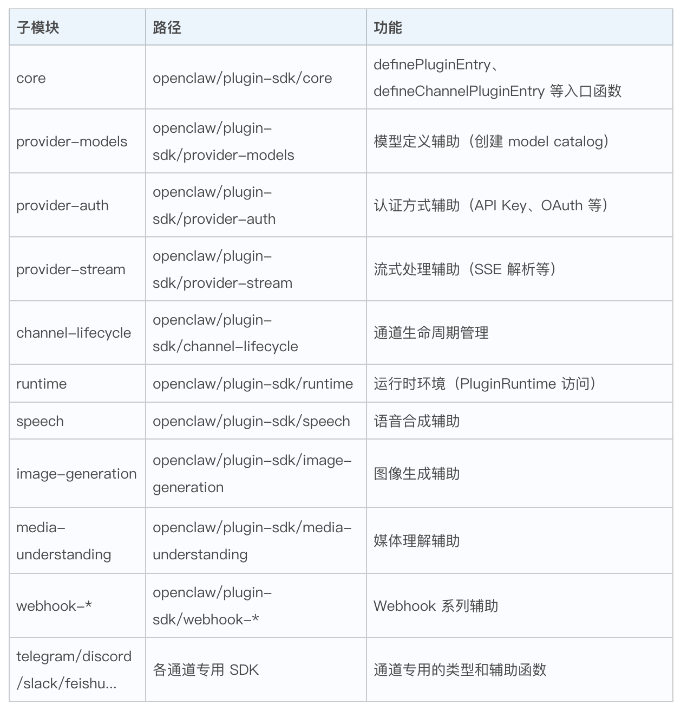
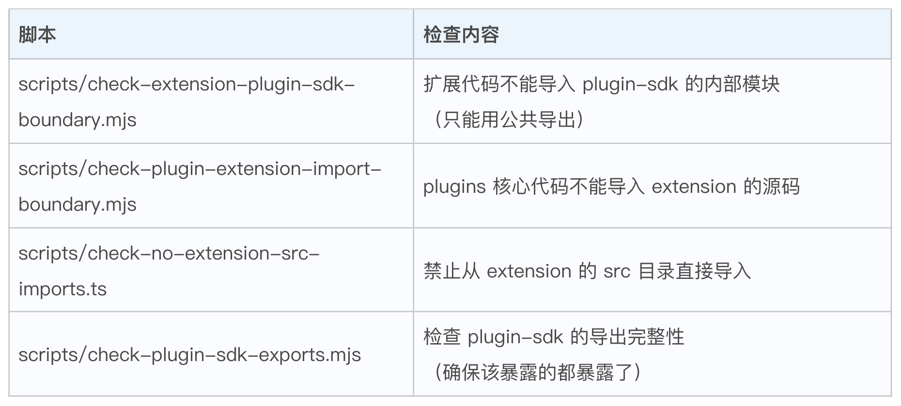
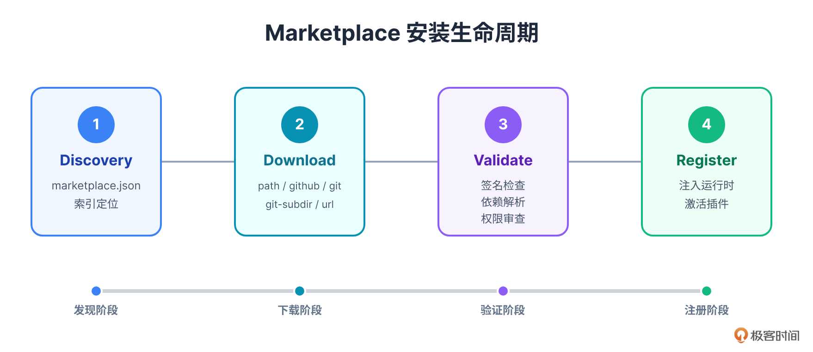
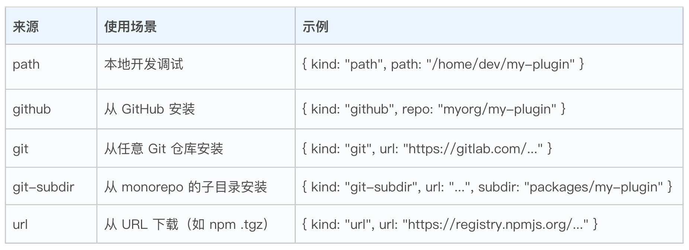

# 23 | PluginSDK分层与生态工程化：如何从插件开发者升级为生态贡献者？

你好，我是 Henry，欢迎来到《OpenClaw 核心原理与实战》。

虽然我们可以通过编写代码实现 OpenClaw 各种奇妙的插件功能，但当项目规模扩大、参与者增多时，新的挑战接踵而至：如何确保不同开发者编写的插件不会互相冲突？如何让一个插件在不修改代码的情况下适配不同的 Agent 平台？

如果说 OpenClaw 的核心框架是城市的“市政中心”，那么插件就是遍布城市的“建筑”。如果每个建筑商都按照自己的标准铺设电线和水管，这座城市很快就会陷入瘫痪。我们需要一套严密的“城市规划道路系统”。具体来说，这就是我们今天要讨论的主题：

1. SDK 分层：OpenClaw 怎么通过架构分层保护插件不被内部变更影响？

2. Bundle 兼容与 Marketplace：你的插件怎么打包、发布、让别人安装？

3. PluginRuntime：插件在运行时能访问哪些系统能力？

## SDK 三层架构：城市规划的道路系统

为什么需要分层？如果你开发了一个很棒的 Provider 插件，接入了公司内部的 LLM 服务。你

```
的插件代码里直接 import 了 OpenClaw 核心的内部模块，比如
src/plugins/loader.ts 里的一个辅助函数。一切工作正常。但是 OpenClaw 发布了新
版本。核心团队重构了 loader.ts，把那个辅助函数改了名字、换了参数。你的插件就不可
```

用了。

OpenClaw 的解决方案是严格的三层架构分层。核心理念是：

- Plugin SDK 是 OpenClaw 对插件开发者的“公共接口承诺”——只要 SDK 不变，你的插件就不会因为内部重构而坏掉。

这就像操作系统的系统调用接口：应用程序通过系统调用与内核交互，内核内部怎么实现你不用管，只要系统调用的签名不变，你的程序就能一直跑。

为了实现高内聚低耦合的设计目标，OpenClaw 将其 Plugin SDK 划分为三个清晰的层级。这种设计确保了框架核心的稳定性，同时也赋予了开发者足够的自由度。



```
Layer 1 是你写的插件代码。不管是 extensions/ 目录下的内置扩展，还是你开发的第三方
```

插件，都在这一层。你的代码只能导入 Layer 2 提供的公共 API。

```
Layer 2 是 Plugin SDK 公共 API 层，位于 src/plugin-sdk/ 目录下。它是一个精心设计
```

的接口集合，把核心实现的复杂性封装起来，对外暴露稳定的、类型安全的 API。让我们看看它的主要子模块：



```
Layer 3 是核心内部实现——src/plugins/ 和 src/agents/ 等目录。这些模块不可被插
```

件直接引用。核心团队可以自由重构这些模块的内部实现，不用担心影响任何插件。

约定了分层，还需要严格执行，为了保证遵守，OpenClaw 采用了边界检查机制，代码强制执行。为了防止开发者“越界”调用 Layer 3 的私有接口，OpenClaw 在 CI 阶段引入了 4 个严格的lint 脚本，在每次代码提交时都会自动检查导入边界是否被违反：



这些脚本运行在 CI 管道中。如果你的 PR 违反了任何一条导入边界，CI 会失败，代码无法合

```
并。其中，最核心的是 check-extension-plugin-sdk-boundary.mjs。它会扫描插件
```

代码，一旦发现非法的引用路径，将直接拒绝构建。这种强制性的约束，保证了生态系统长期的可维护性。

这是一个关键的设计：架构边界不能只靠文档和口头约定来维护——它们必须是自动化、可执行的检查。否则随着项目规模增长，边界一定会被突破。OpenClaw 用这四个脚本把“架构约定”变成了“架构约束”。

我们刚刚解决了开发时的架构安全。现在来看发布时的兼容性。

## Bundle 格式兼容：一次开发，多平台运行

在 Agent 领域，存在着多种清单文件格式，如 Codex、Claude、Cursor 等。如果开发者需要为每个平台都重写一遍插件，那将是巨大的资源浪费。

```
OpenClaw 采用了“大一统”的 Bundle 兼容策略。它不仅支持原生的 openclaw.json，还能
```

自动识别并解析其他主流平台的清单文件，OpenClaw 设计了一个格式兼容层，让一个插件可以跨平台使用。它支持四种清单文件格式：

```bash
// src/plugins/bundle-manifest.ts
export type PluginBundleFormat = "codex" | "claude" | "cursor";
export type PluginFormat = "openclaw" | "bundle";
// 支持的清单文件路径（按检测优先级）：
// 1. ".codex-plugin/plugin.json"   — Codex 格式
// 2. ".claude-plugin/plugin.json"  — Claude 格式
// 3. ".cursor-plugin/plugin.json"  — Cursor 格式
// 4. "openclaw.plugin.json"        — 原生格式
```

一个插件目录下可以同时包含多种格式的清单文件。当 OpenClaw 发现插件时，它会依次检测这些文件，自动适配对应的格式。假设你的团队同时使用 OpenClaw 和 Cursor，你开发了

```
一个插件，只需要在插件目录下同时放一个 openclaw.plugin.json 和一个 .cursor-
plugin/plugin.json，两个平台就都能识别和加载你的插件了。
```

当 OpenClaw 加载一个插件包时，它会按照以下优先级进行探测：

```
OpenClaw 原生：寻找 plugin.json 或 extension.json。
第三方兼容：识别 codex.json 或 claude_manifest.json。
```

这种设计使得 OpenClaw 能够直接复用现有的 Agent 生态资源，极大地降低了迁移成本。上面我们有了标准的打包格式，下一步是别人怎么安装你的插件。

## Marketplace 安装机制：Agent 的应用商店

一个繁荣的生态离不开便捷的分发渠道。OpenClaw 的 Marketplace（插件市场）机制，将复杂的安装过程抽象为了四个标准步骤。我们将 Marketplace 比作“应用商店”，其安装流程如下：



```
发现 (Discovery)：通过 marketplace.json 索引文件定位插件元数据。
```

2. 下载 (Download)：根据 source.kind 使用不同策略下载插件代码（git clone、npmdownload、本地复制）。

3. 验证 (Validate)：验证插件的清单文件、配置 Schema、依赖完整性。

4. 注册 (Register)：将插件加载到 PluginRegistry，执行 register/activate 生命周期。

为了适配不同的开发场景，OpenClaw 支持极具灵活性的安装来源：



## PluginRuntime：赋予插件“超能力”

```
到目前为止，我们讨论的都是插件在注册阶段做的事，即通过 api.register*() 声明自己
```

提供的能力。但插件在实际运行时，经常需要主动访问系统的其他能力。

比如：

- 一个通道插件收到用户消息后，想运行一个子 Agent 来处理

- 一个工具插件想调用 TTS 把结果朗读出来

- 一个监控插件想动态创建一个临时工具

这些需求就需要 PluginRuntime，它是插件在运行时可以访问的系统能力集合。以下是PluginRuntime 完整接口案例：

```bash
export type PluginRuntime = PluginRuntimeCore & {
 subagent: {
   run: (...) => Promise<...>;           // 运行子 Agent
   waitForRun: (...) => Promise<...>;    // 等待子 Agent 完成
   getSessionMessages: (...) => ...;     // 获取会话消息历史
   deleteSession: (...) => ...;          // 删除会话
 };
 channel: PluginRuntimeChannel;          // 通道运行时能力
};
export type PluginRuntimeCore = {
 version: string;                        // 当前 OpenClaw 版本
 // 配置
 config: {
   load: (...) => ConfigData;            // 读取配置
   write: (...) => void;                 // 写入配置
 };
 // Agent 管理
 agent: {
   run: (...) => Promise<...>;           // 运行 Agent
   getSession: (...) => ...;             // 获取 Agent 会话
 };
 // 系统
 system: {
   events: EventEmitter;                 // 系统事件总线
   exec: (...) => Promise<...>;          // 执行系统命令
 };
 // 媒体处理
 media: { ... };                         // 媒体文件处理
 // 语音
 tts: { synthesize: (...) => Promise<Buffer> };  // 文本转语音
 stt: { ... };                           // 语音转文本
 // AI 能力
 mediaUnderstanding: { ... };            // 媒体理解（图片/音频/视频）
 imageGeneration: { generate: (...) => Promise<...> };  // 图像生成
 webSearch: { ... };                     // Web 搜索
 // 动态工具
 tools: {
   createInMemoryTool: (...) => Tool;    // 运行时动态创建临时工具
 };
 // 事件
 events: {
   on: (event, handler) => void;         // 监听事件
   once: (event, handler) => void;       // 一次性监听
   emit: (event, data) => void;          // 发送事件
 };
 // 基础设施
 logging: { ... };                       // 日志系统
 state: { dir: string };                 // 插件状态目录
 modelAuth: { ... };                     // 模型认证信息
};
开发者可以通过 runtime 调用，这种设计解释了为什么我们要强调“分层”：通过
PluginRuntime，插件不需要知道底层 LLM 是如何调用的，也不需要关心 TTS 引擎的具体
```

实现，它只需要发出指令，由 Layer 3 负责调度执行。

我们重点看一个最实用子 Agent 运行插件能力，道插件或复杂工具插件经常需要运行子

```
Agent。通过 runtime.subagent.run()，你可以在插件内部启动一个完整的 Agent 推理
```

过程：

```javascript
// 在通道插件中处理用户消息
async function handleMessage(message: IncomingMessage) {
 const result = await runtime.subagent.run({
   prompt: message.text,
   model: "gpt-4",
   // ...
 });
 return result.response;
}
```

## 总结

至此，本模块我们从 OpenClaw 插件系统从最初的简单工具调用，到现在的分层架构设计、工程化分发以及复杂的上下文管理，学习完你已经具备了构建工业级 Agent 插件的能力。

### 思考题

你正在开发一个名为“代码审计专家”的插件，该插件需要读取用户本地的整个项目源码。为了

```
确保插件的安全性，你应该在 Layer 1 的代码中直接调用 Node.js 的 fs 模块，还是寻找
```

Layer 2 提供的 API？为什么？

欢迎你在留言区与我交流！如果今天的课程让你有所收获，也欢迎转发给有需要的朋友，邀请他来一起学习，我们下节课再见！
