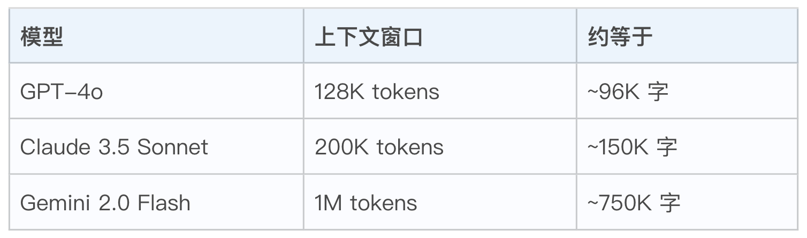
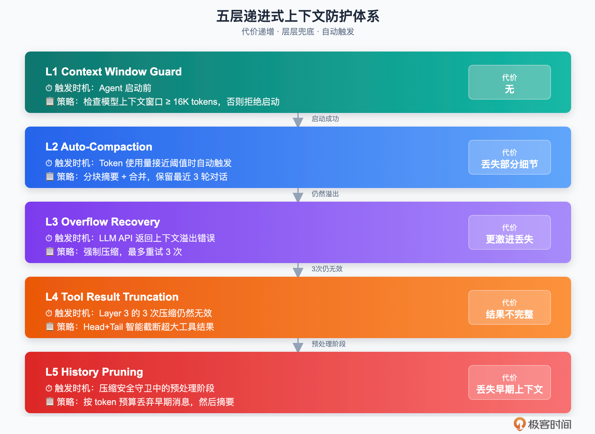
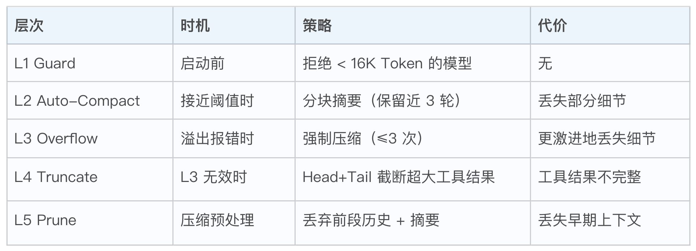

# 24 | 五层递进式上下文防护：如何应对Token爆炸问题？

你好，我是 Henry，欢迎来到《OpenClaw 核心原理与实战》。

提到上下文压缩，我们过去最注意的是压缩什么时候触发、摘要怎么分块、标识符怎么保留。这节课我们要把视角切换到系统架构师的角度，深入解析 OpenClaw 从启动前检查、到运行时自动压缩、到溢出恢复、到超大结果截断、再到历史裁剪的完整防御纵深体系。OpenClaw用五层递进式防护来应对 Token 爆炸问题，每一层都是上一层的兜底，代价逐层递增。

这里你可能会想，为什么把上下文防护作为“故障转移与高可用”模块的开篇？因为 Token 爆炸本质上就是一种“故障”，当上下文溢出时，LLM API 直接拒绝请求，Agent 瘫痪。上下文防护是 Agent 高可用的第一道防线。只有理解了这道防线，你才能理解为什么故障转移链会特殊处理上下文溢出。

## Token 爆炸：为什么它是 Agent 的致命威胁

上下文窗口有多大？每个大语言模型都有上下文窗口限制，就像一个容量有限的“记忆容器”。



看起来很大，但在 Agent 场景下，Token 消耗速度比你想象的快得多。一个粗略的测算：

- System Prompt：约 2K tokens

- 工具声明（Tools Schema）：约 5K tokens

- 10 轮对话历史：约 20K tokens

```
一次 bash("cat large-file.txt") 的结果：可能 50K+ tokens
```

- 一次浏览器截图的 base64 编码：可能 100K+ tokens

```
一个 128K 上下文窗口的模型，一条 cat 命令就可能占掉 40% 的容量。如果用户连续执行几
```

次大文件读取，溢出风险就变成了确定的风险。

当上下文超过模型的窗口限制时，LLM API 不会优雅地截断，它直接报错拒绝整个请求。用户看到的是 Agent 突然“死了”，之前的所有对话上下文全部丢失。

面对这个问题，一个朴素的方案是“在上下文快满的时候做一次压缩”。但如果压缩不及时、压缩失败怎么办？系统需要的不是一道墙，而是多层递进式的一套纵深防御，每一层用不同的策略，解决不同的场景，承担不同的代价。

下面我们针对 OpenClaw 的五层纵深防御系统进行详细介绍。

## 五层纵深防护系统

在逐层深入之前，让我们先鸟瞰整个防护体系：



关键设计哲学：代价递增。Layer 1 完全无代价（只是一次检查），Layer 2 温和（丢失一些细节，保留关键信息），Layer 3 更激进（强制压缩），Layer 4 直接“手术刀”截断，Layer 5 直接丢弃历史。每一层都是前一层的兜底，只有当前一层无法解决问题时，才触发下一层。

它遵循一个通用的工程原则：在可能的范围内用最小代价解决问题。你不会一上来就丢弃历史，那是最后的手段。

理解了全景之后，我们从 Layer 1 开始，逐层深入。你会看到每一层如何用不同的策略解决不同的场景，以及它们之间的“交班逻辑”是如何设计的。

### Layer 1：Context Window Guard——启动前的第一道防线

五层防护中最容易被忽视的其实是第一层，启动前的上下文窗口守卫。它代码量很小，但意义重大：在 Agent 还没开始工作之前，就拦住那些注定会失败的配置。

核心是两个阈值常量：

```bash
// 两个阈值常量
export const CONTEXT_WINDOW_HARD_MIN_TOKENS = 16_000;   // 硬性最小值
export const CONTEXT_WINDOW_WARN_BELOW_TOKENS = 32_000;  // 警告阈值
```

为什么是 16K？测算逻辑是：System Prompt（2K）+ 工具声明（5K）+ 最低限度的对话（几K）就几乎占满了。如果模型的上下文窗口低于 16K tokens，Agent 根本没有足够的空间工作。与其让用户在中途遇到频繁的溢出错误，不如在启动时就明确拒绝。

不同的模型，上下文窗口大小的来源不同。系统设计了一套上下文窗口的优先级链来解析：

```
1. modelsConfig — 用户在配置文件中为特定模型配置的 contextWindow（最高优先级）
2. model       — 模型定义自带的 contextWindow
3. default     — 全局默认值 DEFAULT_CONTEXT_TOKENS
然后检查 agents.defaults.contextTokens 上限：
 如果配置了且 < 上面解析的值 → 用它作为上限
用户配置覆盖模型默认值，而 contextTokens 作为一个全局上限兜底。有些用户可能在一
```

个团队环境中，需要统一限制所有 Agent 使用的上下文大小以控制成本。

Layer 1 很轻量，只在启动时做一次检查，不影响运行时性能。但启动之后，对话越来越长，Token 逐渐累积，我们需要运行时的自动管理，下面就是 Layer 2 的工作。

### Layer 2 与 Layer 5：分阶段摘要算法——压缩的核心引擎

Layer 2（Auto-Compaction）和 Layer 5（History Pruning）共用的压缩算法引擎。四个常量直接决定了压缩的行为，详细配置如下：

```bash
export const BASE_CHUNK_RATIO = 0.4;    // 压缩分块比率基准：目标是原文的 40%
export const MIN_CHUNK_RATIO = 0.15;    // 最小压缩比率：最激进可到 15%
export const SAFETY_MARGIN = 1.2;       // 20% 安全边际
export const SUMMARIZATION_OVERHEAD_TOKENS = 4096;  // 摘要请求本身的开销预留
其中最关键的是 SAFETY_MARGIN = 1.2。为什么需要 20% 的安全边际？因为 Token 估算
用的是 chars / 4 的启发式算法，这对英文文本还算准确，但对中文（约 2-3 字符
```

/Token）、代码（特殊符号多）、多字节字符等场景会低估。20% 的缓冲确保即使估算偏低，也不会在压缩过程中超出上下文窗口。

不同的会话，消息大小差异巨大。一条“好的”可能只有几个 Token，但一条代码 diff 可能有几千个 Token。所以在压缩过程中，需要自适应不同分块的压缩比率，OpenClaw 中

```
computeAdaptiveChunkRatio() 的解决方案是根据平均消息大小动态调整，详细逻辑如
```

下：

```bash
export function computeAdaptiveChunkRatio(
 messages: AgentMessage[], contextWindow: number
): number {
 const totalTokens = estimateMessagesTokens(messages);
 const avgTokens = totalTokens / messages.length;
 const safeAvgTokens = avgTokens * SAFETY_MARGIN;    // 先乘安全边际
 const avgRatio = safeAvgTokens / contextWindow;
 if (avgRatio > 0.1) {   // 平均消息占上下文窗口 > 10%
   const reduction = Math.min(avgRatio * 2, BASE_CHUNK_RATIO - MIN_CHUNK_RATIO);
   return Math.max(MIN_CHUNK_RATIO, BASE_CHUNK_RATIO - reduction);
 }
 return BASE_CHUNK_RATIO;   // 默认 0.4
}
```

```
这个算法的关键是：当 avgRatio > 0.1（平均消息超过上下文窗口的 10%）时，使用
avgRatio × 2 作为衰减量，从 0.4 向 0.15 衰减。当消息特别大时，分块比率会自动降低，
```

确保每个 chunk 都能在摘要请求的上下文窗口内处理。

```
OpenClaw 中采用链式摘要算法，chunkMessagesByMaxTokens() 负责把消息按 Token 分
块，其中 SAFETY_MARGIN 被第二次使用——先把 maxTokens 除以 1.2 得到
effectiveMax，再以此为上限分块。这意味着 SAFETY_MARGIN 在两处叠加使用，提供
了约 44% 的总体安全缓冲（1.2 × 1.2 ≈ 1.44）。分块完成后，summarizeChunks() 执行链
```

式摘要：

```
Chunk 1 → retryAsync(generateSummary, 3次) → Summary 1
Chunk 2 + previousSummary=Summary 1 → Summary 2
Chunk 3 + previousSummary=Summary 2 → Summary 3（最终结果）
```

为什么是链式而非并行？因为后一个 chunk 的摘要需要参考前一个 chunk 的摘要结果，否则整体叙事的连贯性会断裂。每次摘要调用都有 3 次重试（500ms-5000ms 间隔，带 20%jitter），确保单次 API 波动不会导致整个压缩失败。

但是 LLM 摘要调用可能因限流、超时、安全过滤等原因失败。所以还需要对此进行进一步的

```
防护，OpenClaw 中 summarizeWithFallback() 实现了三级降级策略：
```

- Level 1：全量摘要（包含所有消息）

- Level 2：排除超大消息后重试，如果某条消息超过上下文窗口的 50%

```
（isOversizedForSummary），它会导致摘要请求本身超出窗口。排除这些消息后，附
上一条标记："[Large assistant (~30K tokens) omitted from summary]"
Level 3：纯计数兜底，"Context contained 50 messages (3 oversized).
Summary unavailable due to size limits."
```

降级确保系统不会因为摘要失败而卡死，即使只剩下一条“50 条消息、3 条超大”的简短描述，也比 Agent 彻底瘫痪强得多。

### Layer 3：Overflow Recovery——溢出后的紧急救援

自动摘要解决了大部分场景，但如果压缩不及时，LLM API 已经返回了上下文溢出错误怎么办？这就是 Layer 3 的工作，溢出恢复。

当 API 返回溢出错误时，系统不会立即放弃，而是进入紧急救援模式：

1. 强制触发一次压缩

2. 重试 API 调用

3. 最多重复 3 次

如果 3 次强制压缩后仍然溢出，说明问题不在历史消息，很可能是单条工具结果就超过了窗口限制，需要触发下一层防护。这个“最多 3 次”的设计体现了一个重要原则：每一层防护都要有明确的退出条件，避免无限循环。

有一种特殊场景 Layer 2 和 Layer 3 处理不了：单条工具结果就超过了上下文窗口的合理占比。那需要 Layer 4 进行防护。

### Layer 4：Tool Result Truncation——超大工具结果的手术刀

```javascript
例如这个场景，用户让 Agent 执行 bash("cat /var/log/syslog")，结果返回了 200K
```

字符。即使把其他所有消息都压缩掉，这一条工具结果仍然撑爆窗口。摘要没法帮忙，因为你不能“摘要”一个系统日志文件，然后期望 Agent 用摘要来排查问题。OpenClaw 的解决方案是“手术刀式截断”：只切这一条超大结果，不影响其他任何内容。

这里截断涉及三个核心阈值：

```bash
const MAX_TOOL_RESULT_CONTEXT_SHARE = 0.3;   // 单个结果最多占 30% 上下文
export const HARD_MAX_TOOL_RESULT_CHARS = 400_000;  // 硬性上限 400K 字符
const MIN_KEEP_CHARS = 2_000;  // 截断时最少保留 2000 字符
```

三个阈值的设计逻辑非常清晰：

- 30% 上下文占比：给 System Prompt、工具声明、对话历史留出足够空间

- 400K 字符 硬上限：即使是 2M Token 的超大窗口模型，单条结果也不能超过这个值

- 2000 字符 最低保留：截断再激进，也要保留足够内容让模型理解“这是什么”

截断不是简单地砍头或砍尾。系统实现了一种 Head+Tail 智能截断策略，详细逻辑如下：

```bash
export function truncateToolResultText(text: string, maxChars: number): string {
 if (text.length <= maxChars) return text;
 const budget = Math.max(MIN_KEEP_CHARS, maxChars - TRUNCATION_SUFFIX.length);
 // 如果尾部包含重要内容 → Head 70% + Tail 30%
 if (hasImportantTail(text) && budget > MIN_KEEP_CHARS * 2) {
   const tailBudget = Math.min(Math.floor(budget * 0.3), 4_000);
   const headBudget = budget - tailBudget - MIDDLE_OMISSION_MARKER.length;
   // 保留开头 + 保留结尾，中间插入省略标记
   return text.slice(0, headCut) + MIDDLE_OMISSION_MARKER + text.slice(tailStart
 }
 // 默认：只保留开头
 return text.slice(0, budget) + TRUNCATION_SUFFIX;
}
hasImportantTail() 会检测尾部最后 2000 字符是否包含这些模式：
错误信息：error、exception、traceback、panic、exit code
JSON 闭合：} 结尾（JSON 输出的结构化结束）
结果摘要：total、summary、result、complete
```

为什么尾部这么重要？因为在很多场景下，工具输出的最有价值的信息恰恰在末尾，错误堆栈在末尾，命令执行结果在末尾，JSON 的闭合结构在末尾。如果只保留开头，Agent 会丢失最关键的信息。

到这里我们已经有了 Auto-Compact、Overflow Recovery、Tool Result Truncation，但是还需要一个指挥官来协调这些机制。这就是我们下面讲的压缩安全守卫。

## 压缩安全守卫：把所有层串起来的指挥官

压缩安全守卫（compaction-safeguard）接管了压缩事件，在触发压缩之前做一系列预处理和后处理。

首先是质量审计，限制摘要必须包含什么，质量审计会检查生成的摘要是否包含五个必需的section：

```javascript
const REQUIRED_SUMMARY_SECTIONS = [
 "## Decisions",          // 做过的决策
 "## Open TODOs",         // 待办事项
 "## Constraints/Rules",  // 约束条件
 "## Pending user asks",  // 用户未完成的请求
 "## Exact identifiers",  // 精确标识符（commit hash、文件路径等）
];
```

它们是 Agent 在压缩后“恢复记忆”的关键信息。如果摘要丢失了“之前决定用方案 A”这个信息，Agent 可能会重新提议方案 B，让用户困惑。如果丢失了 commit hash，Agent 就无法引用之前的代码变更。

## 总结

我们用一张表总结一下五层防护核心：



渐进式的上下文防护，核心概括为三个设计原则：

1. 纵深防御：不依赖单一机制，五层递进，每层兜底

2. 代价递增：从无代价到有代价，从温和到激进

3. 自动化运行：不依赖人工干预，每一层都自动触发

这些原则不仅适用于上下文管理，也是所有复杂系统设计的通用智慧。当你面对任何可能失败的场景时，都可以问自己：我有几层防护？它们的代价是否递增？触发条件是否自动化？

## 思考题

如果你要为一个 Token 窗口只有 8K 的本地模型设计防护策略，会做哪些调整？

欢迎你在留言区与我交流！如果今天的课程让你有所收获，也欢迎转发给有需要的朋友，邀请他来一起学习，我们下节课再见！
