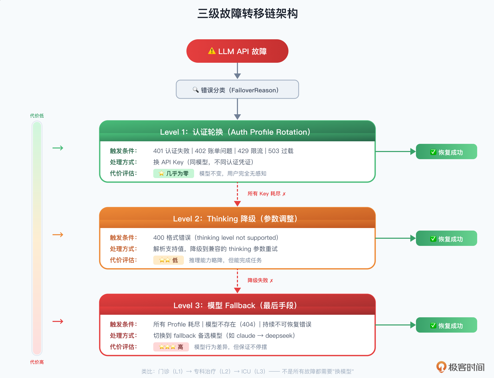
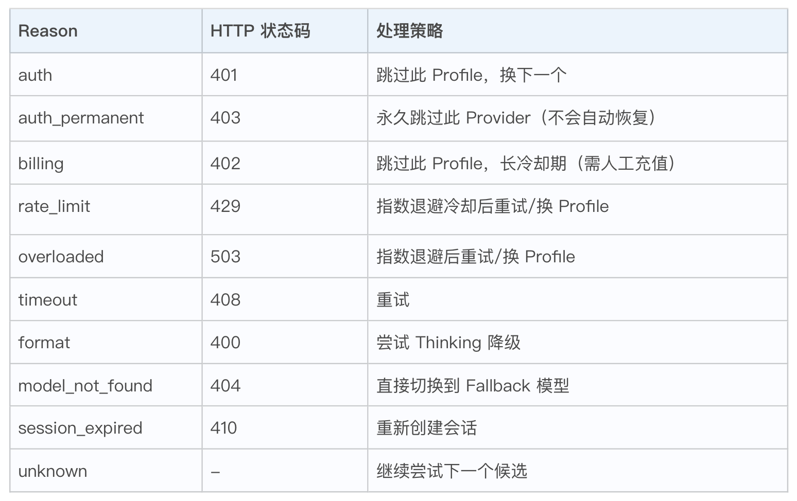
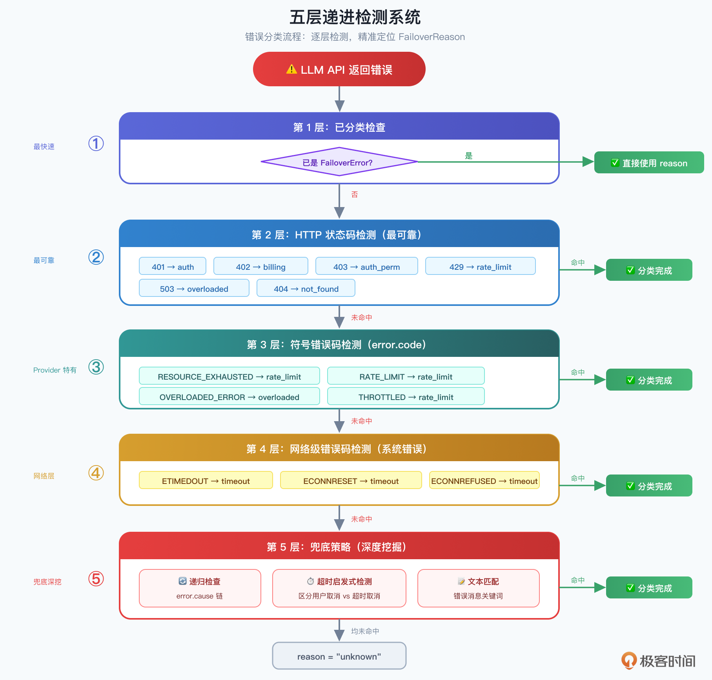
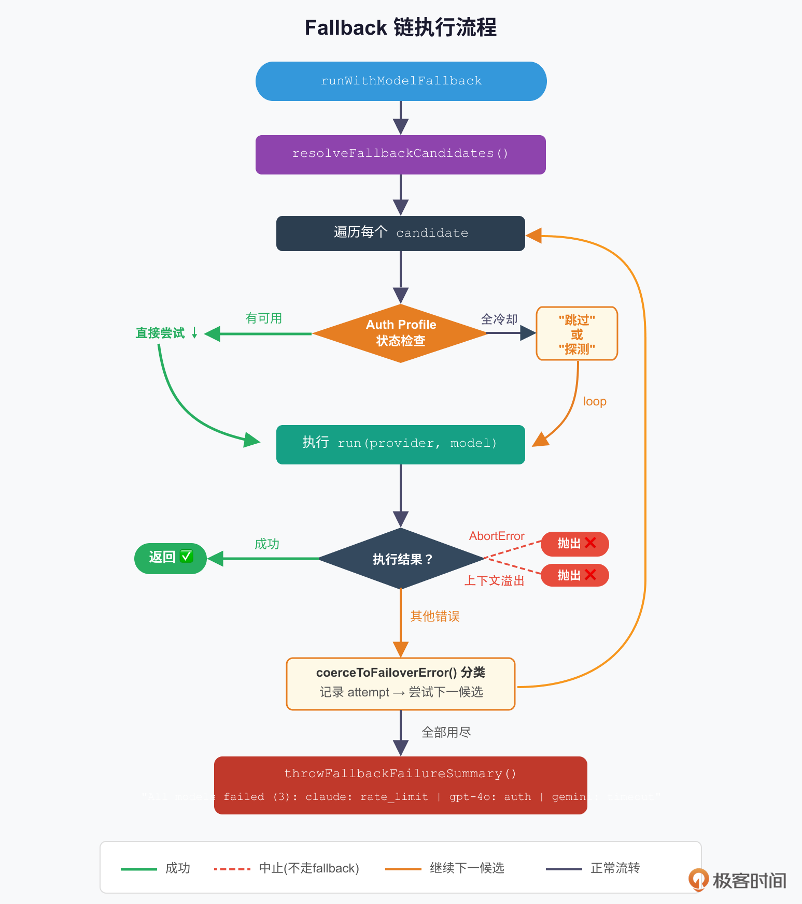
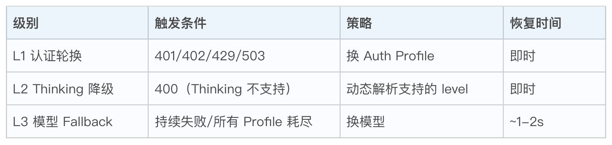

# 25 | 三级故障转移链设计：如何保证Agent永不掉线？

你好，我是 Henry，欢迎来到《OpenClaw 核心原理与实战》。

上节课我们建立了完整的上下文防护认知：五层递进式防护体系，从启动前检查到运行时截断，确保 Agent 不会因为 Token 爆炸而崩溃。但 Token 爆炸只是 Agent 面临的挑战之一。今天我们要面对另一个更棘手的问题：LLM API 本身出了问题。

当你的 Agent 正在帮用户重构一个大型项目，已经执行了十几步操作，修改了文件、运行了测试、生成了报告。然后到了第十五步的 API 调用失败，如果系统不做任何处理，你看到的就是“模型不可用”，你无法控制 API 提供商的服务状态。

今天我们来解决这个问题：OpenClaw 如何设计一条完整的三级故障转移链，让 Agent 在面对API 故障时“静默恢复”，用户甚至不需要知道底层发生了模型切换。

## 为什么需要三级故障转移？

在深入细节之前，一个直觉性的问题：为什么要搞这么复杂？直接“失败就换模型”不行吗？

这种简化方案有两个严重问题：

第一是浪费。如果只是 API Key 被限流了，换一个 Key 就能解决，换模型是大材小用。就像你家停电了，第一反应应该是检查保险丝，而不是搬家。

第二是风险。不同模型的行为可能有差异，GPT-4o 和 Claude 对同一个 prompt 的理解可能完全不同。频繁切换模型会导致推理质量不稳定，用户会觉得“这个 Agent 一会儿聪明一会儿傻”。

所以三级设计的核心思想是：能不换模型就不换模型。先试最轻量的方案，不行再逐级升级，实在不行才动用最后的手段。这就像医院的急诊分诊，不是所有病人都需要进 ICU，大多数情况下门诊就能解决。

首先让我们建立三级故障转移架构全局认知，故障转移链遵循代价最小优先原则，详细情况如下：



Level 1：认证轮换（Auth Profile Rotation）

这是代价最低的恢复策略。当系统检测到 HTTP 401（认证失败）、402（账单问题）、429（限流）或 503（服务过载）时，首先尝试的不是换模型，而是换一个 API Key。

为什么这能解决问题？因为大多数 API 提供商的限流是针对单个 Key 的。你可能有多个 Key分布在不同的账户上，或者同一账户的不同 Profile。只要有一个 Key 还能用，Agent 就能继续工作。这个策略的代价几乎为零，模型不变，只换认证凭证，用户完全无感知。

Level 2：Thinking 降级

这是针对特定错误的参数调整策略。有些模型支持不同级别的“思考深度”参数（比如 Claude的 extended thinking），但这个参数在某些情况下可能不被支持。

当系统检测到错误消息中包含 thinking level not supported 这样的提示时，会自动解析错误中提到的支持值，然后降级到一个兼容的参数重试。这个策略的代价是推理能力可能略降，但至少能完成任务。

Level 3：模型 Fallback

这是最后的手段，当所有 Auth Profile 都用尽了，或者错误持续发生无法恢复时，系统才会切换到备选模型。这个策略的代价最高，不同模型可能有行为差异，但至少保证了 Agent 不会完全停摆。

在这个架构中，还有有一条特殊规则：上下文溢出不触发模型 Fallback。因为上下文溢出意味着当前的消息太多，如果你从 Claude 换到 GPT-4o 情况只会更糟。上下文溢出应该走五层防护路径（压缩、截断），而不是走模型 Fallback 路径。这是两条故障恢复路径的关键隔离点，这一点对于理解整个系统的协同设计至关重要。

了解了架构全景，我们深入第一个基础能力错误分类系统。

## 错误分类系统：10 种 FailoverReason

三级故障转移的每一级都依赖精确的错误分类来决定触发哪一级。分类不准，整个转移链就会做出错误决策。

系统是如何对错误进行分类的？核心定义如下：

```bash
export type FailoverReason =
 | "auth"              // 认证失败（API Key 无效）
 | "auth_permanent"    // 永久认证问题（403 Forbidden）
 | "format"            // 格式错误（400，如 thinking level 不支持）
 | "rate_limit"        // 限流（429 Too Many Requests）
 | "overloaded"        // 服务过载（503 Service Unavailable）
 | "billing"           // 账单问题（402 Payment Required）
 | "timeout"           // 超时（连接超时/请求超时）
 | "model_not_found"   // 模型不存在（404）
 | "session_expired"   // 会话过期（410 Gone）
 | "unknown";          // 未知原因
```

每种 reason 对应不同的处理策略如下所示，这就是为什么分类必须精确：



```
具体处理策略中，auth 和 rate_limit 都会换 Profile，这是 L1 级别的恢复；format 会
尝试 Thinking 降级，这是 L2 级别；而 model_not_found 会直接切换模型，这是 L3 级
```

别。

可能这里你会有一个疑问，为什么需要专门设计一个错误类？这是因为原始的 API 错误千奇百怪，有的是 HTTP 状态码，有的是字符串消息，有的是嵌套的 error.cause 链。

```bash
FailoverError 类的设计，把这些混乱的错误统一成一个结构化对象：
export class FailoverError extends Error {
 readonly reason: FailoverReason;  // 分类原因
 readonly provider?: string;       // 哪个 Provider
 readonly model?: string;          // 哪个模型
 readonly profileId?: string;      // 哪个 Auth Profile
 readonly status?: number;         // HTTP 状态码
 readonly code?: string;           // 错误码
}
有了这个封装，后续的故障转移逻辑就可以用简单的 switch(error.reason) 做清晰的策
```

略选择，而不用每次都去解析原始错误的各种格式。

那么 OpenClaw 具体是如何实现把五花八门的原始错误准确地分类成这 10 种FailoverReason？

下面我们详细讲解 OpenClaw 的五层递进的检测逻辑。因为不同的 LLM API Provider 返回错误的方式完全不同：

- Anthropic：通常返回规范的 HTTP 状态码

- OpenAI：有时在 error.code 中返回 RESOURCE_EXHAUSTED

- Google Gemini：用符号错误码 RESOURCE_EXHAUSTED

- 自托管模型：可能返回网络级错误（ETIMEDOUT、ECONNRESET）

- 代理服务（OpenRouter）：可能把原始错误包装在 error.cause 链中

一个看似简单的“检测限流”操作，因为这种异构性，OpenClaw 设计了一套五层的递进检测系统，详细流程如下：



第一层：检查错误是否已经是 FailoverError。如果是，说明已经被分类过了，直接使用。

第二层：尝试从 HTTP 状态码推断原因。这是最可靠的方式，因为 HTTP 状态码是标准化的。402 一定是账单问题，429 一定是限流。

第三层：检查符号错误码。有些 Provider 不返回 HTTP 状态码，而是在错误对象中设置一个

```
code 字段，比如 RESOURCE_EXHAUSTED。
```

第四层：检查网络级错误码。如果错误是在网络层发生的（连接超时、连接被重置），错误对

```
象中会有 ETIMEDOUT、ECONNRESET 这样的系统错误码。
```

第五层：兜底策略。如果前四层都没命中，就递归检查 error.cause 链（有些 Provider 会把原始错误嵌套在 cause 中），然后进行超时启发式检测，最后做错误消息的文本匹配。

```
在五层检测中，超时检测逻辑更加复杂，我们这里详细展开。因为 AbortError 有两种截然
```

不同的含义，它可能是用户主动取消（比如点了“停止生成”按钮），也可能是超时导致的自动取消。这两种情况需要完全不同的处理：

- 用户主动取消 → 不应该 fallback，尊重用户意图

- 超时自动取消 → 应该 fallback，尝试恢复

OpenClaw 中区分两种情况详细逻辑如下：

```bash
function hasTimeoutHint(err: unknown): boolean {
 if (!err) return false;
 if (readErrorName(err) === "TimeoutError") return true;
 const message = getErrorMessage(err);
 return Boolean(message && isTimeoutErrorMessage(message));
}
export function isTimeoutError(err: unknown): boolean {
 // 检查 1: 直接的超时迹象
 if (hasTimeoutHint(err)) return true;
 if (!err || typeof err !== "object") return false;
 // 检查 2: 只对 AbortError 继续深入检查
 if (readErrorName(err) !== "AbortError") return false;
 // AbortError 可能是超时导致的 abort
 const message = getErrorMessage(err);
 if (message && /request was aborted|request aborted/i.test(message)) {
   return true;
 }
 // 检查 3: 深入 cause/reason 链
 const cause = "cause" in err ? err.cause : undefined;
 const reason = "reason" in err ? err.reason : undefined;
 return hasTimeoutHint(cause) || hasTimeoutHint(reason);
}
```

首先，检查错误本身是否有明显的超时特征（错误名是 TimeoutError，或者消息中包含超时相关的关键词）。

然后，对于 AbortError，进一步检查消息内容。如果消息中包含 request was aborted 这样的文本，说明是自动取消而非用户主动取消。

最后，递归检查 cause 和 reason 属性。有些错误会把真正的超时错误嵌套在这些属性中。

这就是真实工程中的复杂性，同一个错误类型在不同语境下含义完全不同，需要多层检查才能准确判断。

理解了错误分类后，下一个关键问题是：当需要 Fallback 时，有哪些候选模型可以切换？

## Fallback 候选收集与 Fallback 链执行

Fallback 候选模型的主要来源有三个：

1. 当前正在使用的模型（作为第一候选，因为可能只是临时故障）

```
配置的 fallback 列表（比如 ["openai/gpt-4o", "google/gemini-2.0-flash"]）
```

3. 配置的 primary 模型（作为最后兜底）

```
但直接把这些来源拼接起来还不够，因为可能存在重复。如果用户配置了 fallbacks:
["openai/gpt-4o", "openai/gpt-4o"]（手误重复了），或者主模型本身就是 fallback
```

列表中的一个，不去重就会浪费宝贵的重试次数。OpenClaw 中通过去重收集器来实现，详细逻辑如下：

```javascript
function createModelCandidateCollector(allowlist) {
 const seen = new Set<string>();
 const candidates: ModelCandidate[] = [];
 const addCandidate = (candidate, enforceAllowlist) => {
   // 生成唯一键："provider:model"
   const key = modelKey(candidate.provider, candidate.model);
   // 去重检查
   if (seen.has(key)) return;
   // 白名单过滤
   if (enforceAllowlist && allowlist && !allowlist.has(key)) return;
   seen.add(key);
   candidates.push(candidate);
 };
 return { addCandidate, getCandidates: () => candidates };
}
```

这里有两个关键机制：

```
去重机制：使用 "provider:model" 作为唯一键，存入 Set 中。相同的 provider +
```

- model 组合只会被添加一次。

- 白名单过滤：不是所有模型都适合作为 fallback。比如你的 Agent 是为 Claude 的风格优化的，可能不希望它 fallback 到一个完全不同风格的模型。白名单机制让你可以精确控制哪些模型可以被纳入候选。

在实际开发中，我们的模型其实经常来自不同的 Provider，OpenClaw 这里有一个值得深入理解的设计：跨 Provider 的智能 fallback 链策略。假设用户配置的 primary 模型是

```
anthropic/claude，fallback 列表是 ["openai/gpt-4o", "google/gemini"]。但
实际运行时，用户手动选择了 openai/gpt-4o 作为当前模型。这时候应该使用配置的
```

fallback 列表吗？

OpenClaw 的逻辑是：只在当前模型已在 fallback 链中时才使用配置的 fallbacks。如果用户手动选了一个完全不在配置链中的模型，说明用户有特殊意图，不应该自作主张切到配置的其他模型。这个逻辑防止了“用户明确选择了模型 A，系统却自作主张切到了模型 B”的糟糕体验。

所有准备工作就绪后，让我们看看 Fallback 链是如何实际执行的：



这个流程中 OpenClaw 在各种边界条件下有四个设计亮点：

决策一：上下文溢出不触发 Fallback。前面我们已经解释过原因，换模型可能上下文窗口更小，是饮鸩止渴。

决策二：用户主动取消立即中止。用户取消就是用户取消，不应该被解读为“这个模型有问题，换一个试试”。但注意，超时导致的 AbortError 应该继续 fallback。

决策三：非 FailoverError 也继续尝试。如果遇到一个无法分类的未知错误，只要还有候选模型，就继续尝试，宁可多试一个也不要提前放弃。

```
决策四：失败汇总报告。当所有候选都失败后，系统会生成一条结构化的错误消息，如 "All
models failed (3): anthropic/claude: rate_limit | openai/gpt-4o:
auth | google/gemini: timeout"。这让用户和开发者一眼就能看出是哪些模型、因为
```

什么原因失败的。比一条泛泛的“服务不可用”有用得多。

## 总结

今天我们针对 OpenClaw 如何处理故障，从三级转移架构、错误分类、Fallback 候选如何收集和执行三个方面进行了详细讲解，让我们通过一张表回顾一下三级故障转移对照详情：



OpenClaw 故障转移的核心设计原则可以总结为三点：代价最小优先、精确分类驱动策略选择、上下文溢出与 API 故障的路径隔离。故障转移目标是让系统在出错时优雅地恢复，让用户感知不到底层的波折。

## 思考题

为什么上下文溢出错误不应该触发模型 Fallback？如果触发了会有什么后果？

欢迎你在留言区与我交流！如果今天的课程让你有所收获，也欢迎转发给有需要的朋友，邀请他来一起学习，我们下节课再见！
