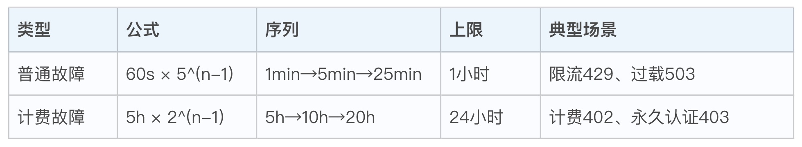

# 26 | 冷却期与指数退避：如何让故障恢复既快又稳？

你好，我是 Henry，欢迎来到《OpenClaw 核心原理与实战》。

三级故障转移链：认证轮换、Thinking 降级、模型 Fallback，我们知道了当 Claude API 错误时系统会先尝试换 API Key，不行再降 Thinking 参数，最后再换模型。但当一个 API Key 因为 429 被标记为“不可用”后，什么时候可以再试？

这个问题看似简单，实则是整个故障恢复系统中最精密的部分。太早重试可能无效重试浪费请求配额；太晚重试，用户本可以 1 分钟后恢复使用主模型，却在 Fallback 模型上等了 10 分钟。

OpenClaw 设计了一套由三个机制组成的精密控制系统：指数退避决定等多久，冷却期半开窗口决定何时给第二次机会，冷却期探测主动感知恢复而非被动等待。同时，对于参数级的故障，还有 Thinking 降级作为补充手段。

## Auth Profile 与认证轮换：理解数据结构

在深入退避算法之前，我们需要先理解退避的对象是什么。指数退避作用在 Auth Profile 上，每个 Profile 有独立的冷却状态、错误计数、使用记录。不理解 Profile 的数据结构，就无法理解退避算法为什么这样设计。

首先我们来理解 Auth Profile 三种认证类型，系统定义了三种方式：

- ApiKeyCredential 是直接的 API Key，比如 Anthropic API Key。

- TokenCredential 是 OAuth Token，比如通过 GitHub 登录获取的。

- OAuthCredential 是完整的 OAuth 凭证，含 refresh token。

```
每个 Auth Profile 都有一份 ProfileUsageStats，可以理解为这个 Key 的“健康档案”：
type ProfileUsageStats = {
 lastUsed?: number;           // 上次使用时间
 cooldownUntil?: number;      // 普通冷却期截止时间
 disabledUntil?: number;      // 禁用截止时间（用于计费/永久认证问题）
 disabledReason?: string;     // 禁用原因
 errorCount?: number;         // 连续错误次数
 failureCounts?: Record<string, number>;  // 按原因分类的错误计数
 lastFailureAt?: number;      // 上次失败时间
};
其中 cooldownUntil 和 disabledUntil 是两个独立的字段，分别对应两种不同严重程度
```

的退避策略。为什么要分开？因为普通限流（429）可能 1 分钟就恢复，但计费问题（402）可能需要 24 小时，二者的退避曲线完全不同。分开管理让系统可以对不同类型的故障施加精确的退避策略。

```
Profile 认证轮换基于 Round-Robin 轮换，其中 resolveAuthProfileOrder() 决定了多
```

个 Profile 的使用顺序：

1. 如果用户配置了显式顺序 → 尊重用户顺序，但冷却中的 Profile 追加到末尾

2. 否则使用 Round-Robin → 按类型优先级排序（oauth > token > api_key），同类型内按

```
lastUsed 最旧优先
```

Round-Robin 的设计目的是均匀分散请求负载。如果总是用同一个 Key，那个 Key 会更快触发限流，轮换使用可以最大化利用所有 Key 的配额。冷却中的 Profile 排在末尾，按

```
cooldownExpiry 最早优先，确保了最快恢复的 Profile 会最先被尝试。
在排序开始前，会先调用 clearExpiredCooldowns(store, now)，清除已过期的冷却
```

状态。这个看似简单的调用，解决了一个实际中遇到的 bug，我们马上就会讲到。

理解了 Auth Profile 数据结构，我们开始进入指数退避算法。

## 指数退避：让重试间隔刚刚好

普通故障的退避采用 5 的指数，当一个 Profile 因为限流（429）、过载（503）等可恢复的故

```bash
障被标记为冷却时，calculateAuthProfileCooldownMs() 计算冷却时长：
export function calculateAuthProfileCooldownMs(errorCount: number): number {
 const normalized = Math.max(1, errorCount);
 return Math.min(
   60 * 60 * 1000,                          // 上限：1 小时
   60 * 1000 * 5 ** Math.min(normalized - 1, 3),  // 公式：60s × 5^(n-1)
 );
}
```

退避序列是：1 分钟 → 5 分钟 → 25 分钟 → 1 小时（上限封顶）。

为什么用 5 的指数而不是常见的 2 的指数，是因为 LLM API 的限流恢复通常比传统 Web API慢得多，传统 API 限流可能几秒钟就恢复，但 LLM API 的 RPM（每分钟请求数）限制通常是按分钟甚至更长的窗口计算的。用 2 的指数（30s→1min→2min→4min），第一次重试就太早了，5 的指数则与 LLM 的限流窗口更匹配。

```
当错误原因是 billing（402）或 auth_permanent（403）时，使用完全不同的退避曲
```

线：

```javascript
function calculateAuthProfileBillingDisableMsWithConfig(params: {
 errorCount: number;
 baseMs: number;    // 默认 5 小时
 maxMs: number;     // 默认 24 小时
}): number {
 const exponent = Math.min(params.errorCount - 1, 10);
 const raw = params.baseMs * 2 ** exponent;
 return Math.min(params.maxMs, raw);
}
```

退避序列（默认配置）是：5 小时 → 10 小时 → 20 小时 → 24 小时（上限封顶）。

为什么 billing 退避这么长？因为计费问题不会自动恢复，它需要用户去充值、续费、或者修复信用卡信息。1 分钟后重试毫无意义，只会浪费请求配额和用户期望。5 小时的基准给了用户足够的时间处理问题，又不至于永远禁用。

这个退避还支持按 Provider 自定义：通过

```
auth.cooldowns.billingBackoffHoursByProvider 配置项，你可以为不同的
```

Provider 设置不同的退避基准。

下表对比了两种退避策略的核心差异：



## 冷却期过期与半开窗口

```
冷却窗口不可变原则是一个关键的设计，keepActiveWindowOrRecompute() 实现了一条
```

至关重要的原则——活跃冷却窗口内的重试不会延长恢复时间。

```javascript
function keepActiveWindowOrRecompute(params: {
 existingUntil: number | undefined;
 now: number;
 recomputedUntil: number;
}): number {
 const hasActiveWindow = typeof existingUntil === "number"
   && Number.isFinite(existingUntil) && existingUntil > now;
 return hasActiveWindow ? existingUntil : recomputedUntil;
}
```

逻辑很简单，如果当前已经有一个活跃的冷却窗口（尚未到期），就保持原来的到期时间，不重新计算。

想象一个场景：Profile A 在 10:00 被限流，冷却到 10:01。但由于某个 bug 或用户操作，

```
10:00:30 又用了一次 Profile A，又失败了。如果此时重新计算冷却时间：errorCount=2 →
冷却 5 分钟 → 冷却到 10:05:30。再来一次：errorCount=3 → 冷却 25 分钟。
```

类似这种问题，一个频繁重试的 bug 会把冷却时间推到无穷远，每次重试都刷新窗口，错误

```
计数不断累积。keepActiveWindowOrRecompute 阻止了这种“冷却时间漂移”，在窗口内
```

的重试不改变恢复时间，确保系统按预期的指数退避序列运行。

冷却期过期与半开窗口策略，使得系统拥有了“第二次机会”，clearExpiredCooldowns 重置计

```bash
数器，当冷却期到期后 clearExpiredCooldowns() 负责清理，实现逻辑如下：
export function clearExpiredCooldowns(store: AuthProfileStore, now?: number): boo
 for (const [profileId, stats] of Object.entries(usageStats)) {
   if (cooldownExpired) {
     stats.cooldownUntil = undefined;
   }
   if (disabledExpired) {
     stats.disabledUntil = undefined;
     stats.disabledReason = undefined;
   }
   // 关键：当所有冷却都过期后，重置错误计数器
   if (profileMutated && !resolveProfileUnusableUntil(stats)) {
     stats.errorCount = 0;
     stats.failureCounts = undefined;
   }
 }
}
这里的关键设计在于：冷却过期后会重置 errorCount 和 failureCounts。
```

举一个真实的 bug 案例：Profile 在冷却后看似“卡住”了——第一次限流，冷却 1 分钟。冷却到期后 Agent 重新使用它，结果又限流了。按理说应该冷却 1 分钟（新的第一次），但实际冷却

```
了 25 分钟。根因是旧的 errorCount=2 没有被重置。冷却到期后再次失败时，
errorCount 变成 3，直接跳到了 60s × 5^2 = 25 分钟。
修复方法就是在 clearExpiredCooldowns 中重置错误计数，给 Profile 一个全新的开始，
```

就像经典的熔断器模式中的“半开”状态：先关上（冷却），等一段时间后半开（允许试一次），成功就全开（恢复正常），失败就关上（重新冷却，从 1 分钟开始而非 25 分钟）。

并非所有 Provider 都需要冷却期，特殊 Provider 的豁免。系统为 OpenRouter 和 KiloCode跳过了冷却机制，因为它们是代理型 Provider，自身有内置的限流管理和请求分发。对这类Provider 做客户端冷却反而是多此一举。

冷却期让系统能自动恢复，但有一种不理想的情况：主模型被限流，系统切到了 Fallback 模型（比如从 Claude 切到 GPT-4o）。冷却期设了 5 分钟，但实际上 Claude 的限流可能 2 分钟就恢复了。下面我们讲讲 OpenClaw 解针对这种情况的策略。

## 冷却期探测：主动恢复而非被动等待

OpenClaw 的解决方案是冷却期探测，在冷却期即将到期时，主动偷偷试一下主模型是否已经恢复。

```
但是主动探测是也是有条件的，shouldProbePrimaryDuringCooldown() 定义了三个必
```

须同时满足的条件，详细逻辑如下：

```javascript
function shouldProbePrimaryDuringCooldown(params): boolean {
 // 条件 1: 必须是主模型，且有 fallback 候选
 if (!params.isPrimary || !params.hasFallbackCandidates) return false;
 // 条件 2: 节流——每 30 秒最多探测一次
 if (!isProbeThrottleOpen(params.now, params.throttleKey)) return false;
 // 条件 3: 冷却期已过期或即将在 2 分钟内过期
 const soonest = getSoonestCooldownExpiry(params.authStore, params.profileIds);
 return params.now >= soonest - PROBE_MARGIN_MS;  // PROBE_MARGIN_MS = 2分钟
}
```

这里需要 2 分钟的提前量（PROBE_MARGIN_MS）是因为系统记录的冷却到期时间是基于本地时钟计算的，而 API 的限流窗口是基于服务端时钟。两者之间存在网络延迟和时钟偏差。2 分钟的提前量为这种不确定性留出了缓冲。每 30 秒最多探测一次，防止探测本身变成一种攻击——如果 Agent 每秒都尝试探测，就违背了冷却期的初衷。

每个 Provider 每次 run 最多探测一次，因为一个 Provider 可能有多个模型候选（如

```
anthropic/claude-3-sonnet 和 anthropic/claude-3-opus）。如果每个候选都触发
```

探测，一次 run 就可能对同一个 Provider 发送多个探测请求——这就是“探测风暴”。

探测状态存储在内存中的 Map 里，有两个保护机制：256 键上限，超过后自动清理最旧的条目；24 小时 TTL，超过 24 小时的探测记录自动过期。

前面讲的都是 Key 级和模型级的故障恢复，但有一种故障更加微妙。模型支持这个请求，但不支持你传的某个参数。也就是我们下面要讲的参数级故障，对于参数级的故障，OpenClaw采用 Thinking 降级作为补充手段。

## Thinking 降级：参数级的优雅降级

```
不换模型，只调参数。最常见的场景是 Thinking level。Claude 支持 thinking: "high"，
但如果你 Fallback 到 GPT-4o，它可能返回 400 错误："think value \"high\" is not
supported for this model. Supported values are: 'low', 'off'"。这时候
```

换 Key 没用（所有 Key 都会报同样的错），换模型太重（只是一个参数不支持而已）。正确的做法是降低 Thinking level——从 high 降到 low 或 off。

```bash
Thinking 降级通过数据驱动降级，pickFallbackThinkingLevel() 详细逻辑如下：
export function pickFallbackThinkingLevel(params: {
 message?: string;
 attempted: Set<ThinkLevel>;
}): ThinkLevel | undefined {
 const raw = params.message?.trim();
 if (!raw) return undefined;
 // Step 1: 从错误消息中提取支持的值列表
 const supported = extractSupportedValues(raw);
 if (supported.length === 0) {
   // Step 2: 确认不支持但无法提取列表 → 直接降到 "off"
   if (/not supported/i.test(raw) && !params.attempted.has("off")) {
     return "off";
   }
   return undefined;
 }
 // Step 3: 从支持列表中选择一个未尝试过的
 for (const entry of supported) {
   const normalized = normalizeThinkLevel(entry);
   if (normalized && !params.attempted.has(normalized)) {
     return normalized;
   }
 }
 return undefined;
}
extractSupportedValues() 匹配错误消息中的 "supported values are: ..." 或
"supported values: ..." 模式，提取引号内的值列表（如 'low', 'off'）。如果没
```

有引号，用逗号和 “and” 分割。

```
attempted Set 的作用是避免重复尝试同一个级别，如果 low 已经试过了还是失败，就不会
```

再选它。

这不是一个固定的 high → medium → low → off 降级路径，而是从 API 错误消息中动态解析支持的值，然后选择一个未尝试过的。固定路径有问题，是因为不同的模型 /Provider 支持不

```
同的 Thinking level 组合。有的模型可能只支持 ["low", "off"]，固定路径会浪费 2 次无
```

效尝试（先试 medium，失败；再试 low，才成功）。而数据驱动的方案直接跳到可用的选项。这个设计体现了一个重要的软件工程哲学：数据驱动 > 规则驱动。让运行时数据（API 的错误消息）驱动决策，而不是硬编码规则。

## 总结

这节课我们深入了故障恢复系统中最精密的部分，三个核心设计原则：

1. 不可变冷却窗口：活跃窗口内的重试不延长恢复时间，防止“无穷远冷却”。

2. 主动探测：不被动等待冷却到期，主动感知恢复（30s 节流 + 2min 提前量）。

3. 数据驱动降级：从 API 错误消息动态解析支持的参数，而非硬编码固定路径。

## 思考题

为什么 OpenClaw 选择 5 的指数而非常见的 2 的指数作为普通故障的退避基数？可以从 LLMAPI 的限流特性、传统 Web API 的差异、以及用户体验的平衡角度来思考。

欢迎你在留言区与我交流！如果今天的课程让你有所收获，也欢迎转发给有需要的朋友，邀请他来一起学习，我们下节课再见！
