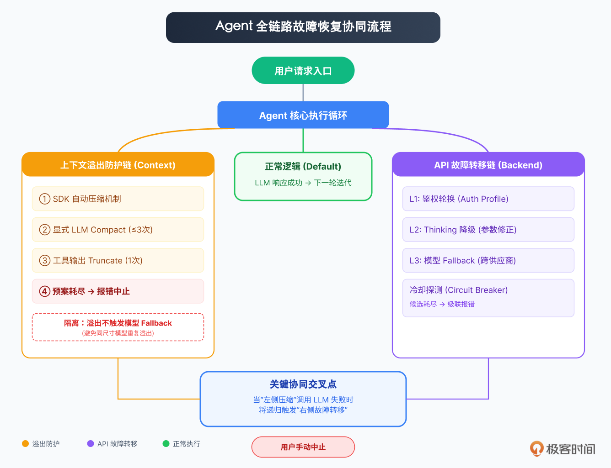

# 27 | 从防护到实战：全链路如何故障恢复？

你好，我是 Henry，欢迎来到《OpenClaw 核心原理与实战》。

前面我们深入讲解了三个子系统：五层递进式上下文防护、三级故障转移、恢复策略。今天我

```
们重点讲解在真实运行中，它们在 Agent 运行循环（run.ts）中如何协同配合。把三个子系
```

统连成一条线。学完这节课，你将理解的不是几个孤立的机制，而是一套完整的高可用工程体系，这是 AI Agent 从“Demo 能跑”到“生产能上线”的关键跨越。

## Agent 运行循环中的溢出恢复：完整代码路径

在深入恢复逻辑之前，我们需要先理解三个关键的状态变量。这三个变量共同控制着溢出恢复的整个生命周期：

```javascript
const MAX_OVERFLOW_COMPACTION_ATTEMPTS = 3;
let overflowCompactionAttempts = 0;        // 溢出压缩计数（跨迭代累积）
let toolResultTruncationAttempted = false;  // 截断是否已尝试（布尔标志）
// hadAttemptLevelCompaction: 本次 attempt 中 SDK 是否已自动压缩
其中，overflowCompactionAttempts 是全局计数器，跨所有迭代累积，最多 3 次。压缩
```

操作本身可能需要多次迭代才能将上下文压缩到足够小的程度，但超过 3 次意味着压缩策略已

```
经失效。toolResultTruncationAttempted 是布尔标志，只尝试一次。截断的本质是丢
```

弃信息，第一次截断已经按照最优策略（Head+Tail）保留了最有价值的部分，重复执行不会

```
带来任何改善。hadAttemptLevelCompaction 则是一个 attempt 级别的标志，用于标识
```

在当前这一轮尝试中 SDK 是否已经自动触发过压缩。这个变量的存在是为了避免框架层和SDK 层的重复压缩。

知道了三个变量，我们首先要了解溢出错误可能在两个不同的时刻出现，对应着 API 调用生命周期的两个阶段：

```
promptError：提交请求时就被 API 拒绝（请求太大）
assistantError：流式返回过程中报错（流式处理中途发现超限）
```

详细逻辑如下：

```javascript
const contextOverflowError = (() => {
 if (promptError) {
   const errorText = describeUnknownError(promptError);
   if (isLikelyContextOverflowError(errorText)) {
     return { text: errorText, source: "promptError" };
   }
   return null;  // 非溢出的 promptError 不再检查 assistantError
 }
 if (assistantErrorText && isLikelyContextOverflowError(assistantErrorText)) {
   return { text: assistantErrorText, source: "assistantError" };
 }
 return null;
})();
```

这段代码使用了立即执行函数表达式（IIFE）来封装检测逻辑，使得

```
contextOverflowError 要么是一个包含错误文本和来源的对象，要么是 null。注意检
测的优先级，如果 promptError 存在但不是溢出错误，就不再检查 assistantError。这
是因为 promptError 和 assistantError 不会同时是有意义的错误。
isLikelyContextOverflowError() 通过文本匹配检测溢出关键词，不同 Provider 的错
```

误消息格式不同，但都包含类似 context length exceeded、token limit、maximum contextlength 的文本。这种基于文本匹配的方式虽然不够优雅，但在面对多个 Provider 时是最实用的方案。

检测到溢出后，恢复策略是按照三级优先级执行。这是整个恢复逻辑中最核心的部分。

第一优先级：SDK 已自动压缩 → 直接重试

```
if (!isCompactionFailure && hadAttemptLevelCompaction
   && overflowCompactionAttempts < MAX_OVERFLOW_COMPACTION_ATTEMPTS) {
 overflowCompactionAttempts++;
 continue;  // 直接重试，不额外压缩
}
如果 SDK 在本次 attempt 内部已经自动触发了压缩（hadAttemptLevelCompaction =
true），说明系统已经尝试缩减过了。此时直接重试，不重复压缩，因为压缩是幂等的，再压
```

一次结果一样。

```
这里的关键是：SDK 的自动压缩发生在 session._checkCompaction() 中，它会在
```

token 接近阈值时主动触发。如果它已经压过了还是溢出，说明要么需要更激进的压缩，要么问题不在压缩能解决的范围内。

第二优先级：显式触发强制压缩 → 压缩后重试

```javascript
if (!isCompactionFailure && !hadAttemptLevelCompaction
   && overflowCompactionAttempts < MAX_OVERFLOW_COMPACTION_ATTEMPTS) {
 overflowCompactionAttempts++;
 const compactResult = await contextEngine.compact({
   sessionId, sessionKey, sessionFile,
   tokenBudget: ctxInfo.tokens,
   force: true,
   trigger: "overflow",
 });
 if (compactResult.compacted) continue;  // 压缩成功，重试
}
注意条件中的 !hadAttemptLevelCompaction，只有当 SDK 没有自动压缩时，才需要框
架层显式触发。这避免了“SDK 已经压了一次，框架又压一次”的重复操作。force: true 参
数告诉压缩引擎不要进行常规的阈值检查，直接执行压缩。trigger: "overflow" 则用于
```

日志和监控，标识这是一次溢出触发的紧急压缩。

区分开这两个分支，是因为 SDK 内部的自动压缩和框架层的显式压缩是两个独立的触发路

```
径。SDK 可能在 session._checkCompaction() 中自动触发压缩（当 token 接近阈值
时），而框架层的 contextEngine.compact({ force: true }) 是应对溢出的强制措
```

施。区分它们是为了避免在一次迭代中重复压缩同一内容，既浪费计算资源，又可能因为调用摘要 LLM 而产生额外费用。

第三优先级：截断超大工具结果 → 截断后重试

```javascript
if (!toolResultTruncationAttempted) {
 const hasOversized = sessionLikelyHasOversizedToolResults({
   messages: attempt.messagesSnapshot,
   contextWindowTokens: ctxInfo.tokens,
 });
 if (hasOversized) {
   toolResultTruncationAttempted = true;
   const truncResult = await truncateOversizedToolResultsInSession({
     sessionFile, contextWindowTokens, sessionId, sessionKey,
   });
   if (truncResult.truncated) continue;  // 截断成功，重试
 }
}
```

当 3 次压缩都无法解决溢出时（可能是单条超大工具结果撑爆了窗口），最后尝试截断。这正是第 24 课讲的 Layer 4 Tool Result Truncation。

```
sessionLikelyHasOversizedToolResults 会快速扫描消息历史，检测是否存在单条结
```

果超过窗口 30% 的工具调用结果。如果存在，就调用

```
truncateOversizedToolResultsInSession 进行 Head+Tail 智能截断。
```

全部用尽 → 报错退出。如果压缩 3 次 + 截断 1 次仍然溢出，系统已经无能为力了，只能向用户报告错误。

分析完 Agent 循环中的完整路径，我们来讲解当多种异常叠加时全链路如何进行故障恢复。

## 全链路故障恢复：多种异常叠加

现在让我们把五层防护和三级转移放在一起，讲解完整的协同流程，看看它们如何在 Agent 运行循环中协同。



整个故障恢复系统分为两条相对独立的路径：左侧是上下文溢出防护链，右侧是 API 故障转移链。全链路故障恢复协同流程涉及两个关键点的交叉点：

交叉点一：溢出恢复后可能触发故障转移。压缩需要调用 LLM 来生成摘要。如果这个 LLM 调用本身限流了怎么办？此时会进入故障转移链，先换 Key，不行换模型。

例如下面这个场景：用户的会话 token 数超限了，触发了压缩。压缩需要调用 Claude 来生成摘要，但此时 Claude 正好限流返回 429。系统会先尝试换 Profile（认证轮换），如果所有Profile 都在冷却期，就会回退到 GPT-4o 来完成摘要任务。摘要完成后，主对话继续使用原来的模型。

```
交叉点二：上下文溢出不进入模型 Fallback 链。isLikelyContextOverflowError 检测
到溢出后直接 throw，不走 runWithModelFallback 的候选遍历逻辑。我们前面解释过原
```

因：换模型可能窗口更小，只会更糟。这是两条恢复路径的隔离点。如果不隔离会发生什么？Claude 的 200K 窗口溢出了，系统切换到 GPT-4o 的 128K 窗口，这只会让问题更严重。所以溢出错误必须走专门的压缩 / 截断路径，而不是模型回退路径。

讲解完理论基础，下面我们通过两个实际案例，追踪高并发限流场景如何恢复，以及超长会话如何进行 Token 防护。

## 场景分析一：高并发限流应对

场景：10 个 Agent 同时使用 Claude API，服务端 RPM（每分钟请求数）限制为 100。

问题演进：

10:00:00 — Agent 1-10 同时发起请求，Claude API 返回正常结果。

10:00:30 — 请求量持续增长，最终超过 RPM 限制。Agent 3 率先收到 429 Too ManyRequests 错误。

```
10:00:30 — 错误被 resolveFailoverReasonFromError 函数捕获并分类。HTTP 429 状
态码被明确识别为 rate_limit 类型。
```

10:00:30 — Level 1 认证轮换启动：当前的 Profile A 被标记进入冷却期（首次冷却 1 分钟），系统自动切换到 Profile B 继续请求。

10:00:45 — Profile B 也遭遇 429 了。这并不意外，10 个 Agent 都在使用 Claude，共享相同的 RPM 配额。系统尝试 Profile C，结果相同。

10:00:45 — 所有可用的 Profile 都已耗尽或进入冷却期。Level 1 认证轮换策略失效，系统升级到 Level 3 模型 Fallback。

```
10:00:46 — 系统根据配置的 fallback 列表，切换到第一个备选模型 openai/gpt-4o。
```

OpenAI 和 Anthropic 是不同的 Provider，配额相互独立。

10:00:46 — GPT-4o 正常响应！用户无感知地继续工作。

```
10:01:00 — 30 秒后，shouldProbePrimaryDuringCooldown 函数触发探测请求。系统
```

想知道 Claude 是否已经恢复。

10:01:01 — Claude 冷却探测成功！下次请求将优先回到 Claude。

## 场景分析二：超长会话的 Token 防护

场景：用户和 Agent 协作编写大型项目，已对话 500 条消息（约 150K tokens），使用 GPT-4o（128K 窗口）。

问题演进：

阶段一：L2 Auto-Compact 触发

系统在每次请求前会进行 Token 估算。当前 150K Tokens 乘以安全系数 1.2 等于 180K，超过GPT-4o 的 128K 窗口限制。L2 Auto-Compact 机制自动启动。

阶段二：分阶段摘要执行

压缩引擎执行分阶段摘要算法：首先将历史消息分块，然后对每个分块生成摘要，接着通过链式摘要将多个分块摘要合并，最后进行质量审计（检查摘要是否包含 5 个必需的 section）。近3 轮对话被完整保留，确保上下文连贯性。

阶段三：压缩后继续对话

压缩完成后，上下文大约缩减到 50K tokens，系统恢复正常对话。

阶段四：超大工具结果触发再次溢出

```
用户执行了 cat large-file.txt 命令，工具返回了 80K tokens 的内容。加上现有的 50K
```

tokens，再次超过 128K 限制。

阶段五：L3 Overflow Recovery 启动

```
由于这是运行时溢出（上一次压缩后又溢出了），系统调用 contextEngine.compact({
force: true }) 强制压缩。但问题来了：那个 80K 的文件内容是单条工具结果，压缩算法
```

对它无能为力，你不能对一个纯文本文件做“摘要”。

阶段六：L4 Tool Result Truncation 生效

```
sessionLikelyHasOversizedToolResults 检测到存在超大工具结果，单条结果超过窗
口的 30%。系统调用 truncateToolResultText 执行 Head+Tail 智能截断：
```

- 最大允许长度：128K × 0.3 × 4 ≈ 153K 字符

- 尾部检测：发现文件末尾包含重要的错误信息或 JSON 闭合标记

- 截断策略：Head 70% + Tail 30% 保留

阶段七：截断后重试成功

截断完成后，上下文大小回到安全范围，请求成功发送并得到响应。

## 总结

至此我们完成了故障转移模块的学习。

第 24 课我们解决了 Token 爆炸问题：五层防护确保对话再长也不怕。但上下文问题解决了，API 本身出问题怎么办？

第 25 课我们解决了 API 故障问题：三级转移加错误分类，让系统能够换 Key、换参数、换模型。但知道了怎么转移，转移后什么时候恢复呢？

第 26 课我们解决了恢复策略问题：冷却期、指数退避、探测机制，确保快速恢复不过度。每个子系统都懂了，但它们怎么协同？

本节课我们解决了协同问题：全链路视角让我们看到真实世界的故障不会只出现一种。这四节课针对故障转移形成一个完整闭环。

## 思考题

如果你负责一个需要 7×24 小时运行的 Agent 服务，除了本模块讲的上下文防护、故障转移、冷却恢复这些机制，还需要考虑哪些高可用措施？

可以从以下几个维度思考：

- 监控与告警：如何及时发现问题？

- 数据持久化：会话状态如何保证不丢失？

- 水平扩展：单点故障如何避免？

- 灾备切换：跨区域容灾如何设计？

欢迎你在留言区与我交流！如果今天的课程让你有所收获，也欢迎转发给有需要的朋友，邀请他来一起学习，我们下节课再见！
