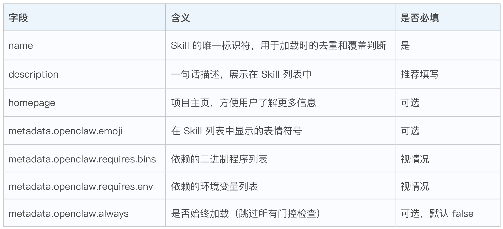
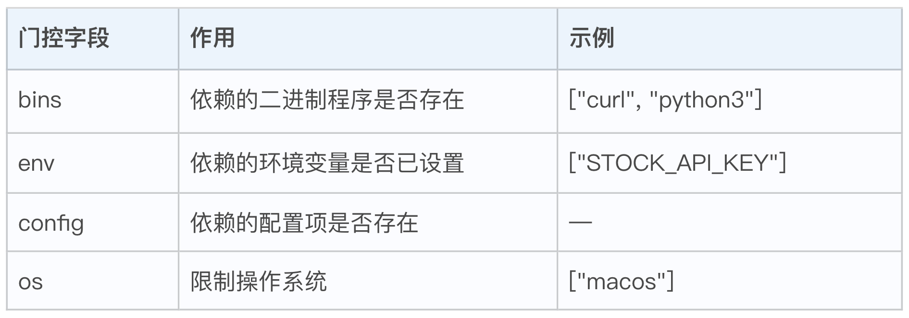
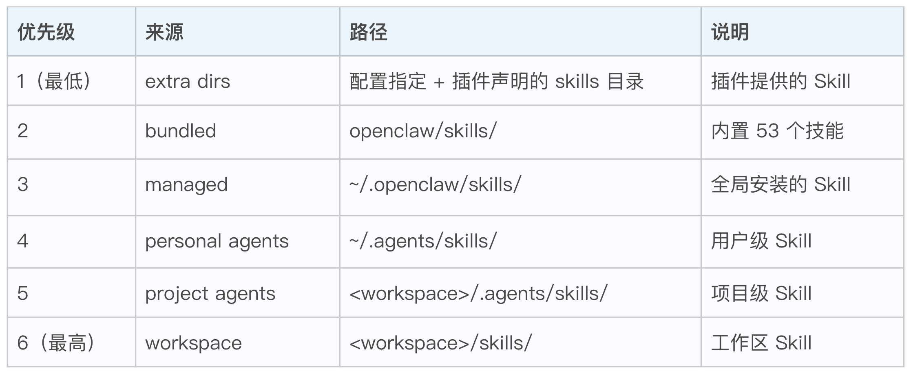
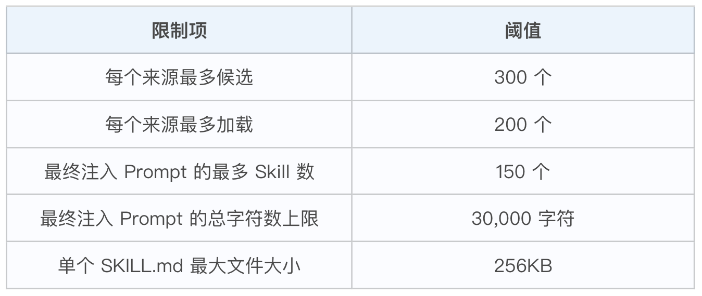
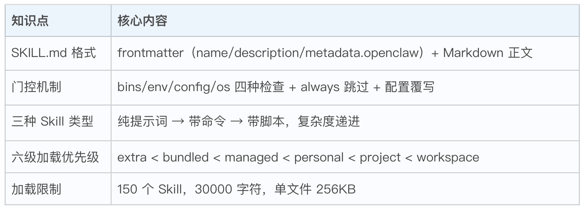

# 28 | 自定义Skill开发：创建你的第一个Agent技能

你好，我是 Henry，欢迎来到《OpenClaw 核心原理与实战》。

在演练场（一）中，我们学会了通过配置文件驱动 OpenClaw 工作：安装部署、多 Agent 配置、社区 Skill 生态活用、综合工作台搭建。那部分核心理念是“配置驱动、零代码上手”，面向的是使用者角色。

但在实际业务中内置 Skill 不能完全满足你的场景需求，这时候你就需要从使用者升级为创造者。演练场（二）要解决的就是这个问题：从使用现有能力到创造新能力。

而 Skill 是这条路上最好的起点。因为 Skill 的开发门槛低，我们先学 Skill，建立信心和基本认知，再过渡到 Plugin 开发。本节课你将掌握 SKILL.md 的完整格式，从零创建三种类型的Skill，理解加载优先级和门控机制。学完这节课，你就能为任何业务场景量身打造 Agent 技能。

## SKILL.md 格式：一个文件的完整解剖

为什么我们还要先讲格式，Skill 不就是写个 Markdown 吗？其实 SKILL.md 的格式有很多细节，决定了 Skill 能不能被正确加载、能不能在合适的环境中生效。特别是 frontmatter 中的

```
metadata.openclaw 嵌套结构，以及门控字段的含义。所以我们先把格式讲透，然后再动
```

手写。

这里，我们以 A 股行情查询 Skill 为例进行完整解析，用一个完整的示例来逐字段解析SKILL.md 的结构：

```bash
---
name: stock-checker
description: "查询A股实时行情和基本面数据"
homepage: https://github.com/your-org/stock-checker
metadata:
 openclaw:
   emoji: ""
   requires:
     bins: ["curl", "python3"]
     env: ["STOCK_API_KEY"]
   always: false
---
# A股行情查询
## When to Use
- 用户询问某只股票的价格、涨跌
- 用户想了解某公司的财报数据
- 用户需要对比多只股票
## Commands
### 实时行情
```bash
curl -s "https://api.example.com/stock/{code}?key=${STOCK_API_KEY}" | python3 -c
import sys, json
data = json.load(sys.stdin)
print(f\"股票: {data['name']} ({data['code']})\")
print(f\"最新价: {data['price']} 涨跌幅: {data['change']}%\")
"
```
### 财报摘要
```bash
curl -s "https://api.example.com/finance/{code}?key=${STOCK_API_KEY}"
```
## Important Notes
- 数据仅供参考，不构成投资建议
- 交易时间外数据为上一交易日收盘数据
```

frontmatter 部分解析：



```
一个需要特别注意的点是，requires 必须嵌套在 metadata.openclaw 下，不是
```

frontmatter 的顶层字段。如果你写成这样：

```
---
name: stock-checker
requires:  # ❌ 错误位置！应该在 metadata.openclaw 下面
 bins: ["curl"]
---
Skill 能加载，但门控检查会失效，系统找不到 requires 字段，认为没有依赖要求，跳过所
有检查。结果是 Skill 在缺少 curl 的环境中也能被加载，但运行时会报错。
```

Markdown 正文部分解析：

正文是注入 Agent System Prompt 的核心内容。LLM 会读到这些文字，并据此决定何时使用以及怎么使用这个 Skill。所以正文的写法直接影响 Skill 的效果。

```
## When to Use：告诉 LLM 在什么场景下应该调用这个 Skill。写得越具体，LLM 的判
```

- 断越准确。

```
## Commands：提供具体的命令模板。LLM 会参考这些模板，用 exec 工具执行实际的
```

- 命令。

```
## Important Notes：约束和注意事项。比如免责声明、数据来源说明等。
```

门控部分解析：

```
除了 bins 和 env，metadata.openclaw.requires 还支持更多门控条件：
```



还有两个特殊标记：

```
always: true：跳过所有门控检查，始终加载。适合不依赖外部工具的纯提示词 Skill。
配置覆写：config.skills.entries.<name>.enabled 可以强制启用或禁用某个
```

- Skill。

```
门控机制的核心目的是自动适应环境。比如 Linux 系统不需要加载 Apple Notes Skill（os:
["macos"]），没有安装 gh CLI 的环境不需要加载 GitHub Skill（bins: ["gh"]）。这比手
```

动管理启用 / 禁用列表要智能得多。

## 三种 Skill 类型实战：从简单到复杂

现在你已经理解了 SKILL.md 的格式，接下来我们实际动手创建三种不同类型的 Skill。不同的业务场景需要不同复杂度的 Skill，有的只需要给 LLM 一段行为指引（不涉及外部工具），有的需要调用命令行工具，有的需要配合脚本文件做复杂处理。我们从简到繁递进，找到最适合自己场景的类型。

### 类型一：纯提示词 Skill（最简单）

适用场景：不需要调用任何外部工具，只需要引导 LLM 的行为模式。比如：代码审查规范、文档写作风格、客户服务话术。

代码审查助手实战示例：

```
---
name: code-reviewer
description: "代码审查最佳实践"
---
# Code Review Assistant
## When to Use
- 用户请求代码审查
- 用户提交 PR 需要 review
- 用户要求检查代码质量
## Review Checklist
1. 检查命名规范：变量、函数、类名是否符合项目约定
2. 检查错误处理：异常是否被正确捕获和处理
3. 检查安全隐患：SQL 注入、XSS、硬编码密钥
4. 检查性能问题：N+1 查询、无限循环风险、内存泄漏
5. 检查测试覆盖：核心逻辑是否有单元测试
## Output Format
```

- 对每个文件，按以下格式输出：

```
- ✅ 通过项
- ⚠️ 建议改进项（附修改建议）
- ❌ 必须修改项（附理由和修改示范）
关键点：这个 Skill 没有 metadata.openclaw.requires，因为它不依赖任何外部工具。
没有门控字段意味着它在任何环境都能加载，也不需要设置 always: true。
纯提示词 Skill 和直接写提示词 Agent 的 instructions 好处：
复用性：instructions 是 Agent 级别的，一个 Agent 一份。Skill 是全局的，多个 Agent
```

- 都能共享。

2. 模块化：当你有 10 种专业规范（代码审查、文档审核、安全检查、性能优化……），全写

```
在 instructions 里会让配置臃肿不堪。拆成独立 Skill，每个 Skill 专注一件事，清晰得
```

- 多。

### 类型二：带命令的 Skill（中等难度）

适用场景：需要调用命令行工具完成特定任务。比如，查询 API、执行脚本、操作文件。

汇率查询 Skill 实战示例：

```bash
---
name: currency-converter
description: "实时汇率查询和货币转换"
metadata:
 openclaw:
   requires:
     bins: ["curl"]
---
# Currency Converter
## When to Use
- 用户需要查询汇率
- 用户需要货币转换
- 用户比较不同币种的价值
## Commands
### 查询汇率
```bash
curl -s "https://api.exchangerate-api.com/v4/latest/{FROM}" | \
 python3 -c "import sys,json; d=json.load(sys.stdin); print(f'1 {d[\"base\"]} =
```
## Important Notes
- 汇率数据来自 exchangerate-api.com，可能有数分钟延迟
- {FROM} 和 {TO} 需替换为实际的货币代码（如 USD、CNY、EUR）
Skill 声明了 requires.bins: ["curl"]。当 OpenClaw 启动加载 Skill 时，门控机制会检
查系统中是否安装了 curl，如果没有，这个 Skill 会被静默跳过，不会注入到 System
```

Prompt 中。这避免了 Agent 尝试执行不存在的命令。

Commands 部分的写法注意事项：

```
命令模板中的 {FROM}、{TO} 是占位符，LLM 会根据用户的实际请求替换为具体值。你
```

- 不需要写变量解析逻辑，LLM 天然擅长做这种替换。

```
命令中可以引用环境变量（${STOCK_API_KEY}）。如果你在 requires.env 中声明了
```

- 依赖，门控系统会在加载前检查变量是否存在。

```
管道操作（|）是常用模式，用 curl 获取数据，用 python3 或 jq 解析和格式化。
```

### 类型三：带脚本的 Skill（复杂）

适用场景：需要多步骤处理、复杂数据分析、调用多个脚本，命令行单行写不下了，需要独立的脚本文件。

示例：CSV 数据分析 Skill

首先看目录结构：

```
skills/
└── data-analyzer/
   ├── SKILL.md
   └── scripts/
       ├── analyze.py
       └── visualize.py
```

SKILL.md 内容：

```
---
name: data-analyzer
description: "CSV数据分析和可视化"
metadata:
 openclaw:
   requires:
     bins: ["python3"]
---
# Data Analyzer
## When to Use
- 用户提供了 CSV 文件需要分析
- 用户需要数据统计摘要
- 用户需要数据可视化图表
## Commands
### 数据分析
```bash
python3 /path/to/skills/data-analyzer/scripts/analyze.py "{file_path}"
```
### 数据可视化
```bash
python3 /path/to/skills/data-analyzer/scripts/visualize.py "{file_path}" "{chart_
```
## Supported Chart Types
- bar: 柱状图
- line: 折线图
- pie: 饼图
- scatter: 散点图
```

需要注意的要点：

1. 脚本路径必须用绝对路径。因为 Skill 的 Markdown 内容会被注入到 System Prompt 中，LLM 执行命令时的工作目录可能不是 Skill 所在目录。如果用相对路径

```
（scripts/analyze.py），命令大概率会找不到文件。
```

2. 脚本文件的维护和部署需要额外注意。纯 Markdown 的 Skill 只有一个文件，复制到任何地方都能工作，但带脚本的 Skill 需要确保脚本文件也跟着部署到正确位置。

3. 什么时候该从“带命令”升级到“带脚本”？经验法则：如果你的命令行超过 3 行管道操作，或者需要复杂的错误处理逻辑，就应该抽成独立脚本。脚本可以做单元测试、可以有异常处理、可以输出结构化结果，这些都是内联命令做不到的。

上面我们讲解完三种类型的 Skill 的案例，但是我们实际开发过程中，好了一个 Skill，放到了项目目录下，但 Agent 好像完全忽略了它。这是初学者最常遇到的问题。原因通常有两个：一是放错了目录（不在加载路径中），二是被同名的更高优先级 Skill 覆盖了。要诊断这类问题，我们首先要理解 OpenClaw 的六级加载优先级，下面我们重点讲解 Skill 的加载优先级和调试细节。

## Skill 加载优先级与调试：为什么我的 Skill 没生效？

OpenClaw 通过六级加载优先级来加载 Skill，后加载的同名 Skill 会覆盖先加载的，详细优先级如下：



整体采用越贴近用户的来源优先级越高。这个设计优势是可以实现实际业务场景中两类问题：

- 在工作区 Skill（优先级 6）中覆盖内置 Skill（优先级 2）。比如内置的 GitHub Skill 用的是通用的 PR 审查流程，你可以在工作区写一个同名的 GitHub Skill，使用公司定制的审查规范。

- 全局安装一个通用 Skill（优先级 3），然后在特定项目中用项目级 Skill（优先级 5）做定制化调整。

下面我们通过一个案例，来一步步创建并验证 Skill 加载。

Step 1：确认放置目录

对于日常开发，推荐把自定义 Skill 放在工作区 skills 目录：

```bash
# 创建 Skill 目录
mkdir -p skills/stock-checker
# 创建 SKILL.md
cat > skills/stock-checker/SKILL.md << 'EOF'
---
name: stock-checker
description: "查询A股实时行情"
metadata:
 openclaw:
   emoji: ""
   requires:
     bins: ["curl"]
---
# A股行情查询
## When to Use
- 用户询问股票价格或涨跌
- 用户想了解某公司财报数据
## Commands
### 实时行情
```bash
curl -s "wttr.in/{city}?format=3"
```
```

Step 2：验证 Skill 是否被加载

```
# 查看已加载的 Skill 列表
openclaw skills list
# 你应该能看到类似输出：
#  stock-checker — 查询A股实时行情 [workspace]
#    requires: bins(curl) ✅
其中，[workspace] 标记表示这个 Skill 来自工作区目录（优先级 6）。requires:
bins(curl) ✅ 表示门控检查通过了，系统中存在 curl 命令。
```

Step 3：测试门控是否正确

```
# 专门检查某个 Skill 的门控状态
openclaw skills check stock-checker
# 输出会告诉你每个门控条件的检查结果：
# ✅ bins: curl (found at /usr/bin/curl)
# ✅ env: STOCK_API_KEY (set)
# 或者：
# ❌ env: STOCK_API_KEY (not set) — Skill will be skipped
```

如果门控检查失败，你有两个解决办法：

1. 设置缺少的环境变量或安装缺少的工具

```
如果这个 Skill 不依赖该工具也能工作，从 requires 中移除对应条件
```

实际加载过程中，为了防止 System Prompt 被无限膨胀，Skill 系统有以下加载限制：



如果你的 Skill 内容特别长（超过 2000 字），考虑精简。记住，Skill 的内容会被注入到System Prompt 中，内容越多，消耗的上下文窗口越大，留给对话内容的空间就越小。

## 总结

本节课我们的核心知识点如下：



你现在能做到：

- 从零创建一个符合规范的 SKILL.md 文件

- 根据业务需求选择合适的 Skill 类型

- 将 Skill 放到正确的目录并验证加载

- 排查 Skill 未生效的常见问题

- 为你的实际业务场景定制专属 Skill

## 思考题

请创建一个贴合你实际业务的自定义 Skill（如行业术语助手、公司规范检查器、内部 API 查

```
询工具），放入工作区 skills/ 目录并验证加载和使用。
```

欢迎你在留言区与我交流！如果今天的课程让你有所收获，也欢迎转发给有需要的朋友，邀请他来一起学习，我们下节课再见！
