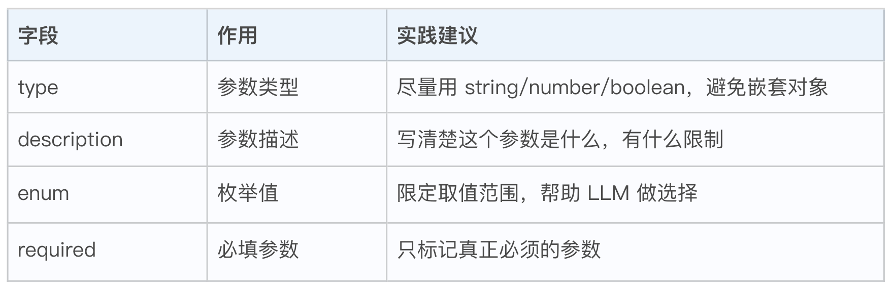
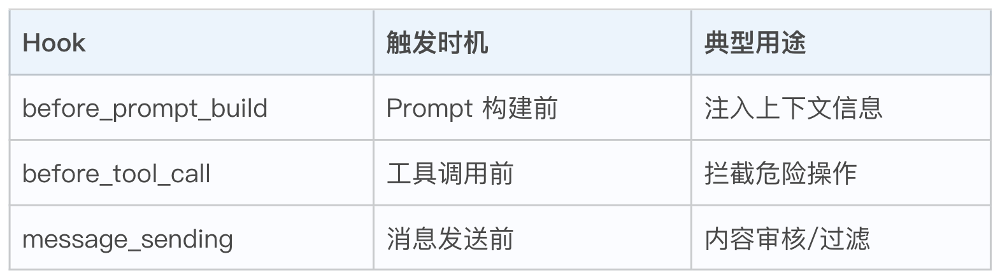
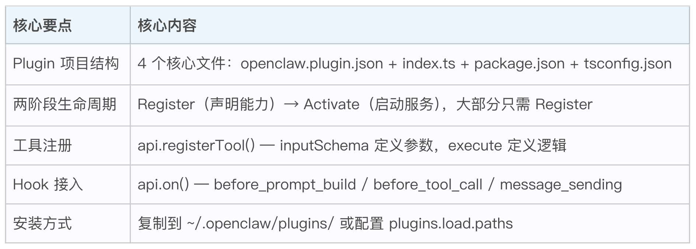

# 29 | Plugin开发入门：从工具注册到Hook接入

你好，我是 Henry，欢迎来到《OpenClaw 核心原理与实战》。

上节课我们通过一个 SKILL.md 文件，就能为 Agent 添加行为指引。但是 Skill 有三个局限：不能注册新工具、不能参与 Agent 生命周期、不能启动后台服务。真实业务中经常遇到如下问题：

```
你想让 Agent 能搜索企业内部的知识库，但 Agent 没有 kb_search 这个工具，你需要注
```

- 册一个新工具

- 你想在 Agent 每次回复前自动做内容审核，这需要在消息发送的 Hook 上注入处理逻辑

- 你想在 Agent 构建 Prompt 时自动注入当前用户的定制信息，这需要在

```
before_prompt_build Hook 上修改上下文
```

这些都超出了 Skill 的能力范围。要实现它们，你需要跨入 OpenClaw 扩展体系的高能力层：Plugin。Skill 只能建议 Agent 做什么（通过 Prompt 引导），Plugin 能真正参与 Agent 的决策和执行过程（通过注册工具和 Hook）。

今天我们搭建 Plugin 开发脚手架，注册一个自定义工具，接入 Hook 增强 Agent 行为，最后编译安装到 OpenClaw。完成这四步后，你就具备了 Plugin 开发的基本能力。下面我们逐个模块详细展开，首先从 Plugin 开发脚手架开始。

## Plugin 开发脚手架：从搭建项目结构开始

Plugin 开发是一个实践性很强的技能，我们先搭好脚手架跑通项目骨架，有一个“能改能调”的环境，然后在这个基础上逐步添加功能。

首先是初始化项目：

```bash
# 创建项目目录
mkdir my-openclaw-plugin && cd my-openclaw-plugin
# 初始化 Node.js 项目
npm init -y
# 安装 TypeScript 依赖
npm install typescript @types/node
```

一个最小可工作的 Plugin 项目只需要四个文件：

```
my-openclaw-plugin/
├── openclaw.plugin.json    # 清单文件
├── src/
│   └── index.ts            # 入口文件
├── package.json
└── tsconfig.json
```

```
清单文件 openclaw.plugin.json：
{
 "name": "my-plugin",
 "version": "1.0.0",
 "description": "我的第一个 OpenClaw 插件",
 "entry": "dist/index.js"
}
```

清单文件是 Plugin 的“身份证”，OpenClaw 在加载插件时，首先读取清单获取元信息（名称、

```bash
版本、入口文件路径）。entry 指向编译后的 JavaScript 文件，不是 TypeScript 源文件。
入口文件 src/index.ts：
import { definePluginEntry } from "openclaw/plugin-sdk/core";
export default definePluginEntry({
 id: "my-plugin",
 name: "My Plugin",
 register(api) {
   // 在这里注册能力（工具、Hook、HTTP 路由等）
   console.log("Plugin registered!");
 },
 activate(api) {
   // 在这里启动后台服务（可选）
   console.log("Plugin activated!");
 }
});
这里的 register 和 activate  两阶段生命周期：
Register 阶段：Gateway 启动时调用。在这里通过 api.register*() 方法声明能力，注
```

- 册工具、注册 Hook、注册 HTTP 路由等。不能在 register 中做网络请求或启动服务，因为

- 此时其他 Plugin 可能还没注册完毕，依赖关系可能不完整。

- Activate 阶段：所有 Plugin 都注册完毕后调用。在这里启动后台服务、建立外部连接。此时注册表是完整快照，你可以安全地检查其他 Plugin 是否存在。

```
TypeScript 配置 tsconfig.json：
// tsconfig.json
{
 "compilerOptions": {
   "target": "ES2022",
   "module": "commonjs",
   "outDir": "./dist",
   "rootDir": "./src",
   "strict": true,
   "esModuleInterop": true,
   "declaration": true
 },
 "include": ["src/**/*"]
}
```

配置完成后，验证编译能通过：

```
npx tsc
# 应该在 dist/ 目录下生成 index.js
```

到这里，你的 Plugin 骨架就搭好了，整个加载、注册、激活的流程已经完整，接下来我们让这个骨架上“长肌肉”，自定义注册一个工具。

## 注册自定义工具：让 Agent 拥有新能力

Agent 的核心价值就在于“能执行操作”，而操作的载体就是工具。Agent 在推理循环中，LLM输出“我要调用某个工具”的指令，Agent Loop 执行该工具并将结果返回给 LLM。你通过

```
registerTool 注册的工具，就会出现在 LLM 的可用工具列表中，LLM 可以根据用户请求
```

主动调用它。

让我们实现一个真实场景，企业知识库搜索。这是 Plugin 最典型的应用，Agent 原生没有这个能力，你通过注册一个新工具来赋予它。企业知识库查询工具完整示例如下：

```bash
import { definePluginEntry } from "openclaw/plugin-sdk/core";
export default definePluginEntry({
 id: "kb-search",
 name: "Enterprise Knowledge Base",
 register(api) {
   api.registerTool(
     {
       name: "kb_search",
       description: "搜索企业知识库中的文档和FAQ",
       inputSchema: {
         type: "object",
         properties: {
           query: {
             type: "string",
             description: "搜索关键词"
           },
           category: {
             type: "string",
             enum: ["技术", "产品", "运营", "HR"],
             description: "知识分类（可选）"
           }
         },
         required: ["query"]
       },
       async execute(params) {
         const { query, category } = params;
         // 调用企业知识库 API
         const response = await fetch(
           `https://kb.company.com/api/search?q=${encodeURIComponent(query)}&cat
           {
             headers: {
               Authorization: `Bearer ${process.env.KB_API_TOKEN}`
             }
           }
         );
         const results = await response.json();
         return {
           type: "text",
           text: results.map((r: any) =>
             `${r.title}\n${r.summary}`
           ).join("\n\n")
         };
       }
     },
     { names: ["kb_search"] }
   );
 }
});
inputSchema 工具的参数定义，这是一个标准的 JSON Schema。LLM 通过这个 Schema
知道工具需要什么参数、参数的类型和约束。写好 Schema 的关键是 description 字段，
```

LLM 依靠它来理解每个参数的含义，从而正确地从用户请求中提取参数。



```
execute 是工具的执行逻辑，这是工具被调用时实际执行的代码。它接收 LLM 传入的参数，
执行业务逻辑（这里是调用企业 API），然后返回结果。返回值的格式是 { type: "text",
text: "..." }，这是最常用的文本返回格式。返回的文本会被传回 LLM，LLM 据此生成
```

最终回复。

```
{ names: ["kb_search"] } 工具名注册，第二个参数指定了工具在系统中注册的名称列
```

表。LLM 通过这个名称来调用工具。同时，这个名称也会出现在工具策略管道中，你可以在

```
配置中用 allow/deny 控制哪些 Agent 能使用它。
```

工具注册环节需要几个事项：

1. 工具名的命名规范：使用小写字母和下划线，不使用连字符。因为工具名标准化机制会把连

```
字符转为下划线（apply-patch → apply_patch），直接用下划线可以避免混淆。
execute 函数的错误处理：如果 execute 抛出异常，Agent Loop 会捕获异常并将错误信
息返回给 LLM，LLM 可能据此决定重试或放弃。所以建议在 execute 中做好错误处理，
```

- 返回有意义的错误消息。

```
环境变量的使用：process.env.KB_API_TOKEN 直接从环境变量读取 API Token。安全
```

- 审计会检查配置中是否有明文密钥。

注册工具让 Agent 多了一项技能，但 Hook 让 Plugin 能主动参与 Agent 的推理过程。下面我们详细讲解如何通过 Hook 增强 Agent 行为。

## 使用 Hook 增强 Agent 行为：主动参与推理过程

OpenClaw 有 25 个生命周期 Hook，四种执行模式（Void、Modifying、Claiming、Sync）。

```
Plugin 通过 api.on() 注册 Hook handler，在 Agent 处理消息的各个环节插入自定义逻辑。
```

在所有 25 个 Hook 中，以下三个是开发者最常用的：



让我们在 Plugin 中同时注册这三个 Hook：

```javascript
register(api) {
 // Hook 1: 在 Prompt 构建前注入企业上下文
 api.on("before_prompt_build", async (ctx) => {
   return {
     prependSystemContext: `
       [企业上下文]
       当前用户部门: ${await getUserDept(ctx.peer)}
       公司最新公告: ${await getLatestAnnouncement()}
     `
   };
 });
 // Hook 2: 在工具调用前进行安全检查
 api.on("before_tool_call", async (ctx) => {
   if (ctx.toolName === "exec" && ctx.params.command?.includes("rm")) {
     return {
       block: true,
       blockReason: "安全策略：禁止执行删除命令"
     };
   }
   return {};
 });
 // Hook 3: 在消息发送前进行内容审核
 api.on("message_sending", async (ctx) => {
   const hasViolation = await contentModeration(ctx.text);
   if (hasViolation) {
     return { cancel: true };
   }
   return {};
 });
}
Hook 1：before_prompt_build（Modifying Hook），这个 Hook 在 Agent 构建发给 LLM
的 Prompt 之前触发。你可以通过返回 prependSystemContext 来在 System Prompt 前面
```

追加内容。Agent 的行为很大程度上取决于 System Prompt 中的上下文。如果你能在 Prompt构建前动态注入“当前用户是销售部的”“公司刚发布了新产品”这类信息，Agent 的回复就会更加精准和个性化。

```
Hook 2：before_tool_call，这个 Hook 在 LLM 决定调用某个工具后、实际执行之前触
发。你可以检查工具名和参数，决定是否拦截。返回 { block: true, blockReason:
"..." } 会阻止工具执行。第 21 课讲过，before_tool_call 的合并规则是 block 任一为
```

true 即生效，这是一票否决机制。即使其他 Plugin 允许执行，只要你的 Plugin block 了，工具调用就会被阻止。

```
Hook 3：message_sending，这个 Hook 在 Agent 准备发送回复之前触发。你可以检查回
复内容，决定是否取消发送或修改内容。返回 { cancel: true } 会取消消息发送。合并
```

规则是“后覆盖前”，最后执行的 handler 有最终决定权。实际通常应用在敏感词过滤、内容合规检查、数据脱敏业务场景。比如 Agent 在回复中不小心包含了客户的手机号码，内容审核Hook 可以自动检测并阻止发送或脱敏处理。

### Hook 的 priority 设置

当你知道系统中有其他 Plugin 也注册了同一个 Hook，并且你的逻辑需要在它们之前或之后执行时。比如安全检查应该设高优先级（先拦截危险操作），而日志记录可以设低优先级（最后执行，记录最终状态）。需要设置 Hook 的 priority，Modifying Hook 的 handler 按 priority 降序排序执行（数字越大越先执行，默认 priority = 0）。

```
api.on("before_tool_call", async (ctx) => {
 // 安全检查逻辑
 return { block: true, blockReason: "..." };
}, { priority: 100 });  // 高优先级，先于其他 handler 执行
注册 Hook 有两种方式：api.on() 和 api.registerHook()。推荐使用 api.on()，因
```

为 TypeScript 会根据 hookName 自动推导参数类型，减少类型错误。

```
//  推荐：api.on() — TypeScript 自动推导 ctx 类型
api.on("before_tool_call", async (ctx) => {
 ctx.toolName;  // TypeScript 知道这是 string
 ctx.params;    // TypeScript 知道这是 object
});
// ❌ 不推荐：registerHook() — 需要手动指定类型
api.registerHook({
 hookName: "before_tool_call",
 handler: async (ctx: any) => { /* ... */ }
});
```

完成了 Plugin 的开发，我们需要让 Plugin 跑起来，这就到了最后一个模块——编辑安装与测试。

## 编译、安装与测试：让 Plugin 跑起来

```bash
# 编译 TypeScript → JavaScript
npx tsc
# 验证输出
ls dist/
# 应该看到 index.js 和 index.d.ts
```

下面开始安装到 OpenClaw，Plugin 有两种安装方式。

方式一：复制到插件目录

```bash
# 创建插件目录
mkdir -p ~/.openclaw/plugins/my-plugin
# 复制编译产物和清单文件
cp -r dist/ ~/.openclaw/plugins/my-plugin/
cp openclaw.plugin.json ~/.openclaw/plugins/my-plugin/
```

方式二：在配置中指定路径

```
# openclaw.yaml
plugins:
 load:
   paths:
     - /path/to/my-openclaw-plugin  # 指向项目根目录
方式二的好处是，不需要每次修改代码后手动复制，只需要重新编译（npx tsc），然后重启
```

OpenClaw。在开发迭代阶段更方便。

安装完我们需要验证加载 Plugin：

```
# 查看已加载的插件列表
openclaw plugins list
# 你应该看到类似输出：
# my-plugin (v1.0.0) — 我的第一个 OpenClaw 插件
#   Tools: kb_search
#   Hooks: before_prompt_build, before_tool_call, message_sending
```

最后我们测试 Plugin 功能：

- 测试工具注册：

在聊天中输入：“帮我搜索知识库中关于休假政策的文档”。预期行为：Agent 应该调用

```
kb_search 工具，传入 query: "休假政策"，然后返回知识库的搜索结果。
```

- 测试 Hook 效果：

```
before_prompt_build 测试：询问 Agent “你知道我是哪个部门的吗？”，如果 Hook 正
```

- 确注入了部门信息，Agent 应该能回答。

```
before_tool_call 测试：让 Agent 执行 rm /tmp/test，应该被 Hook 拦截，Agent
```

- 回复安全策略提示。

```
message_sending 测试：如果配置了内容审核，让 Agent 生成包含敏感词的内容，消息
```

- 应该被取消或过滤。

## 总结

今天我们讲解了 Plugin 开发的基本能力，核心要点如下：



你现在能做到：

- 搭建 Plugin 开发的完整项目脚手架

- 注册一个自定义工具，让 Agent 具备新能力

- 通过 Hook 在 Prompt 构建、工具调用、消息发送环节注入自定义逻辑

- 编译、安装并验证 Plugin 的运行

## 思考题

```
请开发一个敏感词过滤 Plugin，使用 message_sending Hook 在消息发送前检查并替换敏
感词。要求：维护一个敏感词列表，检测到敏感词时用 *** 替换，并在日志中记录过滤行
```

为。

欢迎你在留言区与我交流！如果今天的课程让你有所收获，也欢迎转发给有需要的朋友，邀请他来一起学习，我们下节课再见！
