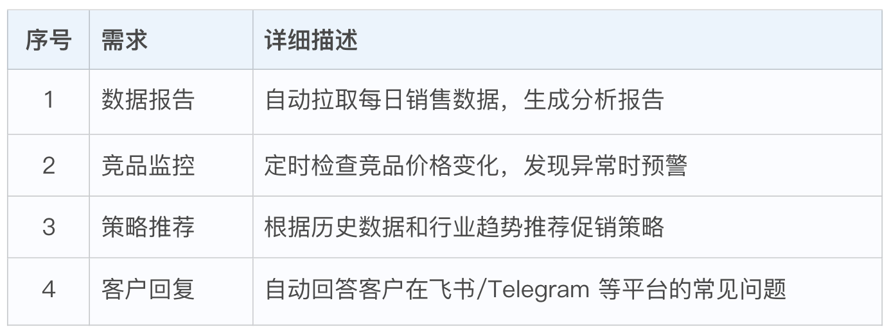
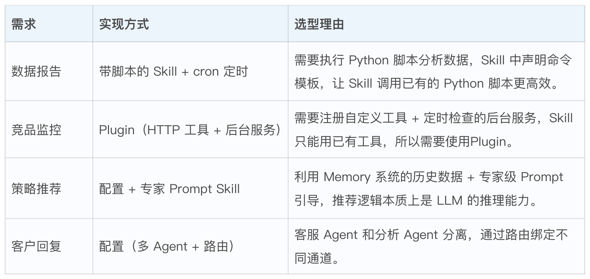
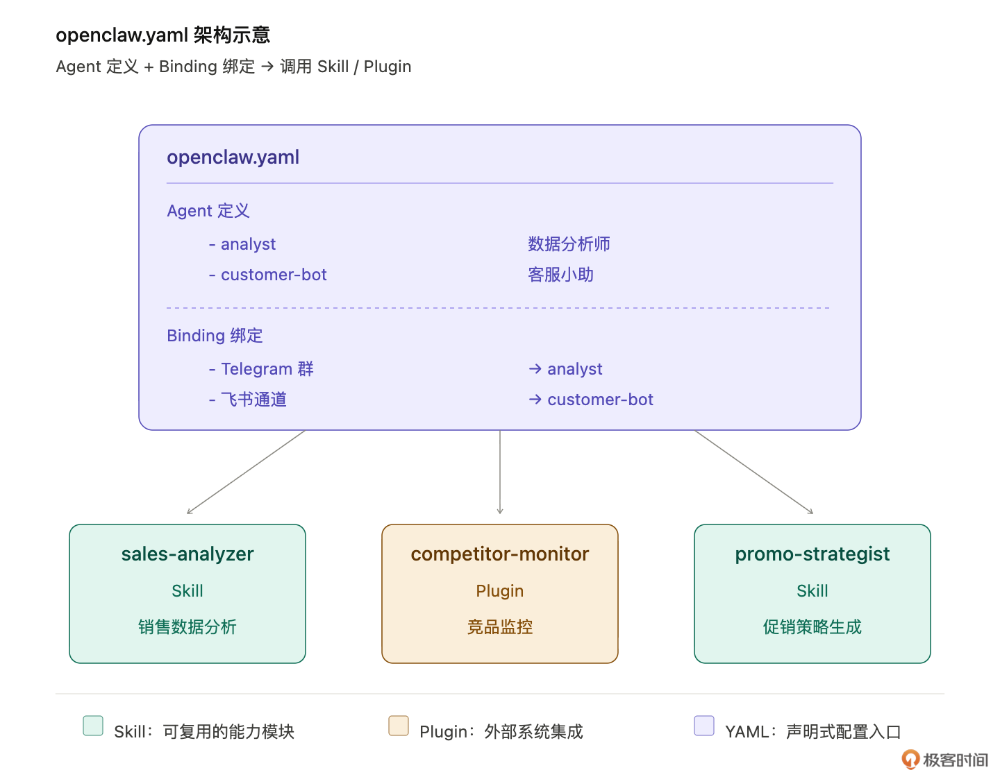
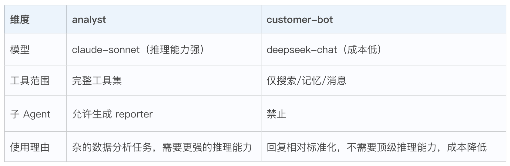
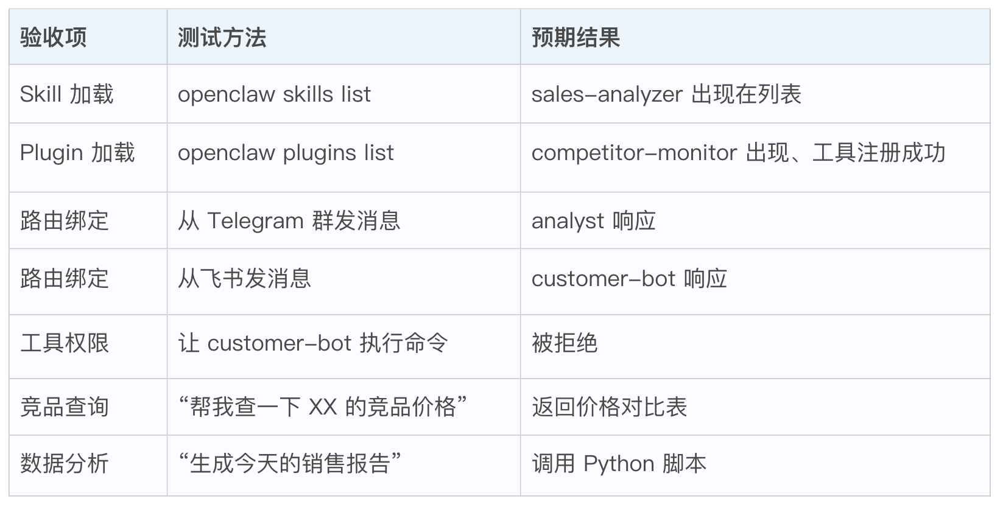
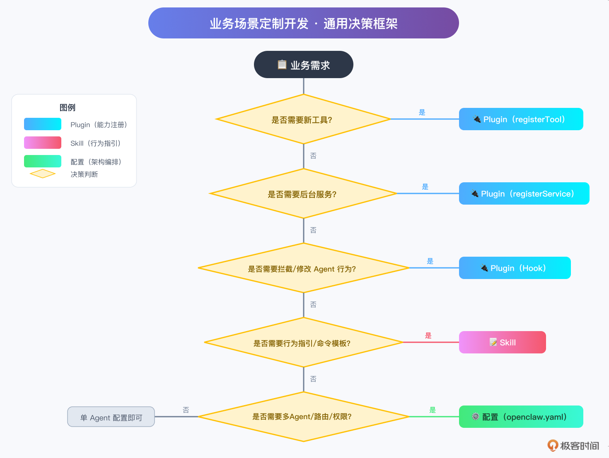
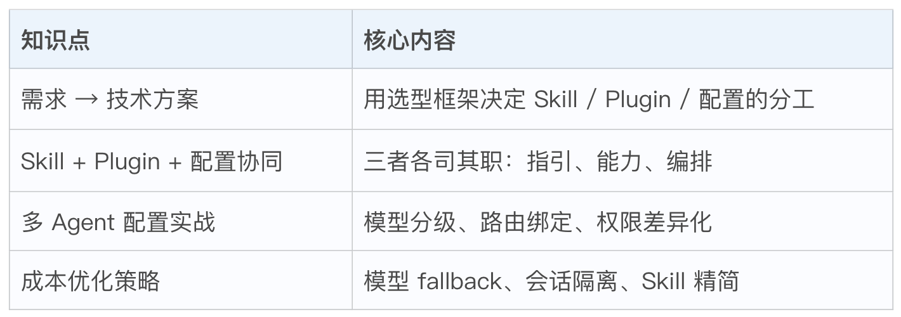

# 30 | 业务场景定制开发实战：从需求到落地的完整开发流程

你好，我是 Henry，欢迎来到《OpenClaw 核心原理与实战》。

前面我们分别学会了两种扩展方式：Skill 和 Plugin，具备了 OpenClaw 扩展开发的两把武器。但在真实工作中，你面对的需求不是“写一个 Skill”或者“写一个 Plugin”这样的技术任务，而是像这样的需求：

- “我们需要一个智能运营助手，能帮团队自动拉取每日销售数据、监控竞品价格、推荐促销策略、自动回复客户常见问题。”

作为开发者，你需要把它拆解成技术方案，然后用合适的工具来实现。今天我们这节的核心是从业务需求到技术落地的完整流程，怎么选择技术方案，怎么让 Skill、Plugin 和配置协同工作，教你上手做项目。

下面我们针对智能运营助手案例进行展开，首先我们讲解怎么分析需求。

## 需求分析：“智能运营助手”的技术拆解

让我们把需求具体化，某电商团队需要一个运营助手，具备以下四项核心能力：



## 技术方案选型

明确了需求，我们需要基于需求进行技术方案选型，我们需要考虑一个核心问题：用 Skill、Plugin 还是纯配置来实现？选型的依据是什么？我们学过的三种工具的能力边界：

- Skill：适合“行为指引”，告诉 Agent 遇到什么场景该怎么做、该执行什么命令

- Plugin：适合“能力注册”，注册新工具、接入 Hook、启动后台服务

- 配置：适合“架构编排”，多 Agent 定义、路由规则、权限策略、会话隔离

根据我们学过的能力边界，我们设计四项需求的技术映射如下：



架构设计图如下：



下面开始按模块逐个实现。

## 模块实现：Skill、Plugin、配置实战

我们首先实现 Skill 部分，再实现 Plugin 核心能力，最后实现架构编排配置。

模块一：销售数据分析 Skill

```bash
---
name: sales-analyzer
description: "电商销售数据分析"
metadata:
 openclaw:
   emoji: ""
   requires:
     bins: ["python3", "curl"]
     env: ["SHOP_API_KEY", "SHOP_API_URL"]
---
# 销售数据分析
## When to Use
- 用户需要查看每日/每周/每月销售报告
- 用户询问某个品类的销售趋势
- 用户需要对比不同时间段的销售数据
## Commands
### 每日报告生成
```bash
python3 scripts/daily_report.py --date "{date}" --api-key "${SHOP_API_KEY}"
```
### 销售趋势分析
```bash
python3 scripts/trend_analysis.py --days {n} --category "{category}"
```
### 热销商品排行
```bash
curl -s "${SHOP_API_URL}/top-products?period={period}&limit=10" \
 -H "Authorization: Bearer ${SHOP_API_KEY}"
```
## Output Format
- 用表格展示关键指标（GMV、订单量、客单价、转化率）
- 同比/环比用 📈📉 标注涨跌
- 结尾附简要分析和建议
```

核心包含三个部分：

```
门控声明了 bins: ["python3", "curl"] 和 env: ["SHOP_API_KEY"]：只有在这
```

- 些依赖都满足的环境中，Skill 才会被加载。避免在没有数据分析能力的环境中误加载。

```
脚本使用相对路径 scripts/：在实际部署中需要替换为绝对路径。这里用相对路径是为
```

- 了示例清晰，真实使用时务必用绝对路径。

3. Output Format 部分：告诉 LLM 怎么组织输出格式。这部分只在分析场景下有用，不需要

```
在所有对话中占用上下文，比在 Agent 的 instructions 里写要好。
```

模块二：竞品监控 Plugin

这是整个项目中最复杂的模块，它需要注册工具和启动后台服务。

```bash
```typescript
import { definePluginEntry } from "openclaw/plugin-sdk/core";
export default definePluginEntry({
 id: "competitor-monitor",
 name: "Competitor Price Monitor",
 register(api) {
   // 1. 注册竞品查询工具
   api.registerTool(
     {
       name: "check_competitor_price",
       description: "查询竞品价格并与我方对比",
       inputSchema: {
         type: "object",
         properties: {
           product: {
             type: "string",
             description: "商品名称或SKU"
           },
           competitors: {
             type: "array",
             items: { type: "string" },
             description: "竞品平台列表（如 jd, taobao, pdd）"
           }
         },
         required: ["product"]
       },
       async execute(params) {
         const { product, competitors } = params;
         const results = await fetchCompetitorPrices(
           product,
           competitors || ["jd", "taobao", "pdd"]
         );
         return {
           type: "text",
           text: formatPriceComparison(results)
         };
       }
     },
     { names: ["check_competitor_price"] }
   );
   // 2. 注册后台定时检查服务
   api.registerService({
     id: "price-alert",
     async start() {
       console.log("竞品价格监控服务已启动");
       // 每 6 小时检查一次竞品价格变动
       setInterval(async () => {
         try {
           const alerts = await checkPriceChanges();
           if (alerts.length > 0) {
             // 通过消息通知运营团队
             await notifyOperator(alerts);
           }
         } catch (error) {
           console.error("价格检查失败:", error);
         }
       }, 6 * 60 * 60 * 1000);
     }
   });
 }
});
// === 辅助函数 ===
async function fetchCompetitorPrices(
 product: string,
 competitors: string[]
) {
 // 调用竞品价格 API
 const results = [];
 for (const comp of competitors) {
   const resp = await fetch(
     `${process.env.COMPETITOR_API_URL}/price?product=${encodeURIComponent(produ
     { headers: { Authorization: `Bearer ${process.env.COMPETITOR_API_KEY}` } }
   );
   if (resp.ok) {
     results.push(await resp.json());
   }
 }
 return results;
}
function formatPriceComparison(results: any[]): string {
 if (results.length === 0) return "未找到竞品价格数据";
 let output = " 竞品价格对比：\n\n";
 output += "| 平台 | 价格 | 与我方差价 |\n";
 output += "|:---|:---|:---|\n";
 for (const r of results) {
   const diff = r.price - r.ourPrice;
   const arrow = diff > 0 ? "📈 高" : diff < 0 ? "📉 低" : "➡️ 持平";
   output += `| ${r.platform} | ¥${r.price} | ${arrow} ¥${Math.abs(diff)} |\n`;
 }
 return output;
}
async function checkPriceChanges() {
 // 查询所有监控商品的价格变动
 const resp = await fetch(
   `${process.env.COMPETITOR_API_URL}/alerts`,
   { headers: { Authorization: `Bearer ${process.env.COMPETITOR_API_KEY}` } }
 );
 return resp.ok ? await resp.json() : [];
}
async function notifyOperator(alerts: any[]) {
 // 通过 OpenClaw 的消息系统通知运营
 console.log(`发现 ${alerts.length} 个价格异动！`);
 // 实际实现中通过 OpenClaw 消息 API 发送通知
}
```

核心包含三个部分：

```
registerTool 用于手动查询：运营人员可以随时通过对话让 Agent 查询竞品价格。
registerService 用于自动监控：后台服务每 6 小时自动检查一次，发现异常主动通知
```

- 而非被动等待，这正是 Plugin 相比 Skill 的优势。

```
服务注册在 register 阶段而非 activate 阶段：后台服务的启动不依赖其他 Plugin 的
注册完成，用 register 阶段即可。如果服务启动时需要查询“系统中有没有 memory-core
工具”，则应放在 activate 阶段。
```

模块三：多 Agent 配置编排

```
通过 openclaw.yaml 定义 Agent、绑定通道、配置权限，把所有模块串起来。
# openclaw.yaml — 智能运营助手
providers:
 default: openai
 openai:
   apiKey: "${OPENAI_API_KEY}"
agents:
 list:
   # Agent 1: 数据分析师 — 处理数据分析和竞品监控
   - id: analyst
     model: claude-sonnet-4-20250514
     identity:
       name: "数据分析师小A"
       instructions: |
         你是一位电商数据分析专家。你的职责包括：
         1. 根据销售数据生成分析报告
         2. 监控竞品价格并给出应对建议
         3. 基于历史数据推荐促销策略
         回复风格：专业但不晦涩，用数据说话，给出可执行的建议。
     subagents:
       allowAgents: ["reporter"]  # 可生成报告子 Agent
     tools:
       allow: ["*"]
   # Agent 2: 客服小助 — 自动回复客户常见问题
   - id: customer-bot
     model: deepseek-chat       # 客服用更经济的模型
     identity:
       name: "客服小助"
       instructions: |
         你是一位友好的电商客服。回答客户关于订单、退换货、物流的常见问题。
         如果遇到无法处理的复杂问题，告知客户将转接人工客服。
     tools:
       allow:
         - web_search
         - memory_search
         - message
       deny:
         - exec               # 客服 Agent 绝对禁止执行命令
         - write              # 禁止写文件
         - sessions_spawn     # 禁止创建子 Agent
# 路由绑定 — 不同通道绑定不同 Agent
bindings:
 - agentId: analyst
   match:
     channel: telegram
     peer:
       kind: group
       id: "ops_group"        # 运营团队 Telegram 群
 - agentId: customer-bot
   match:
     channel: feishu            # 飞书客服通道
# 工具全局策略
tools:
 profile: "coding"
 deny: ["group:automation"]     # 全局禁止 cron/gateway
```

两个 Agent 的职责完全不同，所以配置策略也截然不同：



```
Agents 的路由绑定匹配规则包含 agentId、channel、peer 三个维度，这里的设计是运营
```

团队在 Telegram 群里的消息 → 路由到 analyst，飞书通道的所有消息 → 路由到 customer-bot。

```
权限配置方面，客服 Agent 的 deny 列表体现了一个核心原则：deny 优先于 allow，每层只
能收紧不能放宽。即使全局 Profile 包含了 exec，customer-bot 的 Agent 级 deny 也会把
```

它过滤掉。这确保了即使客服 Agent 被 Prompt Injection，也无法执行任何命令。

## 集成测试与优化

所有模块实现完成后，我们进入测试验收阶段，逐项验证可以遵照如下流程：



在实际运行中，Token 成本可能是最大的运营开销，以下是两个实用的优化策略。

策略一：模型分级

```
agents:
 list:
   - id: analyst
     model:
       primary: claude-sonnet-4-20250514     # 主力模型
       fallbacks: [deepseek-chat]         # 降级备选
```

七重容错策略，模型 fallback 是关键一环。当主力模型不可用或响应过慢时，自动降级到备选模型。既保障了可用性，也为高峰期提供了成本缓冲。

策略二：精简 Skill 内容

每个加载的 Skill 都会占用 System Prompt 的空间，如果分析师 Agent 加载了 20 个 Skill 但只

```xml
常用 5 个，剩下 15 个就是浪费的上下文空间。可以通过配置 config.skills.entries.
<name>.enabled: false 禁用不需要的 Skill。
```

## 总结

经过今天的实战，从示例到业务我们可以提炼出一个通用的决策框架：



贯穿全文核心知识点如下：



Skill、Plugin、配置编排三者协作。Skill 做前端，Plugin 做后端，Skill 提供面向 LLM 的行为指引，Plugin 提供底层能力；配置做架构，代码做实现，用 YAML 编排 Agent 和路由，用代码实现具体逻辑；先 Skill 后 Plugin，能用 Skill 解决的不要用 Plugin，降低复杂度。通过本节课，你现在能做到：

- 面对业务需求做出合理的技术拆解

- 综合运用 Skill + Plugin + 配置完成项目

- 为不同角色的 Agent 配置差异化策略

- 进行集成测试和成本优化

## 思考题

针对你的实际业务场景，设计并实现一个包含至少 1 个 Skill + 1 个 Plugin 的定制方案。要求：提交技术方案设计文档（需求拆解 + 选型理由）和完整配置文件。

欢迎你在留言区与我交流！如果今天的课程让你有所收获，也欢迎转发给有需要的朋友，邀请他来一起学习，我们下节课再见！
