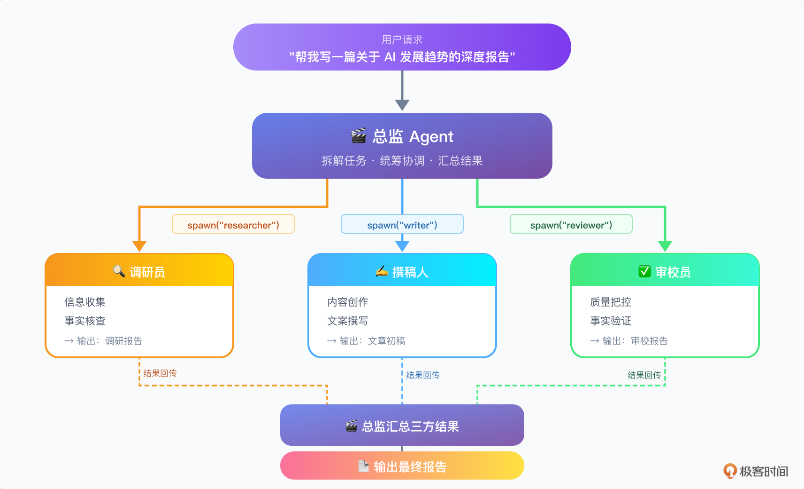
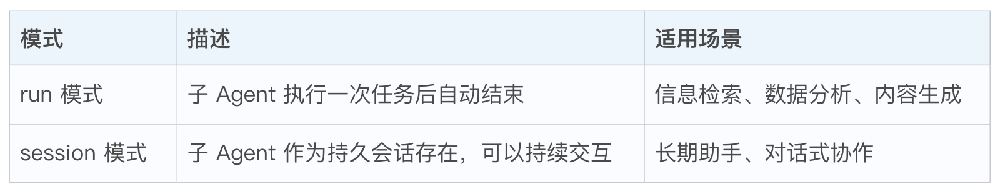
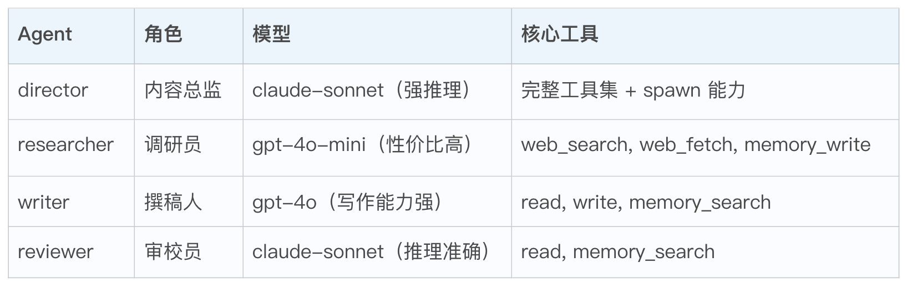
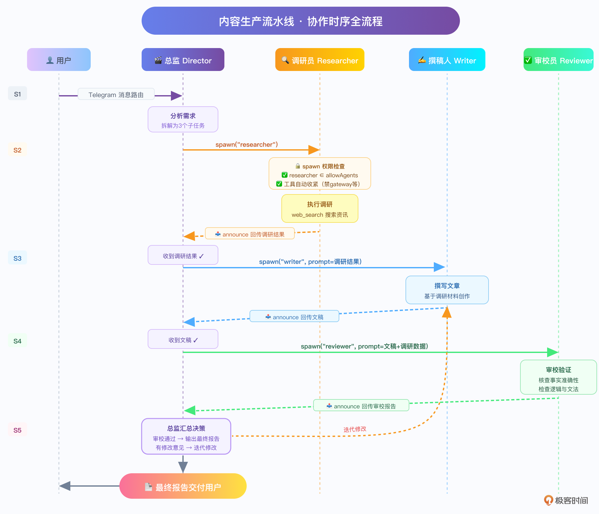
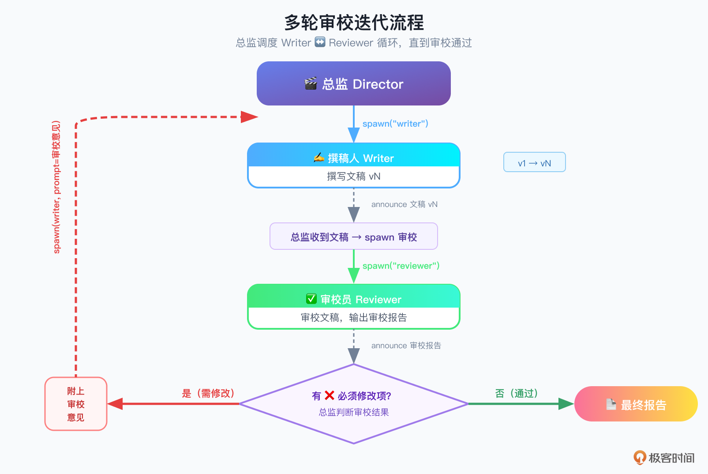
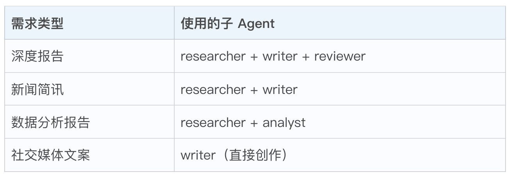
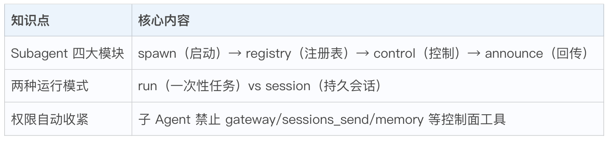

# 31 | 多Agent协作系统构建：让Agent团队分工协作

你好，我是 Henry，欢迎来到《OpenClaw 核心原理与实战》。

上节课我们完成了一个包含两个 Agent 的运营助手项目。analyst 处理数据分析，customer-bot 处理客服问题，它们各自独立工作，互不干扰。但如果一个任务太复杂，比如：“帮我写一篇关于 AI 发展趋势的深度报告。” 这个任务涉及信息收集、数据分析、内容撰写、质量审校。让一个 Agent 独立完成这四步，它会陷入一个超长的推理循环，上下文窗口很快被填满，推理质量也会随着对话变长而下降。真正高效的方案是分工协作，像一个内容团队。



多 Agent 协作是 AI Agent 从“工具”进化为“团队”的关键能力。受限于上下文窗口、单线程推理、以及固定的角色定位，单 Agent 能做的事有上限。多 Agent 协作打破了这些限制。这就是 OpenClaw 的 SubAgent 动态协作机制，今天我们要把这个机制从理论变成实践。

## 理解 SubAgent 机制：四大模块

Subagent 机制的配置和使用中有很多坑，比如子 Agent 的工具权限为什么被自动收紧了？为什么某个子 Agent 的结果没有正确回传？这些问题的答案都在四大模块设计中。

Subagent 系统由 spawn、registry、control、announce 四个模块组成。用一个比喻来理解四个模块的关系，假如你是一家公司的 CEO（父 Agent），你要安排员工（子 Agent）完成工作。

- spawn（招聘）：面试候选人（权限检查），确认他能胜任（验证），然后发 offer 让他入职（启动）

- registry（花名册）：HR 维护所有在职员工的记录，谁在做什么任务、状态怎样，员工离职了自动从花名册删除（孤儿回收）

- control（管理）：随时可以查看员工的工作进度，也可以叫停某个人的任务（取消）

- announce（汇报）：员工完成任务后，把成果汇报给你。你汇总所有人的成果，输出最终交付物

OpenClaw 支持两种子 Agent 运行模式：



今天我们主要使用 run 模式，因为内容生产流水线中的子任务都是“做完就走”的性质。

OpenClaw 安全机制采用子 Agent 权限自动收紧策略，OpenClaw 为子 Agent 定义了独立的拒绝列表。

所有子 Agent 一律禁止的工具：

```
gateway、agents_list、whatsapp_login，系统管理类
session_status、cron，应由父 Agent 管理
memory_search、memory_get，内存工具应通过 spawn prompt 传递
sessions_send，防止跨 Session 注入
```

叶子 Agent 额外禁止的工具：

```
subagents、sessions_spawn，不能再创建下级
sessions_list、sessions_history，不需要查看其他会话
整体原则是每一层只能收紧，不能放宽。父 Agent 有 exec 权限不代表子 Agent 也有。子
```

Agent 被 Prompt Injection 攻击时，因为权限被大幅收窄，攻击面非常有限。

## 实战：内容生产流水线

回顾了 Subagent 机制后，我们进入实战环节，构建一个内容生产流水线，包含四个 Agent：



模型选型方案，参照模型优先级链的实际应用，不同角色使用不同模型，既保障了质量，又控制了成本：

- 总监用 claude-sonnet：需要分析复杂任务、拆解子任务、汇总多方信息，这些都需要强推理能力

- 调研员用 gpt-4o-mini：信息收集是相对标准化的任务，不需要顶级推理能力，用经济模型降低成本

- 撰稿人用 gpt-4o：内容创作需要较好的语言表达能力，gpt-4o 在写作方面表现优秀

- 审校员用 claude-sonnet：审校需要严格的逻辑推理和事实判断能力

详细的完整配置如下所示：

```
# openclaw.yaml — 内容生产流水线
providers:
 default: openai
 openai:
   apiKey: "${OPENAI_API_KEY}"
 anthropic:
   apiKey: "${ANTHROPIC_API_KEY}"
agents:
 list:
   # 内容总监 — 任务拆解和结果汇总
   - id: director
     model: claude-sonnet-4-20250514
     identity:
       name: "内容总监"
       instructions: |
         你是内容团队的总监。当收到内容创作需求时：
         1. 分析需求，拆解为三个子任务：
            - research（调研）：收集相关信息和数据
            - write（写作）：基于调研结果撰写文章
            - review（审校）：检查事实准确性和行文质量
         2. 依次 spawn 子 Agent 完成每个子任务
         3. 收到所有子 Agent 的结果后，汇总输出最终稿件
         注意事项：
         - 给每个子 Agent 的 prompt 要明确、具体
         - 写作任务要附上调研结果作为参考素材
         - 审校任务要附上文章全文和调研数据用于核实
     subagents:
       allowAgents: ["researcher", "writer", "reviewer"]
       model: gpt-4o-mini    # 子 Agent 默认使用经济模型
     tools:
       allow: ["*"]
   # 调研员 — 信息收集和事实核查
   - id: researcher
     model: gpt-4o-mini
     identity:
       name: "调研员"
       instructions: |
         你是一位严谨的调研员。你的工作是：
         1. 根据给定的主题，搜索最新的权威信息
         2. 整理关键数据和事实
         3. 标注信息来源
         输出格式：
         - 核心发现（3-5 条）
         - 关键数据（表格形式）
         - 信息来源列表
     tools:
       allow: [web_search, web_fetch, memory_write]
   # 撰稿人 — 内容创作
   - id: writer
     model: gpt-4o
     identity:
       name: "撰稿人"
       instructions: |
         你是一位经验丰富的撰稿人。你的工作是：
         1. 根据调研材料和主题要求撰写文章
         2. 确保逻辑清晰、论据充分、行文流畅
         3. 控制篇幅在 2000-3000 字
     tools:
       allow: [read, write, memory_search]
   # 审校员 — 质量把控
   - id: reviewer
     model: claude-sonnet-4-20250514
     identity:
       name: "审校员"
       instructions: |
         你是一位细心的审校员。你的工作是：
         1. 检查文章中的事实是否与调研数据一致
         2. 检查逻辑是否通顺、论述是否完整
         3. 检查是否有语法错误或用词不当
         输出格式：
         -  通过项
         - ⚠️ 建议修改项
         - ❌ 必须修改项
         - 总体评价和最终建议
     tools:
       allow: [read, memory_search]
# 路由绑定
bindings:
 - agentId: director
   match:
     channel: telegram
```

我们通过一个流程，讲解整体的协作流程，当用户发送“帮我写一篇关于 AI 发展趋势的深度报告”时，整个协作流程如下：



```
当子 Agent 完成任务后，结果是通过 announce 回传机制 subagent-announce.ts 回传给
```

父 Agent，详细的回传流程主要四步：

1. 子 Agent 完成所有推理循环后，输出最终文本

2. announce 模块将输出打包为“公告消息”

3. 公告消息被发送到父 Agent 的消息队列

4. 父 Agent 在下一轮推理中接收到公告，据此决定下一步动作

子 Agent 的结果不是实时流式传回的，而是在子 Agent 完成后一次性回传。这意味着如果子Agent 的任务耗时较长，父 Agent 会等待。

子 Agent 权限 < 父 Agent 权限，是 OpenClaw 强制执行的安全机制，最小权限原则。所有子Agent 一律禁止 gateway、sessions_send、memory_search 等控制面工具。在配置子 Agent时，tools.allow 应该只列出该角色真正需要的工具。比如审校员只需要 read 和memory_search，不需要 write（审校员不应该修改文件）和 exec（审校员不应该执行命令）。

当前设计是一次审校，更健壮的流程是支持多轮迭代，需要从从流水线到更复杂的系统，升级为多轮审校迭代，如下所示：



不同类型的内容需求可以路由到不同的子 Agent，采用动态 Agent 选择：



```
总监 Agent 的 instructions 中可以描述这些规则，让 LLM 根据需求类型自动选择合适的
```

子 Agent 组合。

## 总结

本节课我们的核心知识点如下：



到目前为止你现在能做到：

- 设计多 Agent 协作的系统架构

```
配置父 Agent 的 subagents 白名单和默认模型
```

- 为每个子 Agent 配置最小必要的工具权限

- 理解 announce 回传机制和循环检测的保护作用

## 思考题

构建一个“一人开发团队”多 Agent 系统，包含四个角色：需求分析师、编码员、测试员、文档员。要求：通过父 Agent 统一调度，每个子 Agent 有差异化的工具权限和模型配置。

欢迎你在留言区与我交流！如果今天的课程让你有所收获，也欢迎转发给有需要的朋友，邀请他来一起学习，我们下节课再见！
