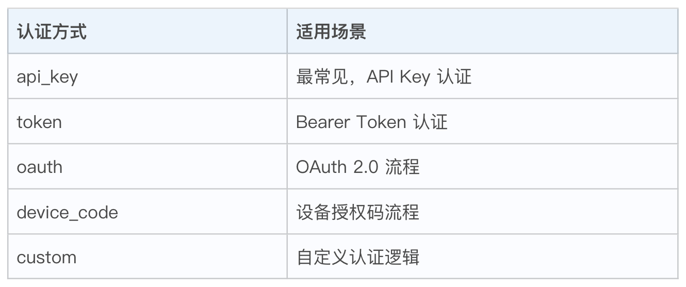

# 32 | Provider与ChannelPlugin开发：接入企业内部系统

你好，我是 Henry，欢迎来到《OpenClaw 核心原理与实战》。

前面我们从 Skill 到 Plugin，从单模块到多 Agent 协作，逐步掌握了 OpenClaw 扩展开发的完整路径。但有一个底层问题我们一直在“用”但没有“碰”，Agent 调用的 LLM 模型从哪来？消息通道怎么对接？

```
在前面的实战中，我们直接在配置里写 model: claude-sonnet-4-20250514，消息通道
```

用的都是 OpenClaw 内置的 Telegram 或飞书。但在企业场景中，你很可能遇到这两个需求：

1. 公司有自研的 LLM 模型（或者部署了 Ollama 本地模型），想让 OpenClaw 接入 → 需要开发 Provider Plugin

2. 公司用的是自建的 IM 系统（不是 Telegram/ 飞书 /Discord），想让 Agent 能收发消息 → 需要开发 Channel Plugin

Provider 让 Agent 有“大脑”，Skill 让 Agent 有“技能”，Channel 让 Agent 有“耳朵和嘴巴”。今天我们聚焦 Provider 和 Channel，它们是 OpenClaw 最底层的两种插件类型，解决的是Agent 能力的基础设施问题。

## Provider Plugin 开发：让 Agent 接入任何 LLM

没有 Provider，Agent 模型调用不了，就没有了大脑。OpenClaw 内置的 33 种 LLM Provider

```
（OpenAI、Anthropic、Google、Ollama 等）全部通过 registerProvider 注册。
```

Provider 是基础设施级的插件，如果你的公司有自研模型，接入 Provider 是让 OpenClaw 可用的第一步。Provider Plugin 接口，这是所有插件类型中最丰富的：

```bash
export type ProviderPlugin = {
 id: string;
 label: string;
 aliases?: string[];
 // 认证——支持 5 种方式
 auth: ProviderAuthMethod[];
 // auth.kind: "oauth" | "api_key" | "token" | "device_code" | "custom"
 // 模型目录——静态 + 动态
 catalog?: ProviderPluginCatalog;
 resolveDynamicModel?: (ctx) => ProviderRuntimeModel | null;
 // 流式处理
 wrapStreamFn?: (ctx) => StreamFn | null;
 // 能力声明
 capabilities?: Partial<ProviderCapabilities>;
};
```

因为不同 Provider 差异极大，所以就需要在系统层面进行兼容设计，来支持不同的Provider：

- OpenAI 用 API Key，Google 用 OAuth，Ollama 免认证

- 模型目录有静态的（已知列表）和动态的（用户自定义 ID）

- 流式输出格式各家不同（SSE、WebSocket、gRPC）

你不需要实现所有字段，只需要实现你的 LLM 需要的部分。下面我们通过实战，接入企业内部的 LLM 服务。

现在你的公司有一个兼容 OpenAI API 格式的内部 LLM 服务（这是最常见的场景，很多公司部署的 vLLM、TGI 等推理框架都兼容 OpenAI API），详细的接入代码示例如下：

```bash
import { definePluginEntry } from "openclaw/plugin-sdk/core";
export default definePluginEntry({
 id: "internal-llm",
 name: "Internal LLM Provider",
 register(api) {
   api.registerProvider({
     id: "internal-llm",
     label: "Internal LLM",
     // 认证方式：API Key
     auth: [{ kind: "api_key", label: "Internal API Key" }],
     // 模型目录：静态定义
     catalog: {
       models: [
         {
           id: "internal-chat-v2",
           label: "Internal Chat V2",
           contextWindow: 32000,
           pricing: {
             inputPerMillion: 0,     // 内部模型免费
             outputPerMillion: 0
           },
         },
         {
           id: "internal-chat-lite",
           label: "Internal Chat Lite",
           contextWindow: 8000,
           pricing: { inputPerMillion: 0, outputPerMillion: 0 },
         }
       ]
     },
     // 流式处理函数——核心实现
     wrapStreamFn: (ctx) => {
       return async function* (params) {
         const response = await fetch(
           "https://llm.internal.company.com/v1/chat/completions",
           {
             method: "POST",
             headers: {
               "Content-Type": "application/json",
               Authorization: `Bearer ${ctx.apiKey}`
             },
             body: JSON.stringify({
               model: params.model,
               messages: params.messages,
               stream: true
             })
           }
         );
         if (!response.ok) {
           throw new Error(
             `Internal LLM error: ${response.status} ${response.statusText}`
           );
         }
         // 解析 SSE 流式响应
         const reader = response.body?.getReader();
         const decoder = new TextDecoder();
         if (!reader) throw new Error("No response body");
         while (true) {
           const { done, value } = await reader.read();
           if (done) break;
           const chunk = decoder.decode(value, { stream: true });
           const lines = chunk.split("\n").filter(
             line => line.startsWith("data: ")
           );
           for (const line of lines) {
             const data = line.slice(6); // 去掉 "data: " 前缀
             if (data === "[DONE]") return;
             try {
               const parsed = JSON.parse(data);
               const content = parsed.choices?.[0]?.delta?.content;
               if (content) {
                 yield { type: "text", text: content };
               }
             } catch {
               // 忽略解析错误的行
             }
           }
         }
       };
     }
   });
 }
});
我们从三个方面解析接入流程，首先是认证配置 auth，我们选择了最简单的 api_key 认证
方式。用户在配置中提供 API Key，OpenClaw 在每次请求时通过 ctx.apiKey 传给
```

Provider。OpenClaw 支持 5 种认证方式，根据你的内部系统选择：



```
接下来是模型目录 catalog：静态定义了两个模型。contextWindow 告诉 OpenClaw 这个
模型能处理多少 token，这影响上下文压缩策略，pricing 设为 0 表示内部模型免费。
最后是模型的流式处理 wrapStreamFn：这是 Provider Plugin 的核心实现，决定了 Agent 怎
么调用 LLM 并获取流式响应。函数返回一个异步生成器 async generator，每次 yield 一个
```

文本片段，OpenClaw 就把这个片段实时传给用户，实现打字机效果。

我们的实现解析了 SSE（Server-Sent Events）格式的流式响应，这是 OpenAI 兼容 API 的标准格式。如果你的内部 LLM 使用其他流式格式（如 WebSocket 或自定义协议），只需要修改解析逻辑。

开发完成 Provider，我们需要在配置中使用内部的 LLM，Provider Plugin 注册成功后，你就

```
可以在 openclaw.yaml 中配置使用，配置详情如下：
providers:
 internal-llm:
   apiKey: "${INTERNAL_LLM_KEY}"
agents:
 list:
   - id: work
     model: internal-chat-v2   # 使用内部模型
```

与模型优先级链的配合：

配置 Provider 同时，我们最好同时配置好模型的优先级链，五层模型优先级（heartbeat >session > channel > agent > global）。你可以把内部模型设为默认，外部模型设为 fallback：

```
agents:
 list:
   - id: work
     model:
       primary: internal-chat-v2     # 主力用内部模型
       fallbacks: [gpt-4o-mini]      # 内部模型不可用时降级到外部
```

现在我们已经可以让 OpenClaw 接入到私有化部署到 LLM，下面我们开始 Channel Plugin 开发，接入一个企业 IM。

## Channel Plugin 开发：对接自定义消息通道

Channel Plugin 需要处理消息的完整生命周期，包括入站解析、出站发送、配置管理、安全验证，比 Provider 更加复杂。但对于大多数企业场景，只需要实现两个核心功能：接收消息和发送消息。

Channel Plugin 接口代码逻辑如下：

```bash
export type ChannelPlugin = {
 id: ChannelId;
 meta: ChannelMeta;
 capabilities: ChannelCapabilities;
 // 核心适配器
 config: ChannelConfigAdapter;       // 配置解析
 outbound?: ChannelOutboundAdapter;  // 出站消息
 gateway?: ChannelGatewayAdapter;    // 网关入站
 messaging?: ChannelMessagingAdapter; // 消息转换
 // 高级适配器（可选）
 streaming?: ChannelStreamingAdapter; // 流式输出
 threading?: ChannelThreadingAdapter; // 线程/话题
 groups?: ChannelGroupAdapter;        // 群组管理
 security?: ChannelSecurityAdapter;   // 安全验证
 pairing?: ChannelPairingAdapter;     // 设备配对
};
```

9 种适配器中，核心的只有 4 种（config、outbound、gateway、messaging）。其余 5 种是高级功能，根据你的 IM 系统是否支持来选择实现。建议的开发策略是：先实现核心 4 个跑通消息收发，再按需添加流式输出、群组管理等高级能力。

假设你的公司有一个自建的 IM 系统，支持 Webhook 接收消息和 HTTP API 发送消息。这是企业 IM 最常见的集成模式，钉钉、企业微信、飞书的 Bot 接口都遵循这个范式。

下面我们来开发一个内部 IM，代码示例如下：

```bash
import { defineChannelPluginEntry } from "openclaw/plugin-sdk/core";
export default defineChannelPluginEntry({
 id: "internal-im",
 plugin: {
   id: "internal-im",
   register(api) {
     api.registerChannel({
       id: "internal-im",
       label: "Internal IM",
       // 配置 schema——定义用户需要提供的配置项
       configSchema: {
         type: "object",
         properties: {
           webhookUrl: {
             type: "string",
             description: "接收消息的 Webhook URL"
           },
           botToken: {
             type: "string",
             description: "Bot 认证 Token"
           }
         },
         required: ["webhookUrl", "botToken"]
       }
     });
   }
 },
 // 通道生命周期——消息收发的核心逻辑
 setRuntime: (runtime) => {
   // === 接收消息 ===
   runtime.onMessage(async (msg) => {
     // 将内部 IM 的消息格式标准化为 OpenClaw 内部格式
     return {
       channel: "internal-im",
       text: msg.content,
       peerId: msg.senderId,
       peerKind: msg.isGroup ? "group" : "direct"
     };
   });
   // === 发送消息 ===
   runtime.onSend(async (reply) => {
     await fetch(runtime.config.webhookUrl, {
       method: "POST",
       headers: {
         "Content-Type": "application/json",
         Authorization: `Bearer ${runtime.config.botToken}`
       },
       body: JSON.stringify({
         target: reply.peerId,
         content: reply.text
       })
     });
   });
 }
});
defineChannelPluginEntry：这是专为 Channel Plugin 设计的辅助函数。它封装了
```

Channel Plugin 特有的生命周期管理，包括自动注册 Hook、管理消息队列、处理连接状态。

```
比通用的 definePluginEntry 更简洁，省去了大量样板代码。
configSchema：定义用户在 openclaw.yaml 中需要配置的字段。声明 Schema 的好处是
```

OpenClaw 启动时会自动校验配置完整性，缺少必填项会直接报错提示，而不是运行时才crash。对于内部 IM，通常需要 Webhook URL（用于接收消息）和 Bot Token（用于发送消息认证）。

```
setRuntime：这是 Channel Plugin 的核心，定义消息的收发逻辑，两个回调函数各司其
职。runtime.onMessage()，当内部 IM 有新消息时被调用。你需要把 IM 的原始消息格式
转换为 OpenClaw 的标准格式。关键字段是 channel（通道标识）、text（消息文本）、
peerId（发送者 ID）、peerKind（direct 私聊或 group 群组）。runtime.onSend()，当
```

Agent 需要发送回复时被调用。你需要把 OpenClaw 的标准回复格式转换为 IM 的发送 API 格式，然后调用 API 发出消息。

在配置中使用内部 IM：

```
channels:
 internal-im:
   webhookUrl: "${IM_WEBHOOK_URL}"
   botToken: "${IM_BOT_TOKEN}"
bindings:
 - agentId: work
   match:
     channel: internal-im
bindings 的作用，是将消息和 Agent 对应起来，来自 internal-im 的消息，交给 work Agent
处理。路由匹配引擎，match.channel 是七层优先级中的一个匹配维度。
```

## 总结

本节课我们解决了 OpenClaw 企业落地的两个基础设施问题：模型从哪来和消息从哪来。

```
Provider Plugin  的核心是三件事：用  auth  声明认证方式，用  catalog  注册模型列表，
用  wrapStreamFn  实现流式调用。掌握这三个字段，你就能让 OpenClaw 接入公司内部任
```

何兼容 OpenAI API 的 LLM 服务——vLLM、TGI、Ollama 或自研推理框架，都走同一套接入模式。

```
Channel Plugin  的核心是两个回调：onMessage  负责将外部 IM 消息转为 OpenClaw 标准
格式，onSend  负责将 Agent 回复发到外部 IM。无论你对接的是钉钉、企业微信还是自建
```

IM，只要它支持 Webhook + HTTP API，都可以用这个模式快速接入。

至此我们完成了演练场（二）的五节课程，你从一个 OpenClaw 的使用者，变成了能为企业定制完整 Agent 系统的开发者，从行为指引、工具扩展、业务定制、多 Agent 协作到底层基础设施对接，覆盖了 Agent 系统开发的全链路。

## 思考题

1. 接入一个 Ollama 本地模型作为 Provider Plugin，在配置中使用它。

2. 为企业内部 IM 系统（或微信 / 钉钉等）开发 Channel Plugin 原型，实现基本的消息收发。

欢迎你在留言区与我交流！如果今天的课程让你有所收获，也欢迎转发给有需要的朋友，邀请他来一起学习，我们下节课再见！
