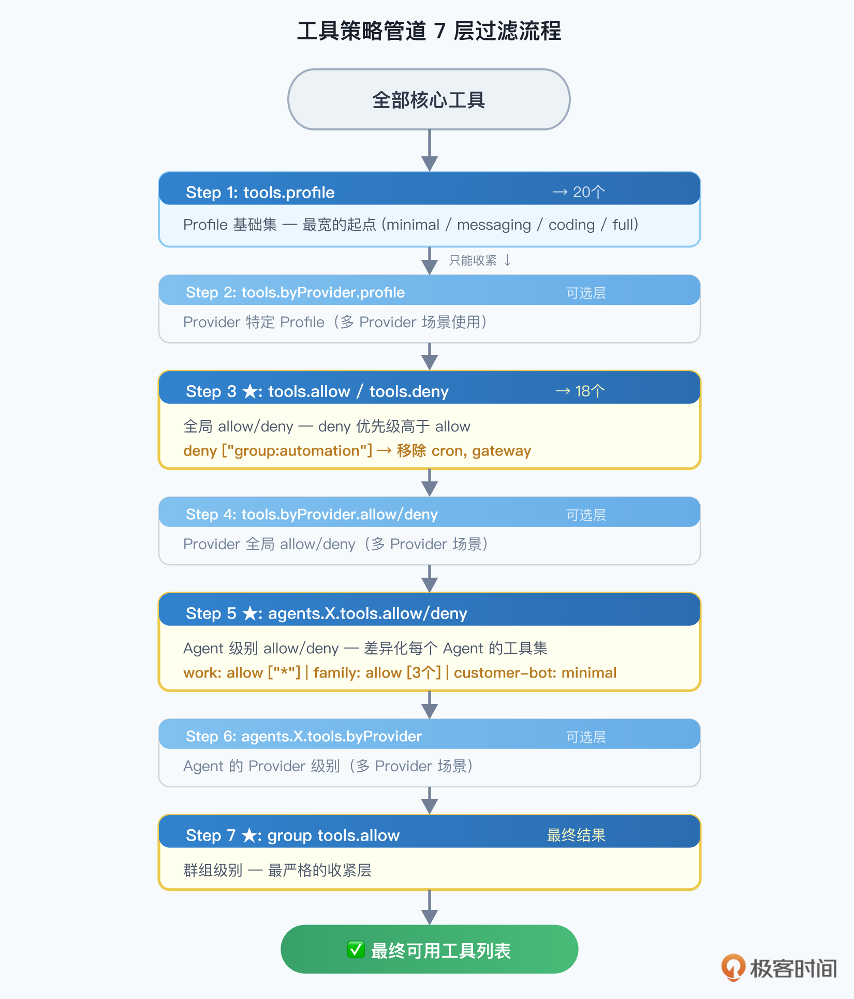

# 34 | 工具策略管道与权限分级：如何精确控制多Agent的能力边界？

你好，我是 Henry，欢迎来到《OpenClaw 核心原理与实战》。

上节课我们通过配置 Profile 和 deny 完成了个人安全基线单人场景，但如角色级的权限这种复杂场景就无法应对，例如：

- 场景一：你有 work Agent（完整工具集）和 family Agent（只需搜索和消息），全局 Profile无法差异化。

```
场景二：群组中你能用 exec，但同事不该有这个权限，全局 allow/deny 无法区分“谁在说
```

- 话”。

- 场景三：子 Agent 不该继承父 Agent 的全部权限，否则被注入后等于提权。

结合这三个场景，今天我们将动手配出三套精细化控制机制，并学会手动推演管道过滤结果。

## 理解 7 层过滤管道

OpenClaw 的工具策略管道有一个核心设计原则：每一层只能收紧上层的限制，不能放宽。全局 deny 的工具，下游层无法重新 allow，这就保证了安全策略的可预测性。核心实现逻辑如下：

```bash
export function applyToolPolicyPipeline(params) {
 let filtered = params.tools;       // 从全部工具开始
 for (const step of params.steps) { // 逐层过滤
   if (!step.policy) continue;      // 该层没有配置则跳过
   const expanded = expandPolicyWithPluginGroups(policy, pluginGroups);
   filtered = filterToolsByPolicy(filtered, expanded);
 }
 return filtered;  // 返回最终工具列表
}
```

其中管道共 7 层，从宽到严逐层过滤，详细流程如下所示：



每一层的 allow/deny 列表在匹配前会经过两轮展开。

```
第一轮是工具组展开：group:automation 被展开为 heartbeat_respond、cron、
gateway 三个独立的工具 ID；group:fs 展开为 read、write、edit、
apply_patch；group:plugins 展开为所有已注册的插件工具。
第二轮是名称标准化：bash 被标准化为 exec，apply-patch 被标准化为
apply_patch。在配置中写哪种形式都能正确匹配。
```

日常最常用的 4 层包含 Step 1（Profile）、Step 3（全局 deny）、Step 5（Agent 级别）、Step7（群组级别）。Provider 级别的 Step 2/4/6 在多 Provider 场景下才需要用到，比如你同时接入了 OpenAI 和 Ollama，想让 Ollama 的 Agent 比 OpenAI 的少一些工具权限。管道结构清楚了，来实际配一个多 Agent 场景。

## 配置多 Agent 权限矩阵

```
配置多 Agent 的权限矩阵，我们为三个 Agent 配置差异化权限：work（你自己使用，需要完
整工具集做日常开发）、family（家人使用，只需搜索和发消息）、customer-bot（对外客
```

服，只需搜索）。下面是详细的配置逻辑：

```
# openclaw.yaml — 多 Agent 权限矩阵
# Step 1: 全局 Profile
tools:
 profile: "coding"              # 20个工具
 deny: ["group:automation"]     # Step 3: 全局禁止 cron + gateway
agents:
 list:
   # work Agent — 完整工具集
   - id: work
     default: true
     tools:
       allow: ["*"]             # Step 5: 允许所有（在全局 deny 之后）
   # family Agent — 白名单模式
   - id: family
     tools:
       allow:                   # Step 5: 只允许这些
         - web_search
         - memory_search
         - message
       deny:
         - exec                 # 明确拒绝命令执行（双重保险）
   # customer-bot — 最小权限
   - id: customer-bot
     tools:
       profile: "minimal"       # 最小 Profile（仅 session_status）
       alsoAllow:
- web search
# 额外允许搜索
```

配置用到了三种完全不同的权限控制策略，包含通配符放行、白名单过滤、Profile 覆盖。每块的核心逻辑如下：

1. 第一块为工具的全局基础设定：

```
tools:
 profile: "coding"              # 起点：20 个工具
 deny: ["group:automation"]     # 全局禁止 cron + gateway
profile: "coding" 给所有 Agent 定了一个统一起点，coding 配置集包含 20 个日常开发
工具。紧接着 deny: ["group:automation"] 在全局层面砍掉了 cron 和 gateway。这两
```

行的效果是不管后面怎么配 Agent，cron 和 gateway 都不可能出现在任何 Agent 的工具列表里。这是管道“只能做减法”的第一道防线。

2. 第二块为 work Agent——通配符放行

```
- id: work
 default: true
 tools:
   allow: ["*"]
default: true 表示新建会话时默认使用这个 Agent。allow: ["*"] 是通配符，意思是
```

上游管道传下来什么，我全要。这不是“允许全部 27 个工具”，全局 deny 已经减掉了 cron 和

```
gateway，到这一层传下来的只有 18 个，["*"] 只是不再做进一步收紧。
```

3. 第三块为 family Agent——白名单 + 防御性 deny

```
- id: family
 tools:
   allow:
     - web_search
     - memory_search
     - message
   deny:
     - exec
family 用的是白名单模式：只列出需要的三个工具，其余一律拒绝。deny: [exec] 是一层
```

防御性兜底，万一将来有人维护配置时误把 exec 加进了 allow 列表，deny 仍然会拦住。deny优先于 allow。

4. 第四块为 customer-bot——Agent 级 Profile 覆盖

```
- id: customer-bot
 tools:
   profile: "minimal"
   alsoAllow:
     - web_search
customer-bot 没有沿用全局的 profile: "coding"，而是用 Agent 级 profile:
"minimal" 直接覆盖了起点，minimal 配置集只含 session_status 一个工具。然后通过
alsoAllow 精确加入 web_search。这是“最小权限 + 按需开放”的典型写法，起点极小，需
```

要什么才加什么。

管道解决了不同 Agent 有不同工具集的问题。但同一个 Agent 里，群组中你和同事的权限怎么区分？下面我们通过 Owner-Only 策略来进行实操配置。

## Owner-Only 策略配置

Owner-Only 独立于管道之外，解决“谁在说话”的问题。即使管道允许了某个工具，非 owner用户仍然无法使用被标记为 Owner-Only 的工具，OpenClaw 默认的 Owner-Only 工具有三个：

- cron：定时任务管理，恶意用户能设持久后门

- gateway：网关配置变更，能关闭认证

- nodes：设备管理，能添加自己的设备

```
这三个工具被分为两类：cron 和 gateway 属于 control_plane（控制面操作），nodes 属
于 exec_capable（执行能力操作）。分类的意义在于，如果你需要给某个非 Owner 用户临
```

时授权某类 Owner-Only 工具，可以按 class 类型批量授权，而不是逐个工具配置。

Owner-Only 通过双重保护实现：

1. 工具列表过滤：非 owner 用户的工具列表中直接剔除 Owner-Only 工具，这是因为 LLM 根本不知道它们的存在，自然不会尝试调用。

2. 执行守卫：即使通过某种方式，比如 LLM 从历史对话中推断出工具名发起了调用，

```
wrapOwnerOnlyToolExecution() 会拦截执行并抛出 "Tool restricted to
owner senders." 错误。
```

双重保护第一层是正常防线，第二层是防止绕过的兜底。两层都独立工作，任意一层被突破不影响另一层的拦截效果。下面是一个完整的自定义 Owner-Only 配置：

```
agents:
 list:
   - id: team-bot
     ownerOnly:
       tools:
         - exec      # exec 只有 owner 能用
         - write     # write 只有 owner 能用
         - edit      # edit 只有 owner 能用
```

Owner-Only 和 deny 的区别：deny 是任何人都不能用，Owner-Only 是只有 Owner 能用。如果你自己也需要在群组里用 exec，deny 会把你也挡住，Owner-Only 则只挡非 Owner。

## 子 Agent 权限限制配置

前面三个实操解决的都是“平级 Agent 之间”的权限差异，但还有一种关系是纵向的，父 Agent创建子 Agent 来执行子任务。

这里有一个关键的安全问题，如果子 Agent 的权限大于等于父 Agent，那么“创建子 Agent”这个动作本身就变成了一种提权手段。攻击者通过 Prompt 注入控制了父 Agent， 父 Agent 只有

```
web_search 权限，但它可以创建一个拥有 exec 权限的子 Agent，子 Agent 执行恶意命
```

令。整个过程绕过了父 Agent 的权限约束。所以这里核心手段是，子 Agent 的权限必须小于等于父 Agent 的权限，只能向下收紧，绝不能向上扩张。

OpenClaw 通过两层机制来强制执行这条原则，系统默认拒绝列表和用户显式配置。

系统默认拒绝列表机制是 OpenClaw 内置了一份子 Agent 的禁止工具清单，分为两级。这些限制是框架自动执行的，即使你在配置中没有写任何 deny，它们也会生效。

```
第一级所有子 Agent 一律禁止：gateway、agents_list、session_status、cron、
memory_search、memory_get、sessions_send、whatsapp_login。
```

这些被禁止的原因各不相同：gateway 和 cron 是控制面工具，子 Agent 无权修改系统配置；

```
sessions_send 被禁止是防止子 Agent 向其他 Session 横向注入；memory_search 和
memory_get 被禁止是因为子 Agent 的生命周期短暂，让它读取长期记忆可能泄露超出当前
```

任务范围的敏感信息。

这一级的设计思路是，子 Agent 只应该执行具体任务，不应该有能力修改系统配置或访问超出任务范围的信息。

第二级叶子子 Agent 额外禁止：叶子子 Agent 是指不能再创建自己子 Agent 的最末端节点。

```
除了上面那些，还额外禁止 subagents、sessions_list、sessions_history、
sessions_spawn 叶子节点不允许再创建子 Agent 或管理会话，这防止的是“无限递归创建”
```

的场景。

如果叶子子 Agent 被注入并尝试创建自己的子 Agent，会被直接拒绝，递归链在这里强制截断。递归深度限制是安全设计中常见的“断路器”模式，也是这一级的设计思路。

系统默认拒绝列表是框架内置，你不需要写任何配置，目标是兜底安全，防止开发者遗忘导致的系统级漏洞。但是实际业务中，业务级权限边界需要精细控制，让每个子 Agent 只拥有完成

```
其任务所需的最少工具，需要在 openclaw.yaml 中手动配置，这就是我们下面要讲的另外
```

一种类型，用户显式配置。

下面我们实操一个典型的“主管 + 研究员”配置：

```
agents:
 list:
   - id: director
     subagents:
       allowAgents: ["researcher", "writer"]
       model: gpt-4o-mini    # 子 Agent 用更经济的模型
     tools:
       allow: ["*"]
   - id: researcher
     tools:
       allow: [web_search, web_fetch, memory_write]
       deny: [exec, write, sessions_spawn]
allowAgents: ["researcher", "writer"] 子 Agent 创建白名单，director 只能创建
ID 为 researcher 或 writer 的子 Agent，尝试创建 admin-backdoor 之类的 ID 会被直接拒
```

绝。这堵住了注入攻击者通过构造特殊 Agent ID 来绕过权限的路径。

```
model: gpt-4o-mini，子 Agent 统一使用更轻量的模型。这既是成本控制（子任务通常不
```

需要最强模型），也是安全考量（更小的模型更难被复杂 Prompt 注入攻破）。

```
researcher 的 allow 列表只给了 web_search、web_fetch、memory_write 三个工具。
即使 director 自身有 exec 权限，researcher 也没有。权限只从父到子单向收紧，永远不会反
```

向继承。

```
researcher 的 deny 列表 exec、write、sessions_spawn 被显式禁止，这是防御性写
```

法，allow 白名单有人误加，deny 仍然兜底。

通过子 Agent 的权限配置，我们可以这样理解，系统默认拒绝列表是地板（你不可能踩穿），用户显式配置是天花板（你根据业务需求主动往下压）。两者叠加后，子 Agent 的最终权限 =父 Agent 权限 - 系统默认禁止 - 用户显式禁止。

## 总结

这节课从“全局一刀切”升级到了“角色级精细管控”，通过四个小节的实操，我们重点讲解了四个核心原则：

- 管道只能做减法

- deny 永远优先于 allow

- Owner-Only 区分用户身份

- 子 Agent 权限只能向下收紧

## 思考题

为一个三角色场景（管理员 / 普通用户 / 访客）编写差异化权限配置，并对每个 Agent 手动完成管道推演，确认最终工具列表符合预期。

欢迎你在留言区与我交流！如果今天的课程让你有所收获，也欢迎转发给有需要的朋友，邀请他来一起学习，我们下节课再见！
