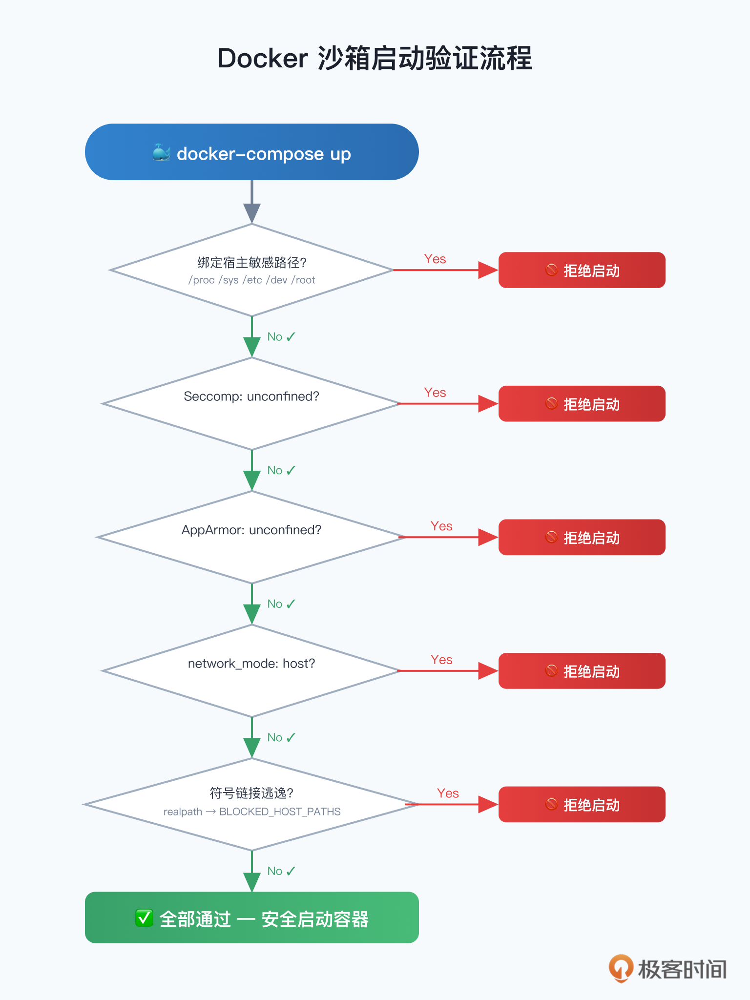
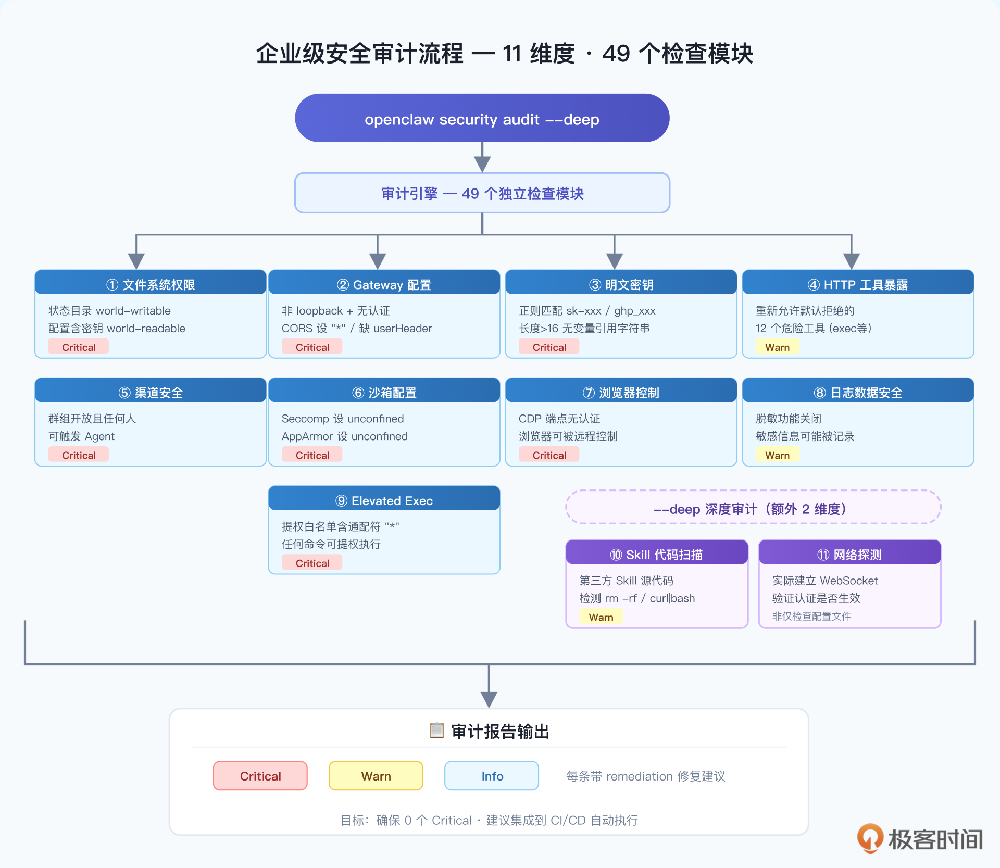

# 36 | Gateway、沙箱与安全审计：如何完成企业级安全部署的最后一公里？

你好，我是 Henry，欢迎来到《OpenClaw 核心原理与实战》。

前面的安全防线覆盖了个人场景，但当你把 OpenClaw 搬到企业环境，攻击面会急剧扩大，每多一个用户多一个攻击入口，每多暴露一个端口多一个网络攻击面，每多引入一个第三方插件多一个供应链风险。今天解决企业场景的三个问题：

1. Gateway 安全配置：锁住网络入口

2. Docker 沙箱部署：隔离执行环境

3. 10+ 维度安全审计：确认全部配置无遗漏

下面我们将三个问题逐一展开。

## 实操一：Gateway 安全配置

Gateway 是 OpenClaw 面向网络的唯一入口。所有外部请求通过 Gateway 进入系统，没有任何请求可以绕过。如果 Gateway 不安全，后面防线将形同虚设。Gateway 模块默认拒绝通过HTTP 调用高危工具， 12 个工具详细信息如下：

```bash
export const DEFAULT_GATEWAY_HTTP_TOOL_DENY = [
 "exec",             // 直接命令执行 — RCE
 "spawn",            // 子进程创建 — RCE
 "shell",            // Shell 命令执行 — RCE
 "fs_write",         // 文件写入
 "fs_delete",        // 文件删除
 "fs_move",          // 文件移动
 "apply_patch",      // 补丁应用可重写任意文件
 "sessions_spawn",   // 远程 spawn = RCE
 "sessions_send",    // 跨 session 注入
 "cron",             // 持久化自动任务
 "gateway",          // 网关重配置
 "nodes",            // 节点命令中继
];
```

这些工具一旦通过 HTTP 暴露，就会出现远程代码执行漏洞，攻击者发一个 HTTP 请求就能执行任意操作，不需要任何社工或注入手段。所以在接入层默认拒绝。一个安全的企业级Gateway 安全配置如下：

```
# 企业部署 Gateway 安全配置
gateway:
 bind: "127.0.0.1"              # 仅绑定 loopback
 auth: "token"                   # 必须启用认证
 token: "${OPENCLAW_TOKEN}"      # 从环境变量读取，绝不明文
 controlUi:
   allowedOrigins:
     - "https://admin.company.com"
   # 不要设置：
   # allowInsecureAuth: true
   # dangerouslyAllowHostHeaderOriginFallback: true
   # dangerouslyDisableDeviceAuth: true
 http:
   tools:
     deny:                        # 保持默认拒绝列表
       - exec
       - spawn
       - shell
       - fs_write
       - fs_delete
       - fs_move
       - apply_patch
       - sessions_spawn
       - sessions_send
       - cron
       - gateway
       - nodes
```

配置中主要涉及以下几个关键部分：

```
bind: "127.0.0.1"：只监听本地，外部通过 Nginx 反向代理转发。审计系统会检测
```

- Gateway 是否绑定了非 loopback 地址（0.0.0.0 或具体 IP）。如果绑了非 loopback 且没启用认证，直接报 Critical，相当于把大门敞开面向全网。

```
auth: "token"：每次请求必须携带有效 token，没有 token 直接拒绝。token 至少 24
```

- 字符，低于这个长度审计会报 Warn。

```
token: "${OPENCLAW_TOKEN}"：绝不明文写在配置文件中。配置可能被提交 Git、被
备份、被其他用户读取。审计系统会用正则扫描配置文件内容，匹配到如 sk-xxx、
ghp_xxx 或长度大于 16 的无变量引用字符串时报 Critical。
allowedOrigins：限制 CORS 来源，绝不能设 ["*"]（否则任何网页都能跨域调用你
的 Gateway）。审计系统对 "*" 直接报 Critical。
```

OpenClaw 支持以下四种认证模式：

- Token：适合内网 API 和简单部署，安全等级中等，token 至少 24 字符。

- Password：适合个人使用，不推荐多用户场景（无法区分用户）。

```
TrustedProxy：适合经过负载均衡器的场景，安全等级高，必须配置 userHeader 指定
```

- 用户身份。

- DeviceAuth：适合对外 UI 场景，设备级认证，安全等级高。

企业级部署，不同情况通常采用不同的认证模式，例如内网 API → Token，对外 UI →

```
DeviceAuth，经过 LB → TrustedProxy（需配 userHeader，否则审计报 Critical）。
```

Gateway 入口层做了防护，但即使合法请求到达了 Agent，Agent 执行命令时仍可能影响宿主系统，接下来通过 Docker 沙箱做执行环境隔离，实操演练 Agent 内如何操作。

## 实操二：Docker 沙箱部署

```
沙箱的核心价值是，即使 Agent 执行了 rm -rf /，也只影响容器内部，不影响宿主。这是
```

所有软件层防御都失败后的最后一道物理隔离。OpenClaw 在启动沙箱时会自动验证安全配置。一个详细完整的 docker-compose.yml 配置如下：

```javascript
# docker-compose.yml — 企业安全部署
version: '3.8'
services:
 openclaw:
   image: openclaw/openclaw:latest
   security_opt:
     - "no-new-privileges:true"   # 禁止提权
   cap_drop:
     - ALL                         # 丢弃所有 Linux 能力
   read_only: true                 # 只读根文件系统
   tmpfs:
     - /tmp:noexec,nosuid,size=100M
   volumes:
     - openclaw-data:/data         # 数据持久化
     # 禁止挂载：/proc, /sys, /dev, /root, /var/run/docker.sock
   pids_limit: 256                 # 防止 fork 炸弹
   mem_limit: 2g                   # 内存限制
   network_mode: bridge            # 不使用 host 网络
   environment:
     - ANTHROPIC_API_KEY=${ANTHROPIC_API_KEY}
     - OPENCLAW_TOKEN=${OPENCLAW_TOKEN}
volumes:
 openclaw-data:
```

配置中几个关键部分参数如下：

```
no-new-privileges：容器内进程不能通过 setuid 提权。具体来说，即使容器里有一个
setuid root 的二进制文件（比如旧版 /usr/bin/passwd），进程也无法通过执行它来获得
```

- root 权限。这堵死了一类经典的容器逃逸路径。

```
cap_drop: ALL：丢弃所有 Linux Capabilities。默认的 Docker 容器有 14 项 capabilities
```

- （如 NET_BIND_SERVICE、CHOWN 等），其中任何一项都可能被利用。全部丢弃后容器只是一个普通用户进程，不能绑低端口、改网络配置、加载内核模块。

```
read_only: true：根文件系统只读，恶意代码无法篡改系统二进制、植入后门或写入
```

- 持久化恶意脚本。结合 tmpfs 挂载 /tmp 提供临时写入空间。

```
tmpfs: noexec：/tmp 可写但不可执行。Agent 下载的脚本写入 /tmp 后无法直接
./script.sh 运行，必须通过解释器调用（bash script.sh），给循环检测和工具策
```

- 略多了一层拦截机会。

```
pids_limit: 256：防 fork 炸弹。正常使用 Agent 进程 + 子进程通常不超过 50 个，256
```

- 留了充足余量但挡住了无限复制进程的攻击。

```
network_mode: bridge：容器有独立网络命名空间，不共享宿主网络栈。容器内的进
```

- 程无法看到宿主的其他端口和服务。

OpenClaw 在启动沙箱时自动检查以下配置，不通过则拒绝启动：



详细的字段含义如下：

- 绑定宿主敏感路径（/proc、/sys、/etc 等）：容器可读写宿主系统文件。

```
Seccomp: unconfined：容器可执行任意系统调用，等于没有沙箱。
AppArmor: unconfined：禁用强制访问控制。
network_mode: host：共享宿主网络栈，网络层无隔离。
符号链接逃逸：如 /workspace/data → /etc/shadow，会被解析真实路径后拒绝。
```

符号链接逃逸需特别注意，因为攻击者可能在容器的 workspace 中创建一个符号链接，指向宿主文件系统的敏感路径。OpenClaw 的验证器会对所有 volume mount 中的路径做

```
realpath 解析，如果解析后的真实路径命中了 BLOCKED_HOST_PATHS 列表，启动直接
```

失败。这个检测在每次容器启动时都会执行，不是只在首次配置时检查，所以运行时创建的恶意符号链接也会在下次重启时被发现。

当我们把 Gateway 和沙箱配置项配好，怎么确认没有遗漏？OpenClaw 内置了安全审计，可以通过一个命令扫清全部的安全隐患。下面我们进行安全审计的实操部分。

## 实操三：11 维度安全审计

OpenClaw 内置了全面的安全审计系统，覆盖 11 个维度。执行审计命令如下：

```
# 基础审计
openclaw security audit
# 深度审计（含网络探测和 Skill 代码扫描）
openclaw security audit --deep
```

审计系统覆盖以下 11 个审计维度，每个维度都有明确的 Critical 触发条件，详细的信息如下图所示：



审计引擎中详细的字段含义如下：

- 文件系统权限：状态目录 world-writable 或配置含密钥，但 world-readable 时报 Critical。

```
Gateway 配置：非 loopback 绑定 + 无认证、allowedOrigins 设为 "*"、TrustedProxy 缺
```

- userHeader 时报 Critical。

- 明文密钥：配置文件包含明文 token/password 时报 Critical。

- HTTP 工具暴露：重新允许了默认拒绝的危险工具时报 Warn。

- 渠道安全：群组开放且任何人可触发 Agent 时报 Critical。

- 沙箱配置：Seccomp 设为 unconfined 时报 Critical。

- 浏览器控制：CDP 端点无认证时报 Critical。

- 日志数据安全：脱敏功能关闭时报 Warn。

```
Elevated Exec：提权白名单含通配符 "*" 时报 Critical。
Skill 代码扫描（--deep 模式）：第三方 Skill 含危险命令时报 Warn。
深度网络探测（--deep 模式）：实际连接 Gateway WebSocket 验证认证是否生效。
```

熟悉了所有的审计维度，我们开始模拟审计流程，进行实战演练，通过引入一个安全问题，查看审计过程的输出。

Step 1：故意引入一个问题

```bash
# 备份配置
cp openclaw.yaml openclaw.yaml.bak
# 把 token 改成明文（模拟错误）
sed -i 's/${OPENCLAW_TOKEN}/my-secret-token-12345/' openclaw.yaml
```

Step 2：执行审计

```
openclaw security audit
```

此时预期已经输出安全问题，执行正确应该输出如下详细内容：

```
 CRITICAL  config.plaintext_secret
  Config file contains plaintext secret value
  Remediation: Use environment variable reference ${VAR_NAME}
Summary: 1 critical, 0 warn, 1 info
```

Step 3：修复并重新审计

```
# 还原配置
mv openclaw.yaml.bak openclaw.yaml
# 重新审计
openclaw security audit
# 预期：
# ✅ No critical or warn findings.
```

至此我们完成了三个实操内容的讲解，我们总结一下企业安全部署 checklist，详细步骤如下：

1. Gateway 绑定 127.0.0.1，外部通过反向代理访问

2. 认证模式已启用（Token / TrustedProxy / DeviceAuth）

3. CORS allowedOrigins 明确列出允许的域名

4. Docker 沙箱启用，配置了 cap_drop ALL + read_only

5. 运行环境中无 LD_PRELOAD、NODE_OPTIONS 等危险变量

6. 配置文件权限 600，状态目录权限 700

```
配置文件中无明文密钥，全部使用 ${ENV_VAR} 引用
```

8. HTTP 危险工具保持默认拒绝列表

9. 第三方 Skill/Plugin 已通过代码扫描审查

```
openclaw security audit --deep 无 Critical 发现
```

## 总结

这节课我们把安全从个人转向了企业级，涉及三个实操配置：

1. Gateway 认证锁住网络入口（token 至少 24 字符 + loopback 绑定 + CORS 白名单）。

2. Docker 沙箱隔离执行环境（cap_drop ALL + read_only + pids_limit + 符号链接逃逸检测）。

3. 49 个审计模块覆盖 11 个维度，确保没有配置遗漏。

在个人场景，Gateway 认证和沙箱都是可选的，审计跑一次即可。但在企业场景，这三样全是必选项，审计要集成到 CI/CD 里定期跑。至此我们完成了演练场（三）的全部内容，你将能够实现从个人基线到企业部署的完整安全配置方案，可以直接用到生产环境。

## 思考题

```
请你使用 Docker 部署一个企业级安全的 OpenClaw 实例：编写 docker-compose.yml（包
含 cap_drop、read_only、pids_limit 等安全配置）和 openclaw.yaml（Gateway 认证 + 环
境变量引用敏感值），运行 openclaw security audit --deep 确保无 Critical 发现。
```

欢迎你在留言区与我交流！如果今天的课程让你有所收获，也欢迎转发给有需要的朋友，邀请他来一起学习，我们下节课再见！
