# 09 | ElementU&CSS：如何设计页面逻辑与功能点？

你好，我是 Barry。

我们都知道网站的美观性非常重要，不同的网站也会有不同的设计风格。比如工具类网站一般比较简洁，娱乐类的网站一般比较丰富多彩，办公类网站比较商务，学习类的网站比较学院风。

我们的视频平台是娱乐性质的网站，应该丰富多彩，比较有活力。而平台众多页面中，首页是用户进入一个平台的入口，也是流量最大的地方。

这节课，我们就从首页入手，一起来应用前面讲过的 CSS + Element-UI ，学习一下如何设计和实现页面的开发。

## 首页该如何设计？

我们先来思考一下，网站首页应该如何设计。

首页最直接的作用就是把平台的主要功能展示给用户。不过首页要展示的东西通常比较多，所以需要设计分区，每个分区负责展示一类事物。

为了方便你理解，我们一起观察一些常见的网站都是怎么做的。首先来看看百度，可以看到百度首页核心的搜索功能放在了 Header 的下面，再往下放的是一些次要的功能——推荐和热搜。

核心功能、推荐和热搜这三块就形成了首页的三个分区。

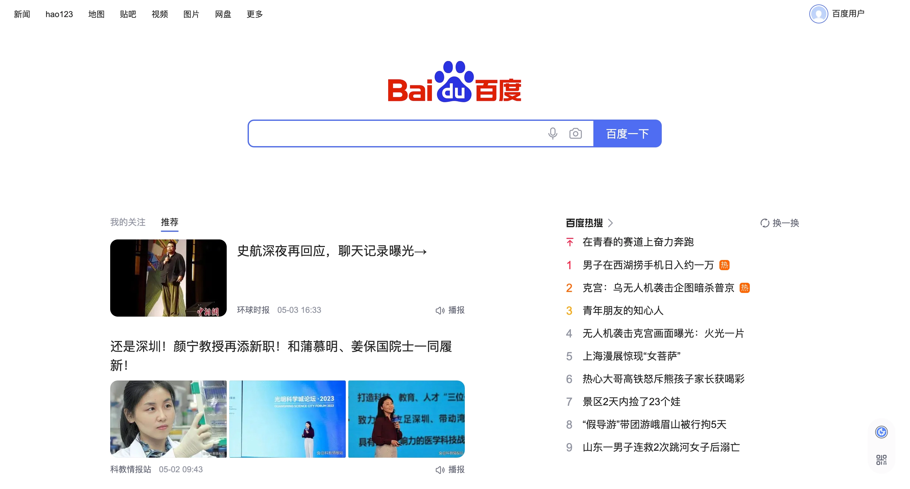

我们再来看一下京东的页面。

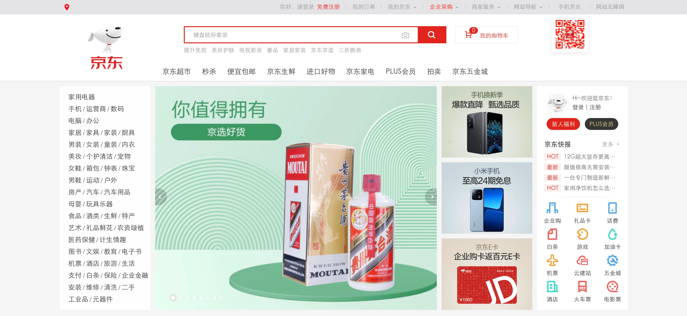

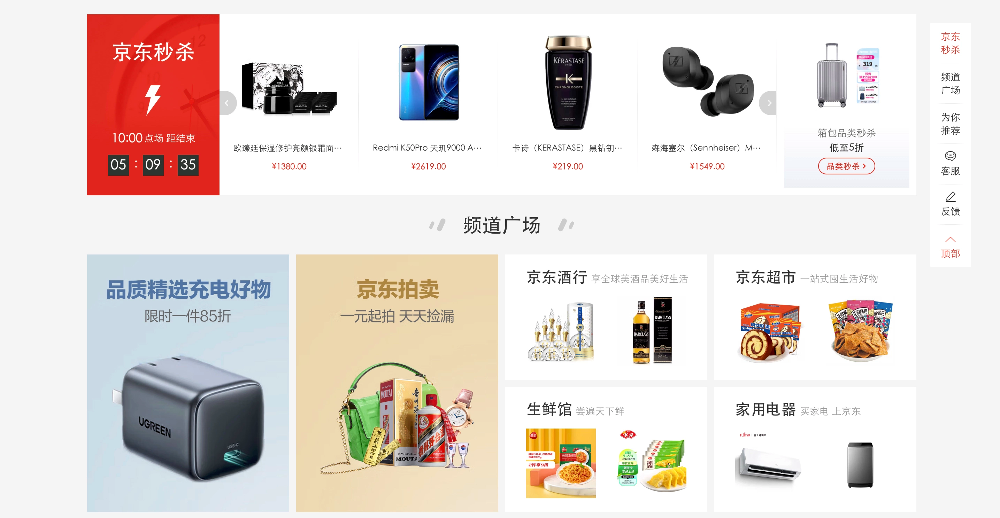

可以看到，Header 下面是核心商品搜索功能和各项菜单栏，中间是广告轮播区。再往下是相对重要的秒杀商品，接下来是各种频道和商品。

例子看完了，我们再来归纳总结一下。首页的定位是要展示一个网站具有的功能，同时也像分发器一样是跳转到其他页面的开始。首页需要按功能做分区，核心位置要突出展示核心功能，按重要程度依次往下。

在实现页面的布局和样式的过程中，CSS 相当于核心的“粉刷匠”，我们通过 CSS 相关属性和功能才能实现页面的多样式开发。

## CSS 回顾

之前我们有简单介绍过装饰文本、装饰链接、装饰区块的相关属性。不过只靠这些还不足以实现一个优雅美观的 HTML 页面，接下来我们就扩展学习一些页面中常用的属性。

### 1. 背景色

在网页中经常需要给元素添加背景色。比如前面我京东的首页，背景就是淡灰色的。背景色的CSS 属性是 background-color，值是颜色值。

```
background-color: #99a9bf;
```

### 2. 透明度

有时候我们为了让元素看起来更美观，还需要用到透明度设置。透明度的属性是 opacity，值是 0-1 之间的小数。

```
opacity: 0.75;
```

### 3. 字行高和字加粗

有关字体的两个设置我们放在一起学习。给元素里的字加行高需要用到 line-height，单位是px。

```
line-height: 20px;
```

有时需要给标题文字加粗，就要用到 font-weight 属性。

```
font-weight: bold;
```

### 4. 鼠标变成小手

鼠标指针放在一个元素边界范围内时所呈现的光标形状有很多形式，它包括问号，小手等形状。

它的 CSS 属性是 cursor，你可以通过后面的表格了解常用的属性值。

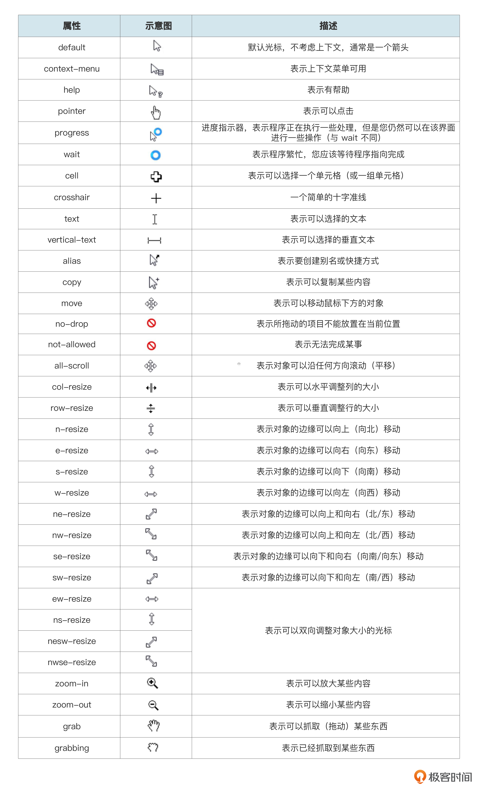

这里我们重点记住 pointer 鼠标悬浮在元素上变成小手，表示当前区域可以点击。

```
cursor: pointer;
```

### 5. 边框

当元素需要边框时，我们要用到 border 属性。

它由 3 个值组成。前两个值是边框宽度和边框样式。后面的示意图我画出了常见样式。

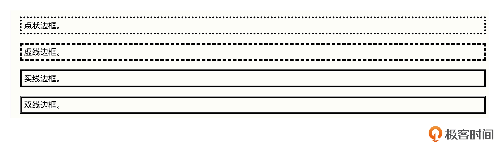

第三个值是边框颜色。我们以上图 1px 大小、黑色的边框为例，对应的 4 种样式属性值是后面这样。

```
border: 1px dotted #000;
border: 1px dashed #000;
border: 1px solid #000;
border: 1px double #000;
```

前面的边框都是直角边框，那如果想要圆角边框怎么办呢？我们可以再加一个 border-radius属性用来给边框加圆角，值是数字，单位仍然是 px。border-radius 属性的值是边框的圆角半径。

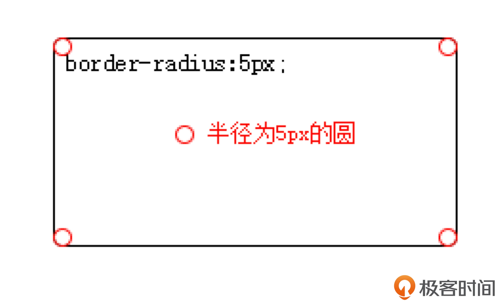

```
border: 1px solid #000;
//边框加上直径是5px的圆角
border-radius：5px;
```

### 6. 布局

当多个元素要放在一行形成布局的时候，我们就需要修改元素的布局，主要是调整 display 属性。

display 在 HTML 中的作用是控制元素的显示方式，HTML 元素分成块级元素和行内元素，后面的表格梳理了常用元素。

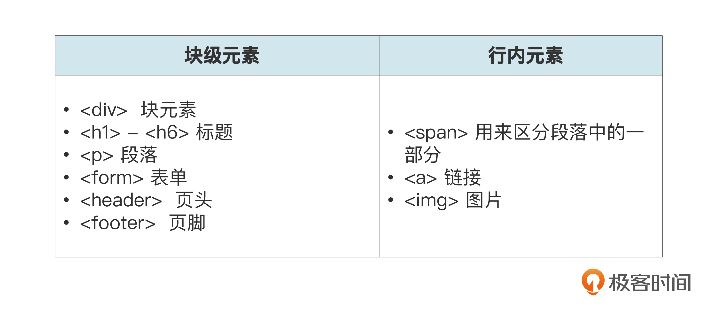

接下来我们就通过几个案例来学习一下，如何使用 display。

当我们需要把元素变成块级元素，就要设置 display 的属性值为 block。

```
display:block;
```

如果我们想把多个块级元素放在一行展示（注意，这个比较常用），就可以将 display 的属性值设置为 inline-block。

```
display:inline-block;
```

想把元素变成行内元素，就可以这样操作。

```
display:inline;
```

还有一个比较常用的设置，就是元素隐藏，代码是后面这样。

```
display:none;
```

我们经常通过这一设置控制一些在某种条件下才出现的元素。比如网页弹出的广告，一开始是隐藏的，当页面滚动到了一个特定位置就会显示出来。

### 7. 定位

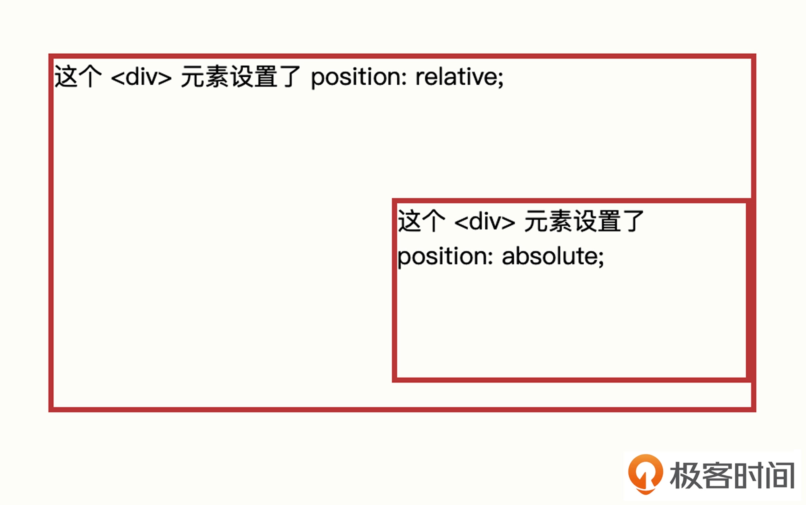

当父元素内的子元素要固定显示在父元素的附近某个距离的位置时，就需要用到定位。

这时父元素要设置为 position: relative，表示相对定位，这样就能进一步定位具备相对定位属性的子元素。

```
position: relative;
width: 400px;
height: 200px;
border: 3px solid #73AD21;
```

接下来是子元素的设置，我们结合后面的例子来看下格式。第一行是 position: absolute，用来把子元素设置为绝对定位。然后通过 top、bottom、left、right 这些参数设置，来确定显示在父元素的什么位置。

比如后面这个例子，子元素定位在距离父元素上面 80px，右边距离 0px 的位置，以此类推。

```
position: absolute;
top: 80px;
right: 0;
width: 200px;
height: 100px;
border: 3px solid #73AD21;
```

### 8. 悬浮

有时我们鼠标经过一个元素，它的样式会发生变化，其实就用到了 :hover 选择器。举个例子，我们希望鼠标悬停时，一个 div 从原先白色的背景色变成黑色，我们就可以按后面的样式代码来设置。

```
div{
 width:200px;
 height:200px;
 background-color:#fff;
}
div:hover{
 background-color:#000;
}
```

## Element-UI 的应用

单单有了 CSS 还不够，有一些常用组件还需要用到 Vue 配套的组件库 Element-UI。

### 初识 Element-UI

Element 是一套基于 Vue 2.0 的桌面端组件库。它由饿了么前端团队开发，并且已经在日常大量的业务中使用和验证过了，具有良好的稳定性和可用性。Element 致力于提供漂亮、可靠的桌面端组件，它实现了完整的设计规范，为用户提供了优质的使用体验。

Element 采用了模块化的设计理念，非常灵活，可以轻松地集成在项目中。Element 和以 vue-cli 为基础的 Webpack 模板深度融合，让 Element 变得更加易于集成和部署，并支持开箱即用的主题定制。这意味着我们可以定制组件库的样式，仅需调整几个变量即可。

接下来，我们就来学习 Element-UI 的一些常见组件，为项目首页设计做好准备。

### 1. 轮播图组件

通常首页的广告展示就需要用到轮播图组件。Element-UI 把这个组件叫做走马灯。我们打开文档，复制后面的代码就可以直接在你的项目中实现对应的效果。

```xml
<template>
 <el-carousel :interval="4000" type="card" height="200px">
   <el-carousel-item v-for="item in 6" :key="item">
     <h3 class="medium">{{ item }}</h3>
   </el-carousel-item>
 </el-carousel>
</template>
<style>
 .el-carousel__item h3 {
   color: #475669;
   font-size: 14px;
   opacity: 0.75;
   line-height: 200px;
   margin: 0;
 }
 .el-carousel__item:nth-child(2n) {
   background-color: #99a9bf;
 }
 .el-carousel__item:nth-child(2n+1) {
   background-color: #d3dce6;
 }
</style>
```

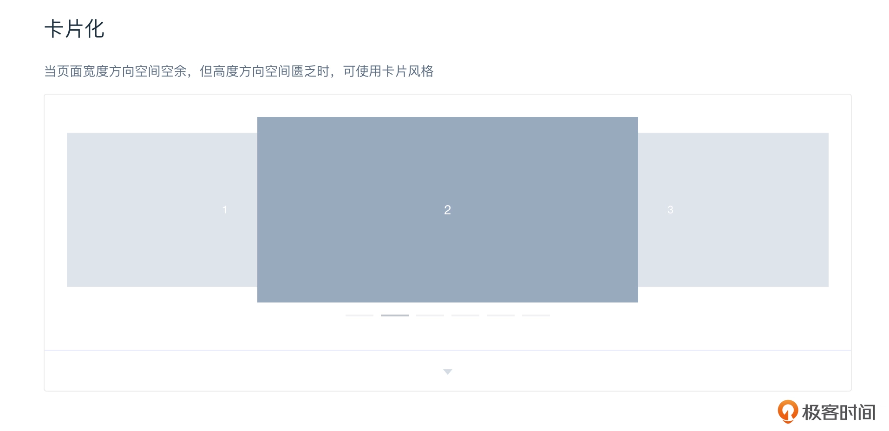

效果就是图里显示的这样，在实际应用中，我们也可以用图片替换文字。

### 2. 按钮

按钮也是网页中非常常见的组件。Element-UI 的按钮组件也非常丰富。

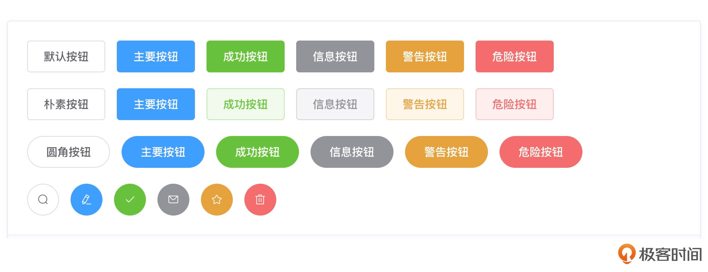

对于按钮的应用，我们重点需要关注 type 值，通过 type 值实现不同样式的按钮，具体代码实现是后面这样。

```sql
<el-row>
 <el-button>默认按钮</el-button>
 <el-button type="primary">主要按钮</el-button>
 <el-button type="success">成功按钮</el-button>
 <el-button type="info">信息按钮</el-button>
 <el-button type="warning">警告按钮</el-button>
 <el-button type="danger">危险按钮</el-button>
</el-row>
<el-row>
 <el-button plain>朴素按钮</el-button>
 <el-button type="primary" plain>主要按钮</el-button>
 <el-button type="success" plain>成功按钮</el-button>
 <el-button type="info" plain>信息按钮</el-button>
 <el-button type="warning" plain>警告按钮</el-button>
 <el-button type="danger" plain>危险按钮</el-button>
</el-row>
<el-row>
 <el-button round>圆角按钮</el-button>
 <el-button type="primary" round>主要按钮</el-button>
 <el-button type="success" round>成功按钮</el-button>
 <el-button type="info" round>信息按钮</el-button>
 <el-button type="warning" round>警告按钮</el-button>
 <el-button type="danger" round>危险按钮</el-button>
</el-row>
<el-row>
 <el-button icon="el-icon-search" circle></el-button>
 <el-button type="primary" icon="el-icon-edit" circle></el-button>
 <el-button type="success" icon="el-icon-check" circle></el-button>
 <el-button type="info" icon="el-icon-message" circle></el-button>
 <el-button type="warning" icon="el-icon-star-off" circle></el-button>
 <el-button type="danger" icon="el-icon-delete" circle></el-button>
</el-row>
```

### 3. 弹窗

如果我们希望给用户提供一些可选择的提示信息，就要用到弹窗。比如要关闭页面时经常会弹出“确定要离开吗？”的弹窗。

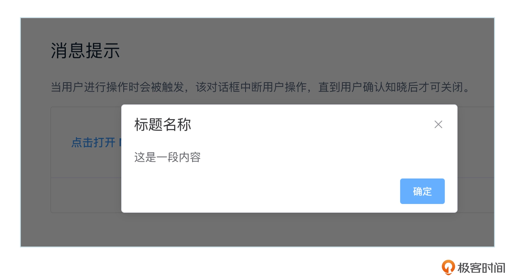

```bash
<template>
 <el-button type="text" @click="open">点击打开 Message Box</el-button>
</template>
<script>
 export default {
   methods: {
     open() {
       this.$alert('这是一段内容', '标题名称', {
         confirmButtonText: '确定',
         callback: action => {
           this.$message({
             type: 'info',
             message: `action: ${ action }`
           });
         }
       });
     }
   }
 }
</script>
```

还有很多其他组件，都是一样的道理，你可以打开 Element-UI官网来查看这些组件，复制官网上的组件案例即可使用。

## 首页的实现

接下来终于到了实战演练的环节——使用 CSS 和 Element-UI 来实现我们视频平台的首页。

先来整体看一下在线视频社区平台的首页，看看怎么拆分任务。

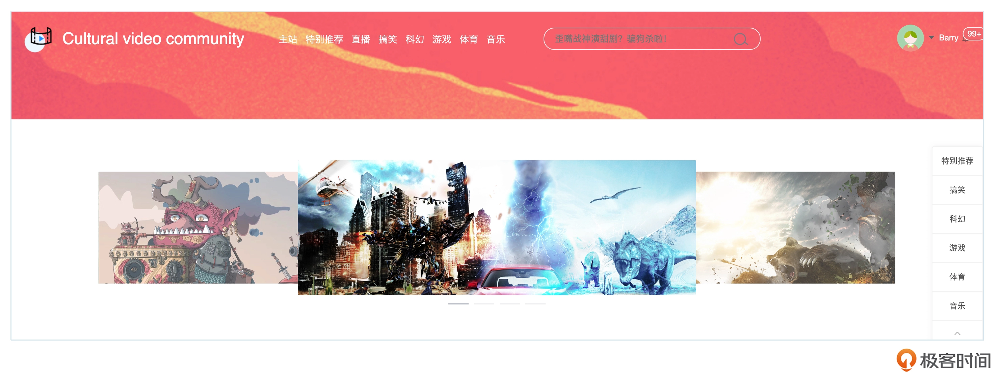

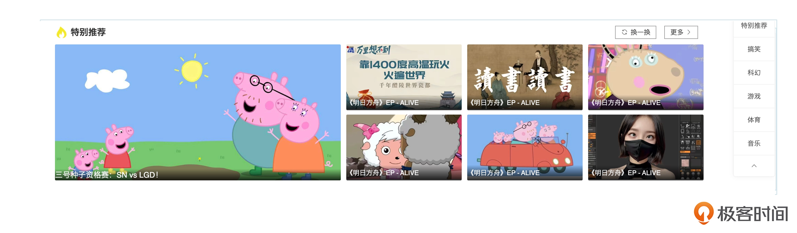

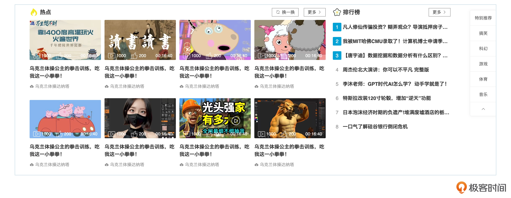

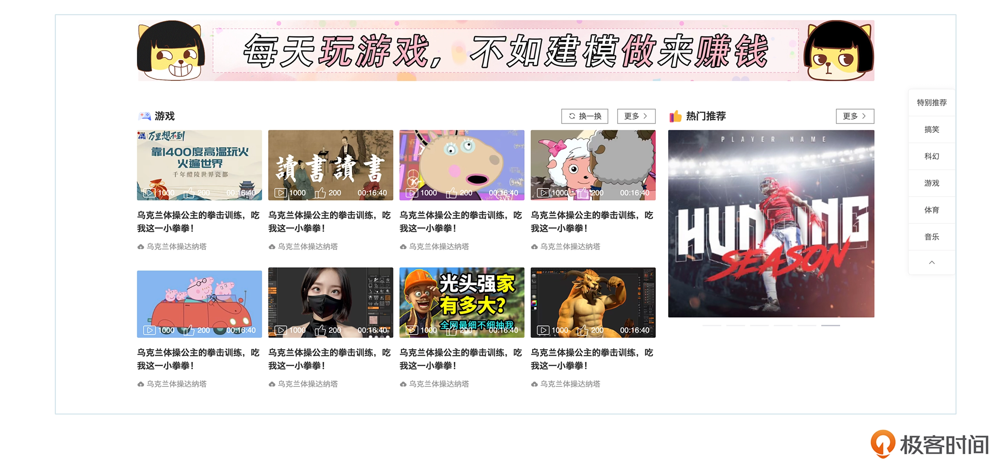

可以看到，在首页里，除了每个页面都有的 Header 和 Footer 外，还有轮播图、特别推荐、热点、排行榜、广告、游戏、热门推荐等模块。

我们从上往下，把它们分成 4 个分区。

- 一层是轮播图，负责展示要推荐给用户的广告。

- 二层是特别推荐，用来展示要给用户推送的视频。

- 三层是热点和排行榜，用来展示实时热点视频和热门新闻。

- 四层是游戏和热门推荐，用来推广一些游戏。

接下来我们按照从上到下的顺序，一层一层来实现它们。

首页的第一层是轮播图，负责滚动展示广告。我们结合代码，一起看一下轮播图是怎么实现的。

```xml
<!-- 轮播图 -->
<div class="banner">
   <el-carousel :interval="4000" type="card" height="200px">
      <el-carousel-item v-for="(item, index) in bannerList" :key="index">
         
      </el-carousel-item>
   </el-carousel>
</div>
```

是不是熟悉的味道？刚刚讲过 Element-UI 的轮播图，在这里就派上了用场。只不过中间替换成了图片。我们事先用数组 bannerList 在 data 里定义好图片的地址，就会呈现前面截图的效果了。

```
bannerList: [
       "./static/banner1.png",
       "./static/banner2.png",
       "./static/banner3.png",
       "./static/banner4.png",
     ],
```

接着再来看第二层——特别推荐。

我们看一下这个模块核心代码，它是左右结构的，左边是一个主要推荐的视频，右边有 6 个小一些的推荐视频，所以左边是一个 div，右边是一个 ul 无序列表，每个列表项作为一个小的推荐视频。

```xml
<div class="video-cover lf" @click="goDetail(main_recommend)">
   
   <p class="video-name">{{ main_recommend.name }}</p>
   <div class="video-icon">
       <i class="icon-play"></i>
   </div>
</div>
<ul class="rt">
   <li v-for="(item, index) in main_recommend.list" :key="index">
        
        <div class="video-name" @click="goDetail(item)">
            <p>{{ item.name }}</p>
             <p>
                <i class="el-icon-upload"></i>
                <span class="video-author">{{ item.author.name }}</span>
                <i class="icon-play rt"></i>
             </p>
             <p>{{ item.play_times }}次播放</p>
         </div>
   </li>
</ul>
```

数据定义是后面这样，整体的数据命名为 main_recommend，左边的大图直接定义在main_recommend 上，右边的 6 个小图用一个数组，定义在 list 里。

```
main_recommend: {
  img: "./static/main.jpeg",
  name: "三号种子资格赛：SN vs LGD！",
  list: [
         {
           img: "./static/5.jpg",
           name: "《明日方舟》EP - ALIVE",
           author: {
             id: "111",
             name: "明日方舟",
           },
           play_times: 1000,
         },
       //....同样的结构一共6个
       ]
}
```

再看 CSS 代码。div 和 ul 都是块级元素，想要让它们在一行内，就要用到刚才我们学到的display:inline-block，把它们变成行内块元素。

为了让视频的名字显示在每个视频图片的最下方，就要用到定位，整个区块设置成相对定位，CSS 类 video-cover 是 position:relative，视频的名字使用绝对定位，类 video-name 是position:absolute。

```
   .video-cover {
     width: 520px;
     height: 248px;
     display: inline-block;
     margin-right: 10px;
     position: relative;
     overflow: hidden;
     border-radius: 2px;
     cursor: pointer;
   }
   .video-name {
     width: 100%;
     font-size: 14px;
     position: absolute;
     bottom: 0;
   }
   ul {
     width: 650px;
     display: inline-block;
   }
   li {
     display: inline-block;
     width: 210px;
     height: 120px;
     margin-right: 10px;
     margin-bottom: 5px;
     border-radius: 2px;
     cursor: pointer;
   }
```

接下来我们看一下第三层——热点和排行榜。它们分别是一个 ul，放在一排。左边是热点的ul，右边是排行榜的 ul。这时，它们的位置关系我们该用什么方法来实现呢？

聪明的你是不是想到了 display:inline-block，其实具体的实现逻辑和前面是相同的，你可以课后自己尝试去做一下布局。

下面是视频相关的信息的代码实现。

```xml
<ul class="hot-video">
   <li v-for="(item, index) in f3_list" :key="index">
      <div>
          <div class="video-cover">
             
              <div class="video-icon">
                 <i class="icon-play"></i>
              </div>
              <div class="video-info">
                 <i class="icon-play2"></i>
                  <span>{{ item.play_times }}</span>
                  <i class="icon-good"></i>
                  <span>{{ item.good }}</span>
                  <span>{{ item.duration | format_duration }}</span>
               </div>
            </div>
            <p class="video-name" @click="goDetail(item)">
                 {{ item.name }}
            </p>
            <p class="video-author" @click="goHome(item.author.id)">
                 <i class="el-icon-upload"></i>
                 {{ item.author.name }}
             </p>
       </div>
   </li>
</ul>
<ul class="ranking-list">
  <li v-for="(item, index) in f3_ranking" :key="index" @click="goDetail(item)">
       <p>
           <span :class="'rank-index ' + (index <= 2 ? 'active' : '')">{{
                 index + 1
            }}</span>
           <span>{{ item.title }}</span>
        </p>
  </li>
</ul>
```

接下来我们需要模拟一组数据，实现视频列表页面内容的展示，代码是后面这样。

```
f3_list：[
   {
       img: "./static/5.jpg",
       name: "乌克兰体操公主的拳击训练，吃我这一小拳拳！",
       author: { id: 111, name: "Barry" },
       play_times: 1000,
       good: 200,
       duration: 1000
   }
   //......一样的结构*8个
],
f3_ranking：[
  {title:"凡人修仙传骗投资？糊弄观众？导演抵押房子卑微解释！难道一定要毁了它吗？"}，
  //......一样的结构*8个
]
```

我们关注一下这一层 CSS 样式的关键点，和上一层类似，因为是左右列表布局的展示方式，所以这里我们依然要用到 display:inline-block。

```
display:inline-block
```

通过上面的代码，就能让它们在同一行内展示。每个视频整个区块是相对定位position:relative，视频的名字设置成绝对定位 position:absolute。

这里我们希望用户鼠标悬停的时候，鼠标变成小手，并出现播放的图标。

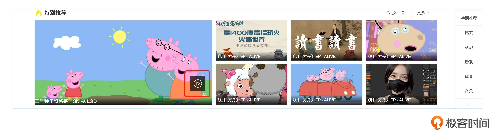

那么播放的图标就需要先设置为 display:none，在鼠标悬浮在封面上时改成 display:block，代码如下。

```
.video-cover {
  position: relative;
  color: #fff;
  //鼠标变成小手
  cursor: pointer;
}
.video-icon {
    position: absolute;
    right: 20px;
    bottom: 30px;
    background: rgba(0, 0, 0, 0.7);
    padding: 10px;
    //先隐藏播放的图标
    display: none;
    border-radius: 2px;
}
//悬浮在视频封面时，显示播放的图标
.video-cover:hover {
   .video-icon {
      display: block;
    }
}
```

第四层和第三层结构比较类似，你可以课后尝试参照第三层的思路，自己尝试实现第四层。

## 总结

不知不觉又到了课程的尾声，我们来总结一下这节课学习的内容。

首页是一个平台的“门面”，需要彰显这个平台的特色。我们结合百度和京东的首页案例，确定了首页设计的核心原则——首页需要按功能分区，核心位置的要突出展示核心功能，按重要程度依次往下排布。

想要搭建首页，就离不开 CSS，我们在原来学习的基础上，又学习了一些常见的新属性。课后你可以练习一下，把 CSS 属性结合 HTML 起来，重点练习元素布局和定位的实现。首页设计还会用到 Element-UI 里的几个常见组件，如果你对这部分还不熟练，课后建议你去看看官方文档。

这节课我们把 CSS 和 Element-UI 应用在了项目中，一起实现了视频平台的首页。掌握了这节课的内容，你就具备了开发网页的能力，课后你也可以仿照着其他网站，尝试自己用Vue+element-UI+CSS 去实现一个网页。

## 课后思考题

尝试用 Element-UI 来实现一个 tab 可以切换的标签页，效果是点击不同的标签能够显示不同的内容。

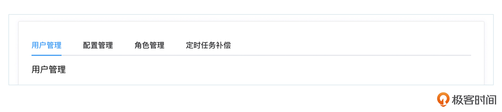

期待你在留言区和我交流互动，也推荐你把这节课分享给身边更多朋友，和他一起学习进步。
