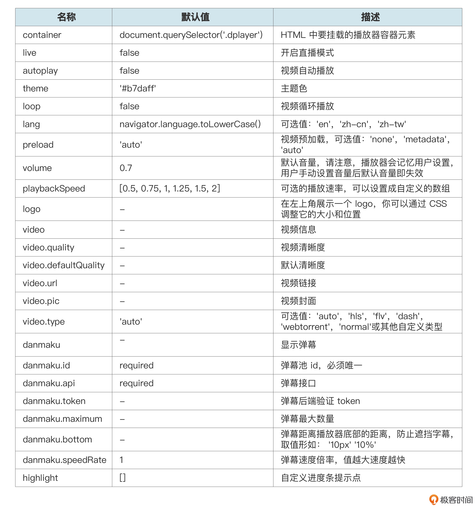
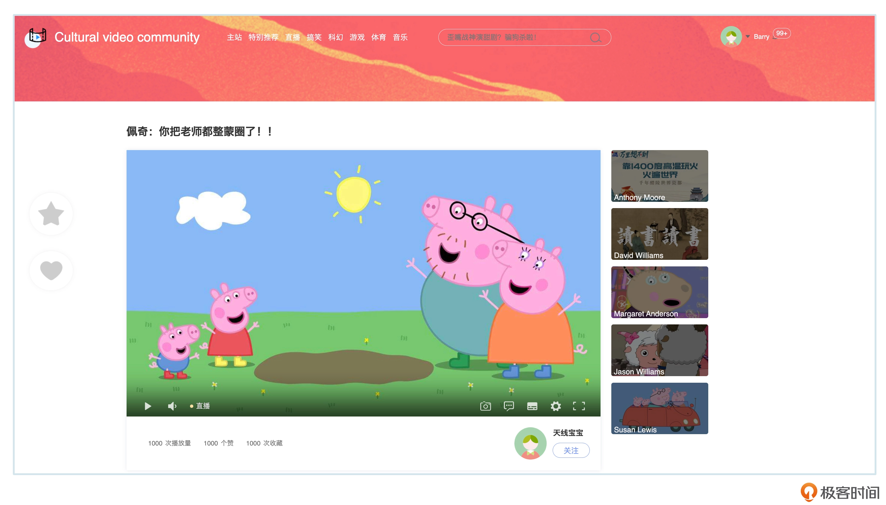
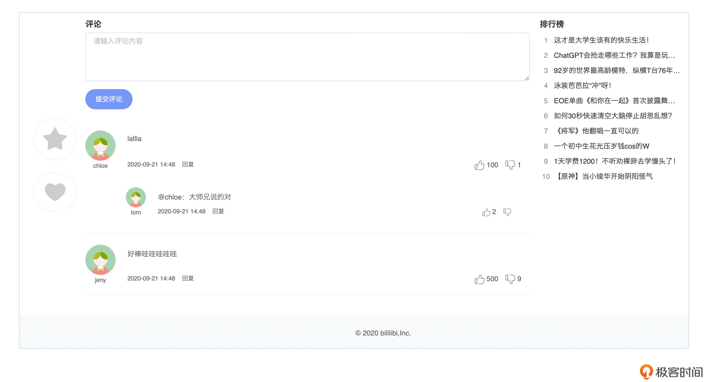

# 11 | DPlayer播放器综合应用：怎样实现自己的第一个视频播放器？

你好，我是 Barry。

这节课，我们一起来学习如何在视频平台中实现自己的第一个视频播放器。

在视频网站中，播放器是不可或缺的存在，我们在日常开发中，用的大多是网页开发，很少用到播放器。相信通过这节课的学习，你对播放器的理解和使用会更上一个台阶。

今天，我将带你从“Hello World”起，探索如何使用前端技术在网页上播放视频。在开始实战之前，让我们先了解一下网页上播放视频的由来。

## 视频播放器的前世今生

说到播放器，就不得不提到 HTML5 的一些新的特性了。我们都知道 HTML5 在老版本的基础上加入了很多新特性，比如后面这些特性。

- 用于绘画的 canvas 元素。

- 用于媒介回放的 video 和 audio 元素。

- 对本地离线存储更好的支持。

- 新的特殊内容元素，比如 article、footer、header、nav、section。

- 新的表单控件，比如 calendar、date、time、email、url、search。

可以看到，其中一个重要的特性就是支持 video 标签在网页上播放视频。

下面这行代码就可以实现一个简单的 HTML5 的视频播放器 demo。

```xml
<video src="movie.ogg" controls="controls"></video>
```

标签上还可以设置其他的属性，常见的属性如下。

- autoplay：其值为 autoplay，如果出现该属性，则视频在就绪后马上播放。

- controls：其值为 controls，如果出现该属性，则向用户显示控件，比如播放按钮。

- height：其值为 pixels，表示视频播放器的高度。

- loop：其值为 loop，如果出现该属性，则当媒介文件完成播放后再次开始播放。

- muted：其值为 muted，它规定视频的音频输出应该被静音。

- poster：其值为 URL，它规定视频下载时显示的图像，或者用户点击播放按钮前显示的图像。

- preload：其值为 preload，如果出现该属性，则视频在页面加载时进行加载，并预备播放。如果使用 “autoplay”，则忽略该属性。

- src：其值为 url，要播放的视频的 URL。

- width：其值为 pixels，表示视频播放器的宽度。

这样一个基础的视频播放器就完成啦！但可能有的同学又问了，这个视频播放器的功能有点丑，功能还有点少？

是的，HTML 版的播放器只具备最基本的功能，且各种浏览器的兼容性也不是很好。所以企业真正用它来做商业化的并不多。企业中主流的视频播放器包括 VideoJS 和 DPlayer。DPlayer支持弹幕，文档看起来更方便。

所以，接下来我们就重点聊聊 DPlayer 视频播放器，包括百度、腾讯、小红书等在内的很多中国企业都在使用。

## 为什么选择 DPlayer 来做项目中的视频播放器？

DPlayer 是一个 HTML5 视频播放器，并且支持弹幕、清晰度切换、实时视频（HTTP LiveStreaming，M3U8 格式）以及 FLV 格式。

此外，它还有以下优点。

- 良好的跨浏览器样式，更美观。

- 支持流媒体格式。

- 没有浏览器兼容问题。

简单来说呢，原生的 video 标签有很多功能需要我们手动去扩展。而这些事情 DPlayer 已经帮我们做好了。我们只需要引用一下别人造好的轮子，就可以开心地跑代码啦。

现在，我们已经全面认识了 DPlayer，下面我们就一起来实操应用一下。

## 怎么样使用 DPlayer？

我们先来看一下一些 DPlayer 常用的属性配置。



DPlayer 可以在 HTML 中使用，也可以在框架中使用，二者大同小异。我们先来学习它在HTML 中的使用。

把大象装冰箱总共分三步，把 DPlayer 装到网页上也要三步走。

第一步，引入 Dplayer。

你可以在 GitHub 上的 DPlayer 项目里下载 js 文件。

打开这个链接，找到 DPlayer.min.js ，右键链接另存为把文件下载下来。

```xml
<script src="dist/DPlayer.min.js(你的本地路径)"></script>
```

第二步，在 HTML 中定义挂载的元素，这里需要定义一个 ID，方便后面通过 ID 进行挂载。

```xml
<div id="player1"></div>
```

第三步，在 js 中把播放器属性设置好，并挂载到上一步定义好的元素上。

我们这里用 container 属性来挂载元素，把 autoplay 设置为不自动播放，然后用 theme 属性给播放器加上主题颜色。loop 为 true，代表循环播放；lang 为 zh，代表语言为中文；preload值为 auto，代表自动预加载。

video 里是视频的信息，url 是视频的链接，pic 是封面图片的链接。

```xml
<script>
var dp = new DPlayer({
   container: document.getElementById('player1'),                       // 可选，
   autoplay: false,                                                   // 可选，自动
   theme: '#FADFA3',                                                  // 可选，主题
   loop: true,                                                        // 可选，循环
   lang: 'zh',                                                        // 可选，语言
   preload: 'auto',                                                   // 可选，预加
   video: {                                                           // 必需，视频
       url: '若能绽放光芒.mp4',                                         // 必填，视频
       pic: '若能绽放光芒.png'                                          // 可选，视频
   }
});
</script>
```

通过上面的实践应用，就可以实现在 HTML 中使用 DPlayer 播放器，那接下来我们继续来看一下在 Node 中该如何使用。

其实要在 Node 框架中使用 DPlayer 的方法也是相同的。

第一步，安装 Dplayer 依赖。

```
$ npm install dplayer --save
```

第二步，在 HTML 中定义挂载的元素。

```xml
<div id="player1" class="dplayer"></div>
```

第三步，在 js 中把播放器属性设置好，并挂载到上一步定义好的元素上。

```python
import DPlayer from 'dplayer';
const dp = new DPlayer(options);
```

这样我们的视频播放器就基本完成了。

如果我们要处理一些业务逻辑，需要在对应的代码执行模块去操作播放器，这时候我们还需要用到一些 API。下面我给你介绍几种最常用的 API。

```
dp.play() : 播放视频。
dp.pause(): 暂停视频。
dp.seek(time: number) ：跳转到特定时间。例如：
dp.seek(100);
dp.toggle(): 切换播放和暂停。
dp.notice(text: string, time: number): 显示通知，它的时间的单位为毫秒，默
```

- 认时间为 2000 毫秒，默认透明度为 0.8。

```
dp.switchQuality(index: number): 切换清晰度。
dp.speed(rate: number): 设置视频速度。
```

- 设置视频音量

```javascript
dp.volume(0.1, true, false);
dp.video.currentTime: 返回视频当前播放时间。
dp.video.duration: 返回视频总时间。
dp.video.paused: 返回视频是否暂停。
dp.danmaku：弹幕功能。
dp.danmaku.send(danmaku, callback: function): 提交一个新弹幕。
dp.danmaku.send(
   {
       text: 'dplayer is amazing',
       color: '#b7daff',
       type: 'right', // should be `top` `bottom` or `right`
   },
   function () {
       console.log('success');
   }
);
dp.danmaku.opacity(percentage: number)：设置弹幕透明度，透明度值在 0 到 1
```

- 之间。

```
dp.danmaku.opacity(0.5);
dp.danmaku.clear(): 清除所有弹幕。
dp.danmaku.hide(): 隐藏弹幕。
dp.danmaku.show() ：显示弹幕。
```

- 如果想进入全屏，我们就通过后面的方式来实现。

```
dp.fullScreen.request('web');
```

- 退出全屏则是通过后面的方式。

```
dp.fullScreen.cancel('web');
```

其他属性和 API 你可以参考官方文档。

现在，相信你已经对 DPlayer 有所了解啦，是不是感觉 so easy!

可以说，我们轻轻松松就已经成功了一半了。俗话说百说不如一练。下面我们来尝试结合业务，实现一个视频详情页。你可以跟着我一起实现自己的视频详情页面。

## 视频详情页面的实现

我们先来看一下成品的效果图。





视频详情页是由首页的视频列表页点击进入的，链接上会带上当前视频的 ID。

页面中的功能如下。

1. 播放器，用来观看视频。

2. 评论、关注、点赞、收藏。

3. 推荐视频、排行榜。

我们先来构思一下页面的布局。

我们把整个页面分为上下两部分，每个部分又以左右结构来呈现。上面从左至右分别是视频播放器、推荐视频，下面依次是评论和排行榜。

接下来我们一步步实现这个构想。我们的页面使用的是 Vue + ElementUI + DPlayer 技术。

首先，我们用 Element 的栅格来实现布局。

```xml
<div class="top">
 <el-row :gutter="20">
   <el-col :span="20"><div class="grid-content bg-purple"><div>这里是播放器</div><
   <el-col :span="4"><div class="grid-content bg-purple"><div>这里是推荐视频</div>
 </el-row>
</div>
<div class="bottom">
 <el-row :gutter="20">
   <el-col :span="20"><div class="grid-content bg-purple"><div>这里是评论</div></e
   <el-col :span="4"><div class="grid-content bg-purple"><div>这里是排行榜</div></
 </el-row>
</div>
```

不管从首页视频列表，还是从二级页面视频列表跳转到视频详情页，在请求的链接中都会带上视频的 ID。当我们点击列表中的视频进入页面时，会首先向后端发送请求，通过 ID 获取到视频的信息。

接下来，我们在 Vue 的 data 里定义一些一会儿要用的数据。

```
data() {
   return {
     info: {},             // 视频信息
     recommend_list: [],   // 推荐列表
     ranking_list: [],     // 排行榜
   }
}
```

在框架中，通常使用 Axios 来发送 HTTP 请求。举个例子，我们现在要请求的是 “/video/info”这个地址的数据，是 get 请求。那么代码如下。

```
this.$axios.get("/video/info").then((data) => {
     console.log(data);
     this.info= data.data;
});
```

返回的数据结构应该是下面的样子。

```
  {
       title: "全程高能！此视频无人能存活到最后！",  //视频标题
       url:"http://www.baidu.com/123.mp4",     //视频url
       play_times: 1000,                       //播放次数
       like_times: 10000,                      //点赞数
       collect_times:1000,                     //收藏数
       auther: {                               //视频作者的信息
         userId："10001"，                      //作者id
         avatar:"http://www.baidu.com/1.jpg",  //作者头像
         nickName: "天线宝宝"                   //作者昵称
         hasFollow: false                      //当前用户是否关注了作者
       },
  }
```

接下来，我们把视频 URL 配置到视频播放器上，这样视频就可以播放了。

```javascript
const dp = new DPlayer({
 ....
 video: this.info
});
```

那刚刚我们学过的 API 要什么时候使用呢？我给你举几个例子。

如果用户离开前，我们要记录用户看了多长时间的视频，发送给后端来统计用户行为，就要用到刚刚我讲过的播放器 API。

```
dp.video.currentTime()
```

同理，假设用户点击了页面上的广告需要暂停视频，看完广告后又再播放视频，这时就要用到播放和暂停 API。

```
dp.play()
dp.pause()
```

然后，我们在页面上把视频的信息展示给用户，包括视频标题、作者、点赞数、评论等等。

```xml
<div class="left-container">
  <div id="dplayer"></div>
     <div class="video-bottom-area">
         <span class="play-times">
           <span>{{ info.play_times }}</span>次播放量
         </span>
         <span class="play-times">
           <span>{{ info.play_times }}</span>个赞
         </span>
         <span class="play-times">
           <span>{{ info.play_times }}</span>次收藏
         </span>
         <div class="auther-info rt clear">
           <div class="lf">
             
           </div>
           <p class="author-name">
             {{ info.auther.nickName }}
           </p>
           <button
             v-show="!info.auther.hasFollow"
             class="button-primary rt"
           >
             关注
           </button>
           <button
             v-show="info.auther.hasFollow"
             class="button-primary rt"
           >
             取消关注
           </button>
       </div>
   </div>
</div>
```

接下来，我们分别请求排行榜和推荐列表的接口，展示在页面上。

```
this.$axios.get("/video/recommend").then((data) => {
     console.log(data);
     this.recommend_list = data.data.rows;
   });
this.$axios.get("/video/ranking").then((data) => {
     console.log(data);
     this.ranking_list = data.data.rows;
   });
```

列表这里我们用到的数据结构是数组，每个元素是列表上的一项。返回的数据结构如下。

```
1.recommend_list:{
 status: 200,
 message: 'success',
 data: {
   total: 5,
   rows: [{
     id: '10001',
     image: './static/similar1.jpg',
     name: '炉石传说'
   },{
     id: '10002',
     image: './static/similar2.jpg',
     name: '小猪佩奇'
   },{
     id: '10003',
     image: './static/similar3.jpg',
     name: '小恐龙'
   },{
     id: '10004',
     image: './static/similar4.jpg',
     name: '小兔兔'
   },{
     id: '10005',
     image: './static/similar5.jpg',
     name: '小喵咪'
   }]
 }
}
2.ranking_list:{
 status: 200,
 message: 'success',
 data: {
   total: 10,
   'rows': [{
       img: "./static/1.jpg",
       title: "这才是大学生该有的快乐生活！",
     },{
       img: "./static/2.jpg",
       title: "ChatGPT会抢走哪些工作？我算是玩明白了…",
     },{
       img: "./static/3.jpg",
       title: "92岁的世界最高龄模特，纵横T台76年 …",
     },{
       img: "./static/4.jpg",
       title: "泳装芭芭拉“冲”呀！",
     },{
       img: "./static/5.jpg",
       title: "EOE单曲《和你在一起》首次披露舞台！",
     },{
       img: "./static/1.jpg",
       title: "如何30秒快速清空大脑停止胡思乱想？",
     },{
       img: "./static/2.jpg",
       title: "《将军》他翻唱一直可以的",
     },{
       img: "./static/3.jpg",
       title: "一个初中生花光压岁钱cos的W",
     },{
       img: "./static/4.jpg",
       title: "1天学费1200！不听劝裸辞去学馒头了！",
     },{
       img: "./static/5.jpg",
       title: "【原神】当小绫华开始阴阳怪气",
     }]
 }
}
```

右侧的排行榜和右下方的推荐，都是其他视频详情页的链接入口。我们只需要分别向后端服务器请求到要展示的标题和图片，在用户点击的时候进行跳转并更换视频 ID 就可以了。

后面是推荐列表的参考代码。

```xml
       <ul class="recommend-list">
         <li
           v-for="(item, index) in recommend_list"
           :key="index"
           :style="{ backgroundImage: `url(${item.image})` }"
         >
           <div class="mask">
             <p>{{ item.name }}</p>
           </div>
         </li>
       </ul>
```

接下来是排行榜的参考代码。

```xml
   <div class="ranking-list">
       <p class="sub-title">排行榜</p>
       <ul>
         <li v-for="(item, index) in ranking_list" :key="index">
           <p>
             <span>{{index + 1}}</span>
             <span>{{ item.title }}</span>
           </p>
         </li>
       </ul>
    </div>
```

## 小结

这样，我们就实现了一个自己的视频播放页，大功告成！下面我们来回顾一下这节课的重点内容。

这节课，我们先是了解了原生 HTML 的 Video 播放器，学习了它的常见属性。但 HTML 版的播放器的兼容性并不是很好，并不适合企业进行商业化的应用，我们也借此引出了企业中常用的两种播放器：VideoJS 和 DPlayer。

接着，我们学习了 DPlayer 的常用属性和 API，以及如何在 HTML 框架中使用它，借此，我们可以轻松应对不同场景下的播放器需求。

在工作中，企业的选型可能会有所不同，我们只需要掌握使用一款播放器的思路，其他组件也是一通百通的。这个思路可以总结为下面三步。

1. 引用（HTML 中需要引用文件，框架中需要 npm install 安装依赖包）。

2. 在 HTML 中定义挂载的元素。

3. 在 js 中把播放器属性设置好，并挂载到上一步定义好的元素上。

在学习了播放器应用的思路和方法之后，我们还一起通过视频详情页这个模块进行了实操。在这个环节，我们除了要实现基本的视频功能外，还要考虑业务逻辑设计、页面的布局、页面的功能模块等核心要素。相信经过这部分内容的学习，你对 DPlayer 的掌握会更加全面，在技术、业务逻辑和项目实现这些方面也会有所进步。

最后，我们还一起熟悉了实际项目中后端数据的请求方式，并结合实际的前端数据需求，对后端数据格式进行了设计、封装，这也是我们这节课非常重要的部分，也是为学习后端部分做的一个小的铺垫。

这节课的内容到这里就结束了。下节课，我们会更进一步，去看看视频的互动功能，敬请期待。

## 思考题

如果我们想要在用户点击视频暂停的时候，弹出一个弹窗，你有什么好的实现方法？

欢迎你在留言区和我交流互动，如果觉得这节课对你有启发的话，也推荐你把它分享给更多朋友。
