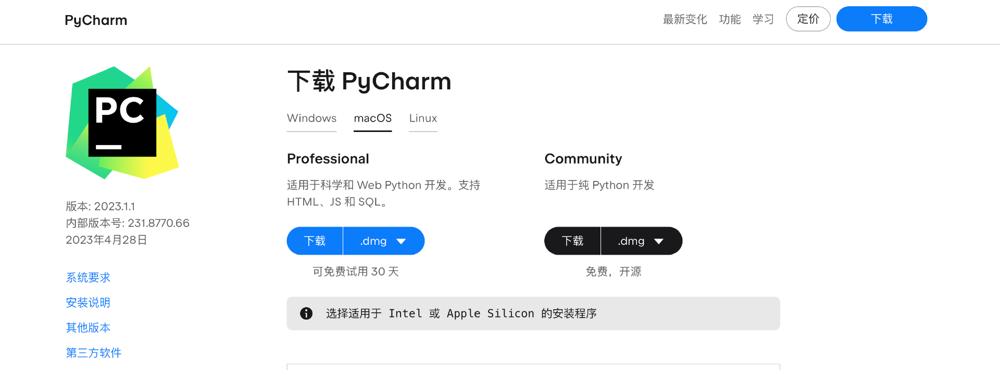
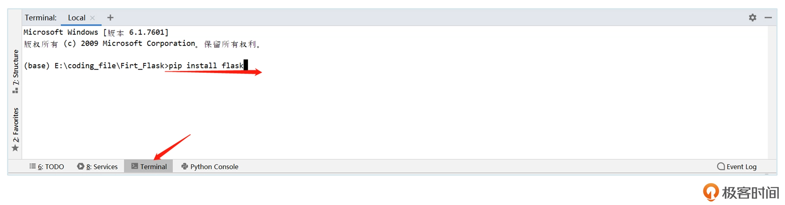
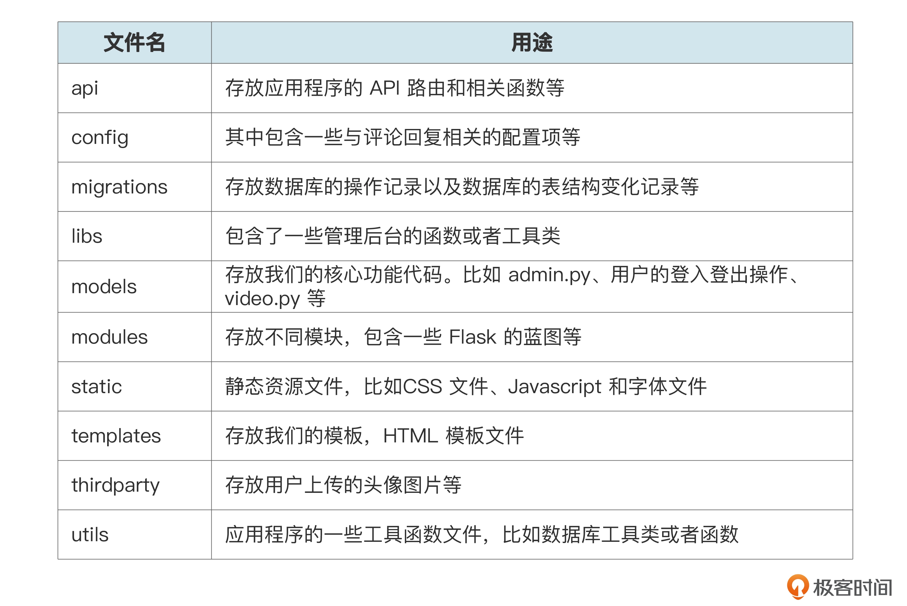
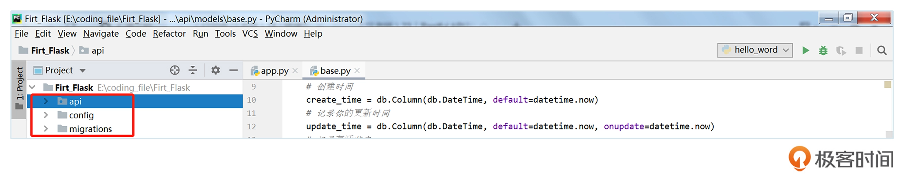
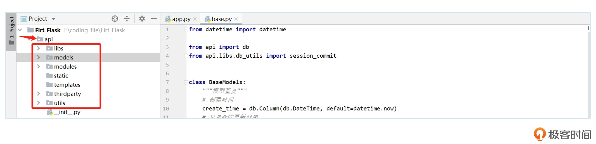
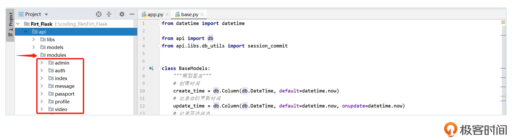
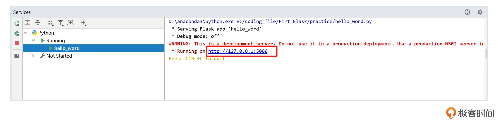
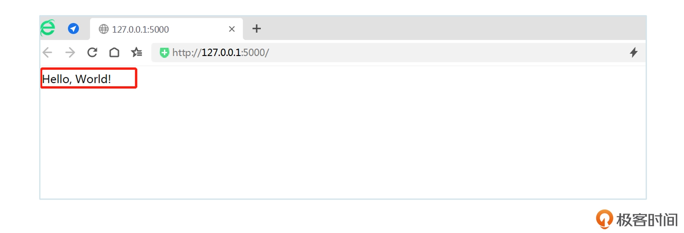

# 18 | 初识Flask：搭建第一个Flask项目

你好，我是 Barry。

从这节课开始，我们就进入到后端实战篇。这个章节重点培养的是我们从 0 到 1 做项目后端开发的能力。我们将经历从代码设计到具体功能的模块接口开发，深度体验独立平台搭建和后端开发的完整链路，学会灵活应用框架技术来应对多种类型的项目需求。

这节课，我们要拿下的就是后端部分的第一个核心知识点—— Flask 项目搭建。之所以选择基于 Python 的 Flask 框架，是因为它更合适用来完成视频直播平台的后端开发。

## 为什么选用 Flask

为了让你知道选型的来龙去脉。我们先聊聊为什么要选用 Flask 框架，而不是选择使用Django 这个应用也很广泛的框架呢？

这就要说到 Flask 和 Django 的区别了。首先，二者都是企业当中用的很多的 Web 的后端框架。接下来，我们一起来看一下二者的对比。

Flask 主要有两大优点。第一个优点，它是轻量级 Python 开发框架。意思就是 Flask 核心就是几个文件，不用大量的配置文件，很快就能搭建起来一个小型的 Web 应用并快速启动运行，很适合搞微服务。

第二个优点就是灵活，其实这不光是 Flask 的优点，也是 Python 的优点，因为 Flask 是基于Python 的 Web 应用框架。灵活的地方就在于这个框架用的人多，整体生态比较好。Flask 有很多别人做好的扩展包，并且整体处在一个持续的维护和更新状态，我们可以灵活使用这些包和库做定制和扩展。它的 API 部分也不需要大量的配置文件和模板，几行代码就可以完成一个实现简单功能的应用。

我们可以结合后面这个例子来看看。通过这个例子，我们不难发现 API 开发在 Flask 中不复杂，几行代码就可以实现一个简单的功能。

```python
from flask import Flask, jsonify
app = Flask(__name__)
def get_weather(city):
 # 根据城市名称查询天气
 # 返回查询结果
 return {'city': city, 'weather': 'sunny'}
@app.route('/weather/<city>')
def weather(city):
 # 调用get_weather函数获取天气情况
 result = get_weather(city)
 # 将查询结果以json格式返回
 return jsonify(result)
if __name__ == '__main__':
 app.run()
```

上面这段代码里，我们定义了一个 get_weather 函数，用来根据城市名称查询天气情况。我们使用了 @app.route 这个装饰器，把 get_weather 函数绑定到 “/weather/” 的 URL 路径上。这样当用户去访问这个 URL 的时候，Flask 就会自动调用 get_weather 函数，并将查询结果以JSON 格式返还给用户。

说完了 Flask，我们再来聊一聊同样是基于 Python 的 Web 框架——Django。那么 Django 有什么优点呢？

首先，Django 的库非常完整，就像一个工具箱一样，你想要的它都有。

其次，Django 有着比较严密的架构设计，安全性也比较高，可以保护网站抵御像 SQL 注入这样的恶意操作。

最后，Django 可以直接用 Python 语言对数据库进行操作，这一点也比较方便。

Django 的库完整、架构设计严密这些优点，注定了它非常适用于大型的应用，比如电子商务网站。不过，Django 的优点其实也算是它的缺点，因为 Django 架构严密，又非常完整的库，这就造成了一个问题——Django 的学习成本比较高。

无论应用大小怎样，Django 所需要的大量配置文件都少不了，而且占用的系统资源比较多，比如像机器性能、网路带宽等等这些资源。应用不需要的功能模块，Django 也包括在内了，所以它不如 Flask 轻便。

我们总结下 Django 和 Flask 的区别。Django 就像是一个工具箱，你要的它都有；而 Flask 是一把锤子，非常轻便，只要你善于使用它，就可以做出更多的、自由度更大的东西。

说到这里，我们已经明白了选用 Falsk 的原因。考虑到我们平台的特点，还有后端学习路径循序渐进的原则，Flask 更合适一些。

## Flask 知识点梳理

接下来我们就一起来看看，学习 Flask 都应该掌握哪些知识点。使用 Flask 去做项目的话，有几样技术知识需要去掌握：Python 语言、数据库和前端应用。

想要掌握 Flask，就需要我们对 Python 语言的应用非常熟悉。通过前面先导课的学习，对于Python 语言你或多或少已经具备了一些基础。

其中需要重点掌握的就是 Python 语言应用。比如变量的应用、Python 当中的一些控制结构语言（比如 if 的 while、for 循环等等简单的控制语句，还有像函数要怎么构造、类怎么构造，怎样使用类当中的操作等等，这些都是高频用到的知识。

第二类技术知识就是数据库。从字面意思理解，数据库就是存储数据的一个仓库，能对项目中的数据进行管理和操作。因为我们的在线视频项目有很多数据，比如用户上传的视频、用户的个人信息预计日志等等，这些都需要存放的容器。而这个容器就是数据库，因此我们整个项目都不留离不开它。这里我也明确一下，数据库我们使用 MySQL 来实现。

第三就是前端应用。前面我们刚刚完成前端语言和框架的学习，相信你已经能够使用 Vue 完成整个前端部分的实现了。等我们学完后端部分，就可以实现整个平台前后端的联动，完成平台整体功能的开发。

接下来就是实践环节，我们一起来完成整个 Flask 框架的搭建。

## 框架搭建

在开始之前，你需要先准备好项目所使用到的 IDE。安装成功之后，我们再来实现 Flask 框架的搭建。

### 第一步：安装项目所使用的 IDE

我们在后端开发中使用 Pycharm 这个工具，你可以直接到 Pycharm 的官网。它的安装比较简单，你根据教程一步步操作就能搞定。这里我们需要选择 community，也就是社区版本。



## 第二步：配置 Pycharm 的编译环境

下一步我们需要创建一个新的项目。在 PyCharm 中，一个项目对应一个文件夹。我们需要在PyCharm 的欢迎界面，点击 “Create New Project” 按钮，然后输入项目的名称和存放路径。

这里我给项目起的名字是 “First_Flask”，你可以自己创建命名。点击 New environmentusing，选择 “Virtualenv”，然后在 Base interpreter 中选择 Python 版本。这里我使用的是软件anaconda 自带的 Python 解释器，你使用先导课中下载过的 Python 解释器即可。若系统未自动检测到，还需要点击右边省略号图标，找到并选中 python.exe 文件路径。

### 第三步：安装 Flask

接下来就是安装环节。在 Pycharm 下方，有一个 Terminal 按钮，点击之后，就会弹出后面截图里的对话框。



我们使用 pip 命令来安装，在下方的终端——Terminal 输入命令行即可。

```
pip install flask
```

这里的 pip 其实是一个 Python 语言的包管理器，用来安装和管理 Python 包和依赖。

### 第四步：框架文件的搭建

由于项目会有许多的程序，我们提前设置好整个项目目录结构。后端开发中，我们需要创建文件夹来存放不同功能的代码块。

接下来，我们看看这个项目需要的 Python Package。我们先把基础的几个文件夹建好。每个文件夹的作用你可以参考后面的表格，之后我们有其他需要再创建即可。我画了一张表，帮你梳理了整个 api 文件下的项目目录。



后面是对应的项目目录图，你可以对照图片来了解文件之间的层级关系。





对于 model 文件夹中的内容，主要存放的是 admin，video，message 等项目文件。



下面进入实战环节，我们通过简单的案例尝试在浏览器中输出打印 hello word，借此感受一下Flask 的魅力。

我们先来新建一个 hello_word 的 Python 文件。只需要在项目文件下面直接创建即可，对应的代码参考如下。

```python
from flask import Flask    # 导入Flask模块
app = Flask(__name__)      # 创建Flask实例，并指定模块名
@app.route('/')                 # 定义路由，即当访问 根目录 时返回下面的函数结果
def hello_world():
   return 'Hello, World!'   # 返回字符串Hello, World!
if __name__ == '__main__':
   app.run()                       # 运行Flask应用程序
```

请注意，写在最后的 if name == ‘main’ 方法中 name 表示当前模块名，如果是直接运行的Python 脚本，则为 main，所以该判断语句整体的作用是判断当前模块是否为主模块，如果是则执行下面的语句。

接着，我们一起来看看运行结果，运行完前面那段代码，在 Pycharm 的终端就会显示后面截图这样的运行结果，生成一个 URL。



紧接着，你需要在浏览器中输入该地址，然后就可以看到对应的效果了。



到这里，我们就完成了 Flask 框架的搭建，并且完成了一个简单的案例测试。建议你在课后用配套代码亲自动手练习一下，这样学习效果会更好。

## 总结

课程接近尾声了，我来带你对今天学到的内容做一个回顾总结。

我们先是比较了 Flask 和 Django 两种框架的特点。结合我们平台的需要和学习路径的合理性，我们最终选择了更合适做视频直播平台后端开发的 Flask 框架。

之后，我带你梳理了掌握 Flask 必备的技术知识，包括 Python 基础应用和数据库操作等，虽然这一部分我们已经在先导课学过了，但如果想更熟练地应用框架，还是建议你课后继续强化练习。

最后，通过 Flask 框架的搭建实操，我们一起演练了 Flask 安装到项目搭建的整个过程。至于hello word 这个简单案例，其实也是为后续我们使用 Flask 开发后端做一个预热，后续课程里我们还会让 Flask 发挥更大的价值。

## 思考题

你可以尝试设置两个路由，实现——用户输入不同 URL，页面显示不同内容。

期待你在留言区和我交流互动。如果觉得这节课的内容实用有趣，不妨推荐给你的伙伴，和他一起学习进步。
