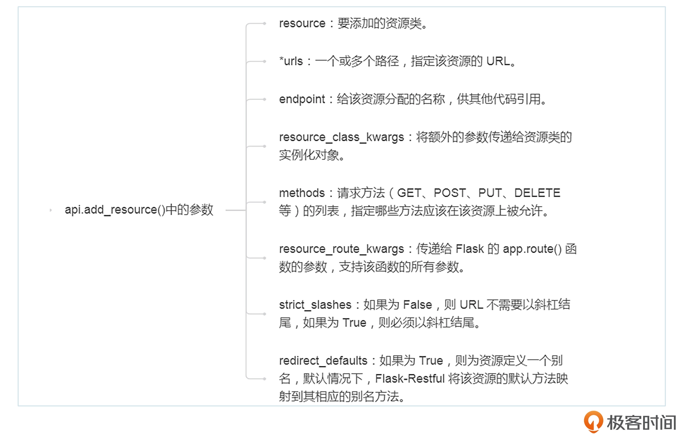
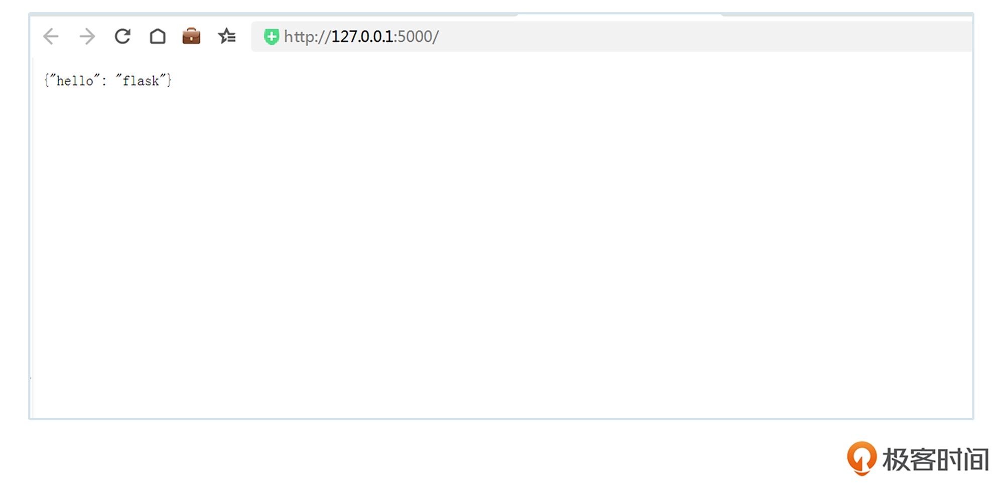
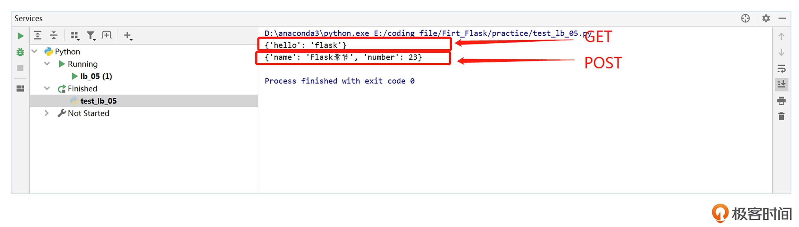
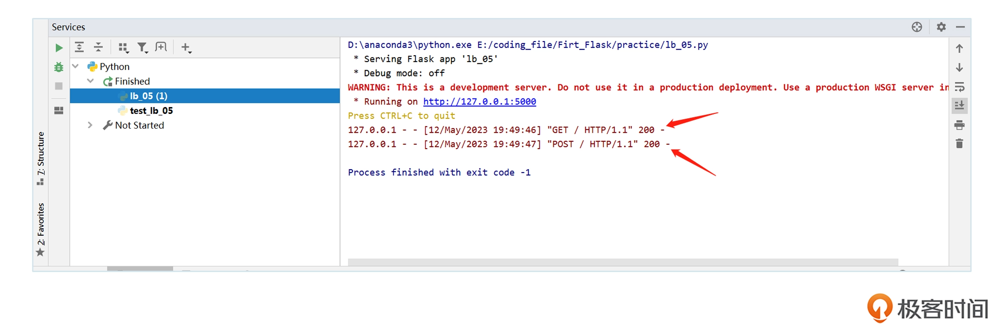
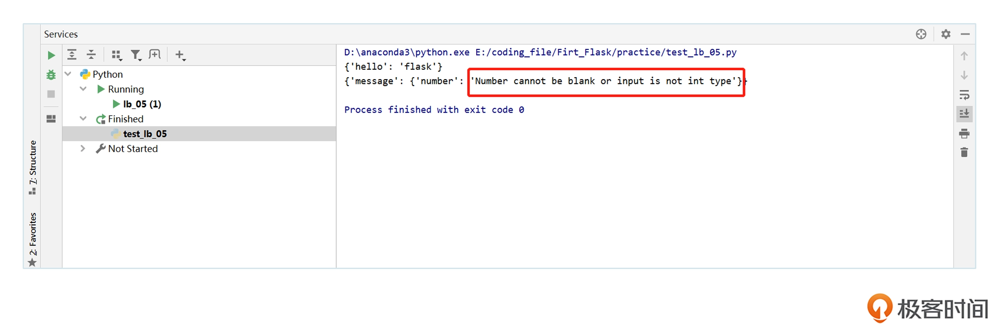
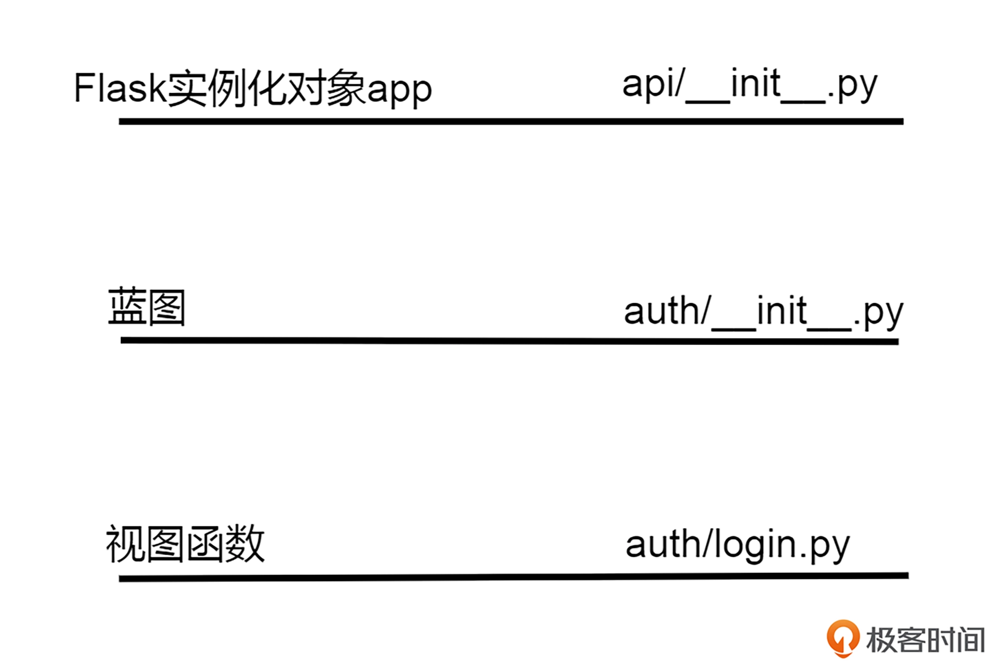
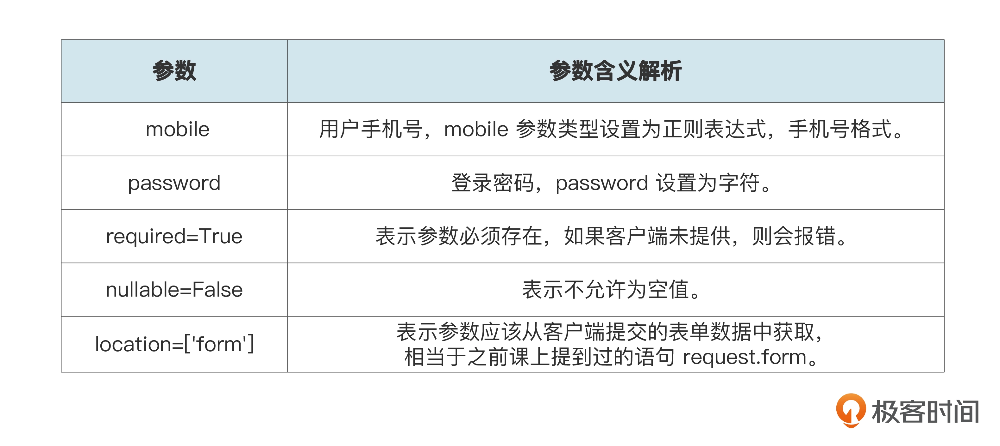

# 26 | RESTfulAPI与Flask-Restful：如何实现后端接口的开发与封装？

你好，我是 Barry。

我们都知道，直播视频平台采用的是前后端开发模式。除去前端界面的实现，后端接口设计开发也相当重要，我们要从多个维度去考量，其中包含 API 规范、请求方式、响应处理、返回数据等。这整个实现的过程，我们在后端接口开发前就要做足功课。

我们都知道，直播视频平台采用前后端分离的开发模式。除去前端界面的实现，后端接口设计开发也相当重要，我们要从多个维度去考量，其中包含 API 规范、请求方式、响应处理、返回数据等。整个实现的过程，我们在后端接口开发前就要做足功课。

这节课，我们就借助 Flask-Restful 来实现高效的前后端接口开发。Flask-Restful 是一个用于Flask 的扩展，它让构建 RESTful API 变得更加容易。为了让你循序渐进地掌握 Flask-Restful，我们先来了解一下 RESTful API，因为 Flask-Restful 就是基于 RESTful APl 实现的。

## 认识 RESTful API

在项目开发过程中，我们的接口调用过程的核心就是前后端通信和数据的交互。

我们提到的 REST，它就是一种软件架构风格，它定义了一系列标准和约束，使得应用程序能够以一种统一的方式完成通信和数据交互，实现接口统一化。而 RESTful API 是一种基于REST 架构的 API 设计规范，它遵循 REST 原则，包括使用标准的 HTTP 方法（如 GET、POST、PUT、DELETE 等）、URI 设计、配置合理的 HTTP 状态码等。

RESTful API 的设计目的是提高系统的可伸缩性、降低开发的复杂性，同时让系统更容易实现缓存等机制。RESTful API 通常使用 JSON 格式传输数据，我们在接口数据格式上也更倾向选用 JSON 格式。

## 认识 Flask-Restful

明白了 RESTful API 的概念和用途，我们这就来学习一下 Flask-Restful。

Flask-Restful 提供了一系列的装饰器，如 @app.route、@app.marshal_with 等，可以帮助开发者快速构建 API。此外，它还提供了一些其他的特性，如自动生成文档、支持自定义视图类等。

总体来说，Flask-Restful 是一个强大的工具，可以帮助我们快速构建出符合 RESTful API 设计规范的 API。

### Flask-Restful 案例演示

接下来，我们通过编译一个最简单的 API，了解 Flask-Restful 是如何工作的。

首先，我们需要安装 Flask-Restful，具体的安装命令如下所示。

```
pip install flask-Restful
```

紧接着，我们要创建 Flask-Restful 的实例化对象，操作和 Flask 的实例化对象 App 一样，你可以直接参考我写的代码。

```python
from flask import Flask
from flask_RESTful import Api
app = Flask(__name__)
api = Api(app)
#使用Flask应用app创建一个API对象，可以注册路由和资源，处理API请求
```

和之前定义路由的方法不同，这里定义的对象是资源。资源表示 API 中的一个用户或某个数据集合，而路由则用于把 HTTP 请求映射到相应的资源上。这里借助 Flask-Restful 提供的Resource 类来实现。

```python
from flask_RESTful import Resource
class HelloFlask(Resource):
   def GET(self):
       return {'hello': 'flask'}
api.add_resource(HelloFlask, '/')
```

我带着你把上面的代码分析一下，我们先定义一个资源类 HelloFlask，在类中定义 GET 请求方法，在请求成功会返回两个字符串，分别是 hello 和 flask。当 Flask 接收到请求后，先把请求映射到对应的资源上，再调用对应的请求方法。我们可以使用 add_resource() 方法来实现绑定 URL，告诉 Flask 在哪条具体路径上使用对应资源。

对应 api.add_resource() 的参数含义，你可以参考后面的思维导图。



项目开发中我们通常都会定义前两个参数——资源类和资源所在的 URL 路径，参数 endpoint不指定则默认为该资源类的名称，比如示例代码当中的 endpoint 默认为 HelloFlask。其余参数我们可以依据不同情况灵活添加。

通过案例演示，相信你已经明白了 Flask-Restful 工作原理。接下来，我们就看看 Flask-Restful 中的 HTTP 请求和对应的响应处理要如何实现。

### HTTP 请求方法和响应

在 Flask-Restful 中，资源处理 HTTP 请求需要实现相应的请求方法。常见的 HTTP 请求方法包括 GET、POST、PUT、DELETE 等。在请求方法中，通常需要根据请求参数（如 URL 参数、请求体等）处理数据，并返回相应的响应。响应可以是一个普通的字符串、JSON 对象或自定义对象。

对照后面的代码案例，我们看看 Flask-Restful 是如何去发起请求并处理响应的。

```python
from flask import Flask, request
from flask_RESTful import Resource, Api
app = Flask(__name__)
api = Api(app)
class HelloFlask(Resource):
   def GET(self):
       return {'hello': 'flask'}
       # 处理GET请求
   def POST(self):
       # 处理POST请求，从request中获取数据
       data = request.get_json()
       return {'received_data': data}
api.add_resource(HelloFlask, '/')
if __name__ == '__main__':
   app.run()
```

在上面的代码实例中，我们创建了一个 Flask 应用和一个 RESTful API 实例，定义了一个HelloFlask 类作为资源，处理 GET 和 POST 请求，并且在根路径 (“/”) 上添加了这个资源。

当使用 GET 请求访问根路径时，服务器会返回一个包含 “hello”: “flask” 的 JSON 响应。当使用 POST 请求访问根路径时，服务器会从 request 中获取 JSON 格式的数据，并返回一个包含 received_data 和请求数据的 JSON 响应。

这里的 GET 方法可以直接运行程序来查看执行结果，我们在浏览器中输入绑定的 URL 即可显示内容。对应的效果图我给你放在了下面，你可以看一下。



POST 方法与 GET 方法不同，不能直接在浏览器输入 URL 来测试执行结果。我们可以借助工具 requests 来测试，它是 Python 的一个 HTTP 库（Python 的第三方库），可以通过 pip 来安装使用，它允许我们发送 HTTP 请求并获取响应。

需要注意 requests 的请求参数要以字典形式编写，包括 URL、headers、cookies 等。它支持GET、POST、PUT、DELETE 等 HTTP 方法，并且可以自动处理 URL 编码、解码、压缩等。除了基本的 HTTP 请求功能，requests 还支持文件上传、响应内容处理、认证和代理等功能。这一部分你安装之后进行测试就可以。

这里要新建一个 test_lb_05.py 文件，我们重点来看具体的文件代码。

```python
import requests
# 发送GET请求
response = requests.get('http://localhost:5000/')
print(response.json())
# 发送POST请求
data = {'name': 'Flask章节', 'number': 23}
response = requests.post('http://localhost:5000/', json=data)
print(response.json())
```

上述代码中，使用了 requests 库的 GET 请求发送到 http://localhost:5000/ ，获取相应数据。

通过 POST 请求向 http://localhost:5000/ 发送参数信息，并在请求成功之后获取响应内容。对于这两个方法，我们都会通过 JSON 将响应数据解析成字典格式，这样会方便前端处理。

接下来，我们先运行 lb_05.py，后运行 test_lb_05.py，等待返回结果。



运行完成后，记得在左栏的 running 中关闭此刻正在运行的 lb_05.py。



查看其中的记录，可以看到 GET 和 POST 两种 HTTP 请求方式都运行了，这正是我们在test_lb_05.py 文件中定义的。

### 参数解析

通过案例，我们全面了解了 Flask-Restful 的请求方法和响应，掌握了 Flask-Restful 接口开发的技巧。在接口请求成功，我们还需要处理返回的参数，这就是我们接下来要学习的参数解析。我们先来了解一下参数解析的作用。

参数解析的作用就是避免手动解析、验证参数的繁琐和可能的错误，实现更加高效的数据解析和管理。我们先通过下面的案例，来了解一下如何实现参数解析。

```python
from flask import Flask
from flask_RESTful import Resource, Api, reqparse
app = Flask(__name__)
api = Api(app)
# 创建一个RequestParser对象，用于解析请求中携带的参数
parser = reqparse.RequestParser()
# 添加一个参数，其名称为name，类型为字符串，若未填写则返回提示信息
parser.add_argument('name', type=str, help='Name cannot be blank or input is not
parser.add_argument('number', type=int, help='Number cannot be blank or input is
class HelloFlask(Resource):
   def GET(self):
       # 处理GET请求
       return {'hello': 'flask'}
   def POST(self):
   # 处理POST请求，从参数解析中获取数据
   # 解析请求参数
       args = parser.parse_args()
       name = args['name']
       number = args['number']
       return {'name': name, 'number': number}
api.add_resource(HelloFlask, '/')
if __name__ == '__main__':
 app.run()
```

这段代码中，我们创建了一个 RequestParser 对象，用来解析请求中携带的参数。上面代码主要解析了 name 和 number 这两个参数。函数 add_argument 中的 type 用来定义参数类型，后边的 help 是自定义发生错误时展示的提示信息，出错时可以做出友好提示。

name = args[‘name’] 和 age = args[‘age’] 作用是获取请求参数中的 ‘name’ 值和 ‘age’ 值。这里有点像 request.form.get 方式，获取表单当中的某个字段，最终返回字典格式的请求参数。

同样，这里我们借助 request 模拟 GET 和 POST 请求，发送参数，查看返回结果。

```python
import requests
# 发送GET请求
response = requests.get('http://localhost:5000/')
print(response.json())
# 发送POST请求
data = {'name': 'Flask章节', 'number': 数字}
response = requests.post('http://localhost:5000/', json=data)
print(response.json())
```

为了和之前的运行结果有所区分，我们修改了 number 的传递数据，改成字符类型，看看在进行参数解析时是什么结果。

再次操作估计你就更熟练了，我们先运行 lb_05.py 文件，再运行 test_lb_05.py，然后查看一下运行结果。



就像截图里展示的这样，在解析参数解析时，add_argument 会自动进行校验，出现传入空值或者不符合数据类型的值，就会提示用户改正。这种方式比手动解析参数时编写多个条件判断语句要方便很多，而且不易出错。

## 与蓝图结合使用

到这里我们已经熟悉了参数解析的用法，也知道了 Flask-Restful 整个规范流程。接下来我们就要看看如何实现 Flask-Restful 与蓝图的结合。使用 Flask-Restful，最大的用处就是将一段代码或者函数封装成接口，被其他函数所调用，如果配合蓝图使用，可以让项目文件结构更清晰，提高可读性。

我们通过登录功能的案例来实践一下。为了帮你更好理解，我给你准备了每一个模块对应的所属文件图。



我们先来看 UserLogin 类的实现，对应的文件路径是 api/models/user.py，具体实现的代码如下所示。

```python
from werkzeug.security import generate_password_hash, check_password_hash
class UserLogin(BaseModels, db.Model):
   """用户登陆表"""
   __tablename__ = "user_login"
   id = db.Column(db.Integer, primary_key=True, autoincrement=True)  # 用户id
   mobile = db.Column(db.String(16), unique=True, nullable=False)  # 手机号
   password_hash = db.Column(db.String(128), nullable=False)  # 加密的密码
   user_id = db.Column(db.Integer)  # 用户id
   last_login = db.Column(db.DateTime, default=datetime.now)  # 最后一次登录时间
   last_login_stamp = db.Column(db.Integer)  # 最后一次登录时间
   @property
   #将一个方法变成属性
   def password(self):
       raise AttributeError('密码属性不能直接获取')
   @password.setter
   #定义password的setter方法
   def password(self, value):
       self.password_hash = generate_password_hash(value)
   # 传入的是明文，校验明文和数据库里面的hash之后密码 正确true
   def check_password(self, password):
       return check_password_hash(self.password_hash, password)
```

我为你解析一下这段代码，它的作用是定义了一个名为 UserLogin 的模型类，用于存储用户登录信息。该模型类继承了 BaseModels 和 db.Model，其中 BaseModels 是一个基础模型类，db.Model 是一个数据库模型类。模型里面包含的字段就是登录功能相关的字段信息。

UserLogin 类还包含两个特殊方法——password 方法和 check_password 方法。

password 方法用于设置或获取用户的密码。直接访问该属性时，会抛出一个 AttributeError 异常，这是因为密码不能直接获取。当传入一个值时，password 方法会使用generate_password_hash() 函数将该值加密，并存储到 password_hash 字段中。

check_password 方法用于校验用户输入的密码是否正确。该方法会接受一个参数password，来校验明文密码和数据库中的密码哈希值是否匹配。如果匹配成功就返回 True，否则返回 False。在校验过程中会使用 check_password_hash() 函数来比较。

到这里，我们就梳理好了上述 UserLogin 模型基类主要实现的功能。现在我们要把请求响应处理好，这样在接口请求之后，才能更好地贴合业务逻辑。

这里我建议你把 response_utils.py 存放在 api/utils/response_utils.py 这个文件路径上。

```python
from flask import jsonify
class HttpCode(object):
   ok = 200
   parmas_error = 400
   server_error = 500
   auth_error = 401
   db_error = 1001
def rep_result(code, msg, data):
   # {code=200, msg='ksdjksd', data={}}
   return jsonify(code=code, msg=msg, data=data or {})
def success(msg, data=None):
   return rep_result(code=HttpCode.ok, msg=msg, data=data)
def error(code, msg, data=None):
return rep result(code=code, msg=msg, data=data)
```

在上述代码中定义了各种 HTTP 状态码定义，成功响应与错误响应的统一格式以及对应的success() 和 error() 方法。rep_result 方法用来返回响应结果，该方法接受三个参数：code（状态码）、msg（提示信息）和 data（响应数据），并通过 jsonify 函数将结果转换成 JSON格式并返回。

success 和 error 两个方法分别用于返回成功和失败的响应结果。在后端开发中需要返回处理结果的时候，直接调用 success() 或 error() 方法即可。

下面我们就来实现视图函数，我们需要创建一个 login.py 文件，文件存放路径我写在下面的

api/modules/auth/login。具体代码实现是后面这样。

```python
from flask import current_app
from flask_RESTful import Resource, reqparse, inputs
from api.models.user import UserLogin
from api.utils.auth_helper import Auth
from api.utils.response_utils import error, HttpCode
class LoginView(Resource):
   def POST(self):
       parser = reqparse.RequestParser(bundle_errors=True)
       parser.add_argument('mobile', type=inputs.regex('1[3456789]\\d{9}'), requ
                           nullable=False, location=['form'], help='手机号参数不正确
       parser.add_argument('password', type=str, required=True,
                           nullable=False, location=['form'], help='密码参数不正确
       args = parser.parse_args()
       # 3.通过手机号取出用户对象
       try:
           user_login = UserLogin.query.filter(UserLogin.mobile == args.mobile).
       except Exception as e:
           current_app.logger.error(e)
           return error(code=HttpCode.db_error, msg='查询手机号异常')
       # 验证拿到的这个手机号  是否在我们的登陆信息中存在  异常捕获
       # 判断我们的用户信息不在返回错误的响应码
       if not user_login:
           return error(code=HttpCode.db_error, msg='用户不存在')
       return Auth().authenticate(args.mobile, args.password)
```

在这段代码中，我们定义 LoginView 类作为资源，用于处理 POST 请求。在创建RequestParser 对象时，参数 bundle_errors=True 能将请求参数校验时发生的所有错误，都打包成一个列表返回。

随后我们向参数解析器 parser 中添加 mobile 和 password 参数。这些参数的含义你可以参考后面的表格。



try-except 异常处理，用于查询用户操作，如果从数据库中查询到的手机号和用户输入的一致，则表示查询成功。如果查询失败，程序就会记录错误日志，并返回一个包含错误消息的HTTP 响应。其中 current_app 是正在运行的 Flask 应用程序的代理对象。

在日志记录管理方面，我们使用了.error() 方法，如果有任何异常发生，则会在日志文件中记录下来，方便查找和调试问题，让我们能尽快锁定问题。

if 语句表示，如果查询到的用户对象不存在，就返回一个包含错误消息的 HTTP 响应。如果以上都验证无误，则会调用 Auth 类的 authenticate 方法，该方法会将传入的手机号和密码与数据库中保存的记录做比对，并返回包含用户身份信息。其中，Auth 类是编写的一个验证用户登录的工具类。

完成视图函数之后，我们再看看蓝图层具体该如何实现。

在蓝图层，注册名为 auth_blu 的蓝图，它的 URL 前缀是 /auth。这意味着，对于使用这个蓝图的路由，都需要以 /auth 开头。通过 add_resource 方法将 LoginView 视图和路径 ‘/login’绑定， LoginView 的完整 URL 变成了 ‘/auth/login’。

```python
from flask import Blueprint
from flask_RESTful import Api
from api.modules.auth.login import LoginView
auth_blu = Blueprint('auth', __name__, url_prefix='/auth')
api = Api(auth_blu)
api.add_resource(LoginView, '/login')
```

在 api 的 __init__.py 文件中，添加对应的蓝图初始化

```
from api.modules.auth import auth_blu
app.register_blueprint(auth_blu)
```

## 总结

又到了课程的尾声，我们一起回顾总结一下今天的内容。

RESTful API 是一种基于 REST 架构的 API 设计规范，设计目的就是提高系统的可伸缩性、降低开发的复杂性。我们都知道直播视频平台采用的是前后端分离开发模式，这就需要前后端在开发过程中对接口规范统一化的管理，这时就需要通过 RESTful API 实现。

通过案例实践，我们明确了 Flask-Restful 工作原理，还有在项目中如何使用 Flask-Restful。之后我们学习了 HTTP 请求方法和响应处理。通过 GET 方法和 POST 方法的比对，带你掌握了 HTTP 请求应用方法。在接口请求成功的过程中，我们重点要关注响应数据和请求状态码，这样就能做好接口返回处理了。

在代码实践环节，我们以登录功能为例做了练习。我们可以把 Flask-Restful 和蓝图配合起来使用，让项目文件结构更清晰，提高可读性。今天内容代码量比较大，还是需要你课后多多实践练习，强化自己的接口开发能力。

从数据库表的设计到最终完成功能开发，相信你的后端开发综合实力又上了一个台阶。下节课我们还会实现认证模块，敬请期待。

## 思考题

课程中我们提到的很多请求方法，你可以说出都是哪几种，还有它们之间有什么区别么？

欢迎你在留言区和我交流互动，如果这节课对你有启发，别忘了分享给身边的朋友。
