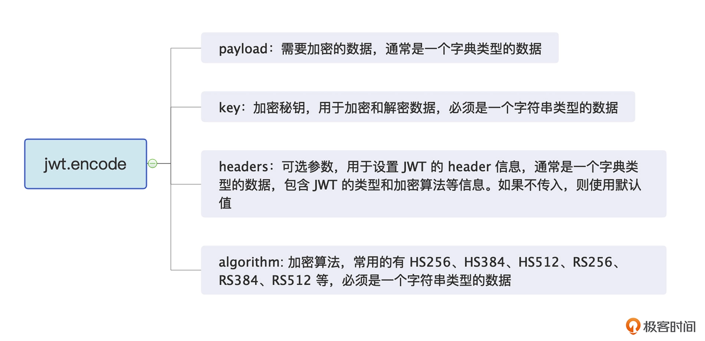

# 28 | 认证机制：Flask认证机制设计与实现

你好，我是 Barry。

上节课，我们初步了解了 Flask 认证机制，也完成了使用 Token 进行认证的前置工作。在我们的视频直播平台中，也需要通过认证机制来实现用户的平台认证和安全保障。

这节课，我们就进入项目实战环节，巩固一下你对 Flask 认证机制的应用能力。整体流程包括生成 Token、Token 验证、登录认证和用户鉴权这四个环节。

认证的第一步，我们就从生成 Token 开始说起。

## 生成 Token

上节课，我们学习过 Token 结构，它有三个部分，分别是 header，playload 和 signature。

在项目中我们借助 Flask 的扩展 Flask-JWT 来生成 Token，具体就是使用 JWT.encode 函数将 JSON 对象编码为 JWT Token。因此，我们有必要了解一下 JWT.encode 函数的参数，你可以参考后面我画的思维导图。



你或许注意到了，在 JWT.encode 函数中只传入了 payload 部分。这是因为在使用JWT.encode 函数时，会自动根据默认算法生成 Header 部分，并将 Header 和 Payload 部分进行签名生成最终的 Token 字符串。我们需要手动指定 Payload 部分。

具体生成 Token 的实现代码是后面这样，你可以参考一下。

```python
import time
import datetime
import jwt
from flask import current_app
from api import redis_store
from api.models.user import UserLogin
from api.utils import constants
from api.utils.response_utils import error, HttpCode, success
from config.config import Config
class Auth(object):
   @staticmethod
   # 声明为静态方法
   def encode_auth_token(user_id, login_time):
       """
       生成认证Token
       :param user_id: int
       :param login_time: int(timestamp)
       :return: string
       """
       try:
           payload = {
               'exp': datetime.datetime.utcnow() + datetime.timedelta(days=1),
               'iat': datetime.datetime.utcnow(),
               'iss': 'Barry',
               'data': {
                   'id': user_id,
                   'login_time': login_time
               }
           }
           return jwt.encode(
               payload,
               Config.SECRET_KEY,
               algorithm='HS256'
           )
       except Exception as e:
           print(e)
           return error(code=HttpCode.auth_error, msg='没有生成对应的token')
```

接下来，我们一起来解读一下这段代码。函数前的 @staticmethod 装饰器，我们将该方法声明为静态方法，也就是类的方法可以直接调用，而不需要再创建该类的实例。

紧接着我们在 encode_auth_token 函数中传入两个参数，分别是用户的 user_id 和用户登录时间 login_time，用户登录时间用于检查 Token 是否过期，保证时效性。然后是 Token 的有效负载 payload，其中主要包括 Token 的过期时间、签发时间、发行人和自定义数据。在自定义数据中两个参数是用户 ID 和登录时间。

其中的 payload 为字典类型，以便作为参数传入 encode 函数中。这里使用Config.SECRET_KEY 作为加密用的密钥，采用 HS256 算法对 JWT 进行加密。HS256 算法是一种基于哈希函数的对称加密算法。如果生成过程出现异常，则返回一个错误消息。这里的auth_error 是我们上节课自定义的 HTTP 状态函数。

## 验证 Token

生成 Token 的下一步就是 Token 的验证。方法就是借助 JWT 扩展的 decode 函数，将客户端发送的 Token 进行解码。我们还是结合代码来理解。

```python
@staticmethod
def decode_auth_token(auth_token):
   """
   验证Token
   :param auth_token:
   :return: integer|string
   """
   try:
       # payload = jwt.decode(auth_token, Config.SECRET_KEY, leeway=datetime.tim
       # 取消过期时间验证
       payload = jwt.decode(auth_token, Config.SECRET_KEY, options={'verify_exp'
       # options，不要执行过期时间验证
       if 'data' in payload and 'id' in payload['data']:
           return dict(code=HttpCode.ok, payload=payload)
       else:
           raise dict(code=HttpCode.auth_error, msg=jwt.InvalidTokenError)
   except jwt.ExpiredSignatureError:
       return dict(code=HttpCode.auth_error, msg='Token过期')
   except jwt.InvalidTokenError:
       return dict(code=HttpCode.auth_error, msg='无效Token')
```

上面代码同样是一个静态方法，主要用于验证 JWT token 的有效性。首先从传入的auth_token 参数中解码 token，使用保存在配置文件中的 SECRET_KEY 来解码，options 选项表示在验证 token 的过期时间时，不要执行过期时间验证。

随后要验证 auth_token 中是否包含有效的数据，这里要分三种情况考虑。

- 如果包含有效数据，则返回一个字典，其中 code 为 HttpCode.ok，表示请求成功，payload 为解码后的数据。

- 如果不包含有效数据或者解码失败，则抛出 InvalidTokenError，表示 Token 验证失败，并返回相应的错误信息。

- 如果 auth_token 中包含有效数据但是 Token 已经过期，则抛出 ExpiredSignatureError，表示 Token 已经失效，并返回相应的错误信息。

虽然代码中取消了过期时间验证，但是在后面依旧会抛出 ExpiredSignatureError，提示 Token过期，所以我们需要把异常处理情况涵盖得更全。

## 登录认证

搞定了生成 Token 和对 Token 认证的代码后，下一步，我们就需要对用户登录进行认证。登录认证成功即可给客户端返回 Token，下次向服务端请求资源的时候，必须带着服务端签发的Token，才能实现对用户信息的认证。

实现用户登录的代码是后面这样。

```sql
def authenticate(self, mobile, password):
   """
   用户登录，登录成功返回token，写将登录时间写入数据库；登录失败返回失败原因
   :param password:
   :return: json
   """
   user = UserLogin.query.filter_by(mobile=mobile).first()
   if not user:
       return error(code=HttpCode.auth_error, msg='请求的用户不存在')
   else:
       if user.check_password(password):
           login_time = int(time.time())
           try:
               user.last_login_stamp = login_time
               user.last_login = datetime.datetime.now()
               user.update()
           except Exception as e:
               current_app.logger.error(e)
               return error(code=HttpCode.db_error, msg='登录时间查询失败')
           token = self.encode_auth_token(user.user_id, login_time)  # bytes
           token = str(token, encoding="utf-8")
           user_id = user.user_id
           # 存储到redis中
           try:
               redis_store.set("jwt_token:%s" % user_id, token, constants.JWT_TO
           # 设置过期时间为常量JWT_TOKEN_REDIS_EXPIRES（86400秒，即24小时）
           except Exception as e:
               current_app.logger.error(e)
               return error(code=HttpCode.db_error, msg="token保存redis失败")
           from api.modules.video.views import user_action_log
           user_action_log.warning({
               'user_id': user_id,
               'url': '/passport/login',
               'method': 'post',
               'msg': 'login',
               'event': 'login',
           })
           return success(msg='用户登录成功', data={"token": token, "user_id": use
       else:
           return error(code=HttpCode.parmas_error, msg='用户登录密码输入错误')
```

上面代码整体实现流程是，首先要做的就是接收用户输入的手机号码和密码，然后利用手机号码查询数据库中是，否存在该用户。如果不存在，则返回错误信息。如果存在，使用在数据库表中定义的函数 check_password 来，检查密码是否正确。

如果密码错误，则返回错误信息。如果密码正确则记录用户的登录时间和日期，使用当前用户的 user_id 和登录时间戳作为参数，调用 encode_auth_token() 方法生成一个 token，再使用redis_store.set() 方法将生成的 token 存储在 redis 中，并设置过期时间。

如果存储失败，则将该错误信息存入应用日志中，以便于后续的调试和问题排查。如果所有条件都满足，最后返回成功信息和 token 以及用户 ID。

这里还调用了 video 模块中的 user_action_log。user_action_log 用来记录出现的异常等信息。具体代码是后面这样。

```
from api.utils.log_utils import json_log
json_log('user_action', 'logs/user_action.log')
user_action_log = logging.getLogger('user_action')
这里调用了 log_utils 中的 json_log 函数，使用  json_log 函数来创建一个名为
user_action_log 的日志记录器对象，并将其指向  logs/user_action.log 路径的文
```

件，这样记录用户操作的相关信息会更方便。

## 用户鉴权

接下来的环节就是在请求时获取用户的登录信息，并进行鉴权。如果用户没有相应的权限，则返回相应的错误信息。具体实现代码是后面这样。

```python
def identify(self, request):
   """
   用户鉴权
   :return: list
   """
   auth_header = request.headers.get('Authorization', None)
   if auth_header:
       auth_token_arr = auth_header.split(" ")
       # 分成列表，含有两个元素
       if not auth_token_arr or auth_token_arr[0] != 'JWT' or len(auth_token_arr
           return dict(code=HttpCode.auth_error, msg='请求未携带认证信息，认证失败')
       else:
           auth_token = auth_token_arr[1]
           # 将JWT令牌的字符串值给auth_token
           payload_dict = self.decode_auth_token(auth_token)
           if 'payload' in payload_dict and payload_dict.get('code') == 200:
               payload = payload_dict.get('payload')
               user_id = payload.get('data').get('id')
               login_time = payload.get('data').get('login_time')
               # print('   解析出的时间戳', login_time)
               user = UserLogin.query.filter_by(user_id=user_id).first()
               if not user:  # 未在请求中找到对应的用户
                   return dict(code=HttpCode.auth_error, msg='用户不存在，查无此用户
               else:
                   # 通过user取出redis中的token
                   try:
                       # print(user_id)
                       redis_jwt_token = redis_store.get("jwt_token:%s" % user_i
                       # print('👈redis', redis_jwt_token)
                   except Exception as e:
                       current_app.logger.error(e)
                       return dict(code=HttpCode.db_error, msg="redis查询token失败
                   if not redis_jwt_token or redis_jwt_token != auth_token:
                       # print('   解析出来的token', auth_token)
                       return dict(code=HttpCode.auth_error, msg="jwt-token失效")
                   # print(type(user.last_login_stamp), type(login_time))
                   # print(user.last_login_stamp, login_time)
                   if user.last_login_stamp == login_time:
                       return dict(code=HttpCode.ok, msg='用户认证成功', data={"us
                   else:
                       return dict(code=HttpCode.auth_error, msg='用户认证失败，需要
           else:
               return dict(code=HttpCode.auth_error, msg=payload_dict.get('msg')
   else:
       return dic在代码中，t(code主要=HttpCode.auth_error, msg='用户认证失败,请求未携带
```

用户鉴权函数主要用于验证用户的身份是否合法。首先通过 request.headers 获取请求头中的Authorization 字段，如果不存在，说明用户未携带对应认证信息，返回包含错误信息的字典。

如果存在该字段，就按照空格将其分割成一个列表，列表中包含两个元素，第一个元素为JWT，第二个元素为 JWT 令牌的字符串值。如果 auth_token_arr 为空，那么 auth_token_arr第一个元素不包含 “JWT” 字符串，或者分割后的 auth_token_arr 长度不为 2，这就证明 JWT令牌格式不正确，需要返回认证失败的信息。

这一步如果通过的话，我们再将 auth_token_arr 列表中的第二个值，也就是 JWT 令牌的字符串值赋给 auth_token，并将解码结果赋值 payload_dict。

下一步就是判断 payload_dict 中是否有 payload 字段，且 code 字段的值是否为 200。不符合判断条件同样要返回错误信息，说明携带认证参数不合法。如果符合条件，就从 payload 中把用户 ID、登录时间和 payload 信息取出来，并根据用户 ID 在用户登录表中完成查询。

如果不存在该用户同样要返回错误。如果用户存在，则从 Redis 内存中，获取以 user_id 为键的 jwt_token，赋给 redis_jwt_token。如果内存中取不出来该值，这时候就返回错误。

紧接着会再次做条件判断，如果请求中解析出的 JWT 令牌的字符串值，跟之前存储在内存中的不相符合，同样要返回错误。最后，验证该 token 对应的登录时间戳是否与数据库中最近一次登录时间戳一致。如果一致，则表示认证通过，否则表示需要重新登录。

在实操环节我们知道 Token 的认证流程是当用户在进行首次登录，服务器会使用密钥和加密算法，生成 Token，发送给客户端，由客户端自己进行存储。等再次登录时，客户端携带Token 请求资源，服务器会进行 Token 的认证，完成一系列验证（如 Token 是否过期，JWT令牌的格式是否正确等），通过异常处理的把控来保证 Token 认证的安全和稳定性。

## 总结

又到了课程的尾声，我们来回顾总结一下。

这节课，我们主要是通过项目实战来强化对认证机制的应用。在项目中应用也是一样的认证流程，我们先要生成 Token，借助 Flask 的扩展 Flask-JWT 来生成 Token。你需要掌握生成Token 的代码，理解它的生成过程。

之后就是 Token 验证和认证阶段，Token 的验证就是借助 JWT 扩展的 decode 函数，将客户端发送的 Token 进行解码。我们重点要关注登录认证成功的前提下，客户端接收 Token 以后，下次向服务端请求资源的时候，必须带着服务端签发的 Token，这样才能实现对用户信息的认证。

用户鉴权函数主要用于验证用户的身份是否合法。鉴定方法就是通过 request.headers 请求头中的 Authorization 字段来判断：如果该字段不存在，说明用户未携带对应认证信息；如果存在则需要我们验证内部参数来判定。

通过这节课的实操练习，相信你会对认证机制的应用得更加熟练。课程里有很多的代码，一定在课后自己多实践。下节课我们即将开启功能接口的实战，不见不散。

## 思考题

前面的课程里，我们讲到了 current_app，session，request，你知道他们有什么区别么？

欢迎你在留言区和我交流互动，如果这节课对你有启发，也推荐你把这节课分享给更多朋友。
