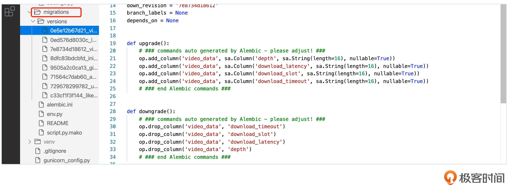
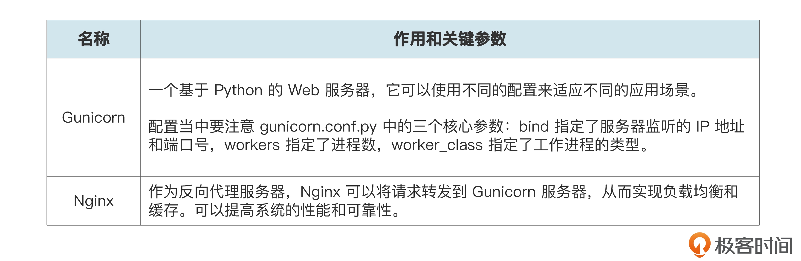

# 31 | 项目实战与部署：如何实现接口部署与访问？

你好，我是 Barry。

前面我们已经完成了后端的功能接口开发。从技术的角度出发，我们作为研发还应具备项目部署的能力。在企业应用当中，把项目部署到服务器上，不但能让前端访问接口，也能供更多用户使用我们的平台。

这节课的操作代码非常多，学完今天的内容之后，建议你在课后自己多多练习，巩固学习效果。要实现项目的部署，首先要确保服务器环境以及相关组件是完备的。除去基本的 Python环境、MySQL 之外，还有服务部署时用到的 Nginx、Gunicorn、Supervisor 库等。所以部署的第一步，我们先来完成服务器相关环境配置。

## 配置 Python 环境与虚拟环境

第一步，我们要配置 Python 环境。在安装之前，可以登录服务器检查一下上面是否安装了Python。方法就是直接在终端中运行后面的命令。

```
python --version
```

如果已安装，你会看到对应的版本号，否则就需要你在服务器上重新安装。对于 Ubuntu 系统，安装命令如下。

```sql
sudo apt-get update
sudo apt-get install python3
```

对于 CentOS 或 RHEL 系统，安装命令如下。

```bash
sudo yum install python3
```

为了隔离项目依赖和环境，我们还需要在服务器上使用虚拟环境，为每个项目提供独立的Python 环境。接下来，我们来安装虚拟环境工具 virtualenv。

```
pip install virtualenv
```

在安装成功之后，我们要去项目目录下激活虚拟环境方可使用。

```
virtualenv venv
source venv/bin/activate
```

搞定虚拟环境以后，下一步就是在虚拟环境中安装项目所需的依赖包。通过所需的依赖包，可以确保项目使用的包版本与开发环境中一致，并且不会与其他项目或全局环境中的包冲突。

具体的安装命令是后面这样。其中，requirements.txt 表示包含项目依赖的文本文件。

```
pip install -r requirements.txt
```

到这里，我们就成功完成了服务器 Python 环境和虚拟环境的配置。

## MySQL 配置

通过前面的学习，我们确定了项目里要用到数据库 MySQL。同样为了保证后端能够访问数据库，我们还要在服务器上安装 MySQL 数据库。

这里的思路和前面 Python 环境安装类似，还是先查看一下服务器上是否安装了 MySQL。我们还是在登录服务器之后，运行后面的命令。

```
mysql --version
```

如果能看到版本号，那证明已经安装过了，否则就需要重新安装。如果是 Ubuntu 环境，直接运行后面的命令即可。

```sql
sudo apt-get update
sudo apt-get install mysql-server
```

之后我们还要对 MySQL 做一些基本的配置，输入后面的命令即可启动服务。

```bash
sudo service mysql start
```

启动服务以后，你可以通过下面的命令完成数据库的安全配置，mysql_secure_installation 脚本可以提高 MySQL 数据库的安全性，减少潜在的攻击风险。具体执行代码如下。

```bash
sudo mysql_secure_installation
```

输入前面的命令后，我们还要按照提示来设置，包括设置 MySQL 的 root 密码和其他相关选项。

接下来，我们要在服务器上创建一个空的数据库。

```
mysql -u root -p
```

下一步就是创建数据库和用户，同时完成权限设置。具体操作代码如下所示。

```
CREATE DATABASE database;
CREATE USER 'username'@'localhost' IDENTIFIED BY 'password';
GRANT ALL PRIVILEGES ON database.* TO 'username'@'localhost';
FLUSH PRIVILEGES;
```

请注意，上面这段配置你需要替换 username、database、password，换成你自己的用户名、数据库名、密码。对应配置中关联的就是我们项目中的数据库，数据库的信息如下所示，这里相信你也非常熟悉了。

```python
class Config:
   DEBUG = True
   LEVEL_LOG = logging.INFO
   SECRET_KEY = 'slajfasfjkajfj'
   SQL_HOST = '127.0.0.1'
   SQL_USERNAME = 'root'
   SQL_PASSWORD = 'root'
   SQL_PORT = 3306
   SQL_DB = 'my_project'
   JSON_AS_ASCII = False
   # 数据库的配置
   SQLALCHEMY_DATABASE_URI = f"mysql+pymysql://{SQL_USERNAME}:{SQL_PASSWORD}@{SQ
   SQLALCHEMY_TRACK_MODIFICATIONS = False
```

创建数据库之后，我们需要使用 Flask-Migrate（Flask-Migrate 是一个基于 Flask 框架的数据库迁移工具）来实现数据库迁移，并且集成到 Flask-Script 中。

每次我们需要对数据库进行更改时，都需要创建一个新的迁移文件，并使用 migrate 命令将其应用到数据库中。

安装命令如下所示。

```
pip install flask-migrate
```

在项目中，我们需要实例化 Flask_Migrate 提供的 Migrate 类，进行初始化操作。对应的文件就是项目中的 manager.py，文件中具体的代码是后面这样。

```python
from flask_script import Manager
from flask_migrate import Migrate, MigrateCommand
from api.models.user import UserInfo
from api.models.video import VideoInfo
from api.models.content import ContentMain
from api.models.gitinfo import GithubInfo
from flask_cors import CORS
from api import db, create_app
app = create_app('dev')
CORS(app, supports_credentials=True)
manager = Manager(app)
Migrate(app, db)
manager.add_command('db', MigrateCommand)
if __name__ == '__main__':
   manager.run()
```

我来为你解释一下前面这段代码。首先，我们从 Flask-Script 库中导入了一个 Manager 对象，用于管理命令行脚本。然后，从 Flask-Migrate 库中导入了 Migrate 和 MigrateCommand对象，用于数据库迁移。

紧接着，我们导入了相关的模型类，包括 UserInfo、VideoInfo、ContentMain 等，这些模型类定义了数据库中的表结构和操作。

在这里，我们创建了一个 Flask 应用实例 app，并使用 Flask-Cors 库来处理跨域资源共享问题。

代码的 14-16 行，我们创建了一个 Manager 对象 manager，并将 app 和 db 对象传递给它。然后，使用 Migrate 对象来绑定 app 和 db 对象，以便进行数据库迁移。

最后，我们将 MigrateCommand 对象添加到 manager 中，以便可以通过命令行运行迁移命令。

我们主要分三步来完成数据库迁移。第一步我们先来创建迁移数据库，直接在我们的PyCharm 中执行命令。

```
python manage.py db init
```

这里的 db 是迁移命令的对象，它可以执行各种数据库操作，包括初始化数据库、迁移数据库等操作，名字可以自己命名，但是相关应用要保持命名一致。

这个命令用来在我们的项目目录下创建 migrations 文件夹，把所有迁移文件都放在里面。后面是文件截图，供你参考。



第二步，我们需要创建迁移脚本，对应脚本的文件位置在 migrations / versions 文件，自动创建迁移脚本需要用到两个函数。upgrade() 函数用来把迁移中的改动应用到数据库中，downgrade() 函数则用于删除改动。

为了让你进一步理解这两个函数的具体用法，我们结合案例来看看。

```python
def upgrade():
   # ### commands auto generated by Alembic - please adjust! ###
   op.add_column('user_login', sa.Column('last_login_stamp', sa.Integer(), nulla
   # ### end Alembic commands ###
def downgrade():
   # ### commands auto generated by Alembic - please adjust! ###
   op.drop_column('user_login', 'last_login_stamp')
   # ### end Alembic commands ###
```

结合代码可以看到，upgrade 函数通过 op.add_column() 方法添加了一个名为last_login_stamp 的列，该列的数据类型是整数。downgrade 函数则是通过 op.drop_column()方法，删除了名为 last_login_stamp 的列。

在数据库迁移过程中，我们可以通过 upgrade 函数来添加新的列、修改表结构等，而通过downgrade 函数可以撤销这些更改。你需要注意，这些函数中的代码是根据数据库的版本控制自动生成的，并非是我们自己编写的，可以根据数据操作需求来调整和修改。

创建迁移脚本的执行命令如下所示。

```
python manage.py db migrate -m 'initial migration
```

不过，运行命令之后，只是在 migrations 文件夹中新增了数据库迁移的版本文件，这时候还并没有生成对应的表。还需要我们完成第三步——更新数据库，代码如下所示。

```
python manage.py db upgrade
```

更新之后，我们会发现数据表就能够实现创建了。到这里我们就完成了数据库的迁移，恭喜你一路坚持到这里。

## Gunicorn 部署

搞定了服务器相关环境配置，我们就可以部署项目了。在这里，我们选用最常用的 Flask 应用部署方案 Flask+Gunicorn+Nginx+Supervisor。

我们先来认识并安装 Gunicorn。Gunicorn 是一个基于 Python 的 Web 服务器，使用 Pre-forking 模型来处理请求。它的主要目的是在生产环境中作为主流 Web 服务器，并提供与Python Web 应用程序的集成。

那我们在项目部署中为什么需要用到 Gunicorn 呢？

这是因为，Gunicorn 可以处理 HTTP 请求并返回响应。它可以使用不同的配置来适应不同的应用场景，例如处理高并发的请求、提供静态文件服务等。

Gunicorn 还可以作为预热服务器使用，它在启动时会加载一些应用程序代码，并预先创建工作进程。这样可以减少请求的等待时间，提高服务器的响应速度。这也是它非常突出的一大优势。

Gunicorn 也可以作为反向代理服务器使用，将请求转发到其他服务器。它可以将请求转发到多个工作进程，从而实现负载均衡和缓存。

在认识了 Gunicorn 之后，我们这就来看看项目部署中如何使用它。首先我们需要安装Gunicorn，直接使用 pip 命令安装即可。

```
pip install gunicorn
安装成功之后，我们要在项目目录下创建一个名为gunicorn.conf.py的配置文件，其中包
```

含以下内容。

```
bind ="%s:%s" % ("0.0.0.0", 8000)
workers = 8
worker_class = "sync"
```

在上面的配置中有三个核心参数：bind 指定了服务器监听的 IP 地址和端口号，workers 指定了进程数，worker_class 指定了工作进程的类型。至于整体的配置文件，你可以参考 Gitee 里的完整代码，到时你直接拉取使用就可以。

在配置完成之后，我们在终端中进入项目目录，并使用以下命令启动 Gunicorn。

```
gunicorn -c gun_conf.py manager:app
```

这里同样有三个参数。-c 用来指定 gunicorn 配置文件，manager 则是 Flask 项目启动的文件名，而 app 代表脚本中创建的 Flask 对象名。

不过在项目部署中，仅有 Gunicorn 还是不够的，我们仍然需要使用 Nginx 作为反向代理服务器来实现更高的可用性、提升性能，我们为什么需要使用 Nginx 呢？主要有三点考虑。

第一，Nginx 可以将请求转发到 Gunicorn 服务器，实现负载均衡和缓存。这将带来的好处是可以帮助提高系统的性能和可靠性。

第二，它可以解决跨域问题，在项目中，经常需要跨域访问资源。我们在 Nginx 里设置适当的响应头，即可允许跨域请求。这也是我们在处理跨域问题中比较经典的方法，也是面试中的高频考点。

第三，Nginx 是一个高度可扩展和稳定的服务器，能提供高效的网络连接管理和安全防护。同时它也支持丰富的配置选项，可以根据实际需求进行灵活配置。

## Nginx 安装

接下来，我们就看看如何配置安装 Nginx。我们依然在链接服务器之后，使用后面的命令更新软件包列表，并安装 Nginx 服务器。

```sql
sudo apt-get update
sudo apt-get install nginx
```

然后，我们需要编辑配置文件 /etc/nginx/sites-available/default，修改 location /，具体的配置项如下所示。

```
# 注意下这里的监听端口，访问的时候会用到
listen 80 default_server;
listen [::]:80 default_server;
location / {
   proxy_pass http://localhost:8000/;
   proxy_redirect off;
   proxy_set_header Host $http_post;
   proxy_set_header X-Real-IP $remote_addr;
   proxy_set_header X-Forwarded-For $proxy_add_x_forwarded_for;
}
```

在上述配置中，listen 80 表示监听 80 端口，server_name example.com 表示域名，可以根据实际情况进行修改。location / 表示将所有请求都转发到 Gunicorn 服务器上，Gunicorn 的监听端口为 8000。

配置完成之后，我们要通过后面的执行命令重新启动 Nginx 服务。

```bash
sudo service nginx reload
```

到这里，Flask 项目部署的准备工作告一段落，我们安装并配置了 Nginx 服务器，还让它与Gunicorn 服务器配合使用。现在你就可以直接在外网 IP 地址 80 端口下，访问你的 Flask 项目了。

到了这一步，我们就完成了部署和启动。但是这个过程中需要我们通过手动命令操作，还不够灵活。我们还需要使用 Supervisor，这是一个进程管理工具。

它的优势有以下三个方面。

首先，Supervisor 可以负责启动、停止、重启和查看 Flask 应用的进程。这样，当项目出现问题或需要重启时，Supervisor 可以自动处理这些问题，而无需手动干预。

其次，Supervisor 可以捕获和处理 Flask 项目中的异常。如果项目发生崩溃或出现故障，Supervisor 可以自动重新启动应用，以保证服务的可用性。

最后，Supervisor 的配置非常灵活，可以根据需求进行定制。我们可以设置应用的工作目录、环境变量、用户权限等，以确保应用在最佳环境下运行。

接下来，我们就看看如何应用 Supervisor 实现进程管理。

## Supervisor 配置

首先要安装 Supervisor。

```bash
sudo apt-get install supervisor
```

安装完成后，在 /etc/supervisor/conf.d/ 目录下创建我们控制进程的配置文件，并以.conf 结尾，这样将会自动应用到主配置文件当中，具体的配置内容如下所示。

```javascript
[program:myproject]
command=gunicorn -c $(项目路径)/gun_conf.py manager:app
user Barry
autostart true; 设置为随 supervisord 启动而启动
autorestart=true; 设置为随 supervisord 重启而重启
startretires:5; supervisord尝试启动一个程序时尝试的次数。默认是3
startsecs 3; 自动重启时间间隔,以秒为单位
stderr_logfile=/var/log/myproject.err.log ;错误日志文件
stdout logfile=/var/log/myproject.out.log ;输出日志文件
```

在上面的配置项中，[program:myproject] 是配置文件的名称，可以根据实际应用名称进行修改。command 是启动应用程序的命令，这里使用了 Gunicorn 服务器。user 是运行应用程序的用户，可以根据实际情况来修改。autostart 和 autorestart 表示自动启动和自动重启应用程序。stdout_logfile 和 stderr_logfile 是应用程序的输出日志文件路径。

保存并退出配置文件之后，我们需要重新加载 Supervisor 的配置，shell 命令是后面这样。

```bash
sudo supervisorctl reload
```

最后，我们就可以运行后面的命令，启动我们的项目了。

```bash
sudo supervisorctl start myapp
```

有没有感觉到，在 Flask 项目里引入 Supervisor 并不复杂。之后，Supervisor 将会监控应用程序的进程并自动重启应用程序，为我们应用程序的稳定运行保驾护航。

## 总结

这节课，我们完成了 Flask 后端接口的部署工作，其实前端部署也是一样的逻辑。估计你也体会到了，操作项比较多，需要你足够耐心和细心。现在，我再为你梳理下整个部署过程里的重难点。

服务器环境配置方面，要注意在虚拟环境里构建，目的是确保项目使用的包版本与开发环境中一致，并且不会与其他项目或全局环境中的包冲突。数据库创建环节的重点是熟练掌握 Flask-Migrate，你可以课后再回味一下相关代码。

项目部署的核心是 Gunicorn 和 Nginx 组合应用，你可以参考后面的表格回顾一下。



为了提高效率，告别手动操作，我们还需要用到 Supervisor 来管理进程，此外，Supervisor更核心的作用是及时帮我们捕获一些进程问题，保证系统的稳定性和安全性。

后端实战内容告一段落，下节课开始，我们即将开启直播模块的学习，敬请期待。

## 思考题

在课程中我们提到了跨域问题，你知道引发跨域问题的主要原因是什么？

欢迎你在留言区和我交流互动，如果这节课对你有启发，也推荐你分享给身边的朋友。
