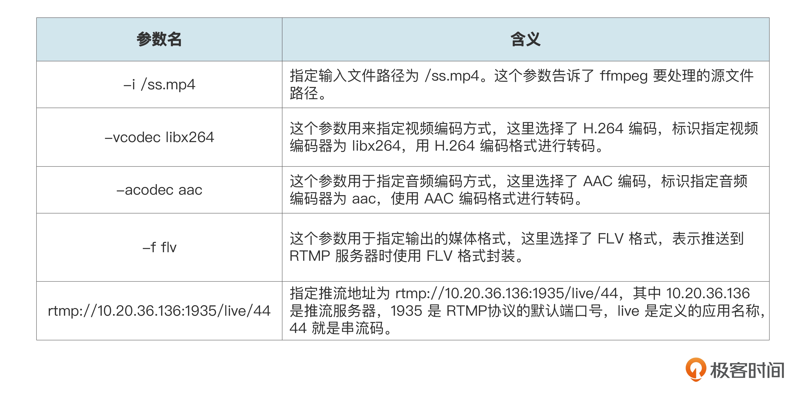
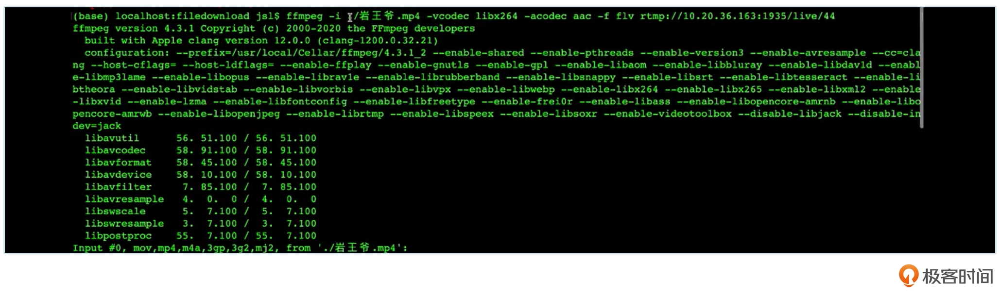
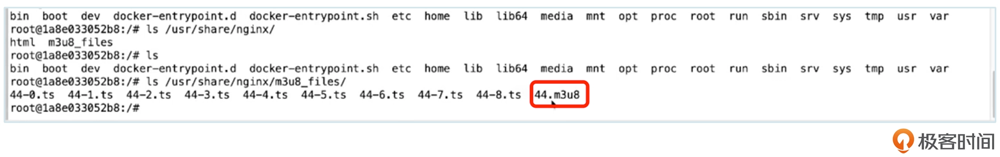
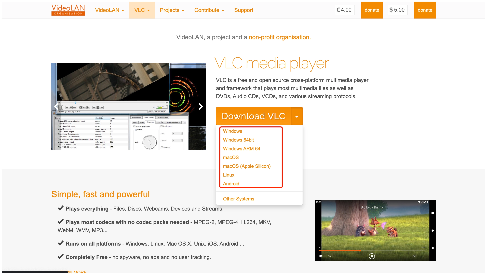
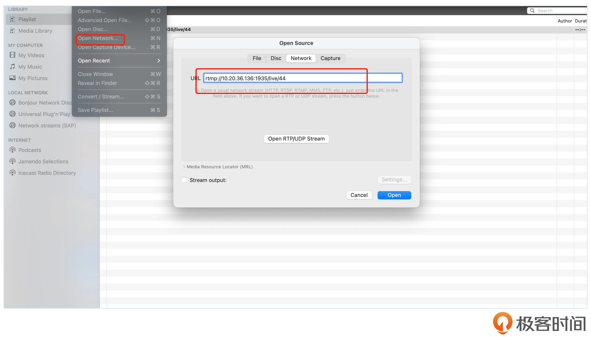
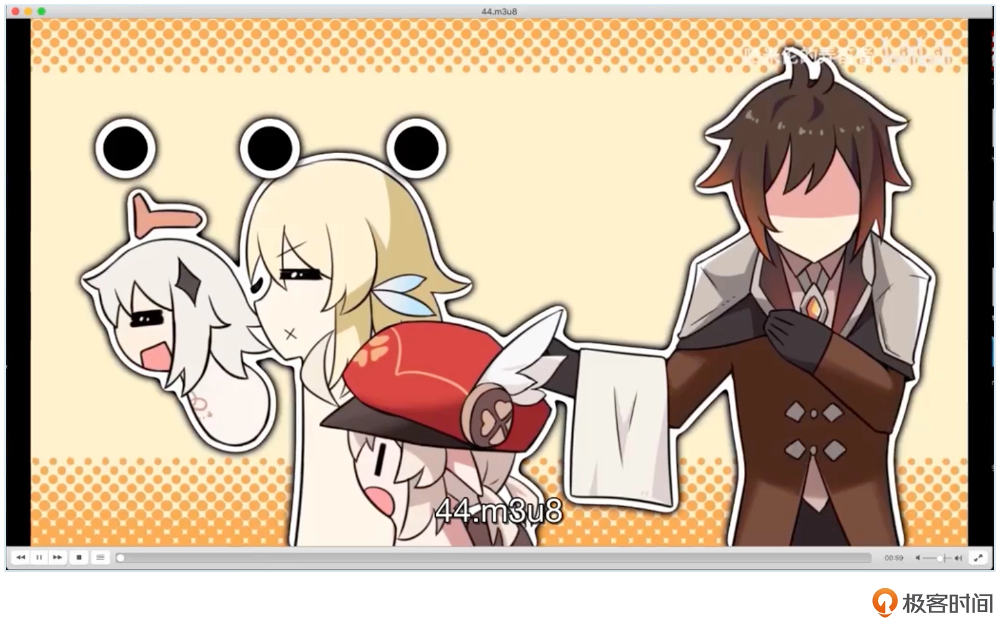
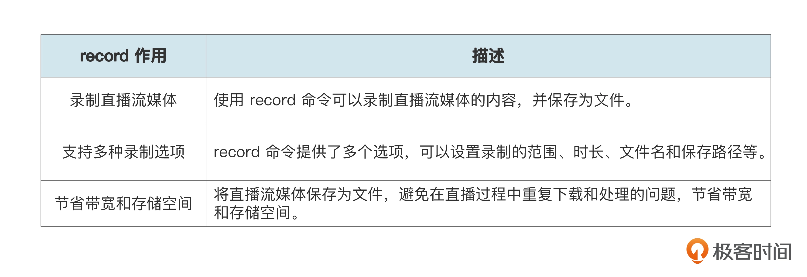
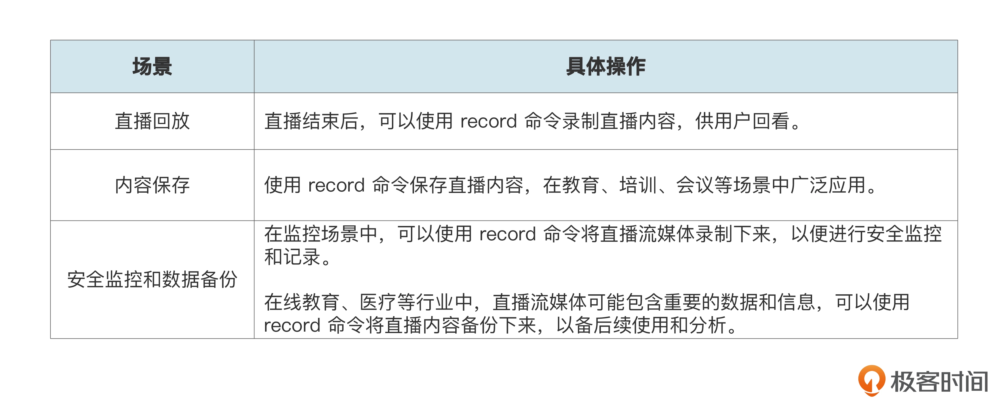
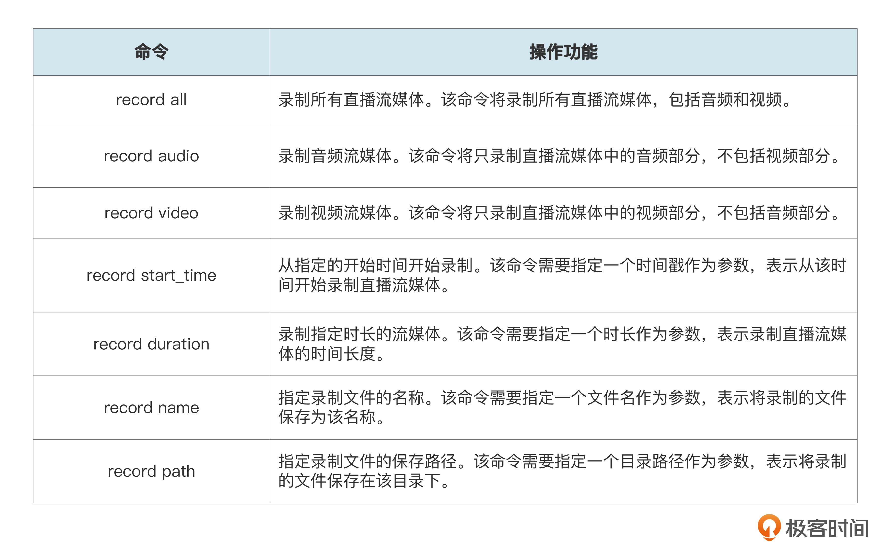

# 36 | 推拉流、串流码与控制器：实现录制与停止直播流

你好，我是 Barry。

上节课，我们通过 Nginx-rtmp-module 搭建流媒体服务器，还通过 RTMP 协议实现了 HLS 协议直播的相关配置。

这节课，我们就来学习如何实现直播的推拉流。推流和拉流的主要作用是实现直播音视频数据的传输，这是直播中最核心的操作。之后，我还会带你利用 record 命令实现直播录制功能，让我们的直播系统更加强大。

## 推流

我们先从推流开始学习。在直播系统中，推流是指将音视频数据由主播端发送到流媒体服务器端，供用户端接收、观看。

直播过程中，主播端会使用编码器编码音视频数据，然后通过 RTMP 协议将编码后的数据推送到服务器端。服务器端接收到数据后，可以对数据进行存储、转码、分发等处理，然后提供给用户端接收观看。

接下来我们一起梳理一下推流的过程，推流的实现步骤分为三步。

第一步，我们需要在 Nginx-rtmp-module 中配置推流地址，即指定服务端将音视频数据推送到哪个服务器地址。我们可以在 Nginx 的配置文件中设置推流地址，在上节课我们已经完成了配置，配置代码如下所示。

```
rtmp {
   server {
       listen 1935;
       #应用程序块
       application live {
           live on; #开启直播
           hls on;  #开启hls直播
           hls_path /usr/share/nginx/m3u8_files; #配置指定了m3u8文件存储位置
       }
   }
}
```

第二步，服务端需要使用编码器将音视频数据进行编码，并将编码后的数据封装为 RTMP 消息。常用的编码器和封装工具包括 FFmpeg、OBS Studio 等。在编码和封装过程中，我们需要选择合适的编码格式、分辨率、帧率等参数，以确保推流的音视频质量。这节课里，我们选择 FFmpeg 这种方式，至于 OBS 的实现方式我们之后的课程里再展开。

第三步，将主播端封装好的 RTMP 消息，通过 RTMP 协议推送到指定的服务器地址。这一步我们可以使用命令行工具或编程语言库来实现推流。比方说，使用命令行工具 FFmpeg 来推流，后面这个推流命令我们在直播系统中就会经常使用。

```
ffmpeg -i /ss.mp4 -vcodec libx264 -acodec aac -f flv rtmp://10.20.36.136:1935/liv
```

这条命令使用 FFmpeg 工具，对指定路径下的 ss.mp4 文件进行转码，并将其推送到指定的RTMP 服务器上。具体参数的含义你可以参考后面的表格。



那么这里提到的串流码是什么意思呢？

串流码（Stream Key）是一个唯一的字符串，用于在服务器上标识直播流。有了串流码标识，就能让同一个应用的直播流互不影响。

搞定了前面配置以后，就宣告了直播推流成功。我把直播推流成功的效果图给你放在了下面，你可以参考一下效果。



推流成功之后，我们就可以在 m3u8_files 目录下查看到 M3U8 及 ts 文件，实现对直播文件的存储，具体的效果截图是后面这样。



第四步，服务器端接收到推流的音视频数据后，可以进行存储、转码、分发等处理。Nginx-rtmp-module 提供了一些功能和配置选项来实现这些处理。例如，我们可以使用 record 指令录制视频。

到这里，我们就完成了推流的过程。接下来，我们就要考虑如何实现拉流了。

## 拉流

拉流是指客户端从服务器端获取音视频数据的过程。在直播过程中，客户端通过 RTMP 协议向服务器端请求获取音视频数据，服务器端接收到请求后，将存储或转码后的音视频数据通过RTMP 协议传输给用户端，供用户观看。

不难发现，拉流是一个非常重要的过程，它直接决定了用户观看直播的体验。拉流过程中我们也需要考虑网络带宽、延迟等因素，这样才能确保直播流畅、无卡顿。

拉流的实现我们会采用 VideoJS，在第 15 节课和第 16 节课我们详细讲过。我们通过播放器直接完成了拉流和播放操作。

不过，如果我们想快速实现拉流测试，反复修改 VideoJS 的配置来测试的话，操作流程太过繁琐，所以这里我还想给你推荐一个工具，它就是 VLC，它能帮我们在日常开发中快速进行拉流测试，无需通过前端代码的配置来完成。

## VLC 应用

VLC 是一个跨平台的多媒体播放器和流媒体服务器，支持多种流媒体协议和格式，包括RTMP、HLS、HDS 和 MP4 等。在直播系统中，VLC 可以用于拉取和播放直播流。

使用 VLC 需要下载它的客户端，这是VLC 的官网地址。你可以根据你的系统类型直接下载应用。



下载之后，如果你使用的是 Windows 系统，你根据安装向导来操作即可。如果你使用macOS 系统，直接点击安装就可以。

安装成功之后，需要选择上方导航栏中的 file，然后选择 open network，在输入框内输入RTMP 的地址，再选择 open 即可。你可以参考后面的示意图来操作。



这时候你就可以直接实现拉流，并且能够播放视频了。

当然，VLC 主要还是用于测试拉流的。如果从直播系统完整实现角度考虑，在我们项目当中你就使用 VideoJS，对应 src 就是返回对应服务器 m3u8 的地址，这样用户就可以直接观看直播了。直播成功播放的效果图是后面这样。



### record 详解

恭喜你成功完成了直播的推拉流操作，也认识了串流码的作用。接下来，我们需要再来学习一个直播系统配置的常用命令，它就是 record 命令。这个命令是用来录制直播的，这样可以方便创作者完成直播录制后，再把视频文件投放到平台多次使用。

record 命令是 Nginx-rtmp-module 提供的一个功能，用于录制 RTMP 直播流媒体。它可以用于记录直播流媒体的内容，并将其保存为文件，以便在需要时进行回放或处理。

record 命令的作用和使用场景，我都给你整理成了表格，你可以看一下。





说完了 record 的作用和应用场景，我们不难发现 record 可以帮我们解决很多实际业务需求。为了让你更好地应用 record 命令，我们再详细了解一下具体命令都实现了哪些功能。



### record 应用

接下来，我们再看看如何在项目中配置并使用 record 命令。

首先你需要创建一个文件夹，用来存储录制的视频，因为在后面的配置当中我们也需要创建对应的存储地址。这一步操作也比较简单，直接使用 mkdir 命令在对应路径下完成创建。

创建了存储文件夹之后，接下来我们看看如何在 Nginx 中进行配置。还是我们之前做 RTMP配置的位置，只需要在 application 应用中完成后面的配置。

```
rtmp {
   server {
       listen 1935;
       #应用程序块
       application live {
           live on; #开启直播
           hls on; #开启HLS直播
           hls_path /usr/share/nginx/m3u8_files; #指定HLS文件的存储位置
           rtmp_auto_record on; #启用自动录制模式
           record_suffix _.flv; #设置录制文件的后缀名为_.flv
           record_path /usr/share/nginx/record_files; #设置录制文件的保存路径
       }
   }
}
```

对照代码，我来带你梳理一下上面的配置项都做了什么。rtmp_auto_record on 表示启用自动录制模式，当有新的直播流推流时，自动开始录制，并在直播结束后自动停止录制。

接下来。我们再来看看第 10 行代码，record_suffix _.flv; 表示录制文件的后缀名为 .flv。这意味着录制的文件将保存为 .flv 格式。第 11 行的 record_path 表示录制文件的保存路径为/usr/share/nginx/record_files。当然，这两处我们都可以结合实际需要灵活修改。

我们使用 record 录制直播时，通常是在发起推流后自动开始录制，你也要时刻关注直播存储的内存空间，以免内存不足影响直播录制。

到这里，我们就实现了直播视频录制的功能。

## 总结

又到了课程的尾声，我们来做个总结。

推流和拉流的主要作用是实现直播的音视频数据传输。推流将音视频数据推送到服务器端，用于存储、转码、分发等处理。而拉流则从服务器端获取音视频数据，供用户端接收观看。

推流这部分，我们选择用 FFmpeg 来实现，这一部分的重点还是扎实掌握各个配置项，理解我们每一步的操作有什么作用。

拉流部分，我们在前面的课程已经详细讲解过 VideoJS，你如果记不太清，可以回顾前面学过的内容。另外，我们还学习了如何用 VLC 实现拉流测试，课后你自己下载下来测试一下。它用起来还是很方便的，这样我们就不需要反复更改前端来测试了。

推流和拉流配合使用，我们就可以实现直播的实时传输和观看，提高直播的品质和用户体验。除了直播推拉流，直播录制也是一项重要功能。

为此我们学习了 record 命令，除了录制 RTMP 直播流媒体，它还有很多其他适用场景。这节课 record 的命令部分，我们重点要把握具体命令含义，还有如何在 RTMP 中配置。

下节课我还会带你进一步完善直播系统的功能，敬请期待。

## 思考题

这节课我们学习了拉流的工具 VLC，你还知道还有哪些工具可以做拉流测试么？

欢迎你在留言区和我交流互动，也推荐你把这节课分享给身边更多的朋友。
