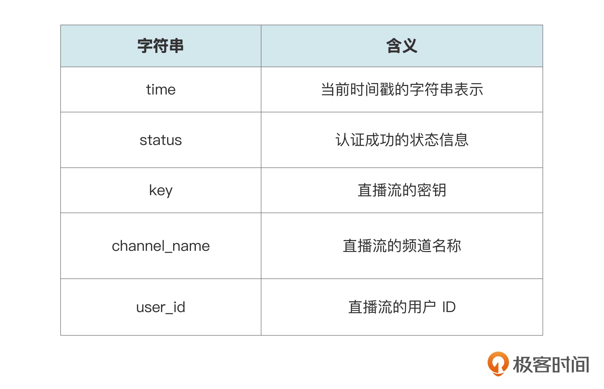
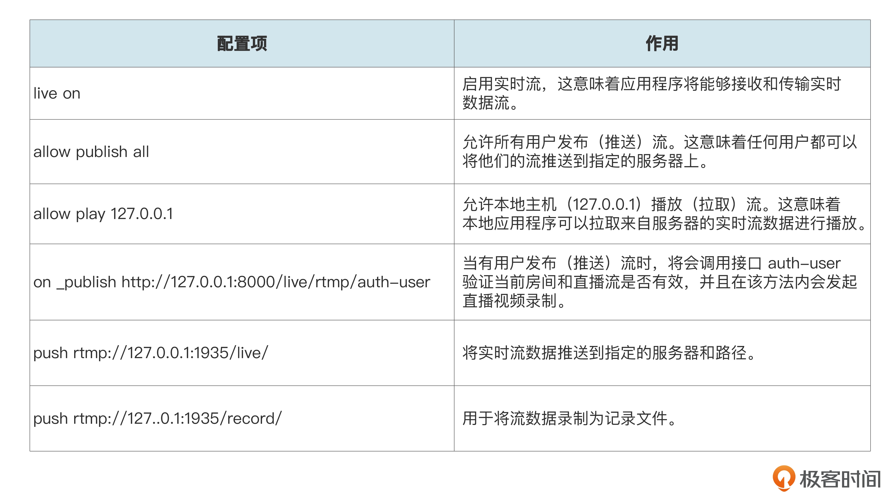
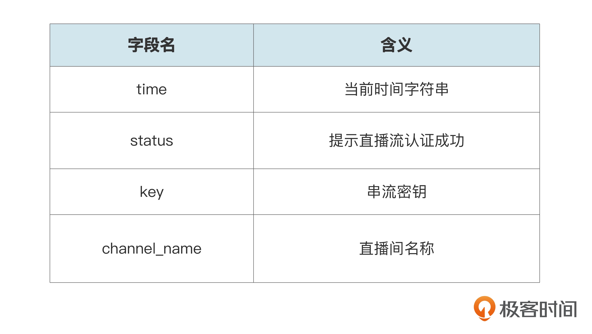
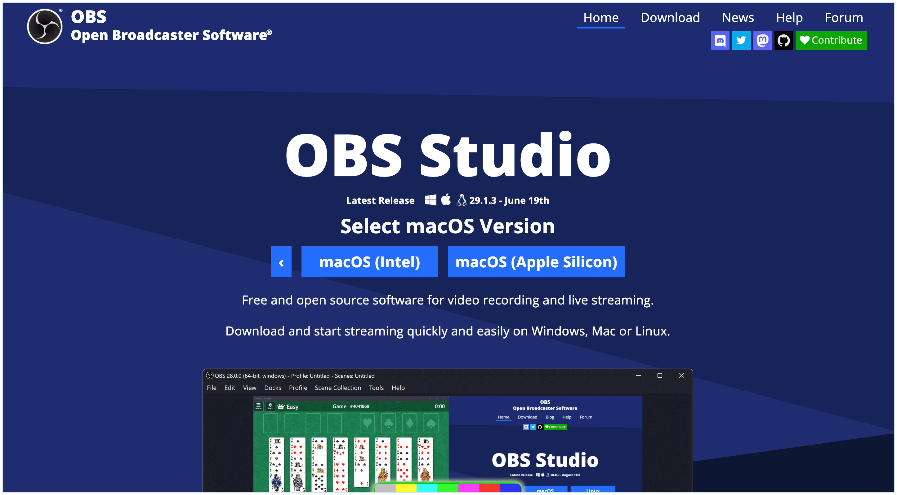
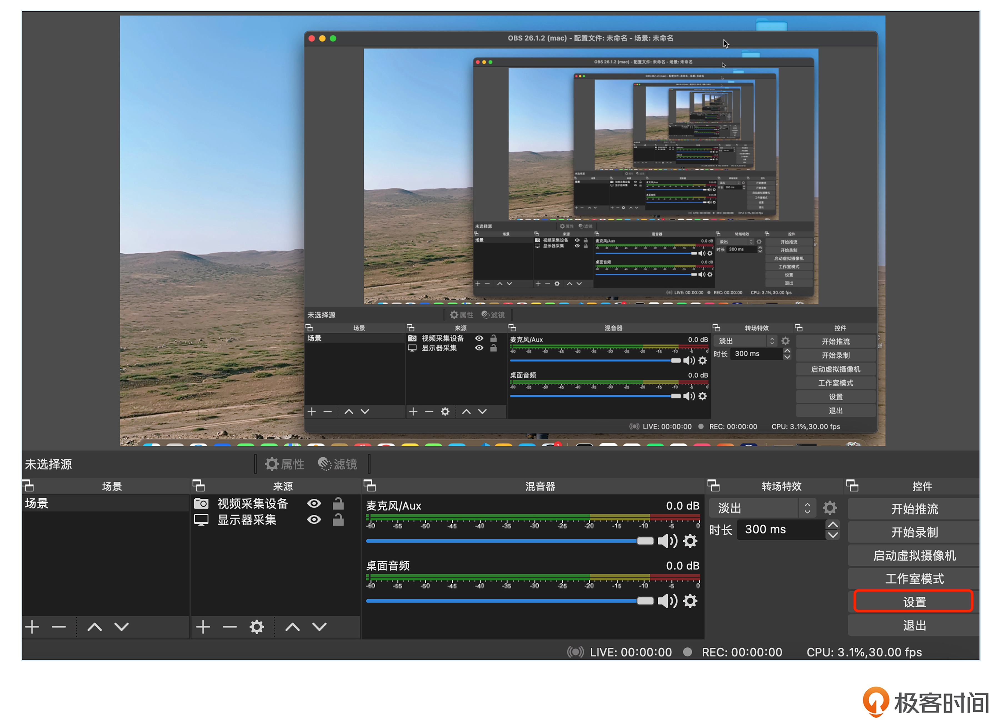
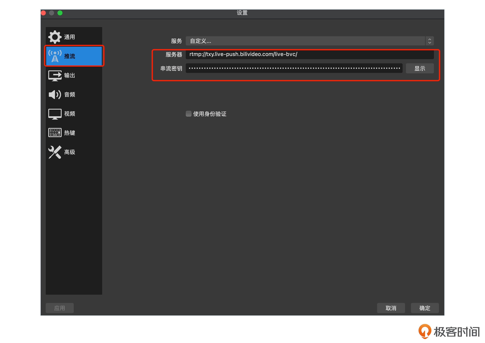
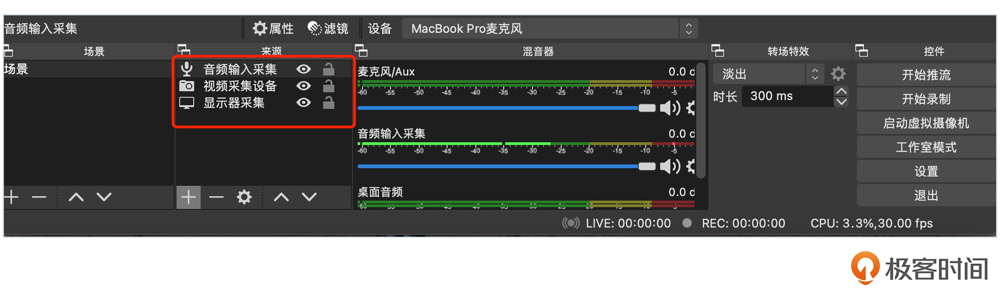
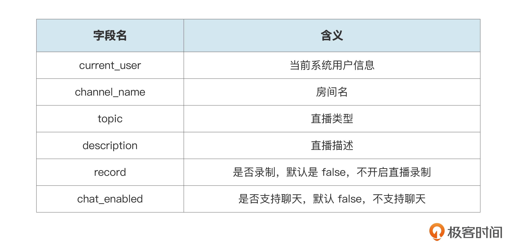

# 37 | 直播完整实现：使用Nginx-rtmp-module配置RTMP直播服务

你好，我是 Barry。

在上节课我们实现了直播推拉流，并且完成了视频直播和直播存储功能。现在你应该对推拉流到直播视频播放的全过程非常熟悉了，但目前系统仍然不够完备，还有很多功能点需要完善。

所以，这节课我们将会整合直播所有的流程以及相关的功能接口，让系统更完备。这节课我们主要会解决后面这几个问题。

- 如何实现直播权限验证？

- 如何做推流验证？

- 如何用 OBS 实现音频采集和推流？

- 如何创建直播间？

好，话不多说，咱们正式开始。

## 直播权限验证

当一个用户想要发起直播时，系统需要验证用户的直播权限，当用户的直播权限验证通过之后，才能发起直播，这么做是为了增强平台的安全性和规范性。

想要完成权限验证，我们首先要在用户表中设定权限字段。具体就是在 UserInfo 数据库表模型中新增该字段，这样到了后面接口操作时，我们才能通过该字段状态做权限的判断。

具体的用户信息表字段如下所示，对应的路径是 model/user.py。

```python
class UserInfo(BaseModels, db.Model):
   """用户信息表"""
   __tablename__ = "user_info"
   #######
   is_streamer = db.Column(db.SmallInteger, default=0) #用于直播权限判断
   active = db.Column(db.SmallInteger, default=0) #用户状态
   last_message_read_time = db.Column(db.DateTime)
```

其中的 is_streamer 用来帮我们判断用户是否具备推流权限。active 字段用于标记用户的激活状态，判断他是正常用户还是被封号的锁定用户。在系统中，我们可以结合这两个字段和推流权限认证接口，来判断用户有没有直播权限。

主要的实现逻辑是这样：我们先判断用户的视频直播流状态，还有用户是否为激活状态。同时，我们要把推流权限认证封装成一个公共接口，需要做用户直播权限判断的时候，都可以调用该接口来实现。

当然在调用接口前，我们需要更改 Nginx 的配置文件，在配置文件中新增 on_publish 和on_publish_done 这两个参数。on_publish 用来在推流开始前认证推流权限，on_publish_done 用在推流结束调用接口，完成推流结束的请求。对应的配置项如下所示。

```
application stream {
 live on;
 record off!
 allow publish all;
 allow play 127.0.0.1;
 on publish http://127..0.1:8000/live/rtmp/auth-key;
 on publish done http://127.0.0.1:8000/live/rtmp/deauth-user;
}
```

上面配置新增的就是 on_publish 和 on_publish_done。我们来梳理一下关键代码。

第 6 行代码表示在推流发生时，使用 HTTP 协议向 URL 为http://127.0.0.1:8000/live/rtmp/auth-key 的接口进行用户认证。

第 7 行代码表示在推流完成后，使用 HTTP 协议向 URL 为http://127.0.0.1:8000/live/rtmp/deauth-user 的接口停止推流。

### 权限处理情况一：用户无直播权限

配置完 Nginx RTMP 以后，接下来我们就看看用户权限判断的接口实现。这里我们把关注点放在核心代码的实现上，完整的代码你可以课后参考 Gitee 链接里的内容。

```python
@api.route('/auth-key', methods=['POST'])
def streamkey_check():
   """
   推流权限认证，验证name是否是推流的key，如果需要验证账号密码可以加入相应的参数进行拼接
   :return:
   """
   key = request.form['name']
   channel = Channel.query.filter_by(stream_key=key).first()  # 查看直播 streamkey
   current_time = datetime.datetime.now()
   if channel is not None:
       # 判断用户是否存在
       user = UserInfo.query.filter_by(id=channel.user_id).first()
       if user is not None:
           if user.is_streamer:
               if not user.active:
                   msg = {
                       'time': str(current_time),
                       'status': 'Unauthorized User - User has been Disabled',
                       'key': str(key)
                   }
                   print(msg)
                   return abort(400)
               msg = {
                   'time': str(current_time),
                   'status': 'Successful Key Auth',
                   'key': str(key),
                   'channel_name': str(channel.channel_name),
                   'user_id': str(channel.user_id)
               }
               print(msg)
```

虽然代码有点长，但跟着我的节奏来，理解起来并不难。我来为你解释一下核心代码。

第 7 行代码的作用是，我们从请求中获取一个表单数据中的名为 “name” 的字段值，并将其赋值给变量 key。这个字段值也就是直播的串流密钥。

第 8 行代码表示使用 Flask-SQLAlchemy 库查询数据库中的 Channel 模型，并通过stream_key 字段过滤出与给定密钥匹配的记录。同时还会将第一个匹配的记录赋值给变量channel，从而查看直播 streamkey 是否存在。

接下来是第 12 行代码，它用来查询数据库中的 UserInfo 模型，并通过 id 字段过滤出与给定直播流的用户 ID 匹配的记录，并将第一个匹配的记录赋值给变量 user。

第 13 行就是检查变量 user 是否为 None，如果不为 None，就代表系统找到了与给定直播流的用户 ID 匹配的用户记录，这样就能判断用户是否存在了。

我们再来看第 14 行，这部分用来判断用户是否有直播权限，它可以与第 15 行代码结合使用，通过直播密钥和用户状态的双层认证，达到把控直播权限的效果。

这时如果用户没有推流权限，我们就进行消息提示，也就是第 18 行“认证失败的状态信息，指示用户已被禁用”，这样的情况下用户就不可以进行直播，给前端返回错误信息的同时会再返回一个 400 状态码，告诉用户没有权限。

### 权限处理情况二：用户有直播权限

另一种情况是用户具备直播权限的情况，对应着前面从 23 行开始的代码，表示用户具备直播权限，系统要给用户返回对应前端需要的字段。具体字段含义你可以参考我梳理的表格。



到这里。我们就完成了用户直播权限的认证处理的功能。

如果用户具备直播权限，那么这时系统就要给用户生成对应的直播流，同时存储在 stream 表中（stream 表的作用就是用来存储当前正在直播的直播流），并重定向跳转到下一个application，也就是 stream-data 中。这么做主要是为了判断用户串流密钥是否有效，这样才能保证顺利发起直播。

刚刚这个过程的核心代码如下所示。你可以先整体看一下，再听我详细讲解。

```sql
exist_streams = Stream.query.filter_by(channel_id=channel.id).all()
# 查询视频流是否存在  如果存在直接删除
if exist_streams:
   for stream in exist_streams:
       db.session.delete(stream)
   db.session.commit()
default_stream_name = normalize_date(str(current_time))
if channel.default_stream_name != "":
   default_stream_name = channel.default_stream_name
new_stream = Stream(key, default_stream_name, int(channel.id), channel.topic)
db.session.add(new_stream)
db.session.commit()
return redirect('rtmp://' + NGINX_RTMP_ADDRESS + '/stream-data/' + channel.channe
```

第 1 行代码主要的作用就是通过查询数据库中的 Stream 表，筛选出具有与给定 channel.id 相同的 channel_id 的所有记录，并将结果赋值给 exist_streams 变量。这样，我们就能得到对应房间的直播流了。

再来看第 3 行到第 6 行代码，这部分表示如果 stream 表中包含直播流数据，系统就会从stream 数据库表中删除该视频流记录。然后通过 db.session.commit() 提交数据库会话，将之前删除的视频流记录永久保存到数据库中，做一个数据存储。

我们再来看看第 7 行代码，default_stream_name 用于获取指定录制直播视频的命名，这个命名是根据当前时间生成一个默认的视频流名称，并将其赋值给 default_stream_name。

紧接着是第 10 行代码，其中包含的字段有直播流的密钥、录制直播视频的命名、房间 id、直播类型信息。这行代码会根据这些字段，重新生成一条直播流数据。

第 11 行到 12 行的代码用来把新创建的视频流对象添加到数据库会话中，然后将新创建的视频流记录存储在直播流数据库中。这样等到直播流验证或推流时，就能从数据库中查询并记录返回给前端。

最后我们再看看第 13 行代码。我们在这一步需要再加一层过滤，通过重定向将请求转发到指定的 RTMP 服务器的 stream-data application 做用户的推流认证。这么做是为了确定当前直播流有效，以便完成相应的推流逻辑处理。

## 推流验证

接下来，我们看看 RTMP 中 stream-data 的配置，核心配置代码是后面这样。

```
application stream-data {
 live on;
 allow publish all;
 allow play 127.0.0.1;
 on _publish http://127.0.0.1:8000/live/rtmp/auth-user;
 push rtmp://127.0.0.1:1935/live/;
 push rtmp://127.0.1:1935/record/;
}
```

你可以参考后面的表格了解每一项配置的含义。



以上配置的核心就是当用户要发起推流时，系统就会调用 auth-user 的接口来验证直播流以及直播间是否可用，一旦开始直播就会开启录制功能。

那么问题来了，auth-user 接口具体怎么实现呢？后面是实现这个接口的核心代码，你不妨边看代码边听我给你讲解。

```python
@api.route('/auth-user', methods=['POST'])
def user_auth_check():
   """
   推流验证，验证上面推流的key是否有效
   :return:
   """
   key = request.form['name']
   request_channel = Channel.query.filter_by(channel_loc=key).first()
   if request_channel is not None:
       authed_stream = Stream.query.filter_by(stream_key=request_channel.stream_
       if authed_stream is not None:
           msg = {
               'time': str(datetime.datetime.now()),
               'status': 'Successful Channel Auth',
               'key': str(request_channel.stream_key),
               'channelName': str(request_channel.channel_name)
           }
           print(msg)
           input_location = "rtmp://" + NGINX_RTMP_ADDRESS + ":1935/live/" + req
           return 'ok'
       else:
           msg = {
               'time': str(datetime.datetime.now()),
               'status': 'Failed Channel Auth. No Authorized Stream Key',
               'channelName': str(key)
           }
           return abort(400)
   else:
       msg = {
           'time': str(datetime.datetime.now()),
           'status': 'Failed Channel Auth. Channel Loc does not match Channel',
           'channelName': str(key)
       }
       return abort(400)
```

以上的方法主要作用就是验证视频直播推流地址和串流密钥的有效性。

整体代码包括两组 if else 嵌套，我们先从最外面的来看。

第 7 到 8 行代码用来获取串流密钥和直播间的所有信息，后续逻辑处理都会基于这两个值来判断。

接着是第 10 行代码，if 语句用来判断获取的直播间信息是不是空值，如果不为空则执行第 11行到 30 行代码。反之，直接执行 31 行的 else，如果查询到的直播间无信息，则直接返回对应的提示信息，其中包含系统当前时间、以及提示信息“直播间身份验证失败，串流码与直播间不匹配”、直播间名称的字符串信息。

外层的 if else 处理之后，我们紧接着来看内层的实现逻辑，第 11 行代码会通过查询 stream表，来获取当前允许直播的直播流信息。

接下来是 13 行代码，用来判断直播流内容，确定是否为有效直播流。如果有效则给前端返回对应的参数信息 msg，这里包含四个字段，含义你可以参考下表。



21 行的 input_location 就是我们的 RTMP 推流地址。其中 NGINX_RTMP_ADDRESS 内容就是对应的服务器 IP 地址，这个是一个动态值，对应端口就是 1935，后面拼接的就是直播的串流码。

第 24 到 29 行代码仍然用来做错误处理。发生错误的时候，会返回错误状态码 400，告诉用户无该直播间直播权限，并且对应的串流密钥也是无权限的，因此无法发起直播。

这样我们就通过 auth-user 接口把直播相关数据返回给了前端。前端在获取到 RTMP 直播推流地址和串流密钥后，直接通过 OBS 就即可发起直播推流。

## OBS 实现推流和采集

接下来我们看看 OBS 是如何实现推流的。

OBS 是一款免费的、开源的直播录制软件，适用于 Windows、macOS 和 Linux 等多个操作系统。它能帮我们采集音视频数据，实现视频推流功能。

而且它整个操作也比较简单，我们直接到官网下载即可，你可以从文稿里获取对应的下载链接。



这里我格外提醒一下，Windows 的用户直接下载就行。而对于 macOS 用户，我们需要注意：

如果你的 Mac 电脑是 Intel 芯片，可以选择下载 OBS Studio 的 Intel 版本。这个版本是为Intel 处理器优化的，可以为我们提供更好的性能和兼容性。

如果你的 Mac 电脑是 Apple 芯片，可以选择下载 OBS Studio 的 Apple 版本。这个版本是为Apple 芯片优化的，可以在 Mac App Store 上下载和安装，稳定性和兼容性更好一些。

完成安装之后，我们就看看如何实现推流？我以 macOS 为例带你熟悉一下这个过程。

第一步我们要在界面当中选择设置，具体的效果图如下。



第二步，在点击设置去选择推流选项，这里的服务器地址就是你后端接口返回来的 RTMP 推流地址，也就是前面提到的 input_location.，串流密钥就是我们返回来的 key。然后，我们点击确定就可以实现推流了。



当然你也可以选择你要录制的内容，因为 OBS 目前默认设置是桌面录制，例如在上课场景中教师端分享桌面的功能。开始直播前，别忘了选择对应的音频输入，一般选择电脑的麦克风即可，具体的调节位置你可以参考后面的截图。



完成前面的配置，我们实现了在系统中直接发起直播，而并非手动配置启动。同时，我们也借助 OBS 的功能完成了音视频录制和直播推流。

那接下来我们看看创建直播间的接口实现，这一步也非常重要，只有创建完直播间之后才能开启直播。

## 创建直播间

用户如果要在平台内直播就需要创建直播房间，这里的主要涉及到的表就是 channel、stream、user。

user 的表字段我们在前面面已经说过了，至于 channel 和 stream 的表字段我们第 33 节课时也详细讲过。所以现在我们只需要聚焦功能实现就好，代码如下所示。

```python
@api.route('/info', methods=['POST'])
@auth_identify
def channels():
   current_user = g.user
   channel_name = request.form['channelName']
   topic = request.form['channelTopic']
   description = request.form['description']
   record = False
   if 'recordSelect' in request.form:
       record = True
   chat_enabled = False
   if 'chatEnabled' in request.form:
       chat_enabled = True
   new_uuid = str(uuid.uuid4())
   channel = Channel(current_user.id, new_uuid, channel_name, topic, record, cha
   # 上传视频直播图片
   if 'photo' in request.files:
       file = request.files['photo']
       if file.filename != '':
           filename = photos.save(request.files['photo'], name=str(uuid.uuid4())
           channel.image_location = filename
   channel.add(channel)
   return success('channel创建成功',data=channel.to_dict())
```

我们来梳理一下这段代码的含义。先看第 4 行到第 13 行，这一部分我们主要用来获取前端提交数据，具体字段含义你可以参考后面的表格。



前端的数据中包含是否录制直播和是否默认进入直播间能聊天两个字段，这两个字段会根据用户的选择来确定最终值。

第 14 行代码标识使用 uuid.uuid4() 函数生成一个 UUID，并将其转换为字符串格式，然后将其赋值给变量 new_uuid。这样，new_uuid 将包含一个随机生成的 UUID 作为字符串，作为唯一标识。

第 16 行代码代表创建一个 channel 对象，这里用到了 Channel 表模型类，传入所有需要提交的参数。channel 对象用于在第 23 行的 channel.add 操作，方便我们将新增的直播间信息添加到数据库。

第 18 到 22 行代码主要用于验证上传视频直播图片文件格式。

具体逻辑是这样的：首检查请求中的文件是否存在名为 photo 的文件，然后获取名为 photo 的文件对象，并将其赋值给变量 file 。然后，我们要检查文件对象的文件名是否不为空。如果为空，就使用 photos.save() 方法将上传的文件保存到应用的图片存储库中，并生成一个新的文件名。这里使用了一个随机生成的 UUID 字符串作为文件名的一部分，以确保唯一性。

最后来看第 22 行，这行代码的作用是将新生成的文件名赋值给 channel.image_location 属性，然后存储在数据库中。到这里，我们就完成了直播间的创建，恭喜你坚持到这里。

## 总结

又到了课程的尾声，让我们一起回顾一下这节课的内容吧。

这节课我们以最有代表性的接口实现为例，逐一实现了直播模块系统性的功能，让直播模块更加系统完善。其他接口实现的完整代码和详细注释，我会上传到 Gitee，其实它们实现思路和这节课的例子大同小异。只要我们梳理好功能需求，接口开发并不困难。

功能需求的梳理我带你多次练习过，诀窍就是换位思考，跟着用户的行动线梳理。

当一个用户发起直播时，我们必然会验证用户的直播权限。如果当前用户是激活状态，表明用户在使用状态。其次就是判断用户的直播推流权限。当二者同时满足时，用户才能够发起直播。另外，你会发现我们对有权限和无权限的用户也做了分支处理，这样能在完善功能的同时保证用户的功能体验。

当验证通过之后，表明用户具备直播权限，但是我们还需要验证他当前的直播间和视频直播流是否有效。这时就需要调用 auth-user 的接口来验证直播流以及直播间是否可用，同时开启直播录制功能。

这个部分有两个重点需要你关注。

第一，验证完用户直播权限后，下一步我们要在接口中通过重定向将请求转发到指定 RTMP服务器的 stream-data application。然后继续做用户的推流认证，确保用户能够实现推流。所以这一步你要提前在 RTMP 配置。

第二，在推流认证接口中，我们嵌套了两个 if else 条件判断，分别来判断直播间信息有效性和用户直播推流地址有效性。用户推流前做一层认证是为了提高系统安全性。

之后，我们利用 OBS 来解决音视频采集和直播推流的功能。OBS 的使用其实很简单，这部分你直接按照课程里我提供的操作步骤来实现即可。

最后，我们一起学习了直播间创建的接口如何实现。我来给你总结一下实现逻辑：创建直播间，获取到用户提交的数据。然后通过 channel 模型类创建一个 channel 对象，并存储到数据库。你会发现，这和其他模块的接口实现逻辑没有什么大的区别。

相信到这里，你也能够总结出接口开发的实现思路和框架了。项目实战环节常常是师傅领进门，修行看个人，需要你课后大量实践，不断总结经验，把握规律，然后推陈出新，这样将会大大提升你的技术硬实力。

## 思考题

在系统中，如果我们要结束视频直播，你觉得这个功能逻辑该如何设计？

欢迎你在留言区和我交流互动，也推荐你把今天这节课分享给身边更多朋友。
