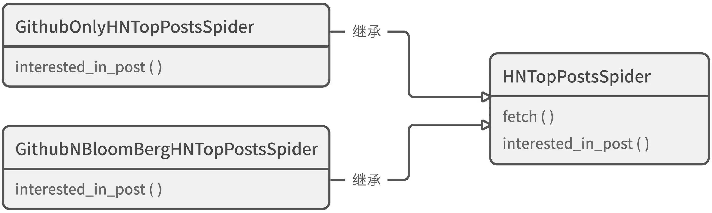
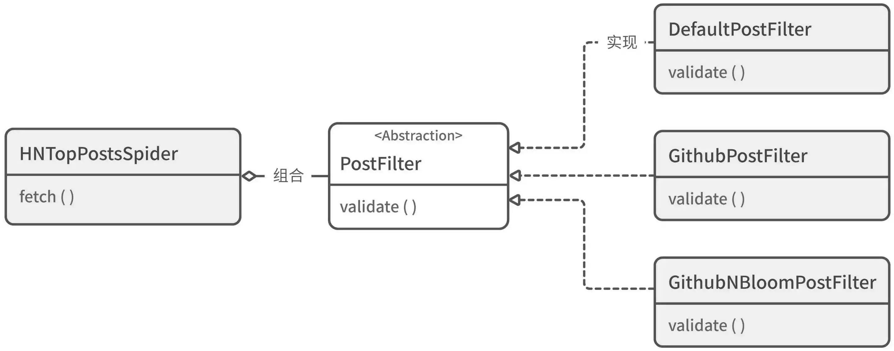

# 第10章面向对象设计原则（上）

面向对象作为一种流行的编程模式，功能强大，但同时也很难掌握。一位面向对象的初学者，从能写一些简单的类，到能独自完成优秀的面向对象设计，往往要花费数月乃至数年的时间。

为了让面向对象编程变得更容易，许多前辈将自己的宝贵经验整理成了图书等资料。其中最有名的一本，当属 1994 年出版的《设计模式：可复用面向对象软件的基础》。

在《设计模式》一书中，4 位作者从各自的经验出发，总结了 23 种经典设计模式，涵盖面向对象编程的各个环节，比如对象创建、行为包装等，具有极高的参考价值和实用性。

但奇怪的是，虽然这 23 种设计模式非常经典，我们却很少听到 Python 开发者讨论它们，也很少在项目代码里见到它们的身影。为什么会这样呢？这和 Python 语言的动态特性有关。

《设计模式》中的大部分设计模式是作者用静态编程语言，在一个有着诸多限制的面向对象环境里创造出来的。而 Python 是一门动态到骨子里的编程语言，它有着一等函数对象、“鸭子类型”、可自定义的数据模型等各种灵活特性。因此，我们极少会用 Python 来一比一还原经典设计模式，而几乎总是会为每种设计模式找到更适合 Python 的表现形式。

```
比如，9.3.4 节就有一个与“单例模式”有关的例子。在示例代码里，我先是用 __new__ 方法实
```

现了经典的单例设计模式。但随后，一个模块级全局对象用更少的代码满足了同样的需求。

```python
# 1：单例模式
class AppConfig:
   _instance = None
   def __new__(cls):
       if cls._instance is None:
           inst = super().__new__(cls)
           cls._instance = inst
       return cls._instance
# 2：全局对象
class AppConfig:
   ...
_config = AppConfig()
```

既然 Python 里的设计模式无法像在其他编程语言里一样带给我们太多实用价值，那我们还能如何学习面向对象设计？当我们编写面向对象代码时，怎样判断不同方案的优劣？怎样打磨出更好的设计？

SOLID 设计原则可以回答上面的问题。

在面向对象领域，除了 23 种经典的设计模式外，还有许多经典的设计原则。同具体的设计模式相比，原则通常更抽象、适用性更广，更适合融入 Python 编程中。而在所有的设计原则中，SOLID 最为有名。

- 1

SOLID 原则的雏形来自 Robert C. Martin（Bob 大叔）于 2000 年发表的一篇文章

- ，其中他

创造与整理了多条面向对象设计原则。在随后出版的《敏捷软件开发：原则、模式与实践》一书中，Bob 大叔提取了这些原则的首字母，组成了单词 SOLID 来帮助记忆。

SOLID 单词里的 5 个字母，分别代表 5 条设计原则。

- S：single responsibility principle（单一职责原则，SRP）。

- O：open-closed principle（开放–关闭原则，OCP）。

- L：Liskov substitution principle（里式替换原则，LSP）。

- I：interface segregation principle（接口隔离原则，ISP）。

- D：dependency inversion principle（依赖倒置原则，DIP）。

在编写面向对象代码时，遵循这些设计原则可以帮你避开常见的设计陷阱，以便写出易于扩展的好代码。反之，如果你的代码违反了其中某几条原则，那么你的设计可能有相当大的改进空间。

接下来，我们将学习这 5 条设计原则的具体内容，并通过一些真实案例将原则应用到 Python代码中。

鉴于 SOLID 原则内容较多，我将其拆分成了两章。在本章中，我们将学习这 5 条原则中的前两条。

- SRP：单一职责原则

- OCP：开放–关闭原则。

我们开始吧！

## 10.1　类型注解基础

为了让代码更具说明性，更好地描述这些原则的特点，本章及下一章的所有代码将会使用Python 的类型注解特性。

在第 1 章中，我简单介绍过 Python 的类型提示（type hint）功能。简而言之，类型注解是一种给函数参数、返回值以及任何变量增加类型描述的技术，规范的注解可以大大提升代码可读性。

举个例子，下面的代码没有任何类型注解：

```python
class Duck:
   """鸭子类
   :param color: 鸭子颜色
   """
   def __init__(self, color):
       self.color = color
   def quack(self):
       print(f"Hi, I'm a  duck!")
def create_random_ducks(number):
   """创建一批随机颜色的鸭子
   :param number: 需要创建的鸭子数量
   """
   ducks = []
   for _ in number:
       color = random.choice(['yellow', 'white', 'gray'])
       ducks.append(Duck(color=color))
   return ducks
```

下面是添加了类型注解后的代码：

```python
from typing import List
class Duck:
   def __init__(self, color: str): ➊
       self.color = color
   def quack(self) -> None: ➋
       print(f"Hi, I'm a  duck!")
def create_random_ducks(number: int) -> List[Duck]: ➌
   ducks: List[Duck] = [] ➍
   for _ in number:
       color = random.choice(['yellow', 'white', 'gray']) ➎
       ducks.append(Duck(color=color))
   return ducks
```

- ❶ 给函数参数加上类型注解

```
❷ 通过 -> 给返回值加上类型注解
❸ 你可以用 typing 模块的特殊对象 List 来标注列表成员的具体类型，注意，这里用的
是 [] 符号，而不是 ()
```

- ❹ 声明变量时，也可以为其加上类型注解

```
❺ 类型注解是可选的，非常自由，比如这里的 color 变量就没加类型注解
typing 是类型注解用到的主要模块，除了 List 以外，该模块内还有许多与类型有关的特殊
```

对象，举例如下。

```
Dict：字典类型，例如 Dict[str, int] 代表键为字符串，值为整型的字典。
Callable：可调用对象，例如 Callable[[str, str], List[str]] 表示接收两个
```

- 字符串作为参数，返回字符串列表的可调用对象。

```
TextIO：使用文本协议的类文件类型，相应地，还有二进制类型 BinaryIO。
Any：代表任何类型。
```

默认情况下，你可以把 Python 里的类型注解当成一种用于提升代码可读性的特殊注释，因为它就像注释一样，只提升代码的说明性，不会对程序的执行过程产生任何实际影响。

但是，如果引入静态类型检查工具，类型注解就不再仅仅是注解了。它在提升可读性之余，还能对程序正确性产生积极的影响。在 13.1.5 节中，我会介绍如何用 mypy 来做到这一点。

对类型注解的简介就到这里，如果你想了解更多内容，可以查看 Python 官方文档的“类型注解”部分，里面的内容相当详细。

## 10.2　SRP：单一职责原则

本章将通过一个具体案例来说明 SOLID 原则的前两条：SRP 和 OCP。

### 10.2.1　案例：一个简单的 Hacker News 爬虫

Hacker News 是一个知名的国外科技类资讯站点，在程序员圈子内很受欢迎。在 HackerNews 首页，你可以阅读当前热门的文章，参与讨论。同时，你也可以向首页提交新的文章链接，系统会根据评分算法对文章进行排序，最受关注的热门文章会排在最前面。Hacker News首页如图 10-1 所示。


- 图 10-1　Hacker News 首页截图

我平时挺爱逛 Hacker News 的，常会去上面找一些热门文章看。但每次都需要打开浏览器，在收藏夹找到网站书签，步骤比较烦琐——程序员嘛，都“懒”！

为了让浏览 Hacker News 变得更方便，我想写个程序，它能自动获取 Hacker News 首页最热门的条目标题和链接，把它们保存到普通文件里。这样我就能直接在命令行里浏览热门文章了，岂不美哉？

```
作为 Python 程序员，写个小脚本自然不在话下。利用 requests、lxml 等模块提供的强大
```

功能，不到半小时，我就把程序写好了，如代码清单 10-1 所示。

- 代码清单 10-1　Hacker News 新闻抓取脚本 news_digester.py

```python
import io
import sys
from typing import Iterable, TextIO
import requests
from lxml import etree
class Post:
   """ Hacker News 上的条目
   :param title: 标题
   :param link: 链接
   :param points: 当前得分
   :param comments_cnt: 评论数
   """
   def __init__(self, title: str, link: str, points: str, comments_cnt: str):
       self.title = title
       self.link = link
       self.points = int(points)
       self.comments_cnt = int(comments_cnt)
class HNTopPostsSpider:
   """抓取 Hacker News Top 内容条目
   :param fp: 存储抓取结果的目标文件对象
   :param limit: 限制条目数，默认为 5
   """
   items_url = 'https://news.ycombinator.com/'
   file_title = 'Top news on HN'
   def __init__(self, fp: TextIO, limit: int = 5):
       self.fp = fp
       self.limit = limit
   def write_to_file(self):
       """以纯文本格式将 Hacker News Top 内容写入文件"""
       self.fp.write(f'# \n\n')
       for i, post in enumerate(self.fetch(), 1): ➊
           self.fp.write(f'> TOP : \n')
           self.fp.write(f'> 分数： 评论数：\n')
           self.fp.write(f'> 地址：\n')
           self.fp.write('------\n')
   def fetch(self) -> Iterable[Post]:
       """从 Hacker News 抓取 Top 内容
       :return: 可迭代的 Post 对象
       """
       resp = requests.get(self.items_url)
       # 使用 XPath 可以方便地从页面解析出需要的内容，以下均为页面解析代码
       # 如果你对 XPath 不熟悉，可以忽略这些代码，直接跳到 yield Post() 部分
       html = etree.HTML(resp.text)
       items = html.xpath('//table[@class="itemlist"]/tr[@class="athing"]')
       for item in items[: self.limit]:
           node_title = item.xpath('./td[@class="title"]/a')[0]
           node_detail = item.getnext()
           points_text = node_detail.xpath('.//span[@class="score"]/text()')
           comments_text = node_detail.xpath('.//td/a[last()]/text()')[0]
           yield Post(
               title=node_title.text,
               link=node_title.get('href'),
               # 条目可能会没有评分
               points=points_text[0].split()[0] if points_text else '0',
               comments_cnt=comments_text.split()[0],
           )
def main():
   # with open('/tmp/hn_top5.txt') as fp:
   #     crawler = HNTopPostsSpider(fp)
   #     crawler.write_to_file()
   # 因为 HNTopPostsSpider 接收任何 file-like 对象，所以我们可以把 sys.stdout 传进去
   # 实现向控制台标准输出打印的功能
   crawler = HNTopPostsSpider(sys.stdout)
   crawler.write_to_file()
if __name__ == '__main__':
   main()
❶ enumerate() 接收第二个参数，表示从这个数开始计数（默认为 0）
```

执行这个脚本，我就能在命令行里看到 Hacker News 站点上的 Top 5 条目：

```
$ python news_digester.py
# Top news on HN
> TOP 1: The auction that set off the race for AI supremacy
> 分数：72 评论数：10
> 地址：https://www.wired.com/story/secret-auction-race-ai-supremacy-google-micros
------
> TOP 2: Introducing the Wikimedia Enterprise API
> 分数：47 评论数：12
> 地址：https://diff.wikimedia.org/2021/03/16/introducing-the-wikimedia-enterprise
------
...
```

显然，上面的代码是面向对象风格的。这是因为我在代码里定义了如下两个类。

```
(1) Post：代表一个 Hacker News 内容条目，包含标题、链接等字段，是一个典型的“数据
```

类”，主要用来衔接程序的“数据抓取”与“文件写入”行为。

```
(2) HNTopPostsSpider：抓取 Hacker News 内容的爬虫类，包含抓取页面、解析、写入结
```

果等行为，是完成主要工作的类。

虽然这个脚本遵循面向对象风格（也就是定义了几个类而已），可以满足我的需求，但从设计的角度看，它违反了 SOLID 原则中的第一条：SRP，我们来看看这是为什么。

SRP 认为：一个类应该仅有一个被修改的理由。换句话说，每个类都应该只承担一种职责。

要理解 SRP，最重要的是理解原则里所说的“修改的理由”代表什么。显而易见，程序本身是没有生命的，修改的理由不会来自程序自身。你的程序不会突然跳起来说“我觉得我执行起来有点儿慢，需要优化一下”这种话。

所有修改程序的理由，都来自与程序相关的人，人是导致程序被修改的“罪魁祸首”。

```
举个例子，在上面的爬虫脚本里，你可以轻易找到两个需要修改 HNTopPostsSpider 类的
```

理由。

- 理由 1：Hacker News 网站的程序员突然更新了页面样式，旧 XPath 解析算法无法正常解

```
析新页面，因此需要修改 fetch() 方法里的解析逻辑。
```

- 理由 2：程序的用户（也就是我）觉得纯文本格式不好看，想要改成 Markdown 样式，因

```
此需要修改 write_to_file() 方法里的输出逻辑。
从这两个理由看来，HNTopPostsSpider 明显违反了 SRP，它同时承担了“抓取帖子列表”和
```

“将帖子列表写入文件”两种职责。

### 10.2.2　违反 SRP 的坏处

假如某个类违反了 SRP，我们就会经常出于某种原因去修改它，而这很可能会导致不同功能之间互相影响。比如，某天我为了适配 Hacker News 站点的新样式，调整了页面的解析逻辑，却发现输出的文件内容全被破坏了。

另外，单个类承担的职责越多，就意味着这个类越复杂，越难维护。在面向对象领域，有一种“臭名昭著”的类：God Class，专指那些包含了太多职责、代码特别多、什么事情都能做的类。God Class 是所有程序员的噩梦，每个理智尚存的程序员在碰到 God Class 后，第一个想法总是逃跑，逃得越远越好。

最后，违反 SRP 的类也很难复用。假如我现在要写另一个和 Hacker News 有关的脚本，需要

```
复用 HNTopPostsSpider 类的抓取和解析逻辑，会发现这件事根本做不到，因为我必须提
供一个莫名其妙的文件对象给 HNTopPostsSpider 类才行。
```

违反 SRP 的坏处说了一箩筐，那么，究竟怎么修改脚本才能让它符合 SRP 呢？办法有很多，其中最传统的就是把大类拆分为小类。

### 10.2.3　大类拆小类

```python
为了让 HNTopPostsSpider 类的职责变得更纯粹，我把其中与“写入文件”相关的内容拆了出
去，形成了一个新的类 PostsWriter，如下所示：
class PostsWriter:
   """负责将帖子列表写入文件中"""
   def __init__(self, fp: io.TextIOBase, title: str):
       self.fp = fp
       self.title = title
   def write(self, posts: List[Post]):
       self.fp.write(f'# \n\n')
       for i, post in enumerate(posts, 1):
           self.fp.write(f'> TOP : \n')
           self.fp.write(f'> 分数： 评论数：\n')
           self.fp.write(f'> 地址：\n')
           self.fp.write('------\n')
然后，对于 HNTopPostsSpider 类，我直接删掉 write_to_file() 方法，让它只保留
fetch() 方法：
class HNTopPostsSpider:
   """抓取 Hacker News Top 内容条目"""
   def __init__(self, limit: int = 5):
       ...
   def fetch(self) -> Iterable[Post]:
       ...
这样修改以后，HNTopPostsSpider 和 PostsWriter 类都符合了 SRP。只有当解析逻辑
变化时，我才会修改 HNTopPostsSpider 类。同样，修改 PostsWriter 类的理由也只有
```

调整输出格式一种。

这两个类各自的修改可以单独进行而不会相互影响。

最后，由于现在两个类各自只负责一件事，需要一个新角色把它们的工作串联起来，因此我实

```python
现了一个新的函数 get_hn_top_posts()：
def get_hn_top_posts(fp: Optional[TextIO] = None):
   """获取 Hacker News Top 内容，并将其写入文件中
   :param fp: 需要写入的文件，如未提供，将向标准输出打印
   """
   dest_fp = fp or sys.stdout
   crawler = HNTopPostsSpider()
   writer = PostsWriter(dest_fp, title='Top news on HN')
   writer.write(list(crawler.fetch()))
新函数通过组合 HNTopPostsSpider 与 PostsWriter 类，完成了主要工作。
```

- 函数同样可以做到“单一职责”单一职责是面向对象领域的设计原则，通常用来形容类。而在 Python 中，单一职责的适用范围不限于类——通过定义函数，我们同样能让上面的代码符合单一职责原则。在下面的代码里，“写入文件”的逻辑就被拆分成了一个函数，它专门负责将帖子列表写入文件里：

```python
def write_posts_to_file(posts: List[Post], fp: TextIO, title: str):
1
   """负责将帖子列表写入文件"""
2
   fp.write(f'# \n\n')
3
   for i, post in enumerate(posts, 1):
4
       fp.write(f'> TOP : \n')
5
       fp.write(f'> 分数： 评论数：\n')
6
       fp.write(f'> 地址：\n')
7
       fp.write('------\n')
8
```

- 这个函数只做一件事，同样符合 SRP。将某个职责拆分为新函数是一个具有 Python 特色的解决方案。它虽然没有那么“面向对象”，却非常实用，甚至在许多场景下比编写类更简单、更高效。

## 10.3　OCP：开放 - 关闭原则

SOLID 原则的第二条是 OCP（开放–关闭原则）。该原则认为：类应该对扩展开放，对修改封闭。换句话说，你可以在不修改某个类的前提下，扩展它的行为。

这是一个看上去自相矛盾、让人一头雾水的设计原则。不修改代码的话，怎么改变行为呢？难道用超能力吗？

其实，OCP 没你想得那么神秘，你身边就有一个符合 OCP 的例子：内置排序函数

```
sorted()。这是一个对可迭代对象进行排序的内置函数，它的使用方法如下：
>>> l = [5, 3, 2, 4, 1]
>>> sorted(l)
[1, 2, 3, 4, 5]
默认情况下，sorted() 的排序策略是递增的，小的在前，大的在后。
现在，假如我想改变 sorted() 的排序逻辑，比如，让它使用所有元素对 3 取模后的结果排
序。我是不是得去修改 sorted() 函数的源码呢？当然不用，我只要在调用函数时，传入自
定义的 key 参数就行了：
>>> l = [8, 1, 9]
>>> sorted(l, key=lambda i: i % 3) ➊
[9, 1, 8]
```

- ❶ 按照元素对 3 取模的结果排序，能被 3 整除的 9 排在了最前面，随后是 1 和 8

```
通过上面的例子可以发现，sorted() 函数是一个符合 OCP 的绝佳例子，原因如下。
对扩展开放：可以通过传入自定义 key 参数来扩展它的行为。
```

- 2

```
对修改关闭：无须修改 sort() 函数本身
```

- 。

接下来，我们回到我的 Hacker News 爬虫脚本，看看 OCP 会对它产生什么影响。

### 10.3.1　接受 OCP 的考验

距上次用“单一职责”改造完 Hacker News 爬虫脚本已经过去了三天。其间我发现虽然脚本可以快速抓取内容，用起来很方便，但在多数情况下，抓取的内容不是我想看的。

当前版本的脚本会不分来源地把热门条目都抓取回来，但其实我只对那些来自特定站点（比如GitHub）的内容感兴趣。

```
因此，我需要对脚本做一点儿改动——修改 HNTopPostsSpider 类的代码来对结果进行过
```

滤。

很快，代码就修改完毕了：

```python
from urllib import parse
class HNTopPostsSpider:
   ...
   def fetch(self) -> Iterable[Post]:
       """从 Hacker News 抓取 Top 内容"""
       # ...
       counter = 0
       for item in items:
           if counter >= self.limit:
               break
           # ...
           link = node_title.get('href')
           # 只关注来自 GitHub 的内容
           parsed_link = parse.urlparse(link) ➊
           if parsed_link.netloc == 'github.com':
               counter += 1
               yield Post(...)
❶ 调用 urlparse() 会返回某个 URL 地址的解析结果——一个 ParsedResult 对象，
该结果对象包含多个属性，其中 netloc 代表主机地址（域名）
```

接下来，简单测试一下修改后的效果：

```
$ python news_digester_O_before.py
# Top news on HN
> TOP 1: Mimalloc – A compact general-purpose allocator
> 分数：291 评论数：40
> 地址：https://github.com/microsoft/mimalloc
------
...
```

看起来，新写的过滤代码起了作用，现在只有当内容条目来自 GitHub 网站时，才会写入结果中。

不过，正如古希腊哲学家赫拉克利特所言：这世间唯一不变的，只有变化本身。没过几天，我

- 3

的兴趣就发生了变化，我突然觉得，除了 GitHub 以外，来自 Bloomberg

- 的内容也很有意

思。因此，我得给脚本的筛选逻辑加一个新域名：bloomberg.com。

```
这时我发现，为了增加 bloomberg.com，我必须修改现有的 HNTopPostsSpider 类代码，
调整那行 if parsed_link.netloc == 'github.com' 判断语句，才能达到目的。
```

还记得 OCP 说的什么吗？“类应该对扩展开放，对修改关闭”。按照这个定义，现在的代码明显违反了 OCP，因为我必须修改类代码，才能调整域名过滤条件。

那么，怎样才能让类符合 OCP，达到不改代码就能调整行为的状态呢？第一个办法是使用继承。

### 10.3.2　通过继承改造代码

继承是面向对象编程里的一个重要概念，它提供了强大的代码复用能力。

继承与 OCP 之间有着重要的联系。继承允许我们用一种新增子类而不是修改原有类的方式来扩展程序的行为，这恰好符合 OCP。而要做到有效地扩展，关键点在于先找到父类中不稳定、会变动的内容。只有将这部分变化封装成方法（或属性），子类才能通过继承重写这部分行为。

```
话题回到我的爬虫脚本。在目前的需求场景下，HNTopPostsSpider 类里会变动的不稳定逻
```

辑，其实就是“用户对条目是否感兴趣”部分（谁让我一天一个想法呢）。

因此，我可以将这部分逻辑抽出来，提炼成一个新方法：

```python
class HNTopPostsSpider:
   ...
   def fetch(self) -> Iterable[Post]:
       # ...
       for item in items:
           # ...
           post = Post(...)
           # 使用测试方法来判断是否返回该帖子
           if self.interested_in_post(post):
               counter += 1
               yield post
   def interested_in_post(self, post: Post) -> bool:
       """判断是否应该将帖子加入结果中"""
       return True
```

有了这样的结构后，假如我只关心来自 GitHub 网站的帖子，那么只要定义一个继承

```python
HNTopPostsSpider 的子类，然后重写父类的 interested_in_post() 方法即可：
class GithubOnlyHNTopPostsSpider(HNTopPostsSpider):
   """只关心来自 GitHub 的内容"""
   def interested_in_post(self, post: Post) -> bool:
       parsed_link = parse.urlparse(post.link)
       return parsed_link.netloc == 'github.com'
def get_hn_top_posts(fp: Optional[TextIO] = None):
   # crawler = HNTopPostsSpider()
   # 使用新的子类
   crawler = GithubOnlyHNTopPostsSpider()
   ...
```

假如某天我的兴趣发生了变化，也没关系，不用修改旧代码，只要增加新子类就行：

```python
class GithubNBloomBergHNTopPostsSpider(HNTopPostsSpider):
   """只关心来自 GitHub/Bloomberg 的内容"""
   def interested_in_post(self, post: Post) -> bool:
       parsed_link = parse.urlparse(post.link)
return parsed link.netloc in ('github.com', 'bloomberg.com')
```

在这个框架下，只要需求变化和“用户对条目是否感兴趣”有关，我都不需要修改原本的

```
HNTopPostsSpider 父类，而只要不断地在其基础上创建新的子类即可。通过继承，我最终
```

实现了 OCP 所说的“对扩展开放，对改变关闭”，如图 10-2 所示。



- 图 10-2　通过继承践行 OCP

### 10.3.3　使用组合与依赖注入

虽然继承功能强大，但它并非通往 OCP 的唯一途径。除了继承外，我们还可以采用另一种思路：组合（composition）。更具体地说，使用基于组合思想的依赖注入（dependencyinjection）技术。

与继承不同，依赖注入允许我们在创建对象时，将业务逻辑中易变的部分（常被称为“算法”）通过初始化参数注入对象里，最终利用多态特性达到“不改代码来扩展类”的效果。

如之前所分析的，在这个脚本里，“条目过滤算法”是业务逻辑里的易变部分。要实现依赖注入，我们需要先对过滤算法建模。

```python
首先定义一个名为 PostFilter 的抽象类：
from abc import ABC, abstractmethod
class PostFilter(ABC):
   """抽象类：定义如何过滤帖子结果"""
   @abstractmethod
   def validate(self, post: Post) -> bool:
       """判断帖子是否应该保留"""
```

随后，为了实现脚本的原始逻辑：不过滤任何条目，我们创建一个继承该抽象类的默认算法类

```python
DefaultPostFilter，它的过滤逻辑是保留所有结果。
要实现依赖注入，HNTopPostsSpider 类也需要做一些调整，它必须在初始化时接收一个名
为 post_filter 的结果过滤器对象：
class DefaultPostFilter(PostFilter):
   """保留所有帖子"""
   def validate(self, post: Post) -> bool:
       return True
class HNTopPostsSpider:
   """抓取 Hacker News Top 内容条目
   :param limit: 限制条目数，默认为 5
   :param post_filter: 过滤结果条目的算法，默认保留所有
   """
   items_url = 'https://news.ycombinator.com/'
   def __init__(self, limit: int = 5, post_filter: Optional[PostFilter] = None):
       self.limit = limit
       self.post_filter = post_filter or DefaultPostFilter() ➊
   def fetch(self) -> Iterable[Post]:
       # ...
       counter = 0
       for item in items:
           # ...
           post = Post(...)
           # 使用测试方法来判断是否返回该帖子
           if self.post_filter.validate(post):
               counter += 1
               yield post
❶ 因为 HNTopPostsSpider 类所依赖的过滤器是通过初始化参数注入的，所以这个技术
```

- 被称为“依赖注入”

```
如代码所示，当我不提供 post_filter 参数时，HNTopPostsSpider.fetch() 会保留所
```

有结果，不进行任何过滤。假如需求发生了变化，需要修改当前的过滤逻辑，那么我只要创建

```python
一个新的 PostFilter 类即可。
下面就是分别过滤 GitHub 与 Bloomberg 的两个 PostFilter 类：
class GithubPostFilter(PostFilter):
   def validate(self, post: Post) -> bool:
       parsed_link = parse.urlparse(post.link)
       return parsed_link.netloc == 'github.com'
class GithubNBloomPostFilter(PostFilter):
   def validate(self, post: Post) -> bool:
       parsed_link = parse.urlparse(post.link)
       return parsed_link.netloc in ('github.com', 'bloomberg.com')
在创建 HNTopPostsSpider 对象时，我可以选择传入不同的过滤器对象，以满足不同的过
```

滤需求：

```
crawler = HNTopPostsSpider() ➊
crawler = HNTopPostsSpider(post_filter=GithubPostFilter()) ➋
crawler = HNTopPostsSpider(post_filter=GithubNBloomPostFilter()) ➌
```

- ❶ 不过滤任何内容❷ 仅过滤 GitHub 站点❸ 过滤 GitHub 与 Bloomberg 站点

类之间的关系如图 10-3 所示。



- 图 10-3　通过依赖注入实现 OCP

通过抽象与提炼过滤器算法，并结合多态与依赖注入技术，我同样让代码符合了 OCP。

- 抽象类不是必需的你应该发现了，我编写的过滤器算法类其实没有共享抽象类里的任何代码，也没有任何通过

```
继承来复用代码的需求。因此，我其实可以完全不定义 PostFilter 抽象类，而直接编写
```

- 后面的过滤器类。这样做对于程序的运行效果不会有任何影响，因为 Python 是一门“鸭子类型”的编程语言，

```
它在调用不同算法类的 .validate()（也就是“多态”）前，不会做任何类型检查工作。
但是，如果少了 PostFilter 抽象类，当编写 HNTopPostsSpider 类的 __init__ 方
式时，我就无法给 post_filter 增加类型注解了——post_filter: Optional[ 这
里写什么？]，因为我根本找不到一个具体的类型。
```

- 所以我必须编写一个抽象类，以此满足类型注解的需求。这件事情告诉我们：类型注解会让 Python 更接近静态语言。启用类型注解，你就必须时刻寻找那些能作为注解的实体类型。类型注解会强制我们把大脑里的隐式“接口”和“协议”显式地表达出来。

### 10.3.4　使用数据驱动

在实现 OCP 的众多手法中，除了继承与依赖注入外，还有另一种常用方式：数据驱动。它的核心思想是：将经常变动的部分以数据的方式抽离出来，当需求变化时，只改动数据，代码逻辑可以保持不动。

听上去数据驱动和依赖注入有点儿像，它们都是把变化的东西抽离到类外部。二者的不同点在于：依赖注入抽离的通常是类，而数据驱动抽离的是纯粹的数据。

下面我们在脚本中尝试一下数据驱动方案。

改造成数据驱动的第一步是定义数据的格式。在这个需求中，变动的部分是“我感兴趣的站点

```
地址”，因此我可以简单地用一个字符串列表 filter_by_hosts: [List[str]] 来指代这
```

个地址。

```python
下面是修改过的 HNTopPostsSpider 类代码：
class HNTopPostsSpider:
   """抓取 Hacker News Top 内容条目
   :param limit: 限制条目数，默认为 5
   :param filter_by_hosts: 过滤结果的站点列表，默认为 None，代表不过滤
   """
   def __init__(self, limit: int = 5, filter_by_hosts: Optional[List[str]] = Non
       self.limit = limit
       self.filter_by_hosts = filter_by_hosts
   def fetch(self) -> Iterable[Post]:
       counter = 0
       for item in items:
           # ...
           post = Post(...)
           # 判断链接是否符合过滤条件
           if self._check_link_from_hosts(post.link):
               counter += 1
               yield post
   def _check_link_from_hosts(self, link: str) -> True:
       """检查某链接是否属于所定义的站点"""
       if self.filter_by_hosts is None:
           return True
       parsed_link = parse.urlparse(link)
       return parsed_link.netloc in self.filter_by_hosts
```

```
修改完 HNTopPostsSpider 类后，它的调用方也要进行调整。在创建
HNTopPostsSpider 实例时，需要传入想要过滤的站点列表：
hosts = None ➊
hosts = ['github.com', 'bloomberg.com'] ➋
crawler = HNTopPostsSpider(filter_by_hosts=hosts)
```

- ❶ 不过滤任何内容❷ 过滤来自 GitHub 和 Bloomberg 的内容

```
之后，每当我要调整过滤站点时，只要修改 hosts 列表即可，无须调整
HNTopPostsSpider 类的任何一行代码。这种数据驱动的方式，同样满足了 OCP 的要求。
```

同前面的继承与依赖注入相比，使用数据驱动的代码明显更简洁，因为它不需要定义任何额外的类。

但数据驱动也有一个缺点：它的可定制性不如其他两种方式。举个例子，假如我想以“链接是否以某个字符串结尾”来进行过滤，现在的数据驱动代码就做不到。

影响每种方案可定制性的根本原因在于，各方案所处的抽象级别不一样。比如，在依赖注入方案下，我选择抽象的内容是“条目过滤行为”；而在数据驱动方案下，抽象内容则是“条目过滤行为的有效站点地址”。很明显，后者的抽象级别更低，关注的内容更具体，所以灵活性不如前者。

在日常工作中，如果你想写出符合 OCP 的代码，除了使用这里演示的继承、依赖注入和数据驱动外，还有许多处理方式。每种方式各有优劣，你需要深入分析具体的需求场景，才能判断出哪种最为适合。这个过程无法一蹴而就，需要大量练习才能掌握。

## 10.4　总结

在本章中，我通过一个具体的案例介绍了 SOLID 设计原则中的前两条：SRP 与 OCP。

这两条原则看似简单，背后其实蕴藏了许多从好代码中提炼而来的智慧，它们的适用范围也不局限于面向对象编程。一旦你深入理解这两条原则后，就会在许多设计模式与框架中发现它们的影子。

在下一章中，我将介绍 SOLID 原则的后三条。在此之前，我们先回顾一下前两条原则的要点。

(1) SRP

- 一个类只应该有一种被修改的原因

- 编写更小的类通常更不容易违反 SRP

- SRP 同样适用于函数，你可以让函数和类协同工作

(2) OCP

- 类应该对修改关闭，对扩展开放

- 通过分析需求，找到代码中易变的部分，是让类符合 OCP 的关键

- 使用子类继承的方式可以让类符合 OCP

- 通过算法类与依赖注入，也可以让类符合 OCP

- 将数据与逻辑分离，使用数据驱动的方式也是实践 OCP 的好办法

[1]：参见“Design Principles and Design Patterns”。[2]：即使你想修改也做不到，因为它是编译在 Python 里的内置函数。[3]：一个英文财经资讯网站。
