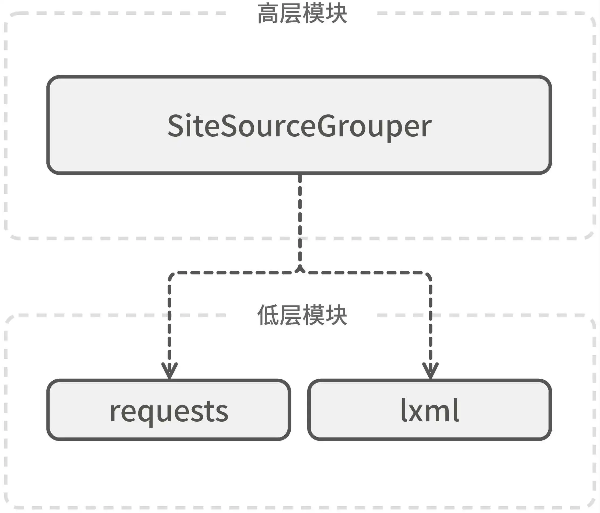
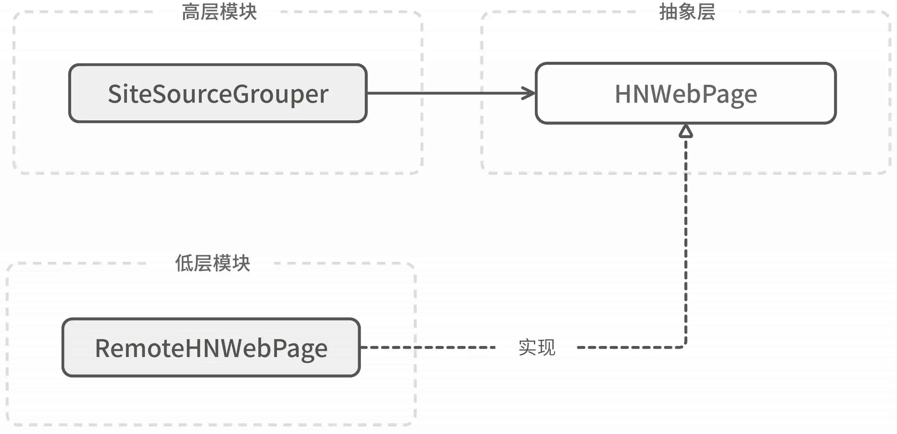
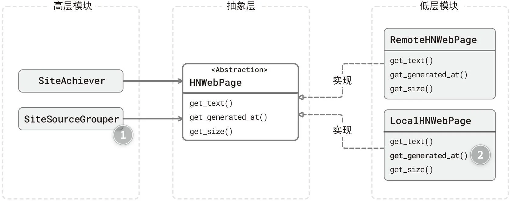
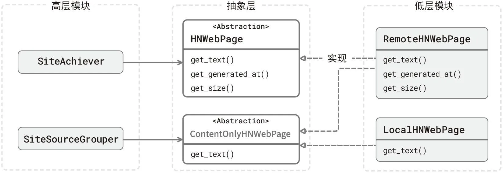

# 第11章面向对象设计原则（下）

在上一章中，我通过一个具体的爬虫案例介绍了 SOLID 设计原则的前两条：SRP 与 OCP。相信你可以感受到，它们都比较抽象，代表面向对象设计的某种理想状态，而不与具体的技术名词直接挂钩。这意味着，“开放–关闭”“单一职责”这些名词，既可以形容类，也可以形容函数。

而余下的三条原则稍微不同，它们都和具体的面向对象技术有关。

SOLID 原则剩下的 LID 如下。

- L：Liskov substitution principle（里式替换原则，LSP）。

- I：interface segregation principle（接口隔离原则，ISP）。

- D：dependency inversion principle（依赖倒置原则，DIP）。

LSP 是一条用来约束继承的设计原则。我在第 9 章中说过，继承是一种既强大又危险的技术，要设计出合理的继承关系绝非易事。在这方面，LSP 为我们提供了很好的指导。遵循该原则，有助于我们设计出合理的继承关系。

ISP 与 DIP 都与面向对象体系里的接口对象有关，前者可以驱动我们设计出更好的接口，后者则会指导我们如何利用接口让代码变得更易扩展。

但如前所述，Python 语言不像 Java，并没有内置任何接口对象。因此，我的诠释可能会与这两条原则的原始定义略有出入。

关于 LID 就先介绍到这里，接下来我会通过具体的代码案例逐条诠释它们的详细含义。

## 11.1　LSP：里式替换原则

在 SOLID 所代表的 5 条设计原则里，LSP 的名称最为特别。不像其他 4 条原则，名称就概括了具体内容，LSP 是以它的发明者——计算机科学家 Barbara Liskov——来命名的。

LSP 的原文稍微有点儿晦涩，看起来像复杂的数学公式：

- Let q(x) be a property provable about objects of x of type T. Then q(y) should be provablefor objects y of type S where S is a subtype of T.

```
给定一个属于类型 T 的对象 x，假如 q(x) 成立，那么对于 T 的子类型 S 来说，S 类型的
任意对象 y 也都能让 q(y) 成立。
```

这里用一种更通俗的方式来描述 LSP：LSP 认为，所有子类（派生类）对象应该可以任意替代父类（基类）对象使用，且不会破坏程序原本的功能。

单看这些文字描述，LSP 显得比较抽象难懂。下面我们通过具体的 Python 代码，来看看一些常见的违反 LSP 的例子。

### 11.1.1　子类随意抛出异常

假设我正在开发一个简单的网站，网站支持用户注册与登录功能，因此我在项目中定义了一个

```python
用户类 User：
class User(Model):
   """用户类，包含普通用户的相关操作"""
   ...
   def deactivate(self):
       """停用当前用户"""
       self.is_active = False
       self.save()
User 类支持许多操作，其中包括停用当前用户的方法：deactivate()。
```

网站上线一周后，我发现有几个恶意用户批量注册了许多违反运营规定的账号，我需要把这些账号全部停用。为了方便处理，我写了一个批量停用用户的函数：

```python
def deactivate_users(users: Iterable[User]):
   """批量停用多个用户
   :param users: 可迭代的用户对象 User
   """
   for user in users:
       user.deactivate()
```

停用这些违规账号后，站点风平浪静地运行了一段时间。

1. 增加管理员用户随着网站的功能变得越来越丰富，我需要给系统增加一种新的用户类型：站点管理员。这是一类特殊的用户，比普通用户多了一些额外的管理类属性。

```python
下面是站点管理员类 Admin 的代码：
class Admin(User):
1
   """管理员用户类"""
2
3
   ...
4
5
   def deactivate(self):
6
       # 管理员用户不允许被停用
7
       raise RuntimeError('admin can not be deactivated!')
8
因为普通用户的绝大多数操作在管理员上适用，所以我让 Admin 类直接继承了 User 类，
```

- 避免了许多重复代码。

- 但是，管理员和普通用户其实有一些差别。比如，出于安全考虑，管理员不允许被直接停

```
用。因此我重写了 Admin 的 deactivate() 方法，让它直接抛出 RuntimeError 异
```

- 常。

- 子类重写父类的少量行为，看上去正是继承的典型用法。但可能会让你有些意外的是，上面的代码明显违反了 LSP。

2. 违反 LSP

```
还记得网站刚上线时，我写的那个批量停用用户的函数 deactivate_users() 吗？它的
```

- 代码如下所示：

```python
def deactivate_users(users: Iterable[User]):
1
   for user in users:
2
       user.deactivate()
3
当系统里只有一种普通用户类 User 时，上面的函数完全可以正常工作，但当我增加了管
理员类 Admin 后，一个新问题就会浮出水面。
在 LSP 看来，新增的管理员类 Admin 是 User 的子类，因此 Admin 对象理应可以随意替
代 User 对象。
但是，假如我真的把 [User("foo"), Admin("bar_admin")] 这样的用户列表传到
deactivate_users() 函数里，程序马上就会抛出 RuntimeError 异常。因为在编写
Admin 时，我重写了父类的 deactivate() 函数——管理员压根儿就不支持停用操作。
所以，现在的代码并不满足 LSP，因为在 deactivate_users 函数看来，子类 Admin
对象根本无法替代父类 User 对象。
```

3. 一个常见但错误的解决办法要修复上面的问题，最直接的做法是在函数内增加类型判断：

```python
def deactivate_users(users: Iterable[User]):
1
   """批量停用多个用户"""
2
   for user in users:
3
       # 管理员用户不支持 deactivate 方法，跳过
4
       if isinstance(user, Admin):
5
           logger.info(f'skip deactivating admin user ')
6
           continue
7
8
       user.deactivate()
9
当 deactivate_users() 函数遍历用户时，如果发现用户对象恰好属于 Admin 类，就
```

- 跳过该用户，不执行停用。这样函数就能正确处理那些包含管理员的用户列表了。

```
但这种做法有个显而易见的问题。虽然到目前为止，只有 Admin 类型不支持停用操作，但
```

- 是谁能保证未来不会出现更多这种用户类型呢？

```
假如以后网站有了更多继承 User 类的新用户类型（比如 VIP 用户、员工用户等），而它们
也都不支持停用操作，那在现在的代码结构下，我就得不断调整 deactivate_users()
```

- 函数，来适配这些新的用户类型：

```
# 在类型判断语句中不断追加新用户类型
1
# if isinstance(user, Admin):
2
# if isinstance(user, (Admin, VIPUser)):
3
if isinstance(user, (Admin, VIPUser, Staff)):
4
```

- 看到这些，你想起上一章的 OCP 了吗？该原则认为：好设计应该对扩展开放，对修改关闭。而上面的代码在每次新增用户类型时，都要被同步修改，与 OCP 的要求相去甚远。

- 此外，LSP 说：“子类对象可以替换父类。”这里的“子类”指的并不是某个具体的子类（比如

```
Admin），而是未来可能出现的任意一个子类。因此，通过增加一些针对性的类型判断，试
```

- 图让程序符合 LSP 的做法完全行不通。

- 既然增加类型判断不可行，我们来试试别的办法。


- 你可以发现，SOLID 的每条原则其实互有关联。比如在这个例子里，违反 LSP的代码同样无法满足 OCP 的要求。

4. 按 LSP 协议要求改造代码在日常编码时，子类重写父类方法，让其抛出异常的做法其实并不少见。但之前代码的主要

```
问题在于，Admin 类的 deactivate() 方法所抛出的异常过于随意，并不属于父类
User 协议的一部分。
要让子类符合 LSP，我们必须让用户类 User 的“不支持停用”特性变得更显式，最好将其设
```

- 计到父类协议里去，而不是让子类随心所欲地抛出异常。

- 虽然在 Python 里，根本没有“父类的异常协议”这种东西，但我们至少可以做两件事。

- 第一件事是创建自定义异常类。我们可以为“用户不支持停用”这件事创建一个专用的异常类：

```python
class DeactivationNotSupported(Exception):
1
   """当用户不支持停用时抛出"""
2
第二件事是在父类 User 和子类 Admin 的方法文档里，增加与抛出异常相关的说明：
class User(Model):
1
   ...
2
3
   def deactivate(self):
4
       """停用当前用户
5
6
       :raises: 当用户不支持停用时，抛出 DeactivationNotSupported 异常 ➊
7
       """
8
       ...
9
10
class Admin(User):
11
   ...
12
13
   def deactivate(self):
14
       raise DeactivationNotSupported('admin can not be deactivated')
15
❶ 虽然 User 类的 deactivate 方法暂时不会真正抛出
DeactivationNotSupported 异常，但我仍然需要把它写入文档中，作为父类规范予
```

- 以声明

```
这样调整后，DeactivationNotSupported 异常便显式成为了 User 类的
deactivate() 方法协议的一部分。当其他人要编写任何使用 User 的代码时，都可以针
```

- 对这个异常进行恰当的处理。

```
比如，我可以调整 deactivate_users() 方法，让它在每次调用 deactivate() 时都
```

- 显式地捕获异常：

```python
def deactivate_users(users: Iterable[User]):
1
   """批量停用多个用户"""
2
   for user in users:
3
       try:
4
           user.deactivate()
5
       except DeactivationNotSupported:
6
           logger.info(
7
               f'user  does not allow deactivating, skip.'
8
           )
9
只要遵循父类的异常规范，当前的子类 Admin 对象以及未来可能出现的其他子类对象，都
可以替代 User 对象。通过对异常做了一些微调，我们最终让代码满足了 LSP 的要求。
```

### 11.1.2　子类随意调整方法参数与返回值

通过上一节内容我们了解到，当子类方法随意抛出父类不认识的异常时，代码就会违反 LSP。除此之外，还有两种常见的违反 LSP 的情况，分别和子类方法的返回值与参数有关。

1. 方法返回值违反 LSP

```python
同样是前面的 User 类与 Admin 类，这次，我在类上添加了一个新的操作：
class User(Model):
1
   """普通用户类"""
2
3
   ...
4
5
   def list_related_posts(self) -> List[int]:
6
       """查询所有与之相关的帖子 ID"""
7
       return [
8
           post.id
9
           for post in session.query(Post).filter(username=self.username)
10
       ]
11
12
13
class Admin(User):
14
   """管理员用户类"""
15
16
   ...
17
18
   def list_related_posts(self) -> Iterable[int]:
19
       # 管理员与所有帖子都有关，为了节约内存，使用生成器返回结果
20
       for post in session.query(Post).all():
21
           yield post.id
22
在上面的代码里，我给两个用户类增加了一个新方法：list_related_posts()，该方
```

- 法会返回所有与当前用户有关的帖子 ID。对普通用户来说，“有关的帖子”指自己发布过的所有帖子；而对于管理员来说，“有关的帖子”指网站上的所有帖子。

```
作为 User 的子类，Admin 的 list_related_posts() 方法返回值和父类并不完全一
样。前者返回的是可迭代对象 Iterable[int]（通过生成器函数实现），而后者的方法返
回值是列表对象：List[int]。
```

- 那这种类型不一致究竟会不会违反 LSP 呢？我们来试试看。

- 我写了一个函数，专门用来查询与用户相关的所有帖子标题：

```python
def list_user_post_titles(user: User) -> Iterable[str]:
1
   """获取与用户有关的所有帖子标题"""
2
   for post_id in user.list_related_posts():
3
       yield session.query(Post).get(post_id).title
4
对于这个函数来说，不论传入的 user 是 User 还是 Admin 对象，它都能正常工作。这是
因为，虽然 User 和 Admin 的方法返回值类型不同，但它们都是可迭代的，都可以满足函
```

- 数里循环的需求。

```
既然如此，那上面的代码符合 LSP 吗？答案是否定的。因为虽然子类 Admin 对象可以替
代父类 User，但这只是特殊场景下的一个巧合，并没有通用性。
```

- 接下来看看第二个场景。

- 有一位新同事加入了项目，他需要实现一个函数，来统计与用户有关的所有帖子数量。当他

```
读到 User 类的代码时，发现 list_related_posts() 方法会返回一个包含所有帖子
```

- ID 的列表，于是他就借助此方法编写了统计帖子数量的函数：

```python
def get_user_posts_count(user: User) -> int:
1
   """获取与用户相关的帖子数量"""
2
   return len(user.list_related_posts())
3
```

- 在绝大多数情况下，上面的函数可以正常工作。

```
但有一天，我偶然用一个管理员用户（Admin）调了上面的函数，程序马上就抛出了异
常：TypeError: object of type 'generator' has no len()。
虽然 Admin 是 User 的子类，但 Admin 类的 list_related_posts() 方法返回的并
不是列表，而是一个不支持 len() 操作的生成器对象，因此程序肯定会报错。
因此我们可以认定，现在 User 类的设计并不符合 LSP。
```

2. 调整返回值以符合 LSP

```
在我的代码里，User 类和 Admin 类的 list_related_posts() 返回了不同的结果。
User 类：返回列表对象 List[int]。
Admin 类：返回可迭代对象 Iterable[int]。
很明显，二者之间存在共通点：它们都是可迭代的 int 对象，这也是为什么在第一个获取
```

- 标题的场景里，子类对象可以替代父类。

- 但要符合 LSP，子类方法与父类方法所返回的结果不能只是碰巧有一些共性。LSP 要求子类方法的返回值类型与父类完全一致，或者返回父类结果类型的子类对象。

- 听上去有点儿绕，我来举个例子。

```
假如我把之前两个类的方法返回值调换一下，让父类 User 的 list_related_posts()
方法返回 Iterable[int] 对象，让子类 Admin 的方法返回 List[int] 对象，这样的
设计就完全符合 LSP，因为 List 是 Iterable 类型的子类：
>>> from collections.abc import Iterable
1
>>> issubclass(list, Iterable) ➊
2
True
3
❶ 列表（以及所有容器类型）都是 Iterable（可迭代类型抽象类）的子类
在这种情况下，当我用 Admin 对象替换 User 对象时，虽然方法返回值类型变了，但新的
返回值支持旧返回值的所有操作（List 支持 Iterable 类型的所有操作——可迭代）。因
此，所有依赖旧返回值（Iterable）的代码，都能拿着新的子类返回值（List）继续正
```

- 常执行。

3. 方法参数违反 LSP前面提到，要让代码符合 LSP，子类方法的返回值类型必须满足特定要求。除此以外，LSP 对子类方法的参数设计同样有一些要求。

- 简单来说，要让子类符合 LSP，子类方法的参数必须与父类完全保持一致，或者，子类方法所接收的参数应该比父类更为抽象，要求更为宽松。

- 第一条很好理解。大多数情况下，我们的子类方法不应该随意改动父类方法签名，否则就会违背 LSP。

- 以下是一个错误示例：

```python
class User(Model):
1
   def list_related_posts(self, type: int) -> List[int]: ...
2
3
4
class Admin(User):
5
   def list_related_posts(self, include_hidden: bool) -> List[int]: ... ➊
6
```

- ❶ 子类同名方法完全修改了方法参数，违反了 LSP

- 不过，当子类方法参数与父类不一致时，有些特殊情况其实仍然可以满足 LSP。

- 第一类情况是，子类方法可以接收比父类更多的参数，只要保证这些新增参数是可选的即可，比如：

```python
class User(Model):
1
   def list_related_posts(self) -> List[int]: ...
2
3
4
class Admin(User):
5
   def list_related_posts(self, include_hidden: bool = False) -> List[int]: .
6
❶ 子类新增了可选参数 include_hidden，保证了与父类兼容。当其他人把 Admin 对
象当作 User 使用时，不会破坏程序原本的功能
```

- 第二类情况是，子类与父类参数一致，但子类的参数类型比父类的更抽象：

```python
class User(Model):
1
   def list_related_posts(self, titles=List[str]) -> List[int]: ...
2
3
4
class Admin(User):
5
   def list_related_posts(self, titles=Iterable[str]) -> List[int]: ... ➊
6
❶ 子类的同名参数 titles 比父类更抽象。当调用方把 Admin 对象当作 User 使用
时，按 User 的要求，传入的列表类型的 titles 参数仍然满足子类对 titles 参数的
要求（是 Iterable 就行）
```

- 简单总结一下，前面我展示了违反 LSP 的几种常见方式：

- 子类抛出了父类所不认识的异常类型；

- 子类的方法返回值类型与父类不同，并且该类型不是父类返回值类型的子类；

- 子类的方法参数与父类不同，并且参数要求没有变得更宽松（可选参数）、同名参数没有更抽象。

- 总体来说，这些违反 LSP 的做法都比较显式，比较容易发现。下面我们来看一类更隐蔽的违反 LSP 的做法。

### 11.1.3　基于隐式合约违反 LSP

在设计一个类时，有许多因素会影响 LSP。除了那些摆在明面上的、可见的方法参数和方法返回值类型以外，还有一些藏在类设计里的、不可见的东西。

举个例子，在下面这段代码里，我实现了一个表示长方形的类：

```python
class Rectangle:
   def __init__(self, width: int, height: int):
       self._width = width
       self._height = height
   @property
   def width(self):
       return self._width
   @width.setter
   def width(self, value: int):
       self._width = value
   @property
   def height(self):
       return self._height
   @height.setter
   def height(self, value: int):
       self._height = value
   def get_area(self) -> int:
       """返回当前长方形的面积"""
       return self.width * self.height
```

类的使用效果如下：

```
>>> r = Rectangle(width=3, height=5)
>>> r.get_area()
15
>>> r.width = 4 ➊
>>> r.get_area()
20
```

- ❶ 修改长方形的宽度，并重新计算面积

某天，我接到一个新需求——增加一个新形状：正方形。我心想：正方形不就是一种特殊的长

```python
方形吗？于是我写了一个继承 Rectangle 的新类 Square：
class Square(Rectangle):
   """正方形
   :param length: 边长
   """
   def __init__(self, length: int): ➊
       self._width = length
       self._height = length
   @property
   def width(self):
       return super().width
   @width.setter
   def width(self, value: int): ➋
       self._width = value
       self._height = value
   @property
   def height(self):
       return super().height
   @height.setter
   def height(self, value: int):
       self._width = value
       self._height = value
```

- ❶ 初始化正方形时，只需要一个边长参数

```
❷ 为了保证正方形形状，子类重写了 width 和 height 属性的 setter 方法，保持对象
```

- 的宽与高永远一致

```
接下来，我试用一下 Square 类：
```

```
>>> s = Square(3)
>>> s.get_area()
9
>>> s.height = 4 ❶
>>> s.get_area()
16
```

- ❶ 修改正方形的高后，正方形的宽也会随之变化

```
看上去还不错，对吧？通过继承 Rectangle，我实现了新的正方形类。不过，虽然代码表面
```

看上去没什么问题，但其实违反了 LSP。

```python
下面是一段针对长方形 Rectangle 编写的测试代码：
def test_rectangle_get_area(r: Rectangle):
   r.width = 3
   r.height = 5
   assert r.get_area() == 15
假如你传入一个正方形对象 Square，会发现它根本无法通过这个测试，因为 r.height =
5 会同时修改正方形的 width，让最后的面积变成 25，而不是 15。
在 Rectangle 类的设计中，有一个隐式的合约：长方形的宽和高应该总是可以单独修改，不
```

会互相影响。上面的测试代码正是这个合约的一种表现形式。

```
在这个场景下，子类 Square 对象并不能替换 Rectangle 使用，因此代码违反了 LSP。在
```

真实项目中，这种因子类打破隐式合约违反 LSP 的情况，相比其他原因来说更难察觉，尤其需要当心。

### 11.1.4　LSP 小结

前面我描述了 SOLID 原则的第三条：LSP。

在面向对象领域，当我们针对某个类型编写代码时，其实并不知道这个类型未来会派生出多少千奇百怪的子类型。我们只能根据当前看到的基类，尝试编写适用于未来子类的代码。

假如这些子类不符合 LSP，那么面向对象所提供给我们的最大好处之一——多态，就不再可靠，变成了一句空谈。LSP 能促使我们设计出更合理的继承关系，将多态的潜能更好地激发出来。

在编写代码时，假如你发现自己的设计违反了 LSP，就需要竭尽所能解决这个问题。有时你得在父类中引入新的异常类型，有时你得尝试用组合替代继承，有时你需要调整子类的方法参数。总之，只要深入思考类与类之间的关系，总会找到正确的解法。

接下来，我将介绍 SOLID 原则的最后两条：

- ISP（接口隔离原则）

- DIP（依赖倒置原则）

考虑到解释 DIP 的过程中，可以自然地引入 ISP 里的“接口”概念，因此先介绍 DIP，后介绍ISP。

## 11.2　DIP：依赖倒置原则

不论多复杂的程序，都是由一个个模块组合而成的。当你告诉别人：“我正在写一个很复杂的程序”时，你其实并不是直接在写那个程序，而是在逐个完成它的模块，最后用这些模块组成程序。

在用模块组成程序的过程中，模块间自然产生了依赖关系。举个例子，你的个人博客站点可能依赖 Flask 模块，而 Flask 依赖 Werkzeug，Werkzeug 又由多个低层模块组成。

在正常的软件架构中，模块间的依赖关系应该是单向的，一个高层模块往往会依赖多个低层模块。整个依赖图就像一条蜿蜒而下、不断分叉的河流。

DIP 是一条与依赖关系相关的原则。它认为：高层模块不应该依赖低层模块，二者都应该依赖抽象。

乍一看，这个原则有些违反我们的常识——高层模块不就是应该依赖低层模块吗？还记得第一

```
堂编程课上，在我学会编写 Hello World 程序时，高层模块（main() 函数）分明依赖了低层
模块（printf()）。
```

高层依赖低层明明是常识，为何 DIP 却说不要这样做呢？DIP 里的“倒置”具体又是什么意思？

我们先把这些问题放在一旁，进入下面的案例研究。假如一切顺利，也许我们能在这个案例里找到这些问题的答案。

### 11.2.1　案例：按来源统计 Hacker News 条目数量

还记得在第 10 章中，我们写了一个抓取 Hacker News 热门内容的程序吗？这次，我想继续针对 Hacker News 做一些统计工作。

在 Hacker News 上，每个由用户提交的条目后面都跟着它的来源域名。为了统计哪些站点在Hacker News 上最受欢迎，我想编写一个脚本，用它来分组统计每个来源站点的条目数量，如图 11-1 所示。


- 图 11-1　Hacker News 条目来源截图

```
这个需求并不复杂。利用 requests 和 collections 模块，我很轻松地就完成了任务，如
```

代码清单 11-1 所示。

- 代码清单 11-1　统计 Hacker News 新闻来源分组脚本 hn_site_grouper.py

```sql
class SiteSourceGrouper:
   """对 Hacker News 新闻来源站点进行分组统计
   :param url: Hacker News 首页地址
   """
   def __init__(self, url: str):
       self.url = url
   def get_groups(self) -> Dict[str, int]:
       """获取 (域名, 个数) 分组"""
       resp = requests.get(self.url)
       html = etree.HTML(resp.text)
       # 通过 XPath 语法筛选新闻域名标签
       elems = html.xpath(
           '//table[@class="itemlist"]//span[@class="sitestr"]'
       )
       groups = Counter()
       for elem in elems:
           groups.update([elem.text])
       return groups
def main():
   groups = SiteSourceGrouper("https://news.ycombinator.com/").get_groups()
   # 打印最常见的 3 个域名
   for key, value in groups.most_common(3):
       print(f'Site:  | Count: ')
```

脚本执行结果如下：

```
$ python hn_site_grouper.py
Site: github.com | Count: 2
Site: howonlee.github.io | Count: 1
Site: latimes.com | Count: 1
```

脚本很短，核心代码加起来不到 20 行，但里面仍然藏着一条依赖关系链。

```
SiteSourceGrouper 是我们的核心类。为了完成统计任务，它需要先用 requests 模块抓
取网页，再用 lxml 模块解析网页。从层级上来说，SiteSourceGrouper 是高层模块，
requests 和 lxml 是低层模块，依赖关系是正向的，如图 11-2 所示。
```



```
图 11-2　SiteSourceGrouper 依赖 requests、lxml
```

看到图 11-2，也许你会觉得特别合理——这不就是正常的依赖关系吗？别着急，接下来我们给脚本写一些单元测试。

### 11.2.2　为脚本编写单元测试

为了测试程序的正确性，我为脚本写了一些单元测试：

```python
from hn_site_grouper import SiteSourceGrouper
from collections import Counter
def test_grouper_returning_valid_type(): ➊
   """测试 get_groups 是否返回了正确类型"""
   grouper = SiteSourceGrouper('https://news.ycombinator.com/')
   result = grouper.get_groups()
   assert isinstance(result, Counter), "groups should be Counter instance"
❶ 这个单元测试基于 pytest 风格编写，执行它需要使用 pytest 测试工具
上面的测试逻辑非常简单，我首先调用了 get_groups() 方法，然后判断它的返回值类型是
```

否正确。

在本地开发时，这个测试用例可以正常执行，没有任何问题。但当我提交了测试代码，想在

- 1

CI

- 服务器上自动执行测试时，却发现根本无法完成测试。

报错信息如下：

```
requests.exceptions.ConnectionError: HTTPSConnectionPool(host='news.ycombinator.c
```

这时我才想起来，我的 CI 环境根本就不能访问外网！

```
你可以发现，上面的单元测试暴露了 SiteSourceGrouper 类的一个问题：它的执行链路依
赖 requests 模块和网络条件，这严格限制了单元测试的执行环境。
```

既然如此，怎么才能解决这个问题呢？假如你去请教有经验的 Python 开发者，他很可能会直

```
接甩给你一句话：用 mock 啊！
```

### 使用 mock 模块

```
mock 是测试领域的一个专有名词，代表一类特殊的测试假对象。
```

假如你的代码依赖了其他模块，但你在执行单元测试时不想真正调用这些依赖的模块，那么你

```
可以选择用一些特殊对象替换真实模块，这些用于替换的特殊对象常被统称为 mock。
在 Python 里，单元测试模块 unittest 为我们提供了一个强大的 mock 子模块，里面有许
多和 mock 技术有关的工具，如下所示。
Mock：mock 主类型，Mock() 对象被调用后不执行任何逻辑，但是会记录被调用的情况
```

- ——包括次数、参数等。

```
MagicMock：在 Mock 类的基础上追加了对魔法方法的支持，是 patch() 函数所使用的
```

- 默认类型。

```
patch()：补丁函数，使用时需要指定待替换的对象，默认使用一个 MagicMock() 替换
```

- 原始对象，可当作上下文管理器或装饰器使用。

```
对于我的脚本来说，假如用 unittest.mock 模块来编写单元测试，我需要做以下几件事：
```

(1) 把一份正确的 Hacker News 页面内容保存为本地文件 static_hn.html；

```python
(2) 用 mock 对象替换真实的网络请求行为；
(3) 让 mock 对象返回文件 static_hn.html 的内容。
使用 mock 的测试代码如下所示：
from unittest import mock
@mock.patch('hn_site_grouper.requests.get') ➊
def test_grouper_returning_valid_type(mocked_get): ➋
   """测试 get_groups 是否返回了正确类型"""
   with open('static_hn.html', 'r') as fp:
       mocked_get.return_value.text = fp.read() ➌
   grouper = SiteSourceGrouperO('https://news.ycombinator.com/')
   result = grouper.get_groups()
   assert isinstance(result, Counter), "groups should be Counter instance"
❶ 通过 patch 装饰器将 requests.get 函数替换为一个 MagicMock 对象
❷ 该 MagicMock 对象将会作为函数参数被注入
❸ 将 get() 函数的返回结果（自动生成的另一个 MagicMock 对象）的 text 属性替换
```

- 为来自本地文件的内容

```
通过 mock 技术，我们最终让单元测试不再依赖网络环境，可以成功地在 CI 环境中执行。
平心而论，当你了解了 mock 模块的基本用法后，就不会觉得上面的代码有多么复杂。但问题
```

是，即便代码不复杂，上面的处理方式仍非常糟糕，我们一起来看看这是为什么。

当我们编写单元测试时，有一条非常重要的指导原则：测试程序的行为，而不是测试具体实现。它的意思是，好的单元测试应该只关心被测试对象功能是否正常，是否能做好它所宣称的事情，而不应该关心被测试对象内部的具体实现是什么样的。

为什么单元测试不能关心内部实现？这是有原因的。

在编写代码时，我们常会修改类的具体实现，但很少会调整类的行为。如果测试代码过分关心类的内部实现，就会变得很脆弱。举个例子，假如有一天我发现了一个速度更快的网络请求模

```
块：fast_requests，我想用它替换程序里的 requests 模块。但当我完成替换后，即便
SiteSourceGrouper 的功能和替换前完全一致，我仍然需要修改上面的测试代码，替换里
面的 @mock.patch('hn_site_grouper.requests.get') 部分，平添了许多工作量。
正因为如此，mock 应该总是被当作一种应急的技术，而不是一种低成本、让单元测试能快速
开展的手段。大多数情况下，假如你的单元测试代码里有太多 mock，往往代表你的程序设计
```

得不够合理，需要改进。

```
既然 mock 方案不够理想，下面我们试试从“依赖关系”入手，看看 DIP 能给我们提供什么帮
```

助。

### 11.2.3　实现 DIP

首先，我们回顾一下 DIP 的内容：高层模块不应该依赖于低层模块，二者都应该依赖于抽

```
象。但在上面的代码里，高层模块 SiteSourceGrouper 就直接依赖了低层模块
requests。
```

为了让代码符合 DIP，我们的首要任务是创造一个“抽象”。但话又说回来，DIP 里的“抽象”到底指什么？

在 7.3.2 节中，我简单介绍过“抽象”的含义。当时我说：抽象是一种选择特征、简化认知的手段，而这是对抽象的一种广义解释。DIP 里的“抽象”是一种更具体的东西。

DIP 里的“抽象”特指编程语言里的一类特殊对象，这类对象只声明一些公开的 API，并不提供任何具体实现。比如在 Java 中，接口就是一种抽象。下面是一个提供“画”动作的接口：

```java
interface Drawable {
 public void draw();
}
```

而 Python 里并没有上面这种接口对象，但有一个和接口非常类似的东西——抽象类：

```python
from abc import ABC, abstractmethod
class Drawable(ABC):
   @abstractmethod
   def draw(self):
       ...
```

搞清楚“抽象”是什么后，接着就是 DIP 里最重要的一步：设计抽象，其主要任务是确定这个抽象的职责与边界。

```
在上面的脚本里，高层模块主要依赖 requests 模块做了两件事：
(1) 通过 requests.get() 获取响应 response 对象；
(2) 利用 response.text 获取响应文本。
```

可以看出，这个依赖关系的主要目的是获取 Hacker News 的页面文本。因此，我可以创建一

```python
个名为 HNWebPage 的抽象，让它承担“提供页面文本”的职责。
下面的 HNWebPage 抽象类就是实现 DIP 的关键：
from abc import ABC, abstractmethod
class HNWebPage(ABC):
   """抽象类：Hacker News 站点页面"""
   @abstractmethod
   def get_text(self) -> str:
       raise NotImplementedError()
```

定义好抽象后，接下来分别让高层模块和低层模块与抽象产生依赖关系。我们从低层模块开始。

低层模块与抽象间的依赖关系表现为它会提供抽象的具体实现。在下面的代码里，我实现了

```
RemoteHNWebPage 类，它的作用是通过 requests 模块请求 Hacker News 页面，返回页
```

面内容：

```python
class RemoteHNWebPage(HNWebPage): ➊
   """远程页面，通过请求 Hacker News 站点返回内容"""
   def __init__(self, url: str):
       self.url = url
   def get_text(self) -> str:
       resp = requests.get(self.url)
       return resp.text
```

- ❶ 此时的依赖关系表现为类与类的继承。除继承外，与抽象类的依赖关系还有许多其他表

```
现形式，比如使用抽象类的 .register() 方法，或者定义子类化钩子方法，等等。详情
```

- 可参考 9.1.4 节

```
处理完低层模块的依赖关系后，接下来我们需要调整高层模块 SiteSourceGrouper 类的代
```

码：

```python
class SiteSourceGrouper:
   """对 Hacker News 页面的新闻来源站点进行分组统计"""
   def __init__(self, page: HNWebPage): ➊
       self.page = page
   def get_groups(self) -> Dict[str, int]:
       """获取 (域名, 个数) 分组"""
       html = etree.HTML(self.page.get_text()) ➋
       ...
def main():
   page = RemoteHNWebPage(url="https://news.ycombinator.com/") ➌
   grouper = SiteSourceGrouper(page).get_groups()
❶ 在初始化方法里，我用类型注解表明了所依赖的是抽象的 HNWebPage 类型
❷ 调用 HNWebPage 类型的 get_text() 方法，获取页面文本内容
❸ 实例化一个符合抽象 HNWebPage 的具体实现：RemoteHNWebPage 对象
```

做完这些修改后，我们再看看现在的模块依赖关系，如图 11-3 所示。



```
图 11-3　SiteSourceGrouper 和 RemoteHNWebPage 都依赖抽象 HNWebPage
```

可以看到，图 11-3 里的高层模块不再直接依赖低层模块，而是依赖处于中间的抽象：

```
HNWebPage。低层模块也不再是被依赖的一方，而是反过来依赖处于上方的抽象层，这便是
```

DIP 里 inversion（倒置）一词的由来。

### 11.2.4　倒置后的单元测试

通过创建抽象实现 DIP 后，我们回到之前的单元测试问题。为了满足单元测试的无网络需

```python
求，基于 HNWebPage 抽象类，我可以实现一个不依赖网络的新类型 LocalHNWebPage：
class LocalHNWebPage(HNWebPage):
   """本地页面，根据本地文件返回页面内容
   :param path: 本地文件路径
   """
   def __init__(self, path: str):
       self.path = path
   def get_text(self) -> str:
       with open(self.path, 'r') as fp:
           return fp.read()
```

单元测试代码也可以进行相应的调整：

```python
def test_grouper_from_local():
   page = LocalHNWebPage(path="./static_hn.html")
   grouper = SiteSourceGrouper(page)
   result = grouper.get_groups()
   assert isinstance(result, Counter), "groups should be Counter instance"
有了额外的抽象后，我们解耦了 SiteSourceGrouper 里的外网访问行为。现在的测试代码
不需要任何 mock 技术，在无法访问外网的 CI 服务器上也能正常执行。
```


- 为了演示，我对单元测试逻辑进行了极大的简化，其实上面的代码远算不上是一个合格的测试用例。在真实项目里，你应该准备一个虚构的 Hacker News 页面，里面刚好包

```
含 N 个 来源自 foo.com 的条目，然后判断 assert result['foo.com'] == N，这样
才能真正验证 SiteSourceGrouper 的核心逻辑是否正常。
```

### 11.2.5　DIP 小结

通过前面的样例我们了解到，DIP 要求代码在互相依赖的模块间创建新的抽象概念。当高层模块依赖抽象而不是具体实现后，我们就能更方便地用其他实现替换底层模块，提高代码灵活性。

以下是有关 DIP 的两点额外思考。

1. 退后一步是“鸭子”，向前一步是“协议”

```
为了实现 DIP，我在上面的例子中定义了抽象类：HNWebPage。但正如我在第 10 章中所
```

- 说，在这个例子里，同样可以去掉抽象类——并非只有抽象类才能让依赖关系倒过来。

- 如果在抽象类方案下，往后退一步，从代码里删掉抽象类，同时删掉所有的类型注解，你会发现代码仍然可以正常执行。在这种情况下，依赖关系仍然是倒过来的，但是处在中间的“抽象”变成了一个隐式概念。

- 没有抽象类后，代码变成了“鸭子类型”，依赖倒置也变成了一种符合“鸭子类型”的倒置。

- 反过来，假如你对“抽象”的要求更为严格，往前走一步，马上就会发现 Python 里的抽象类其实并非完全抽象。比如在抽象类里，你不光可以定义抽象方法，甚至可以把它当成普通基类，提供许多有具体实现的工具方法。

- 那么除了抽象类以外，还有没有其他更严格的抽象方案呢？答案是肯定的。

```python
在 Python 3.8 版本里，类型注解 typing 模块增加了一个名为“协议”（Protocol）的类
型。从各种意义上来说，Protocol 都比抽象类更接近传统的“接口”。
下面是用 Protocol 实现的 HNWebPage：
class HNWebPage(Protocol):
1
   """协议：Hacker News 站点页面"""
2
3
   def get_text(self) -> str:
4
       ...
5
虽然 Protocol 提供了定义协议的能力，但像类型注解一样，它并不提供运行时的协议检
```

- 查，它的真正实力仍然需要搭配 mypy 才能发挥出来。

```
通过 Protocol 与 mypy 类型检查工具，你能实现真正的基于协议的抽象与结构化子类技
术。也就是说，只要某个类实现了 get_text() 方法，并且返回了 str 类型，那么它便
可以当作 HNWebPage 使用。
不过，Protocol 与 mypy 的上手门槛较高，如果不是大型项目，实在没必要使用。在多
```

- 数情况下，普通的抽象类或鸭子类型已经够用了。

2. 抽象一定是好的吗

- 有关 DIP 的全部内容，基本都是在反复说同一件事：抽象是好东西，抽象让代码变得更灵活。但是，抽象多的代码真的就更好吗？缺少抽象的代码就一定不够灵活吗？

- 和所有这类问题的标准回答一样，答案是：视情况而定。

- 当你习惯了 DIP 以后，会发现抽象不仅仅是一种编程手法，更是一种思考问题的特殊方式。只要愿意动脑子，你可以在代码的任何角落里都硬挤出一层额外抽象。

- 代码依赖了 lxml 模块的 XPath 具体实现，假如 lxml 模块未来要改怎么办？我是不是得

```
定义一层 HNTitleDigester 把它抽象进去？
```

- 代码里的字符串字面量也是具体实现，万一以后要用其他字符串类型怎么办？我是不是

```
得定义一个 StringLike 类型把它抽象进去？
```

- ……

- 如果真像上面这样思考，代码里似乎不再有真正可靠的东西，我们的大脑很快就会不堪重负。

- 事实是，抽象的好处显而易见：它解耦了模块间的依赖关系，让代码变得更灵活。但抽象同时也带来了额外的编码与理解成本。所以，了解何时不抽象与何时抽象同样重要。只有对代码中那些容易变化的东西进行抽象，才能获得最大的收益。

- 下面我们学习最后一条原则：ISP。

## 11.3　ISP：接口隔离原则

顾名思义，这是一条与“接口”有关的原则。

在上一节中我描述过接口的定义。接口是编程语言里的一类特殊对象，它包含一些公开的抽象协议，可以用来构建模块间的依赖关系。在不同的编程语言里，接口有不同的表现形态。在

```
Python 中，接口可以是抽象类、Protocol，也可以是鸭子类型里的某个隐式概念。
```

接口是一种非常有用的设计工具，为了更好地发挥它的能力，ISP 对如何使用接口提出了要求：客户（client）不应该依赖任何它不使用的方法。

ISP 里的“客户”不是使用软件的客户，而是接口的使用方——客户模块，也就是依赖接口的高层模块。

拿上一节统计 Hacker News 页面条目的例子来说：

```
使用方（客户模块）——SiteSourceGrouper；
接口（其实是抽象类）——HNWebPage；
依赖关系——调用接口方法 get_text() 获取页面文本。
```

按照 ISP，一个接口所提供的方法应该刚好满足使用方的需求，一个不多，一个不少。在例子

```
里，我设计的接口 HNWebPage 就是符合 ISP 的，因为它没有提供任何使用方不需要的方
```

法。

看上去，ISP 似乎比较容易遵守。但违反 ISP 究竟会带来什么后果呢？我们接着上个例子，通过一个新需求来试试违反 ISP。

### 11.3.1　案例：处理页面归档需求

```
在上一节的例子中，我编写了一个代表 Hacker News 站点页面的抽象类 HNWebPage，它只
```

提供一种行为——获取当前页面的文本内容：

```python
class HNWebPage(ABC):
   """抽象类：Hacker News 站点页面"""
   @abstractmethod
   def get_text(self) -> str:
       raise NotImplementedError()
```

现在，我想开发一个新功能：定期对 Hacker News 首页内容进行归档，观察热点新闻在不同时间点的变化规律。因此，除了页面文本内容外，我还需要获取页面大小、生成时间等额外信息。

```python
为了实现这个功能，我们可以对 HNWebPage 抽象类做一些扩展：
class HNWebPage(metaclass=ABC):
   @abstractmethod
   def get_text(self) -> str:
       """获取页面文本内容"""
   # 新增 get_size 与 get_generated_at
   @abstractmethod
   def get_size(self) -> int:
       """获取页面大小"""
   @abstractmethod
   def get_generated_at(self) -> datetime.datetime:
       """获取页面生成时间"""
我们在抽象类上增加了两个新方法：get_size() 和 get_generated_at()。通过这两个
```

方法，程序就能获取页面大小和生成时间了。

修改完抽象类后，接下来的任务是调整抽象类的具体实现。

### 11.3.2　修改实体类

```
在调整接口前，我有两个实现了接口协议的实体类型：RemoteHNWebPage 和
LocalHNWebPage。如今 HNWebPage 接口增加了两个新方法，我自然需要修改这两个实体
```

类，给它们加上这两个新方法。

```python
修改 RemoteHNWebPage 类很容易，只要让 get_size() 返回页面长度，
get_generated_at() 返回当前时间即可：
class RemoteHNWebPage(HNWebPage):
   """远程页面，通过请求 Hacker News 站点返回内容"""
   def __init__(self, url: str):
       self.url = url
       # 保存当前请求结果
       self._resp = None
       self._generated_at = None
   def get_text(self) -> str:
       """获取页面内容"""
       self._request_on_demand()
       return self._resp.text
   def get_size(self) -> int:
       """获取页面大小"""
       return len(self.get_text())
   def get_generated_at(self) -> datetime.datetime:
       """获取页面生成时间"""
       self._request_on_demand()
       return self._generated_at
   def _request_on_demand(self): ➊
       """请求远程地址并避免重复"""
       if self._resp is None:
           self._resp = requests.get(self.url)
           self._generated_at = datetime.datetime.now()
❶ 因为使用方可能会反复调用 get_generated_at() 等方法，所以我给类添加了一个简
```

- 单的结果缓存功能

```
完成 RemoteHNWebPage 类的修改后，接下来修改 LocalHNWebPage 类。但是，在给它添
加 get_generated_at() 的过程中，我遇到了一个小问题。
LocalHNWebPage 的页面数据完全来源于本地文件，但仅仅通过一个本地文件，我根本就无
```

法知道它的内容是何时生成的。

这时，有两个选择摆在我们面前：

```
(1) 让 get_generated_at() 返回一个错误结果，比如本地文件的修改时间；
(2) 让 get_generated_at() 方法直接抛出 NotImplementedError 异常。
但不论哪种做法，都不符合接口方法的定义，都很糟糕。所以，对 HNWebPage 接口的盲目扩
```

展暴露出一个问题：更丰富的接口协议，意味着更高的实现成本，也更容易给实现方带来麻烦。

```python
不过，我们暂且把这个问题放到一旁，先让 LocalHNWebPage.get_generated_at() 直
接抛出异常，继续编写 SiteAchiever 类，补完页面归档功能链条：
class SiteAchiever:
   """将不同时间点的 Hacker News 页面归档"""
   def save_page(self, page: HNWebPage):
       """将页面保存到后端数据库"""
       data = {
           "content": page.get_text(),
           "generated_at": page.get_generated_at(),
           "size": page.get_size(),
       }
       # 将 data 保存到数据库中
       # ...
```

### 11.3.3　违反 ISP

完成整个页面归档任务后，不知道你是否还记得上一节的“按 Hacker News 来源统计条目数量”程序。现在所有模块间的依赖关系如图 11-4 所示。



- 图 11-4　页面归档功能类关系图

仔细看图 11-4，有没有发现什么问题？

```
问题 1：SiteSourceGrouper 类依赖了 HNWebPage，但是并不使用后者的
get_size()、get_generated_at() 方法。
问题 2：LocalHNWebPage 类为了实现 HNWebPage 抽象，需要“退
化”get_generated_at() 方法。
你会发现，在我扩展完 HNWebPage 抽象类后，虽然按来源分组类 SiteSourceGrouper 仍
然依赖 HNWebPage，但它其实只用到了 get_text() 这一个方法而已。
```

上面的设计明显违反了 ISP。为了修复这个问题，我需要把大接口拆分成多个小接口。

### 11.3.4　分拆接口

在设计接口时有一个简单的技巧：让客户（调用方）来驱动协议设计。在现在的程序里，

```python
HNWebPage 接口共有两个客户。
SiteSourceGrouper：按域名来源统计，依赖 get_text()。
SiteAchiever：页面归档程序，依赖 get_text()、get_size() 和
get_generated_at()。
根据这两个客户的需求，我可以把 HNWebPage 分离成两个不同的抽象类：
class ContentOnlyHNWebPage(ABC):
   """ 抽象类：Hacker News 站点页面（仅提供内容）"""
   @abstractmethod
   def get_text(self) -> str:
       raise NotImplementedError()
class HNWebPage(ABC):
   """ 抽象类：Hacker New 站点页面（含元数据）"""
   @abstractmethod
   def get_text(self) -> str:
       raise NotImplementedError()
   @abstractmethod
   def get_size(self) -> int:
       """ 获取页面大小"""
       raise NotImplementedError()
   @abstractmethod
   def get_generated_at(self) -> datetime.datetime:
       """ 获取页面生成时间"""
       raise NotImplementedError()
完成拆分后，SiteSourceGrouper 和 SiteAchiever 便能各自依赖不同的抽象类了。
同时，对于 LocalHNWebPage 类来说，它也不需要再纠结如何实现
get_generated_at() 方法，而只要认准那个只返回文本的 ContentOnlyHNWebPage 接
口，实现其中的 get_text() 方法就行，如图 11-5 所示。
```



- 图 11-5　实施接口隔离后的结果

从图 11-5 中可以看出，相比之前，符合 ISP 的依赖关系看起来要清爽得多。

### 11.3.5　其他违反 ISP 的场景

虽然我花了很长的篇幅，用了好几个抽象类才把 ISP 讲明白，但其实在日常编码中，违反 ISP的例子并不少见，它常常出现在一些容易被我们忽视的地方。

举个例子，在开发 Web 站点时，我们常常需要判断用户请求的 Cookies 或请求头（HTTPrequest header）里，是否包含某个标记值。为此，我们经常直接写出许多依赖整个

```python
request 对象的函数：
def is_new_visitor(request: HttpRequest) -> bool:
   """从 Cookies 判断是否新访客"""
   return request.COOKIES.get('is_new_visitor') == 'y'
但事实上，除了 COOKIES 以外，is_new_visitor() 根本不需要 request 对象里面的任
```

何其他内容。

```python
因此，我们完全可以把函数改成只接收 cookies 字典：
def is_new_visitor(cookies: Dict) -> bool:
   """从 Cookies 判断是否为新访客"""
   return cookies.get('is_new_visitor') == 'y'
```

类似的情况还有许多，比如一个负责发短信的函数，本身只需要两个参数：电话号码

```
（phone_number）和用户姓名（username），但是函数依赖了整个用户对象（User），里
```

面包含了几十个它根本不关心的其他字段和方法。

所有这些问题，既是抽象上的一种不合理，也可以视作 ISP 的一种反例。

- 现实世界里的接口隔离当你认识到 ISP 带来的种种好处后，很自然地会养成写小类、小接口的习惯。在现实世界里，其实已经有很多小而精的接口设计可供参考，比如：

```
Python 的 collections.abc 模块里面有非常多的小接口；
```

- Go 语言标准库里的 Reader 和 Writer 接口。

## 11.4　总结

在本章中，我们学习了 SOLID 原则的后三条：

- LSP（里式替换原则）；

- DIP（依赖倒置原则）；

- ISP（接口隔离原则）。

LSP 与继承有关。在设计继承关系时，我们常常会让子类重写父类的某些行为，但一些不假思索的随意重写，会导致子类对象无法完全替代父类对象，最终让代码的灵活性大打折扣。

DIP 要求我们在高层与底层模块之间创建出抽象概念，以此反转模块间的依赖关系，提高代码灵活性。但抽象并非没有代价，只有对最恰当的事物进行抽象，才能获得最大的收益。

DIP 鼓励我们创建抽象，ISP 指导我们如何创建出好的抽象。好的抽象应该是精准的，没有任何多余内容。

至此，SOLID 原则的所有内容就都介绍完毕了。

以下是本章要点知识总结。

(1) LSP

- LSP 认为子类应该可以任意替代父类使用

- 子类不应该抛出父类不认识的异常

- 子类方法应该返回与父类一致的类型，或者返回父类返回值的子类型对象

- 子类的方法参数应该和父类方法完全一致，或者要求更为宽松

- 某些类可能会存在隐式合约，违反这些合约也会导致违反 LSP

(2) DIP

- DIP 认为高层模块和低层模块都应该依赖于抽象

- 编写单元测试有一个原则：测试行为，而不是测试实现

```
单元测试不宜使用太多 mock，否则需要调整设计
```

- 依赖抽象的好处是，修改低层模块实现不会影响高层代码

```
在 Python 中，你可以用 abc 模块来定义抽象类
除 abc 以外，你也可以用 Protocol 等技术来完成依赖倒置
```

(3) ISP

- ISP 认为客户依赖的接口不应该包含任何它不需要的方法

- 设计接口就是设计抽象

- 写更小的类、更小的接口在大多数情况下是个好主意

[1]：CI 是 continuous integration（持续集成）的首字母缩写，是一种软件开发实践。
