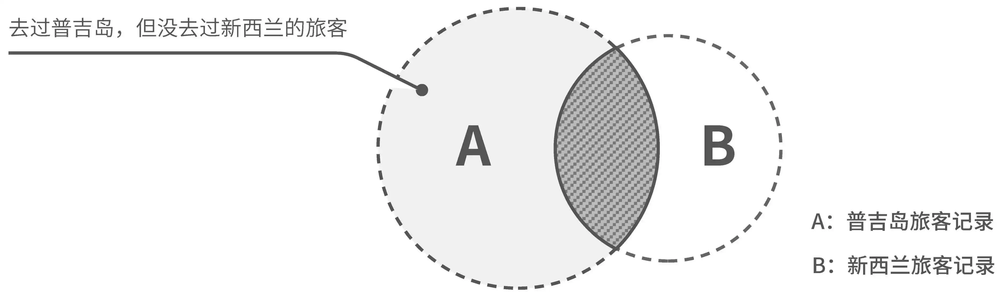

# 第12章数据模型与描述符

## 第 12 章　数据模型与描述符

在 Python 中，数据模型（data model）是个非常重要的概念。我们已经知道，Python 里万物皆对象，任何数据都通过对象来表达。而在用对象建模数据时，肯定不能毫无章法，一定需要一套严格的规则。

我们常说的数据模型（或者叫对象模型）就是这套规则。假如把 Python 语言看作一个框架，数据模型就是这个框架的说明书。数据模型描述了框架如何工作，创建怎样的对象才能更好地融入 Python 这个框架。

也许你还不清楚，数据模型究竟如何影响我们的代码。为此，我们从一个最简单的问题开始：

```xml
当用 print 打印某个对象时，应该输出什么？
假设我定义了一个表示人的对象 Person：
class Person:
   """人
   :param name: 姓名
   :param age: 年龄
   :param favorite_color: 最喜欢的颜色
   """
   def __init__(self, name, age, favorite_color):
       self.name = name
       self.age = age
       self.favorite_color = favorite_color
当我用 print 打印一个 Person 对象时，输出如下：
>>> p = Person('piglei', 18, 'black')
>>> print(p)
<__main__.Person object at 0x10d1e4250>
可以看到，打印 Person 对象会输出类名（Person）加上一长串内存地址
（0x10d1e4250）。不过，这只是普通对象的默认行为。当你在 Person 类里定义 __str__
```

方法后，事情就会发生变化：

```python
class Person:
   ...
   def __str__(self):
       return self.name
```

再试着打印一次对象，输出如下：

```
>>> print(p)
piglei
>>> str(d) ➊
'piglei'
>>> "I'm {}".format(p)
"I'm piglei"
❶ 除了 print() 以外，str() 与 .format() 函数同样也会触发 __str__ 方法
上面展示的 __str__ 就是 Python 数据模型里最基础的一部分。当对象需要当作字符串使用
时，我们可以用 __str__ 方法来定义对象的字符串化结果。
```

虽然从本章标题看来，数据模型似乎是一个新话题，但其实在之前的章节里，我们已经运用过非常多与数据模型有关的知识。表 12-1 整理了其中一部分。

表 12-1　本书前 11 章中出现过的数据模型有关内容

位置

- 方法名相关操作说明

```
__getitem++
obj[key]
```

第 3 章

- 定义按索引读取行为

```
__setitem++
obj[key] = value
```

第 3 章

- 定义按索引写入行为

```
__delitem++
del obj[key]
```

第 3 章

- 定义按索引删除行为

```
__len__
len(obj)
```

第 4 章

- 定义对象的长度

```
__bool__
bool(obj)
```

第 4 章

- 定义对象的布尔值真假

```
__eq__
obj == another_obj
定义 == 运算时的行为
```

第 4 章

```
__enter__、__exit__
with obj:
```

第 5 章

- 定义对象作为上下文管理器时

```
__iter__、__next__
for _ in obj
```

第 6 章

- 定义对象被迭代时的行为

```
__call__
obj()
```

第 8 章

- 定义被调用时的行为

```
__new__
obj_class()
```

第 8 章

- 定义创建实例时的行为

从表 12-1 中可以发现，所有与数据模型有关的方法，基本都以双下划线开头和结尾，它们通常被称为魔法方法（magic method）。

在本章中，除了这些已经学过的魔法方法外，我将介绍一些与 Python 数据模型相关的实用知

```
识。比如，如何用 dataclass 来快速创建一个数据类、如何通过 __get__ 与 __set__ 来
```

定义一个描述符对象等。

在本章的案例故事里，我将介绍如何巧妙地利用数据模型来解决真实需求。

要写出 Pythonic 的代码，恰当地使用数据模型是关键之一。接下来我们进入正题。

## 12.1　基础知识

### 12.1.1　字符串魔法方法

```
在本章一开始，我演示了如何使用 __str__ 方法来自定义对象的字符串表示形式。但其实除
了 __str__ 以外，还有两个与字符串有关的魔法方法，一起来看看吧。
```

1. __repr__当你需要把一个 Python 对象用字符串表现出来时，实际上可分为两种场景。第一种场景是

```
非正式的，比如用 print() 打印到屏幕、用 str() 转换为字符串。这种场景下的字符串
注重可读性，格式应当对用户友好，由类型的 __str__ 方法所驱动。
```

- 第二种场景则更为正式，它一般发生在调试程序时。在调试程序时，你常常需要快速获知对象的详细内容，最好一下子就看到所有属性的值。该场景下的字符串注重内容的完整性，由

```
类型的 __repr__ 方法所驱动。
要模拟第二种场景，最快的办法是在命令行里输入一个 Person 对象，然后直接按回车
```

- 键：

```xml
>>> p = Person('piglei', 18, 'black')
1
>>> str(p) ➊
2
'piglei'
3
>>> p ➋
4
<__main__.Person object at 0x10d993250>
5
>>> repr(p) ➌
6
'<__main__.Person object at 0x10d993250>'
7
❶ 接着前面的例子，Person 类已定义了 __str__ 方法
```

- ❷ 直接输入对象后，你仍然能看到包含一长串内存地址的字符串

```
❸ 和 str() 类似，repr() 可以用来获取第二种场景的字符串
要让对象在调试场景提供更多有用的信息，我们需要实现 __repr__ 方法。
```

```python
当你在 __repr__ 方法里组装结果时，一般会尽可能地涵盖当前对象的所有信息，假如其
他人能通过复制 repr() 的字符串结果直接创建一个同样的对象，就再好不过了。
下面，我试着给 Person 加上 __repr__ 方法：
class Person:
1
   ...
2
3
   def __str__(self):
4
       return self.name
5
6
   def __repr__(self):
7
       return '(name=, age=, favorite_color=)'.format( ➊
8
           cls_name=self.__class__.__name__, ➋
9
           name=self.name,
10
           age=self.age,
11
           color=self.favorite_color,
12
       )
13
❶ 在字符串模板里，我使用了  这样的语法，变量名后的 !r 表示在渲染字符串模板
时，程序会优先使用 repr() 而非 str() 的结果。这么做以后，self.name 这种字符
```

- 串类型在渲染时会包含左右引号，省去了手动添加的麻烦

```
❷ 类名不直接写成 Person 以便更好地兼容子类
```

- 再来试试看效果如何：

```
>>> p = Person('piglei', 18, 'black')
1
>>> print(p)
2
piglei
3
>>> p
4
Person(name='piglei', age=18, favorite_color='black')
5
```

```
当对象定义了 __repr__ 方法后，它便可以在任何需要的时候，快速提供一种详尽的字符
```

- 串展现形式，为程度调试提供帮助。


```
　假如一个类型没定义 __str__ 方法，只定义了 __repr__，那么 __repr__ 的
```

- 结果会用于所有需要字符串的场景。

2. __format__

```
如前面所说，当你直接把某个对象作为 .format() 的参数，用于渲染字符串模板时，默
认会使用 str() 化的字符串结果：
>>> p = Person('piglei', 18, 'black')
1
>>> "I'm {}".format(p)
2
"I'm piglei"
3
```

- 但是，Python 里的字符串格式化语法，其实不光只有上面这种最简单的写法。通过定义

```python
__format__ 魔法方法，你可以为一种对象定义多种字符串表现形式。
继续拿 Person 举例：
class Person:
1
   ...
2
3
   def __format__(self, format_spec):
4
       """定义对象在字符串格式化时的行为
5
6
       :param format_spec: 需要的格式，默认为 ''
7
       """
8
       if format_spec == 'verbose':
9
           return f'()[]'
10
       elif format_spec == 'simple':
11
           return f'()'
12
       return self.name
13
上面的代码给 Person 类增加了 __format__ 方法，并在里面实现了不同的字符串表现形
```

- 式。

- 接下来，我们可以在字符串模板里使用  语法，来触发这些不同的字符串格式：

```
>>> print(''.format(p=p)) ➊
1
piglei(18)[black]
2
>>> print(f'') ➋
3
piglei(18)[black]
4
>>> print(f'') ➌
5
piglei(18)
6
>>> print(f'')
7
piglei
8
❶ 此时传递的 format_spec 为 verbose
❷ 模板语法同样适用于 f-string
```

- ❸ 使用不同的格式

```
假如你的对象需要提供不同的字符串表现形式，那么可以使用 __format__ 方法。
```

### 12.1.2　比较运算符重载

```
比较运算符是指专门用来对比两个对象的运算符，比如 ==、!=、> 等。在 Python 中，你可
以通过魔法方法来重载它们的行为，比如在第 4 章中，我们就通过 __eq__ 方法重载过 ==
```

行为。

```
包含 __eq__ 在内，与比较运算符相关的魔法方法共 6 个，如表 12-2 所示。
```

表 12-2　所有用于重载比较运算符的魔法方法

方法名

- 相关运算说明

```
__lt__
obj < other
```

- 小于（less than）

```
__le__
obj <= other
```

- 小于等于（less than or equal）

```
__eq__
obj == other
```

- 等于（equal）

```
__ne__
obj != other
```

- 不等于（not equal）

一般来说，我们没必要重载比较运算符。但在合适的场景下，重载运算符可以让对象变得更好用，代码变得更直观，是一种非常有用的技巧。

```python
举个例子，假如我有一个用来表示正方形的类 Square，它的代码如下：
class Square:
   """正方形
   :param length: 边长
   """
   def __init__(self, length):
       self.length = length
   def area(self):
       return self.length ** 2
虽然 Square 看上去挺好，但用起来特别不方便。具体来说，假如我有两个边长一样的正方
形 x 和 y，在进行等于运算 x == y 时，会返回下面的结果：
>>> x = Square(4)
>>> y = Square(4)
>>> x == y
False
```

看到了吗？虽然两个正方形边长相同，但在 Python 看来，它们其实是不相等的。因为在默认

```
情况下，对两个用户定义对象进行 == 运算，其实是在对比它俩在内存里的地址（通过 id()
函数获取）。因此，两个不同对象的 == 运算结果肯定是 False。
通过在 Square 类上实现比较运算符魔法方法，我们就能解决上面的问题。我们可以给
Square 类加上一系列规则，比如边长相等的正方形就是相等，边长更长的正方形更大。这样
一来，Square 类可以变得更好用。
```

增加魔法方法后的代码如下：

```python
class Square:
   """正方形
   :param length: 边长
   """
   def __init__(self, length):
       self.length = length
   def area(self):
       return self.length ** 2
   def __eq__(self, other):
       # 在判断两个对象是否相等时，先检验 other 是否同为当前类型
       if isinstance(other, self.__class__):
           return self.length == other.length
       return False
   def __ne__(self, other):
       # “不等”运算的结果一般会直接对“等于”取反
       return not (self == other)
   def __lt__(self, other):
       if isinstance(other, self.__class__):
           return self.length < other.length
       # 如果对象不支持某种运算，可以返回 NotImplemented 值
       return NotImplemented
   def __le__(self, other):
       return self.__lt__(other) or self.__eq__(other)
   def __gt__(self, other):
       if isinstance(other, self.__class__):
           return self.length > other.length
       return NotImplemented
   def __ge__(self, other):
       return self.__gt__(other) or self.__eq__(other)
```

代码怪长的，不过先别在意，我们看看效果：

```
# 边长相等，正方形就相等
>>> Square(4) == Square(4)
True
# 边长不同，正方形不同
>>> Square(5) == Square(4)
False
# 测试“不等”运算
>>> Square(5) != Square(4)
True
# 边长更大，正方形就更大
>>> Square(5) > Square(4)
True
...
通过重载这些魔法方法，Square 类确实变得更好用了。当我们有多个正方形对象时，可以任
```

意对它们进行比较运算，运算结果全都符合预期。

但上面的代码有一个显而易见的缺点——代码量太大了，而且魔法方法之间还有冗余的嫌疑。比如，明明已经实现了“等于”运算，那为什么“不等”运算还得手动去写呢？Python 就不能自动对“等于”取反吗？

好消息是，Python 开发者早就意识到了这个问题，并提供了解决方案。利用接下来介绍的这个工具，我们可以把重载比较描述符的工作量减少一大半。

### 使用 @total_ordering

```
@total_ordering 是 functools 内置模块下的一个装饰器。它的功能是让重载比较运算
```

符变得更简单。

```python
如果使用 @total_ordering 装饰一个类，那么在重载类的比较运算符时，你只要先实现
__eq__ 方法，然后在 __lt__、__le__、__gt__、__ge__ 四个方法里随意挑一个实现
即可，@total_ordering 会帮你自动补全剩下的所有方法。
使用 @total_ordering，前面的 Square 类可以简化成下面这样：
from functools import total_ordering
@total_ordering
class Square:
   """正方形
   :param length: 边长
   """
   def __init__(self, length):
       self.length = length
   def area(self):
       return self.length ** 2
   def __eq__(self, other):
       if isinstance(other, self.__class__):
           return self.length == other.length
       return False
   def __lt__(self, other):
       if isinstance(other, self.__class__):
           return self.length < other.length
       return NotImplemented
虽然功能与之前一致，但在 @total_ordering 的帮助下，代码变短了一大半。
```

### 12.1.3　描述符

在所有 Python 对象协议里，描述符可能是其中应用最广却又最鲜为人知的协议之一。你也许从来没听说过描述符，但肯定早就使用过它。这是因为所有的方法、类方法、静态方法以及属性等诸多 Python 内置对象，都是基于描述符协议实现的。

在日常工作中，描述符的使用并不算频繁。但假如你要开发一些框架类工具，就会发现描述符非常有用。接下来我们通过开发一个小功能，来看看描述符究竟能如何帮助我们。

1. 无描述符时，实现属性校验功能

```python
在下面的代码里，我实现了一个 Person 类：
class Person:
1
2
   def __init__(self, name, age):
3
       self.name = name
4
       self.age = age
5
Person 是个特别简单的数据类，没有任何约束，因此人们很容易创建出一些不合理的数
据，比如年龄为 1000、年龄不是合法数字的 Person 对象等。为了确保对象数据的合法
性，我需要给 Person 的年龄属性加上一些正确性校验。
使用 @property 把 age 定义为 property 对象后，我可以很方便地增加校验逻辑：
class Person:
1
   ...
2
3
   @property
4
   def age(self):
5
       return self._age
6
7
   @age.setter
8
   def age(self, value):
9
       """设置年龄，只允许 0～150 之间的数值"""
10
       try:
11
           value = int(value)
12
       except (TypeError, ValueError):
13
           raise ValueError('value is not a valid integer!')
14
15
       if not (0 < value < 150):
16
           raise ValueError('value must between 0 and 150!')
17
       self._age = value
18
通过在 age 属性的 setter 方法里增加校验，我最终实现了想要的效果：
>>> p = Person('piglei', 'invalid_age') ➊
1
...
2
ValueError: value is not a valid integer!
3
>>> p = Person('piglei', '200') ➋
4
...
5
ValueError: value must between 0 and 150!
6
7
>>> p = Person('piglei', 18) ➌
8
>>> p.age
9
18
10
❶ age 值不能转换为整型
❷ age 值不在合法的年龄范围内
❸ age 值符合要求，对象创建成功
粗看上去，上面使用 @property 的方案还挺不错的，但实际上有许多不如人意的地方。
使用属性对象最大的缺点是：很难复用。假如我现在开发了一个长方形类 Rectangle，想
对长方形的边长做一些与 Person.age 类似的整型校验，那么我根本无法很好地复用上面
的校验逻辑，只能手动为长方形的边长创建多个 @property 对象，然后在每个 setter
```

- 方法里做重复工作：

```python
class Rectangle:
1
2
   @property
3
   def width(self): ...
4
5
   @width.setter
6
   def width(self): ...
7
8
   @property
9
   def height(self): ...
10
11
   @height.setter
12
   def height(self): ...
13
如果非得基于 @property 来实现复用，我也可以继续用类装饰器（class decorator）或元
类（metaclass）在创建类时介入处理，把普通属性自动替换为 property 对象来达到复用
```

- 目的。但是，这种方案不但实现起来复杂，使用起来也不方便。

- 而使用描述符，我们可以更轻松地实现这类需求。不过在用描述符实现字段校验前，我们先了解一下描述符的基本工作原理。

2. 描述符简介描述符（descriptor）是 Python 对象模型里的一种特殊协议，它主要和 4 个魔法方法有

```
关： __get__、__set__、__delete__ 和 __set_name__。
从定义上来说，除了最后一个方法 __set_name__ 以外，任何一个实现了 __get__、
__set__ 或 __delete__ 的类，都可以称为描述符类，它的实例则叫作描述符对象。
```

- 描述符之所以叫这个名字，是因为它“描述”了 Python 获取与设置一个类（实例）成员的整个过程。我们通过简单的代码示例，来看看描述符的几个魔法方法究竟有什么用。

```python
从最常用的 __get__ 方法开始：
class InfoDescriptor:
1
   """打印帮助信息的描述符"""
2
3
   def __get__(self, instance, owner=None):
4
       print(f'Calling __get__, instance: , owner: ')
5
       if not instance:
6
           print('Calling without instance...')
7
           return self
8
       return 'informative descriptor'
9
上面的 InfoDescriptor 是一个实现了 __get__ 方法的描述符类。
要使用一个描述符，最常见的方式是把它的实例对象设置为其他类（常被称为 owner 类）
```

- 的属性：

```xml
class Foo:
1
   bar = InfoDescriptor()
2
描述符的 __get__ 方法，会在访问 owner 类或 owner 类实例的对应属性时被触发。
__get__ 方法里的两个参数的含义如下。
owner：描述符对象所绑定的类。
instance：假如用实例来访问描述符属性，该参数值为实例对象；如果通过类来访
问，该值为 None。
下面，我们试着通过 Foo 类访问 bar 属性：
>>> Foo.bar
1
Calling __get__, instance: None, owner: <class '__main__.Foo'>
2
Calling without instance... ➊
3
<__main__.InfoDescriptor object at 0x105b0adc0>
4
❶ 触发描述符的 __get__ 方法，因为 instance 为 None，所以 __get__ 返回了描
```

- 述符对象本身

```
再试试通过 Foo 实例访问 bar 属性：
>>> Foo().bar
1
Calling __get__, instance: <__main__.Foo object at 0x105b48280>, owner: <class
2
'informative descriptor' ➊
3
❶ 同样触发了 __get__ 方法，但 instance 参数变成了当前绑定的 Foo 实例，因此
最后返回了我在 __get__ 里定义的字符串
与 __get__ 方法相对应的是 __set__ 方法，它可以用来自定义设置某个实例属性时的行
```

- 为。

```python
下面的代码给 InfoDescriptor 增加了 __set__ 方法：
class InfoDescriptor:
1
   ...
2
3
   def __set__(self, instance, value):
4
       print(f'Calling __set__, instance: , value: ')
5
__set__ 方法的后两个参数的含义如下。
instance：属性当前绑定的实例对象。
value：待设置的属性值。
当我尝试修改 Foo 实例的 bar 属性时，描述符的 __set__ 方法就会被触发：
>>> f = Foo()
1
>>> f.bar = 42
2
Calling __set__, instance: <__main__.Foo object at 0x106543340>, value: 42
3
```

```
值得一提的是，描述符的 __set__ 仅对实例起作用，对类不起作用。这和 __get__ 方法
不一样，__get__ 会同时影响描述符所绑定的类和类实例。当你通过类设置描述符属性值
```

- 时，不会触发任何特殊逻辑，整个描述符对象会被覆盖：

```
>>> Foo.bar = None ➊
1
>>> f = Foo()
2
>>> f.bar = 42 ➋
3
❶ 使用 None 覆盖类的描述符对象
```

- ❷ 当描述符对象不存在后，设置实例属性就不会触发任何描述符逻辑了

```python
除了 __get__ 与 __set__ 外，描述符协议还有一个 __delete__ 方法，它用来控制实
例属性被删除时的行为。在下面的代码里，我给 InfoDescriptor 类增加了
__delete__ 方法：
class InfoDescriptor:
1
   ...
2
3
   def __delete__(self, instance):
4
       raise RuntimeError('Deletion not supported!')
5
```

- 试试看效果如何：

```
>>> f = Foo()
1
>>> del f.bar
2
...
3
RuntimeError: Deletion not supported!
4
```

```
除了上面的三个方法以外，描述符还有一个 __set_name__ 方法，不过我们暂先略过它。
```

- 下面我们试着运用描述符来实现前面的年龄字段。

3. 用描述符实现属性校验功能

```
前面我用 property() 为 Person 类的 age 字段增加了校验功能，但这种方式的可复用
```

- 性很差。下面我们试着用描述符来完成同样的功能。

- 为了提供更高的可复用性，这次我在年龄字段的基础上抽象出了一个支持校验功能的整型描

```python
述符类型：IntegerField。它的代码如下：
class IntegerField:
1
   """整型字段，只允许一定范围内的整型值
2
3
   :param min_value: 允许的最小值
4
   :param max_value: 允许的最大值
5
   """
6
7
   def __init__(self, min_value, max_value):
8
       self.min_value = min_value
9
       self.max_value = max_value
10
11
   def __get__(self, instance, owner=None):
12
       # 当不是通过实例访问时，直接返回描述符对象
13
       if not instance:
14
           return self
15
       # 返回保存在实例字典里的值
16
       return instance.__dict__['_integer_field']
17
18
   def __set__(self, instance, value):
19
       # 校验后将值保存在实例字典里
20
       value = self._validate_value(value)
21
       instance.__dict__['_integer_field'] = value
22
23
   def _validate_value(self, value):
24
       """校验值是否为符合要求的整数"""
25
       try:
26
           value = int(value)
27
       except (TypeError, ValueError):
28
           raise ValueError('value is not a valid integer!')
29
30
       if not (self.min_value <= value <= self.max_value):
31
           raise ValueError(
32
               f'value must between  and !'
33
           )
34
       return value
35
IntegerField 最核心的逻辑，就是在设置属性值时先做有效性校验，然后再保存数据。
```

- 除了我已介绍过的描述符基本方法外，上面的代码里还有一个值得注意的细节，那就是描述符保存数据的方式。

```
在 __set__ 方法里，我使用了 instance.dict['_integer_field'] = value 这样
的语句来保存整型数字的值。也许你想问：为什么不直接写 self._integer_field =
value，把值存放在描述符对象 self 里呢？
这是因为每个描述符对象都是 owner 类的属性，而不是类实例的属性。也就是说，所有从
owner 类派生出的实例，其实都共享了同一个描述符对象。假如把值存入描述符对象里，
```

- 不同实例间的值就会发生冲突，互相覆盖。

```python
所以，为了避免覆盖问题，我把值放在了每个实例各自的 __dict__ 字典里。
下面是使用了描述符的 Person 类：
class Person:
1
   age = IntegerField(min_value=0, max_value=150)
2
3
   def __init__(self, name, age):
4
       self.name = name
5
       self.age = age
6
通过把 age 类属性定义为 IntegerField 描述符，我实现了与之前的 property() 方
案完全一样的效果。不过，虽然 IntegerField 能满足 Person 类的需求，但它其实有
```

- 一个严重的问题。

```
由于 IntegerField 往实例里存值时使用了固定的字段名 _integer_field，因此它其
```

- 实只支持一个类里最多使用一个描述符对象，否则不同属性值会发生冲突，举个例子：

```python
class Rectangle:
1
   width = IntegerField(min_value=1, max_value=10)
2
   height = IntegerField(min_value=1, max_value=5)
3
上面 Rectangle 类的 width 和 height 都使用了 IntegerField 描述符，但这两个字
```

- 段的值会因为前面所说的原因而互相覆盖：

```
>>> r = Rectangle(1, 1)
1
>>> r.width = 5
2
>>> r.width
3
5
4
>>> r.height ➊
5
5
6
❶ 修改 width 后，height 也变了
要解决这个问题，最佳方案是使用 __set_name__ 方法。
```

4. 使用 __set_name__ 方法

```
__set_name__(self, owner, name) 是 Python 在 3.6 版本以后，为描述符协议增加
```

- 的新方法，它所接收的两个参数的含义如下。

```
owner：描述符对象当前绑定的类。
name：描述符所绑定的属性名称。
__set_name__ 方法的触发时机是在 owner 类被创建时。
```

```
通过给 IntegerField 类增加 __set_name__ 方法，我们可以方便地解决前面的数据冲
```

- 突问题：

```python
class IntegerField:
1
2
   def __init__(self, min_value, max_value):
3
       self.min_value = min_value
4
       self.max_value = max_value
5
6
   def __set_name__(self, owner, name):
7
       # 将绑定属性名保存在描述符对象中
8
       # 对于 age = IntegerField(...) 来说，此处的 name 就是“age”
9
       self._name = name
10
11
   def __get__(self, instance, owner=None):
12
       if not instance:
13
           return self
14
       # 在数据存取时，使用动态的 self._name
15
       return instance.__dict__[self._name]
16
17
   def __set__(self, instance, value):
18
       value = self._validate_value(value)
19
       instance.__dict__[self._name] = value
20
21
   def _validate_value(self, value):
22
       """校验值是否为符合要求的整数"""
23
       # ...
24
```

- 试试看效果如何：

```
>>> r = Rectangle(1, 1)
1
>>> r.width = 3
2
>>> r.height ➊
3
1
4
>>> r.width = 100
5
...
6
ValueError: width must between 1 and 10!
7
```

- ❶ 不同字段间不会互相影响

```
使用描述符，我们最终实现了一个可复用的 IntegerField 类，它使用起来非常方便——
```

- 无须继承任何父类、声明任何元类，直接将类属性定义为描述符对象即可。

- 数据描述符与非数据描述符按实现方法的不同，描述符可分为两大类。

```
(1) 非数据描述符：只实现了 __get__ 方法的描述符。
(2) 数据描述符：实现了 __set__ 或 __delete__ 其中任何一个方法的描述符。
```

- 这两类描述符的区别主要体现在所绑定实例的属性存取优先级上。

```
对于非数据描述符来说，你可以直接用 instance.attr = ... 来在实例级别重写描
述符属性 attr，让其读取逻辑不再受描述符的 __get__ 方法管控。
```

- 而对于数据描述符来说，你无法做到同样的事情。数据描述符所定义的属性存储逻辑拥有极高的优先级，无法轻易在实例层面被重写。所有的 Python 实例方法、类方法、静态方法，都是非数据描述符，你可以轻易覆盖它

```
们。而 property() 是数据描述符，你无法直接通过重写修改它的行为。
拿一段具体的代码举例。下面定义了两个包含 color 成员的鸭子类，一个使用属性对
```

- 象，另一个使用静态方法：

```python
class DuckWithProperty:
1
   @property
2
   def color(self):
3
       return 'gray'
4
5
class DuckWithStaticMethod:
6
   @staticmethod
7
   def color(self):
8
       return 'gray'
9
```

- 因为属性对象是数据描述符，所以无法被随意重写：

```
>>> d = DuckWithProperty()
1
>>> d.color = 'yellow'
2
Traceback (most recent call last):
3
 File "<stdin>", line 1, in <module>
4
AttributeError: can't set attribute
5
```

- 而静态方法属于非数据描述符，可以被任意重写：

```
>>> d = DuckWithStaticMethod()
1
>>> d.color = 'yellow' ➊
2
>>> d.color
3
'yellow'
4
```

- ❶ 直接把静态方法替换成一个普通字符串属性

## 12.2　案例故事

2017 年 3 月，我在任天堂的 Switch 游戏主机上，玩到了一个令我大开眼界的游戏：《塞尔达传说：荒野之息》（下面简称《荒野之息》）。

《荒野之息》是一款开放世界冒险游戏。简单来说，它讲述了一个名为林克（Link）的角色在沉睡 100 年以后突然醒来，然后拯救整个海拉尔大陆的故事。

不过，作为一本 Python 书的作者，我突然在书中提起一个电子游戏，并不是因为它是我最喜欢的游戏之一，而是因为《荒野之息》里的一个设计，与我们在讲的数据模型之间有奇妙的联系。

在《荒野之息》的新手村里，有一个难倒许多玩家的任务。在任务中，你扮演游戏主角林克，需要前往一座冰雪覆盖的高山顶峰。雪山上的温度特别低，假如你什么都不准备，直接往山顶上跑，林克马上就会进入一个“寒冷”的负面状态，生命值不断降低，直至死亡。

要完成这个任务，有多种方式。

比如，你可以在山脚下找到一口铁锅，然后烹制一些放了辣椒的食物。吃了带辣椒的食物后，林克便会进入“温暖”状态，就能无视寒冷一口气跑上雪山顶。或者，你可以去山脚下找到一座老旧的木房子，从那儿拿到一件厚棉袄穿在身上。当角色的体温升高后，在雪山上同样可以畅行无阻。

到达雪山顶端的方式，绝不止上面这两种。比如你还可以找到一些树枝，然后将它们作为火把点燃。举着火把取暖的林克，也能轻松冲上雪山。

《荒野之息》与其他游戏的不同之处在于，它不限定你完成某件事的方式，而是构造出了一个精巧的规则体系。当你熟悉了规则以后，就能用任何你能想到的方式完成同一件事。

假如我们把 Python 比作一个类似于《荒野之息》的电子游戏，数据模型就是我们的游戏规则。当你在 Python 世界里玩耍，依据游戏规则创造出自己的类型、对象以后，这些东西会在整个 Python 世界的规则下，与其他事物发生奇妙的连锁反应，迸发出一些令人意想不到的火花。

下面的故事就是一个例子。

### 处理旅游数据的三种方案

一个普通的工作日，在一家经营出境旅游的公司办公室里，商务同事小 Y 兴冲冲地跑到我的工位前，一脸激动地跟我说道：“R 哥，跟你说件好事儿。我昨天去 XX 公司出差，和对方谈拢了商务合作，打通了两家公司的客户数据。利用这些数据，我感觉可以做一波精准营销。”

说完，小 Y 打开笔记本电脑，从电脑桌面上的文件夹里翻出两个 Excel 表格文件。

“在这两个文件里，分别存着最近去过泰国普吉岛和新西兰旅游的旅客信息，姓名、电话号码和旅游时间都有。”小 Y 看着我，稍作停顿后继续说“看着这堆数据，我突然有个大胆的想法。我觉得，那些去过普吉岛的人，肯定对新西兰旅游也特别感兴趣。只要 R 哥你能从这两份数据里，找出那些去过普吉岛但没去过新西兰的人，我再让销售人员向他们推销一些新西兰精品旅游路线，肯定能卖疯！”

虽然听上去并没什么逻辑，但我看着小 Y 一脸认真的样子，一时竟找不到什么理由来反驳他，于是接下了这个任务。五分钟后，我从小 Y 那拿到了两份数据文件：新西兰旅客信息.xlsx 和普吉岛旅客信息 .xlsx。

将文件转换为 JSON 格式后，里面的内容大致如下：

```
# 去过普吉岛的人员数据
users_visited_phuket = [
   {
       "first_name": "Sirena",
       "last_name": "Gross",
       "phone_number": "650-568-0388",
       "date_visited": "2018-03-14",
   },
   ...
]
# 去过新西兰的人员数据
users_visited_nz = [
   {
       "first_name": "Justin",
       "last_name": "Malcom",
       "phone_number": "267-282-1964",
       "date_visited": "2011-03-13",
   },
   ...
]
每条旅游数据里都包含旅客的 last_name（姓）、first_name（名）、phone_number
（电话号码）和 date_visited（旅游时间）四个字段。
```

有了规范的数据和明确的需求，接下来编写代码。

1. 第一次蛮力尝试因为在我拿到的旅客数据里，并没有“旅客 ID”之类的唯一标识符，所以我其实无法精确地找出重复旅客，只能用“姓名 + 电话号码”来判断两位旅客是不是同一个人。

- 很快，我就写出了第一版代码：

```python
def find_potential_customers_v1():
1
   """找到去过普吉岛但是没去过新西兰的人
2
3
   :return: 通过 Generator 返回符合条件的旅客记录
4
   """
5
   for puket_record in users_visited_puket:
6
       is_potential = True
7
       for nz_record in users_visited_nz:
8
           if (
9
               puket_record['first_name'] == nz_record['first_name']
10
               and puket_record['last_name'] == nz_record['last_name']
11
               and puket_record['phone_number'] == nz_record['phone_number']
12
           ):
13
               is_potential = False
14
               break
15
16
       if is_potential:
17
           yield puket_record
18
为了找到符合要求的旅客，find_potential_customers_v1 函数先遍历了所有的普吉
```

- 岛旅客记录，然后在循环内逐个检索新西兰旅客记录。假如找不到任何匹配，函数就会把它当作“潜在客户”返回。

- 虽然这段代码能完成任务，但相信不用我说你也能发现，它有非常严重的性能问题。对于每条普吉岛旅客记录，我们都需要轮询所有的新西兰旅客记录，尝试找到匹配项。

- 1

```
如果从时间复杂度上来看，上面函数的时间复杂度是可怕的 O(n*m)
```

- ，执行耗时将随着旅客记录条数的增加呈指数型增长。

- 为了能更高效完成任务，我们需要提升查找匹配记录的效率。

2. 使用集合优化函数在第 3 章中，我们了解到 Python 里的集合是基于哈希表实现的，判断一个东西是否在集合

```
里，速度非常快，平均时间复杂度是 O(1)。
```

- 因此，对于上面的函数来说，我们其实可以先将所有的新西兰旅客记录转换成一个集合，之后查找匹配时，程序就不需要再遍历所有记录，直接做一次集合成员判断就行。这样函数的

```
性能可以得到极大提升，时间复杂度会直接线性下降：O(n+m)。
```

- 下面是修改后的函数代码：

```python
def find_potential_customers_v2():
1
   """ 找到去过普吉岛但是没去过新西兰的人，性能改进版"""
2
   # 首先，遍历所有新西兰旅客记录，创建查找索引
3
   nz_records_idx = {
4
       (rec['first_name'], rec['last_name'], rec['phone_number'])
5
       for rec in users_visited_nz
6
   }
7
8
   for rec in users_visited_puket:
9
       key = (rec['first_name'], rec['last_name'], rec['phone_number'])
10
       if key not in nz_records_idx:
11
           yield rec
12
```

- 引入集合后，新函数的性能有了突破性的增长，足够满足需求。

- 不过，盯着上面的集合代码看了两分钟以后，我隐隐觉得，这个需求似乎还有一种更直接、更有趣的解决方案。

3. 对问题的重新思考我重新梳理一遍整件事情，看看能不能找到一些新点子。

```
首先，有两份旅客记录数据 A 和 B，A 里存放了所有普吉岛旅客记录，B 里存放着所有新西
```

- 兰旅客记录。随后我定义了一个判断记录相等的规则：“姓名与电话号码一致”。最后基于这个规则，我找到了在 A 里出现，但在 B 里没有的旅客记录。

- 有趣的地方来了，如果把 A 和 B 看作两个集合，上面的事情不就是在求 A 和 B 的差集吗？如图 12-1 所示。



- 图 12-1　集合求差集

```
而在 Python 中，假如你有两个集合，就可以直接用 A - B 这样的数学运算来计算二者之
```

- 间的差集：

```
>>> A =
1
>>> B =
2
# 产生新集合：所有在 A 里但是不在 B 里的元素
3
>>> A - B
4
```

- 所以，计算“去过普吉岛但没去过新西兰的人”，其实就是一次集合的差值运算。但在我们熟悉的集合运算里，成员都是简单的数据类型，比如整型、字符串等，而这次我们的数据类型明显更复杂。

- 究竟要怎么做，才能把问题套入集合的游戏规则里呢？

4. 利用集合的游戏规则要用集合来解决我们的问题，第一步是建模一个用来表示旅客记录的新类型，暂且叫它

```python
VisitRecord 吧：
class VisitRecord:
1
   """旅客记录
2
3
   :param first_name: 名
4
   :param last_name: 姓
5
   :param phone_number: 电话号码
6
   :param date_visited: 旅游时间
7
   """
8
9
   def __init__(self, first_name, last_name, phone_number, date_visited):
10
       self.first_name = first_name
11
       self.last_name = last_name
12
       self.phone_number = phone_number
13
       self.date_visited = date_visited
14
默认情况下，Python 的用户自定义类型都是可哈希的。因此，VisitRecord 对象可以直
```

- 接放进集合里，但行为可能会和你预想中的有些不同：

```
# 初始化两个属性完全一致的 VisitRecord 对象
1
>>> v1 = VisitRecord('a', 'b', phone_number='100-100-1000', date_visited='2000-
2
>>> v2 = VisitRecord('a', 'b', phone_number='100-100-1000', date_visited='2000-
3
4
# 往集合里放入一个对象
5
>>> s = set()
6
>>> s.add(v1)
7
>>> s
8
{<__main__.VisitRecord object at 0x1076063a0>}
9
10
# 放入第二个属性完全一致的对象后，集合并没有起到去重作用
11
>>> s.add(v2)
12
>>> s
13
{<__main__.VisitRecord object at 0x1076063a0>, <__main__.VisitRecord object at
14
15
# 对比两个对象，结果并不相等
16
>>> v1 == v2
17
False
18
```

- 出现上面这样的结果其实并不奇怪。因为对于任何自定义类型来说，当你对两个对象进行相等比较时，Python 只会判断它们是不是指向内存里的同一个地址。换句话说，任何对象都只和它自身相等。

```
因此，为了让集合能正确处理 VisitRecord 类型，我们首先要重写类型的 __eq__ 魔法
方法，让 Python 在对比两个 VisitRecord 对象时，不再关注对象 ID，只关心记录的姓
```

- 名与电话号码。

```python
在 VisitRecord 类里增加以下方法：
def __eq__(self, other):
1
   if isinstance(other, self.__class__):
2
       return self.comparable_fields == other.comparable_fields
3
   return False
4
5
@property
6
def comparable_fields(self):
7
   """获取用于对比对象的字段值"""
8
   return (self.first_name, self.last_name, self.phone_number)
9
完成这一步后，VisitRecord 的相等运算就重写成了我们所需要的逻辑：
>>> v1 = VisitRecord('a', 'b', phone_number='100-100-1000', date_visited='2000-
1
>>> v2 = VisitRecord('a', 'b', phone_number='100-100-1000', date_visited='2000-
2
>>> v1 == v2
3
True
4
但要达到计算差集的目的，仅重写 __eq__ 是不够的。如果我现在试着把一个新的
VisitRecord 对象塞进集合，程序马上会报错：
>>> set().add(v1)
1
Traceback (most recent call last):
2
 File "<stdin>", line 1, in <module>
3
TypeError: unhashable type: 'VisitRecord'
4
发生什么事了？VisitRecord 类型突然从可哈希变成了不可哈希！要弄清楚原因，得先从
```

- 哈希表的工作原理讲起。

```
当 Python 把一个对象放入哈希表数据结构（如集合、字典）中时，它会先使用 hash() 函
```

- 数计算出对象的哈希值，然后利用该值在表里找到对象应在的位置，之后完成保存。而当Python 需要获知哈希表里是否包含某个对象时，同样也会先计算出对象的哈希值，之后直接定位到哈希表里的对应位置，再和表里的内容进行精确比较。

- 也就是说，无论是往集合里存入对象，还是判断某对象是否在集合里，对象的哈希值都会作为一个重要的前置索引被使用。

```
在我重写 __eq__ 前，对象的哈希值其实是对象的 ID（值经过一些转换，和 id() 调用结
果并非完全一样）。但当 __eq__ 方法被重写后，假如程序仍然使用对象 ID 作为哈希值，
```

- 那么一个严重的悖论就会出现：即便两个不同的 VisitRecord对象在逻辑上相等，但它们的哈希值不一样，这在原理上和哈希表结构相冲突。

- 因为对于哈希表来说，两个相等的对象，其哈希值也必须一样，否则一切算法逻辑都不再成

```
立。所以，Python 才会在发现重写了 __eq__ 方法的类型后，直接将其变为不可哈希，以
```

- 此强制要求你为其设计新的哈希值算法。

```python
幸运的是，只要简单地重写 VisitRecord 的 __hash__ 方法，我们就能解决这个问题：
def __hash__(self):
1
   return hash(self.comparable_fields)
2
因为 .comparable_fields 属性返回了由姓名、电话号码构成的元组，而元组本身就是
可哈希类型，所以我可以直接把元组的哈希值当作 VisitRecord 的哈希值使用。
完成 VisitRecord 建模，做完所有的准备工作后，剩下的事情便顺水推舟了。基于集合
```

- 差值运算的新版函数，只要一行核心代码就能完成操作：

```python
class VisitRecord:
1
   """旅客记录
2
3
   - 当两条旅客记录的姓名与电话号码相同时，判定二者相等。
4
   """
5
6
   def __init__(self, first_name, last_name, phone_number, date_visited):
7
       self.first_name = first_name
8
       self.last_name = last_name
9
       self.phone_number = phone_number
10
       self.date_visited = date_visited
11
12
   def __hash__(self):
13
       return hash(self.comparable_fields)
14
15
   def __eq__(self, other):
16
       if isinstance(other, self.__class__):
17
           return self.comparable_fields == other.comparable_fields
18
       return False
19
20
   @property
21
   def comparable_fields(self):
22
       """获取用于比较对象的字段值"""
23
       return (self.first_name, self.last_name, self.phone_number)
24
25
def find_potential_customers_v3():
26
   # 转换为 VisitRecord 对象后计算集合差值
27
   return set(VisitRecord(**r) for r in users_visited_puket) - set(
28
       VisitRecord(**r) for r in users_visited_nz
29
   )
30
```

- 哈希值必须独一无二吗？看了上面的哈希值算法，也许你会有一个疑问：一个对象的哈希值必须独一无二吗？答案是“不需要”。对于两个不同的对象，它们的哈希值最好不同，但即便哈希值一样也没关系。有个术语专门用来描述这种情况：哈希冲突（hash collision）。一个正常的哈希表，一定会处理好哈希冲突，同一个哈希值确实可能会指向多个对象。因此，当 Python 通过哈希值在表里搜索时，并不会完全依赖哈希值，而一定会再做一次

```
精准的相等比较运算 ==（使用 __eq__），这样才能最终保证程序的正确性。
```

- 话虽如此，一个设计优秀的哈希算法，应该尽量做到让不同对象拥有不同哈希值，减少哈希冲突的可能性，这样才能让哈希表的性能最大化，让内容存取的时间复杂度保持在

```
O(1)。
```

- 故事到这儿还没有结束。

- 如果让我评价一下上面这份代码，非让我说：“它比‘使用集合优化函数’阶段的简单‘预计算集合 + 循环检查’方案更好”，我还真开不了口。上面的代码很复杂，而且用到了许多高级方法，完全称不上是一段多么务实的好代码，它最大的用途其实是阐述了集合与哈希算法的工作原理。

- 基本没有人会在实际工作中写出上面这种代码来解决这么一个简单问题。但是，有了下面这个模块的帮助，事情也许会有一些变化。

5. 使用 dataclasses

```python
dataclasses 是 Python 在 3.7 版本后新增的一个内置模块。它最主要的用途是利用类型
注解语法来快速定义像上面的 VisitRecord 一样的数据类。
使用 dataclasses 可以极大地简化 VisitRecord 类，代码最终会变成下面这样：
from dataclasses import dataclass, field
1
2
@dataclass(frozen=True)
3
class VisitRecordDC:
4
   first_name: str ➊
5
   last_name: str
6
   phone_number: str
7
   date_visited: str = field(compare=False) ➋
8
9
10
def find_potential_customers_v4():
11
   return set(VisitRecordDC(**r) for r in users_visited_puket) - set(
12
       VisitRecordDC(**r) for r in users_visited_nz
13
   )
14
❶ 要定义一个 dataclass 字段，只需提供字段名和类型注解即可
❷ 因为旅游时间 date_visited 不用于比较运算，所以需要指定 compare=False 跳
```

- 过该字段

```
通过 @dataclass 来定义一个数据类，我完全不用再手动实现 __init__ 方法，也不用
重写任何 __eq__ 与 hash 方法，所有的逻辑都会由 @dataclass 自动完成。
在上面的代码里，尤其需要说明的是 @dataclass(frozen=True) 语句里的 frozen 参
数。在默认情况下，由 @dataclass 创建的数据类都是可修改的，不支持任何哈希操作。
因此你必须指定 frozen=True，显式地将当前类变为不可变类型，这样才能正常计算对象
```

- 的哈希值。

- 最后，在集合运算和数据类的帮助下，不用干任何脏活累活，总共不到十行代码就能完成所有的工作。

6. 小结问题解决后，我们简单做一下总结。在处理这个问题时，我一共使用了三种方案：

- (1) 使用普通的两层循环筛选符合规则的结果集；

```
(2) 利用哈希表结构（set 对象）创建索引，提升处理效率；
```

- (3) 将数据转换为自定义对象，直接使用集合进行运算。

- 方案 (1) 的性能问题太大，不做过多讨论。

- 方案 (2) 其实是个非常务实的问题解决办法，它代码不多，容易理解，并且由于不需要创建任何自定义对象，所以它在性能与内存占用上甚至略优于方案 (3)。

- 但我之所以继续推导出了方案 (3)，是因为我觉得它非常有趣：它有效地利用了 Python 世界的规则，创造性地达成了目的。这条规则可具体化为：“Python 拥有集合类型，集合间可

```
以通过运算符 - 进行差值运算”。
```

- 希望你可以从这个故事里体会到用数据模型与规则来解决实际问题的美妙。

## 12.3　编程建议

### 12.3.1　认识 __hash__ 的危险性

```
在案例故事里，我展示了如何通过重写 __hash__ 方法来重写对象的哈希值，并以此改变对
象在存入哈希表时的行为。但是，在设计 __hash__ 方法时，不是任何东西都适用于计算哈
```

希值，而必须遵守一个原则。

我们通过下面这个类来看看究竟是什么原则：

```python
class HashByValue:
   """根据 value 属性计算哈希值"""
   def __init__(self, value):
       self.value = value
   def __hash__(self):
       return hash(self.value)
HashByValue 类重写了默认的对象哈希方法，总是使用 value 属性的哈希值来当作对象哈
希值。但是，假如一个 HashByValue 对象的 value 属性在对象生命周期里发生变化，就会
```

产生古怪的现象。

先看看下面这段代码：

```
>>> h = HashByValue(3)
>>> s = set()
>>> s.add(h)
>>> s
{<__main__.HashByValue object at 0x108416dc0>}
>>> h in s
True
在上面这段代码里，我创建了一个 HashByValue 对象，并把它放进了一个空集合里。看上
去一切都很正常，但是假如我稍微修改一下对象的 value 属性：
>>> h.value = 4
>>> h in s
False
当 h 的 value 变成 4 以后，h 从集合里消失了！
因为 value 取值变了，h 对象的哈希值也随之改变。而当哈希值改变后，Python 就无法通过
```

新的哈希值从集合里找到原本存在的对象了。

所以，设计哈希算法的原则是：在一个对象的生命周期里，它的哈希值必须保持不变，否则就会出现各种奇怪的事情。这也是 Python 把所有可变类型（列表、字典）设置为“不可哈希”的原因。

```
每当你想要重写 __hash__ 方法时，一定要保证方法产生的哈希值是稳定的，不会随着对象
状态而改变。要做到这点，要么你的对象不可变，不允许任何修改——就像定义 dataclass
时指定的 frozen=True；要么至少应该保证，被卷入哈希值计算的条件不会改变。
```

### 12.3.2　数据模型不是“躺赢”之道

在谈论 Python 的数据模型时，有个观点常会被我们提起：数据模型是写出 Pythonic 代码的关键，自定义数据模型的代码更地道。

```
在大多数情况下，这个观点是有道理的。举个例子，下面的 Events 类是个用来装事件的容
```

器类型，我给它定义了“是否为空”“按索引值获取事件”等方法：

```python
class Events:
   def __init__(self, events):
       self.events = events
   def is_empty(self):
       return not bool(self.events)
   def list_events_by_range(self, start, end):
       return self.events[start:end]
使用 Events 类：
events = Events(
   [
       'computer started',
       'os launched',
       'docker started',
       'os stopped',
   ]
)
# 判断有内容后，打印第二个和第三个对象
if not events.is_empty():
   print(events.list_events_by_range(1, 3))
上面的代码散发着浓浓的传统面向对象气味。我给 Events 类型支持的操作起了一些直观的
```

名字，然后将它们定义成普通方法，之后通过这些方法来使用对象。

```python
不过，Events 类的这两个操作，其实可以精确匹配 Python 数据模型里的概念。假如应用一
丁点儿数据模型知识，我们可以把 Events 类改造得更符合 Python 风格：
class Events:
   def __init__(self, events):
       self.events = events
   def __len__(self):
       """自定义长度，将会用来做布尔判断"""
       return len(self.events)
   def __getitem__(self, index):
       """自定义切片方法"""
       # 直接将 slice 切片对象透传给 events 处理
       return self.events[index]
使用新的 Events 类：
# 判断是否有内容，打印第二个和第三个对象
if events:
   print(events[1:3])
相比旧代码，新的 Events 类提供了更简洁的 API，也更符合 Python 对象的使用习惯。
正如 Events 类所展示的，许多基于 Python 数据模型设计出来的类型更地道，API 也更好
```

用。但我想补充的是：不要把数据模型当成写代码时的万能药，把所有脚都塞进数据模型这双靴子里。

```
举个例子，假如你有一个用来处理用户对象的规则类型 UserRule，它支持唯一的公开方法
apply()。那么，你是不是应该把 apply 改成 __call__ 呢？这样一来，UserRule 对象
会直接变为可调用，它的使用方式也会从 rule.apply(...) 变成 rule(...)，看上去似
```

乎更短也更简单。

```
不过我倒觉得，把 UserRule 往数据模型里套未必是个好主意。显式调用 apply 方法，实际
```

上比隐式的可调用对象更好、更清晰。

恰当地使用数据模型，确实能让我们写出更符合 Python 习惯的代码，设计出更地道的 API。但也得注意不要过度，有时，“聪明”的代码反而不如“笨”代码，平铺直叙的“笨”代码或许更能表达出设计者的意图，更容易让人理解。

### 12.3.3　不要依赖 __del__ 方法

```
我经常见到人们把 __del__ 当成一种自动化的资源回收方法来用。比如，一个请求其他服务
的 Client 对象会在初始化时创建一个连接池。那么写代码的人极有可能会重写对象的
__del__ 方法，把关闭连接池的逻辑放在方法里。
```

```
但上面这种做法实际上很危险。因为 __del__ 方法其实没那么可靠，下面我来告诉你为什
```

么。

```
对于 __del__ 方法，人们经常会做一种望文生义的简单化理解。那就是如果 Foo 类定义了
__del__ 方法，那么当我调用 del 语句，删除一个 Foo 类型对象时，它的 __del__ 方法
```

就一定会被触发。

```python
举例来说，下面的 Foo 类就定义了 __del__ 方法：
class Foo:
   def __del__(self):
       print(f'cleaning up ...')
试着初始化一个 foo 对象，然后删除它：
>>> foo = Foo()
>>> del foo
cleaning up <__main__.Foo object at 0x10ac288b0>...
foo 对象的 __del__ 方法的确被触发了。但是，假如我稍微做一些调整，情况就会发生改
```

变：

```
>>> foo = Foo()
>>> l = [foo, ]
>>> del foo
这一次，我在删除 foo 之前，先把它放进了一个列表里。这时 del foo 语句就没有产生任
何效果，只有当我继续用 del l 删除列表对象时，foo 对象的 __del__ 才会被触发：
>>> del l
cleaning up <__main__.Foo object at 0x101cce610>...
现在你应该明白了，一个对象的 __del__ 方法，并非在使用 del 语句时被触发，而是在它
被作为垃圾回收时触发。del 语句无法直接回收任何东西，它只是简单地删掉了指向当前对
```

象的一个引用（变量名）而已。

```
换句话说，del 让对象的引用计数减 1，但只有当引用计数降为 0 时，它才会马上被 Python
解释器回收。因此，在 foo 仍然被列表 l 引用时，删除 foo 的其中一个引用是不会触发
__del__ 的。
```

总而言之，垃圾回收机制是一门编程语言的实现细节。我所说的引用计数这套逻辑，也只针对CPython 目前的版本有效。对于未来的 CPython 版本，或者 Python 语言的其他实现来说，它

```
们完全有可能采用一些截然不同的垃圾回收策略。因此，__del__ 方法的触发机制实际上是
```

一个谜，它可能在任何时机触发，也可能很长时间都不触发。

```
正因为如此，依赖 __del__ 方法来做一些清理资源、释放锁、关闭连接池之类的关键工作，
```

其实非常危险。因为你创建的任何对象，完全有可能因为某些原因一直都不被作为垃圾回收。这时，网络连接会不断增长，锁也一直无法被释放，最后整个程序会在某一刻轰然崩塌。

```
如果你要给对象定义资源清理逻辑，请避免使用 __del__。你可以要求使用方显式调用清理
方法，或者实现一个上下文管理器协议——用 with 语句来自动清理（参考 Python 的文件对
象），这些方式全都比 __del__ 好得多。
```

## 12.4　总结

在本章中，我们学习了不少与 Python 数据模型有关的知识。

了解 Python 的一些数据模型知识，可以让你更容易写出符合 Python 风格的代码，设计出更好用的框架和工具。有时，数据模型甚至能助你事半功倍。

以下是本章要点知识总结。

(1) 字符串相关协议

```
使用 __str__ 方法，可以定义对象的字符串值（被 str() 触发）
使用 __repr__ 方法，可以定义对象对调试友好的详细字符串值（被 repr() 触发）
如果对象只定义了 __repr__ 方法，它同时会用于替代 __str__
使用 __format__ 方法，可以在对象被用于字符串模板渲染时，提供多种字符串值（被
.format() 触发）
```

(2) 比较运算符重载

```
通过重载与比较运算符有关的 6 个魔法方法，你可以让对象支持 ==、>= 等比较运算
使用 functools.total_ordering 可以极大地减少重载比较运算符的工作量
```

(3) 描述符协议

- 使用描述符协议，你可以轻松实现可复用的属性对象

```
实现了 __get__、__set__ 、__delete__ 其中任何一个方法的类都是描述符类
要在描述符里保存实例级别的数据，你需要将其存放在 instance.dict 里，而不是直接
```

- 放在描述符对象上

```
使用 __set_name__ 方法能让描述符对象知道自己被绑定了什么名字
```

(4) 数据类与自定义哈希运算

```
要让自定义类支持集合运算，你需要实现 __eq__ 与 __hash__ 两个方法
```

- 如果两个对象相等，它们的哈希值也必须相等，否则会破坏哈希表的正确性

- 不同对象的哈希值可以一样，哈希冲突并不会破坏程序正确性，但会影响效率

```
使用 dataclasses 模块，你可以快速创建一个支持哈希操作的数据类
要让数据类支持哈希操作，你必须指定 frozen=True 参数将其声明为不可变类型
```

- 一个对象的哈希值必须在它的生命周期里保持不变

(5) 其他建议

- 虽然数据模型能帮我们写出更 Pythonic 的代码，但切勿过度推崇

```
__del__ 方法不是在执行 del 语句时被触发，而是在对象被作为垃圾回收时被触发
不要使用 __del__ 来做任何“自动化”的资源回收工作
```

[1]：其中 和 分别代表两份旅客记录的数据量。
