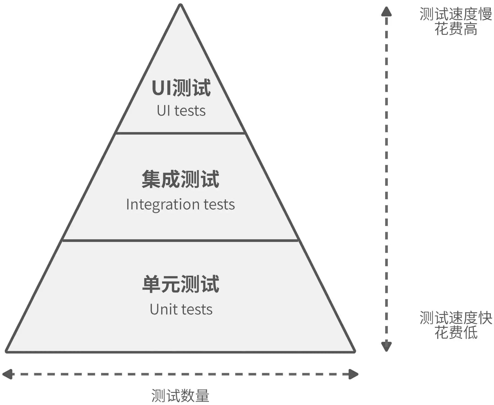

# 第13章开发大型项目

1991 年，在发布 Python 的第一个版本 0.9.0 时，Guido 肯定想不到，这门在当时看来有些怪异、依靠缩进来区分代码块的编程语言，会在之后一路高歌猛进，三十年后一跃成为全世界最

- 1

为流行的编程语言之一

- 。

但 Python 的流行并非偶然，简洁的语法、强大的标准库以及极低的上手成本，都是 Python赢得众人喜爱的重要原因。以我自己为例，我最初就是被 Python 的简洁语法所吸引，而后成为了一名忠实的 Python 爱好者。

但除了那些显而易见的优点外，我喜欢 Python 还有另一个原因：“自由感”。

对我而言，Python 的“自由感”体现在，我既可以用它来写一些快糙猛的小脚本，同时也能用它来做一些真正的“大项目”，解决一些更为复杂的问题。

在任何时候，当遇到某个小问题时，我都可以随手打开一个文本编辑器，马上开始编写Python 代码。代码写好后直接保存成 .py 文件，然后调用解释器执行，一杯茶的工夫就能解决问题。

而在面对更复杂的需求时，Python 仍然是一个不错的选择。在经历了多年发展后，如今的Python 有着成熟的打包机制、强大的工具链以及繁荣的第三方生态，无数企业乐于用 Python来开发重要项目。

在国外，许多大企业在或多或少地使用 Python，YouTube、Instagram 以及 Dropbox 的后台

- 2

代码几乎完全使用 Python 编写

- 。而在国内，豆瓣、搜狐邮箱、知乎等许多产品，也大量用

到了 Python。

但是，写个几百行代码的 Python 脚本是一码事，参与一个有数万行代码的项目，用它来服务成千上万的用户则完全是另一码事。当项目规模变大，参与人数变多后，许多在写小脚本时完全不用考虑的问题会跳出来：

- 缩进用 Tab 还是空格？如何让所有人的代码格式保持统一？

- 为什么每次发布新版本都心惊胆战？如何在代码上线前发现错误？

- 如何在快速开发新功能的同时，对代码做安全重构？

在本章中，我会围绕上面这些问题分享一些经验。

虽然 Python 有官方的 PEP 8 规范，但在实际项目里，区区纸面规范远远不够。在 13.1 节中，我会介绍一些常用的代码格式化工具，利用这些工具，你可以在大型项目里轻松统一代码风格，提升代码质量。

在开发大型项目时，自动化测试是必不可少的一环。它能让我们可以更容易发现代码里的问

```
题，更好地保证程序的正确性。在 13.2 节中，我会对常用的测试工具 pytest 做简单介绍，
```

同时分享一些实用的单元测试技巧。

希望本章内容能在你参与大型项目开发时提供一些帮助。

## 13.1　常用工具介绍

在很多事情上，百花齐放是件好事，但在开发大型项目时，百花齐放的代码风格却会毁灭整个项目。

试想一下，在合作开发项目时，如果每个人都坚持自己的一套代码风格，最后的项目代码肯定会破碎不堪、难以入目。因此，在多人参与的大型项目里，最基本的一件事就是让所有人的代码风格保持一致，整洁得就像是出自同一人之手。

下面介绍 4 个与代码风格有关的工具。如果能让所有开发者都使用这些工具，你就可以轻松统一项目的代码风格。


```
　如无特殊说明，本节提到的所有工具都可以通过 pip 直接安装。
```

### 13.1.1　flake8

在 1.1.4 节中，我提到 Python 有一份官方代码风格指南：PEP 8。PEP 8 对代码风格提出了许多具体要求，比如每行代码不能超过 79 个字符、运算符两侧一定要添加空格，等等。

但正如章首所说，在开发项目时，光有一套纸面上的规范是不够的。纸面规范只适合阅读，无

- 3

法用来快速检验真实代码是否符合规范。只有通过自动化代码检查工具（常被称为 Linter

- ）

才能最大地发挥 PEP 8 的作用。

```
flake8 就是这么一个工具。利用 flake8，你可以轻松检查代码是否遵循了 PEP 8 规范。
```

比如，下面这段代码：

```python
class Duck:
   """鸭子类
   :param color: 鸭子颜色
   """
   def __init__(self,color):
     self.color= color
虽然语法正确，但如果用 flake8 扫描它，会报出下面的错误：
flake8_demo.py:3:3: E111 indentation is not a multiple of four ➊
flake8_demo.py:8:3: E111 indentation is not a multiple of four
flake8_demo.py:8:20: E231 missing whitespace after ',' ➋
flake8_demo.py:9:15: E225 missing whitespace around operator ➌
```

- ❶ PEP 8 规定必须缩进必须使用 4 个空格，但上面的代码只用了 2 个

```
❷ PEP 8 规定逗号 , 后必须有空格，应改为 def init(self, color):
❸  PEP 8 规定操作符两边必须有空格，应改为 self.color = color
值得一提的是，flake8 的 PEP 8 检查功能，并非由 flake8 自己实现，而是主要由集成在
flake8 里的另一个 Linter 工具 pycodestyle 提供。
除了 PEP 8 检查工具 pycodestyle 以外，flake8 还集成了另一个重要的 Linter，它同时
也是 flake8 名字里单词“flake”的由来，这个 Linter 就是 pyflakes。同 pycodestyle 相
比，pyflakes 更专注于检查代码的正确性，比如语法错误、变量名未定义等。
```

以下面这个文件为例：

```python
import os
import re
def find_number(input_string):
       """找到字符串里的第一个整数"""
       matched_obj = re.search(r'\d+', input_sstring)
       if matched_obj:
           return int(matched_obj.group())
       return None
假如用 flake8 扫描它，会得到下面的结果：
flake8_error.py:1:1: F401 'os' imported but unused ➊
flake8_error.py:7:37: F821 undefined name 'input_sstring' ➋
❶ os 模块被导入了，但没有使用
❷ input_sstring 变量未被定义（名字里多了一个 s）
这两个错误就是由 pyflakes 扫描出来的。
flake8 为每类错误定义了不同的错误代码，比如 F401、E111 等。这些代码的首字母代表
了不同的错误来源，比如以 E 和 W 开头的都违反了 PEP 8 规范，以 F 开头的则来自于
pyflakes。
除了 PEP 8 与错误检查以外，flake8 还可以用来扫描代码的圈复杂度（见 7.3.1 小节），这
部分功能由集成在工具里的 mccabe 模块提供。当 flake8 发现某个函数的圈复杂度过高
```

时，会打印下面这种错误：

```
$ flake8 --max-complexity 8 flake8_error.py ➊
flake8_error.py:5:1: C901 'complex_func' is too complex (12)
❶ --max-complexity 参数可以修改允许的最大圈复杂度，建议该值不要超过 10
如之前所说，flake8 的主要检查能力是由它所集成的其他工具所提供的。而更有趣的是，
flake8 其实把这种集成工具的能力完全通过插件机制开放给了我们。这意味着，当我们想定
制自己的代码规范检查时，完全可以通过编写一个 flake8 插件来实现。
在 flake8 的官方文档中，你可以找到详细的插件开发教程。一个极为严格的流行代码规范
检查工具：wemake-python-styleguide，就是完全基于 flake8 的插件机制开发的。
```

扫描结果示例：wemake-python-styleguide 对代码的要求极为严格。安装它以后，如果再用 flake8 扫描之前的 find_number() 函数，你会发现许多新错误冒了出来，其中大部分和函数文档有关：

```
$ flake8 flake8_error.py
flake8_error.py:1:1: D100 Missing docstring in public module
flake8_error.py:1:1: F401 'os' imported but unused
flake8_error.py:6:1: D400 First line should end with a period
flake8_error.py:6:1: DAR101 Missing parameter(s) in Docstring: - input_string
flake8_error.py:6:1: DAR201 Missing "Returns" in Docstring: - return
flake8_error.py:7:37: F821 undefined name 'input_sstring'
```

```
由此可见，flake8 是一个非常全能的工具，它不光可以检查代码是否符合 PEP 8 规范，还
能帮你找出代码里的错误，揪出圈复杂度过高的函数。此外，flake8 还通过插件机制提供了
```

强大的定制能力，可谓 Python 代码检查领域的一把“瑞士军刀”，非常值得在项目中使用。

### 13.1.2　isort

```python
在编写模块时，我们会用 import 语句来导入其他依赖模块。假如依赖模块很多，这些
import 语句也会随之变多。此时如果缺少规范，这许许多多的 import 就会变得杂乱无
```

章，难以阅读。

为了解决这个问题，PEP 8 规范提出了一些建议。PEP 8 认为，一个源码文件内的所有

```python
import 语句，都应该依照以下规则分为三组：
(1) 导入 Python 标准库包的 import 语句；
(2) 导入相关联的第三方包的 import 语句；
(3) 与当前应用（或当前库）相关的 import 语句。
不同的 import 语句组之间应该用空格分开。
如果用上面的规则来组织代码，import 语句会变得更整齐、更有规律，阅读代码的人也能更
```

轻松地获知每个依赖模块的来源。

但问题是，虽然上面的分组规则很有用，但要遵守它，比你想的要麻烦许多。试想一下，在编

```
写代码时，每当你新增一个外部依赖，都得先扫一遍文件头部的所有 import 分组，找准新
```

依赖属于哪个分组，然后才能继续编码，整个过程非常烦琐。

```
幸运的是，isort 工具可以帮你简化这个过程。借助 isort，我们不用手动进行任何分组，
```

它会帮我们自动做好这些事。

```
举个例子，某个文件头部的 import 语句如下所示：
```

源码文件：isort_demo.py

```python
import os
import requests
import myweb.models ➊
from myweb.views import menu
from urllib import parse
import django
❶ 其中 myweb 是本地应用的模块名
执行 isort isort_demo.py 命令后，这些 import 语句都会被排列整齐：
import os ➊
from urllib import parse
import django ➋
import requests
import myweb.models ➌
from myweb.views import menu
```

- ❶ 第一部分：标准库包❷ 第二部分：第三方包❸ 第三部分：本地包

```
除了能自动分组以外，isort 还有许多其他功能。比如，某个 import 语句特别长，超出了
PEP 8 规范所规定的最大长度限制，isort 就会将它自动折行，免去了手动换行的麻烦。
总之，有了 isort 以后，你在调整 import 语句时可以变得随心所欲，只需负责一些简单的
编辑工作，isort 会帮你搞定剩下的所有事情——只要执行 isort，整段 import 代码就会
```

自动变得整齐且漂亮。

### 13.1.3　black

```
在 13.1.1 节中，我介绍了 Linter 工具：flake8。使用 flake8，我们可以检验代码是否遵循
```

PEP 8 规范，保持项目风格统一。

不过，虽然 PEP 8 规范为许多代码风格问题提供了标准答案，但这份答案其实非常宏观，在许多细节要求上并不严格。在许多场景中，同一段代码在符合 PEP 8 规范的前提下，可以写成好几种风格。

以下面的代码为例，同一个方法调用语句可以写成三种风格。

第一种风格：在不超过单行长度限制时，把所有方法参数写在同一行。

```
User.objects.create(name='piglei', gender='M', lang='Python', status='active')
```

第二种风格：在第二个参数时折行，并让后面的参数与之对齐。

```
User.objects.create(name='piglei',
                   gender='M',
                   language='Python',
                   status='active')
```

第三种风格：统一使用一层缩进，每个参数单独占用一行。

```
User.objects.create(
   name='piglei',
   gender='M',
   language='Python',
   status='active'
)
假如你用 flake8 来扫描上面这三段代码，会发现它们虽然风格迥异，但全都符合 PEP 8 规
```

范。

从各种角度来说，上面三种风格并没有绝对的优劣之分，一切都只与个人喜好有关。但问题是，不同人的喜好存在差异，而这种差异最终只会给项目带来不必要的沟通成本，影响开发效率。

举个例子，有一位开发人员是第二种编码风格的坚决拥护者。在审查代码时，他发现另一位开发者的所有函数调用代码都写成了第三种风格。这时，他俩可能会围绕这个问题展开讨论，互相争辩自己的风格才是最好的。到最后，代码审查里的大多数讨论变成了代码风格之争，消耗了大家的大部分精力。那些真正需要关注的代码问题，反而变得无人问津。

此外，通过手动编辑代码让其维持 PEP 8 风格，其实还有另一个问题。

假设你喜欢第一种编码风格：只要函数参数没超过长度限制，就坚决都放在一行里。某天你在开发新功能时，给函数调用增加了一些新参数，修改后发现新代码的长度超过了最大长度限制，于是手动对所有参数进行折行、对齐，整个过程即机械又麻烦。

```
因此，在多人参与的项目中，除了用 flake8 来扫描代码是否符合 PEP 8 规范外，我推荐一
个更为激进的代码格式化工具：black。
black 用起来很简单，只要执行 black  命令即可。
举个例子，上面三种风格的函数调用代码被 black 自动格式化后，都会统一变成下面这样：
User.objects.create(name="piglei", gender="M", language="Python", status="active"
❶ 因为代码没有超过单行长度限制，所以 black 不会进行任何换行，已有的换行也会被压
```

- 缩到同一行。与此同时，代码里字符串字面量两侧的单引号也全被替换成了双引号

```
当函数增加了新参数，超出单行长度限制以后，black 会根据情况自动将代码格式化成以下
```

两种风格：

```
# 1. 代码稍微长了一点儿，black 会尝试将所有参数单独换行
User.objects.create(
   name="piglei", gender="M", language="Python", status="active", points=100
)
# 2. 代码过长，black 会让每个参数各占一行
User.objects.create(
   name="piglei",
   gender="M",
   language="Python",
   status="active",
   points=100,
   location="Shenzhen",
)
作为一个代码格式化工具，black 最大的特点在于它的不可配置性。正如官方介绍所言，
black 是一个“毫不妥协的代码格式化工具”（The Uncompromising Code Formatter）。和许
多其他格式化工具相比，black 的配置项可以用“贫瘠”两个字来形容。除了单行长度以外，你
基本无法对 black 的行为做任何调整。
black 的少数几个配置项如表 13-1 所示。
```

表 13-1　black 配置项

配置项

- 说明

```
-l / --line-length
```

- 允许的最大单行宽度，默认为 88

```
-S / --skip-string-normalization
```

- 是否关闭调整字符串引号

```
总之，black 是个非常强势的代码格式化工具，基本没有任何可定制性。在某些人看来，这
```

种设计理念免去了配置上的许多麻烦，非常省心。而对于另一部分人来说，这种不支持任何个性化设置的设计，令他们完全无法接受。

```
从我个人的经验来看，虽然 black 格式化过的代码并非十全十美，肯定不能在所有细节上让
```

大家都满意，但它确实能让我们不用在各种编码风格间纠结，能有效解决许多问题。整体来

```
看，在大型项目中引入 black，利远大于弊。
```

### 13.1.4　pre-commit

前面我介绍了三个常用的代码检查与格式化工具。利用这些工具，你可以更好地统一项目内的代码风格，提升代码可读性。

但只是安装好工具，再偶尔手动执行那么一两次是远远不够的。要最大地发挥工具的能力，你必须让它们融入所有人的开发流程里。这意味着，对于项目的每位开发者来说，无论是谁改动

```
了代码，都必须保证新代码一定被 black 格式化过，并且能通过 flake8 的检查。
```

那么，究竟如何实现这一点呢？

一个最容易想到的方式是通过 IDE 入手。大部分 IDE 支持在保存源码文件的同时执行一些额

```
外程序，因此你可以调整 IDE 配置，让它在每次保存 .py 文件时，都自动用 black 格式化代
码，执行 flake8 扫描代码里的错误。
```

但这个方案有个致命的缺点：在多人参与的大型项目里，你根本无法让所有人使用同一种IDE。比如，有些人喜欢用 PyCharm 写代码，有些人则更习惯用 VS Code，还有些人常年只用 Vim 编程。

因此，要让工具融入每个人的开发流程，依靠 IDE 显然不现实。

不过，虽然我们没法统一每个人的 IDE，但至少大部分项目使用的版本控制软件是一样的——Git。而 Git 有个特殊的钩子功能，它允许你给每个仓库配置一些钩子程序（hook），之后每当

```
你进行特定的 Git 操作时——比如 git commit、git push，这些钩子程序就会执行。
```

```
pre-commit 就是一个基于钩子功能开发的工具。从名字就能看出来，pre-commit 是一个
```

专门用于预提交阶段的工具。要使用它，你需要先创建一个配置文件 .pre-commit-config.yaml。

```
举个例子，下面是一个我常用的 pre-commit 配置文件内容：
fail_fast: true
repos:
- repo: https://github.com/timothycrosley/isort
 rev: 5.7.0
 hooks:
 - id: isort
   additional_dependencies: [toml]
- repo: https://github.com/psf/black
 rev: 20.8b1
 hooks:
 - id: black
   args: [--config=./pyproject.toml]
- repo: https://github.com/pre-commit/pre-commit-hooks
 rev: v2.4.0
 hooks:
 - id: flake8
可以看到，在上面的配置文件里，我定义了 isort、black、flake8 三个插件。基于这份
配置，每当我修改完代码，执行 git commit 时，这些插件就会由 pre-commit 依次触发
```

执行：

```sql
$ git commit -m 'Update'
isort...................................Passed ➊
black...................................Passed
Flake8..................................Passed
[dev fac43421] Update
1 file changed, 1 insertion(+), 1 deletion(-)
```

```
❶ 依次执行配置在 pre-commit 里的插件，完成代码检查与格式化工作
假如某次改动后的代码无法通过 pre-commit 检查，这次提交流程就会中断。此时作者必须
```

修正代码使其符合规范，之后再尝试提交。

```
由于 pre-commit 的配置文件与项目源码存放在一起，都在代码仓库中，因此项目的所有开
发者天然共享 pre-commit 的插件配置，每个人不用单独维护各自的配置，只要安装 pre-
commit 工具就行。
使用 pre-commit，你可以让代码检查工具融入每位项目成员的开发流程里。所有代码改动
```

在被提交到 Git 仓库前，都会经工具的规范化处理，从而真正实现项目内代码风格的统一。

### 13.1.5　mypy

Python 是一门动态类型语言。大多数情况下，我们会把动态类型当成 Python 的一个优点，因为它让我们不必声明每个变量的类型，不用关心太多类型问题，只专注于用代码实现功能就好。

但现实情况是，我们写的程序里的许多 bug 和类型系统息息相关。比如，我在 10.1.1 节介绍类型注解时，写了短短几行示例代码，其实里面就藏着一个 bug：

```python
def create_random_ducks(number: int) -> List[Duck]:
   ducks: List[Duck] = []
   for _ in number: ➊
       ...
❶ 这一行有错误，因为整型 number 不能被迭代，range(number) 对象才行
```

为了在程序执行前就找出由类型导致的潜在 bug，提升代码正确性，人们为 Python 开发了不少静态类型检查工具，其中 mypy 最为流行。

举个例子，假如你用 mypy 检查上面的代码，它会直接报错：

```
> mypy type_hints.py
type_hints.py:_: error: "int" has no attribute "__iter__"; maybe "__str__", "__in
```

mypy 找这些类型错误又快又准，根本不用真正运行代码。

在大型项目中，类型注解与 mypy 的组合能大大提升项目代码的可读性与正确性。给代码写上类型注解后，函数参数与变量的类型会变得更明确，人们在阅读代码时更不容易感到困惑。再配合 mypy 做静态检查，可以轻松找出藏在代码里的许多类型问题。

mypy 让动态类型的 Python 拥有了部分静态类型语言才有的能力，值得在大型项目中推广使用。

- 虽然相比传统 Python 代码，编写带类型注解的代码总是更麻烦一些，需要进行额外的工作，但和类型注解所带来的诸多好处相比是完全值得的。

## 13.2　单元测试简介

在许多年以前，大型软件项目的发布周期都很长。软件的每个新版本都要经过漫长的需求设计、功能开发、测试验证等不同阶段，经常会花费数周乃至数月的时间。

但如今，事情发生了很多变化。由于敏捷开发与快速迭代理论的流行，人们现在开始想尽办法压缩发布周期、提升发布频率，态度近乎狂热。不少百万行代码量级的互联网项目，每天要构建数十个版本，每周发布数次。由于构建和发布几乎无时无刻都在进行，大家给这类实践起了一个贴切的名字：持续集成（CI）与持续交付（CD）。

在这种高频次的发布节奏下，如何保障软件质量成了一个难题。如果依靠人力来手动测试验证每个新版本，整体工作量会非常巨大，根本不现实，只有自动化测试才能担此重任。

根据关注点的不同，自动化测试可分为不同的类型，比如 UI 测试、集成测试、单元测试等。不同类型的测试，各自关注着不同的领域，覆盖了不一样的场景。比如，UI 测试是模拟一位真实用户真正使用软件，以此验证软件的行为是否与预期一致。而单元测试通过单独执行项目代码里的每个功能单元，来验证它们的行为是否正常。

在所有测试中，单元测试数量最多、测试成本最低，是整个自动化测试的基础和重中之重，如图 13-1 所示。



- 图 13-1　测试金字塔

也许你还没有意识到，作为一名程序员，编写单元测试其实是一项收益极高的工作，它不光能让你更容易发现代码里的问题，还能驱动你写出更具扩展性的好代码。

下面我们看看在 Python 中编写单元测试的几种方式。

### 13.2.1　unittest

```
在 Python 里编写单元测试，最正统的方式是使用 unittest 模块。unittest 是标准库里
```

的单元测试模块，使用方便，无须额外安装。

```
我们先通过一个简单的测试文件来感受一下 unittest 的功能：
```

文件：test_upper.py

```python
import unittest
class TestStringUpper(unittest.TestCase):
   def test_normal(self):
       self.assertEqual('foo'.upper(), 'FOO')
if __name__ == '__main__':
   unittest.main()
用 unittest 编写测试用例的第一步，是创建一个继承 unittest.TestCase 的子类，然
后编写许多以 test 开头的测试方法。在方法内部，通过调用一些以 assert 开头的方法来
```

进行测试断言，如下所示。

```
self.assertEqual(x, y)：断言 x 和 y 必须相等。
self.assertTrue(x)：断言 x 必须为布尔真。
self.assertGreaterEqual(x, y)：断言 x 必须大于等于 y。
在 unittest 包内，这样的 assert 方法超过 30 个。
```

如果一个测试方法内的所有测试断言都能通过，那么这个测试方法就会被标记为成功；而如果有任何一个断言无法通过，就会被标记为失败。

```
使用 python test_upper.py 来执行测试文件，会打印出测试用例的执行结果：
.
-------------------------------------------------------
Ran 1 test in 0.000s
OK
除了定义测试方法外，你还可以在 TestCase 类里定义一些特殊方法。比如，通过定义
setUp() 和 tearDown() 方法，你可以让程序在执行每个测试方法的前后，运行额外的代
```

码逻辑。

```
在看过一个简单的 unittest 测试文件后，不知道你有没有感觉到，虽然是 unittest 是标
```

准库里的模块，但它的许多设计有些奇怪。

```
比如，使用 unittest 创建一个测试用例，你必须写一个继承 TestCase 的子类，而不是简
单定义一个函数就行。又比如，TestCase 里的所有断言方法 self.assert，全都使用了
驼峰命名法——assertEqual，而非 PEP 8 所推荐的蛇形风格——assert_equal。
要搞清楚为什么 unittest 会采用这些奇怪设计，得从模块的历史出发。Python 的
unittest 模块在最初实现时，大量参考了 Java 语言的单元测试框架 JUnit。因此，它的许
```

多“奇怪”设计其实是“Java 化”的表现，比如只能用类来定义测试用例，又比如方法都采用驼峰命名法等。

```
但千万别误会，我并不是在说 unitest 的 API 设计很别扭，不要用它来写单元测试。恰恰相
反，我认为 unittest 是个功能非常全面的单元测试框架，当你不想引入任何复杂的东西，
只想用最简单实用的方式来编写单元测试时，unittest 是最佳选择，能很好地满足需求。
```

但在日常工作中，我其实更偏爱另一个在 API 设计上更接近 Python 语言习惯的单元测试框

```
架：pytest。接下来我们看看如何用 pytest 做单元测试。
```

### 13.2.2　pytest

```
pytest 是一个开源的第三方单元测试框架，第一个版本发布于 2009 年。同 unittest 比
起来，pytest 功能更多，设计更复杂，上手难度也更高。但 pytest 的最大优势在于，它
把 Python 的一些惯用写法与单元测试很好地融合了起来。因此，当你掌握了 pytest 以后，
用它写出的测试代码远比用 unittest 写的简洁。
为了更好地展示 pytest 的能力，下面我试着用它来写单元测试。
假设 Python 里的字符串没有提供 upper() 方法，我得自己编写一个函数，来实现将字符串
```

转换为大写的功能。

```
代码清单 13-1 就是我写的 string_upper() 函数。
```

- 代码清单 13-1　string_utils.py

```python
def string_upper(s: str) -> str:
   """将某个字符串里的所有英文字母由小写转换为大写"""
   chars = []
   for ch in s:
       # 32 是小写字母与大写字母在 ASCII 码表中的距离
       chars.append(chr(ord(ch) - 32))
   return ''.join(chars)
为了测试函数的功能，我用 pytest 写了一份单元测试：
```

文件：test_string_utils.py

```python
from string_utils import string_upper
def test_string_upper():
   assert string_upper('foo') == 'FOO'
相信你已经发现了，用 pytest 编写的单元测试代码与 unittest 有很大不同。
首先，TestCase 类消失了。使用 pytest 时，你不必用一个 TestCase 类来定义测试用
例，用一个以 test 开头的普通函数也行。
其次，当你要进行断言判断时，不需要调用任何特殊的 assert() 方法，只要写一条原生的
断言语句 assert  就好。
正因为这些简化，用 pytest 来编写测试用例变得非常容易。
用 pytest 执行上面的测试文件，会输出以下结果：
$ pytest test_string_utils.py
===================== test session starts =====================
platform darwin -- Python 3.8.1, pytest-6.2.2
rootdir: /python_craftman/
collected 1 item
test_string_utils.py .                                   [100%]
====================== 1 passed in 0.01s ======================
看上去一切顺利，string_upper() 函数可以通过测试。
```

但话说回来，就测试用例的覆盖率来说，我写的测试代码根本就不合格。因为我的用例只有输入字符全为小写的情况，并没有考虑到其他场景。比如，当输入字符串为空、输入字符串混合了大小写时，我们其实并不知道函数是否能返回正确结果。

为了让单元测试覆盖更多场景，最直接的办法是在 test_string_utils.py 里增加测试函数。

比如：

```python
from string_utils import string_upper
def test_string_upper():
   assert string_upper('foo') == 'FOO'
def test_string_empty(): ➊
   assert string_upper('') == ''
def test_string_mixed_cases():
   assert string_upper('foo BAR') == 'FOO BAR'
```

- ❶ 新增两个测试函数

```
虽然像上面这样增加函数很简单，但 pytest 其实为我们提供了更好的工具。
```

1. 用 parametrize 编写参数化测试在单元测试领域，有一种常用的编写测试代码的技术：表驱动测试（table-driven testing）。

- 当你要测试某个函数在接收到不同输入参数的行为时，最直接的做法是像上面那样，直接编写许多不同的测试用例。但这种做法其实并不好，因为它很容易催生出重复的测试代码。

- 表驱动测试是一种简化单元测试代码的技术。它鼓励你将不同测试用例间的差异点抽象出来，提炼成一张包含多份输入参数、期望结果的数据表，以此驱动测试执行。如果你要增加测试用例，直接往表里增加一份数据就行，不用写任何重复的测试代码。

```
在 pytest 中实践表驱动测试非常容易。pytest 为我们提供了一个强大的参数测试工
具：pytest.mark.parametrize。利用该装饰器，你可以方便地定义表驱动测试用例。
```

- 以测试文件 test_string_utils.py 为例，使用参数化工具，我可以把测试代码改造成代码清单13-2。

```python
代码清单 13-2　使用 parametrize 后的测试代码
import pytest
1
from string_utils import string_upper
2
3
@pytest.mark.parametrize(
4
   's,expected', ➊
5
   [
6
       ('foo', 'FOO'), ➋
7
       ('', ''),
8
       ('foo BAR', 'FOO BAR'),
9
   ],
10
)
11
def test_string_upper(s, expected): ➌
12
   assert string_upper(s) == expected ➍
13
```

- ❶ 用逗号分隔的参数名列表，也可以理解为数据表每一列字段的名称❷ 数据表的每行数据通过元组定义，元组成员与参数名一一对应

```
❸ 在测试函数的参数部分，按 parametrize 定义的字段名，增加对应参数
```

- ❹ 在测试函数内部，用参数替换静态测试数据

```
利用 parametrize 改造测试用例后，代码会变精简许多。接着，我们试着运行测试代
```

- 码：

```python
$ pytest test_string_utils.py
1
================= test session starts =================
2
platform darwin -- Python 3.8.1, pytest-6.2.2
3
rootdir: /python_craftman/
4
collected 1 item
5
6
test_string_utils.py ..F                          [100%]
7
8
======================= FAILURES =======================
9
__________ test_string_upper[foo BAR-FOO BAR] __________
10
11
s = 'foo BAR', expected = 'FOO BAR'
12
13
   @pytest.mark.parametrize(
14
       's,expected',
15
       [
16
           ('foo', 'FOO'),
17
           ('', ''),
18
           ('foo BAR', 'FOO BAR'),
19
       ],
20
   )
21
   def test_string_upper(s, expected):
22
>       assert string_upper(s) == expected
23
E       assert 'FOO\x00"!2' == 'FOO BAR'
24
E         - FOO BAR
25
E         + FOO"!2
26
27
test_string_utils.py:25: AssertionError
28
=============== short test summary info ================
29
FAILED test_string_utils.py::test_string_upper[foo BAR-FOO BAR]
30
============= 1 failed, 2 passed in 0.13s ==============
31
```

- 哐当！测试出错了。

```
可以看到，在处理字符串 'foo BAR' 时，string_upper() 并不能给出预期的结果，导
```

- 致测试失败。

```
接下来我们尝试修复这个问题。在 string_upper() 函数的循环内部，我可以增加一条
```

- 过滤逻辑：只有当字符是小写字母时，才将它转换成大写。代码如下所示：

```python
def string_upper(s: str) -> str:
1
   """将某个字符串里的所有英文字母由小写转换为大写"""
2
   chars = []
3
   for ch in s:
4
       if ch >= 'a' and ch <= 'z': ①
5
           # 32 是小写字母与大写字母在 ASCII 码表中的距离
6
           chars.append(chr(ord(ch) - 32))
7
       else:
8
           chars.append(ch)
9
   return ''.join(chars)
10
```

- ❶ 新增过滤逻辑，仅处理小写字母

- 再次执行单元测试：

```
================== test session starts ===================
1
2
platform darwin -- Python 3.8.1, pytest-6.2.2
3
rootdir: /python_craftman/
4
5
collected 3 items
6
7
test_string_utils.py ...                            [100%]
8
9
=================== 3 passed in 0.01s ====================
这次，修改后的 string_upper() 函数完美通过了所有的测试用例。
在本节中，我演示了如何使用 @pytest.mark.parametrize 定义参数化测试，避免编
写重复的测试代码。下面，我会介绍 pytest 的另一个重要功能：fixture（测试固定件）。
```

2. 使用 @pytest.fixture 创建 fixture 对象在编写单元测试时，我们常常需要重复用到一些东西。比如，当你测试一个图片操作模块时，可能需要在每个测试用例开始时，重复创建一张临时图片用于测试。

```
这类被许多单元测试依赖、需要重复使用的对象，常被称为 fixture。在 pytest 框架下，
你可以非常方便地用 @pytest.fixture 装饰器创建 fixture 对象。
```

- 举个例子，在为某模块编写测试代码时，我需要不断用到一个长度为 32 的随机 token 字符

```
串。为了简化测试代码，我可以创造一个名为 random_token 的 fixture，如代码清单 13-
```

- 3 所示。

- 代码清单 13-3　包含 fixture 的 conftest.py

```python
import pytest
1
import string
2
import random
3
4
@pytest.fixture
5
def random_token() -> str:
6
   """生成随机 token"""
7
   token_l = []
8
   char_pool = string.ascii_lowercase + string.digits
9
   for _ in range(32):
10
       token_l.append(random.choice(char_pool))
11
   return ''.join(token_l)
12
定义完 fixture 后，假如任何一个测试用例需要用到随机 token，不用执行 import，也不用
手动调用 random_token() 函数，只要简单调整测试函数的参数列表，增加
random_token 参数即可：
def test_foo(random_token):
1
   print(random_token)
2
之后每次执行 test_foo() 时，pytest 都会自动找到名为 random_token 的 fixutre 对
```

- 象，然后将 fixture 函数的执行结果注入测试方法中。

```
假如你在 fixture 函数中使用 yield 关键字，把它变成一个生成器函数，那么就能为 fixture
增加额外的清理逻辑。比如，下面的 db_connection 会在作为 fixture 使用时返回一个数
```

- 据库连接，并在测试结束需要销毁 fixture 前，关闭这个连接：

```python
@pytest.fixture
1
def db_connection():
2
   """创建并返回一个数据库连接"""
3
   conn = create_db_conn() ➊
4
   yield conn
5
   conn.close() ➋
6
❶ yield 前的代码在创建 fixture 前被调用
❷ yield 后的代码在销毁 fixture 前被调用
```

```
除了作为函数参数，被主动注入测试方法中以外，pytest 的 fixture 还有另一种触发方
```

- 式：自动执行。

```sql
通过在调用 @pytest.fixture 时传入 autouse=True 参数，你可以创建一个会自动执
行的 fixture。举个例子，下面的 prepare_data 就是一个会自动执行的 fixture：
@pytest.fixture(autouse=True)
1
def prepare_data():
2
   # 在测试开始前，创建两个用户
3
   User.objects.create(...)
4
   User.objects.create(...)
5
   yield
6
   # 在测试结束时，销毁所有用户
7
   User.objects.all().delete()
8
无论测试函数的参数列表里是否添加了 prepare_data，prepare_data fixture 里的数
```

- 据准备与销毁逻辑，都会在每个测试方法的开始与结束阶段自动执行。这类自动执行的fixture，非常适合用来做一些测试准备与事后清理工作。

```
除了 autouse 以外，fixture 还有一个非常重要的概念：作用域（scope）。
在 pyetst 执行测试时，每当测试用例第一次引用某个 fixture，pytest 就会执行 fixture
```

- 函数，将结果提供给测试用例使用，同时将其缓存起来。之后，根据 scope 的不同，这个被缓存的 fixture 结果会在不同的时机被销毁。而再次引用 fixture 会重新执行 fixture 函数获得新的结果，如此周而复始。

```
pytest 里的 fixture 可以使用五种作用域，它们的区别如下。
```

- (1) function（函数）：默认作用域，结果会在每个测试函数结束后销毁。

- (2) class（类）：结果会在执行完类里的所有测试方法后销毁。

- (3) module（模块）：结果会在执行完整个模块的所有测试后销毁。

- (4) package（包）：结果会在执行完整个包的所有测试后销毁。

```
(5) session（测试会话）：结果会在测试会话（也就是一次完整的 pytest 执行过程）结束
```

- 后销毁。

```python
举个例子，假如你把上面 random_token fixture 的 scope 改为 session：
@pytest.fixture(scope='session')
1
def random_token() -> str:
2
   ...
3
那么，无论你在测试代码里引用了多少次 random_token，在一次完整的 pytest 会话
```

- 里，所有地方拿到的随机 token 都是同一个值。

```
因为 random_token 的作用域是 session，所以当 random_token 第一次被测试代码
```

- 引用，创建出第一个随机值以后，这个值会被后续的所有测试用例复用。只有等到整个测试

```
会话结束，random_token 的结果才会被销毁。
总结一下，fixture 是 pytest 最为核心的功能之一。通过定义 fixture，你可以快速创建出
```

- 一些可复用的测试固定件，并在每个测试的开始和结束阶段自动执行特定的代码逻辑。

```
pytest 的功能非常强大，本节只对它做了最基本的介绍。如果你想在项目里使用
pytest，可以阅读它的官方文档，里面的内容非常详细。
```

## 13.3　有关单元测试的建议

虽然好像人人都认为单元测试很有用，但在实际工作中，有完善单元测试的项目仍然是个稀罕物。大家拒绝写测试的理由总是千奇百怪：“项目工期太紧，没时间写测试了，先这么用吧！”“这个模块太复杂了，根本没法写测试啊！”“我提交的这个模块太简单了，看上去就不可能有 bug，写单元测试干嘛？”

这些理由乍听上去都有道理，但其实都不对，它们代表了人们对单元测试的一些常见误解。

(1) “工期紧没时间写测试”：写单元测试看上去要多花费时间，但其实会在未来节约你的时间。

(2) “模块复杂没法写测试”：也许这正代表了你的代码设计有问题，需要调整。

(3) “模块简单不需要测试”：是否应该写单元测试，和模块简单或复杂没有任何关系。

在长期编写单元测试的过程中，我总结了几条相关建议，希望它们能帮你更好地理解单元测试。

### 13.3.1　写单元测试不是浪费时间

对于从来没写过单元测试的人来说，他们往往会这么想：“写测试太浪费时间了，会降低我的开发效率。”从直觉上来看，这个说法似乎有一定道理，因为编写测试代码确实要花费额外的时间，如果不写测试，这部分时间不就省出来了吗？

但真的是这样吗？不写测试真能节省时间？我们看看下面这个场景。

假设你在为某个博客项目开发一个新功能：支持在文章里插入图片。在花了一些时间写好功能代码后，由于这个项目没有任何单元测试，因此你在本地开发环境里简单测试了一下，确认功能正常后就提交了改动。一天后，这个功能上线了。

但令人意外的是，功能发布以后，虽然文章里能正常插入图片，但系统后台开始接到大量用户反馈：所有人都没法上传用户头像了。仔细一查才发现，由于你开发新功能时调整了图像模块的某个 API，而头像处理功能恰好使用了这个 API，因此新功能妨害了八竿子打不着的头像上传功能。

如果有单元测试，上面这种事根本就不会发生。当测试覆盖了项目的大部分功能以后，每当你对代码做出任何调整，只要执行一遍所有的单元测试，绝大多数问题会自动浮出水面，许多隐蔽的 bug 根本不可能被发布出去。

因此，虽然不写单元测试看上去节约了一丁点儿时间，但有问题的代码上线后，你会花费更多的时间去定位、去处理这个 bug。缺少单元测试的帮助，你需要耐心找到改动可能会影响到的每个模块，手动验证它们是否正常工作。所有这些事所花费的时间，足够你写好几十遍单元测试。

单元测试能节约时间的另一个场景，发生在项目需要重构时。

假设你要对某个模块做大规模的重构，那么，这个模块是否有单元测试，对应的重构难度天差地别。对于没有任何单元测试的模块来说，重构是地狱难度。在这种环境下，每当你调整任何代码，都必须仔细找到模块的每一个被引用处，小心翼翼地手动测试每一个场景。稍有不慎，重构就会引入新 bug，好心办坏事。

而在有着完善单元测试的模块里，重构是件轻松惬意的事情。在重构时，可以按照任何你想要的方式随意调整和优化旧代码。每次调整后，只要重新运行一遍测试用例，几秒钟之内就能得到完善和准确的反馈。

所以，写单元测试不是浪费时间，也不会降低开发效率。你在单元测试上花费的那点儿时间，会在未来的日子里为项目的所有参与者节约不计其数的时间。

### 13.3.2　不要总想着“补”测试

- 4

“先帮我 review 下刚提交的这个 PR

- ，功能已经全实现好了。单元测试我等会儿补上来！”

在工作中，我常常会听到上面这句话。情况通常是，某人开发了一个或复杂或简单的功能，他在本地开发调试时，主要依靠手动测试，并没有同步编写功能的单元测试。但项目对单元测试又有要求。因此，为了让改动尽早进入代码审查阶段，他决定先提交已实现的功能代码，晚点儿再补上单元测试。

在上面的场景里，单元测试被当成了一种验证正确性的事后工具，对开发功能代码没有任何影响，因此，人们总是可以在完成开发后补上测试。

但事实是，单元测试不光能验证程序的正确性，还能极大地帮助你改进代码设计。但这种帮助有一个前提，那就是你必须在编写代码的同时编写单元测试。当开发功能与编写测试同步进行时，你会来回切换自己的角色，分别作为代码的设计者和使用者，不断从代码里找出问题，调整设计。经过多次调整与打磨后，你的代码会变得更好、更具扩展性。

但是，当你已经开发完功能，准备“补”单元测试时，你的心态和所处环境已经完全不同了。假

```
如这时你在写单元测试时遇到一些障碍，就会想尽办法将其移除，比如引入大量 mock，或者
```

只测好测的，不好测的干脆不测。在这种心态下，你最不想干的事，就是调整代码设计，让它变得更容易测试。为什么？因为功能已经实现了，再改来改去又得重新测，多麻烦呀！所以，不论最后的测试代码有多么别扭，只要能运行就好。

测试代码并不比普通代码地位低，选择事后补测试，你其实白白丢掉了用测试驱动代码设计的机会。只有在编写代码时同步编写单元测试，才能更好地发挥单元测试的能力。

- 我应该使用 TDD 吗？TDD（test-driven development，测试驱动开发）是由 Kent Beck 提出的一种软件开发方式。在 TDD 工作流下，要对软件做一个改动，你不会直接修改代码，而会先写出这个改动所需要的测试用例。TDD 的工作流大致如下：(1) 写测试用例（哪怕测试用例引用的模块根本不存在）；(2) 执行测试用例，让其失败；(3) 编写最简单的代码（此时只关心实现功能，不关心代码整洁度）；(4) 执行测试用例，让测试通过；(5) 重构代码，删除重复内容，让代码变得更整洁；(6) 执行测试用例，验证重构；(7) 重复整个过程。在我看来，TDD 是一种行之有效的工作方式，它很好地发挥了单元测试驱动设计的能力，能帮助你写出更好的代码。但在实际工作中，我其实很少宣称自己在实践 TDD。因为在开发时，我基本不会严格遵循上面的 TDD 标准流程。比如，有时我会直接跳过 TDD 的前两个步骤，不写任何会失败的测试用例，直接就开始编写功能代码。

- 假如你从来没试过 TDD，建议了解一下它的基本概念，试着在项目中用 TDD 流程写几天代码。也许到最后，你会像我一样，虽然不会成为 TDD 的忠实信徒，但通过 TDD 的帮助找到了最适合自己的开发流程。

### 13.3.3　难测试的代码就是烂代码

在为代码编写单元测试时，我们常常会遇到一些特别棘手的情况。

举个例子，当模块依赖了一个全局对象时，写单元测试就会变得很难。全局对象的基本特征决定了它在内存中永远只会存在一份。而在编写单元测试时，为了验证代码在不同场景下的行为，我们需要用到多份不同的全局对象。这时，全局对象的唯一性就会成为写测试最大的阻碍。

```
再举一个例子，项目中有一个负责用户帖子的类 UserPostService，它的功能非常复杂，
初始化一个 UserPostService 对象，需要提供多达十几个依赖参数，比如用户对象、数据
```

库连接对象、某外部服务的 Client 对象、Redis 缓存池对象等。

```
这时你会发现，很难给 UserPostService 编写单元测试，因为写测试的第一个步骤就会难
倒你：创建不出一个有效的 UserPostService 对象。光是想办法搞定它所依赖的那些复杂
```

参数，都要花费大半天的时间。

所以我的结论很简单：难测试的代码就是烂代码。

在不写单元测试时，烂代码就已经是烂代码了，只是我们没有很好地意识到这一点。也许在代码审查阶段，某个经验丰富的同事会在审查评论里，友善而委婉地提到：“我感觉

```
UserPostService 类好像有点儿复杂？要不要考虑拆分一下？”但也许他也不能准确说出拆
```

分的深层理由。也许经过妥协后，这堆复杂的代码最终就这么上线了。

但有了单元测试后，情况就完全不同了。每当你写出难以测试的代码时，单元测试总会无差别地大声告诉你：“你写的代码太烂了！”不留半点情面。

因此，每当你发现很难为代码编写测试时，就应该意识到代码设计可能存在问题，需要努力调整设计，让代码变得更容易测试。也许你应该直接删掉全局对象，仅在它被用到的那几个地方

```
每次手动创建一个新对象。也许你应该把 UserPostService 类按照不同的抽象级别，拆分
```

为许多个不同的小类，把依赖 I/O 的功能和纯粹的数据处理完全隔离开来。

单元测试是评估代码质量的标尺。每当你写好一段代码，都能清楚地知道到底写得好还是坏，因为单元测试不会撒谎。

### 13.3.4　像应用代码一样对待测试代码

随着项目的不断发展，应用代码会越来越多，测试代码也会随之增长。在看过许许多多的应用代码与测试代码后，我发现，人们在对待这两类代码的态度上，常常有一些微妙的区别。

第一个区别，是对重复代码的容忍程度。举个例子，假如在应用代码里，你提交了 10 行非常相似的重复代码，那么这些代码几乎一定会在代码审查阶段，被其他同事作为烂代码指出来，最后它们非得抽象成函数不可。但在测试代码里，出现 10 行重复代码是件稀松平常的事情，人们甚至能容忍更长的重复代码段。

第二个区别，是对代码执行效率的重视程度。在编写应用代码时，我们非常关心代码的执行效率。假如某个核心 API 的耗时突然从 100 毫秒变成了 130 毫秒，会是个严重的问题，需要尽快解决。但是，假如有人在测试代码里偶然引入了一个效率低下的 fixture，导致整个测试的执行耗时突然增加了 30%，似乎也不是什么大事儿，极少会有人关心。

最后一个区别，是对“重构”的态度。在写应用代码时，我们会定期回顾一些质量糟糕的模块，在必要时做一些重构工作加以改善。但是，我们很少对测试代码做同样的事情——除非某个旧测试用例突然坏掉了，否则我们绝不去动它。

总体来说，在大部分人看来，测试代码更像是代码世界里的“二等公民”。人们很少关心测试代码的执行效率，也很少会想办法提升它的质量。

但这样其实是不对的。如果对测试代码缺少必要的重视，那么它就会慢慢“腐烂”。当它最终变得不堪入目，执行耗时以小时计时，人们就会从心理上开始排斥编写测试，也不愿意执行测试。

所以，我建议你像对待应用代码一样对待测试代码。

比如，你应该关心测试代码的质量，经常想着把如何把它写得更好。具体来说，你应该像学习项目 Web 开发框架一样，深入学习测试框架，而不只是每天重复使用测试框架最简单的功

```
能。只有在了解工具后，你才能写出更好的测试代码。拿之前的 pytest 例子来说，假如你
并不知道 @pytest.mark.parametrize 的存在，那就得重复写许多相似的测试用例代码。
```

测试代码的执行效率同样十分重要。只有当整个单元测试总能在足够短的时间内执行完时，大家才会更愿意频繁地执行测试。在开发项目时，所有人能更快、更频繁地从测试中获得反馈，写代码的节奏才会变得更好。

### 13.3.5　避免教条主义

说起来很奇怪，在单元测试领域有非常多的理论与说法。人们总是乐于发表各种对单元测试的见解，在文章、演讲以及与同事的交谈中，你常常能听到下面这些话：

- “只有 TDD 才是写单元测试的正确方式，其他都不行！”

- “TDD 已死，测试万岁！”

```
“单元测试应该纯粹，任何依赖都应该被 mock 掉！”
“mock 是一种垃圾技术，mock 越多，表示代码越烂！”
```

- “只有项目测试覆盖率达到 100%，才算是合格！”

- ……

这些观点各自都有许多狂热的追随者，但我有个建议：你应该了解这些理论，越多越好，但是千万不要陷入教条主义。因为在现实世界里，每个人参与的项目千差万别，别人的理论不一定适用于你，如果盲目遵从，反而会给自己增加麻烦。

- 5

拿是否应该隔离测试依赖来说，我参与过一个与 Kubernetes

- 有关的项目，项目里有一个核

心模块，其主要职责是按规则组装好 Kubernetes 资源，然后利用 Client 模块将这些资源提交到 Kubernetes 集群中。

要搭建一个完整的 Kubernetes 集群特别麻烦。因此，为了给这个模块编写单元测试，从理论上来说，我们需要实现一套假的 Kubernetes Client 对象（fake implementation）——它会提供一些接口，返回一些假数据，但并不会访问真正的 Kubernetes 集群。用假对象替换原本的

```
Client 后，我们就可以完全 mock 掉 Kubernetes 依赖。
```

但最后，项目其实并没有引入任何假 Client 对象。因为我们发现，如果使用 Docker，我们其实能在 3 秒钟之内快速启动一套全新的 Kubernetes apiserver 服务。而对于单元测试来说，一个 apiserver 服务足够完成所有的测试用例，根本不需要其他 Kubernetes 组件。

通过 Docker 来启动真正的依赖服务，我们不光节省了用来开发假对象的大量时间，并且在某种程度上，这样的测试方式其实更好，因为它会和真正的 apiserver 打交道，更接近项目运行的真实环境。

也许有人会说：“你这么搞不对啊！单元测试就是要隔离依赖服务，单独测试每个函数（方法）单元！你说的这个根本不是单元测试，而是集成测试！”

好吧，我承认这个指责听上去有一些道理。但首先，单元测试里的单元（unit）其实并不严格地指某个方法、函数，其实指的是软件模块的一个行为单元，或者说功能单元。其次，某个测试用例应该算作集成测试或单元测试，这真的重要吗？在我看来，所有的自动化测试只要能满足几条基本特征：快、用例间互相隔离、没有副作用，这样就够了。

单元测试领域的理论确实很多，这刚好说明了一件事，那就是要做好单元测试真的很难。要更好地实践单元测试，你要做的第一件事就是抛弃教条主义，脚踏实地，不断寻求最合适当前项目的测试方案，这样才能最大地享受单元测试的好处。

## 13.4　总结

在本章中，我分享了一些开发大型 Python 项目的建议。简而言之，无非是使用一些 Linter 工具、编写规范的单元测试罢了。

虽然我非常希望能告诉你：“用 Python 开发大项目，只要配置好 Linter，写上类型注解，然后再写点儿单元测试就够了！”但其实你我都知道，现实中的大型项目千奇百怪，许多项目的开发难度之高，远不是一些工具、几个测试就能搞定的。

要开发一个成功的大型项目（注意：这里的“成功”不是商业意义上的，而是工程意义上的），你不光需要 Linter 工具和单元测试，还需注重与团队成员间的沟通，积极推行代码审查，营造更好的合作氛围，等等。所有这些无一不需要大量的实践和长期的专注。作为作者的我能力有限，无法在一章或一本书内，把这些事情都讲清楚。

如果你正身处一个大型项目的开发团队中，抑或正准备启动一个大型项目，我希望你对本章提到的所有工具和理念不要停留于“知道就好”，而是做一些真正的落地和尝试。希望你最终发现：它们真的有用。

除了本章提到的这些内容以外，我还建议你继续学习一些敏捷编程、领域驱动设计、整洁架构方面的内容。从我的个人经历来看，这些知识对于大型项目开发有很好的启发作用。

无论如何，永远不要停止学习。

[1]：在 2021 年 7 月发布的 TIOBE 编程语言流行榜单上，Python 名列第三，仅次于 C 语言和 Java。[2]：此处的“几乎完全使用”特指这些项目的早期阶段。这是因为随着项目变得庞大，新服务不断诞生，旧的功能模块也会被持续拆分

- 和重写。在这个过程中，原本的 Python 代码会被其他编程语言部分替换。

[3]：Linter 指一类特殊的代码静态分析工具，专门用来找出代码里的格式问题、语法问题等，帮助提升代码质量。[4]：PR 是 Pull Request 的首字母缩写，它由开发者创建，里面包含对项目的代码修改。PR 在经过代码审查、讨论、调整的流程

- 后，会并入主分支。PR 是人们通过 GitHub 进行代码协作的主要工具。

[5]：Kubernetes 是目前一个相当流行的容器编排框架，由 Google 设计并捐赠给 CNCF。
