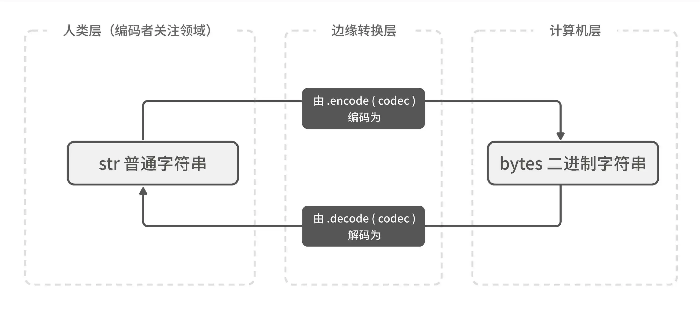

# 第2章数值与字符串

现代人的生活离不开各种数字。人的身高是数字，年龄是数字，银行卡里的余额也是数字。大家同样离不开的还有文字。网络上的文章、路边的指示牌，以及你正在阅读的这本书，都是由文字构成的。

我们离不开数字和文字，正如同编程语言离不开“数值”与“字符串”。两者几乎是所有编程语言里最基本的数据类型，也是我们通过代码连接现实世界的基础。

对于这两种基础类型，Python 展现了它一贯的简单易用的特点。拿整型（integer）来说，在Python 里使用整型，你不需要了解“有符号”“无符号”“32 位”“64 位”这些令人头疼的概念。不论多大的数字都能直接用，不必担心任何溢出问题：

```
# 无符号 64 位整型的最大值（unsigned int64）
>>> 2 ** 64 - 1
18446744073709551615
# 直接乘上 10000 也没问题，永不溢出！
>>> 18446744073709551615 * 10000
184467440737095516150000
```

- 1

和数字一样，Python 里的字符串（string）也很容易上手

- 。它直接兼容所有的 Unicode 字

符，处理起中文来非常方便：

```xml
>>> s = 'Hello, 中文'
>>> type(s)
<class 'str'>
# 打印中文
>>> print(s)
Hello, 中文
除了上面的字符串类型（str），有时我们还需要同字节串类型（bytes）打交道。在本章的
```

基础知识板块，我会简单介绍二者的区别，以及如何在它们之间做转换。

接下来，我们就从这两种最基础的数据类型开始，踏上探索 Python 对象世界的旅程吧！

## 2.1　基础知识

本节将介绍与数值和字符串有关的基础知识，内容涵盖浮点数的精度问题、字符串与字节串的区别，等等。

### 2.1.1　数值基础

```
在 Python 中，一共存在三种内置数值类型：整型（int）、浮点型（float）和复数类型
（complex）。创建这三类数值很简单，代码如下所示：
# 定义一个整型
>>> score = 100
# 定义一个浮点型
>>> temp = 37.2
# 定义一个复数
>>> com = 1+2j
在大多数情况下，我们只需要用到前两种类型：int 与 float。二者之间可以通过各自的内
```

置方法进行转换：

```
# 将浮点数转换为整型
>>> int(temp)
37
# 将整型转换为浮点型
>>> float(score)
100.0
在定义数值字面量时，如果数字特别长，可以通过插入 _ 分隔符来让它变得更易读：
# 以"千"为单位分隔数字
>>> i = 1_000_000
>>> i + 10
1000010
```

正如本章开篇所说，Python 里的数值类型十分让人省心，你大可随心所欲地使用，一般不会碰到什么奇怪的问题。不过，浮点数精度问题是个例外。

### 浮点数精度问题

```
如果你在 Python 命令行里输入 0.1 + 0.2，你会看到这样的“奇景”：
>>> 0.1 + 0.2
0.30000000000000004
```

一个简单的小数计算，为何会产生这么奇怪的结果？这其实是一个由浮点数精度导致的经典问题。

计算机是一个二进制的世界，它能表示的所有数字，都是通过 0 和 1 两个数模拟而来的（比如二进制的 110 代表十进制的 6）。这套模拟机制在表示整数时，尚能勉强应对，一旦我们需要小于 1 的浮点数时，计算机就做不到绝对的精准了。

但是，不提供浮点数肯定是不行的。为此，计算机只好“尽力而为”：取一个固定精度来近似表

- 2

```
。这个精度限制就是 0.1 + 0.2
```

示小数——Python 使用的是“双精度”（double precision）

```
的最终结果多出来 0.000…4 的原因。
为了解决这个问题，Python 提供了一个内置模块：decimal。假如你的程序需要精确的浮点
数计算，请考虑使用 decimal.Decimal 对象来替代普通浮点数，它在做四则运算时不会损
```

失任何精度：

```
>>> from decimal import Decimal
# 注意：这里的 '0.1' 和 '0.2' 必须是字符串
>>> Decimal('0.1') + Decimal('0.2')
Decimal('0.3')
在使用 Decimal 的过程中，大家需要注意：必须使用字符串来表示数字。如果你提供的是普
通浮点数而非字符串，在转换为 Decimal 对象前就会损失精度，掉进所谓的“浮点数陷阱”：
>>> Decimal(0.1)
Decimal('0.1000000000000000055511151231257827021181583404541015625')
```


- 如果你想了解更多浮点数相关的内容，可查看 Python 官方文档中的“15. FloatingPoint Arithmetic: Issues and Limitations”，其中的介绍非常详细。

### 2.1.2　布尔值其实也是数字

布尔（bool）类型是 Python 里用来表示“真假”的数据类型。你肯定知道它只有两个可选值：

```
True 和 False。不过，你可能不知道的是：布尔类型其实是整型的子类型，在绝大多数情
况下，True 和 False 这两个布尔值可以直接当作 1 和 0 来使用。
```

就像这样：

```
>>> int(True), int(False)
(1, 0)
>>> True + 1
2
# 把 False 当除数的效果和 0 一样
>>> 1 / False
Traceback (most recent call last):
 File "<stdin>", line 1, in <module>
ZeroDivisionError: division by zero
```

布尔值的这个特点，最常用来简化统计总数操作。

假设有一个包含整数的列表，我需要计算列表里一共有多少个偶数。正常来说，我得写一个循环加分支结构才能完成统计：

```
numbers = [1, 2, 4, 5, 7]
count = 0
for i in numbers:
   if i % 2 == 0:
       count += 1
print(count)
# 输出：2
```

但假如利用“布尔值可作为整型使用”的特性，一个简单的表达式就能完成同样的事情：

```
count = sum(i % 2 == 0 for i in numbers) ➊
❶ 此处的表达式 i % 2 == 0 会返回一个布尔值结果，该结果随后会被当成数字 0 或 1
由 sum() 函数累加求和
```

### 2.1.3　字符串常用操作

本节介绍一些与字符串有关的常用操作。

1. 把字符串当序列来操作字符串是一种序列类型，这意味着你可以对它进行遍历、切片等操作，就像访问一个列表对象一样：

```
>>> s = 'Hello, world!'
1
>>> for c in s: ➊
2
...     print(c)
3
...
4
H
5
...
6
d
7
!
8
>>> s[1:3] ➋
9
'el'
10
```

- ❶ 遍历一个字符串，将会逐个返回每个字符❷ 对字符串进行切片

```
假如你想反转一个字符串，可以使用切片操作或者 reversed 内置方法：
>>> s[::-1] ➊
1
'!dlrow ,olleH'
2
>>> ''.join(reversed(s)) ➋
3
'!dlrow ,olleH'
4
❶ 切片最后一个字段使用 -1，表示从后往前反序
❷ reversed 会返回一个可迭代对象，通过字符串的 .join 方法可以将它转换为字符
```

- 串

2. 字符串格式化3Python 语言有一个设计理念：“任何问题应有一种且最好只有一种显而易见的解决方法。”如果把这句话放到字符串格式化领域，似乎就有点儿难以自圆其说了。

- 在当前的主流 Python 版本中，至少有三种主要的字符串格式化方式。

```
(1) C 语言风格的基于百分号 % 的格式化语句：'Hello, %s' % 'World'。
(2) 新式字符串格式化（str.format）方式（Python 2.6 新增）："Hello,
{}".format ('World')。
(3) f-string 字符串字面量格式化表达式（Python 3.6 新增）：name = 'World';
f'Hello, '。
```

- 第一种字符串格式化方式历史最为悠久，但现在已经很少使用。相比之下，后两种方式正变

```
得越来越流行。从个人体验来说，f-string 格式化方式用起来最方便，是我的首选。和
其他两种方式比起来，使用 f-string 的代码多数情况下更简洁、更直观。
```

- 举个例子：

```
username, score = 'piglei', 100
1
# 1. C 语言风格格式化
2
print('Welcome %s, your score is %d' % (username, score))
3
# 2. str.format
4
print('Welcome {}, your score is {:d}'.format(username, score))
5
6
# 3. f-string，最短最直观
7
print(f'Welcome , your score is ')
8
# 输出：
9
# Welcome piglei, your score is 100
10
str.format 与 f-string 共享了同一种复杂的“字符串格式化微语言”。通过这种微语
```

- 言，我们可以方便地对字符串进行二次加工，然后输出。比如：

```
# 将 username 靠右对齐，左侧补空格到一共 20 个字符
1
# 以下两种方式将输出同样的内容
2
print('{:>20}'.format(username))
3
print(f'')
4
# 输出：
5
#               piglei
6
```

- 对于用户自定义类型来说，可以通过定义魔法方法，来修改对象被渲染成字符串的值。我在 12.2.1 节会介绍这部分内容。

```
虽然年轻的 f-string 抢走了 str.format 的大部分风头，但后者仍有着自己的独到之
处。比如 str.format 支持用位置参数来格式化字符串，实现对参数的重复使用：
print(': name= score='.format(username, score))
1
# 输出：
2
# piglei: name=piglei score=100
3
综上所述，日常编码中推荐优先使用 f-string，搭配 str.format 作为补充，想必能满
```

- 足大家绝大多数的字符串格式化需求。


- 查看 Python 官方文档中的“Format Specification Mini-Language”一节，了解字符串格式化微语言更多的相关信息。

3. 拼接多个字符串假如要拼接多个字符串，比较常见的 Python 式做法是：首先创建一个空列表，然后把需要

```
拼接的字符串都放进列表，最后调用 str.join 来获得大字符串。示例如下：
>>> words = ['Numbers(1-10):']
1
>>> for i in range(10):
2
...     words.append(f'Value: ')
3
...
4
>>> print('\n'.join(words))
5
Numbers(1-10):
6
Value: 1
7
...
8
Value: 10
9
除了使用 join，也可以直接用 words_str += f'Value: ' 这种方式来拼接字符串。
```

- 但也许有人告诫过你：“千万别这么干！这样操作字符串很慢很不专业！”这个说法也许曾经

```
正确，但现在看其实有些危言耸听。我在 2.3.5 节会向你证明：在拼接字符串时，+= 和
join 同样好用。
```

### 2.1.4　不常用但特别好用的字符串方法

为了方便，Python 为字符串类型实现了非常多内置方法。在对字符串执行某种操作前，请一定先查查某个内置方法是不是已经实现了该操作，否则一不留神就会重复发明轮子。

比如我以前就写过一个函数，它专门用正则表达式来判断某个字符串是否只包含数字。写完后

```
我才发现，这个功能其实根本不用自己实现，直接调用字符串的 s.isdigit() 方法就能完
```

成任务：

```
>>> '123'.isdigit(), 'foo'.isdigit()
(True, False)
日常编程中，我们最常用到的字符串方法有 .join()、.split()、.startswith()，等
```

等。虽然这些常用方法能满足大部分的字符串处理需求，但要成为真正的字符串高手，除了掌

```
握常用方法，了解一些不那么常用的方法也很重要。在这方面，.partition() 和
.translate() 方法就是两个很好的例子。
str.partition(sep) 的功能是按照分隔符 sep 切分字符串，返回一个包含三个成员的元
组：(part_before, sep, part_after)，它们分别代表分隔符前的内容、分隔符以及分
```

隔符后的内容。

```
第一眼看上去，partition 的功能和 split 的功能似乎是重复的——两个方法都是分割字
符串，只是结果稍有不同。但在某些场景下，使用 partition 可以写出比用 split 更优雅
```

的代码。

```python
举个例子，我有一个字符串 s，它的值可能会是以下两种格式。
(1)':'，键值对标准格式，此时我需要拿到 value 部分。
(2)''，只有 key，没有冒号 : 分隔符，此时我需要拿到空字符串 ''。
如果用 split 方法来实现需求，我需要写出下面这样的代码：
def extract_value(s):
   items = s.split(':')
   # 因为 s 不一定会包含 ':'，所以需要对结果长度进行判断
   if len(items) == 2:
       return items[1]
   else:
       return ''
```

执行效果如下：

```
>>> extract_value('name:piglei')
'piglei'
>>> extract_value('name')
''
这个函数的逻辑虽算不上复杂，但由于 split 的特点，函数内的分支判断基本无法避免。这
时，如果使用 partition 函数来替代 split，原本的分支判断逻辑就可以消失——一行代
```

码就能完成任务：

```python
def extract_value_v2(s):
   # 当 s 包含分隔符 : 时，元组最后一个成员刚好是 value
   # 若是没有分隔符，最后一个成员默认是空字符串 ''
   return s.partition(':')[-1]
除了 partition 方法，str.translate(table) 方法有时也非常有用。它可以按规则一
次性替换多个字符，使用它比调用多次 replace 方法更快也更简单：
>>> s = '明明是中文,却使用了英文标点.'
# 创建替换规则表：',' -> '，', '.' -> '。'
>>> table = s.maketrans(',.', '，。')
>>> s.translate(table)
'明明是中文，却使用了英文标点。'
```

除了上面这两个方法，在 2.3.4 节中，我们还会分享一个用较少露面的内置方法解决真实问题的例子。

### 2.1.5　字符串与字节串

按照受众的不同，广义上的“字符串”概念可分为两类。

(1) 字符串：我们最常挂在嘴边的“普通字符串”，有时也被称为文本（text），是给人看的，对

```
应 Python 中的字符串（str）类型。str 使用 Unicode 标准，可通过 .encode() 方法编码
```

为字节串。

(2) 字节串：有时也称“二进制字符串”（binary string），是给计算机看的，对应 Python 中的字

```
节串（bytes）类型。bytes 一定包含某种真正的字符串编码格式（默认为 UTF-8），可通过
.decode() 解码为字符串。
```

下面是简单的字符串操作示例：

```xml
>>> str_obj = 'Hello, 世界'
>>> type(str_obj)
<class 'str'>
>>> bin_str = str_obj.encode('UTF-8') ➊
>>> type(bin_str)
<class 'bytes'>
>>> bin_str
b'Hello, \xe4\xb8\x96\xe7\x95\x8c'
>>> str_obj.encode('UTF-8') == str_obj.encode() ➋
True
>>> str_obj.encode('gbk') ➌
b'Hello, \xca\xc0\xbd\xe7'
❶ 通过 .encode() 方法将字符串编码为字节串，此时使用的编码格式为 UTF-8
❷ 假如不指定任何编码格式，Python 也会使用默认值：UTF-8
❸ 也可以使用其他编码格式，比如另一种中文编码格式：gbk
要创建一个字节串字面量，可以在字符串前加一个字母 b 作为前缀：
>>> bin_obj = b'Hello'
>>> type(bin_obj)
<class 'bytes'>
>>> bin_obj.decode() ➊
'Hello'
❶ 字节串可通过调用 .decode() 解码为字符串
bytes 和 str 是两种数据类型，即便有时看上去“一样”，但做比较时永不相等：
>>> 'Hello' == b'Hello'
False
```

它们也不能混用：

```
>>> 'Hello'.split('e')
['H', 'llo']
# str 不能使用 bytes 来调用任何内置方法，反之亦然
>>> 'Hello'.split(b'e')
Traceback (most recent call last):
File "<stdin>", line 1, in <module>
TypeError: must be str or None, not bytes
```

### 最佳实践

正因为字符串面向的是人，而二进制的字节串面向的是计算机，因此，在使用体验方面，前者要好得多。在我们的程序中，应该尽量保证总是操作普通字符串，而非字节串。必须操作处理字节串的场景，一般来说只有两种：

(1) 程序从文件或其他外部存储读取字节串内容，将其解码为字符串，然后再在内部使用；

(2) 程序完成处理，要把字符串写入文件或其他外部存储，将其编码为字节串，然后继续执行其他操作。

举个例子，假如你写了一个简单的字符串函数：

```python
def upper_s(s):
   """把输入字符串里的所有“s”都转为大写"""
   return s.replace('s', 'S')
```

当接收的输入是字节串时，你需要先将其转换为普通字符串，再调用函数：

```
# 从外部系统拿到的字节串对象
>>> bin_obj
b'super sunflowers\xef\xbc\x88\xe5\x90\x91\xe6\x97\xa5\xe8\x91\xb5\xef\xbc\x89'
# 将其转换为字符串后，再继续执行后面的操作
>>> str_obj = bin_obj.decode('UTF-8') ➊
>>> str_obj
'super sunflowers（向日葵）'
>>> upper_s(str_obj)
'Super SunflowerS.（向日葵）'
❶ 此处的 UTF-8 也可能是 gbk 或其他任何一种编码格式，一切取决于输入字节串的实际
```

- 编码格式

反之，当你要把字符串写入文件（进入计算机的领域）时，请谨记：普通字符串采用的是文本格式，没法直接存放于外部存储，一定要将其编码为字节串——也就是“二进制字符串”——才行。

这个编码工作有时需要显式去做，有时则隐式发生在程序内部。比如在写入文件时，只要通过

```
encoding 参数指定字符串编码格式，Python 就会自动将写入的字符串编码为字节串：
# 通过 encoding 指定字符串编码格式为 UTF-8
with open('output.txt', 'w', encoding='UTF-8') as fp:
   str_obj = upper_s('super sunflowers（向日葵）')
   fp.write(str_obj)
   # 最后 output.txt 中存储的将是 UTF-8 编码的文本
```

- 删掉 open(...) 里的 encoding 参数

```
假如删掉上面 open(...) 调用里的 encoding 参数，将其改成 open('output.txt',
'w')，也就是不指定任何编码格式，你会发现代码也能正常运行。
这并不代表字符串编码过程消失了，只是变得更加隐蔽而已。如果不指定 encoding 参
```

- 数，Python 会尝试自动获取当前环境下偏好的编码格式。比如在 Linux 操作系统下，这个编码格式通常是 UTF-8。

```
# 如果不指定 encoding，Python 将通过 locale 模块获取系统偏好的编码格式
1
>>> import locale
2
>>> locale.getpreferredencoding()
3
'UTF-8'
4
```

一旦弄清楚“字符串”和“字节串”的区别，你会发现 Python 里的字符串处理其实很简单。关键在于：用一个“边缘转换层”把人类和计算机的世界隔开，如图 2-1 所示。



- 图 2-1　字符串类型转换图

有关数字与字符串的基础知识就先讲到这里。下面我们进入故事时间。

## 2.2　案例故事

在本章中，我准备了两个案例故事。

### 2.2.1　代码里的“密码”

又是一年求职季，小 R 成功入职了一家心仪已久的大公司，负责公司的核心系统开发。入职的第一天，小 R 从茶水间接了一杯咖啡，坐在电脑前打开 IDE，准备好好地熟悉一下项目代码。

但刚点开第一个文件，小 R 就愣住了，他端着咖啡的手悬在空中许久，似乎没想到自己的读代码计划这么快就卡壳了。此时，屏幕上展示的是这么一段代码：

```python
def add_daily_points(user):
   """用户每天完成第一次登录后，为其增加积分"""
   if user.type == 13:
       return
   if user.type == 3:
       user.points += 120
       return
   user.points += 100
   return
```

“这个函数是啥意思？”小 R 在心里问自己。“首先，从函数名和文档来看，它在给用户发送每

```
日积分，但它的内部逻辑呢？第一行的 user.type == 13 是什么，之后的 user.type
== 3 又是什么？其次，为啥有时增加 100 积分，有时增加 120 积分？”
```

这几行代码看似简单，没有用到任何魔法特性，但代码里的那些数字字面量（13、3、120、100）就像几个无法破解的密码一样，让读代码的小 R 脑子里一团糨糊。

1. “密码”的含义幸运的是，就在小 R 一筹莫展之际，公司的资深程序员小 Q 从他身边走过。小 R 赶紧叫住了小 Q，向他咨询这段积分代码。在后者的一番解释后，小 R 终于搞明白了那些“密码”的含义。

```
13：用户 type 是 13，代表用户处于被封禁状态，不能增加积分。
3：用户 type 为 3，代表用户充值了 VIP。
```

- 100：普通用户每天登录增加 100 积分。

- 120：VIP 用户在普通用户基础上，每天登录多得 20 积分。

- 弄明白这些数字的含义后，小 R 觉得自己必须把这段代码改写一遍。我们来帮他看看有哪些办法。

2. 改善代码的可读性要改善这段代码的可读性，最直接的做法就是给每一行有数字的代码加上注释。但在这种情况下，加注释显然不是首选。我们在第 1 章中讲过，注释应该用来描述那些代码所不能表

- 达的信息；而在这里，小 R 的首要问题是让代码变得可以“自说明”。

- 他需要用有意义的名称来代替这些数字字面量。

- 说到有意义的数字，大家最先想到的一般是“常量”（constant）。但 Python 里没有真正的常量类型，人们一般会把大写字母全局变量当“常量”来用。

- 比如把积分数量定义为常量：

```
# 用户每日奖励积分数量
1
DAILY_POINTS_REWARDS = 100
2
# VIP 用户每日额外奖励积分数量
3
VIP_EXTRA_POINTS = 20
4
除了常量以外，我们还可以使用枚举类型（enum.Enum）。
enum 是 Python 3.4 引入的专门用于表示枚举类型的内置模块。使用它，小 R 可以定义出
```

- 这样的枚举类型：

```python
from enum import Enum
1
2
# 在定义枚举类型时，如果同时继承一些基础类型，比如 int、str，
3
# 枚举类型就能同时充当该基础类型使用。比如在这里，UserType 就可以当作int 使用
4
class UserType(int, Enum):
5
   # VIP 用户
6
   VIP = 3
7
   # 小黑屋用户
8
   BANNED = 13
9
```

- 有了这些常量和枚举类型后，一开始那段满是“密码”的代码就可以重写成这样：

```python
def add_daily_points(user):
12
   """用户每天完成第一次登录后，为其增加积分"""
3
   if user.type == UserType.BANNED:
4
       return
5
   if user.type == UserType.VIP:
6
       user.points += DAILY_POINTS_REWARDS + VIP_EXTRA_POINTS
7
       return
8
   user.points += DAILY_POINTS_REWARDS
9
   return
```

- 把那些神奇的数字定义成常量和枚举类型后，代码的可读性得到了可观的提升。不仅如此，代码出现 bug 的概率其实也降低了。

```
试想一下，如果某位同事在编写分支判断时，把 13 错打成了 3 会怎么样？那样 VIP 用户
```

- 和小黑屋用户的权益就会对调，势必会引发一大批用户投诉。这种因为输入错误导致的 bug并不少见，而且隐蔽性特别强。

- 把数字字面量改成常量和枚举类型后，我们就能很好地规避输入错误问题。同样，把字符串字面量改写成枚举类型，也可以获得这种好处：

```
# 如果 'vip' 字符串打错了，不会有任何提示
1
# 正确写法：
2
# if user.type == 'vip':
3
# 错误写法：
4
if user.type == 'vlp':
5
6
# 正确写法：
7
# if user.type == UserType.VIP:
8
# 错误写法：
9
if user.type == UserType.VLP:
10
# 更健壮：如果 VIP 打错了，会报错 AttributeError: VLP
11
```

- 最后，总结一下用常量和枚举类型来代替字面量的好处。

- 更易读：所有人都不需要记忆某个数字代表什么。

- 更健壮：降低输错数字或字母产生 bug 的可能性。

### 2.2.2　别轻易成为 SQL 语句“大师”

一个月后，小 R 慢慢习惯了新工作。他学会了用常量和枚举类型替换那些难懂的字面量，逐步改善项目的代码质量。不过，在他所负责的项目里，还有一样东西一直让他觉得很难受

——数据库操作模块。

在这个大公司的核心项目里，所有的数据库操作代码，都是用下面这样的“裸字符串处理”逻辑拼接 SQL 语句而成的，比如一个根据条件查询用户列表的函数如下所示：

```sql
def fetch_users(
   conn,
   min_level=None,
   gender=None,
   has_membership=False,
   sort_field="created",
):
   """获取用户列表
   :param min_level: 要求的最低用户级别，默认为所有级别
   :type min_level: int, optional
   :param gender: 筛选用户性别，默认为所有性别
   :type gender: int, optional
   :param has_membership: 筛选会员或非会员用户，默认为 False，代表非会员
   :type has_membership: bool, optional
   :param sort_field: 排序字段，默认为 "created"，代表按用户创建日期排序
   :type sort_field: str, optional
   :return: 一个包含用户信息的列表：[(User ID, User Name), ...]
   """
   # 一种古老的 SQL 拼接技巧，使用“WHERE 1=1”来简化字符串拼接操作
   statement = "SELECT id, name FROM users WHERE 1=1"
   params = []
   if min_level is not None:
       statement += " AND level >= ?"
       params.append(min_level)
   if gender is not None:
       statement += " AND gender >= ?"
       params.append(gender)
   if has_membership:
       statement += " AND has_membership = true"
   else:
       statement += " AND has_membership = false"
   statement += " ORDER BY ?"
   params.append(sort_field)
   # 将查询参数 params 作为位置参数传递，避免 SQL 注入问题
   return list(conn.execute(statement, params))
```

这类代码历史悠久，最初写下它的人甚至早已不知所踪。不过，小 R 大约能猜到，代码的作者当年这么写的原因肯定是：“这种拼接字符串的方式简单直接、符合直觉。”

但令人遗憾的是，这样的代码只是看上去简单，实际上有一个非常大的问题：无法有效表达更复杂的业务逻辑。假如未来查询逻辑要增加一些复合条件、连表查询，人们很难在现有代码的基础上扩展，修改也容易出错。

我们来看看有什么办法能帮助小 R 优化这段代码。

1. 使用 SQLAlchemy 模块改写代码上述函数所做的事情，我习惯称之为“裸字符串处理”。这种处理一般只使用基本的加减乘除

```
和循环，配合 .split() 等内置方法来不断操作字符串，获得想要的结果。
```

- 它的优点显而易见：一开始业务逻辑比较简单，操作字符串代码符合思维习惯，写起来容易。但随着业务逻辑逐渐变得复杂，这类裸处理就会显得越来越力不从心。

- 其实，对于 SQL 语句这种结构化、有规则的特殊字符串，用对象化的方式构建和编辑才是更好的做法。

- 下面这段代码引入了 SQLAlchemy 模块，用更少的代码量完成了同样的功能：

```sql
def fetch_users_v2(
1
   conn,
2
   min_level=None,
3
   gender=None,
4
   has_membership=False,
5
   sort_field="created",
6
):
7
   """获取用户列表"""
8
   query = select([users.c.id, users.c.name])
9
   if min_level != None:
10
       query = query.where(users.c.level >= min_level)
11
   if gender != None:
12
       query = query.where(users.c.gender == gender)
13
   query = query.where(users.c.has_membership == has_membership).order_by(
14
       users.c[sort_field]
15
   )
16
return list(conn.execute(query))
17
新的 fetch_users_v2() 函数不光更短、更好维护，而且根本不需要担心 SQL 注入问
题。它最大的缺点在于引入了一个额外依赖：sqlalchemy，但同 sqlalchemy 带来的种
```

- 种好处相比，这点复杂度成本微不足道。

2. 使用 Jinja2 模板处理字符串除了 SQL 语句，我们日常接触最多的还是一些普通字符串拼接任务。比如，有一份电影评分数据列表，我需要把它渲染成一段文字并输出。

- 代码如下：

```python
def render_movies(username, movies):
1
   """
2
   以文本方式展示电影列表信息
3
   """
4
   welcome_text = 'Welcome, {}.\n'.format(username)
5
   text_parts = [welcome_text]
6
   for name, rating in movies:
7
       # 没有提供评分的电影，以 [NOT RATED] 代替
8
       rating_text = rating if rating else '[NOT RATED]'
9
       movie_item = '* {}, Rating: {}'.format(name, rating_text)
10
       text_parts.append(movie_item)
11
   return '\n'.join(text_parts)
12
13
14
movies = [
15
   ('The Shawshank Redemption', '9.3'),
16
   ('The Prestige', '8.5'),
17
   ('Mulan', None),
18
]
19
20
print(render_movies('piglei', movies))
21
```

- 运行上面的代码会输出：

```
Welcome, piglei.
1
2
* The Shawshank Redemption, Rating: 9.3
3
* The Prestige, Rating: 8.5
4
* Mulan, Rating: [NOT RATED]
5
```

- 或许你觉得，这样的字符串拼接代码没什么问题。但如果使用 Jinja2 模板引擎处理，代码可以变得更简单：

```python
from jinja2 import Template
1
2
_MOVIES_TMPL = '''\
3
Welcome, {}.
4

5
* {{ name }}, Rating: {{ rating|default("[NOT RATED]", True) }}
6

7
'''
8
9
10
def render_movies_j2(username, movies):
11
   tmpl = Template(_MOVIES_TMPL)
12
   return tmpl.render(username=username, movies=movies)
13
```

- 和之前的代码相比，新代码少了列表拼接、默认值处理，所有的逻辑都通过模板语言来表达。假如我们的渲染逻辑以后变得更复杂，第二份代码也能更好地随之进化。

- 总结一下，当你的代码里出现复杂的裸字符串处理逻辑时，请试着问自己一个问题：“目标 /源字符串是结构化的且遵循某种格式吗？”如果答案是肯定的，那么请先寻找是否有对应的开源专有模块，比如处理 SQL 语句的 SQLAlchemy、处理 XML 的 lxml 模块等。

- 如果你要拼接非结构化字符串，也请先考虑使用 Jinja2 等模板引擎，而不是手动拼接，因为用模板引擎处理字符串之后，代码写起来更高效，也更容易维护。

## 2.3　编程建议

### 2.3.1　不必预计算字面量表达式

在写代码的过程中，我们偶尔会用到一些比较复杂的数字，举个例子：

```python
def do_something(delta_seconds):
   # 如果时间已经过去11 天（或者更久），不做任何事
   if delta_seconds > 950400:
       return
   ...
```

我们在写这个函数时的“心路历程”大概是下面这样的。

首先，拿起办公桌上的小本子，在上面写上问题：11 天一共包含多少秒？经过一番计算后，得到结果：950 400。然后，我们把这个数字填进代码里，心满意足地在上面补上一行注释——告诉所有人这个数字是怎么来的。

```
这样的代码看似没有任何毛病，但我想问一个问题：为什么不直接把代码写成 if
delta_seconds < 11 * 24 * 3600: 呢？
```

我猜你给的答案一定是“性能”。

我们都知道，和 C、Go 这种编译型语言相比，Python 是一门执行效率欠佳的解释型语言。出

```
于性能考虑，我们预先算出算式的结果 950400 并写入代码，这样每次调用函数就不会有额
```

外的计算开销了，积水成渊嘛。

```
但事实是，即便我们把代码改写成 if delta_seconds < 11 * 24 * 3600:，函数也不
```

会多出任何额外开销。为了展示这一点，我们需要用到两个知识点：字节码与 dis 模块。

### 使用 dis 模块反编译字节码

虽然 Python 是一门解释型语言，但在解释器真正运行 Python 代码前，其实仍然有一个类似“编译”的加速过程：将代码编译为二进制的字节码。我们没法直接读取字节码，但利用内置的

- 4

```
dis 模块
```

- ，可以将它们反汇编成人类可读的内容——类似一行行的汇编代码。

先举一个简单的例子。比如，一个简单的加法函数的反汇编结果是这样的：

```
>>> def add(x, y):
...     return x + y
...
# 导入 dis 模块，使用它打印 add() 函数的字节码，也就是解释器如何理解 add() 函数
>>> import dis
>>> dis.dis(add)
 2           0 LOAD_FAST                     0 (x)
             2 LOAD_FAST                     1 (y)
             4 BINARY_ADD
             6 RETURN_VALUE
在上面的输出中，add() 函数的反汇编结果主要展示了下面几种操作。
(1) 两次 LOAD_FAST：分别把局部变量 x 和 y 的值放入栈顶。
(2) BINARY_ADD：从栈顶取出两个值（也就是 x 和 y 的值），执行加法操作，将结果放回栈
```

顶。

```
(3) RETURN_VALUE：返回栈顶的结果。
```

```
　如果想了解字节码相关的更多知识，建议阅读 dis 模块的官方文档：“dis —
```

- Disassembler for Python bytecode”。

```python
现在，我们再回头用 dis 模块看看 do_something 函数的字节码：
def do_something(delta_seconds):
   if delta_seconds < 11 * 24 * 3600:
       return
import dis
dis.dis(do_something)
# dis 执行结果
 5           0 LOAD_FAST                0 (delta_seconds)
             2 LOAD_CONST               1 (950400)
             4 COMPARE_OP               0 (<)
             6 POP_JUMP_IF_FALSE       12
 6           8 LOAD_CONST               0 (None)
            10 RETURN_VALUE
       >>   12 LOAD_CONST               0 (None)
            14 RETURN_VALUE
注意到 2 LOAD_CONST  1 (950400) 那一行了吗？这表示 Python 解释器在将源码编译成
字节码时，会主动计算 11 * 24 * 3600 表达式的结果，并用 950400 替换它。也就是
说，无论你调用 do_something 多少次，其中的算式 11 * 24 * 3600 都只会在编译期被
```

执行 1 次。

因此，当我们需要用到复杂计算的数字字面量时，请保留整个算式吧。这样做对性能没有任何影响，而且会让代码更容易阅读。

- 解释器除了会预计算数值表达式以外，还会对字符串、列表执行类似的操作——一切为了性能。

### 2.3.2　使用特殊数字：“无穷大”

如果有人问你：Python 里哪个数字最大 / 最小？你该怎么回答？存在这样的数字吗？

```
答案是“有的”，它们就是 float("inf") 和 float("-inf")。这两个值分别对应数学世界
里的正负无穷大。当它们和任意数值做比较时，满足这样的规律：float("-inf") < 任意
数值 < float("inf")。
```

正因为有着这样的特点，它们很适合“扮演”一些特殊的边界值，从而简化代码逻辑。

比如有一个包含用户名和年龄的字典，我需要把里面的用户名按照年龄升序排序，没有提供年

```python
龄的放在最后。使用 float('inf')，代码可以这么写：
def sort_users_inf(users):
   def key_func(username):
       age = users[username]
       # 当年龄为空时，返回正无穷大作为 key，因此就会被排到最后
       return age if age is not None else float('inf')
   return sorted(users.keys(), key=key_func)
users = {"tom": 19, "jenny": 13, "jack": None, "andrew": 43}
print(sort_users_inf(users))
# 输出：
# ['jenny', 'tom', 'andrew', 'jack']
```

### 2.3.3　改善超长字符串的可读性

为了保证可读性，单行代码的长度不宜太长。比如 PEP 8 规范就建议每行字符数不超过 79。在现实世界里，大部分人遵循的单行最大字符数通常会比 79 稍大一点儿，但一般不会超过119 个字符。

假如只考虑普通代码，满足这个长度要求并不算太难。但是，当代码里需要用到一段超长的、没有换行的字符串时，怎么办？

```
这时，除了用斜杠 \ 和加号 + 将长字符串拆分为几段，还有一种更简单的办法，那就是拿括
```

号将长字符串包起来，之后就可以随意折行了：

```python
s = ("This is the first line of a long string, "
    "this is the second line")
# 如果字符串出现在函数参数等位置，可以省略一层括号
def main():
   logger.info("There is something really bad happened during the process. "
               "Please contact your administrator.")
```

### 多级缩进里出现多行字符串

在往代码里插入字符串时，还有一种比较棘手的情况：在已经有缩进层级的代码里，插入多行字符串字面量。为了让字符串不要包含当前缩进里的空格，我们必须把代码写成这样：

```python
def main():
   if user.is_active:
       message = """Welcome, today's movie list:
- Jaw (1975)
- The Shining (1980)
- Saw (2004)"""
```

但是，这种写法会破坏整段代码的缩进视觉效果，显得非常突兀。有好几种办法可以改善这种情况，比如可以把这段多行字符串提取为外层全局变量。

```python
但假如你不想那么做，也可以用标准库 textwrap 来解决这个问题：
from textwrap import dedent
def main():
   if user.is_active:
       message = dedent("""\
           Welcome, today's movie list:
           - Jaw (1975)
           - The Shining (1980)
- Saw (2004)""")
dedent 方法会删除整段字符串左侧的空白缩进。使用它来处理多行字符串以后，整段代码的
```

缩进视觉效果就能保持正常了。

### 2.3.4　别忘了以 r 开头的字符串内置方法

当人们阅读文字时，通常是从左往右，这或许影响了我们处理字符串的顺序——也是从左往

```
右。Python 的绝大多数字符串方法遵循从左往右的执行顺序，比如最常用的 .split() 就
```

是：

```
>>> s = 'hello, string world!'
# 从左边开始切割字符串，限制 maxsplit=1 只切割一次
>>> s.split(' ', maxsplit=1)
['hello,', 'string world!']
```

但除了这些“正序”方法，字符串其实还有一些执行从右往左处理的“逆序”方法。这些方法都以

```
字符 r 开头，比如 rsplit() 就是 split() 的镜像“逆序”方法。在处理某些特定任务时，
```

使用“逆序”方法也许能事半功倍。

```
举个例子，假设我需要解析一些访问日志，日志格式为 '"" '：
>>> log_line = '"AppleWebKit/537.36 (KHTML, like Gecko) Chrome/70.0.3538.77 Safar
537.36" 47632'
如果使用 .split() 将日志拆分为 (user_agent, content_length)，我们需要这么
```

写：

```
>>> l = log_line.split()
# 因为 UserAgent 里面有空格，所以切完后得把它们再连接起来
>>> " ".join(l[:-1]), l[-1]
('"AppleWebKit/537.36 (KHTML, like Gecko) Chrome/70.0.3538.77 Safari/537.36"', '4
但假如利用 .rsplit()，处理逻辑就可以变得更直接：
# 从右往左切割，None 表示以所有的空白字符串切割
>>> log_line.rsplit(None, maxsplit=1)
['"AppleWebKit/537.36 (KHTML, like Gecko) Chrome/70.0.3538.77 Safari/537.36"', '4
```

### 2.3.5　不要害怕字符串拼接

很多年以前刚接触 Python 时，我在某个网站上看到这样一个说法：

- Python 里的字符串是不可变对象，因此每拼接一次字符串都会生成一个新对象，触发新的内存分配，效率非常低。

有段时间我对此深信不疑。

```
因此，一直以来，我在任何场合都避免使用 += 拼接字符串，总是用 "".join(str_list)
```

之类的方式来替代。

但有一次，在开发一个文本处理工具时，我偶然对字符串拼接操作做了一次性能测试，然后发现——“Python 的字符串拼接根本就不慢！”下面我简单重现一下当时的性能测试。

```
Python 有一个内置模块 timeit，利用它，我们可以非常方便地测试代码的执行效率。首
```

先，定义需要测试的两个函数：

```bash
# 定义一个长度为 100 的词汇列表
WORDS = ['Hello', 'string', 'performance', 'test'] * 25
def str_cat():
   """使用字符串拼接"""
   s = ''
   for word in WORDS:
       s += word
   return s
def str_join():
"""使用列表配合 join 产生字符串"""
   l = []
   for word in WORDS:
       l.append(word)
   return ''.join(l)
然后，导入 timeit 模块，定义性能测试：
import timeit
# 默认执行 100 万次
cat_spent = timeit.timeit(setup='from __main__ import str_cat', stmt='str_cat()')
print("cat_spent:", cat_spent)
join_spent = timeit.timeit(setup='from __main__ import str_join', stmt='str_join(
print("join_spent", join_spent)
```

在我的笔记本电脑上，上面的测试会输出以下结果：

```bash
cat_spent: 7.844882188
join_spent 7.310863505
发现了吗？基于字符串拼接的 str_cat() 函数只比 str_join() 慢 0.5 秒，按比例来说不
```

到 7%。所以，这两种字符串拼接方式在效率上根本没什么区别。

当时的我在做完性能测试后，又查阅了一些资料，最终才弄明白这是怎么一回事。

在 Python 2.2 及之前的版本里，字符串拼接操作确实很慢，这正是由“不可变对象”和“内存分配”导致的，跟我最早看到的说法一致。但重点是，由于字符串拼接操作实在太常用，2.2 版本之后的 Python 专门针对它做了性能优化，大大提升了其执行效率。

```
如今，使用 += 拼接字符串基本已经和 "".join(str_list) 一样快了。所以，该拼接时就
```

拼接吧，少量的字符串拼接根本不会带来任何性能问题，反而会让代码更直观。

## 2.4　总结

本章我们学习了在 Python 中使用数值与字符串的经验和技巧。

Python 中的数值非常让人省心，使用它的过程中只要注意不要掉入浮点数精度陷阱就行。而Python 中的字符串也特别好用，它具有大量内置方法，甚至一些不那么常用的字符串方法有时也能发挥奇效。

正因为字符串简单易用，有时也会被过度使用。比如在代码中直接拼接字符串生成 SQL 语句、组装复杂文本，等等。在这些场景下，使用专业模块和模板引擎才是更好的选择。

在看到一些写代码的“经验之谈”时，你最好抱着怀疑精神，因为 Python 语言进化得特别快，

```
稍不留神，以往的经验就会过时。如果需要验证某个“经验之谈”，dis 和 timeit 两个优秀的
```

工具可以帮到你：前者能让你直接查看编译后的字节码，后者则能让你方便地做性能测试。保持怀疑、多多实验，有助于你成长为更优秀的程序员。

以下是本章要点知识总结。

(1) 数值基础知识

```
Python 的浮点数有精度问题，请使用 Decimal 对象做精确的小数运算
```

- 布尔类型是整型的子类型，布尔值可以当作 0 和 1 来使用

```
使用 float('inf') 无穷大可以简化边界处理逻辑
```

(2) 字符串基础知识

```
字符串分为两类：str（给人阅读的文本类型）和 bytes（给计算机阅读的二进制类型）
通过 .encode() 与 .decode() 可以在两种字符串之间做转换
优先推荐的字符串格式化方式（从前往后）：f-string、str.format()、C 语言风格格
```

- 式化

```
使用以 r 开头的字符串内置方法可以从右往左处理字符串，特定场景下可以派上用场
```

- 字符串拼接并不慢，不要因为性能原因害怕使用它

(3) 代码可读性技巧

```
在定义数值字面量时，可以通过插入 _ 字符来提升可读性
```

- 不要出现“神奇”的字面量，使用常量或者枚举类型替换它们

- 保留数学算式表达式不会影响性能，并且可以提升可读性

```
使用 textwrap.dedent() 可以让多行字符串更好地融入代码
```

(4) 代码可维护性技巧

- 当操作 SQL 语句等结构化字符串时，使用专有模块比裸处理的代码更易于维护

- 使用 Jinja2 模板来替代字符串拼接操作

(5) 语言内部知识

```
使用 dis 模块可以查看 Python 字节码，帮助我们理解内部原理
使用 timeit 模块可以对 Python 代码方便地进行性能测试
```

- Python 语言进化得很快，不要轻易被旧版本的“经验”所左右

[1]：准确来说，是 Python 3 版本后的字符串容易上手。要处理好 Python 2 及之前版本中的字符串还是有些难度的。[2]：具体来说，是符合 IEEE-754 规范的双精度，它使用 53 个比特的精度来表达十进制浮点数。[3]：原文来自“Python 之禅”：There should be one-- and preferably only one --obvious way to do it。翻译来自维基百科。[4]：的全称是 disassembler for Python bytecode，翻译过来就是 Python 字节码的反汇编器。
